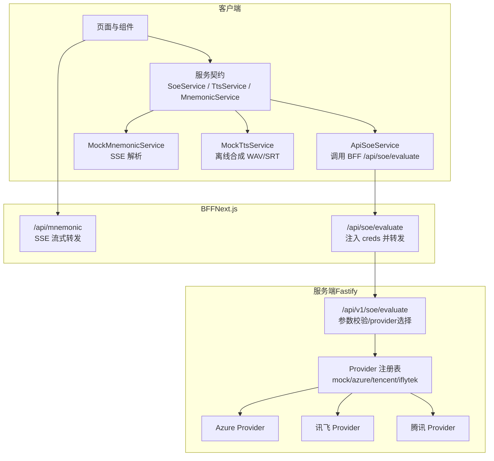
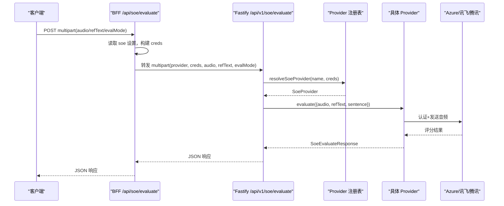
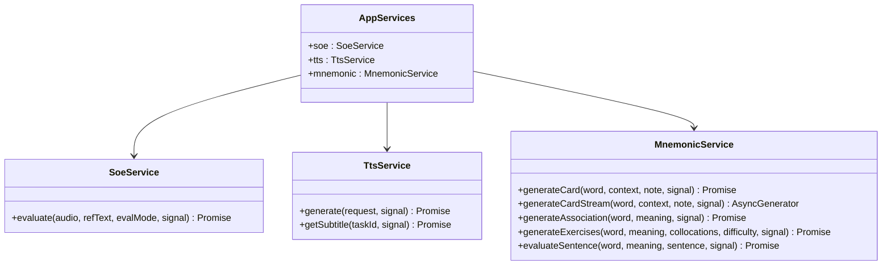
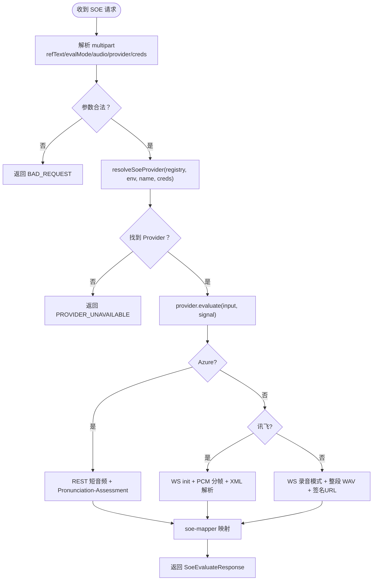
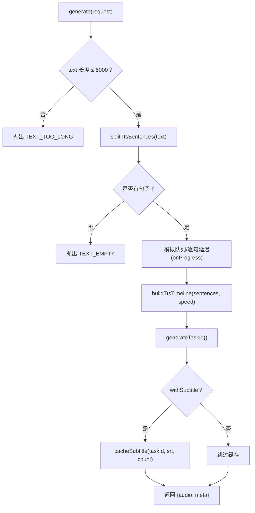
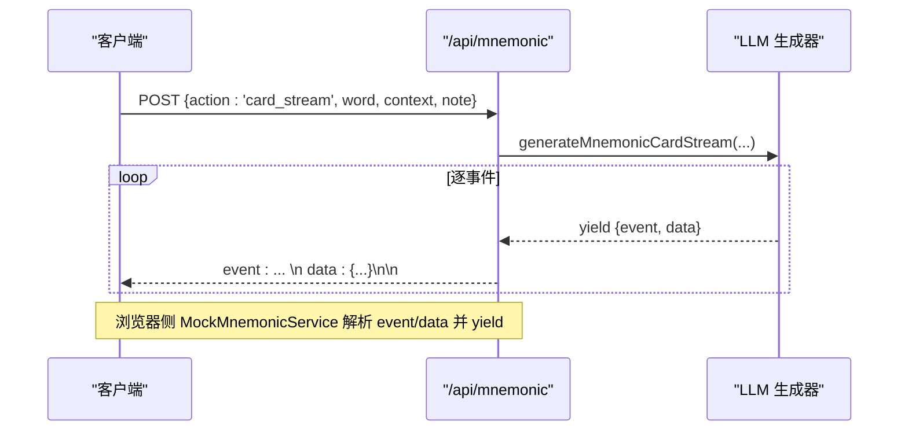
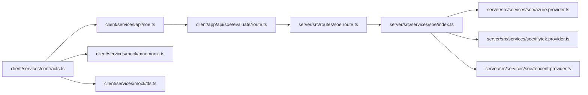

# AI 服务集成

<cite>
**本文引用的文件**   
- [client/services/contracts.ts](file://client/services/contracts.ts)
- [client/services/api/soe.ts](file://client/services/api/soe.ts)
- [client/app/api/soe/evaluate/route.ts](file://client/app/api/soe/evaluate/route.ts)
- [server/src/routes/soe.route.ts](file://server/src/routes/soe.route.ts)
- [server/src/services/soe/index.ts](file://server/src/services/soe/index.ts)
- [server/src/services/soe/soe-provider.ts](file://server/src/services/soe/soe-provider.ts)
- [server/src/services/soe/mock.provider.ts](file://server/src/services/soe/mock.provider.ts)
- [server/src/services/soe/azure.provider.ts](file://server/src/services/soe/azure.provider.ts)
- [server/src/services/soe/iflytek.provider.ts](file://server/src/services/soe/iflytek.provider.ts)
- [server/src/services/soe/tencent.provider.ts](file://server/src/services/soe/tencent.provider.ts)
- [server/src/services/soe/iflytek-auth.ts](file://server/src/services/soe/iflytek-auth.ts)
- [server/src/services/soe/tencent-ws-auth.ts](file://server/src/services/soe/tencent-ws-auth.ts)
- [server/src/services/soe/wav-pcm.ts](file://server/src/services/soe/wav-pcm.ts)
- [server/src/services/soe/iflytek-xml.ts](file://server/src/services/soe/iflytek-xml.ts)
- [server/src/services/soe/soe-mapper.ts](file://server/src/services/soe/soe-mapper.ts)
- [client/services/mock/mnemonic.ts](file://client/services/mock/mnemonic.ts)
- [client/app/api/mnemonic/route.ts](file://client/app/api/mnemonic/route.ts)
- [client/services/mock/tts.ts](file://client/services/mock/tts.ts)
</cite>

## 目录
1. [简介](#简介)
2. [项目结构](#项目结构)
3. [核心组件](#核心组件)
4. [架构总览](#架构总览)
5. [详细组件分析](#详细组件分析)
6. [依赖关系分析](#依赖关系分析)
7. [性能与可观测性](#性能与可观测性)
8. [配置指南](#配置指南)
9. [错误处理策略](#错误处理策略)
10. [测试方法](#测试方法)
11. [故障排查](#故障排查)
12. [结论](#结论)

## 简介
本技术文档围绕 AI 服务集成展开，聚焦以下目标：
- 服务契约模式：SOE（口语评测）、TTS（文本转语音）、Mnemonic（生词助记）的接口定义与实现切换。
- Mock 服务与真实服务的切换机制：前端 mock、后端 provider 注册表与请求级密钥覆盖。
- 后端 SOE 多厂商支持：Azure REST、讯飞 ISE WebSocket、腾讯 OEN WebSocket，涵盖认证、音频格式与结果映射。
- SSE 流式响应：用于实时传输 LLM 生成的助记分析报告。
- 配置、错误处理、性能优化与第三方接入规范。

## 项目结构
本项目采用前后端分离 + BFF（Backend for Frontend）中转的模式：
- 客户端 Next.js 应用提供页面、BFF API 路由与前端服务层（mock 与 api）。
- 服务端 Fastify 提供 SOE 评分路由与多厂商 provider 实现。
- 契约集中在 client/services/contracts.ts，统一抽象 SoeService、TtsService、MnemonicService。

图表来源
- [client/services/contracts.ts:92-143](file://client/services/contracts.ts#L92-L143)
- [client/services/api/soe.ts:9-29](file://client/services/api/soe.ts#L9-L29)
- [client/app/api/soe/evaluate/route.ts:18-67](file://client/app/api/soe/evaluate/route.ts#L18-L67)
- [server/src/routes/soe.route.ts:64-109](file://server/src/routes/soe.route.ts#L64-L109)
- [server/src/services/soe/index.ts:21-28](file://server/src/services/soe/index.ts#L21-L28)

章节来源
- [client/services/contracts.ts:1-144](file://client/services/contracts.ts#L1-L144)
- [client/services/api/soe.ts:1-30](file://client/services/api/soe.ts#L1-L30)
- [client/app/api/soe/evaluate/route.ts:1-68](file://client/app/api/soe/evaluate/route.ts#L1-L68)
- [server/src/routes/soe.route.ts:1-110](file://server/src/routes/soe.route.ts#L1-L110)
- [server/src/services/soe/index.ts:1-82](file://server/src/services/soe/index.ts#L1-L82)

## 核心组件
- 服务契约
  - SoeService：发音评分，输入 wav/pcm 16kHz mono，返回 total/accuracy/fluency/integrity/words。
  - TtsService：文本转语音，generate 返回音频 Blob 与元信息；getSubtitle 返回 SRT。
  - MnemonicService：LLM 生成助记卡片、联想、练习、造句批改；支持非流式与流式（AsyncGenerator）。
- 错误模型
  - ApiError：统一 code/message/detail；AbortSignal 中止统一为 'ABORTED'。
  - toApiError/throwIfAborted/abortableDelay：统一异常与可中止延迟。

章节来源
- [client/services/contracts.ts:33-87](file://client/services/contracts.ts#L33-L87)
- [client/services/contracts.ts:92-143](file://client/services/contracts.ts#L92-L143)

## 架构总览
SOE 评分端到端流程（客户端 → BFF → 服务端 → 上游厂商）：

图表来源
- [client/app/api/soe/evaluate/route.ts:18-67](file://client/app/api/soe/evaluate/route.ts#L18-L67)
- [server/src/routes/soe.route.ts:64-109](file://server/src/routes/soe.route.ts#L64-L109)
- [server/src/services/soe/index.ts:37-79](file://server/src/services/soe/index.ts#L37-L79)

## 详细组件分析

### 服务契约与实现切换
- 契约定义
  - SoeService.evaluate：接收 Blob 音频、参考原文、evalMode='sentence'，返回结构化评分。
  - TtsService.generate/getSubtitle：生成音频与字幕，带 taskId 与时长等元信息。
  - MnemonicService：包含 generateCard/generateCardStream/generateAssociation/generateExercises/evaluateSentence。
- 实现切换
  - 前端：services/api/soe.ts 调用 BFF；services/mock/* 提供离线模拟。
  - 后端：server/src/services/soe/index.ts 注册 mock/azure/tencent/iflytek，默认由 env.SOE_PROVIDER 决定；请求可携带 provider 与 creds 覆盖。

图表来源
- [client/services/contracts.ts:92-143](file://client/services/contracts.ts#L92-L143)

章节来源
- [client/services/contracts.ts:92-143](file://client/services/contracts.ts#L92-L143)
- [client/services/api/soe.ts:9-29](file://client/services/api/soe.ts#L9-L29)
- [server/src/services/soe/index.ts:21-28](file://server/src/services/soe/index.ts#L21-L28)

### SOE 后端多厂商支持与认证
- Provider 注册与选择
  - createSoeProviderRegistry：按凭据可用性注册 azure/tencent/iflytek，mock 恒在。
  - resolveSoeProvider：优先使用请求级 creds 合并 env，构造临时 provider；否则回退到注册表。
- 各厂商实现要点
  - Azure：REST 短音频接口，Pronunciation-Assessment base64 JSON 头，Dimension=Comprehensive，IPA 音素，重试网络错/408/429/5xx。
  - 讯飞：WS 流式 ISE，init 帧 + 裸 PCM 分帧（stripWavHeader），XML 结果累积后解析，鉴权 HMAC-SHA256。
  - 腾讯：WS OEN 录音模式，整段 WAV 单二进制帧 + end 标记，HMAC-SHA1+Base64 签名 URL。
- 音频格式与映射
  - wav-pcm.stripWavHeader：剥离 RIFF/WAVE 头，仅保留 PCM 载荷（讯飞 aue=raw）。
  - soe-mapper：将各厂商响应归一化为 SoeEvaluateResponse（分数取整、errorType 映射、phonemes 对齐）。

图表来源
- [server/src/routes/soe.route.ts:64-109](file://server/src/routes/soe.route.ts#L64-L109)
- [server/src/services/soe/index.ts:37-79](file://server/src/services/soe/index.ts#L37-L79)
- [server/src/services/soe/azure.provider.ts:24-109](file://server/src/services/soe/azure.provider.ts#L24-L109)
- [server/src/services/soe/iflytek.provider.ts:54-235](file://server/src/services/soe/iflytek.provider.ts#L54-L235)
- [server/src/services/soe/tencent.provider.ts:50-192](file://server/src/services/soe/tencent.provider.ts#L50-L192)
- [server/src/services/soe/wav-pcm.ts:11-23](file://server/src/services/soe/wav-pcm.ts#L11-L23)
- [server/src/services/soe/soe-mapper.ts:39-154](file://server/src/services/soe/soe-mapper.ts#L39-L154)

章节来源
- [server/src/services/soe/index.ts:1-82](file://server/src/services/soe/index.ts#L1-L82)
- [server/src/services/soe/soe-provider.ts:1-47](file://server/src/services/soe/soe-provider.ts#L1-L47)
- [server/src/services/soe/mock.provider.ts:1-83](file://server/src/services/soe/mock.provider.ts#L1-L83)
- [server/src/services/soe/azure.provider.ts:1-110](file://server/src/services/soe/azure.provider.ts#L1-L110)
- [server/src/services/soe/iflytek.provider.ts:1-236](file://server/src/services/soe/iflytek.provider.ts#L1-L236)
- [server/src/services/soe/tencent.provider.ts:1-193](file://server/src/services/soe/tencent.provider.ts#L1-L193)
- [server/src/services/soe/iflytek-auth.ts:1-35](file://server/src/services/soe/iflytek-auth.ts#L1-L35)
- [server/src/services/soe/tencent-ws-auth.ts:1-96](file://server/src/services/soe/tencent-ws-auth.ts#L1-L96)
- [server/src/services/soe/wav-pcm.ts:1-24](file://server/src/services/soe/wav-pcm.ts#L1-L24)
- [server/src/services/soe/iflytek-xml.ts:1-81](file://server/src/services/soe/iflytek-xml.ts#L1-L81)
- [server/src/services/soe/soe-mapper.ts:1-155](file://server/src/services/soe/soe-mapper.ts#L1-L155)

### TTS Mock 服务与字幕缓存
- MockTtsService.generate：文本切句、估算时长、生成时间轴、合成占位 WAV、生成 taskId 与 SRT 缓存。
- getSubtitle：从模块级 Map 中按 taskId 取 SRT，未命中抛 'SUBTITLE_NOT_FOUND'。
- 关键算法
  - splitTtsSentences：按 [.!?;:\n] 切分，标点归属前句。
  - estimateSentenceMs/buildTtsTimeline：按字符数估算时长，句间静音。
  - buildSrt/srtTime：生成标准 SRT 时间戳与块。

图表来源
- [client/services/mock/tts.ts:148-188](file://client/services/mock/tts.ts#L148-L188)
- [client/services/mock/tts.ts:58-110](file://client/services/mock/tts.ts#L58-L110)

章节来源
- [client/services/mock/tts.ts:1-190](file://client/services/mock/tts.ts#L1-L190)

### 生词助记 SSE 流式响应
- 客户端 MockMnemonicService.generateCardStream：
  - 调用 /api/mnemonic action='card_stream'，读取 ReadableStream，按行解析 event/data，yield MnemonicSseEvent。
- BFF /api/mnemonic：
  - 当 action='card_stream' 时，调用 generateMnemonicCardStream，将事件序列以 text/event-stream 推送。
  - 超时控制、错误事件封装、finally 关闭控制器。

图表来源
- [client/services/mock/mnemonic.ts:50-102](file://client/services/mock/mnemonic.ts#L50-L102)
- [client/app/api/mnemonic/route.ts:148-179](file://client/app/api/mnemonic/route.ts#L148-L179)

章节来源
- [client/services/mock/mnemonic.ts:1-125](file://client/services/mock/mnemonic.ts#L1-L125)
- [client/app/api/mnemonic/route.ts:1-272](file://client/app/api/mnemonic/route.ts#L1-L272)

## 依赖关系分析
- 前端契约与服务实现解耦：通过 contracts.ts 定义接口，mock 与 api 分别实现，便于替换。
- BFF 作为安全边界：不暴露上游密钥，仅转发 multipart 并注入 creds。
- 后端 Provider 注册表：按凭据动态注册，支持请求级 creds 覆盖，降低耦合。

图表来源
- [client/services/contracts.ts:92-143](file://client/services/contracts.ts#L92-L143)
- [client/services/api/soe.ts:9-29](file://client/services/api/soe.ts#L9-L29)
- [client/app/api/soe/evaluate/route.ts:18-67](file://client/app/api/soe/evaluate/route.ts#L18-L67)
- [server/src/routes/soe.route.ts:64-109](file://server/src/routes/soe.route.ts#L64-L109)
- [server/src/services/soe/index.ts:21-28](file://server/src/services/soe/index.ts#L21-L28)

章节来源
- [client/services/contracts.ts:1-144](file://client/services/contracts.ts#L1-L144)
- [client/services/api/soe.ts:1-30](file://client/services/api/soe.ts#L1-L30)
- [client/app/api/soe/evaluate/route.ts:1-68](file://client/app/api/soe/evaluate/route.ts#L1-L68)
- [server/src/routes/soe.route.ts:1-110](file://server/src/routes/soe.route.ts#L1-L110)
- [server/src/services/soe/index.ts:1-82](file://server/src/services/soe/index.ts#L1-L82)

## 性能与可观测性
- 超时与重试
  - SOE：统一 SOE_TIMEOUT_MS 超时，SOE_RETRY 次重试（仅网络错/408/429/5xx）。
  - 讯飞/腾讯 WS：每次重试重建会话，避免状态污染。
- 音频处理
  - 批量分帧（讯飞 1280B）减少阻塞；腾讯整段上传减少握手开销。
- 可观测性
  - 日志：SOE 请求记录 provider、字节数、refText 前缀。
  - 指标头：/api/mnemonic 返回 X-Mnemonic-* 系列耗时与内容长度。

章节来源
- [server/src/services/soe/azure.provider.ts:40-51](file://server/src/services/soe/azure.provider.ts#L40-L51)
- [server/src/services/soe/iflytek.provider.ts:54-69](file://server/src/services/soe/iflytek.provider.ts#L54-L69)
- [server/src/services/soe/tencent.provider.ts:59-72](file://server/src/services/soe/tencent.provider.ts#L59-L72)
- [server/src/routes/soe.route.ts:104-106](file://server/src/routes/soe.route.ts#L104-L106)
- [client/app/api/mnemonic/route.ts:219-229](file://client/app/api/mnemonic/route.ts#L219-L229)

## 配置指南
- SOE 提供商与环境变量
  - 环境变量：AZURE_SPEECH_KEY/AZURE_SPEECH_REGION/AZURE_SPEECH_HOST、IFLYTEK_APP_ID/IFLYTEK_API_KEY/IFLYTEK_API_SECRET、TENCENT_APP_ID/TENCENT_SECRET_ID/TENCENT_SECRET_KEY。
  - 运行时选择：env.SOE_PROVIDER 指定默认 provider；请求字段 provider 可覆盖。
- 请求级密钥
  - multipart creds 字段（JSON）：{azure:{key,region,host}, tencent:{appId,secretId,secretKey}, iflytek:{appId,apiKey,apiSecret}}。
  - 优先级：请求级 creds 覆盖 env；若合并后仍不齐，则回退注册表（可能 503）。
- BFF 注入
  - /api/soe/evaluate 从 settings.json 读取 soe 配置，提取所选 provider 的密钥并以 creds 字段注入。

章节来源
- [server/src/services/soe/index.ts:21-79](file://server/src/services/soe/index.ts#L21-L79)
- [server/src/routes/soe.route.ts:24-62](file://server/src/routes/soe.route.ts#L24-L62)
- [client/app/api/soe/evaluate/route.ts:10-16](file://client/app/api/soe/evaluate/route.ts#L10-L16)

## 错误处理策略
- 统一错误模型
  - ApiError(code, message, detail)：ABORTED、INTERNAL、TEXT_TOO_LONG、SUBTITLE_NOT_FOUND、SOE_UPSTREAM_ERROR、PROVIDER_UNAVAILABLE 等。
- 上游错误分类
  - Azure：无语音（NoMatch/InitialSilenceTimeout/BabbleTimeout）→ SOE_NO_SPEECH；认证失败 401/403；限流 429；音频格式 400。
  - 讯飞：鉴权族错误码附加提示；WS 握手失败/连接提前关闭。
  - 腾讯：错误码族 4000~5002，区分鉴权失败、并发超限、无人声等。
- 客户端错误转换
  - ApiSoeService 将 fetch 异常与 HTTP 非 200 转换为 ApiError，保持 ABORTED 语义供 read-aloud 静默分支。

章节来源
- [client/services/contracts.ts:33-87](file://client/services/contracts.ts#L33-L87)
- [client/services/api/soe.ts:16-28](file://client/services/api/soe.ts#L16-L28)
- [server/src/services/soe/azure.provider.ts:78-100](file://server/src/services/soe/azure.provider.ts#L78-L100)
- [server/src/services/soe/iflytek.provider.ts:125-171](file://server/src/services/soe/iflytek.provider.ts#L125-L171)
- [server/src/services/soe/tencent.provider.ts:125-182](file://server/src/services/soe/tencent.provider.ts#L125-L182)

## 测试方法
- 单元测试
  - 契约与工具函数：ApiError/toApiError/throwIfAborted/abortableDelay。
  - TTS Mock：splitTtsSentences/estimateSentenceMs/buildTtsTimeline/buildSrt/srtTime。
  - SOE Mock：FNV-1a 哈希、WAV 时长估算、tokenize/mockPhonemes。
  - 鉴权与解析：iflytek-auth/tencent-ws-auth/iflytek-xml/wav-pcm。
- 集成测试
  - SOE 路由：参数校验、provider 选择、creds 解析、错误码映射。
  - 助记 SSE：/api/mnemonic card_stream 事件流解析与错误事件。

章节来源
- [client/services/contracts.ts:33-87](file://client/services/contracts.ts#L33-L87)
- [client/services/mock/tts.ts:58-110](file://client/services/mock/tts.ts#L58-L110)
- [server/src/services/soe/mock.provider.ts:9-78](file://server/src/services/soe/mock.provider.ts#L9-L78)
- [server/src/services/soe/iflytek-auth.ts:27-34](file://server/src/services/soe/iflytek-auth.ts#L27-L34)
- [server/src/services/soe/tencent-ws-auth.ts:57-95](file://server/src/services/soe/tencent-ws-auth.ts#L57-L95)
- [server/src/services/soe/iflytek-xml.ts:51-80](file://server/src/services/soe/iflytek-xml.ts#L51-L80)
- [server/src/routes/soe.route.ts:64-109](file://server/src/routes/soe.route.ts#L64-L109)
- [client/app/api/mnemonic/route.ts:148-179](file://client/app/api/mnemonic/route.ts#L148-L179)

## 故障排查
- 常见问题
  - 上游不可达或超时：检查 SOE_TIMEOUT_MS、网络连通性与上游限流（429）。
  - 认证失败：Azure 401/403；讯飞鉴权族错误码；腾讯 4002。
  - 音频格式不符：Azure 400（非 RIFF/WAVE 或非 16k mono PCM）；腾讯整段上限约 60s。
  - 未检测到语音：Azure NoMatch/InitialSilenceTimeout/BabbleTimeout；腾讯 4105；讯飞 is_rejected。
- 定位建议
  - 查看日志：SOE 请求日志含 provider、bytes、refText 前缀。
  - 检查 BFF 转发：确认 /api/soe/evaluate 是否成功注入 creds。
  - 回放 SSE：/api/mnemonic card_stream 的 event/data 是否正确输出。

章节来源
- [server/src/services/soe/azure.provider.ts:78-100](file://server/src/services/soe/azure.provider.ts#L78-L100)
- [server/src/services/soe/iflytek.provider.ts:125-171](file://server/src/services/soe/iflytek.provider.ts#L125-L171)
- [server/src/services/soe/tencent.provider.ts:125-182](file://server/src/services/soe/tencent.provider.ts#L125-L182)
- [server/src/routes/soe.route.ts:104-106](file://server/src/routes/soe.route.ts#L104-L106)
- [client/app/api/mnemonic/route.ts:148-179](file://client/app/api/mnemonic/route.ts#L148-L179)

## 结论
本方案通过服务契约抽象与 Provider 注册表实现了 SOE/TTS/Mnemonic 的可插拔集成：
- 前端契约稳定，mock 与真实实现可无缝切换。
- 后端支持 Azure/讯飞/腾讯三家，具备完善的认证、音频格式处理与结果映射。
- SSE 流式响应为 LLM 助记报告提供实时体验。
- 统一的错误模型与可观测性帮助快速定位问题，提升系统稳定性与可维护性。