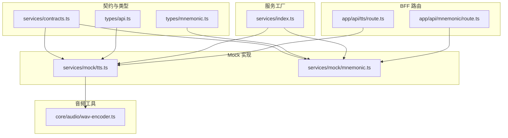
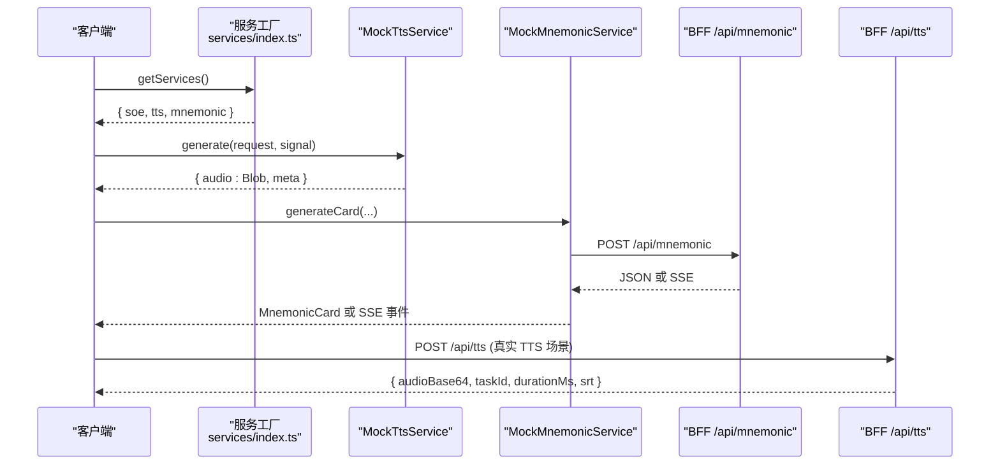
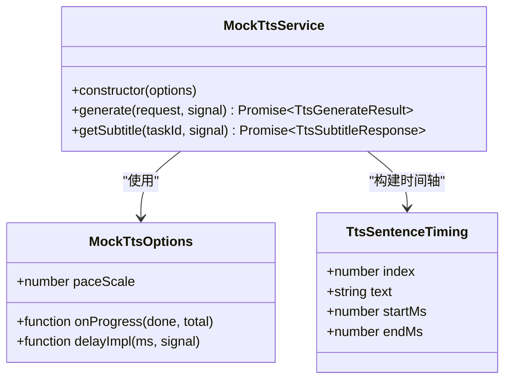
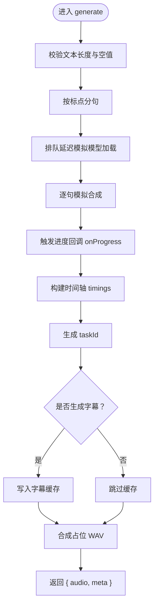
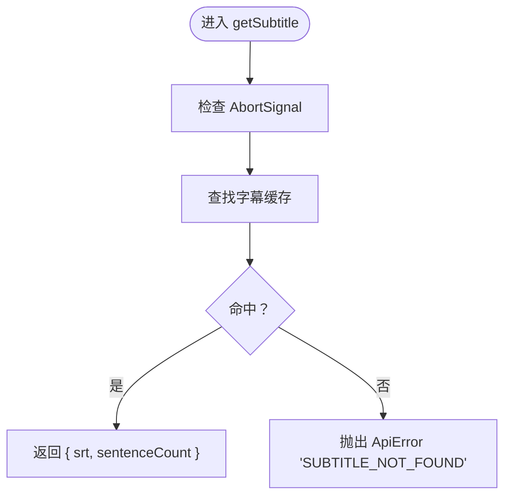
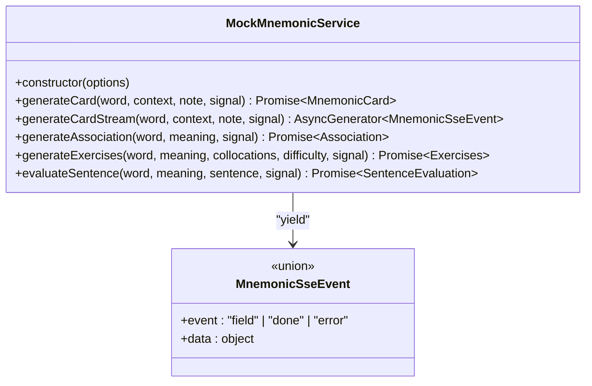
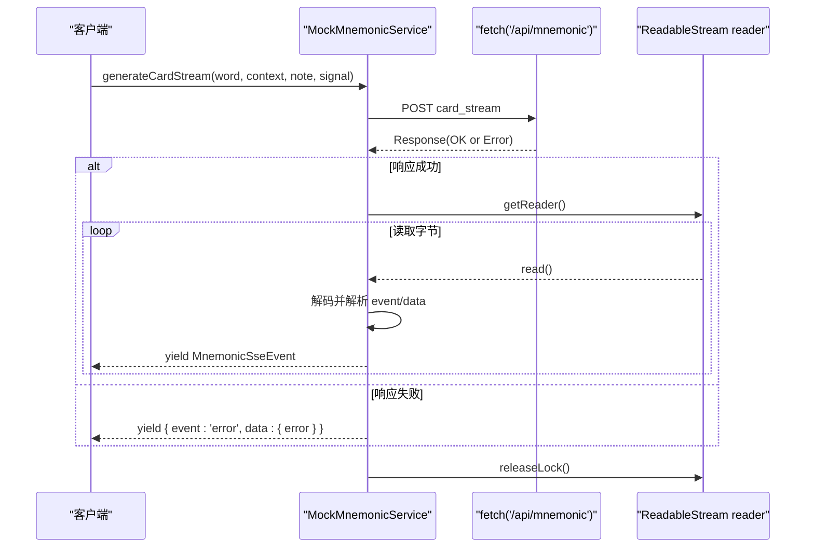
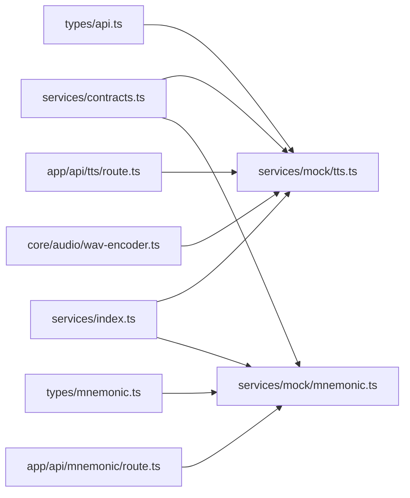

# Mock 服务实现

<cite>
**本文引用的文件**   
- [client/services/mock/mnemonic.ts](file://client/services/mock/mnemonic.ts)
- [client/services/mock/tts.ts](file://client/services/mock/tts.ts)
- [client/services/contracts.ts](file://client/services/contracts.ts)
- [client/types/mnemonic.ts](file://client/types/mnemonic.ts)
- [client/types/api.ts](file://client/types/api.ts)
- [client/services/index.ts](file://client/services/index.ts)
- [client/app/api/mnemonic/route.ts](file://client/app/api/mnemonic/route.ts)
- [client/app/api/tts/route.ts](file://client/app/api/tts/route.ts)
- [client/core/audio/wav-encoder.ts](file://client/core/audio/wav-encoder.ts)
</cite>

## 目录
1. [引言](#引言)
2. [项目结构](#项目结构)
3. [核心组件](#核心组件)
4. [架构总览](#架构总览)
5. [详细组件分析](#详细组件分析)
6. [依赖关系分析](#依赖关系分析)
7. [性能与测试](#性能与测试)
8. [调试与故障排查](#调试与故障排查)
9. [从 Mock 切换到真实服务](#从-mock-切换到真实服务)
10. [结论](#结论)

## 引言
本文面向“Mock 服务实现”的技术文档，聚焦以下目标：
- 解释 MnemonicService 和 TtsService 的 Mock 实现原理；
- 说明模拟延迟、随机数据生成与错误模拟机制；
- 讲解如何使用 AbortSignal 实现可取消的异步操作；
- 梳理 mock 数据结构与真实 API 响应的映射关系；
- 提供开发环境下的使用方法与配置选项；
- 给出性能测试与调试技巧；
- 说明如何从 Mock 模式平滑切换到真实服务实现。

本仓库采用“契约优先”的设计：先定义接口与类型（contracts.ts、types/*.ts），再分别提供 Mock 实现与未来真实后端实现。当前默认使用 Mock 服务，便于离线开发与演示。

## 项目结构
与 Mock 服务相关的代码主要分布在以下位置：
- 契约与类型：
  - client/services/contracts.ts：统一服务接口、错误类型、AbortSignal 工具函数；
  - client/types/api.ts：TTS 请求/响应、SSE 事件等通用类型；
  - client/types/mnemonic.ts：生词助记相关的数据模型与 SSE 事件类型。
- Mock 实现：
  - client/services/mock/mnemonic.ts：MnemonicService 的 Mock 实现；
  - client/services/mock/tts.ts：TtsService 的 Mock 实现，包含分句、时间轴、SRT、WAV 占位音频、字幕缓存等逻辑。
- 服务工厂：
  - client/services/index.ts：聚合 Mock 服务并提供切换入口。
- BFF 路由（真实调用端）：
  - client/app/api/mnemonic/route.ts：BFF 路由，转发到 LLM 服务层；
  - client/app/api/tts/route.ts：BFF 路由，调用 TTS 服务层并复用 Mock 中的分句/时间轴/SRT 构建逻辑。
- 音频编码：
  - client/core/audio/wav-encoder.ts：WAV 编码工具，供 Mock TTS 生成占位音频。

**图表来源**
- [client/services/contracts.ts:1-144](file://client/services/contracts.ts#L1-L144)
- [client/types/api.ts:104-134](file://client/types/api.ts#L104-L134)
- [client/types/mnemonic.ts:57-141](file://client/types/mnemonic.ts#L57-L141)
- [client/services/mock/tts.ts:148-189](file://client/services/mock/tts.ts#L148-L189)
- [client/services/mock/mnemonic.ts:42-124](file://client/services/mock/mnemonic.ts#L42-L124)
- [client/services/index.ts:29-48](file://client/services/index.ts#L29-L48)
- [client/app/api/mnemonic/route.ts:44-270](file://client/app/api/mnemonic/route.ts#L44-L270)
- [client/app/api/tts/route.ts:23-115](file://client/app/api/tts/route.ts#L23-L115)
- [client/core/audio/wav-encoder.ts](file://client/core/audio/wav-encoder.ts)

**章节来源**
- [client/services/contracts.ts:1-144](file://client/services/contracts.ts#L1-L144)
- [client/types/api.ts:104-134](file://client/types/api.ts#L104-L134)
- [client/types/mnemonic.ts:57-141](file://client/types/mnemonic.ts#L57-L141)
- [client/services/mock/tts.ts:1-189](file://client/services/mock/tts.ts#L1-L189)
- [client/services/mock/mnemonic.ts:1-125](file://client/services/mock/mnemonic.ts#L1-L125)
- [client/services/index.ts:1-68](file://client/services/index.ts#L1-L68)
- [client/app/api/mnemonic/route.ts:1-272](file://client/app/api/mnemonic/route.ts#L1-L272)
- [client/app/api/tts/route.ts:1-116](file://client/app/api/tts/route.ts#L1-L116)

## 核心组件
本节聚焦两个关键 Mock 服务：
- MockTtsService：离线模拟 TTS 合成，返回 WAV 音频与元信息，支持字幕缓存与进度回调；
- MockMnemonicService：封装对 BFF /api/mnemonic 的调用，支持非流式与流式（SSE）两种模式。

它们都遵循 contracts.ts 中定义的接口，并通过 services/index.ts 暴露给上层应用。

**章节来源**
- [client/services/mock/tts.ts:148-189](file://client/services/mock/tts.ts#L148-L189)
- [client/services/mock/mnemonic.ts:42-124](file://client/services/mock/mnemonic.ts#L42-L124)
- [client/services/contracts.ts:108-136](file://client/services/contracts.ts#L108-L136)
- [client/services/index.ts:29-48](file://client/services/index.ts#L29-L48)

## 架构总览
下图展示 Mock 服务在整体系统中的位置：客户端通过服务工厂获取 Mock 服务；TTS Mock 完全离线运行；Mnemonic Mock 则调用 BFF 路由，由路由转发到 LLM 服务层。

**图表来源**
- [client/services/index.ts:29-48](file://client/services/index.ts#L29-L48)
- [client/services/mock/tts.ts:148-189](file://client/services/mock/tts.ts#L148-L189)
- [client/services/mock/mnemonic.ts:42-124](file://client/services/mock/mnemonic.ts#L42-L124)
- [client/app/api/mnemonic/route.ts:44-270](file://client/app/api/mnemonic/route.ts#L44-L270)
- [client/app/api/tts/route.ts:23-115](file://client/app/api/tts/route.ts#L23-L115)

## 详细组件分析

### MockTtsService：离线语音合成与字幕
MockTtsService 的核心职责是：
- 文本校验与分句；
- 估算每句时长并构建时间轴；
- 生成 SRT 字幕并缓存；
- 合成低音量正弦波 WAV 作为占位音频；
- 支持 AbortSignal 中止与进度回调。

#### 类与方法概览

**图表来源**
- [client/services/mock/tts.ts:38-52](file://client/services/mock/tts.ts#L38-L52)
- [client/services/mock/tts.ts:148-189](file://client/services/mock/tts.ts#L148-L189)

#### 关键流程：generate

**图表来源**
- [client/services/mock/tts.ts:152-180](file://client/services/mock/tts.ts#L152-L180)

#### 关键流程：getSubtitle

**图表来源**
- [client/services/mock/tts.ts:183-188](file://client/services/mock/tts.ts#L183-L188)

#### 辅助函数与算法
- splitTtsSentences：按 [.!?;:\n] 切分，保留标点归属前句，过滤纯标点片段；
- estimateSentenceMs：按字符数估算时长，最小 400ms，语速范围限制在 0.5~2.0；
- buildTtsTimeline：累计 startMs/endMs，句间留 120ms 静音；
- srtTime/buildSrt：毫秒转 SRT 时间戳与块格式；
- synthesizePlaceholderWav：为每句生成不同基频的正弦波，首尾淡入淡出，总时长对齐时间轴；
- generateTaskId：生成带前缀的任务 ID；
- subtitleCache：模块级 Map，LRU 上限 500 条。

这些函数均为纯 TS，零浏览器特有 API，可在 Node 18+ 环境下测试。

**章节来源**
- [client/services/mock/tts.ts:58-136](file://client/services/mock/tts.ts#L58-L136)
- [client/services/mock/tts.ts:148-189](file://client/services/mock/tts.ts#L148-L189)

### MockMnemonicService：助记卡片与 SSE 流式
MockMnemonicService 的职责是封装对 BFF /api/mnemonic 的请求，包括：
- 非流式方法：generateCard、generateAssociation、generateExercises、evaluateSentence；
- 流式方法：generateCardStream，解析服务端 SSE 事件并逐条 yield。

所有方法均支持 AbortSignal，并在请求失败时抛出统一错误。

#### 类与方法概览

**图表来源**
- [client/services/mock/mnemonic.ts:42-124](file://client/services/mock/mnemonic.ts#L42-L124)
- [client/types/mnemonic.ts:133-141](file://client/types/mnemonic.ts#L133-L141)

#### 流式处理流程：generateCardStream

**图表来源**
- [client/services/mock/mnemonic.ts:50-102](file://client/services/mock/mnemonic.ts#L50-L102)

#### 非流式方法与错误处理
- callApi：统一封装 fetch，失败时抛错；
- 各方法在调用前检查 AbortSignal；
- 流式方法在错误路径 yield error 事件后终止。

**章节来源**
- [client/services/mock/mnemonic.ts:16-31](file://client/services/mock/mnemonic.ts#L16-L31)
- [client/services/mock/mnemonic.ts:45-123](file://client/services/mock/mnemonic.ts#L45-L123)

## 依赖关系分析
- contracts.ts 定义了统一的错误类型 ApiError、AbortSignal 工具函数 throwIfAborted 与 abortableDelay，以及 TtsService、MnemonicService 接口；
- types/api.ts 定义 TTS 请求/响应与 SSE 事件类型；
- types/mnemonic.ts 定义助记卡片、联想、练习、造句批改等数据结构及 SSE 事件；
- services/index.ts 聚合 Mock 服务，并提供 getServices 入口；
- app/api/mnemonic/route.ts 与 app/api/tts/route.ts 是 BFF 路由，负责参数校验、配置读取、上游调用与错误映射；
- core/audio/wav-encoder.ts 被 MockTtsService 用于生成 WAV 音频。

**图表来源**
- [client/services/contracts.ts:1-144](file://client/services/contracts.ts#L1-L144)
- [client/types/api.ts:104-134](file://client/types/api.ts#L104-L134)
- [client/types/mnemonic.ts:57-141](file://client/types/mnemonic.ts#L57-L141)
- [client/services/index.ts:29-48](file://client/services/index.ts#L29-L48)
- [client/app/api/mnemonic/route.ts:44-270](file://client/app/api/mnemonic/route.ts#L44-L270)
- [client/app/api/tts/route.ts:23-115](file://client/app/api/tts/route.ts#L23-L115)
- [client/core/audio/wav-encoder.ts](file://client/core/audio/wav-encoder.ts)

**章节来源**
- [client/services/contracts.ts:1-144](file://client/services/contracts.ts#L1-L144)
- [client/types/api.ts:104-134](file://client/types/api.ts#L104-L134)
- [client/types/mnemonic.ts:57-141](file://client/types/mnemonic.ts#L57-L141)
- [client/services/index.ts:29-48](file://client/services/index.ts#L29-L48)
- [client/app/api/mnemonic/route.ts:44-270](file://client/app/api/mnemonic/route.ts#L44-L270)
- [client/app/api/tts/route.ts:23-115](file://client/app/api/tts/route.ts#L23-L115)

## 性能与测试

### 模拟延迟与进度控制
- MockTtsService 支持 paceScale 缩放系数，用于加速或减速模拟延迟；
- 可通过 delayImpl 注入自定义延迟实现，便于单元测试；
- onProgress 回调在逐句合成时触发，可用于 UI 进度条更新。

建议测试策略：
- 使用 delayImpl 设置为无延迟实现以加速测试；
- 验证 onProgress 的 done/total 序列是否符合预期；
- 验证文本超长、空文本、无效速度等边界条件。

**章节来源**
- [client/services/mock/tts.ts:45-52](file://client/services/mock/tts.ts#L45-L52)
- [client/services/mock/tts.ts:152-180](file://client/services/mock/tts.ts#L152-L180)

### 随机数据生成
- MockTtsService 使用 Math.random 生成任务 ID 后缀；
- 占位音频使用固定基频序列（G3 起五度系）以便听辨句边界；
- 字幕缓存使用模块级 Map，LRU 淘汰策略保证内存可控。

注意：
- 随机性主要用于区分任务与音频特征，不影响业务逻辑确定性；
- 若需可重复测试，可替换 delayImpl 与随机源。

**章节来源**
- [client/services/mock/tts.ts:132-146](file://client/services/mock/tts.ts#L132-L146)
- [client/services/mock/tts.ts:113-130](file://client/services/mock/tts.ts#L113-L130)

### 错误模拟
- MockTtsService 在文本超长时抛出 ApiError('TEXT_TOO_LONG')；
- 文本为空时抛出 ApiError('TEXT_EMPTY')；
- 未找到字幕时抛出 ApiError('SUBTITLE_NOT_FOUND')；
- 所有方法在 AbortSignal 已中止时抛出 ApiError('ABORTED')。

**章节来源**
- [client/services/mock/tts.ts:157-164](file://client/services/mock/tts.ts#L157-L164)
- [client/services/mock/tts.ts:183-188](file://client/services/mock/tts.ts#L183-L188)
- [client/services/contracts.ts:61-64](file://client/services/contracts.ts#L61-L64)

## 调试与故障排查

### 使用 AbortSignal 实现可取消
- 所有服务方法接受可选 AbortSignal；
- throwIfAborted 在信号已中止时立即抛出 ApiError('ABORTED')；
- abortableDelay 支持在延迟期间被中止；
- 流式方法在读取过程中若发生中止，会释放 reader 锁并终止迭代。

建议实践：
- 在用户取消操作时调用 controller.abort()；
- 捕获 ApiError('ABORTED') 并忽略错误日志；
- 在 UI 上显示“已取消”提示而非崩溃。

**章节来源**
- [client/services/contracts.ts:49-87](file://client/services/contracts.ts#L49-L87)
- [client/services/mock/tts.ts:152-171](file://client/services/mock/tts.ts#L152-L171)
- [client/services/mock/mnemonic.ts:45-57](file://client/services/mock/mnemonic.ts#L45-L57)

### 常见错误与定位
- TEXT_TOO_LONG：文本超过 5000 字符，需截断或分批；
- TEXT_EMPTY：文本为空，无法合成语音；
- SUBTITLE_NOT_FOUND：taskId 不存在或缓存过期；
- MNEMONIC_TIMEOUT：助记请求超时，检查 LLM 配置与网络；
- SETTINGS_NOT_CONFIGURED：LLM/TTS 配置缺失，需在设置页填写 Base URL 与 API Key。

定位步骤：
- 检查请求参数是否符合契约；
- 查看 BFF 路由日志与响应头（如 X-Mnemonic-*）；
- 确认服务工厂返回的是 Mock 还是真实实现；
- 使用 onProgress 与 delayImpl 进行逐步验证。

**章节来源**
- [client/services/mock/tts.ts:157-164](file://client/services/mock/tts.ts#L157-L164)
- [client/services/mock/tts.ts:183-188](file://client/services/mock/tts.ts#L183-L188)
- [client/app/api/mnemonic/route.ts:122-136](file://client/app/api/mnemonic/route.ts#L122-L136)
- [client/app/api/mnemonic/route.ts:231-240](file://client/app/api/mnemonic/route.ts#L231-L240)
- [client/app/api/tts/route.ts:48-57](file://client/app/api/tts/route.ts#L48-L57)

## 从 Mock 切换到真实服务
当前 services/index.ts 默认返回 Mock 服务，预留了 ServiceMode 与 getServices 入口。未来接入真实 Fastify 后端时：
- 新增 services/api/*.ts 实现 contracts.ts 中的同名接口；
- 在 getServices 中根据环境变量（如 NEXT_PUBLIC_SERVICE_MODE）返回 api 实现；
- 保持契约不变，仅替换实现。

当前状态：
- getServices 恒返回 getMockServices；
- getSoeService 可根据设置选择 mock 或 api 实现。

建议切换步骤：
- 在 settings 中配置 provider 与 model；
- 在 getServices 中读取环境变量并分支；
- 逐步替换 tts、mnemonic、soe 的实现；
- 确保类型与错误处理一致。

**章节来源**
- [client/services/index.ts:1-48](file://client/services/index.ts#L1-L48)
- [client/services/index.ts:50-57](file://client/services/index.ts#L50-L57)

## 结论
本项目的 Mock 服务实现了“契约优先”的可插拔架构：
- MockTtsService 提供离线、确定性、可测试的 TTS 模拟，涵盖分句、时间轴、SRT、WAV 占位音频与字幕缓存；
- MockMnemonicService 封装 BFF 路由调用，支持非流式与流式（SSE）两种模式；
- 通过 contracts.ts 与 types/*.ts 统一接口与类型，便于未来无缝切换到真实服务；
- 借助 AbortSignal 与 ApiError 实现一致的错误处理与可取消能力；
- 通过 services/index.ts 提供服务工厂，便于在开发环境与生产环境之间切换。

在实际开发中，建议：
- 使用 Mock 服务进行前端联调与单元测试；
- 通过 onProgress 与 delayImpl 优化测试速度与用户体验；
- 在配置缺失或网络异常时，利用统一错误类型进行友好提示；
- 在接入真实服务时，保持契约不变，仅替换实现。