# SOE 后端服务

<cite>
**本文引用的文件**   
- [app.ts](file://server/src/app.ts)
- [index.ts](file://server/src/index.ts)
- [soe.route.ts](file://server/src/routes/soe.route.ts)
- [env.ts](file://server/src/config/env.ts)
- [api-error.ts](file://server/src/lib/api-error.ts)
- [index.ts（注册表）](file://server/src/services/soe/index.ts)
- [soe-provider.ts](file://server/src/services/soe/soe-provider.ts)
- [azure.provider.ts](file://server/src/services/soe/azure.provider.ts)
- [tencent.provider.ts](file://server/src/services/soe/tencent.provider.ts)
- [iflytek.provider.ts](file://server/src/services/soe/iflytek.provider.ts)
- [mock.provider.ts](file://server/src/services/soe/mock.provider.ts)
- [soe-mapper.ts](file://server/src/services/soe/soe-mapper.ts)
- [wav-pcm.ts](file://server/src/services/soe/wav-pcm.ts)
- [iflytek-auth.ts](file://server/src/services/soe/iflytek-auth.ts)
- [tencent-ws-auth.ts](file://server/src/services/soe/tencent-ws-auth.ts)
- [iflytek-xml.ts](file://server/src/services/soe/iflytek-xml.ts)
</cite>

## 目录
1. [简介](#简介)
2. [项目结构](#项目结构)
3. [核心组件](#核心组件)
4. [架构总览](#架构总览)
5. [详细组件分析](#详细组件分析)
6. [依赖关系分析](#依赖关系分析)
7. [性能与可靠性](#性能与可靠性)
8. [配置与环境变量](#配置与环境变量)
9. [故障排查指南](#故障排查指南)
10. [第三方厂商接入规范与测试](#第三方厂商接入规范与测试)
11. [结论](#结论)

## 简介
SOE（Speech Oral Evaluation，口语评测）后端服务基于 Fastify 提供统一的发音评分 API。服务通过适配器模式聚合多家上游厂商（Azure、腾讯云、科大讯飞），并提供 mock 实现用于联调与降级。请求统一为 multipart/form-data，支持 WAV/PCM 音频输入；响应遵循统一的 SoeEvaluateResponse 契约，包含总分、准确度、流利度、完整度以及词级与音素级明细。

## 项目结构
- 应用装配：Fastify 实例、CORS、Multipart、错误处理、健康检查与路由挂载。
- 路由层：解析 multipart 字段、校验参数、选择 provider、调用 evaluate 并返回结果。
- Provider 层：抽象接口 + 多厂商实现（Azure REST、腾讯 WS、讯飞 WS、Mock）。
- 映射层：将各厂商响应标准化为统一契约。
- 工具层：WAV 头剥离、鉴权 URL 构造、XML 解析等。

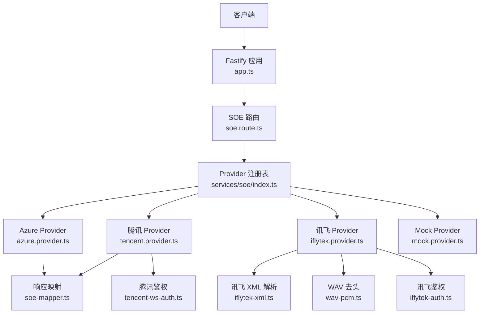

**图示来源** 
- [app.ts:14-45](file://server/src/app.ts#L14-L45)
- [soe.route.ts:64-108](file://server/src/routes/soe.route.ts#L64-L108)
- [index.ts（注册表）:21-28](file://server/src/services/soe/index.ts#L21-L28)
- [azure.provider.ts:24-108](file://server/src/services/soe/azure.provider.ts#L24-L108)
- [tencent.provider.ts:50-191](file://server/src/services/soe/tencent.provider.ts#L50-L191)
- [iflytek.provider.ts:54-234](file://server/src/services/soe/iflytek.provider.ts#L54-L234)
- [soe-mapper.ts:40-154](file://server/src/services/soe/soe-mapper.ts#L40-L154)
- [iflytek-xml.ts:51-80](file://server/src/services/soe/iflytek-xml.ts#L51-L80)
- [wav-pcm.ts:11-23](file://server/src/services/soe/wav-pcm.ts#L11-L23)
- [iflytek-auth.ts:27-34](file://server/src/services/soe/iflytek-auth.ts#L27-L34)
- [tencent-ws-auth.ts:57-94](file://server/src/services/soe/tencent-ws-auth.ts#L57-L94)

**章节来源**
- [app.ts:14-45](file://server/src/app.ts#L14-L45)
- [index.ts（入口）:8-18](file://server/src/index.ts#L8-L18)

## 核心组件
- Fastify 应用装配：启用 CORS、Multipart、统一错误处理器与健康检查端点。
- SOE 路由：解析 multipart 表单，校验 refText/evalMode/audio/provider/creds，选择 provider 并调用 evaluate。
- Provider 注册表：按环境变量注册可用 provider，支持请求级凭据覆盖。
- Provider 抽象：SoeProvider 接口定义 name 与 evaluate(input, signal)。
- 响应映射：将 Azure/Tencent/Iflytek 的原始响应标准化为 SoeEvaluateResponse。
- 工具模块：WAV 头剥离、讯飞/腾讯鉴权 URL 构造、讯飞 XML 解析。

**章节来源**
- [soe.route.ts:64-108](file://server/src/routes/soe.route.ts#L64-L108)
- [index.ts（注册表）:21-79](file://server/src/services/soe/index.ts#L21-L79)
- [soe-provider.ts:8-46](file://server/src/services/soe/soe-provider.ts#L8-L46)
- [soe-mapper.ts:40-154](file://server/src/services/soe/soe-mapper.ts#L40-L154)
- [wav-pcm.ts:11-23](file://server/src/services/soe/wav-pcm.ts#L11-L23)
- [iflytek-auth.ts:27-34](file://server/src/services/soe/iflytek-auth.ts#L27-L34)
- [tencent-ws-auth.ts:57-94](file://server/src/services/soe/tencent-ws-auth.ts#L57-L94)
- [iflytek-xml.ts:51-80](file://server/src/services/soe/iflytek-xml.ts#L51-L80)

## 架构总览
SOE 后端采用“路由 → 注册表 → Provider 适配器”的分层设计。路由负责参数校验与流程编排；注册表根据环境变量与请求级凭据决定使用哪个 provider；每个 provider 封装与特定厂商的通信协议与认证逻辑；映射器将不同厂商的响应归一化为统一契约。

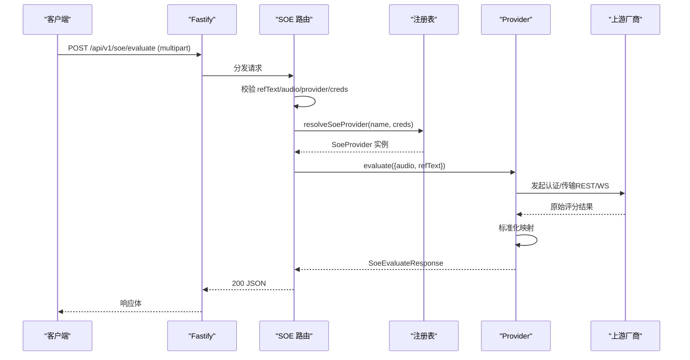

**图示来源**
- [soe.route.ts:64-108](file://server/src/routes/soe.route.ts#L64-L108)
- [index.ts（注册表）:38-79](file://server/src/services/soe/index.ts#L38-L79)
- [azure.provider.ts:24-108](file://server/src/services/soe/azure.provider.ts#L24-L108)
- [tencent.provider.ts:50-191](file://server/src/services/soe/tencent.provider.ts#L50-L191)
- [iflytek.provider.ts:54-234](file://server/src/services/soe/iflytek.provider.ts#L54-L234)
- [soe-mapper.ts:40-154](file://server/src/services/soe/soe-mapper.ts#L40-L154)

## 详细组件分析

### Fastify 应用装配与错误处理
- 启动 Fastify，设置 bodyLimit 与 multipart 限制（单文件 ≤25MB）。
- 注册 CORS，允许前端开发端口与局域网 H5。
- 统一错误处理器：ApiError 直接输出 {code,message,detail}；multipart 限流/格式错误保留状态码并补齐 code；其他异常统一 500。
- 健康检查 /healthz 返回默认 provider 与已注册 provider 列表。

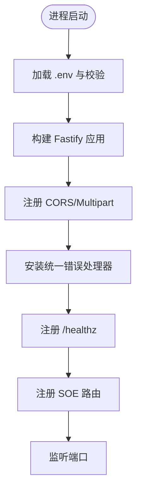

**图示来源**
- [app.ts:14-45](file://server/src/app.ts#L14-L45)
- [index.ts（入口）:8-18](file://server/src/index.ts#L8-L18)

**章节来源**
- [app.ts:14-45](file://server/src/app.ts#L14-L45)
- [api-error.ts:6-35](file://server/src/lib/api-error.ts#L6-L35)

### SOE 路由与请求处理流程
- 接收 multipart/form-data，要求 audio 文件、refText 文本、可选 provider 与 creds。
- 校验 refText 长度、evalMode 固定 sentence、音频非空且不超过 25MB。
- 解析 provider 字段，若未指定则使用默认 provider；未知 provider 返回 400。
- 解析 creds JSON，合并到环境变量后尝试现场构造 provider；否则回退注册表。
- 建立 AbortController 监听 socket close，避免客户端断开后继续上游调用。
- 调用 provider.evaluate 并返回 200 响应。

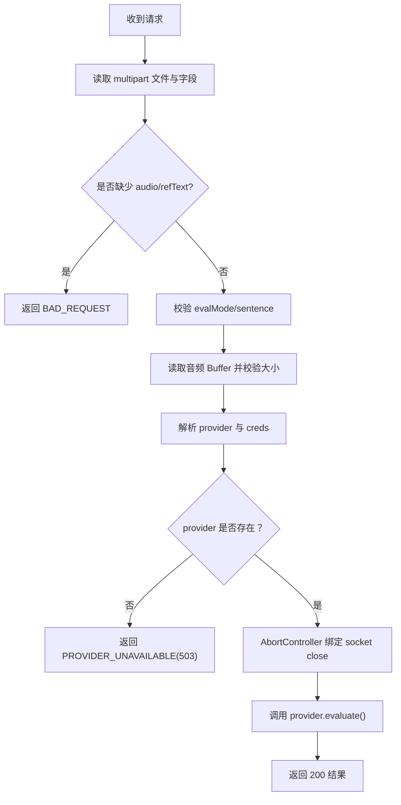

**图示来源**
- [soe.route.ts:64-108](file://server/src/routes/soe.route.ts#L64-L108)

**章节来源**
- [soe.route.ts:20-108](file://server/src/routes/soe.route.ts#L20-L108)

### Provider 注册表与请求级凭据覆盖
- 注册表恒含 mock；其余 provider 仅在对应凭据齐全时注册。
- resolveSoeProvider 支持请求级 creds 覆盖 env：同名键优先，空串视为未提供。
- 合并后凭据仍不齐则回退注册表现状；若仍未找到则调用方返回 503。

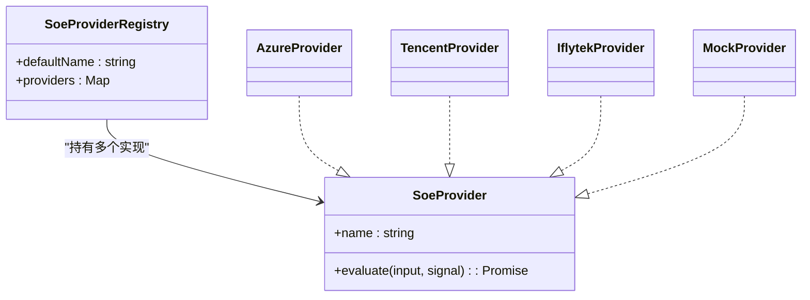

**图示来源**
- [index.ts（注册表）:14-28](file://server/src/services/soe/index.ts#L14-L28)
- [soe-provider.ts:43-46](file://server/src/services/soe/soe-provider.ts#L43-L46)

**章节来源**
- [index.ts（注册表）:21-79](file://server/src/services/soe/index.ts#L21-L79)

### Azure Provider（REST 短音频）
- 使用 Azure Speech REST 短音频接口，携带 Pronunciation-Assessment base64 JSON 头。
- 强制 Dimension=Comprehensive 以获取流利度/完整度与词级错误类型。
- 超时与重试：SOE_TIMEOUT_MS 超时；仅网络错/超时/上游错误可重试。
- 无语音状态（NoMatch/InitialSilenceTimeout/BabbleTimeout）映射为 SOE_NO_SPEECH。

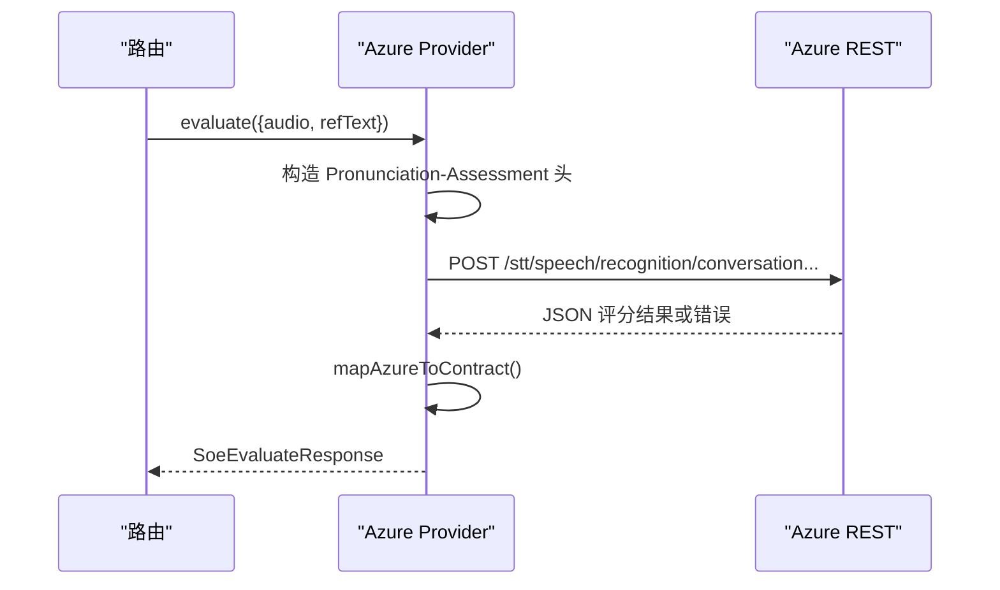

**图示来源**
- [azure.provider.ts:24-108](file://server/src/services/soe/azure.provider.ts#L24-L108)
- [soe-mapper.ts:40-53](file://server/src/services/soe/soe-mapper.ts#L40-L53)

**章节来源**
- [azure.provider.ts:24-108](file://server/src/services/soe/azure.provider.ts#L24-L108)
- [soe-mapper.ts:40-53](file://server/src/services/soe/soe-mapper.ts#L40-L53)

### 腾讯 Provider（OEN WebSocket）
- 使用 wss://soe.cloud.tencent.com/soe/api/<appid>，录音模式整段 WAV 一次上行。
- 鉴权 URL 由 tencent-ws-auth.ts 生成（HMAC-SHA1+Base64），每次 attempt 重新签名。
- 握手成功首帧 voice_id；最终帧 final=1 携带 result JSON。
- 错误码映射：鉴权失败、并发超限、分片等待超时、无人声等。

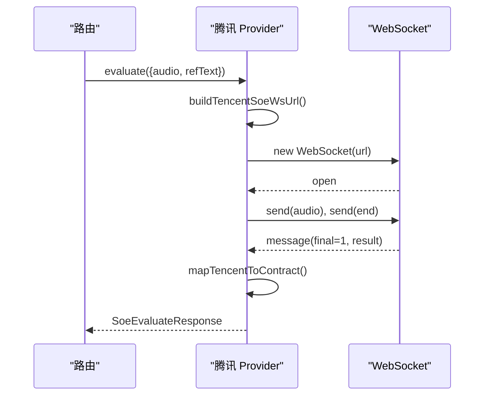

**图示来源**
- [tencent.provider.ts:50-191](file://server/src/services/soe/tencent.provider.ts#L50-L191)
- [tencent-ws-auth.ts:57-94](file://server/src/services/soe/tencent-ws-auth.ts#L57-L94)
- [soe-mapper.ts:105-125](file://server/src/services/soe/soe-mapper.ts#L105-L125)

**章节来源**
- [tencent.provider.ts:50-191](file://server/src/services/soe/tencent.provider.ts#L50-L191)
- [tencent-ws-auth.ts:57-94](file://server/src/services/soe/tencent-ws-auth.ts#L57-L94)
- [soe-mapper.ts:105-125](file://server/src/services/soe/soe-mapper.ts#L105-L125)

### 讯飞 Provider（ISE 流式版）
- 使用 wss://ise-api.xfyun.cn/v2/open-ise，init 帧发送业务参数与参考文本。
- 音频以裸 PCM 分帧（1280B），可按 IFLYTEK_FRAME_INTERVAL_MS 控制发送节奏。
- 结果 XML 分片累积，status=2 时解析并映射到契约。
- 鉴权 URL 由 iflytek-auth.ts 生成（HMAC-SHA256），每次 attempt 刷新 date。

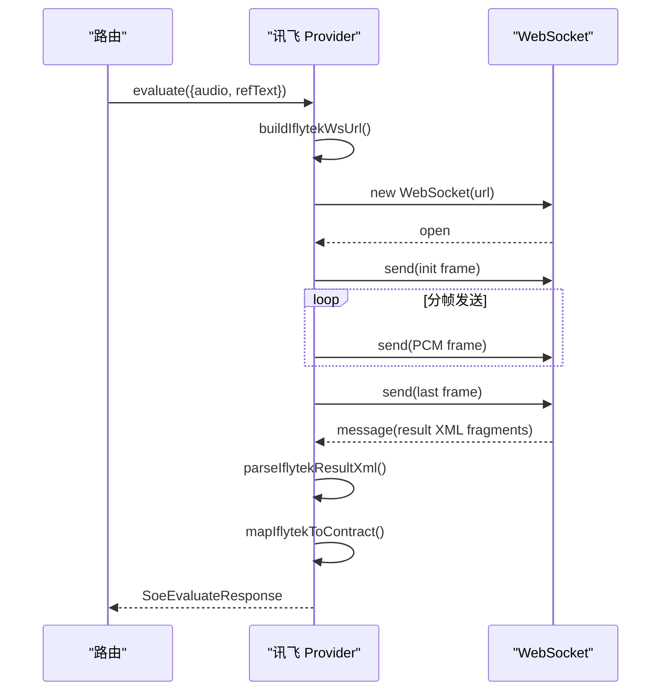

**图示来源**
- [iflytek.provider.ts:54-234](file://server/src/services/soe/iflytek.provider.ts#L54-L234)
- [iflytek-auth.ts:27-34](file://server/src/services/soe/iflytek-auth.ts#L27-L34)
- [iflytek-xml.ts:51-80](file://server/src/services/soe/iflytek-xml.ts#L51-L80)
- [soe-mapper.ts:137-154](file://server/src/services/soe/soe-mapper.ts#L137-L154)

**章节来源**
- [iflytek.provider.ts:54-234](file://server/src/services/soe/iflytek.provider.ts#L54-L234)
- [iflytek-auth.ts:27-34](file://server/src/services/soe/iflytek-auth.ts#L27-L34)
- [iflytek-xml.ts:51-80](file://server/src/services/soe/iflytek-xml.ts#L51-L80)
- [soe-mapper.ts:137-154](file://server/src/services/soe/soe-mapper.ts#L137-L154)

### Mock Provider（确定性伪评分）
- 使用 FNV-1a 哈希对 refText 与音频时长进行种子化，产生确定性评分。
- 估算 WAV 时长（RIFF/WAVE data chunk），否则按 16kHz mono 16bit 字节率估算。
- 词级与音素级分数由伪算法生成，便于端到端比对。

**章节来源**
- [mock.provider.ts:9-82](file://server/src/services/soe/mock.provider.ts#L9-L82)

### 音频格式转换与采样率处理
- 输入约定：WAV/PCM，16kHz 单声道。
- Azure：原样透传 WAV（Content-Type 声明 samplerate=16000）。
- 腾讯：录音模式整段 WAV 直发（保留头）。
- 讯飞：需 stripWavHeader 去除 WAV 头，得到裸 PCM 再分帧发送。

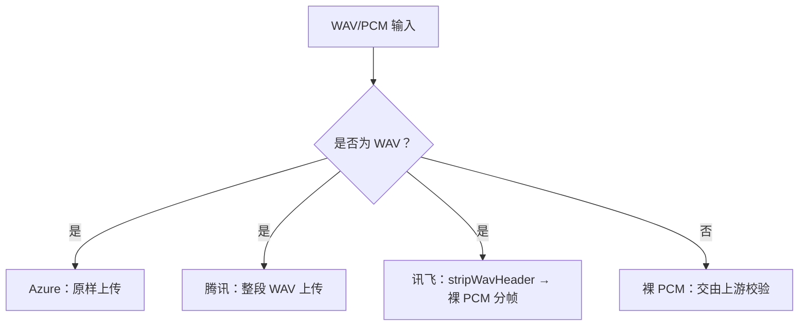

**图示来源**
- [wav-pcm.ts:11-23](file://server/src/services/soe/wav-pcm.ts#L11-L23)
- [azure.provider.ts:61-71](file://server/src/services/soe/azure.provider.ts#L61-L71)
- [tencent.provider.ts:137-147](file://server/src/services/soe/tencent.provider.ts#L137-L147)
- [iflytek.provider.ts:204-225](file://server/src/services/soe/iflytek.provider.ts#L204-L225)

**章节来源**
- [wav-pcm.ts:11-23](file://server/src/services/soe/wav-pcm.ts#L11-L23)

### 评分结果映射与标准化
- 统一契约 SoeEvaluateResponse：total/accuracy/fluency/integrity/words[]。
- Azure：Pron/Accuracy/Fluency/Completeness 分别映射到 total/accuracy/fluency/integrity；Words.Phonemes 映射为 phonemes[]。
- 腾讯：SuggestedScore/PronAccuracy 作为总分候选；PronFluency/PronCompletion 小数归一；Tag/MatchTag 映射 errorType；PhoneInfo/PhoneInfos 兼容双形状。
- 讯飞：根据 total 量纲启发判断 0–5 或 0–100 分制，乘以 scale 归一；dpMessage 映射 errorType；英文朗读题型音素级为空数组。

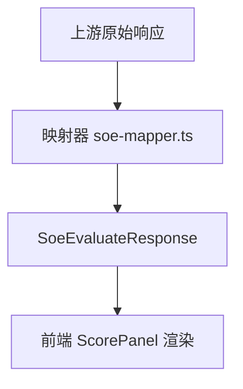

**图示来源**
- [soe-mapper.ts:40-154](file://server/src/services/soe/soe-mapper.ts#L40-L154)

**章节来源**
- [soe-mapper.ts:40-154](file://server/src/services/soe/soe-mapper.ts#L40-L154)

## 依赖关系分析
- 路由依赖注册表与环境变量；注册表依赖各 provider 工厂函数。
- Provider 依赖鉴权模块与映射器；讯飞额外依赖 XML 解析与 WAV 去头。
- 错误模型集中管理，所有 provider 与路由统一抛出 ApiError。

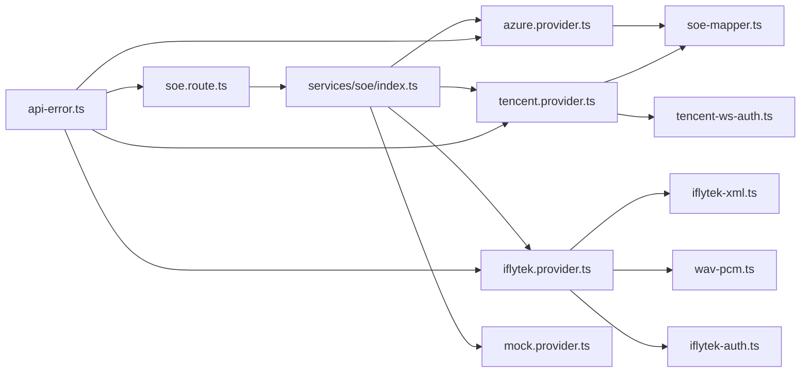

**图示来源**
- [soe.route.ts:64-108](file://server/src/routes/soe.route.ts#L64-L108)
- [index.ts（注册表）:21-28](file://server/src/services/soe/index.ts#L21-L28)
- [azure.provider.ts:24-108](file://server/src/services/soe/azure.provider.ts#L24-L108)
- [tencent.provider.ts:50-191](file://server/src/services/soe/tencent.provider.ts#L50-L191)
- [iflytek.provider.ts:54-234](file://server/src/services/soe/iflytek.provider.ts#L54-L234)
- [soe-mapper.ts:40-154](file://server/src/services/soe/soe-mapper.ts#L40-L154)
- [iflytek-xml.ts:51-80](file://server/src/services/soe/iflytek-xml.ts#L51-L80)
- [wav-pcm.ts:11-23](file://server/src/services/soe/wav-pcm.ts#L11-L23)
- [iflytek-auth.ts:27-34](file://server/src/services/soe/iflytek-auth.ts#L27-L34)
- [tencent-ws-auth.ts:57-94](file://server/src/services/soe/tencent-ws-auth.ts#L57-L94)
- [api-error.ts:6-35](file://server/src/lib/api-error.ts#L6-L35)

**章节来源**
- [soe.route.ts:64-108](file://server/src/routes/soe.route.ts#L64-L108)
- [index.ts（注册表）:21-79](file://server/src/services/soe/index.ts#L21-L79)
- [api-error.ts:6-35](file://server/src/lib/api-error.ts#L6-L35)

## 性能与可靠性
- 超时与重试：SOE_TIMEOUT_MS 控制上游超时；SOE_RETRY 控制重试次数；仅网络错/超时/上游错误可重试。
- 连接中断：路由层监听 socket close 触发 AbortController，避免无效上游调用。
- 音频上限：路由层 25MB；腾讯 OEN 录音模式约 60s（≈1.92MB）在 provider 内提前拒绝。
- 并发与限流：上游 429 映射为 UPSTREAM_RATE_LIMIT；腾讯并发超限 4006 明确提示。
- 日志：路由层记录 provider、是否请求级密钥、音频字节数与参考文本前缀。

**章节来源**
- [env.ts:27-31](file://server/src/config/env.ts#L27-L31)
- [soe.route.ts:98-105](file://server/src/routes/soe.route.ts#L98-L105)
- [azure.provider.ts:40-51](file://server/src/services/soe/azure.provider.ts#L40-L51)
- [tencent.provider.ts:59-71](file://server/src/services/soe/tencent.provider.ts#L59-L71)
- [iflytek.provider.ts:56-68](file://server/src/services/soe/iflytek.provider.ts#L56-L68)

## 配置与环境变量
- 基础配置：PORT、HOST、CORS_ORIGIN。
- SOE 默认提供商：SOE_PROVIDER（mock/azure/tencent/iflytek）。
- Azure：AZURE_SPEECH_KEY、AZURE_SPEECH_REGION 或 AZURE_SPEECH_HOST。
- 腾讯：TENCENT_APP_ID、TENCENT_SECRET_ID、TENCENT_SECRET_KEY。
- 讯飞：IFLYTEK_APP_ID、IFLYTEK_API_KEY、IFLYTEK_API_SECRET、IFLYTEK_FRAME_INTERVAL_MS。
- 通用：SOE_TIMEOUT_MS、SOE_RETRY。

**章节来源**
- [env.ts:9-32](file://server/src/config/env.ts#L9-L32)
- [env.ts:56-83](file://server/src/config/env.ts#L56-L83)
- [env.ts:85-115](file://server/src/config/env.ts#L85-L115)

## 故障排查指南
- 400 参数错误：缺少 audio/refText、evalMode 非 sentence、creds 非法 JSON 或结构不符。
- 413 负载过大：音频超过 25MB（路由层）或腾讯录音模式超 60s（provider 层）。
- 429 上游限流：上游返回 429 或腾讯并发超限 4006。
- 502 上游错误：Azure/腾讯/讯飞内部错误或认证失败。
- 503 Provider 不可用：请求指定了未配置的 provider（缺少密钥）。
- 无语音：Azure NoMatch/InitialSilenceTimeout/BabbleTimeout、腾讯 4105、讯飞 is_rejected=true。

**章节来源**
- [api-error.ts:18-29](file://server/src/lib/api-error.ts#L18-L29)
- [soe.route.ts:69-96](file://server/src/routes/soe.route.ts#L69-L96)
- [azure.provider.ts:78-100](file://server/src/services/soe/azure.provider.ts#L78-L100)
- [tencent.provider.ts:158-179](file://server/src/services/soe/tencent.provider.ts#L158-L179)
- [iflytek.provider.ts:162-170](file://server/src/services/soe/iflytek.provider.ts#L162-L170)

## 第三方厂商接入规范与测试
- 实现 SoeProvider 接口：提供 name 与 evaluate(input, signal)，返回 SoeEvaluateResponse。
- 鉴权与传输：
  - REST：构造必要头部与查询参数，处理超时与重试。
  - WebSocket：握手成功、消息解析、最终帧处理、错误码映射。
- 音频格式：
  - 如上游要求裸 PCM，使用 stripWavHeader 去除 WAV 头。
  - 保持 16kHz 单声道，必要时分帧发送并按间隔控制速率。
- 响应映射：
  - 将上游字段映射到 SoeEvaluateResponse，确保 total/accuracy/fluency/integrity 百分制取整。
  - 词级 errorType 与音素 phonemes 按需映射，未知值置 undefined 或 None。
- 错误处理：
  - 使用 apiError 抛出统一错误，区分 NO_SPEECH、UPSTREAM_ERROR、RATE_LIMIT、TIMEOUT。
- 测试建议：
  - 单元测试：鉴权 URL 黄金向量（腾讯 HMAC-SHA1+Base64、讯飞 HMAC-SHA256）、XML 解析、WAV 去头。
  - 集成测试：使用 mock provider 与真实凭据对比端到端评分一致性。
  - 边界用例：空音频、超长音频、断连、上游 429/5xx、无语音场景。

**章节来源**
- [soe-provider.ts:8-46](file://server/src/services/soe/soe-provider.ts#L8-L46)
- [wav-pcm.ts:11-23](file://server/src/services/soe/wav-pcm.ts#L11-L23)
- [tencent-ws-auth.ts:57-94](file://server/src/services/soe/tencent-ws-auth.ts#L57-L94)
- [iflytek-auth.ts:27-34](file://server/src/services/soe/iflytek-auth.ts#L27-L34)
- [iflytek-xml.ts:51-80](file://server/src/services/soe/iflytek-xml.ts#L51-L80)
- [soe-mapper.ts:40-154](file://server/src/services/soe/soe-mapper.ts#L40-L154)

## 结论
SOE 后端服务通过 Fastify 路由与 Provider 适配器模式实现了多厂商口语评测的统一接入。路由层负责参数校验与流程编排，注册表依据环境与请求级凭据动态选择 provider，各 provider 封装各自协议与认证逻辑，映射层将不同响应标准化为统一契约。系统具备完善的错误处理、超时重试与监控日志能力，并提供 mock 实现用于联调与回归测试。按照本文规范接入新厂商时，应严格遵循 SoeProvider 接口、音频格式约定、鉴权与映射规则，并通过黄金向量与端到端测试保障稳定性与一致性。