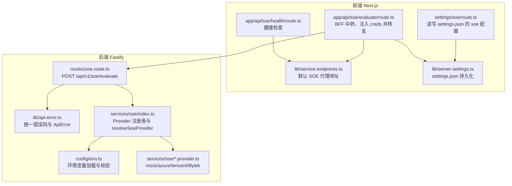
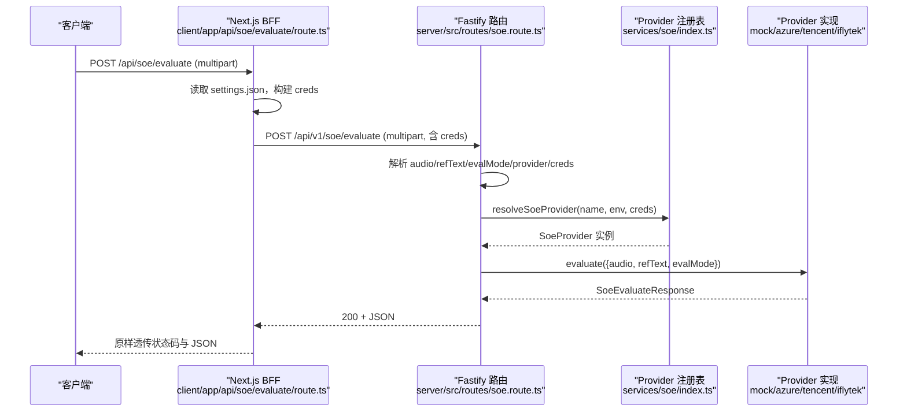
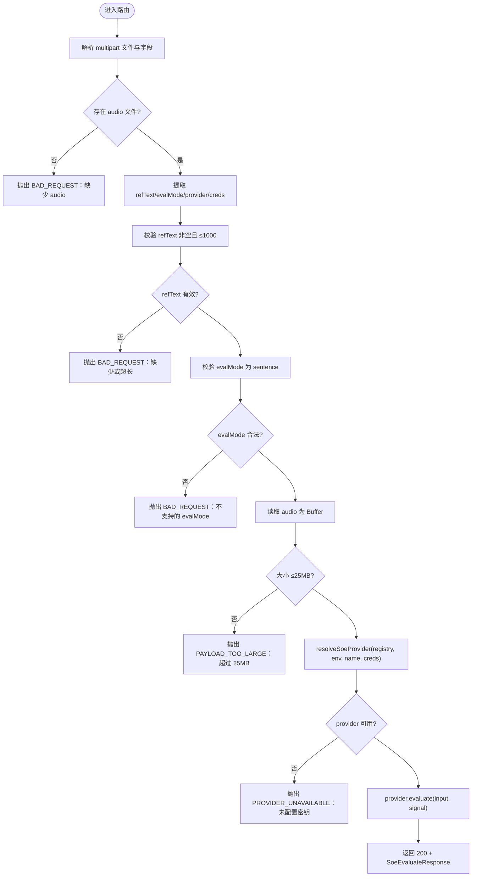
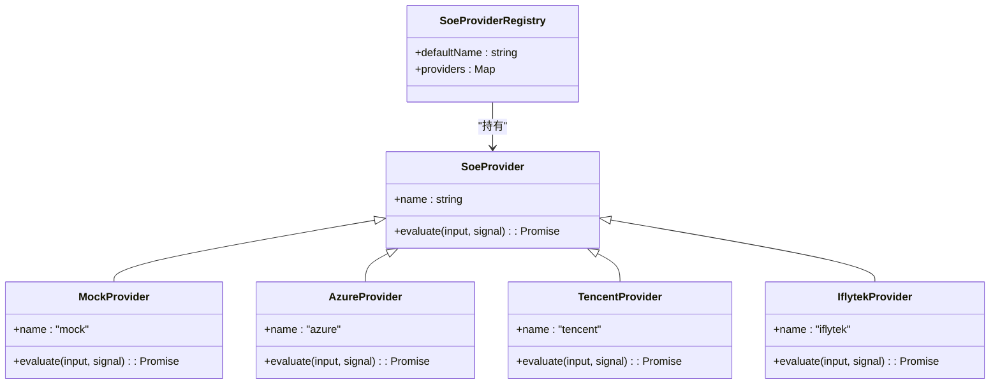
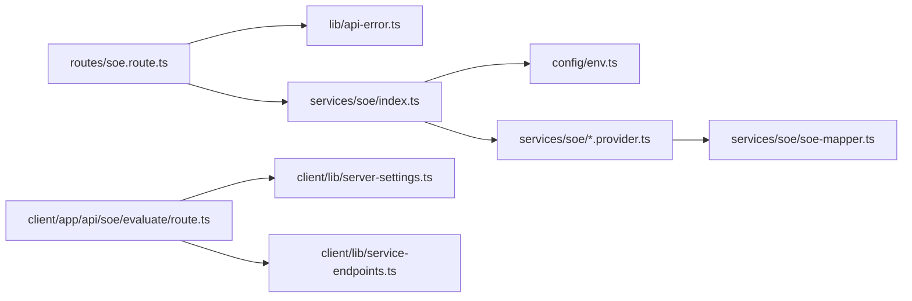

# SOE 路由处理

<cite>
**本文引用的文件**   
- [server/src/routes/soe.route.ts](file://server/src/routes/soe.route.ts)
- [server/src/lib/api-error.ts](file://server/src/lib/api-error.ts)
- [server/src/services/soe/index.ts](file://server/src/services/soe/index.ts)
- [server/src/services/soe/soe-provider.ts](file://server/src/services/soe/soe-provider.ts)
- [server/src/config/env.ts](file://server/src/config/env.ts)
- [server/src/services/soe/mock.provider.ts](file://server/src/services/soe/mock.provider.ts)
- [server/src/services/soe/azure.provider.ts](file://server/src/services/soe/azure.provider.ts)
- [server/src/services/soe/tencent.provider.ts](file://server/src/services/soe/tencent.provider.ts)
- [server/src/services/soe/iflytek.provider.ts](file://server/src/services/soe/iflytek.provider.ts)
- [client/app/api/soe/evaluate/route.ts](file://client/app/api/soe/evaluate/route.ts)
- [client/app/api/settings/soe/route.ts](file://client/app/api/settings/soe/route.ts)
- [client/app/api/soe/health/route.ts](file://client/app/api/soe/health/route.ts)
- [client/lib/server-settings.ts](file://client/lib/server-settings.ts)
- [client/lib/service-endpoints.ts](file://client/lib/service-endpoints.ts)
</cite>

## 目录
1. [简介](#简介)
2. [项目结构](#项目结构)
3. [核心组件](#核心组件)
4. [架构总览](#架构总览)
5. [详细组件分析](#详细组件分析)
6. [依赖关系分析](#依赖关系分析)
7. [性能与优化建议](#性能与优化建议)
8. [故障排查指南](#故障排查指南)
9. [结论](#结论)
10. [附录：API 接口规范](#附录api-接口规范)

## 简介
本技术文档聚焦于 SOE（口语评测）路由处理器，围绕 Fastify 路由设计、请求处理流程、multipart/form-data 文件上传、参数校验与安全策略展开。重点说明以下方面：
- 请求参数解析与校验：refText、evalMode、provider、creds、audio
- provider 选择逻辑与环境变量合并策略
- 音频文件大小限制（25MB）与格式要求（16kHz mono）
- 错误处理机制与统一错误码
- 完整的 API 接口规范（请求示例、响应格式、错误码定义）
- 性能优化建议与最佳实践

## 项目结构
SOE 相关代码横跨前端 Next.js BFF 与后端 Fastify 服务：
- 前端 BFF：负责读取本地 settings.json 中的 soe 配置，注入 provider 密钥后转发到后端代理
- 后端 Fastify：实现 /api/v1/soe/evaluate 路由，完成 multipart 解析、参数校验、provider 选择与调用
- Provider 层：mock/azure/tencent/iflytek 四种评分实现，遵循统一 SoeProvider 接口

**图示来源**
- [client/app/api/soe/evaluate/route.ts:1-68](file://client/app/api/soe/evaluate/route.ts#L1-L68)
- [client/app/api/settings/soe/route.ts:1-57](file://client/app/api/settings/soe/route.ts#L1-L57)
- [client/app/api/soe/health/route.ts:1-23](file://client/app/api/soe/health/route.ts#L1-L23)
- [client/lib/service-endpoints.ts:67-69](file://client/lib/service-endpoints.ts#L67-L69)
- [client/lib/server-settings.ts:300-327](file://client/lib/server-settings.ts#L300-L327)
- [server/src/routes/soe.route.ts:1-110](file://server/src/routes/soe.route.ts#L1-L110)
- [server/src/lib/api-error.ts:1-36](file://server/src/lib/api-error.ts#L1-L36)
- [server/src/services/soe/index.ts:1-82](file://server/src/services/soe/index.ts#L1-L82)
- [server/src/config/env.ts:1-116](file://server/src/config/env.ts#L1-L116)
- [server/src/services/soe/mock.provider.ts:1-83](file://server/src/services/soe/mock.provider.ts#L1-L83)
- [server/src/services/soe/azure.provider.ts:1-110](file://server/src/services/soe/azure.provider.ts#L1-L110)
- [server/src/services/soe/tencent.provider.ts:1-193](file://server/src/services/soe/tencent.provider.ts#L1-L193)
- [server/src/services/soe/iflytek.provider.ts:1-236](file://server/src/services/soe/iflytek.provider.ts#L1-L236)

**章节来源**
- [server/src/routes/soe.route.ts:1-110](file://server/src/routes/soe.route.ts#L1-L110)
- [client/app/api/soe/evaluate/route.ts:1-68](file://client/app/api/soe/evaluate/route.ts#L1-L68)
- [client/app/api/settings/soe/route.ts:1-57](file://client/app/api/settings/soe/route.ts#L1-L57)
- [client/app/api/soe/health/route.ts:1-23](file://client/app/api/soe/health/route.ts#L1-L23)
- [client/lib/server-settings.ts:300-327](file://client/lib/server-settings.ts#L300-L327)
- [client/lib/service-endpoints.ts:67-69](file://client/lib/service-endpoints.ts#L67-L69)

## 核心组件
- Fastify 路由处理器：负责接收 multipart/form-data，解析字段、校验参数、选择 provider 并调用 evaluate
- Provider 注册表：根据环境变量与请求级凭据构造或选择 provider
- Provider 实现：mock/azure/tencent/iflytek，统一 SoeProvider 接口
- 统一错误库：ApiError 与 ERR 常量映射 HTTP 状态码
- 环境变量加载：.env 与 process.env 校验，provider 凭据完整性检查
- 前端 BFF：Next.js route handler，读取 settings.json，注入 creds，转发请求

关键职责与交互：
- 路由层只做参数校验与编排，不直接依赖第三方 SDK
- Provider 层封装上游协议差异（REST/WS），返回统一 SoeEvaluateResponse
- 前端 BFF 仅做透传与最小校验，避免在浏览器暴露密钥

**章节来源**
- [server/src/routes/soe.route.ts:14-109](file://server/src/routes/soe.route.ts#L14-L109)
- [server/src/services/soe/index.ts:14-82](file://server/src/services/soe/index.ts#L14-L82)
- [server/src/services/soe/soe-provider.ts:1-47](file://server/src/services/soe/soe-provider.ts#L1-L47)
- [server/src/lib/api-error.ts:1-36](file://server/src/lib/api-error.ts#L1-L36)
- [server/src/config/env.ts:1-116](file://server/src/config/env.ts#L1-L116)
- [client/app/api/soe/evaluate/route.ts:1-68](file://client/app/api/soe/evaluate/route.ts#L1-L68)

## 架构总览
SOE 评分请求从前端发起，经 Next.js BFF 转发至 Fastify 后端，再由后端选择具体 provider 进行评分。

**图示来源**
- [client/app/api/soe/evaluate/route.ts:18-67](file://client/app/api/soe/evaluate/route.ts#L18-L67)
- [server/src/routes/soe.route.ts:64-109](file://server/src/routes/soe.route.ts#L64-L109)
- [server/src/services/soe/index.ts:37-79](file://server/src/services/soe/index.ts#L37-L79)
- [server/src/services/soe/soe-provider.ts:43-46](file://server/src/services/soe/soe-provider.ts#L43-L46)

## 详细组件分析

### Fastify 路由处理器（POST /api/v1/soe/evaluate）
- 使用 req.file() 解析 multipart/form-data，获取 audio 文件与伴随文本字段
- 参数校验规则：
  - refText：必填，trim 后非空，长度 ≤1000 字符
  - evalMode：可选，缺省为 'sentence'；仅支持 'sentence'
  - provider：可选，覆盖默认实现；白名单 mock/azure/tencent/iflytek
  - creds：可选，JSON 字符串，按 schema 宽松校验（字段全可选字符串，未知键剥离）
  - audio：单文件，非空，≤25MB
- provider 选择：
  - 若未指定或为空 → registry.defaultName
  - 若指定但不在白名单 → BAD_REQUEST
  - 通过 resolveSoeProvider 合并 env 与请求级 creds，构造或选择 provider
- 取消与超时：
  - 监听 socket close 触发 AbortController.abort()，中止上游请求
- 日志：记录 provider、是否携带请求级密钥、音频字节数、refText 前缀

**图示来源**
- [server/src/routes/soe.route.ts:64-109](file://server/src/routes/soe.route.ts#L64-L109)

**章节来源**
- [server/src/routes/soe.route.ts:20-109](file://server/src/routes/soe.route.ts#L20-L109)

### Provider 注册表与选择逻辑
- createSoeProviderRegistry：
  - 始终注册 mock
  - 若 env 中对应 provider 凭据齐全，则注册 azure/tencent/iflytek
  - defaultName = env.SOE_PROVIDER
- resolveSoeProvider：
  - 若 name=mock 或未携带请求级 creds → 直接从注册表取
  - 否则合并 env 与请求级 creds（同名时请求胜出；空串视为未提供）
  - 合并后凭据仍不齐 → 回落注册表（可能未注册，调用方按 503 处理）
  - 凭据齐全 → 现场构造 provider（轻量闭包，无需缓存）

**图示来源**
- [server/src/services/soe/index.ts:14-28](file://server/src/services/soe/index.ts#L14-L28)
- [server/src/services/soe/soe-provider.ts:40-46](file://server/src/services/soe/soe-provider.ts#L40-L46)
- [server/src/services/soe/mock.provider.ts:80-82](file://server/src/services/soe/mock.provider.ts#L80-L82)
- [server/src/services/soe/azure.provider.ts:24-109](file://server/src/services/soe/azure.provider.ts#L24-L109)
- [server/src/services/soe/tencent.provider.ts:50-192](file://server/src/services/soe/tencent.provider.ts#L50-L192)
- [server/src/services/soe/iflytek.provider.ts:54-235](file://server/src/services/soe/iflytek.provider.ts#L54-L235)

**章节来源**
- [server/src/services/soe/index.ts:21-79](file://server/src/services/soe/index.ts#L21-L79)

### 环境变量与凭据校验
- .env 加载：极简 KEY=VALUE 解析，忽略注释行，不覆盖已有进程环境变量
- zod 校验：PORT/HOST/CORS_ORIGIN/SOE_PROVIDER/AZURE/TENCENT/IFLYTEK 等字段
- provider 凭据齐备性：
  - Azure：AZURE_SPEECH_KEY + (AZURE_SPEECH_HOST 或 AZURE_SPEECH_REGION)
  - 腾讯：TENCENT_APP_ID + TENCENT_SECRET_ID + TENCENT_SECRET_KEY
  - 讯飞：IFLYTEK_APP_ID + IFLYTEK_API_KEY + IFLYTEK_API_SECRET
- 启动期校验：仅默认 provider 凭据缺失会抛错；非默认 provider 允许暂缺（请求指定时返回 503）

**章节来源**
- [server/src/config/env.ts:36-116](file://server/src/config/env.ts#L36-L116)

### 前端 BFF（Next.js）
- settings/soe/route.ts：
  - GET：返回 soe 配置（provider/proxyUrl/各 provider 密钥对象）
  - PUT：校验 provider 与 proxyUrl，规范化密钥对象（仅保留非空字符串），写入 settings.json
- app/api/soe/evaluate/route.ts：
  - 读取 settings.json，若 provider=mock → 直接返回演示模式提示
  - 校验 incoming FormData（audio/refText/evalMode）
  - 构建 outgoing FormData：refText/evalMode/provider/creds/audio
  - fetch 转发到 buildServiceUrl(cfg.proxyUrl, '/api/v1/soe/evaluate')
  - 透传上游状态码与 JSON
- app/api/soe/health/route.ts：
  - 同源转发 {proxyUrl}/healthz，超时 3s，失败返回 ok=false

**章节来源**
- [client/app/api/settings/soe/route.ts:1-57](file://client/app/api/settings/soe/route.ts#L1-L57)
- [client/app/api/soe/evaluate/route.ts:1-68](file://client/app/api/soe/evaluate/route.ts#L1-L68)
- [client/app/api/soe/health/route.ts:1-23](file://client/app/api/soe/health/route.ts#L1-L23)
- [client/lib/server-settings.ts:300-327](file://client/lib/server-settings.ts#L300-L327)
- [client/lib/service-endpoints.ts:67-69](file://client/lib/service-endpoints.ts#L67-L69)

### Provider 实现要点
- mock.provider.ts：
  - 确定性伪评分：基于 FNV-1a(refText + '#' + durationMs) 种子
  - WAV 时长估算：RIFF/WAVE 头解析，回退按 16kHz/mono/16bit 估算
  - 词切分与音素生成：与前端 mock 算法一致，便于端到端比对
- azure.provider.ts：
  - REST 短音频接口：Pronunciation-Assessment 头 base64 JSON，Dimension=Comprehensive
  - 重试策略：SOE_RETRY+1 次，仅网络错/408/429/5xx 重试
  - 错误映射：NoMatch/InitialSilenceTimeout/BabbleTimeout → SOE_NO_SPEECH
- tencent.provider.ts：
  - WS OEN 录音模式：整段二进制帧 + end 文本帧，final=1 结果帧
  - 上限：约 60s @16kHz/16bit/mono ≈ 1.92MB
  - 错误映射：鉴权/并发/超时/无人声等
- iflytek.provider.ts：
  - WS ISE 流式版：init 帧 + 1280B PCM 分片 + 末帧 status=2
  - XML 结果累积与解析，base64 分片拼接
  - 帧间等待：IFLYTEK_FRAME_INTERVAL_MS（默认 40ms）

**章节来源**
- [server/src/services/soe/mock.provider.ts:1-83](file://server/src/services/soe/mock.provider.ts#L1-L83)
- [server/src/services/soe/azure.provider.ts:1-110](file://server/src/services/soe/azure.provider.ts#L1-L110)
- [server/src/services/soe/tencent.provider.ts:1-193](file://server/src/services/soe/tencent.provider.ts#L1-L193)
- [server/src/services/soe/iflytek.provider.ts:1-236](file://server/src/services/soe/iflytek.provider.ts#L1-L236)

## 依赖关系分析
- 路由层依赖：
  - api-error：统一错误码与 ApiError
  - services/soe：Provider 注册表与类型定义
  - config/env：环境变量与凭据校验
- Provider 层依赖：
  - api-error：错误映射
  - config/env：超时与重试配置
  - soe-mapper：上游响应到契约类型的映射（Azure/Tencent/Iflytek）
- 前端 BFF 依赖：
  - server-settings：settings.json 读写
  - service-endpoints：默认 SOE 代理地址与 URL 拼接

**图示来源**
- [server/src/routes/soe.route.ts:14-18](file://server/src/routes/soe.route.ts#L14-L18)
- [server/src/services/soe/index.ts:1-12](file://server/src/services/soe/index.ts#L1-L12)
- [server/src/config/env.ts:1-34](file://server/src/config/env.ts#L1-L34)
- [client/app/api/soe/evaluate/route.ts:6-8](file://client/app/api/soe/evaluate/route.ts#L6-L8)

**章节来源**
- [server/src/routes/soe.route.ts:14-18](file://server/src/routes/soe.route.ts#L14-L18)
- [server/src/services/soe/index.ts:1-12](file://server/src/services/soe/index.ts#L1-L12)
- [client/app/api/soe/evaluate/route.ts:6-8](file://client/app/api/soe/evaluate/route.ts#L6-L8)

## 性能与优化建议
- 音频上传与解析：
  - 保持 16kHz mono PCM WAV，避免额外转码开销
  - 控制音频大小 ≤25MB，减少内存占用与传输时间
- 上游超时与重试：
  - 合理设置 SOE_TIMEOUT_MS 与 SOE_RETRY，避免雪崩
  - 区分可重试与不可重试错误（如认证失败不应重试）
- Provider 选择：
  - 优先使用已注册的 provider，避免频繁构造新实例
  - 请求级 creds 仅在必要时使用，避免每次请求都合并与校验
- 前端 BFF：
  - 复用 settings.json 读取结果，避免重复 IO
  - 对 upstream 响应直接透传，减少序列化/反序列化次数
- 日志与监控：
  - 记录 provider、音频大小、refText 前缀，便于定位问题
  - 统计上游错误码分布，优化重试策略

[本节为通用指导，不直接分析具体文件]

## 故障排查指南
- 常见错误码与含义：
  - BAD_REQUEST：参数缺失或非法（如缺少 audio/refText、evalMode 不支持、refText 超长）
  - PAYLOAD_TOO_LARGE：音频超过 25MB（或腾讯 OEN 录音模式约 1.92MB）
  - SOE_NO_SPEECH：未检测到语音（Azure NoMatch/InitialSilenceTimeout/BabbleTimeout；腾讯 4105；讯飞拒绝）
  - UPSTREAM_RATE_LIMIT：上游限流（Azure 429；腾讯 4006）
  - UPSTREAM_TIMEOUT：上游超时（网络不可达/会话超时）
  - SOE_UPSTREAM_ERROR：上游内部错误或握手失败/鉴权失败/音频格式不符
  - PROVIDER_UNAVAILABLE：请求指定了服务端未配置的 provider（缺少密钥）
  - INTERNAL：内部错误（500）
- 排查步骤：
  - 确认 multipart 字段完整：audio/refText/evalMode/provider/creds
  - 检查 provider 配置：env 或 settings.json 中密钥是否齐全
  - 验证音频格式：WAV RIFF/WAVE，16kHz mono PCM
  - 查看上游状态码与 body：Azure/腾讯/讯飞的具体错误信息
  - 调整超时与重试：SOE_TIMEOUT_MS/SOE_RETRY

**章节来源**
- [server/src/lib/api-error.ts:18-35](file://server/src/lib/api-error.ts#L18-L35)
- [server/src/services/soe/azure.provider.ts:78-100](file://server/src/services/soe/azure.provider.ts#L78-L100)
- [server/src/services/soe/tencent.provider.ts:36-48](file://server/src/services/soe/tencent.provider.ts#L36-L48)
- [server/src/services/soe/iflytek.provider.ts:157-170](file://server/src/services/soe/iflytek.provider.ts#L157-L170)

## 结论
SOE 路由处理器采用清晰的层次化设计：路由层专注参数校验与编排，Provider 层封装上游协议差异，统一返回 SoeEvaluateResponse。通过环境变量与请求级凭据合并策略，灵活支持多 provider 切换与临时密钥注入。统一的错误码与重试策略提升了系统的健壮性与可观测性。前端 BFF 作为安全边界，避免密钥泄露，同时简化客户端集成。

[本节为总结性内容，不直接分析具体文件]

## 附录：API 接口规范

### 接口概览
- 路径：POST /api/v1/soe/evaluate
- Content-Type：multipart/form-data
- 成功响应：200 + SoeEvaluateResponse
- 错误响应：{ code, message, detail? }，HTTP 状态语义化

### 请求字段
- refText：string，必填，trim 后非空，长度 ≤1000 字符
- evalMode：string，可选，缺省 'sentence'，仅支持 'sentence'
- provider：string，可选，覆盖默认实现；白名单 mock/azure/tencent/iflytek
- creds：string，可选，JSON 字符串，结构如下：
  - azure：{ key?: string; region?: string; host?: string }
  - tencent：{ appId?: string; secretId?: string; secretKey?: string }
  - iflytek：{ appId?: string; apiKey?: string; apiSecret?: string }
- audio：file，wav/pcm，16kHz mono，≤25MB

### 响应体（SoeEvaluateResponse）
- total：number，总分
- accuracy：number，准确度
- fluency：number，流利度
- integrity：number，完整度（语义）
- words：SoeWordScore[]，词级评分数组
  - text：string，词
  - score：number，词分
  - errorType：'None' | 'Omission' | 'Insertion' | 'Mispronunciation'，可选
  - phonemes：SoePhonemeScore[]，音素评分数组
    - symbol：string，IPA 符号
    - score：number，音素分

### 错误码定义
- BAD_REQUEST：400，参数缺失或非法
- PAYLOAD_TOO_LARGE：413，音频过大
- SOE_NO_SPEECH：400，未检测到语音
- UPSTREAM_RATE_LIMIT：429，上游限流
- UPSTREAM_TIMEOUT：504，上游超时
- SOE_UPSTREAM_ERROR：502，上游内部错误
- PROVIDER_UNAVAILABLE：503，provider 未配置
- INTERNAL：500，内部错误

### 请求示例（multipart/form-data）
- refText：Hello world
- evalMode：sentence
- provider：azure（可选）
- creds：{"azure":{"key":"...","region":"..."}}（可选）
- audio：<binary wav/pcm 16kHz mono>

### 响应示例（200）
- total：85
- accuracy：82
- fluency：88
- integrity：84
- words：[
  { text: "Hello", score: 80, errorType: "None", phonemes: [{ symbol: "h", score: 80 }, { symbol: "ə", score: 82 }] },
  { text: "world", score: 88, errorType: "None", phonemes: [{ symbol: "w", score: 88 }, { symbol: "ɜː", score: 86 }] }
]

### 错误响应示例
- { code: "BAD_REQUEST", message: "缺少参考原文 refText" }
- { code: "PAYLOAD_TOO_LARGE", message: "音频超过 25MB 上限" }
- { code: "PROVIDER_UNAVAILABLE", message: "评分 provider「azure」未在服务端配置（缺少对应密钥）", detail: { provider: "azure", available: ["mock"] } }

**章节来源**
- [server/src/routes/soe.route.ts:1-110](file://server/src/routes/soe.route.ts#L1-L110)
- [server/src/services/soe/soe-provider.ts:8-46](file://server/src/services/soe/soe-provider.ts#L8-L46)
- [server/src/lib/api-error.ts:18-35](file://server/src/lib/api-error.ts#L18-L35)