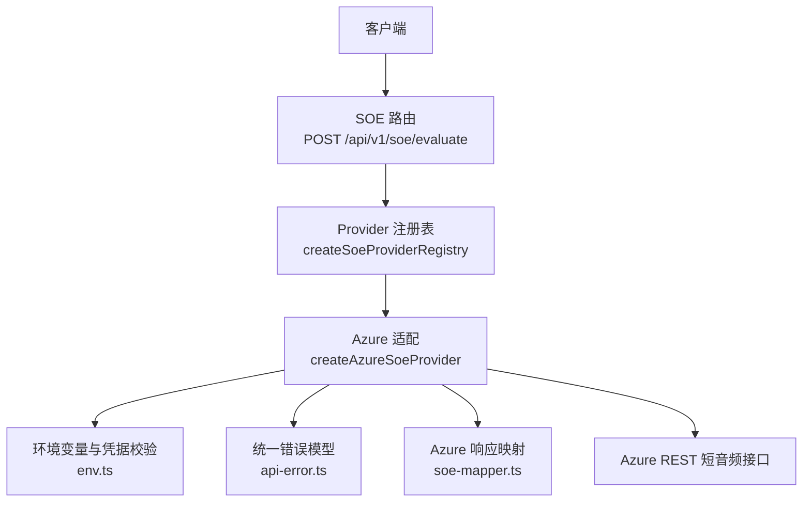
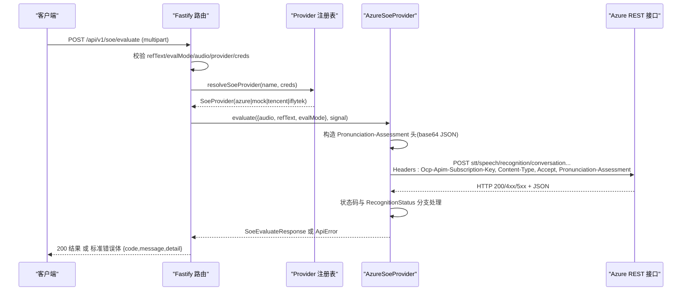
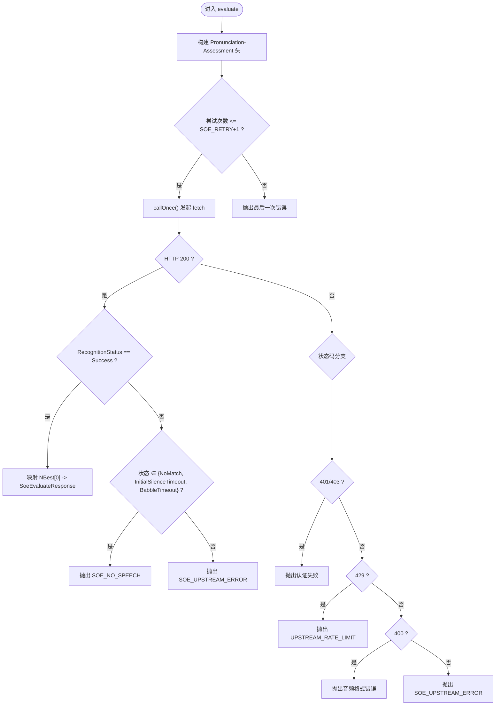
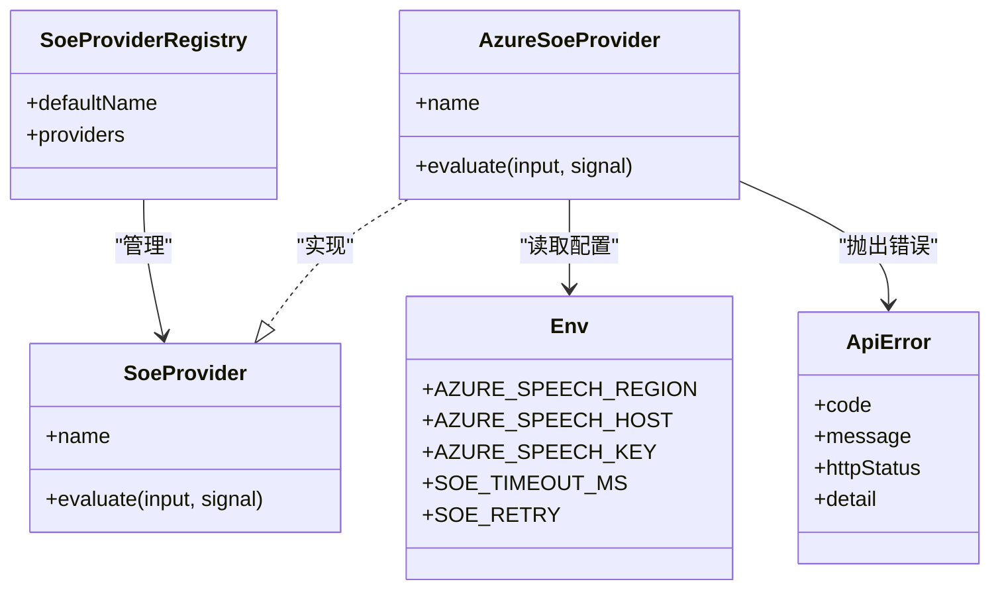

# Azure Speech Services 适配

<cite>
**本文引用的文件**   
- [server/src/services/soe/azure.provider.ts](file://server/src/services/soe/azure.provider.ts)
- [server/src/services/soe/soe-provider.ts](file://server/src/services/soe/soe-provider.ts)
- [server/src/services/soe/wav-pcm.ts](file://server/src/services/soe/wav-pcm.ts)
- [server/src/services/soe/index.ts](file://server/src/services/soe/index.ts)
- [server/src/routes/soe.route.ts](file://server/src/routes/soe.route.ts)
- [server/src/config/env.ts](file://server/src/config/env.ts)
- [server/src/lib/api-error.ts](file://server/src/lib/api-error.ts)
</cite>

## 目录
1. [引言](#引言)
2. [项目结构](#项目结构)
3. [核心组件](#核心组件)
4. [架构总览](#架构总览)
5. [详细组件分析](#详细组件分析)
6. [依赖关系分析](#依赖关系分析)
7. [性能与调优](#性能与调优)
8. [故障排查指南](#故障排查指南)
9. [结论](#结论)
10. [附录：配置示例](#附录配置示例)

## 引言
本技术文档聚焦于 Azure Speech Services 的发音评分（SOE）适配层，围绕 AzureSoeProvider 的实现细节展开，涵盖 Azure SDK/REST 集成方式、认证机制、音频格式转换（WAV 到 PCM）、流式处理逻辑、API 调用参数配置（区域、端点、速率限制）、错误处理与重试机制，并提供配置示例、常见问题解决方案以及性能调优建议与监控指标。

## 项目结构
本项目在服务端采用 Fastify 路由 + Provider 注册表模式组织 SOE 能力。Azure 适配位于 services/soe 下，通过统一接口 SoeProvider 暴露 evaluate 方法；路由层负责解析 multipart/form-data 请求、校验参数、选择 provider 并转发调用。

图表来源
- [server/src/routes/soe.route.ts:64-107](file://server/src/routes/soe.route.ts#L64-L107)
- [server/src/services/soe/index.ts:21-28](file://server/src/services/soe/index.ts#L21-L28)
- [server/src/services/soe/azure.provider.ts:24-108](file://server/src/services/soe/azure.provider.ts#L24-L108)
- [server/src/config/env.ts:56-83](file://server/src/config/env.ts#L56-L83)
- [server/src/lib/api-error.ts:6-35](file://server/src/lib/api-error.ts#L6-L35)

章节来源
- [server/src/routes/soe.route.ts:1-110](file://server/src/routes/soe.route.ts#L1-L110)
- [server/src/services/soe/index.ts:1-82](file://server/src/services/soe/index.ts#L1-L82)

## 核心组件
- SoeProvider 接口与契约类型：定义统一的输入输出契约，包括音素级评分、词级评分、准确度/流利度/完整度等字段。
- AzureSoeProvider：实现 Azure REST 短音频接口的调用、认证、参数构造、超时与重试、错误分类与映射。
- WAV/PCM 工具：提供从 WAV 中剥离头部的纯 PCM 载荷（当前 Azure 走 WAV 透传，该工具主要服务于其他 provider）。
- Provider 注册表：按环境凭据动态注册可用 provider，支持请求级凭据覆盖。
- 路由层：解析 multipart/form-data，校验参数，选择 provider，绑定客户端断开信号，返回标准化结果或错误。

章节来源
- [server/src/services/soe/soe-provider.ts:1-47](file://server/src/services/soe/soe-provider.ts#L1-L47)
- [server/src/services/soe/azure.provider.ts:1-110](file://server/src/services/soe/azure.provider.ts#L1-L110)
- [server/src/services/soe/wav-pcm.ts:1-24](file://server/src/services/soe/wav-pcm.ts#L1-L24)
- [server/src/services/soe/index.ts:1-82](file://server/src/services/soe/index.ts#L1-L82)
- [server/src/routes/soe.route.ts:1-110](file://server/src/routes/soe.route.ts#L1-L110)

## 架构总览
下图展示一次完整的发音评分请求从客户端到 Azure 上游的端到端流程，包含参数校验、provider 选择、认证、超时控制、重试与错误分类。

图表来源
- [server/src/routes/soe.route.ts:64-107](file://server/src/routes/soe.route.ts#L64-L107)
- [server/src/services/soe/index.ts:38-79](file://server/src/services/soe/index.ts#L38-L79)
- [server/src/services/soe/azure.provider.ts:28-101](file://server/src/services/soe/azure.provider.ts#L28-L101)

## 详细组件分析

### AzureSoeProvider 实现要点
- 端点与区域
  - 默认端点由 AZURE_SPEECH_REGION 生成；若设置 AZURE_SPEECH_HOST，则优先使用自定义域名。
  - 固定路径为 stt/speech/recognition/conversation/cognitiveservices/v1，查询参数 language=en-US&format=detailed。
- 认证机制
  - 使用 Ocp-Apim-Subscription-Key 头部进行认证，密钥来自 AZURE_SPEECH_KEY。
  - 启动时校验 AZURE_SPEECH_KEY 与 AZURE_SPEECH_REGION/AZURE_SPEECH_HOST 至少其一存在。
- 请求参数与 Pronunciation-Assessment 头
  - 将 ReferenceText、GradingSystem=HundredMark、Granularity=Phoneme、Dimension=Comprehensive、EnableMiscue=True、PhonemeAlphabet=IPA 序列化为 base64 字符串放入 Pronunciation-Assessment 头。
- 音频格式
  - Content-Type 指定 audio/wav; codecs=audio/pcm; samplerate=16000，直接透传 WAV 原数据。
- 超时与取消
  - 使用 AbortSignal.timeout(SOE_TIMEOUT_MS) 与客户端传入的 AbortController 合并，确保客户端断开时及时中止上游。
- 重试策略
  - 最多尝试 SOE_RETRY+1 次；仅当错误为网络异常或上游 5xx/429 时重试；客户端取消不重试。
- 响应处理
  - 200 且 RecognitionStatus=Success：取 NBest[0] 映射为 SoeEvaluateResponse。
  - NoMatch/InitialSilenceTimeout/BabbleTimeout：视为用户未说话，抛出 SOE_NO_SPEECH。
  - 其他非成功状态：抛出 SOE_UPSTREAM_ERROR。
  - 401/403：认证失败，提示检查 KEY/REGION/HOST。
  - 429：限流，抛出 UPSTREAM_RATE_LIMIT。
  - 400：通常为音频格式不符，抛出 SOE_UPSTREAM_ERROR。
  - 其他状态：包装为 SOE_UPSTREAM_ERROR。

图表来源
- [server/src/services/soe/azure.provider.ts:28-106](file://server/src/services/soe/azure.provider.ts#L28-L106)

章节来源
- [server/src/services/soe/azure.provider.ts:1-110](file://server/src/services/soe/azure.provider.ts#L1-L110)

### SoeProvider 接口与数据契约
- SoeInput：包含 audio(Buffer)、refText(string)、evalMode('sentence')。
- SoeEvaluateResponse：包含 total、accuracy、fluency、integrity、words[]；其中 words 包含 text、score、errorType、phonemes[]。
- SoeProvider：name 与 evaluate(input, signal?) 方法。

章节来源
- [server/src/services/soe/soe-provider.ts:1-47](file://server/src/services/soe/soe-provider.ts#L1-L47)

### WAV 到 PCM 转换工具
- stripWavHeader：从 RIFF/WAVE 结构中定位 data chunk，返回纯 PCM 载荷（subarray 视图，零拷贝）。
- 注意：Azure 适配直接使用 WAV 原数据，不走此函数；该工具主要用于其他 provider（如讯飞 raw 场景）。

章节来源
- [server/src/services/soe/wav-pcm.ts:1-24](file://server/src/services/soe/wav-pcm.ts#L1-L24)

### Provider 注册表与请求级凭据覆盖
- createSoeProviderRegistry：根据 env 中的凭据可用性注册 mock/azure/tencent/iflytek。
- resolveSoeProvider：支持请求级 creds 覆盖 env；若凭据齐全则现场构造 provider，否则回退到已注册的 provider。
- 请求级 creds 结构：azure.key/region/host、tencent.appId/secretId/secretKey、iflytek.appId/apiKey/apiSecret。

章节来源
- [server/src/services/soe/index.ts:1-82](file://server/src/services/soe/index.ts#L1-L82)

### 路由层与请求处理
- 解析 multipart/form-data：读取 file、fields(refText/evalMode/provider/creds)、audio。
- 参数校验：refText 必填且 ≤1000 字符；evalMode 固定 sentence；audio 非空且 ≤25MB。
- provider 选择：provider 可选，未指定则用默认；未知 provider 返回 BAD_REQUEST。
- 凭据解析：creds 为可选 JSON，非法或结构不符返回 BAD_REQUEST。
- 客户端断开：监听 socket close 触发 AbortController.abort()，向上游传递取消信号。
- 日志记录：记录 provider、是否携带请求级凭据、音频大小、参考文本前缀。

章节来源
- [server/src/routes/soe.route.ts:1-110](file://server/src/routes/soe.route.ts#L1-L110)

### 环境变量与配置校验
- 关键变量：
  - AZURE_SPEECH_REGION：Azure 语音服务区域。
  - AZURE_SPEECH_HOST：自定义 Azure 端点域名（优先于 REGION）。
  - AZURE_SPEECH_KEY：Azure 订阅密钥。
  - SOE_TIMEOUT_MS：上游超时毫秒数（默认 10000）。
  - SOE_RETRY：最大重试次数（默认 1，实际尝试次数 = retry+1）。
- 校验规则：
  - azureCredsOk：要求 AZURE_SPEECH_KEY 与 AZURE_SPEECH_REGION/AZURE_SPEECH_HOST 至少其一。
  - providerCredsOk：针对所选 provider 校验凭据齐备。
  - AZURE_SPEECH_HOST 必须以 http(s):// 开头。

章节来源
- [server/src/config/env.ts:1-116](file://server/src/config/env.ts#L1-L116)

### 统一错误模型
- ApiError：包含 code、message、httpStatus、detail。
- ERR 常量：BAD_REQUEST、PAYLOAD_TOO_LARGE、SOE_NO_SPEECH、UPSTREAM_RATE_LIMIT、UPSTREAM_TIMEOUT、SOE_UPSTREAM_ERROR、PROVIDER_UNAVAILABLE、INTERNAL。
- apiError：工厂函数，快速构造 ApiError。

章节来源
- [server/src/lib/api-error.ts:1-36](file://server/src/lib/api-error.ts#L1-L36)

## 依赖关系分析
- 路由层依赖注册表与环境变量，负责参数校验与 provider 选择。
- AzureSoeProvider 依赖环境变量、统一错误模型与 Azure REST 接口。
- 注册表依赖各 provider 创建函数与凭据校验函数。
- 所有 provider 共享 SoeProvider 接口与数据契约。

图表来源
- [server/src/services/soe/soe-provider.ts:40-47](file://server/src/services/soe/soe-provider.ts#L40-L47)
- [server/src/services/soe/azure.provider.ts:24-108](file://server/src/services/soe/azure.provider.ts#L24-L108)
- [server/src/services/soe/index.ts:14-28](file://server/src/services/soe/index.ts#L14-L28)
- [server/src/config/env.ts:9-34](file://server/src/config/env.ts#L9-L34)
- [server/src/lib/api-error.ts:6-35](file://server/src/lib/api-error.ts#L6-L35)

章节来源
- [server/src/services/soe/index.ts:1-82](file://server/src/services/soe/index.ts#L1-L82)
- [server/src/services/soe/azure.provider.ts:1-110](file://server/src/services/soe/azure.provider.ts#L1-L110)
- [server/src/config/env.ts:1-116](file://server/src/config/env.ts#L1-L116)
- [server/src/lib/api-error.ts:1-36](file://server/src/lib/api-error.ts#L1-L36)

## 性能与调优
- 超时与重试
  - SOE_TIMEOUT_MS：建议根据网络质量与业务 SLA 调整，默认 10s。
  - SOE_RETRY：建议保持 1，避免过度重试导致雪崩；仅在稳定网络环境下可考虑提高至 2。
- 音频大小与传输
  - 单文件上限 25MB；建议前端压缩或分片上传以降低带宽占用。
  - 使用 16kHz mono WAV 可减少不必要的编解码开销。
- 并发与连接池
  - Node.js 原生 fetch 复用 TCP 连接；在高并发场景下关注系统 fd 限制与内核参数。
- 资源监控
  - 监控上游延迟、错误率、重试次数、客户端取消比例。
  - 在路由层增加指标埋点：请求耗时、provider 分布、错误码分布。
- 缓存与降级
  - 对相同 refText 的短时重复请求可考虑本地缓存（需结合音频指纹）。
  - 上游不可用时自动降级到 mock 或返回友好错误。

## 故障排查指南
- 认证失败（401/403）
  - 检查 AZURE_SPEECH_KEY 是否正确。
  - 确认 AZURE_SPEECH_REGION 或 AZURE_SPEECH_HOST 配置正确。
- 音频格式错误（400）
  - 确保上传的是 16kHz mono WAV，Content-Type 为 audio/wav; codecs=audio/pcm; samplerate=16000。
  - 若使用其他 provider，可能需要先 stripWavHeader 获取 PCM。
- 未检测到语音（NoMatch/InitialSilenceTimeout/BabbleTimeout）
  - 提示用户重新朗读，或检查麦克风权限与音量。
- 限流（429）
  - 降低并发或增加重试间隔；必要时联系 Azure 提升配额。
- 上游超时
  - 增大 SOE_TIMEOUT_MS；检查网络连通性与 Azure 服务状态。
- Provider 未配置（503）
  - 检查 SOE_PROVIDER 与对应凭据是否齐全；或通过请求级 creds 临时覆盖。

章节来源
- [server/src/services/soe/azure.provider.ts:78-101](file://server/src/services/soe/azure.provider.ts#L78-L101)
- [server/src/lib/api-error.ts:18-29](file://server/src/lib/api-error.ts#L18-L29)
- [server/src/routes/soe.route.ts:64-107](file://server/src/routes/soe.route.ts#L64-L107)

## 结论
AzureSoeProvider 以简洁的 REST 调用与清晰的错误分类实现了稳定的发音评分能力。通过环境变量与请求级凭据的双重配置机制，系统在灵活性与安全性之间取得平衡。配合合理的超时、重试与监控策略，可在生产环境中提供高可用的 SOE 服务。

## 附录：配置示例
- 环境变量（.env）
  - AZURE_SPEECH_REGION=your-region
  - AZURE_SPEECH_KEY=your-subscription-key
  - SOE_PROVIDER=azure
  - SOE_TIMEOUT_MS=10000
  - SOE_RETRY=1
- 请求级凭据（multipart creds 字段，JSON 文本）
  - {"azure":{"key":"...","region":"...","host":"https://custom.cognitiveservices.azure.com"}}

章节来源
- [server/src/config/env.ts:9-34](file://server/src/config/env.ts#L9-L34)
- [server/src/routes/soe.route.ts:24-39](file://server/src/routes/soe.route.ts#L24-L39)