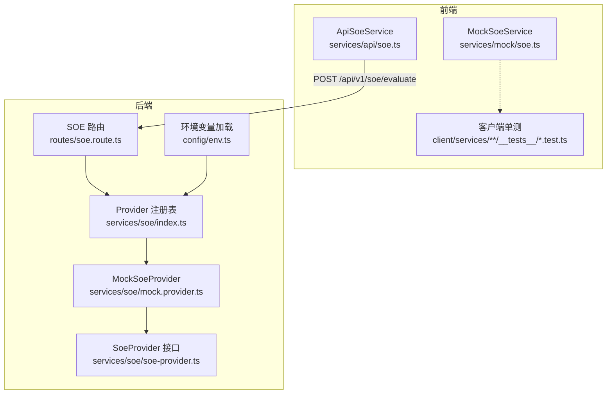
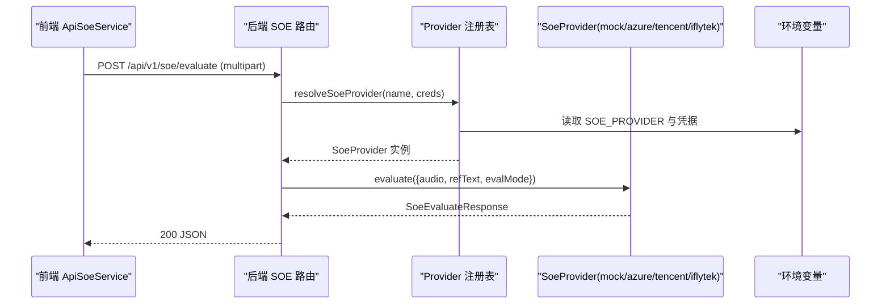
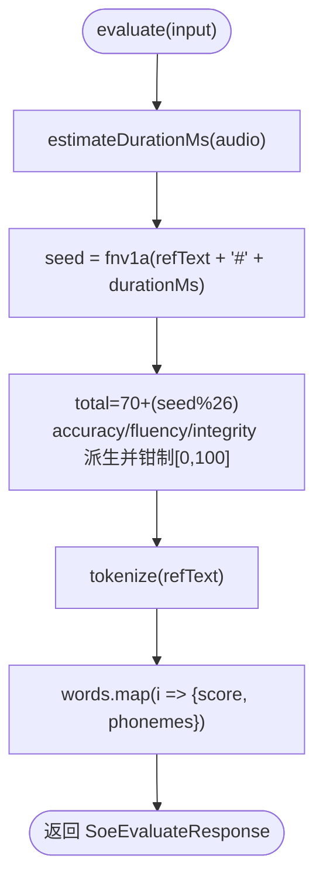
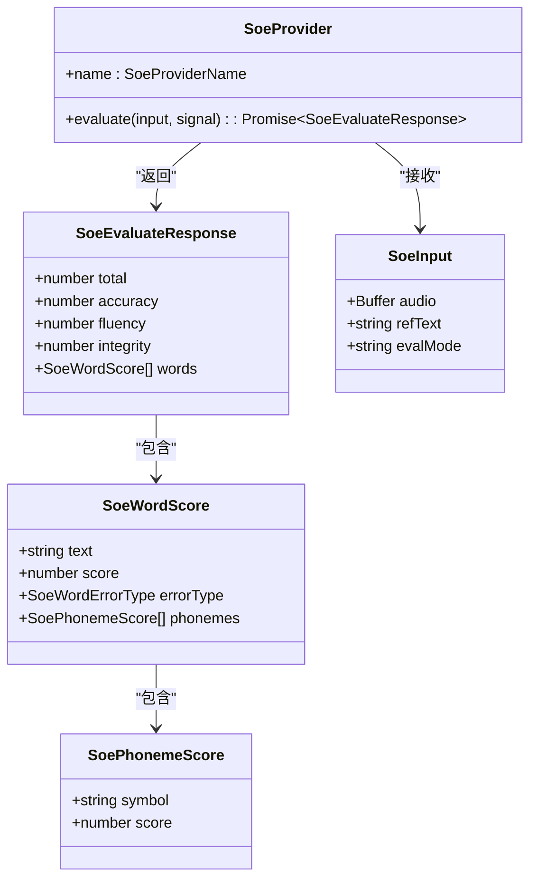
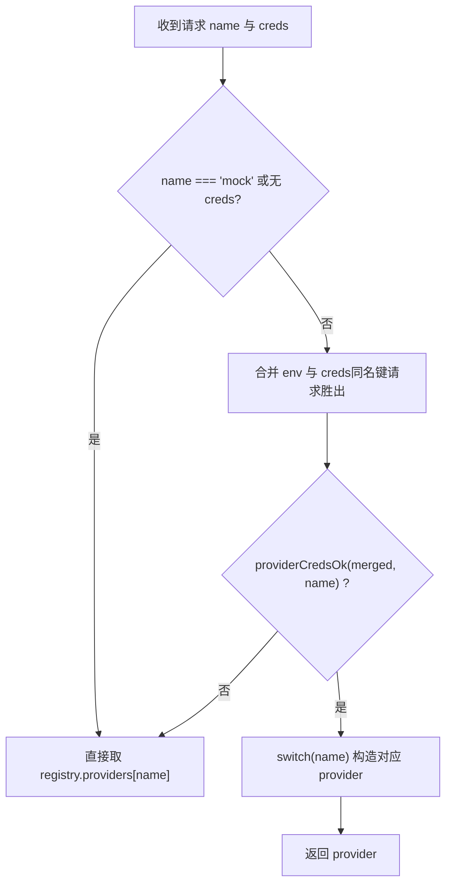
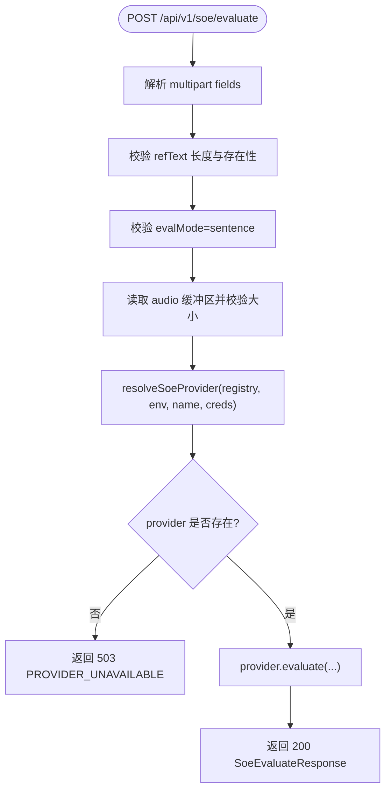
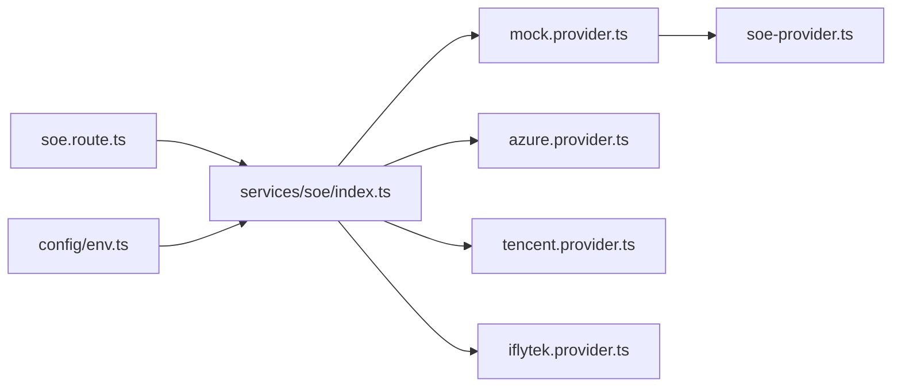

# Mock 测试提供商

<cite>
**本文引用的文件**   
- [server/src/services/soe/mock.provider.ts](file://server/src/services/soe/mock.provider.ts)
- [server/src/services/soe/soe-provider.ts](file://server/src/services/soe/soe-provider.ts)
- [server/src/services/soe/index.ts](file://server/src/services/soe/index.ts)
- [server/src/routes/soe.route.ts](file://server/src/routes/soe.route.ts)
- [server/src/config/env.ts](file://server/src/config/env.ts)
- [client/services/mock/__tests__/soe.test.ts](file://client/services/mock/__tests__/soe.test.ts)
- [client/services/api/__tests__/soe.test.ts](file://client/services/api/__tests__/soe.test.ts)
</cite>

## 目录
1. [引言](#引言)
2. [项目结构](#项目结构)
3. [核心组件](#核心组件)
4. [架构总览](#架构总览)
5. [详细组件分析](#详细组件分析)
6. [依赖关系分析](#依赖关系分析)
7. [性能与压力测试指南](#性能与压力测试指南)
8. [故障排查](#故障排查)
9. [结论](#结论)

## 引言
本文面向 Mock 测试提供商，重点解释服务端 Mock SoE（口语评测）实现、评分逻辑、响应数据结构、Mock 模式启用方式、测试覆盖与断言方法，以及 Mock 数据的生成规则与随机性控制。文档同时给出端到端调用序列图、类图和数据流图，帮助开发者在开发与测试环境中稳定使用 Mock 能力，并扩展真实 Provider 时保持契约一致。

## 项目结构
本仓库采用前后端分离结构：
- 前端 Next.js 应用位于 client，包含 UI、服务层与单元测试。
- 后端 Fastify 服务位于 server，提供 SOE 评估 API，并通过 Provider 注册表管理不同评分实现。
- Mock 能力同时存在于前端（MockSoeService）与服务端（MockSoeProvider），两者评分算法保持一致，便于端到端比对。

**图表来源**
- [server/src/routes/soe.route.ts:14-109](file://server/src/routes/soe.route.ts#L14-L109)
- [server/src/services/soe/index.ts:14-28](file://server/src/services/soe/index.ts#L14-L28)
- [server/src/services/soe/mock.provider.ts:64-82](file://server/src/services/soe/mock.provider.ts#L64-L82)
- [server/src/services/soe/soe-provider.ts:40-46](file://server/src/services/soe/soe-provider.ts#L40-L46)
- [server/src/config/env.ts:9-32](file://server/src/config/env.ts#L9-L32)

**章节来源**
- [server/src/routes/soe.route.ts:1-110](file://server/src/routes/soe.route.ts#L1-L110)
- [server/src/services/soe/index.ts:1-82](file://server/src/services/soe/index.ts#L1-L82)
- [server/src/services/soe/mock.provider.ts:1-83](file://server/src/services/soe/mock.provider.ts#L1-L83)
- [server/src/services/soe/soe-provider.ts:1-47](file://server/src/services/soe/soe-provider.ts#L1-L47)
- [server/src/config/env.ts:1-116](file://server/src/config/env.ts#L1-L116)

## 核心组件
- SoeProvider 接口与响应类型：定义统一的输入、输出与 Provider 抽象，确保 mock、azure、tencent、iflytek 等实现遵循同一契约。
- MockSoeProvider：基于 FNV-1a 哈希的确定性伪评分实现，对同一音频和参考文本产生稳定结果，便于端到端比对。
- Provider 注册表：默认注入 mock；其他 provider 按凭据条件注册；支持请求级凭据覆盖。
- SOE 路由：解析 multipart 表单、校验参数、选择 provider、调用 evaluate 并返回统一响应。
- 环境变量：集中配置 SOE_PROVIDER 与各 provider 密钥；mock 无需密钥。

**章节来源**
- [server/src/services/soe/soe-provider.ts:7-46](file://server/src/services/soe/soe-provider.ts#L7-L46)
- [server/src/services/soe/mock.provider.ts:9-82](file://server/src/services/soe/mock.provider.ts#L9-L82)
- [server/src/services/soe/index.ts:14-28](file://server/src/services/soe/index.ts#L14-L28)
- [server/src/routes/soe.route.ts:20-109](file://server/src/routes/soe.route.ts#L20-L109)
- [server/src/config/env.ts:9-32](file://server/src/config/env.ts#L9-L32)

## 架构总览
SOE 评估从前端发起，经 BFF 路由转发到后端，由注册表解析并选择具体 provider，最终返回结构化评分结果。Mock 模式通过环境变量或请求字段切换，且 mock 始终可用。

**图表来源**
- [server/src/routes/soe.route.ts:64-109](file://server/src/routes/soe.route.ts#L64-L109)
- [server/src/services/soe/index.ts:37-79](file://server/src/services/soe/index.ts#L37-L79)
- [server/src/config/env.ts:85-115](file://server/src/config/env.ts#L85-L115)

## 详细组件分析

### MockSoeProvider 设计与实现
MockSoeProvider 的核心目标是：
- 提供与前端 MockSoeService 一致的评分算法，保证端到端一致性。
- 以“参考文本 + 音频时长”为种子，生成稳定的 total、accuracy、fluency、integrity 分数。
- 将参考文本分词，并为每个词生成伪音标与词级分数。
- 所有数值均被钳制到合法区间，避免越界。

关键实现要点：
- FNV-1a 字符串哈希：用于生成确定性种子。
- WAV 时长估算：优先解析 RIFF/WAVE 头获取采样率与块对齐，回退到字节率估算。
- 分词与标点剥离：按空格切词，去除首尾非字母字符，保留撇号。
- 伪音标生成：基于元音映射与固定长度限制，结合种子偏移计算音素分数。
- 分数派生：total 范围 [70,95]，各维度分数钳制到 [0,100]。

**图表来源**
- [server/src/services/soe/mock.provider.ts:9-17](file://server/src/services/soe/mock.provider.ts#L9-L17)
- [server/src/services/soe/mock.provider.ts:19-36](file://server/src/services/soe/mock.provider.ts#L19-L36)
- [server/src/services/soe/mock.provider.ts:40-46](file://server/src/services/soe/mock.provider.ts#L40-L46)
- [server/src/services/soe/mock.provider.ts:48-62](file://server/src/services/soe/mock.provider.ts#L48-L62)
- [server/src/services/soe/mock.provider.ts:64-78](file://server/src/services/soe/mock.provider.ts#L64-L78)

**章节来源**
- [server/src/services/soe/mock.provider.ts:1-83](file://server/src/services/soe/mock.provider.ts#L1-L83)

### SoeProvider 接口与响应契约
SoeProvider 接口定义了统一的 evaluate 方法与 name 标识；SoeEvaluateResponse 描述总分、准确度、流利度、完整度与词级评分数组；SoeInput 描述音频 Buffer、参考文本与评估模式。

**图表来源**
- [server/src/services/soe/soe-provider.ts:7-46](file://server/src/services/soe/soe-provider.ts#L7-L46)

**章节来源**
- [server/src/services/soe/soe-provider.ts:1-47](file://server/src/services/soe/soe-provider.ts#L1-L47)

### Provider 注册表与请求级凭据
注册表默认注入 mock；其他 provider 根据环境变量中的凭据是否齐全决定是否注册。resolveSoeProvider 支持请求级凭据覆盖，合并后若仍不齐全则回落注册表；若齐全则现场构造 provider。

**图表来源**
- [server/src/services/soe/index.ts:37-79](file://server/src/services/soe/index.ts#L37-L79)
- [server/src/config/env.ts:56-83](file://server/src/config/env.ts#L56-L83)

**章节来源**
- [server/src/services/soe/index.ts:1-82](file://server/src/services/soe/index.ts#L1-L82)
- [server/src/config/env.ts:56-83](file://server/src/config/env.ts#L56-L83)

### SOE 路由与错误处理
路由负责：
- 解析 multipart 表单，校验 refText、evalMode、audio 大小与内容。
- 解析可选 provider 与 creds，校验 provider 名称合法性。
- 通过 resolveSoeProvider 获取 provider；若未配置则返回 503。
- 监听 socket close 中止上游请求，记录日志并返回统一响应。

**图表来源**
- [server/src/routes/soe.route.ts:64-109](file://server/src/routes/soe.route.ts#L64-L109)

**章节来源**
- [server/src/routes/soe.route.ts:1-110](file://server/src/routes/soe.route.ts#L1-L110)

### 环境变量与 Mock 模式启用
- SOE_PROVIDER 枚举包含 mock、azure、tencent、iflytek，默认值为 mock。
- 当 SOE_PROVIDER=mock 时，无需任何第三方凭据即可启动。
- 其他 provider 需要相应凭据；若缺失则启动失败（仅默认 provider）。
- 请求级 provider 字段可覆盖默认实现，但必须为已注册 provider。

**章节来源**
- [server/src/config/env.ts:9-32](file://server/src/config/env.ts#L9-L32)
- [server/src/config/env.ts:85-115](file://server/src/config/env.ts#L85-L115)
- [server/src/services/soe/index.ts:21-28](file://server/src/services/soe/index.ts#L21-L28)
- [server/src/routes/soe.route.ts:82-96](file://server/src/routes/soe.route.ts#L82-L96)

## 依赖关系分析
- 路由依赖注册表与环境变量，注册表依赖各 provider 工厂函数。
- MockSoeProvider 依赖 soe-provider 的类型定义，不依赖外部网络。
- 前端测试验证 MockSoeService 的确定性与结构约束；API 层测试验证 multipart 组装与错误映射。

**图表来源**
- [server/src/routes/soe.route.ts:14-19](file://server/src/routes/soe.route.ts#L14-L19)
- [server/src/services/soe/index.ts:7-12](file://server/src/services/soe/index.ts#L7-L12)
- [server/src/services/soe/mock.provider.ts:7-7](file://server/src/services/soe/mock.provider.ts#L7-L7)
- [server/src/config/env.ts:1-8](file://server/src/config/env.ts#L1-L8)

**章节来源**
- [server/src/routes/soe.route.ts:14-19](file://server/src/routes/soe.route.ts#L14-L19)
- [server/src/services/soe/index.ts:7-12](file://server/src/services/soe/index.ts#L7-L12)
- [server/src/services/soe/mock.provider.ts:7-7](file://server/src/services/soe/mock.provider.ts#L7-L7)
- [server/src/config/env.ts:1-8](file://server/src/config/env.ts#L1-L8)

## 性能与压力测试指南
- 确定性评分：MockSoeProvider 使用哈希种子派生分数，时间复杂度主要取决于音频时长估算与分词，整体开销极低，适合高频压测。
- 音频上限：路由限制 25MB，避免内存压力；建议压测时使用短静音 WAV 或 PCM 片段。
- 并发与中止：路由监听 socket close 触发 AbortController，防止长连接阻塞；压测时应模拟客户端断开场景验证中止路径。
- 基准建议：
  - 单次评估延迟：以短音频（如 1s 静音 WAV）多次调用，统计 p50/p95。
  - 吞吐能力：并发 N 个请求，观察 CPU 与内存增长，确认无泄漏。
  - 边界条件：空音频、超长 refText、非法 evalMode、未知 provider、缺失凭据等。

[本节为通用指导，不涉及具体代码行]

## 故障排查
常见问题与定位方法：
- 返回 400 BAD_REQUEST：refText 为空或超长、evalMode 非 sentence、音频为空或超大、creds 非合法 JSON 或结构不符。
- 返回 413 PAYLOAD_TOO_LARGE：音频超过 25MB。
- 返回 503 PROVIDER_UNAVAILABLE：所选 provider 未在服务端配置（缺少对应密钥）。
- 中止异常：客户端断开导致 ABORTED；前端应捕获并静默处理。

**章节来源**
- [server/src/routes/soe.route.ts:66-106](file://server/src/routes/soe.route.ts#L66-L106)
- [server/src/config/env.ts:85-115](file://server/src/config/env.ts#L85-L115)

## 结论
MockSoeProvider 提供了稳定、可复现的口语评测评分能力，配合注册表与路由实现了灵活的 Provider 切换与请求级凭据覆盖。通过环境变量 SOE_PROVIDER=mock 即可在开发环境快速启用 Mock 模式，无需第三方凭据。前端与后端的 Mock 实现保持一致，便于端到端比对与回归测试。建议在压测中关注音频大小、并发中止与边界条件，确保系统在 Mock 模式下具备高可用与高性能表现。