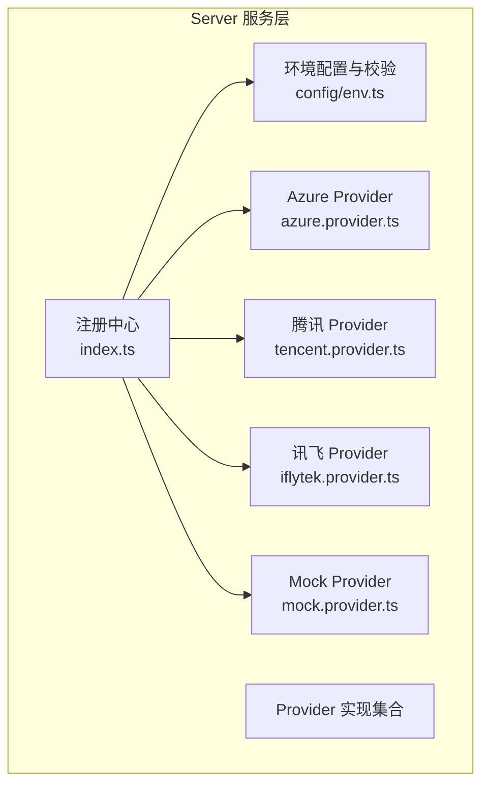
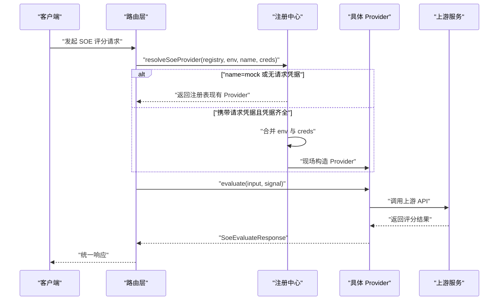
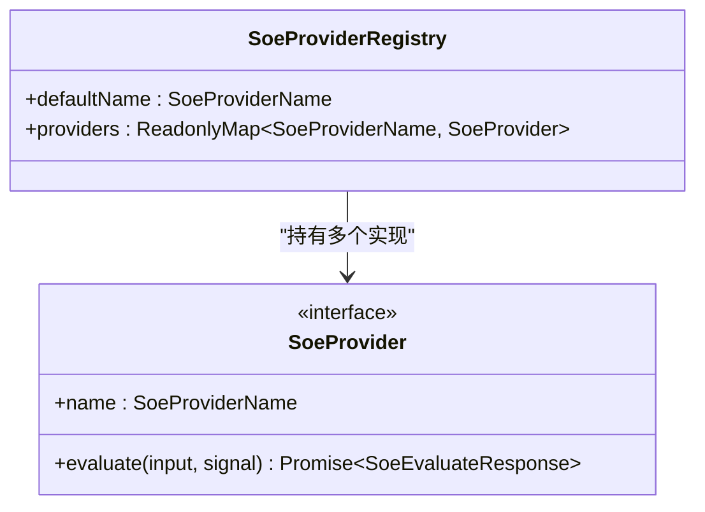
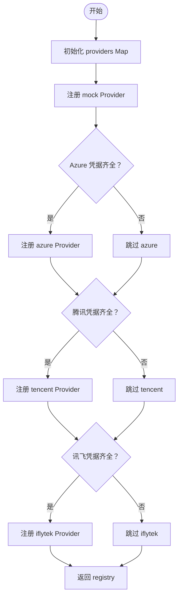
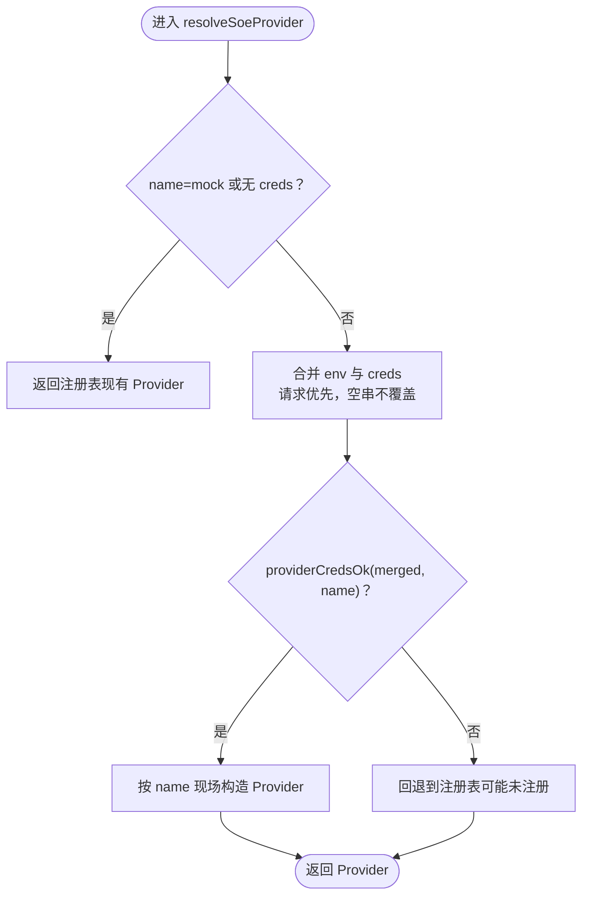
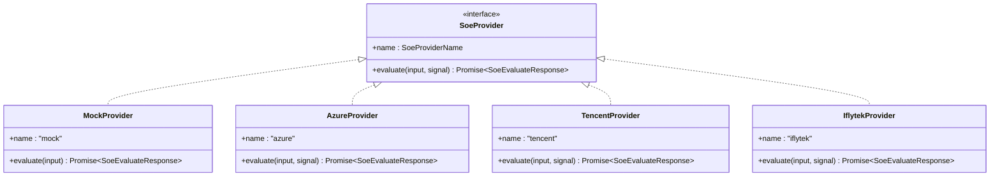
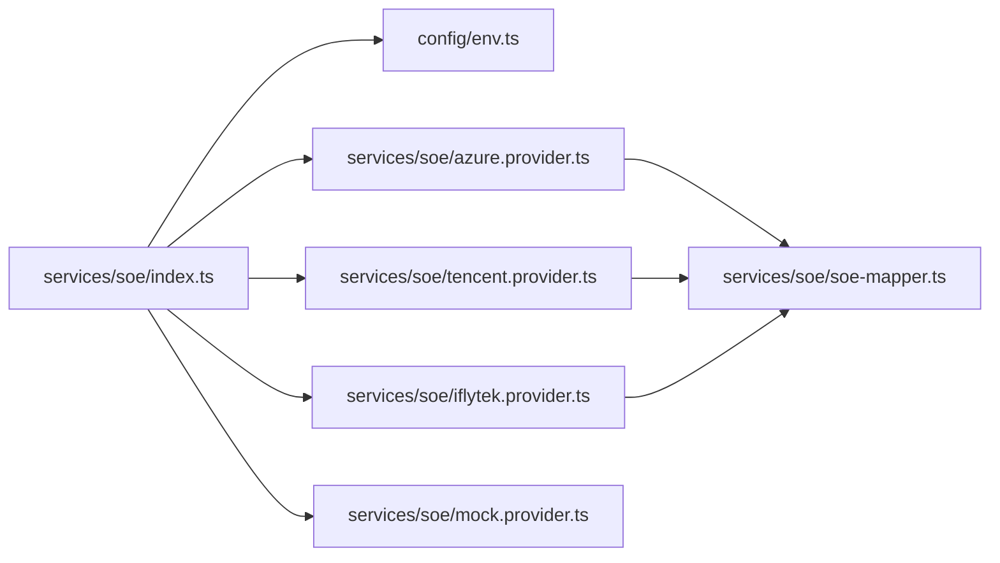

# Provider 注册中心

<cite>
**本文引用的文件**   
- [server/src/services/soe/index.ts](file://server/src/services/soe/index.ts)
- [server/src/services/soe/soe-provider.ts](file://server/src/services/soe/soe-provider.ts)
- [server/src/config/env.ts](file://server/src/config/env.ts)
- [server/src/services/soe/mock.provider.ts](file://server/src/services/soe/mock.provider.ts)
- [server/src/services/soe/azure.provider.ts](file://server/src/services/soe/azure.provider.ts)
- [server/src/services/soe/tencent.provider.ts](file://server/src/services/soe/tencent.provider.ts)
- [server/src/services/soe/iflytek.provider.ts](file://server/src/services/soe/iflytek.provider.ts)
</cite>

## 目录
1. [简介](#简介)
2. [项目结构定位](#项目结构定位)
3. [核心组件](#核心组件)
4. [架构总览](#架构总览)
5. [详细组件分析](#详细组件分析)
6. [依赖关系分析](#依赖关系分析)
7. [性能与可扩展性](#性能与可扩展性)
8. [配置示例](#配置示例)
9. [故障排除指南](#故障排除指南)
10. [结论](#结论)

## 简介
本文聚焦 SOE（口语评测）Provider 注册中心，围绕 SoeProviderRegistry 接口、createSoeProviderRegistry 初始化流程、resolveSoeProvider 请求级密钥解析逻辑、SoeRequestCreds 字段语义、Provider 生命周期与错误处理进行系统化说明。目标是帮助开发者理解：
- 如何通过环境变量与请求级凭据动态选择并实例化不同上游 Provider；
- mock、Azure、腾讯云、科大讯飞四种 Provider 的契约与行为差异；
- 在运行时合并 env 与请求 creds 的优先级规则；
- 如何正确配置、排查问题并进行性能优化。

## 项目结构定位
SOE Provider 注册中心位于 server 端服务层，负责：
- 根据启动期环境变量加载并校验配置；
- 按需注册可用 Provider；
- 在请求阶段按 provider 名与可选请求级凭据解析最终 Provider 实例；
- 将统一 SoeInput 输入映射到各上游 API，并返回统一 SoeEvaluateResponse。

**图示来源**
- [server/src/services/soe/index.ts:21-28](file://server/src/services/soe/index.ts#L21-L28)
- [server/src/config/env.ts:85-115](file://server/src/config/env.ts#L85-L115)

**章节来源**
- [server/src/services/soe/index.ts:1-82](file://server/src/services/soe/index.ts#L1-L82)
- [server/src/config/env.ts:1-116](file://server/src/config/env.ts#L1-L116)

## 核心组件
- SoeProviderRegistry：定义默认 Provider 名称与已注册 Provider 集合，是注册表对外暴露的核心类型。
- createSoeProviderRegistry：基于环境变量构造注册表，仅注册凭据齐备的 Provider，mock 恒在。
- resolveSoeProvider：请求级解析函数，支持以 multipart creds 覆盖 env，并在凭据齐全时现场构造 Provider。
- SoeRequestCreds：请求级凭据结构，字段全可选，用于临时覆盖或补充某 Provider 的鉴权参数。
- SoeProvider 接口：所有 Provider 的统一抽象，包含 name 与 evaluate 方法。

**章节来源**
- [server/src/services/soe/index.ts:14-28](file://server/src/services/soe/index.ts#L14-L28)
- [server/src/services/soe/index.ts:30-79](file://server/src/services/soe/index.ts#L30-L79)
- [server/src/services/soe/soe-provider.ts:40-46](file://server/src/services/soe/soe-provider.ts#L40-L46)

## 架构总览
注册中心在应用启动时完成 Provider 注册，在请求阶段完成 Provider 解析与调用。

**图示来源**
- [server/src/services/soe/index.ts:37-79](file://server/src/services/soe/index.ts#L37-L79)
- [server/src/services/soe/azure.provider.ts:24-109](file://server/src/services/soe/azure.provider.ts#L24-L109)
- [server/src/services/soe/tencent.provider.ts:50-191](file://server/src/services/soe/tencent.provider.ts#L50-L191)
- [server/src/services/soe/iflytek.provider.ts:54-235](file://server/src/services/soe/iflytek.provider.ts#L54-L235)

## 详细组件分析

### SoeProviderRegistry 接口设计
- defaultName：来自 SOE_PROVIDER 环境变量，表示默认 Provider。
- providers：不可变 Map，键为 SoeProviderName，值为 SoeProvider 实例。
- 设计要点：
  - 通过 ReadonlyMap 暴露只读视图，避免外部篡改。
  - mock 恒在，便于联调与降级。
  - 其他 Provider 仅在凭据齐全时注册，未注册时调用方应返回 503 PROVIDER_UNAVAILABLE。

**图示来源**
- [server/src/services/soe/index.ts:14-19](file://server/src/services/soe/index.ts#L14-L19)
- [server/src/services/soe/soe-provider.ts:40-46](file://server/src/services/soe/soe-provider.ts#L40-L46)

**章节来源**
- [server/src/services/soe/index.ts:14-19](file://server/src/services/soe/index.ts#L14-L19)
- [server/src/services/soe/soe-provider.ts:40-46](file://server/src/services/soe/soe-provider.ts#L40-L46)

### createSoeProviderRegistry 初始化流程
初始化步骤：
1. 创建空 Map，并注入 mock Provider。
2. 检查 Azure 凭据是否齐全，若齐全则注册 azure Provider。
3. 检查腾讯凭据是否齐全，若齐全则注册 tencent Provider。
4. 检查讯飞凭据是否齐全，若齐全则注册 iflytek Provider。
5. 返回 defaultName 与 providers。

关键约束：
- 启动期 loadEnv 会校验默认 Provider 的凭据是否齐全；缺失则直接抛错，阻止服务启动。
- 非默认 Provider 允许暂缺凭据（不注册），请求指定该 Provider 时返回 503。

**图示来源**
- [server/src/services/soe/index.ts:21-28](file://server/src/services/soe/index.ts#L21-L28)
- [server/src/config/env.ts:56-83](file://server/src/config/env.ts#L56-L83)
- [server/src/config/env.ts:85-115](file://server/src/config/env.ts#L85-L115)

**章节来源**
- [server/src/services/soe/index.ts:21-28](file://server/src/services/soe/index.ts#L21-L28)
- [server/src/config/env.ts:56-115](file://server/src/config/env.ts#L56-L115)

### resolveSoeProvider 请求级密钥解析逻辑
目标：在请求阶段决定使用哪个 Provider 实例，支持以请求级凭据覆盖环境变量。

解析策略：
- 若 name 为 mock 或未携带请求凭据：直接返回注册表现有 Provider。
- 否则，合并 env 与 creds：
  - 同名字段请求优先；
  - 空字符串视为“未提供”，不覆盖 env；
  - 分别映射到对应 Provider 的环境变量键。
- 合并后仍不齐：回退到注册表（可能未注册，调用方按 503 处理）。
- 合并后凭据齐全：现场构造 Provider（轻量闭包，无需缓存）。

**图示来源**
- [server/src/services/soe/index.ts:37-79](file://server/src/services/soe/index.ts#L37-L79)
- [server/src/config/env.ts:71-83](file://server/src/config/env.ts#L71-L83)

**章节来源**
- [server/src/services/soe/index.ts:37-79](file://server/src/services/soe/index.ts#L37-L79)
- [server/src/config/env.ts:71-83](file://server/src/config/env.ts#L71-L83)

### SoeRequestCreds 字段定义与使用场景
SoeRequestCreds 是请求级凭据结构，字段全可选，用于临时覆盖或补充某 Provider 的鉴权参数。典型使用场景：
- 多租户或多账号场景：每个请求可携带独立密钥，而不修改全局环境变量。
- 灰度或 A/B 测试：对特定请求切换到备用 Provider 或不同区域端点。
- 安全隔离：敏感凭据由前端或网关传入，服务端仅用于本次请求。

字段映射：
- azure：key、region、host → AZURE_SPEECH_KEY / AZURE_SPEECH_REGION / AZURE_SPEECH_HOST
- tencent：appId、secretId、secretKey → TENCENT_APP_ID / TENCENT_SECRET_ID / TENCENT_SECRET_KEY
- iflytek：appId、apiKey、apiSecret → IFLYTEK_APP_ID / IFLYTEK_API_KEY / IFLYTEK_API_SECRET

注意：
- 空字符串被视为“未提供”，不会覆盖 env。
- 只有当合并后的凭据齐全时，才会现场构造 Provider；否则回退到注册表。

**章节来源**
- [server/src/services/soe/index.ts:30-35](file://server/src/services/soe/index.ts#L30-L35)
- [server/src/services/soe/index.ts:47-65](file://server/src/services/soe/index.ts#L47-L65)

### Provider 实现与生命周期
- mock：确定性伪评分，便于端到端比对与联调。
- azure：REST 短音频接口，带 Pronunciation-Assessment 头，支持重试与超时控制。
- tencent：WebSocket 录音模式整段上传，握手成功后发送二进制帧与结束标记。
- iflytek：WebSocket 流式 ISE，分帧发送 PCM，累积 XML 结果后解析。

生命周期要点：
- 启动期：根据环境变量注册 Provider；默认 Provider 必须凭据齐全，否则启动失败。
- 请求期：根据 name 与 creds 解析 Provider；若凭据齐全则现场构造，否则回退注册表。
- 调用期：各 Provider 内部实现超时、重试、错误码映射与资源清理。

**图示来源**
- [server/src/services/soe/soe-provider.ts:40-46](file://server/src/services/soe/soe-provider.ts#L40-L46)
- [server/src/services/soe/mock.provider.ts:80-82](file://server/src/services/soe/mock.provider.ts#L80-L82)
- [server/src/services/soe/azure.provider.ts:24-109](file://server/src/services/soe/azure.provider.ts#L24-L109)
- [server/src/services/soe/tencent.provider.ts:50-191](file://server/src/services/soe/tencent.provider.ts#L50-L191)
- [server/src/services/soe/iflytek.provider.ts:54-235](file://server/src/services/soe/iflytek.provider.ts#L54-L235)

**章节来源**
- [server/src/services/soe/mock.provider.ts:1-83](file://server/src/services/soe/mock.provider.ts#L1-L83)
- [server/src/services/soe/azure.provider.ts:1-110](file://server/src/services/soe/azure.provider.ts#L1-L110)
- [server/src/services/soe/tencent.provider.ts:1-193](file://server/src/services/soe/tencent.provider.ts#L1-L193)
- [server/src/services/soe/iflytek.provider.ts:1-236](file://server/src/services/soe/iflytek.provider.ts#L1-L236)

## 依赖关系分析
注册中心依赖环境配置模块进行校验与默认 Provider 保障；Provider 实现依赖各自的上游协议与鉴权逻辑。

**图示来源**
- [server/src/services/soe/index.ts:7-12](file://server/src/services/soe/index.ts#L7-L12)
- [server/src/services/soe/azure.provider.ts:16-19](file://server/src/services/soe/azure.provider.ts#L16-L19)
- [server/src/services/soe/tencent.provider.ts:15-20](file://server/src/services/soe/tencent.provider.ts#L15-L20)
- [server/src/services/soe/iflytek.provider.ts:13-20](file://server/src/services/soe/iflytek.provider.ts#L13-L20)

**章节来源**
- [server/src/services/soe/index.ts:7-12](file://server/src/services/soe/index.ts#L7-L12)

## 性能与可扩展性
- 启动期注册：仅注册凭据齐全的 Provider，减少无效对象创建。
- 请求期按需构造：当请求级凭据齐全时现场构造 Provider，避免缓存复杂对象带来的内存压力。
- 超时与重试：各 Provider 统一遵循 SOE_TIMEOUT_MS 与 SOE_RETRY 配置，提升鲁棒性。
- WebSocket 会话：腾讯与讯飞采用一次性会话，每次重试重建连接，避免状态污染。
- 扩展新 Provider：
  - 新增 SoeProviderName 枚举值；
  - 实现 SoeProvider 接口；
  - 在 createSoeProviderRegistry 中按凭据条件注册；
  - 在 resolveSoeProvider 中增加合并与构造分支。

建议：
- 在高并发场景下，若同一 Provider 的凭据稳定，可在上层缓存 Provider 实例，减少重复构造开销。
- 对上游限流与超时进行监控与告警，结合 SOE_RETRY 合理设置重试次数。
- 对音频格式与大小进行前置校验，避免无效请求浪费上游资源。

[本节为通用指导，不直接分析具体文件]

## 配置示例
以下为常见环境变量配置示例（请根据实际环境调整）：

- 开发联调（mock）
  - SOE_PROVIDER=mock

- Azure 主方案
  - SOE_PROVIDER=azure
  - AZURE_SPEECH_KEY=<your-key>
  - AZURE_SPEECH_REGION=<your-region>
  - 或 AZURE_SPEECH_HOST=https://your-host.cognitiveservices.azure.com

- 腾讯云
  - SOE_PROVIDER=tencent
  - TENCENT_APP_ID=<your-app-id>
  - TENCENT_SECRET_ID=<your-secret-id>
  - TENCENT_SECRET_KEY=<your-secret-key>

- 科大讯飞
  - SOE_PROVIDER=iflytek
  - IFLYTEK_APP_ID=<your-app-id>
  - IFLYTEK_API_KEY=<your-api-key>
  - IFLYTEK_API_SECRET=<your-api-secret>
  - IFLYTEK_FRAME_INTERVAL_MS=40

- 上游超时与重试
  - SOE_TIMEOUT_MS=10000
  - SOE_RETRY=1

注意事项：
- AZURE_SPEECH_HOST 必须以 http(s):// 开头。
- 默认 Provider 的凭据必须齐全，否则服务启动失败。
- 非默认 Provider 可暂缺凭据，请求指定时会返回 503。

**章节来源**
- [server/src/config/env.ts:9-32](file://server/src/config/env.ts#L9-L32)
- [server/src/config/env.ts:94-115](file://server/src/config/env.ts#L94-L115)

## 故障排除指南
常见问题与处理建议：

- 启动失败：默认 Provider 凭据缺失
  - 现象：服务启动时报错提示缺少某 Provider 的凭据。
  - 处理：检查 SOE_PROVIDER 指向的 Provider 所需环境变量是否齐全。

- 请求返回 503 PROVIDER_UNAVAILABLE
  - 现象：请求指定了未注册的 Provider。
  - 处理：确认该 Provider 的凭据已在环境变量中配置，或在请求级 creds 中提供。

- Azure 认证失败
  - 现象：HTTP 401/403 或上游返回认证错误。
  - 处理：检查 AZURE_SPEECH_KEY 与 AZURE_SPEECH_REGION/AZURE_SPEECH_HOST 是否正确。

- 腾讯鉴权失败或并发超限
  - 现象：WS 握手失败或错误码 4002/4006。
  - 处理：检查 TENCENT_APP_ID/TENCENT_SECRET_ID/TENCENT_SECRET_KEY；降低并发或等待限流恢复。

- 讯飞签名错误或握手失败
  - 现象：WS 握手 401 或错误码 1016x。
  - 处理：检查 IFLYTEK_APP_ID/IFLYTEK_API_KEY/IFLYTEK_API_SECRET；确保 date 新鲜。

- 未检测到语音
  - 现象：上游返回 NoMatch/InitialSilenceTimeout/BabbleTimeout 或等价错误。
  - 处理：引导用户重新朗读，检查麦克风权限与音频采集质量。

- 音频格式不符
  - 现象：上游拒绝音频数据（非 RIFF/WAVE、非 16k mono PCM）。
  - 处理：在前端或服务端统一音频格式，确保 16kHz 单声道 PCM。

**章节来源**
- [server/src/config/env.ts:94-115](file://server/src/config/env.ts#L94-L115)
- [server/src/services/soe/azure.provider.ts:78-100](file://server/src/services/soe/azure.provider.ts#L78-L100)
- [server/src/services/soe/tencent.provider.ts:36-48](file://server/src/services/soe/tencent.provider.ts#L36-L48)
- [server/src/services/soe/iflytek.provider.ts:34-37](file://server/src/services/soe/iflytek.provider.ts#L34-L37)

## 结论
SOE Provider 注册中心通过清晰的接口设计与严格的凭据校验，实现了 Provider 的动态注册与请求级密钥解析。其优势在于：
- 启动期保障默认 Provider 可用性；
- 请求期灵活覆盖凭据，支持多租户与灰度切换；
- 统一超时与重试策略，提升系统鲁棒性；
- 扩展性强，易于接入新的上游 Provider。

在实际使用中，建议：
- 严格配置环境变量，确保默认 Provider 凭据齐全；
- 合理使用请求级 creds，避免泄露敏感信息；
- 监控上游限流与超时，合理设置重试次数；
- 对音频格式与大小进行前置校验，减少无效请求。

[本节为总结性内容，不直接分析具体文件]