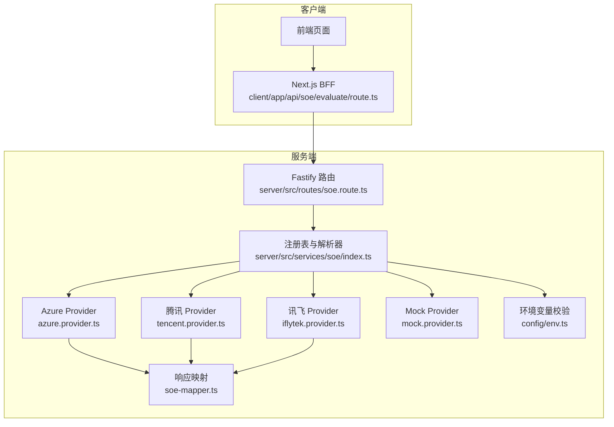
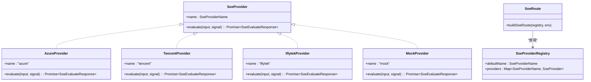
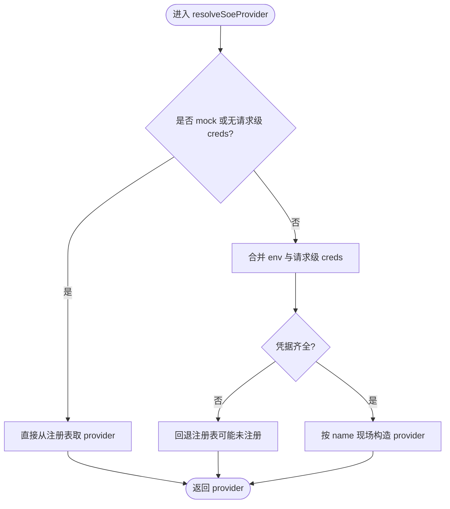
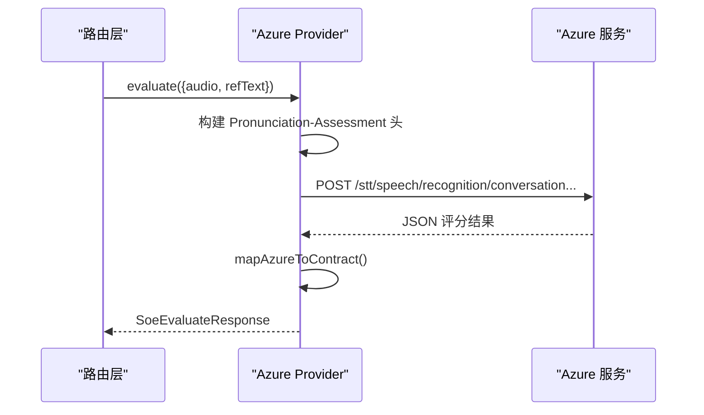
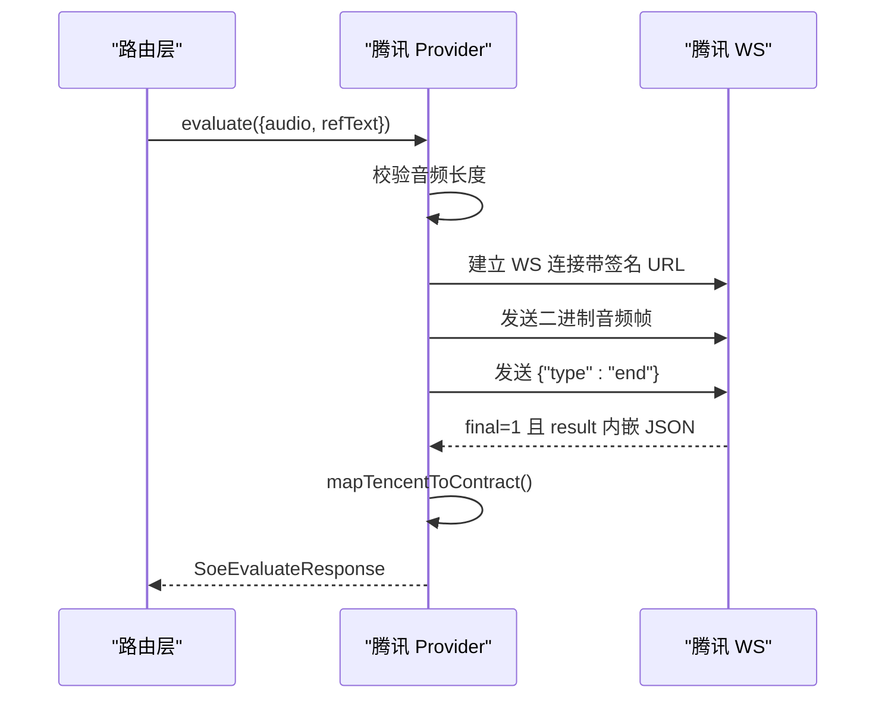
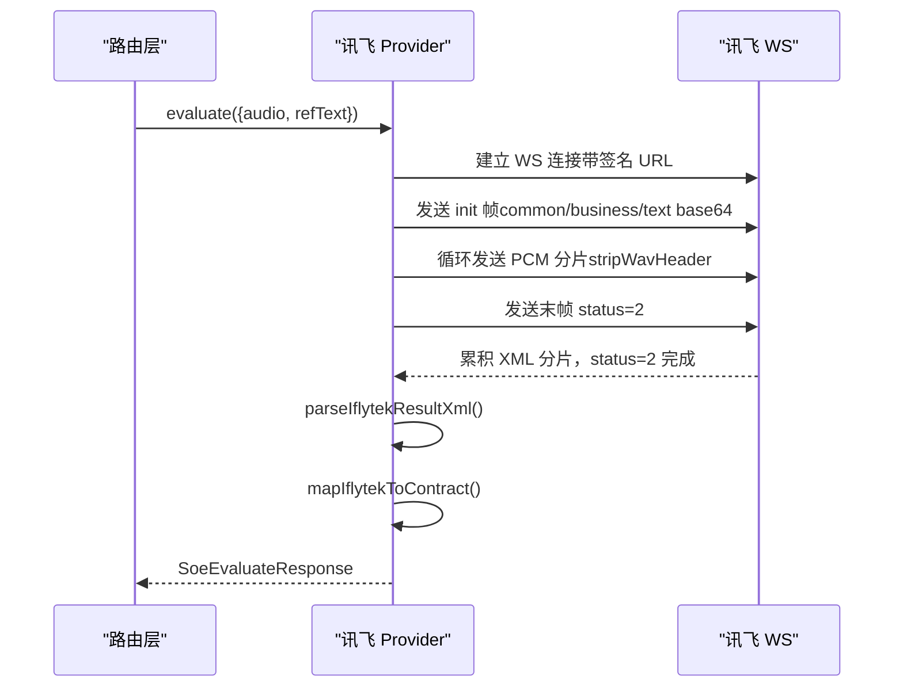
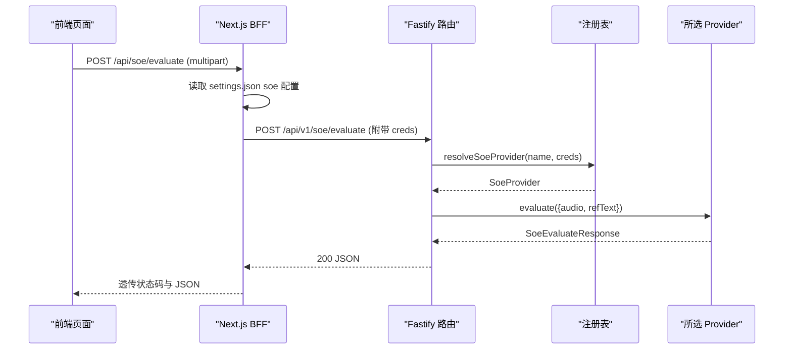
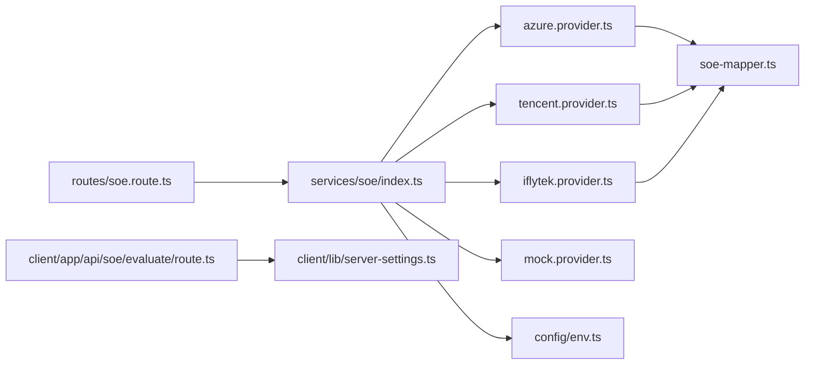

# 多厂商适配层

<cite>
**本文引用的文件**   
- [server/src/services/soe/index.ts](file://server/src/services/soe/index.ts)
- [server/src/services/soe/soe-provider.ts](file://server/src/services/soe/soe-provider.ts)
- [server/src/services/soe/azure.provider.ts](file://server/src/services/soe/azure.provider.ts)
- [server/src/services/soe/tencent.provider.ts](file://server/src/services/soe/tencent.provider.ts)
- [server/src/services/soe/iflytek.provider.ts](file://server/src/services/soe/iflytek.provider.ts)
- [server/src/services/soe/mock.provider.ts](file://server/src/services/soe/mock.provider.ts)
- [server/src/services/soe/soe-mapper.ts](file://server/src/services/soe/soe-mapper.ts)
- [server/src/config/env.ts](file://server/src/config/env.ts)
- [server/src/routes/soe.route.ts](file://server/src/routes/soe.route.ts)
- [client/app/api/soe/evaluate/route.ts](file://client/app/api/soe/evaluate/route.ts)
- [client/lib/server-settings.ts](file://client/lib/server-settings.ts)
- [client/types/api.ts](file://client/types/api.ts)
</cite>

## 目录
1. [引言](#引言)
2. [项目结构](#项目结构)
3. [核心组件](#核心组件)
4. [架构总览](#架构总览)
5. [详细组件分析](#详细组件分析)
6. [依赖关系分析](#依赖关系分析)
7. [性能与可靠性](#性能与可靠性)
8. [配置与厂商切换](#配置与厂商切换)
9. [新厂商接入指南](#新厂商接入指南)
10. [故障排除指南](#故障排除指南)
11. [结论](#结论)

## 引言
本技术文档聚焦 SOE（口语评测）多厂商适配层，目标是帮助开发者理解并扩展该适配层：统一抽象 SoeProvider、注册与动态加载策略、Azure Speech Services / 腾讯云 / 讯飞的具体实现差异、Mock 提供商的测试用途，以及新增厂商的接入规范、认证配置、厂商切换方法与常见问题排查。

## 项目结构
SOE 适配层位于服务端 services/soe 目录，由路由层暴露 REST API，前端 Next.js BFF 负责读取用户 settings.json 中的 soe 配置，并将所选厂商密钥以 multipart creds 字段注入后端请求。

**图表来源**
- [server/src/routes/soe.route.ts:1-110](file://server/src/routes/soe.route.ts#L1-L110)
- [server/src/services/soe/index.ts:1-82](file://server/src/services/soe/index.ts#L1-L82)
- [server/src/services/soe/azure.provider.ts:1-110](file://server/src/services/soe/azure.provider.ts#L1-L110)
- [server/src/services/soe/tencent.provider.ts:1-193](file://server/src/services/soe/tencent.provider.ts#L1-L193)
- [server/src/services/soe/iflytek.provider.ts:1-236](file://server/src/services/soe/iflytek.provider.ts#L1-L236)
- [server/src/services/soe/mock.provider.ts:1-83](file://server/src/services/soe/mock.provider.ts#L1-L83)
- [server/src/services/soe/soe-mapper.ts:1-155](file://server/src/services/soe/soe-mapper.ts#L1-L155)
- [server/src/config/env.ts:1-116](file://server/src/config/env.ts#L1-L116)
- [client/app/api/soe/evaluate/route.ts:1-68](file://client/app/api/soe/evaluate/route.ts#L1-L68)

**章节来源**
- [server/src/routes/soe.route.ts:1-110](file://server/src/routes/soe.route.ts#L1-L110)
- [server/src/services/soe/index.ts:1-82](file://server/src/services/soe/index.ts#L1-L82)
- [client/app/api/soe/evaluate/route.ts:1-68](file://client/app/api/soe/evaluate/route.ts#L1-L68)

## 核心组件
- SoeProvider 接口与契约类型：定义统一的输入输出、词级评分、音素评分、错误类型枚举等。
- 注册表与解析器：按环境凭据构造可用 provider；支持请求级 creds 覆盖；默认 provider 来自环境变量。
- 各厂商 Provider：Azure REST、腾讯 WS、讯飞 WS、Mock。
- 响应映射器：将各厂商原始响应归一化为契约② SoeEvaluateResponse。
- 路由层：接收 multipart 音频与文本，选择 provider，调用 evaluate，返回统一结果。
- 前端 BFF：从 settings.json 读取 soe 配置，注入 creds，转发到后端。

**章节来源**
- [server/src/services/soe/soe-provider.ts:1-47](file://server/src/services/soe/soe-provider.ts#L1-L47)
- [server/src/services/soe/index.ts:1-82](file://server/src/services/soe/index.ts#L1-L82)
- [server/src/services/soe/soe-mapper.ts:1-155](file://server/src/services/soe/soe-mapper.ts#L1-L155)
- [server/src/routes/soe.route.ts:1-110](file://server/src/routes/soe.route.ts#L1-L110)
- [client/app/api/soe/evaluate/route.ts:1-68](file://client/app/api/soe/evaluate/route.ts#L1-L68)

## 架构总览
SOE 适配层采用适配器模式：上层只依赖 SoeProvider 接口，不感知具体厂商实现。注册表根据环境变量与请求级 creds 决定使用哪个 provider；路由层通过统一接口 evaluate 获取标准化评分结果。

**图表来源**
- [server/src/services/soe/soe-provider.ts:40-47](file://server/src/services/soe/soe-provider.ts#L40-L47)
- [server/src/services/soe/azure.provider.ts:24-109](file://server/src/services/soe/azure.provider.ts#L24-L109)
- [server/src/services/soe/tencent.provider.ts:50-191](file://server/src/services/soe/tencent.provider.ts#L50-L191)
- [server/src/services/soe/iflytek.provider.ts:54-234](file://server/src/services/soe/iflytek.provider.ts#L54-L234)
- [server/src/services/soe/mock.provider.ts:80-82](file://server/src/services/soe/mock.provider.ts#L80-L82)
- [server/src/services/soe/index.ts:14-28](file://server/src/services/soe/index.ts#L14-L28)
- [server/src/routes/soe.route.ts:64-109](file://server/src/routes/soe.route.ts#L64-L109)

## 详细组件分析

### SoeProvider 接口与契约
- 输入 SoeInput：包含 16kHz mono WAV/PCM 音频 Buffer、参考原文 refText、固定 evalMode='sentence'。
- 输出 SoeEvaluateResponse：total/accuracy/fluency/integrity 四维分数，words 数组含词级 score、可选 errorType、phonemes 音素评分。
- 错误类型 SoeWordErrorType：None/Omission/Insertion/Mispronunciation，真实 provider 填充，mock 不填。
- 名称枚举 SoeProviderName：'mock' | 'azure' | 'tencent' | 'iflytek'。

这些类型同时存在于服务端与客户端类型文件中，保证前后端契约一致。

**章节来源**
- [server/src/services/soe/soe-provider.ts:1-47](file://server/src/services/soe/soe-provider.ts#L1-L47)
- [client/types/api.ts:21-48](file://client/types/api.ts#L21-L48)

### 注册表与动态加载
- createSoeProviderRegistry：注册 mock 恒在；若环境凭据齐全则注册 azure/tencent/iflytek；默认 provider 取自 SOE_PROVIDER。
- resolveSoeProvider：优先处理 mock 或未携带请求级 creds 的情况，直接取注册表；否则合并 env 与请求级 creds，若凭据齐全则现场构造对应 provider，否则回退注册表。
- 请求级 creds 结构 SoeRequestCreds：每个厂商提供可选字段，空字符串视为未提供，不会覆盖 env。

**图表来源**
- [server/src/services/soe/index.ts:38-79](file://server/src/services/soe/index.ts#L38-L79)

**章节来源**
- [server/src/services/soe/index.ts:1-82](file://server/src/services/soe/index.ts#L1-L82)

### Azure Speech Services Provider
- 协议：REST 短音频接口，Pronunciation-Assessment 头为 base64 JSON，Dimension=Comprehensive，启用 IPA 音素与 Miscue 判定。
- 认证：Ocp-Apim-Subscription-Key 来自 AZURE_SPEECH_KEY；端点由 AZURE_SPEECH_HOST 或 AZURE_SPEECH_REGION 推导。
- 重试：网络错/超时/408/429/5xx 按 SOE_RETRY 重试；客户端断开不重试。
- 错误语义：NoMatch/InitialSilenceTimeout/BabbleTimeout → 无语音；鉴权失败/限流/格式不符分别给出明确错误码与信息。
- 映射：mapAzureToContract 将 Pron/Accuracy/Fluency/Completeness 映射为 total/accuracy/fluency/integrity，Words 与 Phonemes 对齐。

**图表来源**
- [server/src/services/soe/azure.provider.ts:24-109](file://server/src/services/soe/azure.provider.ts#L24-L109)
- [server/src/services/soe/soe-mapper.ts:18-53](file://server/src/services/soe/soe-mapper.ts#L18-L53)

**章节来源**
- [server/src/services/soe/azure.provider.ts:1-110](file://server/src/services/soe/azure.provider.ts#L1-L110)
- [server/src/services/soe/soe-mapper.ts:18-53](file://server/src/services/soe/soe-mapper.ts#L18-L53)

### 腾讯云口语评测 Provider
- 协议：WS 录音模式整段音频会话，URL 带 HMAC-SHA1+Base64 签名；首帧二进制发送 WAV，再发结束标记 {"type":"end"}；final=1 时携带完整评分 result。
- 限制：整段音频上限约 60s（1.92MB），超限立即拒绝。
- 错误码：鉴权失败/并发超限/分片等待超时/无人声等映射为统一 ApiError。
- 重试：每次重试独立会话，重新生成 timestamp/nonce/voice_id/签名/连接。
- 映射：mapTencentToContract 兼容新版 Tag 与旧版 MatchTag，兼容 PhoneInfo/PhoneInfos 两种形状。

**图表来源**
- [server/src/services/soe/tencent.provider.ts:50-191](file://server/src/services/soe/tencent.provider.ts#L50-L191)
- [server/src/services/soe/soe-mapper.ts:55-125](file://server/src/services/soe/soe-mapper.ts#L55-L125)

**章节来源**
- [server/src/services/soe/tencent.provider.ts:1-193](file://server/src/services/soe/tencent.provider.ts#L1-L193)
- [server/src/services/soe/soe-mapper.ts:55-125](file://server/src/services/soe/soe-mapper.ts#L55-L125)

### 科大讯飞 ISE Provider
- 协议：WS 流式 ISE，init 帧携带 common/business/text（整体 base64），随后按 1280B 分片发送裸 PCM（需 stripWavHeader），末帧 status=2；结果 XML 以 base64 分片累积，status=2 时解析。
- 鉴权：每次 attempt 重新生成 date 与签名 URL。
- 错误语义：鉴权族错误码附加排查提示；未能识别有效内容返回无语音语义。
- 映射：mapIflytekToContract 自动判断 0–5 或 0–100 量纲进行归一化；英文朗读题型音素级仅错误标记无数值分，降级为空 phonemes。

**图表来源**
- [server/src/services/soe/iflytek.provider.ts:54-234](file://server/src/services/soe/iflytek.provider.ts#L54-L234)
- [server/src/services/soe/soe-mapper.ts:127-155](file://server/src/services/soe/soe-mapper.ts#L127-L155)

**章节来源**
- [server/src/services/soe/iflytek.provider.ts:1-236](file://server/src/services/soe/iflytek.provider.ts#L1-L236)
- [server/src/services/soe/soe-mapper.ts:127-155](file://server/src/services/soe/soe-mapper.ts#L127-L155)

### Mock Provider
- 目的：联调与降级用，与服务端移植的前端 mock 算法一致，确定性伪评分，同输入必得同输出。
- 行为：从标准 WAV 解析时长估算 durationMs；基于 hash(refText + '#' + durationMs) 种子生成 total/accuracy/fluency/integrity 与 words；词形切分后生成伪音标与音素评分。
- 适用场景：无需上游凭据，便于端到端比对与快速开发。

**章节来源**
- [server/src/services/soe/mock.provider.ts:1-83](file://server/src/services/soe/mock.provider.ts#L1-L83)

### 路由层与前端 BFF
- 路由层 buildSoeRoute：校验 multipart 字段（refText、evalMode、provider、creds、audio），选择 provider，监听 socket close 中止上游，返回 SoeEvaluateResponse。
- 前端 BFF：读取 settings.json 的 soe 配置，剥离空串构建 creds，转发到后端 /api/v1/soe/evaluate，原样透传状态码与 JSON。

**图表来源**
- [client/app/api/soe/evaluate/route.ts:18-67](file://client/app/api/soe/evaluate/route.ts#L18-L67)
- [server/src/routes/soe.route.ts:64-109](file://server/src/routes/soe.route.ts#L64-L109)
- [server/src/services/soe/index.ts:38-79](file://server/src/services/soe/index.ts#L38-L79)

**章节来源**
- [server/src/routes/soe.route.ts:1-110](file://server/src/routes/soe.route.ts#L1-L110)
- [client/app/api/soe/evaluate/route.ts:1-68](file://client/app/api/soe/evaluate/route.ts#L1-L68)

## 依赖关系分析
- 路由层依赖注册表与 Env；注册表依赖各 Provider 工厂函数与凭据校验函数。
- 各 Provider 依赖 soe-mapper 将上游响应映射为契约类型。
- 前端 BFF 依赖 server-settings 读取 soe 配置，依赖 service-endpoints 构建代理地址。
- 环境变量校验 env.ts 提供凭据齐备性检查与启动期约束。

**图表来源**
- [server/src/routes/soe.route.ts:1-110](file://server/src/routes/soe.route.ts#L1-L110)
- [server/src/services/soe/index.ts:1-82](file://server/src/services/soe/index.ts#L1-L82)
- [server/src/services/soe/soe-mapper.ts:1-155](file://server/src/services/soe/soe-mapper.ts#L1-L155)
- [server/src/config/env.ts:1-116](file://server/src/config/env.ts#L1-L116)
- [client/app/api/soe/evaluate/route.ts:1-68](file://client/app/api/soe/evaluate/route.ts#L1-L68)
- [client/lib/server-settings.ts:300-327](file://client/lib/server-settings.ts#L300-L327)

**章节来源**
- [server/src/services/soe/index.ts:1-82](file://server/src/services/soe/index.ts#L1-L82)
- [server/src/config/env.ts:1-116](file://server/src/config/env.ts#L1-L116)
- [client/lib/server-settings.ts:300-327](file://client/lib/server-settings.ts#L300-L327)

## 性能与可靠性
- 超时控制：所有 Provider 使用 AbortSignal.timeout(SOE_TIMEOUT_MS)，并与调用方信号组合，避免悬挂连接。
- 重试策略：对网络错误、上游超时、限流与 5xx 进行有限次重试（SOE_RETRY），客户端断开不重试。
- 音频大小限制：路由层限制 25MB；腾讯 OEN 录音模式整段上限约 1.92MB，超限立即拒绝。
- 流式与分片：讯飞按 1280B 分片发送，可配置间隔（IFLYTEK_FRAME_INTERVAL_MS）；腾讯一次性整段上传。
- 资源清理：WS 连接在 settle/fail 中统一关闭或终止，避免泄漏。

[本节为通用指导，不直接分析具体文件]

## 配置与厂商切换
- 环境变量（server/.env 或进程环境变量）：
  - SOE_PROVIDER：默认 provider（mock/azure/tencent/iflytek）。
  - AZURE_SPEECH_KEY / AZURE_SPEECH_REGION / AZURE_SPEECH_HOST：Azure 凭据与端点。
  - TENCENT_APP_ID / TENCENT_SECRET_ID / TENCENT_SECRET_KEY：腾讯凭据。
  - IFLYTEK_APP_ID / IFLYTEK_API_KEY / IFLYTEK_API_SECRET：讯飞凭据。
  - IFLYTEK_FRAME_INTERVAL_MS：讯飞分帧间隔（毫秒）。
  - SOE_TIMEOUT_MS / SOE_RETRY：上游超时与重试次数。
- 前端 settings.json（soe section）：
  - provider：当前选择的厂商。
  - proxyUrl：后端代理地址。
  - azure/tencent/iflytek：对应厂商密钥对象（空串会被剥离）。
- 运行时切换：
  - 修改 SOE_PROVIDER 重启服务生效。
  - 前端通过 settings.json 的 provider 字段切换，BFF 会将所选厂商的 creds 注入后端请求。
  - 请求级 creds 可临时覆盖 env 中的密钥，但必须满足凭据齐全条件才会现场构造 provider。

**章节来源**
- [server/src/config/env.ts:9-32](file://server/src/config/env.ts#L9-L32)
- [server/src/config/env.ts:56-83](file://server/src/config/env.ts#L56-L83)
- [client/lib/server-settings.ts:300-327](file://client/lib/server-settings.ts#L300-L327)
- [client/app/api/soe/evaluate/route.ts:10-16](file://client/app/api/soe/evaluate/route.ts#L10-L16)
- [server/src/services/soe/index.ts:30-79](file://server/src/services/soe/index.ts#L30-L79)

## 新厂商接入指南
目标：新增一个厂商 Provider（例如 “newvendor”），使其可通过注册表与路由层被调用，并遵循现有契约。

步骤与建议：
1. 定义新厂商凭据与环境变量
   - 在 config/env.ts 中添加新厂商的 zod schema 字段与凭据齐备性检查函数（如 newvendorCredsOk）。
   - 在 providerCredsOk 中增加分支，确保默认 provider 校验能正确报错。

2. 实现 NewVendorProvider
   - 新建 file：server/src/services/soe/newvendor.provider.ts。
   - 实现 createNewVendorSoeProvider(env): SoeProvider，返回 { name: 'newvendor', evaluate }。
   - evaluate 内部：
     - 校验凭据（缺失抛 ERR.SOE_UPSTREAM_ERROR）。
     - 与上游通信（HTTP/WS），遵循 SOE_TIMEOUT_MS 与 SOE_RETRY 重试策略。
     - 将上游响应映射为 SoeEvaluateResponse（复用 or extend soe-mapper.ts）。
     - 处理无语音、鉴权失败、限流、格式不符等错误语义。

3. 注册与解析
   - 在 services/soe/index.ts：
     - import createNewVendorSoeProvider。
     - 在 createSoeProviderRegistry 中，若 newvendorCredsOk(env) 为真，则 providers.set('newvendor', ...)。
     - 在 resolveSoeProvider 的 switch 中增加 'newvendor' 分支，使用 merged 构造 provider。
     - 更新 SoeRequestCreds 类型，加入 newvendor 可选字段。

4. 路由层与前端
   - routes/soe.route.ts：
     - PROVIDER_NAMES 增加 'newvendor'。
     - credsSchema 增加 newvendor 对象字段。
   - client/lib/server-settings.ts：
     - SoeSettingsConfig 增加 newvendor?: { ... }。
   - client/app/api/soe/evaluate/route.ts：
     - buildCreds 逻辑已按 cfg[cfg.provider] 动态取值，新增字段后自动生效。

5. 契约一致性
   - 确保 SoeEvaluateResponse 字段与 client/types/api.ts 保持一致。
   - 若引入新的错误类型或维度，需在 soe-provider.ts 与 soe-mapper.ts 同步更新。

注意事项：
- 保持错误语义与重试策略与其他 Provider 一致。
- 音频格式要求：16kHz mono WAV/PCM；如需特殊处理（如去头、分片），在 Provider 内部实现。
- 鉴权方式：按厂商协议实现签名/密钥注入，避免泄露到前端。

**章节来源**
- [server/src/config/env.ts:9-32](file://server/src/config/env.ts#L9-L32)
- [server/src/config/env.ts:56-83](file://server/src/config/env.ts#L56-L83)
- [server/src/services/soe/index.ts:1-82](file://server/src/services/soe/index.ts#L1-L82)
- [server/src/routes/soe.route.ts:20-39](file://server/src/routes/soe.route.ts#L20-L39)
- [client/lib/server-settings.ts:300-327](file://client/lib/server-settings.ts#L300-L327)
- [client/app/api/soe/evaluate/route.ts:10-16](file://client/app/api/soe/evaluate/route.ts#L10-L16)
- [client/types/api.ts:21-48](file://client/types/api.ts#L21-L48)

## 故障排除指南
常见错误与定位方法：
- 无语音检测
  - Azure：RecognitionStatus 为 NoMatch/InitialSilenceTimeout/BabbleTimeout → 抛出 SOE_NO_SPEECH。
  - 腾讯：WS 错误码 4105 → 映射为 SOE_NO_SPEECH。
  - 讯飞：XML 解析后 isRejected → 抛出 SOE_NO_SPEECH。
  - 建议：确认麦克风拾音正常、录音时长足够、背景噪音低。

- 鉴权失败
  - Azure：HTTP 401/403 → 检查 AZURE_SPEECH_KEY / REGION(HOST)。
  - 腾讯：WS 错误码 4002 → 检查 TENCENT_APP_ID / SECRET_ID / SECRET_KEY。
  - 讯飞：WS 握手非 101 或错误码 10160~10165/10105/10106 → 检查 IFLYTEK_APP_ID / API_KEY / API_SECRET。
  - 建议：核对控制台凭据、域名/Region 配置、签名有效期。

- 限流与超时
  - 腾讯并发超限 4006、分片等待超时 4008；Azure 429；通用 UPSTREAM_TIMEOUT。
  - 建议：降低并发、增大 SOE_TIMEOUT_MS、调整 SOE_RETRY。

- 音频格式问题
  - Azure 400 通常因非 RIFF/WAVE、非 16k mono PCM。
  - 建议：前端录制为 16kHz mono WAV，或使用 wav-pcm 工具去头（讯飞场景）。

- Provider 未配置
  - 路由层返回 PROVIDER_UNAVAILABLE，detail 中包含可用 providers。
  - 建议：设置 SOE_PROVIDER 或在 settings.json 中配置对应厂商凭据。

- 前端 BFF 不可达
  - Next.js BFF 返回 502，message 提示代理不可达。
  - 建议：检查 settings.json 的 proxyUrl 是否正确、后端服务是否运行。

**章节来源**
- [server/src/services/soe/azure.provider.ts:78-100](file://server/src/services/soe/azure.provider.ts#L78-L100)
- [server/src/services/soe/tencent.provider.ts:37-48](file://server/src/services/soe/tencent.provider.ts#L37-L48)
- [server/src/services/soe/iflytek.provider.ts:125-170](file://server/src/services/soe/iflytek.provider.ts#L125-L170)
- [server/src/routes/soe.route.ts:82-96](file://server/src/routes/soe.route.ts#L82-L96)
- [client/app/api/soe/evaluate/route.ts:50-62](file://client/app/api/soe/evaluate/route.ts#L50-L62)

## 结论
SOE 多厂商适配层通过 SoeProvider 接口与注册表机制，实现了 Azure、腾讯、讯飞与 Mock 的统一抽象。路由层与前端 BFF 协同完成凭据注入与请求转发，配合环境变量与 settings.json 实现灵活的厂商切换。新增厂商只需遵循接口契约、凭据校验与映射规范，即可无缝接入。通过一致的超时、重试与错误语义，系统具备良好的可扩展性与可维护性。