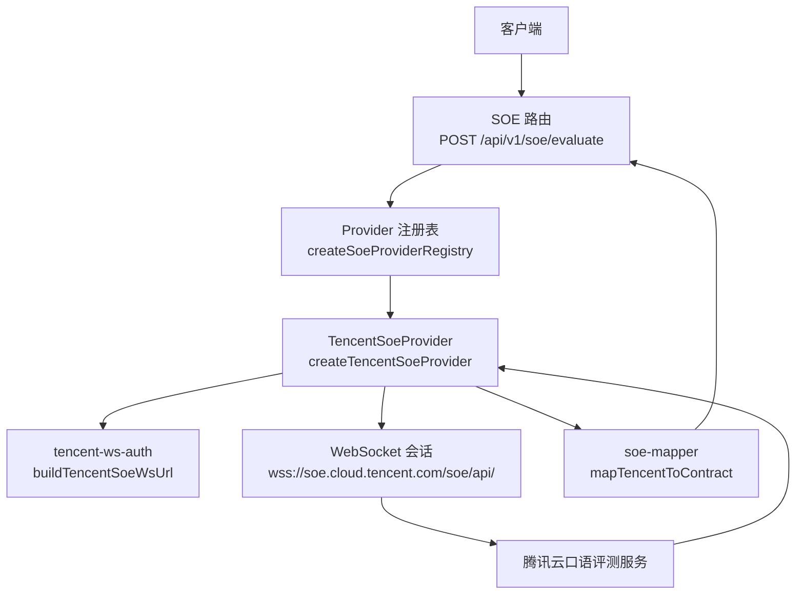
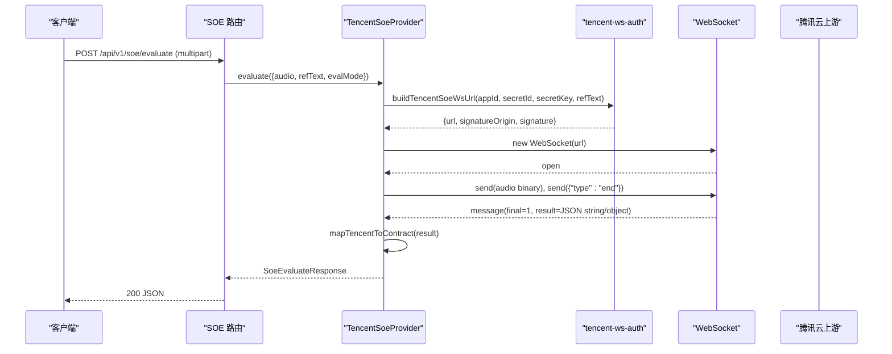
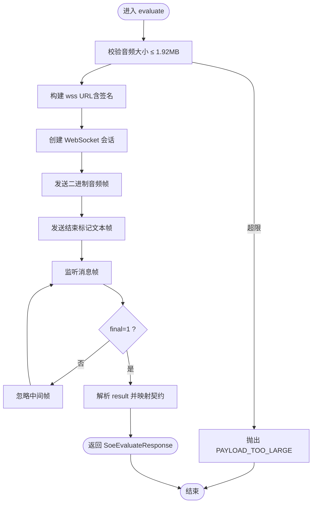
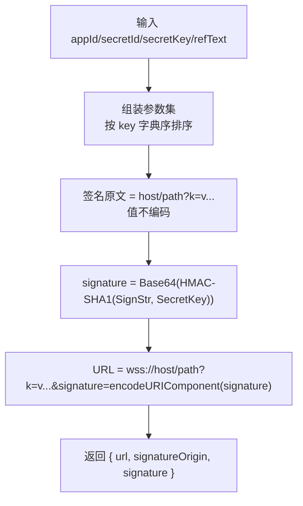
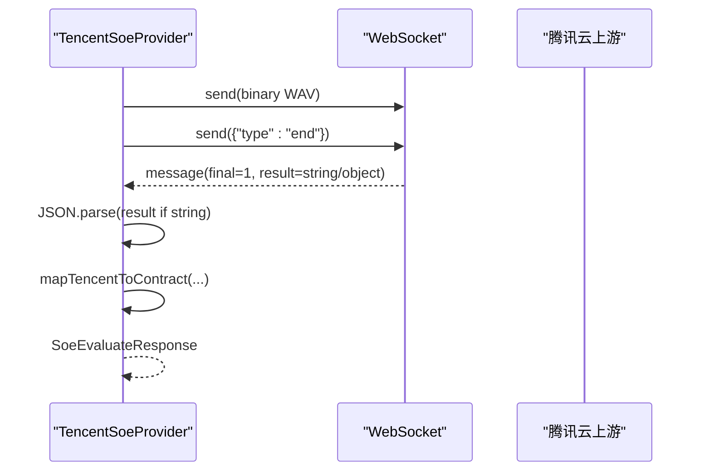
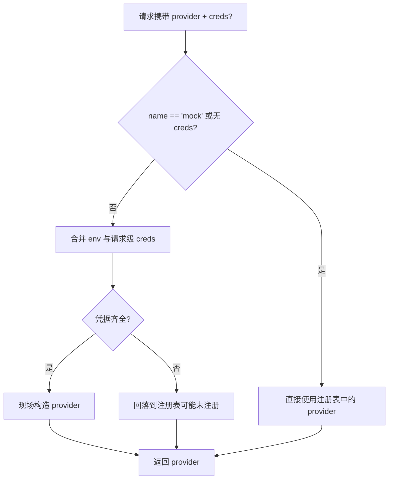
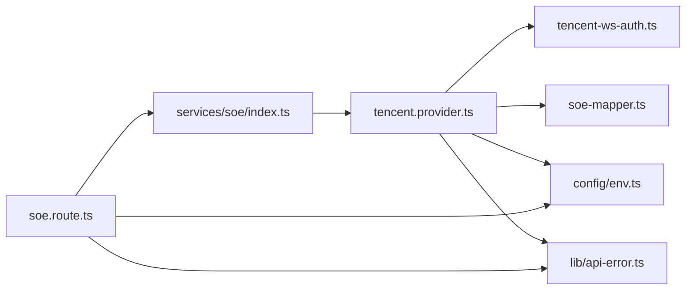
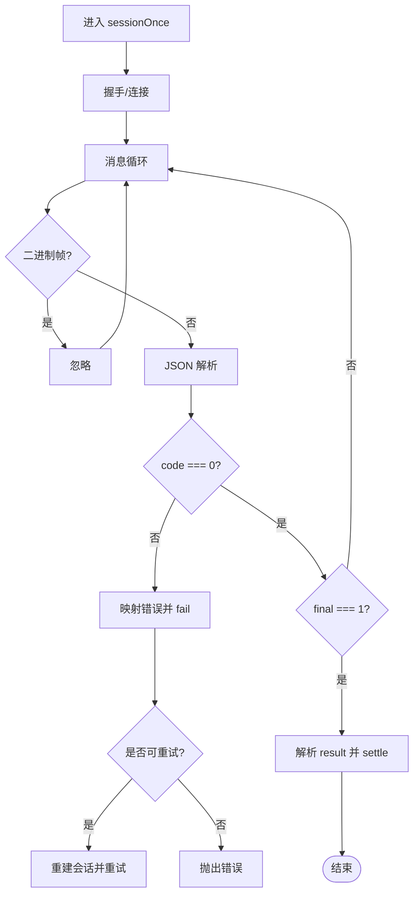

# 腾讯语音评测适配

<cite>
**本文引用的文件**   
- [tencent.provider.ts](file://server/src/services/soe/tencent.provider.ts)
- [tencent-ws-auth.ts](file://server/src/services/soe/tencent-ws-auth.ts)
- [soe-provider.ts](file://server/src/services/soe/soe-provider.ts)
- [soe-mapper.ts](file://server/src/services/soe/soe-mapper.ts)
- [index.ts](file://server/src/services/soe/index.ts)
- [env.ts](file://server/src/config/env.ts)
- [api-error.ts](file://server/src/lib/api-error.ts)
- [soe.route.ts](file://server/src/routes/soe.route.ts)
</cite>

## 目录
1. [引言](#引言)
2. [项目结构](#项目结构)
3. [核心组件](#核心组件)
4. [架构总览](#架构总览)
5. [详细组件分析](#详细组件分析)
6. [依赖关系分析](#依赖关系分析)
7. [性能与并发特性](#性能与并发特性)
8. [配置与密钥管理最佳实践](#配置与密钥管理最佳实践)
9. [网络异常处理与重连机制](#网络异常处理与重连机制)
10. [故障排查指南](#故障排查指南)
11. [结论](#结论)

## 引言
本文面向“腾讯语音评测（口语评测 OEN）”服务端适配层，聚焦 TencentSoeProvider 的实现架构、WebSocket 连接生命周期、鉴权签名算法、音频上传格式、数据处理流程、注册表与请求级凭据合并策略、超时重试与错误映射，以及生产环境下的配置与密钥管理建议。文档同时给出代码级架构图与时序图，帮助读者快速定位关键路径与风险点。

## 项目结构
围绕腾讯 SOE 适配的相关代码位于 server 端 services/soe 与 routes 层：
- services/soe：provider 实现、鉴权、响应映射、注册表与契约类型
- config/env：环境变量加载与凭据校验
- lib/api-error：统一错误码与 HTTP 状态映射
- routes/soe.route.ts：HTTP 入口，解析 multipart 请求并调用 provider

**图表来源**
- [soe.route.ts:64-107](file://server/src/routes/soe.route.ts#L64-L107)
- [index.ts:21-28](file://server/src/services/soe/index.ts#L21-L28)
- [tencent.provider.ts:50-191](file://server/src/services/soe/tencent.provider.ts#L50-L191)
- [tencent-ws-auth.ts:57-95](file://server/src/services/soe/tencent-ws-auth.ts#L57-L95)
- [soe-mapper.ts:104-125](file://server/src/services/soe/soe-mapper.ts#L104-L125)

**章节来源**
- [soe.route.ts:1-110](file://server/src/routes/soe.route.ts#L1-L110)
- [index.ts:1-82](file://server/src/services/soe/index.ts#L1-L82)

## 核心组件
- TencentSoeProvider：封装腾讯 OEN WebSocket 会话、鉴权 URL 构造、音频发送、结果解析与错误映射，提供 SoeProvider.evaluate 接口。
- tencent-ws-auth：生成 HMAC-SHA1 + Base64 签名，输出可直接用于 new WebSocket(url) 的 wss 地址。
- soe-mapper：将腾讯 WS result 内嵌 JSON 映射为契约② SoeEvaluateResponse。
- index.ts：Provider 注册表与 resolveSoeProvider，支持 env 默认 provider 与请求级 creds 覆盖。
- env.ts：环境变量加载、校验与凭据齐备性检查。
- api-error.ts：统一 ApiError 与 ERR 常量，定义 HTTP 语义。
- soe.route.ts：HTTP 入口，multipart 参数校验、provider 选择、AbortController 透传。

**章节来源**
- [tencent.provider.ts:1-193](file://server/src/services/soe/tencent.provider.ts#L1-L193)
- [tencent-ws-auth.ts:1-96](file://server/src/services/soe/tencent-ws-auth.ts#L1-L96)
- [soe-mapper.ts:1-155](file://server/src/services/soe/soe-mapper.ts#L1-L155)
- [index.ts:1-82](file://server/src/services/soe/index.ts#L1-L82)
- [env.ts:1-116](file://server/src/config/env.ts#L1-L116)
- [api-error.ts:1-36](file://server/src/lib/api-error.ts#L1-L36)
- [soe.route.ts:1-110](file://server/src/routes/soe.route.ts#L1-L110)

## 架构总览
TencentSoeProvider 采用“每次评估独立 WebSocket 会话”的策略：
- 构建带签名的 wss URL
- 建立连接后一次性发送整段 WAV 二进制帧，再发送结束标记文本帧
- 接收最终评分文本帧，解析内嵌 JSON 并映射为契约响应
- 通过 AbortSignal 组合客户端取消与服务端超时信号

**图表来源**
- [soe.route.ts:64-107](file://server/src/routes/soe.route.ts#L64-L107)
- [tencent.provider.ts:74-183](file://server/src/services/soe/tencent.provider.ts#L74-L183)
- [tencent-ws-auth.ts:57-95](file://server/src/services/soe/tencent-ws-auth.ts#L57-L95)
- [soe-mapper.ts:104-125](file://server/src/services/soe/soe-mapper.ts#L104-L125)

## 详细组件分析

### TencentSoeProvider 类与实现要点
- 输入约束：录音模式整段音频上限约 60s（1.92MB），超出直接拒绝，避免无意义重试。
- 会话控制：
  - 使用 AbortSignal.any 组合客户端传入 signal 与 SOE_TIMEOUT_MS 超时信号。
  - 握手失败、连接错误、结果前关闭均走 fail 清理并终止 socket。
  - 成功时 close(1000)，避免资源泄漏。
- 数据流：
  - 上行：一次二进制帧（裸字节 WAV，保留头）+ 一个文本帧 {"type":"end"}。
  - 下行：忽略中间帧；final=1 且存在 result 字段时解析并映射。
- 错误映射：
  - 4002 鉴权失败 → 提示检查 appId/secretId/secretKey。
  - 4006 并发超限 → 限流错误。
  - 4008 分片等待超时 → 上游超时。
  - 4105 无人声 → 业务错误，不重试。
- 重试策略：
  - 最多尝试 SOE_RETRY + 1 次。
  - 仅当错误为 UPSTREAM_TIMEOUT 或 SOE_UPSTREAM_ERROR 时重试；客户端中断不重试。

**图表来源**
- [tencent.provider.ts:50-183](file://server/src/services/soe/tencent.provider.ts#L50-L183)

**章节来源**
- [tencent.provider.ts:22-48](file://server/src/services/soe/tencent.provider.ts#L22-L48)
- [tencent.provider.ts:50-191](file://server/src/services/soe/tencent.provider.ts#L50-L191)

### tencent-ws-auth 签名与认证头构造
- 目标：生成可用于 new WebSocket(url) 的完整 wss 地址，签名串与 URL 编码口径严格区分。
- 关键步骤：
  - 参数集合包含 secretid、timestamp、expired、nonce、server_engine_type、voice_id、voice_format、text_mode、ref_text、eval_mode、score_coeff、sentence_info_enabled、rec_mode。
  - 键字典序排序拼接；签名原文中字符串值不做 URL 编码，数值原样拼接。
  - signature = Base64(HMAC-SHA1(signatureOrigin, SecretKey))。
  - 最终 URL 对字符串值进行 encodeURIComponent，并对 signature 也做 encodeURIComponent。
- 测试友好：导出 signatureOrigin 与 signature，便于黄金向量测试。

**图表来源**
- [tencent-ws-auth.ts:57-95](file://server/src/services/soe/tencent-ws-auth.ts#L57-L95)

**章节来源**
- [tencent-ws-auth.ts:1-96](file://server/src/services/soe/tencent-ws-auth.ts#L1-L96)

### 腾讯 API 音频上传格式与数据处理流程
- 音频格式：WAV 16kHz mono，保留头部，作为二进制帧直发（非 base64）。
- 会话模式：rec_mode=1 录音模式，单连接单次评测，音频长度限制约 60s。
- 交互顺序：
  - 握手成功后立即发送二进制音频帧。
  - 随后发送文本帧 {"type":"end"} 表示结束。
  - 服务端返回 final=1 的文本帧，result 为内嵌 JSON 字符串或对象。
- 结果解析：
  - 若 result 为字符串则二次 JSON.parse。
  - 通过 mapTencentToContract 映射为 SoeEvaluateResponse。

**图表来源**
- [tencent.provider.ts:137-180](file://server/src/services/soe/tencent.provider.ts#L137-L180)
- [soe-mapper.ts:104-125](file://server/src/services/soe/soe-mapper.ts#L104-L125)

**章节来源**
- [tencent.provider.ts:137-180](file://server/src/services/soe/tencent.provider.ts#L137-L180)
- [soe-mapper.ts:55-125](file://server/src/services/soe/soe-mapper.ts#L55-L125)

### Provider 注册表与请求级凭据合并
- 注册表 createSoeProviderRegistry：
  - mock 恒在；azure/tencent/iflytek 仅在凭据齐全时注册。
  - defaultName 来自 SOE_PROVIDER。
- resolveSoeProvider：
  - 若 name 为 mock 或未携带请求级 creds，直接取注册表现状。
  - 否则合并 env 与请求级 creds（同名时请求胜出，空串视为未提供）。
  - 合并后仍不齐则回落注册表（可能未注册，调用方返回 PROVIDER_UNAVAILABLE）。
  - 凭据齐全则现场构造对应 provider（闭包轻量，无需缓存）。

**图表来源**
- [index.ts:21-28](file://server/src/services/soe/index.ts#L21-L28)
- [index.ts:38-79](file://server/src/services/soe/index.ts#L38-L79)

**章节来源**
- [index.ts:1-82](file://server/src/services/soe/index.ts#L1-L82)

### 契约类型与响应映射
- SoeInput：包含 audio(Buffer)、refText(string)、evalMode('sentence')。
- SoeEvaluateResponse：total、accuracy、fluency、integrity、words[]。
- 腾讯映射：
  - total 优先 SuggestedScore，其次 PronAccuracy。
  - accuracy 使用 PronAccuracy。
  - fluency/integrity 使用 PronFluency/PronCompletion（[0,1] 小数需 ×100 归一化）。
  - words 中 Tag/MatchTag 映射 errorType；PhoneInfo/PhoneInfos 双形状兼容音素数组。

**章节来源**
- [soe-provider.ts:7-46](file://server/src/services/soe/soe-provider.ts#L7-L46)
- [soe-mapper.ts:55-125](file://server/src/services/soe/soe-mapper.ts#L55-L125)

## 依赖关系分析
- tencent.provider.ts 依赖：
  - ws：WebSocket 客户端
  - api-error：统一错误
  - env：读取 TENCENT_* 与超时重试配置
  - soe-mapper：结果映射
  - tencent-ws-auth：鉴权 URL 构造
  - soe-provider：契约类型
- 路由层 soe.route.ts 依赖：
  - fastify：HTTP 框架
  - zod：参数校验
  - env：环境变量
  - api-error：错误构造
  - services/soe：resolveSoeProvider 与类型

**图表来源**
- [soe.route.ts:14-18](file://server/src/routes/soe.route.ts#L14-L18)
- [index.ts:7-12](file://server/src/services/soe/index.ts#L7-L12)
- [tencent.provider.ts:15-20](file://server/src/services/soe/tencent.provider.ts#L15-L20)

**章节来源**
- [soe.route.ts:14-18](file://server/src/routes/soe.route.ts#L14-L18)
- [index.ts:7-12](file://server/src/services/soe/index.ts#L7-L12)
- [tencent.provider.ts:15-20](file://server/src/services/soe/tencent.provider.ts#L15-L20)

## 性能与并发特性
- 连接模型：每次评估新建 WebSocket 会话，避免长连接复用带来的状态耦合与锁竞争。
- 并发控制：
  - 由上游并发限制（4006）与 SOE_RETRY 控制整体吞吐。
  - 客户端侧可通过并发度限制请求数量；服务端侧可结合队列或令牌桶扩展。
- I/O 模型：
  - 二进制音频帧一次性发送，减少协议开销。
  - 结果以 final=1 的单帧返回，降低解析复杂度。
- 内存占用：
  - 音频 Buffer 在会话结束后释放。
  - 建议在上层限制最大音频大小（已在路由层与 provider 层双重校验）。

[本节为通用性能讨论，不直接分析具体文件]

## 配置与密钥管理最佳实践
- 环境变量（server/.env 或容器注入）：
  - TENCENT_APP_ID：腾讯云账号 AppID（数字）
  - TENCENT_SECRET_ID：CAM 密钥 ID
  - TENCENT_SECRET_KEY：CAM 密钥 Key
  - SOE_TIMEOUT_MS：上游超时毫秒数（默认 10000）
  - SOE_RETRY：重试次数（默认 1，最大 3）
  - SOE_PROVIDER：默认 provider（mock/azure/tencent/iflytek）
- 请求级凭据（multipart creds）：
  - 支持 per-request 覆盖 TENCENT_APP_ID/TENCENT_SECRET_ID/TENCENT_SECRET_KEY。
  - 空字符串视为未提供，不会覆盖 env。
- 安全建议：
  - 生产环境禁止将密钥写入代码仓库；使用环境变量或密钥管理服务注入。
  - 最小权限原则：为 SOE 服务单独创建 CAM 子账号，仅授予所需权限。
  - 定期轮换密钥，并在变更时更新部署配置。
  - 日志脱敏：避免打印 secretId/secretKey 等敏感信息。

**章节来源**
- [env.ts:19-31](file://server/src/config/env.ts#L19-L31)
- [env.ts:61-64](file://server/src/config/env.ts#L61-L64)
- [index.ts:47-65](file://server/src/services/soe/index.ts#L47-L65)

## 网络异常处理与重连机制
- 握手阶段：
  - unexpected-response：握手非 101 即失败，抛 SOE_UPSTREAM_ERROR。
  - handshakeTimeout：由 new WebSocket(url, {handshakeTimeout}) 控制。
- 连接阶段：
  - error：记录 reason 并上抛 SOE_UPSTREAM_ERROR。
  - close：若在结果返回前关闭，视为异常。
- 消息阶段：
  - 二进制帧直接忽略（结果均为文本帧）。
  - JSON 解析失败：抛 SOE_UPSTREAM_ERROR。
  - code !== 0：映射为业务错误（鉴权失败、并发超限、超时、无人声）。
- 超时与取消：
  - AbortSignal.any 组合客户端 signal 与 SOE_TIMEOUT_MS。
  - 客户端中断：原样上抛（非 ApiError，不重试）。
  - 超时：UPSTREAM_TIMEOUT（可重试）。
- 重试策略：
  - isRetryable 仅允许 UPSTREAM_TIMEOUT 与 SOE_UPSTREAM_ERROR 重试。
  - 每次重试重建 timestamp/nonce/voice_id/签名/连接，避免状态污染。

**图表来源**
- [tencent.provider.ts:89-183](file://server/src/services/soe/tencent.provider.ts#L89-L183)
- [tencent.provider.ts:186-189](file://server/src/services/soe/tencent.provider.ts#L186-L189)

**章节来源**
- [tencent.provider.ts:89-183](file://server/src/services/soe/tencent.provider.ts#L89-L183)
- [api-error.ts:18-29](file://server/src/lib/api-error.ts#L18-L29)

## 故障排查指南
- 常见错误码与处理：
  - 4002 鉴权失败：检查 TENCENT_APP_ID/TENCENT_SECRET_ID/TENCENT_SECRET_KEY 是否正确，确认签名串与 URL 编码口径一致。
  - 4006 并发超限：降低并发或提升配额；适当增加 SOE_RETRY。
  - 4008 分片等待超时：检查网络质量与上游负载；增大 SOE_TIMEOUT_MS。
  - 4105 无人声：提示用户重新朗读；该错误不重试。
- 握手失败：
  - 检查 URL 是否包含正确签名与参数；确保 refText 已正确传递。
  - 注意签名串中字符串值不编码，而最终 URL 中字符串值需 encodeURIComponent。
- 音频问题：
  - 确认 WAV 16kHz mono，保留头部；长度不超过 60s。
  - 路由层与 provider 层双重上限校验，避免过大音频导致失败。
- 日志与调试：
  - 路由层记录 provider、是否携带请求级 creds、音频大小与参考文本前缀。
  - 使用 tencent-ws-auth 导出的 signatureOrigin/signature 进行黄金向量比对。

**章节来源**
- [tencent.provider.ts:36-48](file://server/src/services/soe/tencent.provider.ts#L36-L48)
- [soe.route.ts:104-105](file://server/src/routes/soe.route.ts#L104-L105)
- [tencent-ws-auth.ts:1-14](file://server/src/services/soe/tencent-ws-auth.ts#L1-L14)

## 结论
TencentSoeProvider 以简洁可靠的 WebSocket 会话模型对接腾讯云口语评测 OEN 接口，通过严格的鉴权签名、明确的音频上传格式与健壮的错误映射，提供了稳定可扩展的语音评测能力。配合注册表与请求级凭据合并机制，系统可在多 provider 场景下灵活切换，并通过超时与重试策略提升鲁棒性。生产环境中应遵循密钥管理与最小权限原则，结合监控与日志完善排障能力。