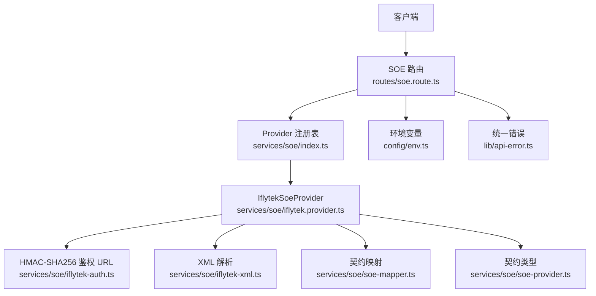
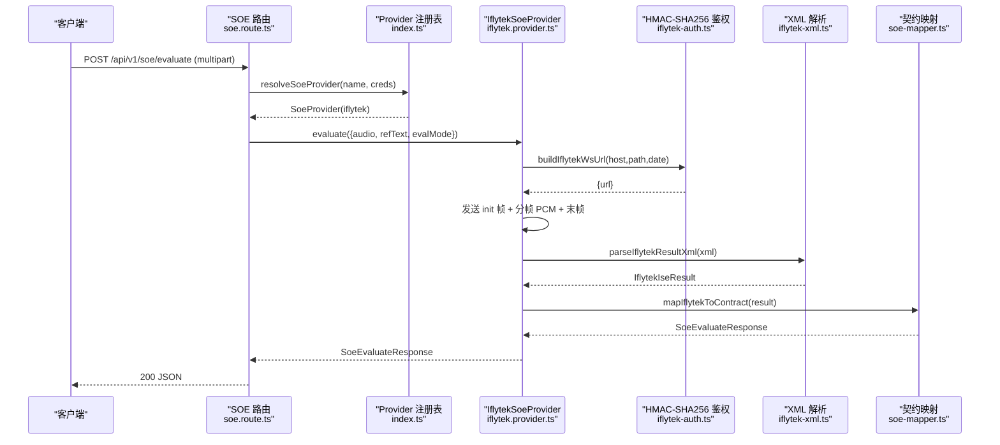
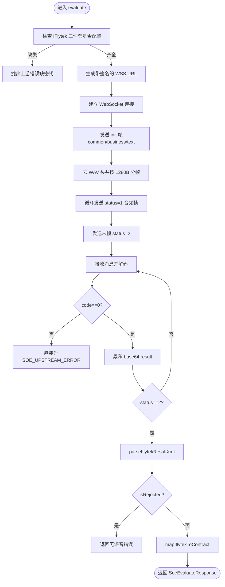
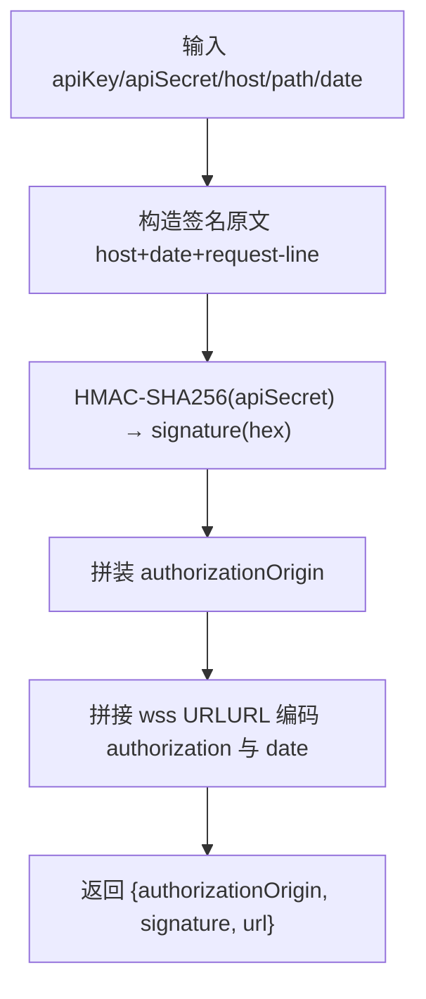
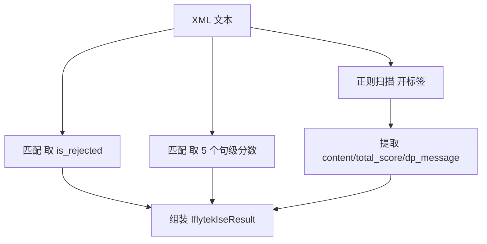
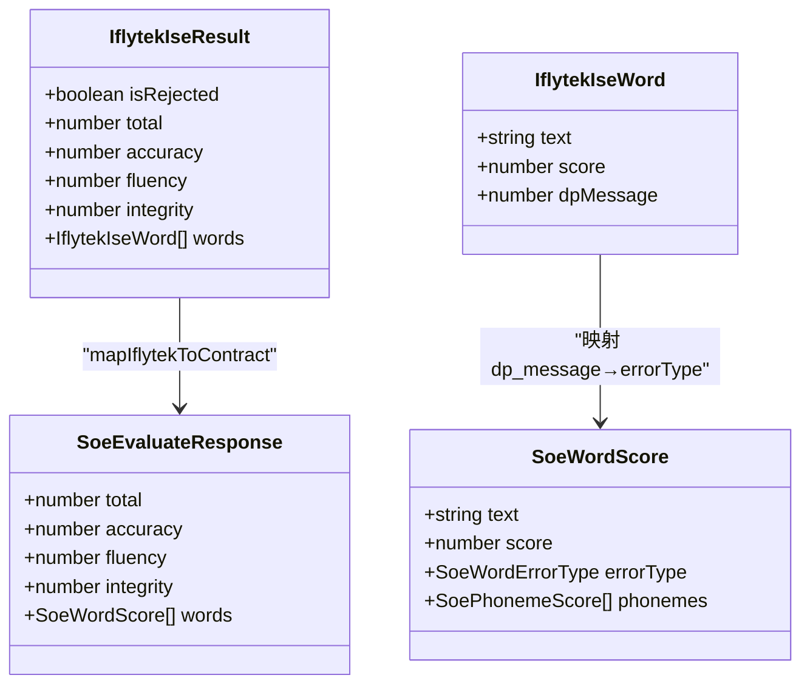
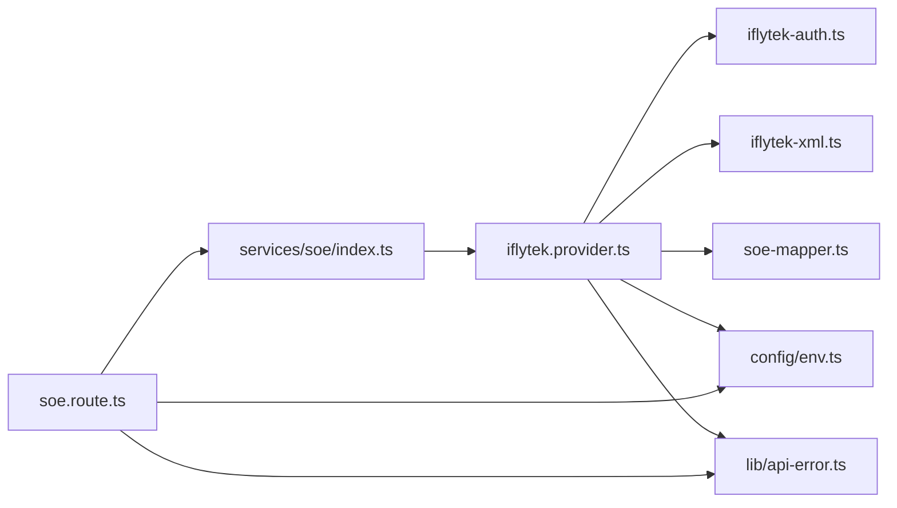

# 讯飞语音评测适配

<cite>
**本文引用的文件**   
- [iflytek.provider.ts](file://server/src/services/soe/iflytek.provider.ts)
- [iflytek-auth.ts](file://server/src/services/soe/iflytek-auth.ts)
- [iflytek-xml.ts](file://server/src/services/soe/iflytek-xml.ts)
- [soe-provider.ts](file://server/src/services/soe/soe-provider.ts)
- [soe-mapper.ts](file://server/src/services/soe/soe-mapper.ts)
- [index.ts](file://server/src/services/soe/index.ts)
- [env.ts](file://server/src/config/env.ts)
- [api-error.ts](file://server/src/lib/api-error.ts)
- [soe.route.ts](file://server/src/routes/soe.route.ts)
</cite>

## 目录
1. [引言](#引言)
2. [项目结构](#项目结构)
3. [核心组件](#核心组件)
4. [架构总览](#架构总览)
5. [详细组件分析](#详细组件分析)
6. [依赖关系分析](#依赖关系分析)
7. [性能与可靠性](#性能与可靠性)
8. [配置示例与调试技巧](#配置示例与调试技巧)
9. [错误码映射与本地化](#错误码映射与本地化)
10. [结论](#结论)

## 引言
本文件面向“讯飞语音评测（ISE）”在服务端的适配实现，聚焦以下目标：
- 解释 IflytekSoeProvider 的 WebSocket 流式交互、HTTP 鉴权 URL 构建、音频分帧发送与结果解析流程。
- 说明 iflytek-auth.ts 中的 HMAC-SHA256 签名算法与时间戳处理。
- 说明 iflytek-xml.ts 中 XML 结果的轻量解析与数据转换。
- 梳理讯飞 API 参数到内部契约 SoeEvaluateResponse 的映射逻辑。
- 提供配置示例、调试建议与错误码映射方案。

该适配层位于 server 端，通过统一的 SoeProvider 接口对外暴露，路由层负责参数校验、凭据合并与调用 provider.evaluate。

## 项目结构
围绕讯飞 ISE 的核心代码集中在 server/src/services/soe 下，并与路由、环境配置和统一错误模型协作：
- services/soe/iflytek.provider.ts：IflytekSoeProvider 实现，WS 会话、请求构造、重试与超时控制。
- services/soe/iflytek-auth.ts：HMAC-SHA256 鉴权 URL 生成。
- services/soe/iflytek-xml.ts：ISE 结果 XML 解析。
- services/soe/soe-mapper.ts：各 provider 响应到契约② SoeEvaluateResponse 的统一映射。
- services/soe/soe-provider.ts：SoeInput / SoeEvaluateResponse 等类型定义。
- services/soe/index.ts：Provider 注册表与请求级凭据合并。
- config/env.ts：环境变量加载与校验。
- lib/api-error.ts：统一错误码与 HTTP 状态映射。
- routes/soe.route.ts：POST /api/v1/soe/evaluate 路由。

**图表来源**
- [soe.route.ts:64-107](file://server/src/routes/soe.route.ts#L64-L107)
- [index.ts:21-28](file://server/src/services/soe/index.ts#L21-L28)
- [iflytek.provider.ts:54-234](file://server/src/services/soe/iflytek.provider.ts#L54-L234)
- [iflytek-auth.ts:27-33](file://server/src/services/soe/iflytek-auth.ts#L27-L33)
- [iflytek-xml.ts:51-79](file://server/src/services/soe/iflytek-xml.ts#L51-L79)
- [soe-mapper.ts:137-154](file://server/src/services/soe/soe-mapper.ts#L137-L154)
- [soe-provider.ts:23-46](file://server/src/services/soe/soe-provider.ts#L23-L46)
- [env.ts:9-32](file://server/src/config/env.ts#L9-L32)
- [api-error.ts:18-35](file://server/src/lib/api-error.ts#L18-L35)

**章节来源**
- [soe.route.ts:1-110](file://server/src/routes/soe.route.ts#L1-L110)
- [index.ts:1-82](file://server/src/services/soe/index.ts#L1-L82)
- [iflytek.provider.ts:1-236](file://server/src/services/soe/iflytek.provider.ts#L1-L236)
- [iflytek-auth.ts:1-35](file://server/src/services/soe/iflytek-auth.ts#L1-L35)
- [iflytek-xml.ts:1-81](file://server/src/services/soe/iflytek-xml.ts#L1-L81)
- [soe-mapper.ts:1-155](file://server/src/services/soe/soe-mapper.ts#L1-L155)
- [soe-provider.ts:1-47](file://server/src/services/soe/soe-provider.ts#L1-L47)
- [env.ts:1-116](file://server/src/config/env.ts#L1-L116)
- [api-error.ts:1-36](file://server/src/lib/api-error.ts#L1-L36)

## 核心组件
- IflytekSoeProvider：封装 WS 会话生命周期、初始化帧、音频分帧发送、结果累积与解析、重试与超时控制。
- HMAC-SHA256 鉴权：根据 host/date/request-line 生成签名并拼接 wss URL。
- XML 解析器：从 base64 分片拼接的 XML 中提取句级评分、词级评分与 dp_message。
- 契约映射：将讯飞评分量纲归一化为 0–100 整数，dp_message 映射为 errorType。
- Provider 注册与请求级凭据：支持 env 默认 provider 与请求级 creds 覆盖。
- 路由层：multipart 参数校验、provider 选择、AbortController 透传。

**章节来源**
- [iflytek.provider.ts:54-234](file://server/src/services/soe/iflytek.provider.ts#L54-L234)
- [iflytek-auth.ts:27-33](file://server/src/services/soe/iflytek-auth.ts#L27-L33)
- [iflytek-xml.ts:51-79](file://server/src/services/soe/iflytek-xml.ts#L51-L79)
- [soe-mapper.ts:137-154](file://server/src/services/soe/soe-mapper.ts#L137-L154)
- [index.ts:21-79](file://server/src/services/soe/index.ts#L21-L79)
- [soe.route.ts:64-107](file://server/src/routes/soe.route.ts#L64-L107)

## 架构总览
下图展示一次完整的 SOE 评估请求在服务器端的调用链路与关键数据变换。

**图表来源**
- [soe.route.ts:64-107](file://server/src/routes/soe.route.ts#L64-L107)
- [index.ts:38-79](file://server/src/services/soe/index.ts#L38-L79)
- [iflytek.provider.ts:71-226](file://server/src/services/soe/iflytek.provider.ts#L71-L226)
- [iflytek-auth.ts:27-33](file://server/src/services/soe/iflytek-auth.ts#L27-L33)
- [iflytek-xml.ts:51-79](file://server/src/services/soe/iflytek-xml.ts#L51-L79)
- [soe-mapper.ts:137-154](file://server/src/services/soe/soe-mapper.ts#L137-L154)

## 详细组件分析

### IflytekSoeProvider 实现原理
- 会话与重试
  - 每次 attempt 独立创建 WS 连接，并重新生成 date 与签名，避免签名过期。
  - 支持 SOE_TIMEOUT_MS 超时与 SOE_RETRY 次重试；客户端断开不重试。
- 初始化帧
  - common.app_id 来自环境变量；business 指定 sub=ise、cmd=ssb、aue=raw、auf=audio/L16;rate=16000。
  - data.text 为完整请求 JSON 的 base64，包含 text.content（参考原文）。
- 音频分帧
  - 先去除 WAV 头，得到裸 PCM；按 1280B 切分，status=1 逐帧发送。
  - 可选 IFLYTEK_FRAME_INTERVAL_MS 间隔发送，默认 40ms。
- 结果接收
  - 服务端消息 code!=0 时直接失败；data.result 为 base64 分片，累积后在 status=2 时解析。
  - 若 isRejected，返回“未识别出有效跟读内容”。
- 清理与中止
  - 使用 AbortSignal.any 组合客户端取消与服务端超时信号；异常时终止 socket 或关闭连接。

**图表来源**
- [iflytek.provider.ts:54-234](file://server/src/services/soe/iflytek.provider.ts#L54-L234)

**章节来源**
- [iflytek.provider.ts:54-234](file://server/src/services/soe/iflytek.provider.ts#L54-L234)

### HMAC-SHA256 鉴权与时间戳处理（iflytek-auth.ts）
- 签名原文由三行组成：host、date、GET path。
- 使用 apiSecret 作为密钥进行 HMAC-SHA256 计算，输出小写 hex。
- authorizationOrigin 字段包含 api_key、algorithm、headers、signature。
- 最终 URL 为 wss://host/path?authorization=...&date=...&host=...，其中 authorization 与 date 需 URL 编码。
- date 由调用方传入 UTC 字符串，每次 attempt 重新生成，避免签名有效期问题。

**图表来源**
- [iflytek-auth.ts:27-33](file://server/src/services/soe/iflytek-auth.ts#L27-L33)

**章节来源**
- [iflytek-auth.ts:1-35](file://server/src/services/soe/iflytek-auth.ts#L1-L35)

### XML 数据格式解析（iflytek-xml.ts）
- 输入：base64 分片拼接后的 XML 文本。
- 提取句级属性：total_score、accuracy_score、fluency_score、integrity_score、standard_score。
- 提取 rec_paper.is_rejected：'true' 或 '1' 视为被拒。
- 遍历所有 <word> 开标签，提取 content、total_score、dp_message。
- 对英文常见实体做最小还原（如 &#39;、&amp;）。

**图表来源**
- [iflytek-xml.ts:51-79](file://server/src/services/soe/iflytek-xml.ts#L51-L79)

**章节来源**
- [iflytek-xml.ts:1-81](file://server/src/services/soe/iflytek-xml.ts#L1-L81)

### 讯飞 API 参数映射与数据转换（soe-mapper.ts）
- 句级评分量纲启发：若 total>5 则视为 0–5 分制，乘以 20 归一化到 0–100；否则视为百分制。
- 数值统一 clamp 到 [0,100] 并取整。
- dp_message 映射到 errorType：
  - 0/64 → None
  - 16 → Omission
  - 32 → Insertion
  - 128 → Mispronunciation
- 音素级 phonemes：英文朗读题型不提供音素分值，降级为空数组。

**图表来源**
- [iflytek-xml.ts:10-25](file://server/src/services/soe/iflytek-xml.ts#L10-L25)
- [soe-provider.ts:23-30](file://server/src/services/soe/soe-provider.ts#L23-L30)
- [soe-mapper.ts:127-154](file://server/src/services/soe/soe-mapper.ts#L127-L154)

**章节来源**
- [soe-mapper.ts:127-154](file://server/src/services/soe/soe-mapper.ts#L127-L154)

### Provider 注册与请求级凭据（index.ts）
- 注册表默认包含 mock；若 env 中对应 provider 凭据齐全则注册。
- 请求可携带 creds（JSON），优先于 env；合并后若凭据齐全则现场构造 provider。
- 若 provider 未注册且无法现场构造，路由层返回 PROVIDER_UNAVAILABLE。

**章节来源**
- [index.ts:21-79](file://server/src/services/soe/index.ts#L21-L79)

### 路由层与输入校验（soe.route.ts）
- multipart/form-data 字段：refText、evalMode、provider、creds、audio。
- 校验 refText 非空且长度≤1000；evalMode 仅支持 sentence；audio 非空且≤25MB。
- 根据 provider 字段选择已注册的 provider，或尝试用 creds 现场构造。
- 使用 AbortController 透传客户端断开信号至 provider。

**章节来源**
- [soe.route.ts:1-110](file://server/src/routes/soe.route.ts#L1-L110)

## 依赖关系分析
- iflytek.provider.ts 依赖：
  - iflytek-auth.ts：构建带签名的 WSS URL。
  - iflytek-xml.ts：解析 ISE 结果 XML。
  - soe-mapper.ts：将 IflytekIseResult 映射为 SoeEvaluateResponse。
  - wav-pcm.ts：去除 WAV 头（不在本文重点，但参与音频预处理）。
  - api-error.ts：统一错误封装。
  - env.ts：读取 IFLYTEK_* 相关环境变量。
- soe.route.ts 依赖：
  - index.ts：resolveSoeProvider 获取 provider。
  - env.ts：读取 SOE_PROVIDER、SOE_TIMEOUT_MS、SOE_RETRY 等。
  - api-error.ts：统一错误码。

**图表来源**
- [soe.route.ts:14-18](file://server/src/routes/soe.route.ts#L14-L18)
- [index.ts:7-12](file://server/src/services/soe/index.ts#L7-L12)
- [iflytek.provider.ts:13-20](file://server/src/services/soe/iflytek.provider.ts#L13-L20)

**章节来源**
- [soe.route.ts:1-110](file://server/src/routes/soe.route.ts#L1-L110)
- [index.ts:1-82](file://server/src/services/soe/index.ts#L1-L82)
- [iflytek.provider.ts:1-236](file://server/src/services/soe/iflytek.provider.ts#L1-L236)

## 性能与可靠性
- 分帧大小与间隔
  - 每帧 1280B，约 40ms@16kHz/16bit；可通过 IFLYTEK_FRAME_INTERVAL_MS 调整发送节奏。
- 超时与重试
  - SOE_TIMEOUT_MS 默认 10s；SOE_RETRY 默认 1 次；网络错误与上游错误可重试，客户端断开不重试。
- 内存与缓冲
  - XML 结果以 base64 分片累积，仅在 status=2 时解析；音频去头后按固定步长切片，避免大对象拷贝。
- 健壮性
  - 握手失败、连接提前关闭、消息解析失败均包装为统一错误；鉴权族错误码附加排查提示。

[本节为通用指导，不直接分析具体文件]

## 配置示例与调试技巧
- 环境变量（.env 或容器注入）
  - IFLYTEK_APP_ID、IFLYTEK_API_KEY、IFLYTEK_API_SECRET：三件套必填。
  - IFLYTEK_FRAME_INTERVAL_MS：建议 40（范围 0–200）。
  - SOE_TIMEOUT_MS：建议 10000。
  - SOE_RETRY：建议 1（范围 0–3）。
  - SOE_PROVIDER：设为 iflytek 启用讯飞 provider。
- 请求级凭据（multipart creds）
  - 可在请求中附带 JSON 文本 creds.iflytek.{appId,apiKey,apiSecret}，优先于 env。
- 调试建议
  - 开启日志：路由层记录 provider、音频字节数、参考原文前缀。
  - 抓包验证：确认 wss URL 中 authorization 与 date 是否正确编码。
  - 分帧间隔：若出现丢帧或延迟，适当增大 IFLYTEK_FRAME_INTERVAL_MS。
  - 超时重试：若偶发上游不稳定，可适当提高 SOE_RETRY。
  - 错误定位：当收到鉴权族错误码（10160~10165、10105、10106），检查 APP_ID/API_KEY/SECRET 与签名 date。

**章节来源**
- [env.ts:23-31](file://server/src/config/env.ts#L23-L31)
- [soe.route.ts:82-105](file://server/src/routes/soe.route.ts#L82-L105)
- [iflytek.provider.ts:71-100](file://server/src/services/soe/iflytek.provider.ts#L71-L100)

## 错误码映射与本地化
- 统一错误码（ERR）
  - BAD_REQUEST：400，参数校验失败。
  - PAYLOAD_TOO_LARGE：413，音频过大。
  - SOE_NO_SPEECH：400，未识别出有效朗读。
  - UPSTREAM_RATE_LIMIT：429，上游限流。
  - UPSTREAM_TIMEOUT：504，上游超时。
  - SOE_UPSTREAM_ERROR：502，上游连接/握手/消息解析错误。
  - PROVIDER_UNAVAILABLE：503，provider 未配置。
  - INTERNAL：500，内部错误。
- 讯飞特定错误
  - 鉴权族错误码（10160~10165、10105、10106）：附加“检查 IFLYTEK_APP_ID / IFLYTEK_API_KEY / IFLYTEK_API_SECRET”的排查提示。
  - 未识别有效朗读：返回 SOE_NO_SPEECH，提示用户重新朗读。
- 本地化策略
  - 当前错误消息为中文，便于运维与开发者快速定位；如需多语言，可在上层 UI 层基于 code 映射翻译文案。

**章节来源**
- [api-error.ts:18-35](file://server/src/lib/api-error.ts#L18-L35)
- [iflytek.provider.ts:157-169](file://server/src/services/soe/iflytek.provider.ts#L157-L169)

## 结论
IflytekSoeProvider 通过 WS 流式协议与讯飞 ISE 服务交互，结合 HMAC-SHA256 鉴权、WAV 头剥离、固定分帧发送与轻量 XML 解析，将上游结果标准化为 SoeEvaluateResponse。配合路由层的参数校验、Provider 注册表与请求级凭据机制，形成稳定可扩展的语音评测接入层。在生产环境中，建议合理配置超时、重试与分帧间隔，并结合统一错误码进行可观测性与排障。