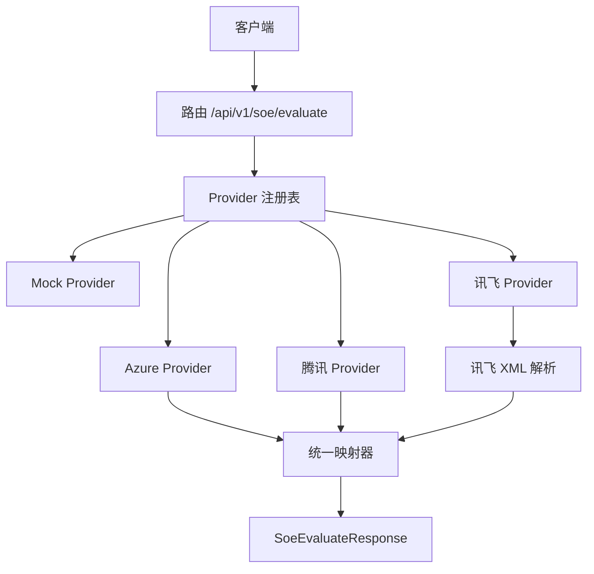
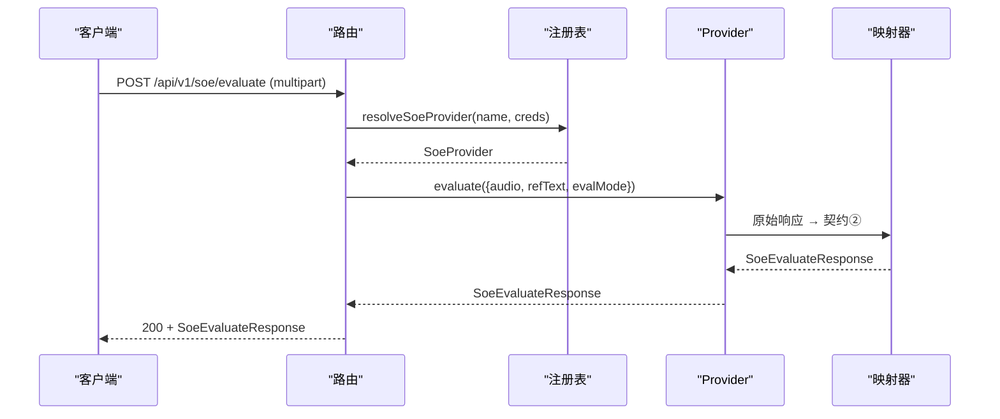
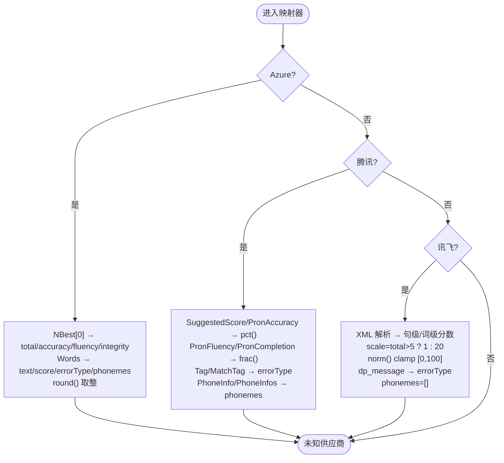
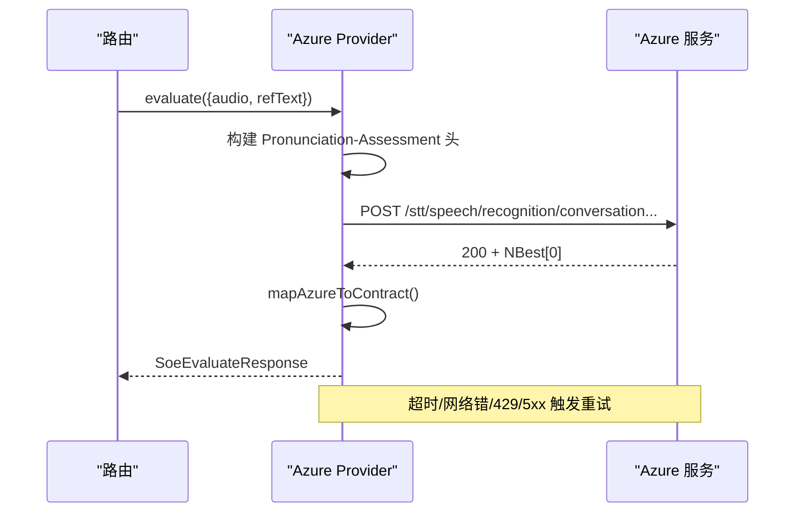
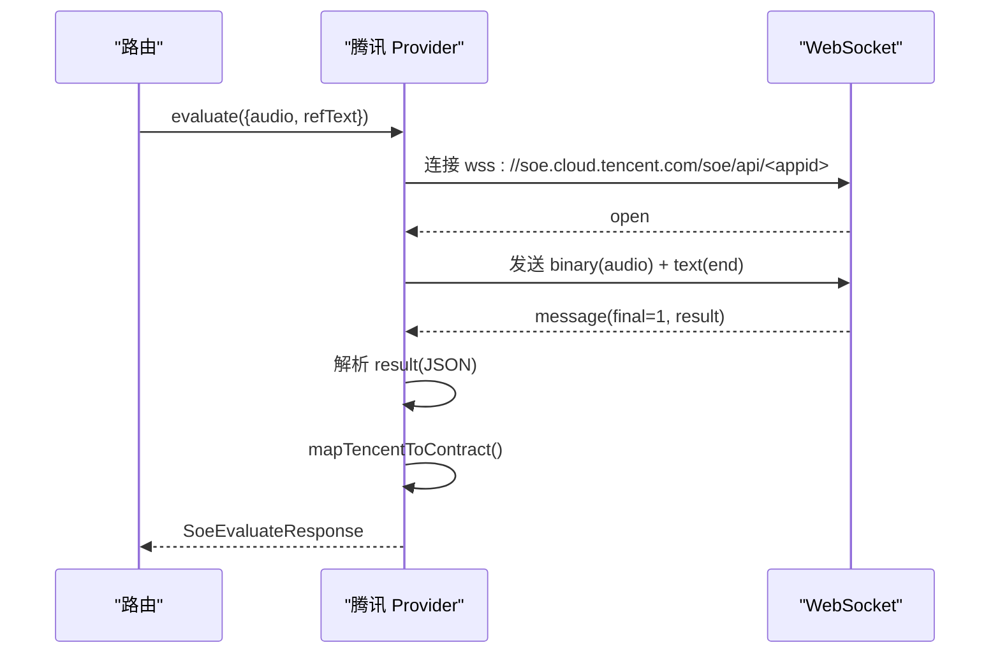
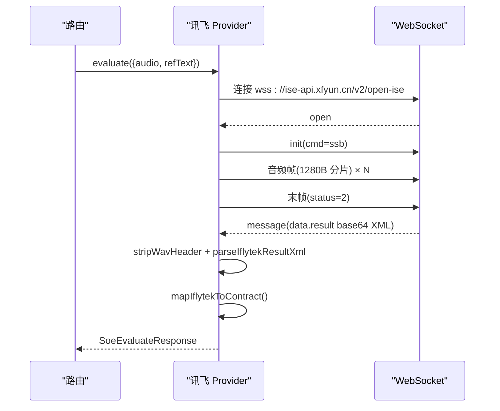
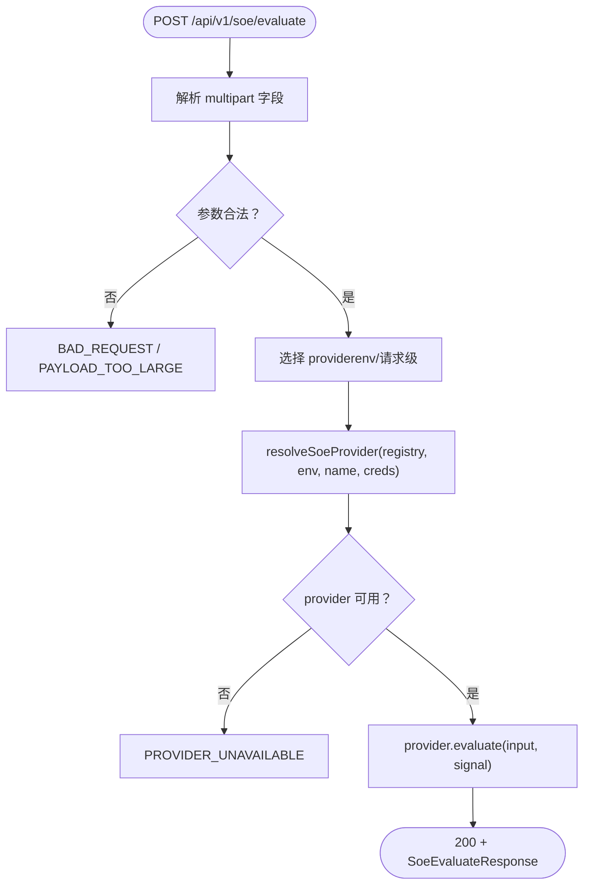
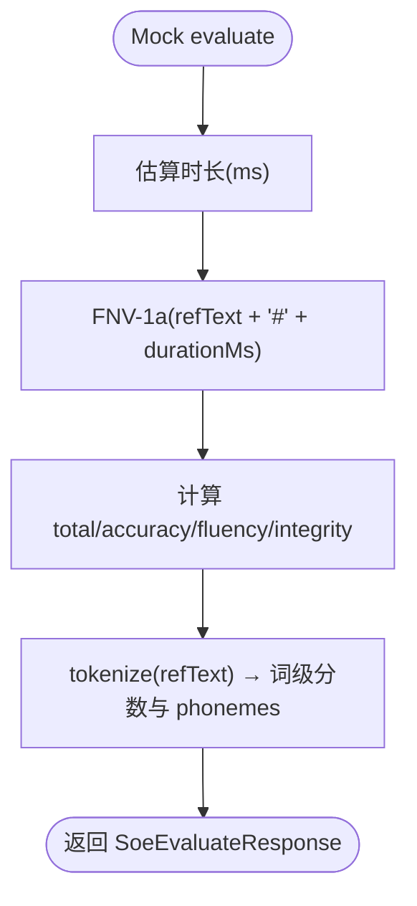
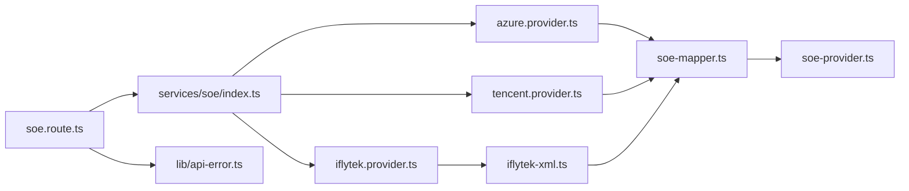
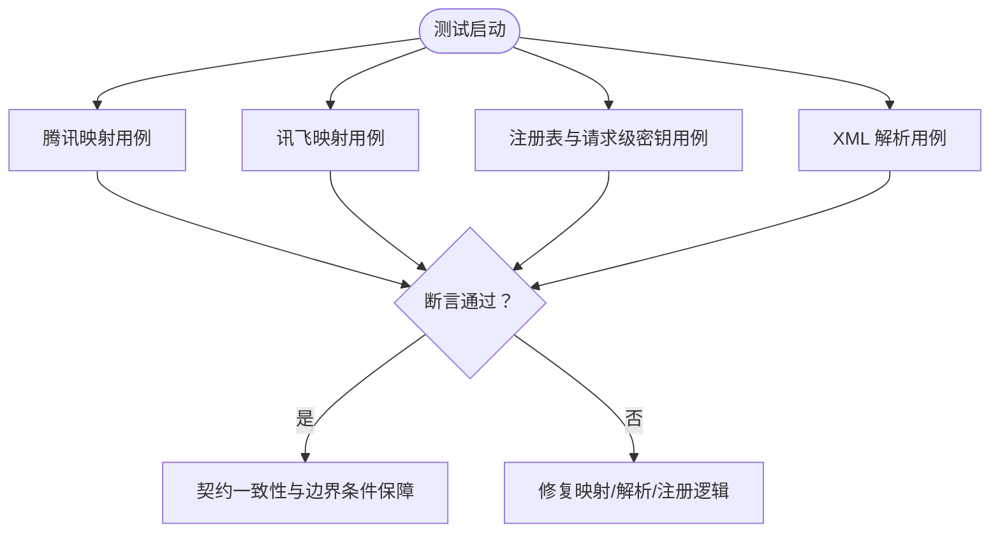

# 结果映射与标准化

<cite>
**本文引用的文件**   
- [server/src/services/soe/soe-mapper.ts](file://server/src/services/soe/soe-mapper.ts)
- [server/src/services/soe/soe-provider.ts](file://server/src/services/soe/soe-provider.ts)
- [server/src/routes/soe.route.ts](file://server/src/routes/soe.route.ts)
- [server/src/services/soe/index.ts](file://server/src/services/soe/index.ts)
- [server/src/services/soe/mock.provider.ts](file://server/src/services/soe/mock.provider.ts)
- [server/src/services/soe/azure.provider.ts](file://server/src/services/soe/azure.provider.ts)
- [server/src/services/soe/tencent.provider.ts](file://server/src/services/soe/tencent.provider.ts)
- [server/src/services/soe/iflytek.provider.ts](file://server/src/services/soe/iflytek.provider.ts)
- [server/src/services/soe/iflytek-xml.ts](file://server/src/services/soe/iflytek-xml.ts)
- [server/src/lib/api-error.ts](file://server/src/lib/api-error.ts)
- [client/types/api.ts](file://client/types/api.ts)
- [server/src/services/soe/__tests__/iflytek-mapper.test.ts](file://server/src/services/soe/__tests__/iflytek-mapper.test.ts)
- [server/src/services/soe/__tests__/tencent-mapper.test.ts](file://server/src/services/soe/__tests__/tencent-mapper.test.ts)
- [server/src/services/soe/__tests__/registry.test.ts](file://server/src/services/soe/__tests__/registry.test.ts)
- [server/src/services/soe/__tests__/iflytek-xml.test.ts](file://server/src/services/soe/__tests__/iflytek-xml.test.ts)
</cite>

## 目录
1. [引言](#引言)
2. [项目结构](#项目结构)
3. [核心组件](#核心组件)
4. [架构总览](#架构总览)
5. [详细组件分析](#详细组件分析)
6. [依赖关系分析](#依赖关系分析)
7. [性能与缓存策略](#性能与缓存策略)
8. [数据质量检查与异常处理](#数据质量检查与异常处理)
9. [测试结果与一致性保证](#测试结果与一致性保证)
10. [结论](#结论)

## 引言
本模块负责将不同厂商（Azure、腾讯云、科大讯飞）的口语评测结果统一映射到内部契约类型，完成评分字段映射、数值归一化、错误类型转换、音素级数据处理，并向上层路由返回标准化的 SoeEvaluateResponse。同时提供请求级 provider 选择、凭据合并、错误响应封装与重试策略，确保多供应商接入的一致性与可观测性。

## 项目结构
SOE 结果映射与标准化相关代码集中在 server 端 services/soe 与 routes 下：
- soe-provider.ts：定义统一契约类型与 Provider 接口。
- soe-mapper.ts：各厂商原始响应 → 契约②的统一映射器。
- azure.provider.ts / tencent.provider.ts / iflytek.provider.ts：各厂商调用实现，负责网络、鉴权、协议细节与错误转换。
- index.ts：Provider 注册表与请求级凭据解析。
- mock.provider.ts：确定性伪评分实现，用于联调与端到端比对。
- iflytek-xml.ts：讯飞 ISE XML 结果解析。
- routes/soe.route.ts：HTTP 入口，参数校验、provider 选择、超时与取消控制。
- lib/api-error.ts：统一错误码与 HTTP 状态映射。
- client/types/api.ts：前端契约类型，与服务端 SoeEvaluateResponse 保持一致。



**图示来源**
- [server/src/routes/soe.route.ts:64-109](file://server/src/routes/soe.route.ts#L64-L109)
- [server/src/services/soe/index.ts:21-28](file://server/src/services/soe/index.ts#L21-L28)
- [server/src/services/soe/azure.provider.ts:24-109](file://server/src/services/soe/azure.provider.ts#L24-L109)
- [server/src/services/soe/tencent.provider.ts:50-192](file://server/src/services/soe/tencent.provider.ts#L50-L192)
- [server/src/services/soe/iflytek.provider.ts:54-235](file://server/src/services/soe/iflytek.provider.ts#L54-L235)
- [server/src/services/soe/iflytek-xml.ts:51-80](file://server/src/services/soe/iflytek-xml.ts#L51-L80)
- [server/src/services/soe/soe-mapper.ts:40-154](file://server/src/services/soe/soe-mapper.ts#L40-L154)

**章节来源**
- [server/src/services/soe/soe-provider.ts:1-47](file://server/src/services/soe/soe-provider.ts#L1-L47)
- [server/src/services/soe/soe-mapper.ts:1-155](file://server/src/services/soe/soe-mapper.ts#L1-L155)
- [server/src/routes/soe.route.ts:1-110](file://server/src/routes/soe.route.ts#L1-L110)
- [server/src/services/soe/index.ts:1-82](file://server/src/services/soe/index.ts#L1-L82)

## 核心组件
- 统一契约类型 SoeEvaluateResponse：包含 total、accuracy、fluency、integrity 四个句级分数与 words 词级数组；每个词含 text、score、errorType 可选、phonemes 音素数组。
- Provider 接口：name 与 evaluate(input, signal)，所有厂商实现统一签名。
- 映射器：mapAzureToContract、mapTencentToContract、mapIflytekToContract，分别处理 Azure REST、腾讯 WS OEN、讯飞 ISE XML。
- 注册表与解析：createSoeProviderRegistry 按 env 构造可用 provider；resolveSoeProvider 支持请求级 creds 覆盖。
- 路由：参数校验、provider 选择、AbortSignal 透传、日志记录与统一响应。

**章节来源**
- [server/src/services/soe/soe-provider.ts:8-47](file://server/src/services/soe/soe-provider.ts#L8-L47)
- [server/src/services/soe/soe-mapper.ts:18-154](file://server/src/services/soe/soe-mapper.ts#L18-L154)
- [server/src/services/soe/index.ts:14-82](file://server/src/services/soe/index.ts#L14-L82)
- [server/src/routes/soe.route.ts:64-109](file://server/src/routes/soe.route.ts#L64-L109)

## 架构总览
SOE 评估流程从 HTTP 路由开始，经注册表选择具体 provider，调用上游服务后由映射器统一输出 SoeEvaluateResponse。



**图示来源**
- [server/src/routes/soe.route.ts:64-109](file://server/src/routes/soe.route.ts#L64-L109)
- [server/src/services/soe/index.ts:37-79](file://server/src/services/soe/index.ts#L37-L79)
- [server/src/services/soe/soe-mapper.ts:40-154](file://server/src/services/soe/soe-mapper.ts#L40-L154)

## 详细组件分析

### 统一契约与 Provider 接口
- SoePhonemeScore：symbol、score。
- SoeWordErrorType：'None' | 'Omission' | 'Insertion' | 'Mispronunciation'。
- SoeWordScore：text、score、errorType?、phonemes。
- SoeEvaluateResponse：total、accuracy、fluency、integrity、words。
- SoeInput：audio(Buffer)、refText(string)、evalMode('sentence')。
- SoeProvider：name、evaluate(input, signal)。

```mermaid
classDiagram
class SoePhonemeScore {
+string symbol
+number score
}
class SoeWordErrorType {
<<enum>>
"None"
"Omission"
"Insertion"
"Mispronunciation"
}
class SoeWordScore {
+string text
+number score
+SoeWordErrorType errorType?
+SoePhonemeScore[] phonemes
}
class SoeEvaluateResponse {
+number total
+number accuracy
+number fluency
+number integrity
+SoeWordScore[] words
}
class SoeInput {
+Buffer audio
+string refText
+string evalMode
}
class SoeProvider {
+string name
+evaluate(input, signal) Promise~SoeEvaluateResponse~
}
SoeEvaluateResponse --> SoeWordScore : "包含"
SoeWordScore --> SoePhonemeScore : "包含"
```

**图示来源**
- [server/src/services/soe/soe-provider.ts:8-47](file://server/src/services/soe/soe-provider.ts#L8-L47)

**章节来源**
- [server/src/services/soe/soe-provider.ts:8-47](file://server/src/services/soe/soe-provider.ts#L8-L47)

### 映射器：差异化格式统一标准化
- Azure：NBest[0] 四维对应 total/accuracy/fluency/integrity；Words 映射词级 score、errorType、phonemes；分数取整。
- 腾讯：SuggestedScore/PronAccuracy 百分制归一；PronFluency/PronCompletion 小数×100 归一；Tag/MatchTag→errorType；PhoneInfo/PhoneInfos 双形状兼容；Phone/Phoneme 双形状兼容。
- 讯飞：XML 解析出句级与词级分数；根据 total 是否大于 5 判断 0–5 或 0–100 量纲并缩放至 [0,100]；dp_message→errorType；英文朗读题型音素级仅标记无数值分，phonemes 恒空。



**图示来源**
- [server/src/services/soe/soe-mapper.ts:39-154](file://server/src/services/soe/soe-mapper.ts#L39-L154)

**章节来源**
- [server/src/services/soe/soe-mapper.ts:18-154](file://server/src/services/soe/soe-mapper.ts#L18-L154)

### Azure Provider
- REST 短音频接口，Dimension=Comprehensive 获取流利度/完整度与词级 ErrorType。
- Pronunciation-Assessment 头 base64 JSON 配置。
- 超时与重试：SOE_TIMEOUT_MS + SOE_RETRY；仅网络错/超时/限流/5xx 重试。
- 无语音状态 NoMatch/InitialSilenceTimeout/BabbleTimeout → SOE_NO_SPEECH。
- 认证失败/限流/格式错误等统一转换为 ERR 错误码。



**图示来源**
- [server/src/services/soe/azure.provider.ts:24-109](file://server/src/services/soe/azure.provider.ts#L24-L109)
- [server/src/services/soe/soe-mapper.ts:39-53](file://server/src/services/soe/soe-mapper.ts#L39-L53)

**章节来源**
- [server/src/services/soe/azure.provider.ts:1-110](file://server/src/services/soe/azure.provider.ts#L1-L110)

### 腾讯 Provider（WS OEN）
- WS 录音模式：整段 WAV 单二进制帧上行，随后文本帧 end；final=1 携带 result(JSON 字符串或对象)。
- 握手与消息事件：unexpected-response、error、close、open、message。
- 错误码映射：4002 鉴权失败、4006 并发超限、4008 分片等待超时、4105 无人声。
- result 内嵌 JSON 解析后交由 mapTencentToContract。



**图示来源**
- [server/src/services/soe/tencent.provider.ts:50-192](file://server/src/services/soe/tencent.provider.ts#L50-L192)
- [server/src/services/soe/soe-mapper.ts:104-125](file://server/src/services/soe/soe-mapper.ts#L104-L125)

**章节来源**
- [server/src/services/soe/tencent.provider.ts:1-193](file://server/src/services/soe/tencent.provider.ts#L1-L193)

### 讯飞 Provider（ISE 流式）
- WS 会话：init 帧（cmd=ssb），音频帧 aue=raw 裸 PCM 分片（stripWavHeader），末帧 status=2。
- 结果 XML 以 base64 分片累积，status=2 时 parseIflytekResultXml 解析。
- isRejected 表示未识别有效朗读 → SOE_NO_SPEECH。
- 每帧间隔可按 IFLYTEK_FRAME_INTERVAL_MS 控制。



**图示来源**
- [server/src/services/soe/iflytek.provider.ts:54-235](file://server/src/services/soe/iflytek.provider.ts#L54-L235)
- [server/src/services/soe/iflytek-xml.ts:51-80](file://server/src/services/soe/iflytek-xml.ts#L51-L80)
- [server/src/services/soe/soe-mapper.ts:136-154](file://server/src/services/soe/soe-mapper.ts#L136-L154)

**章节来源**
- [server/src/services/soe/iflytek.provider.ts:1-236](file://server/src/services/soe/iflytek.provider.ts#L1-L236)
- [server/src/services/soe/iflytek-xml.ts:1-81](file://server/src/services/soe/iflytek-xml.ts#L1-L81)

### 路由与请求处理
- multipart/form-data：refText、evalMode、provider、creds、audio。
- 参数校验：refText 非空且≤1000字符；evalMode 固定 sentence；audio 非空且≤25MB。
- provider 选择：默认 registry.defaultName；未知名 provider 返回 BAD_REQUEST。
- creds 解析：JSON 宽松校验，结构不符返回 BAD_REQUEST；请求级密钥优先于 env。
- 取消与超时：AbortController 监听 socket close；combined AbortSignal 透传到 provider。



**图示来源**
- [server/src/routes/soe.route.ts:64-109](file://server/src/routes/soe.route.ts#L64-L109)
- [server/src/services/soe/index.ts:37-79](file://server/src/services/soe/index.ts#L37-L79)

**章节来源**
- [server/src/routes/soe.route.ts:1-110](file://server/src/routes/soe.route.ts#L1-L110)
- [server/src/services/soe/index.ts:1-82](file://server/src/services/soe/index.ts#L1-L82)

### Mock Provider
- 确定性伪评分：基于 FNV-1a(refText + '#' + durationMs) 种子生成稳定分数。
- 时长估算：标准 WAV 头解析或按 16kHz mono 16bit 字节率估算。
- 词切分与音标模拟：空格切词、去首尾标点；按字母映射元音音标；音素分数偏移。



**图示来源**
- [server/src/services/soe/mock.provider.ts:9-82](file://server/src/services/soe/mock.provider.ts#L9-L82)

**章节来源**
- [server/src/services/soe/mock.provider.ts:1-83](file://server/src/services/soe/mock.provider.ts#L1-L83)

## 依赖关系分析
- 路由依赖注册表与 API 错误库。
- Provider 依赖映射器与各自鉴权/协议工具。
- 映射器依赖契约类型与厂商特定数据结构。
- 测试覆盖映射逻辑、注册表行为与 XML 解析。



**图示来源**
- [server/src/routes/soe.route.ts:14-18](file://server/src/routes/soe.route.ts#L14-L18)
- [server/src/services/soe/index.ts:7-12](file://server/src/services/soe/index.ts#L7-L12)
- [server/src/services/soe/azure.provider.ts:16-19](file://server/src/services/soe/azure.provider.ts#L16-L19)
- [server/src/services/soe/tencent.provider.ts:15-20](file://server/src/services/soe/tencent.provider.ts#L15-L20)
- [server/src/services/soe/iflytek.provider.ts:13-20](file://server/src/services/soe/iflytek.provider.ts#L13-L20)
- [server/src/services/soe/iflytek-xml.ts:1-8](file://server/src/services/soe/iflytek-xml.ts#L1-L8)
- [server/src/services/soe/soe-mapper.ts:15-16](file://server/src/services/soe/soe-mapper.ts#L15-L16)

**章节来源**
- [server/src/routes/soe.route.ts:1-110](file://server/src/routes/soe.route.ts#L1-L110)
- [server/src/services/soe/index.ts:1-82](file://server/src/services/soe/index.ts#L1-L82)
- [server/src/services/soe/soe-mapper.ts:1-155](file://server/src/services/soe/soe-mapper.ts#L1-L155)

## 性能与缓存策略
- 无服务端结果缓存：每次请求独立调用上游服务，避免缓存陈旧与跨租户污染。
- 重试策略：Azure/腾讯/讯飞均使用 SOE_TIMEOUT_MS + SOE_RETRY 次重试，仅对超时/网络错/上游错误进行重试，避免无效重试放大负载。
- 流式与分片：讯飞按 1280B 分片发送，配合 IFLYTEK_FRAME_INTERVAL_MS 控制速率，降低瞬时带宽压力。
- 取消传播：AbortController 与 AbortSignal.any 组合，及时释放上游资源，减少无效计算。

[本节为通用性能指导，不直接分析具体文件]

## 数据质量检查与异常处理
- 输入校验：refText 非空且长度限制；evalMode 固定 sentence；audio 非空且大小限制。
- 错误封装：统一 ApiError(code, message, httpStatus, detail?)，ERR 常量映射 HTTP 语义（400/413/429/502/503/504）。
- 上游错误分类：
  - Azure：NoMatch/InitialSilenceTimeout/BabbleTimeout → SOE_NO_SPEECH；认证失败/限流/格式错误 → SOE_UPSTREAM_ERROR 或 UPSTREAM_RATE_LIMIT。
  - 腾讯：WS 错误码 4002/4006/4008/4105 → 分别映射到 SOE_UPSTREAM_ERROR/UPSTREAM_RATE_LIMIT/UPSTREAM_TIMEOUT/SOE_NO_SPEECH。
  - 讯飞：isRejected → SOE_NO_SPEECH；鉴权族错误码附加排查提示。
- 字段健壮性：
  - 腾讯 Tag/MatchTag 双形状兼容；PhoneInfo/PhoneInfos 双形状兼容；Phone/Phoneme 双形状兼容。
  - 讯飞 XML 正则属性提取忽略嵌套元素，content 实体还原。

**章节来源**
- [server/src/routes/soe.route.ts:64-109](file://server/src/routes/soe.route.ts#L64-L109)
- [server/src/lib/api-error.ts:6-36](file://server/src/lib/api-error.ts#L6-L36)
- [server/src/services/soe/azure.provider.ts:78-106](file://server/src/services/soe/azure.provider.ts#L78-L106)
- [server/src/services/soe/tencent.provider.ts:36-48](file://server/src/services/soe/tencent.provider.ts#L36-L48)
- [server/src/services/soe/iflytek.provider.ts:157-170](file://server/src/services/soe/iflytek.provider.ts#L157-L170)
- [server/src/services/soe/soe-mapper.ts:89-125](file://server/src/services/soe/soe-mapper.ts#L89-L125)
- [server/src/services/soe/iflytek-xml.ts:40-49](file://server/src/services/soe/iflytek-xml.ts#L40-L49)

## 测试结果与一致性保证
- 腾讯映射测试：验证百分制取整、小数×100、Tag→errorType、旧版 MatchTag/PhoneInfos 兼容、Words 缺失兜底。
- 讯飞映射测试：验证 0–5 分制×20、0–100 分制不变、越界 clamp、dp_message 映射含回读近似 None、phonemes 恒空。
- 注册表测试：验证无凭据仅 mock、各凭据注册、defaultName 跟随 SOE_PROVIDER、请求级密钥覆盖 env。
- XML 解析测试：验证句级 5 项分数、词级 content/total_score/dp_message、is_rejected true/1、安全默认。



**图示来源**
- [server/src/services/soe/__tests__/tencent-mapper.test.ts:47-95](file://server/src/services/soe/__tests__/tencent-mapper.test.ts#L47-L95)
- [server/src/services/soe/__tests__/iflytek-mapper.test.ts:5-55](file://server/src/services/soe/__tests__/iflytek-mapper.test.ts#L5-L55)
- [server/src/services/soe/__tests__/registry.test.ts:5-90](file://server/src/services/soe/__tests__/registry.test.ts#L5-L90)
- [server/src/services/soe/__tests__/iflytek-xml.test.ts:23-53](file://server/src/services/soe/__tests__/iflytek-xml.test.ts#L23-L53)

**章节来源**
- [server/src/services/soe/__tests__/tencent-mapper.test.ts:1-96](file://server/src/services/soe/__tests__/tencent-mapper.test.ts#L1-L96)
- [server/src/services/soe/__tests__/iflytek-mapper.test.ts:1-56](file://server/src/services/soe/__tests__/iflytek-mapper.test.ts#L1-L56)
- [server/src/services/soe/__tests__/registry.test.ts:1-91](file://server/src/services/soe/__tests__/registry.test.ts#L1-L91)
- [server/src/services/soe/__tests__/iflytek-xml.test.ts:1-54](file://server/src/services/soe/__tests__/iflytek-xml.test.ts#L1-L54)

## 结论
该模块通过 Provider 抽象与统一映射器，将 Azure、腾讯、讯飞的多源口语评测结果标准化为 SoeEvaluateResponse，确保字段映射、数值归一化、错误类型转换与音素级数据的一致性。路由层提供严格的参数校验、请求级 provider 选择与凭据覆盖，结合统一的错误封装与重试策略，提升了系统的鲁棒性与可维护性。测试覆盖关键映射与解析路径，保障了契约一致性与边界条件正确性。未来可在必要时引入结果缓存与更细粒度的指标监控，进一步提升性能与可观测性。