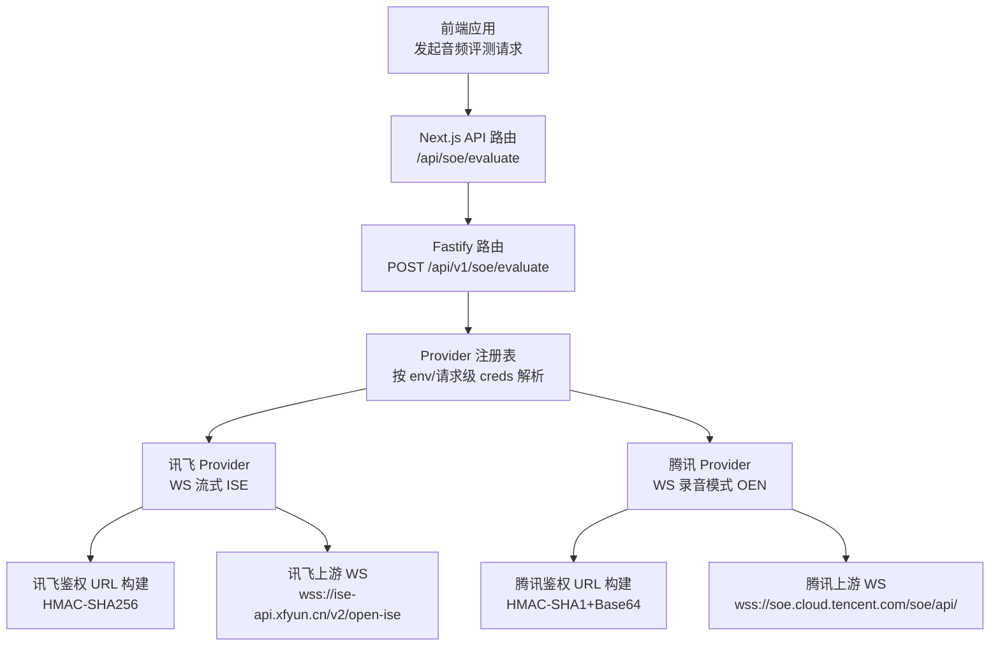
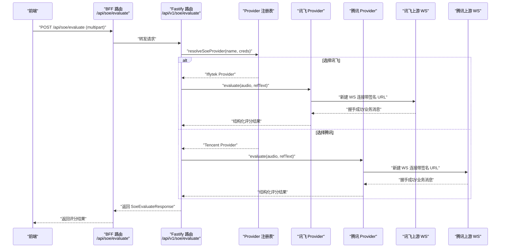
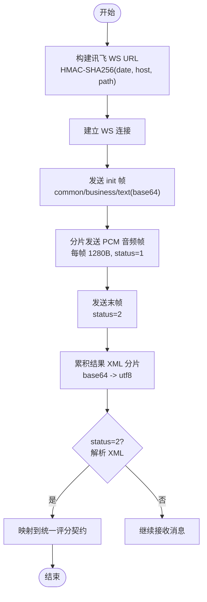
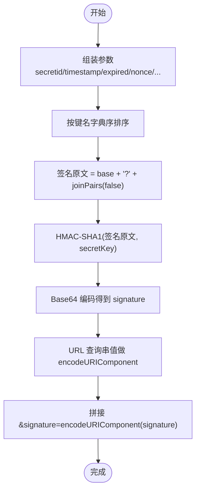
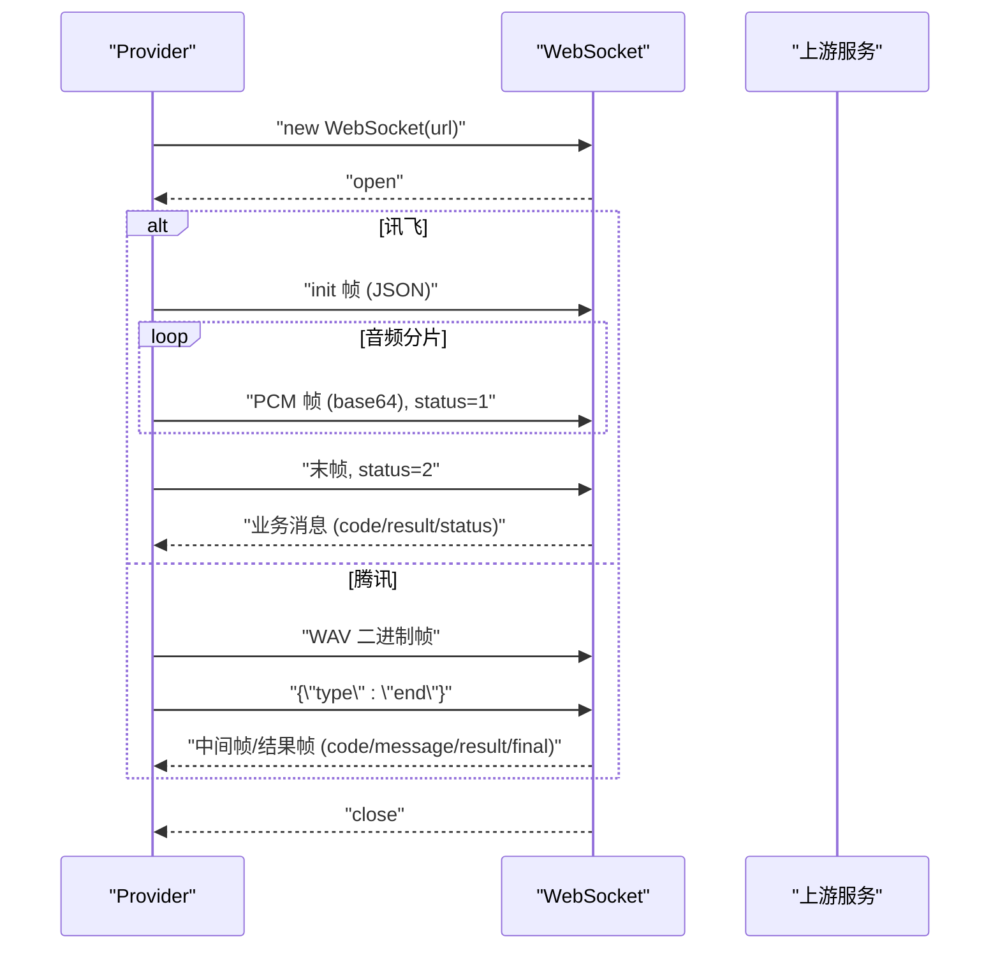
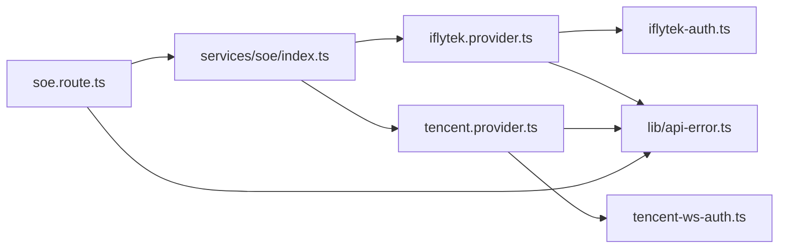

# 认证协议实现

<cite>
**本文引用的文件**   
- [server/src/services/soe/iflytek-auth.ts](file://server/src/services/soe/iflytek-auth.ts)
- [server/src/services/soe/tencent-ws-auth.ts](file://server/src/services/soe/tencent-ws-auth.ts)
- [server/src/services/soe/iflytek.provider.ts](file://server/src/services/soe/iflytek.provider.ts)
- [server/src/services/soe/tencent.provider.ts](file://server/src/services/soe/tencent.provider.ts)
- [server/src/routes/soe.route.ts](file://server/src/routes/soe.route.ts)
- [client/app/api/settings/soe/route.ts](file://client/app/api/settings/soe/route.ts)
- [client/services/api/soe.ts](file://client/services/api/soe.ts)
- [server/src/services/soe/index.ts](file://server/src/services/soe/index.ts)
- [server/src/lib/api-error.ts](file://server/src/lib/api-error.ts)
- [server/src/services/soe/soe-provider.ts](file://server/src/services/soe/soe-provider.ts)
- [client/types/api.ts](file://client/types/api.ts)
</cite>

## 目录
1. [引言](#引言)
2. [项目结构](#项目结构)
3. [核心组件](#核心组件)
4. [架构总览](#架构总览)
5. [详细组件分析](#详细组件分析)
6. [依赖关系分析](#依赖关系分析)
7. [性能与并发特性](#性能与并发特性)
8. [故障排查指南](#故障排查指南)
9. [安全最佳实践与密钥管理](#安全最佳实践与密钥管理)
10. [结论](#结论)

## 引言
本文件面向 SOE（口语评测）认证协议的实现，聚焦两个厂商的鉴权机制：
- 讯飞 WebSocket 认证流程：基于 HMAC-SHA256 的 URL 签名，用于建立 wss://ise-api.xfyun.cn/v2/open-ise 流式会话。
- 腾讯云签名生成算法：基于 HMAC-SHA1 + Base64 的 URL 签名，用于建立 wss://soe.cloud.tencent.com/soe/api/<appid> 录音模式会话。

文档将深入解释 HMAC 签名计算、时间戳处理、随机数生成、WebSocket 连接建立与握手协议、认证令牌生命周期与自动刷新策略、失败重试机制，以及安全最佳实践和密钥管理建议。

## 项目结构
SOE 相关代码分布在服务端与客户端两部分：
- 服务端负责：
  - 暴露统一评分接口 POST /api/v1/soe/evaluate。
  - 按 provider 选择并构造上游 WebSocket 连接。
  - 为讯飞与腾讯分别实现鉴权 URL 构建与 WS 会话控制。
- 客户端负责：
  - 通过 BFF 路由调用后端评分接口。
  - 在设置页读写 SOE 配置（provider、proxyUrl、各厂商凭据）。

图表来源
- [server/src/routes/soe.route.ts:64-109](file://server/src/routes/soe.route.ts#L64-L109)
- [server/src/services/soe/index.ts:21-28](file://server/src/services/soe/index.ts#L21-L28)
- [server/src/services/soe/iflytek.provider.ts:54-83](file://server/src/services/soe/iflytek.provider.ts#L54-L83)
- [server/src/services/soe/tencent.provider.ts:50-84](file://server/src/services/soe/tencent.provider.ts#L50-L84)
- [server/src/services/soe/iflytek-auth.ts:27-33](file://server/src/services/soe/iflytek-auth.ts#L27-L33)
- [server/src/services/soe/tencent-ws-auth.ts:57-94](file://server/src/services/soe/tencent-ws-auth.ts#L57-L94)

章节来源
- [server/src/routes/soe.route.ts:1-110](file://server/src/routes/soe.route.ts#L1-L110)
- [client/app/api/settings/soe/route.ts:1-57](file://client/app/api/settings/soe/route.ts#L1-L57)
- [client/services/api/soe.ts:1-30](file://client/services/api/soe.ts#L1-L30)

## 核心组件
- 统一评分路由：接收 multipart/form-data（audio/refText/evalMode/provider/creds），校验参数后选择 provider 并调用 evaluate。
- Provider 注册表：根据环境变量与请求级凭据动态构造 provider；mock 恒在，其余按需注册。
- 讯飞 Provider：构建带签名的 WS URL，发送 init 帧、分片 PCM 音频帧、末帧，累积并解析结果 XML。
- 腾讯 Provider：构建带签名的 WS URL，整段二进制音频帧上行，等待 final 文本帧并解析内嵌 JSON 结果。
- 鉴权模块：
  - 讯飞：HMAC-SHA256 签名，date 使用 RFC 1123 UTC 字符串，签名有效期约 5 分钟。
  - 腾讯：HMAC-SHA1 + Base64 签名，timestamp/expired 秒级时间戳，nonce 随机数，voice_id 会话唯一 ID。

章节来源
- [server/src/routes/soe.route.ts:64-109](file://server/src/routes/soe.route.ts#L64-L109)
- [server/src/services/soe/index.ts:21-79](file://server/src/services/soe/index.ts#L21-L79)
- [server/src/services/soe/iflytek.provider.ts:54-234](file://server/src/services/soe/iflytek.provider.ts#L54-L234)
- [server/src/services/soe/tencent.provider.ts:50-191](file://server/src/services/soe/tencent.provider.ts#L50-L191)
- [server/src/services/soe/iflytek-auth.ts:27-33](file://server/src/services/soe/iflytek-auth.ts#L27-L33)
- [server/src/services/soe/tencent-ws-auth.ts:57-94](file://server/src/services/soe/tencent-ws-auth.ts#L57-L94)

## 架构总览
SOE 认证与评测的整体流程如下：

图表来源
- [client/services/api/soe.ts:9-28](file://client/services/api/soe.ts#L9-L28)
- [server/src/routes/soe.route.ts:64-109](file://server/src/routes/soe.route.ts#L64-L109)
- [server/src/services/soe/index.ts:37-79](file://server/src/services/soe/index.ts#L37-L79)
- [server/src/services/soe/iflytek.provider.ts:54-234](file://server/src/services/soe/iflytek.provider.ts#L54-L234)
- [server/src/services/soe/tencent.provider.ts:50-191](file://server/src/services/soe/tencent.provider.ts#L50-L191)

## 详细组件分析

### 讯飞 WebSocket 认证流程
- 鉴权 URL 构建：
  - 输入包含 apiKey、apiSecret、host、path、date。
  - 签名原文由 host、date、GET path 三行拼接。
  - 使用 HMAC-SHA256 对签名原文进行摘要，得到 signature。
  - authorization 字段包含 api_key、algorithm、headers、signature。
  - 最终 URL 为 wss://host/path?authorization=...&date=...&host=...。
- WS 会话：
  - 首次 init 帧携带 common/business/text（text 为 base64 编码的请求体）。
  - 音频以裸 PCM 分片（1280B）逐帧发送，status=1；末帧 status=2。
  - 结果以 base64 的 XML 分片累积，status=2 时解析并映射到统一契约。
- 超时与重试：
  - 每次 attempt 重新生成 date/签名/连接。
  - 超时或网络错误可重试；客户端断开不重试。

图表来源
- [server/src/services/soe/iflytek-auth.ts:27-33](file://server/src/services/soe/iflytek-auth.ts#L27-L33)
- [server/src/services/soe/iflytek.provider.ts:174-225](file://server/src/services/soe/iflytek.provider.ts#L174-L225)

章节来源
- [server/src/services/soe/iflytek-auth.ts:1-35](file://server/src/services/soe/iflytek-auth.ts#L1-L35)
- [server/src/services/soe/iflytek.provider.ts:54-234](file://server/src/services/soe/iflytek.provider.ts#L54-L234)

### 腾讯签名生成算法
- 签名参数：
  - secretid、timestamp、expired、nonce、server_engine_type、voice_id、voice_format、text_mode、ref_text、eval_mode、score_coeff、sentence_info_enabled、rec_mode。
  - timestamp 为 Unix 秒；expired = timestamp + 300（秒）。
  - nonce 为 9 位数字随机串；voice_id 为 18 位字母数字随机串。
- 签名原文：
  - 键字典序排序后拼接 k=v，值不做 URL 编码。
  - 基础路径为 soe.cloud.tencent.com/soe/api/<appid>。
  - signatureOrigin = base + "?" + joinPairs(false)。
- 签名计算：
  - signature = Base64(HMAC-SHA1(signatureOrigin, secretKey))。
- 最终 URL：
  - 同一排序串但字符串值做 encodeURIComponent，数值原样。
  - 追加 &signature=encodeURIComponent(signature)。

图表来源
- [server/src/services/soe/tencent-ws-auth.ts:57-94](file://server/src/services/soe/tencent-ws-auth.ts#L57-L94)

章节来源
- [server/src/services/soe/tencent-ws-auth.ts:1-96](file://server/src/services/soe/tencent-ws-auth.ts#L1-L96)

### WebSocket 连接建立与握手协议
- 讯飞：
  - 握手非 101 视为失败（常见 401 表示签名/密钥问题）。
  - open 后发送 init 帧，随后分片发送 PCM 音频帧，最后发送末帧。
  - 收到 code!=0 的业务消息即报错；status=2 时解析 XML 结果。
- 腾讯：
  - 握手非 101 视为失败（签名/参数错直接拒绝协议升级）。
  - open 后发送整段 WAV 二进制帧，再发送 {"type":"end"}。
  - 收到 code!=0 的消息即映射为统一错误；final=1 时解析 result 内嵌 JSON。

图表来源
- [server/src/services/soe/iflytek.provider.ts:123-172](file://server/src/services/soe/iflytek.provider.ts#L123-L172)
- [server/src/services/soe/tencent.provider.ts:123-182](file://server/src/services/soe/tencent.provider.ts#L123-L182)

章节来源
- [server/src/services/soe/iflytek.provider.ts:123-172](file://server/src/services/soe/iflytek.provider.ts#L123-L172)
- [server/src/services/soe/tencent.provider.ts:123-182](file://server/src/services/soe/tencent.provider.ts#L123-L182)

### 认证令牌生命周期管理与自动刷新
- 讯飞：
  - date 每次 attempt 新生成（RFC 1123 UTC），签名有效期约 5 分钟。
  - 每次重试独立会话：重新生成 date/签名/连接。
- 腾讯：
  - timestamp/expired 秒级时间戳，expired = timestamp + 300。
  - nonce 与 voice_id 每次 attempt 重新生成。
  - 每次重试独立会话：重新生成 timestamp/nonce/voice_id/签名/连接。
- 自动刷新：
  - 未在进程内缓存 token；每次 evaluate 调用均重新构建签名 URL。
  - 超时或网络错误触发重试，重试时重新生成时间相关参数与签名。

章节来源
- [server/src/services/soe/iflytek.provider.ts:54-83](file://server/src/services/soe/iflytek.provider.ts#L54-L83)
- [server/src/services/soe/tencent.provider.ts:50-84](file://server/src/services/soe/tencent.provider.ts#L50-L84)
- [server/src/services/soe/iflytek-auth.ts:27-33](file://server/src/services/soe/iflytek-auth.ts#L27-L33)
- [server/src/services/soe/tencent-ws-auth.ts:57-94](file://server/src/services/soe/tencent-ws-auth.ts#L57-L94)

### 认证失败的排查方法与重试策略
- 讯飞：
  - 握手非 101 或业务 code 在 10160~10165、10105、10106 族：检查 APP_ID/API_KEY/API_SECRET。
  - 未识别有效内容：提示重新朗读。
  - 重试条件：UPSTREAM_TIMEOUT 或 SOE_UPSTREAM_ERROR；客户端断开不重试。
- 腾讯：
  - code=4002：鉴权失败，检查 SECRET_ID/SECRET_KEY/APP_ID。
  - code=4006：并发超限，稍后重试。
  - code=4008：分片等待超时。
  - code=4105：无人声，提示重新朗读。
  - 重试条件：UPSTREAM_TIMEOUT 或 SOE_UPSTREAM_ERROR；客户端断开不重试。

章节来源
- [server/src/services/soe/iflytek.provider.ts:34-37](file://server/src/services/soe/iflytek.provider.ts#L34-L37)
- [server/src/services/soe/iflytek.provider.ts:125-171](file://server/src/services/soe/iflytek.provider.ts#L125-L171)
- [server/src/services/soe/iflytek.provider.ts:229-232](file://server/src/services/soe/iflytek.provider.ts#L229-L232)
- [server/src/services/soe/tencent.provider.ts:36-48](file://server/src/services/soe/tencent.provider.ts#L36-L48)
- [server/src/services/soe/tencent.provider.ts:125-182](file://server/src/services/soe/tencent.provider.ts#L125-L182)
- [server/src/services/soe/tencent.provider.ts:186-189](file://server/src/services/soe/tencent.provider.ts#L186-L189)

## 依赖关系分析
- 路由层依赖 Provider 注册表与 Env。
- Provider 依赖各自鉴权模块与上游 WS。
- 错误类型统一通过 ApiError 与 ERR 常量映射 HTTP 状态码。

图表来源
- [server/src/routes/soe.route.ts:64-109](file://server/src/routes/soe.route.ts#L64-L109)
- [server/src/services/soe/index.ts:21-79](file://server/src/services/soe/index.ts#L21-L79)
- [server/src/services/soe/iflytek.provider.ts:54-234](file://server/src/services/soe/iflytek.provider.ts#L54-L234)
- [server/src/services/soe/tencent.provider.ts:50-191](file://server/src/services/soe/tencent.provider.ts#L50-L191)
- [server/src/lib/api-error.ts:1-36](file://server/src/lib/api-error.ts#L1-L36)

章节来源
- [server/src/routes/soe.route.ts:1-110](file://server/src/routes/soe.route.ts#L1-L110)
- [server/src/services/soe/index.ts:1-82](file://server/src/services/soe/index.ts#L1-L82)
- [server/src/lib/api-error.ts:1-36](file://server/src/lib/api-error.ts#L1-L36)

## 性能与并发特性
- 讯飞：
  - 音频分片大小 1280B，对应约 40ms@16kHz/16bit；可通过 IFLYTEK_FRAME_INTERVAL_MS 控制帧间间隔。
  - 支持 AbortSignal 中止 sleep，避免阻塞。
- 腾讯：
  - 录音模式整段音频上限约 60s（1.92MB），一次性二进制帧上传。
  - handshakeTimeout 与整体超时一致，避免握手阶段长时间占用。
- 通用：
  - 超时信号与客户端取消信号合并，确保及时释放资源。
  - 重试策略仅针对可重试错误，避免无效重试放大负载。

章节来源
- [server/src/services/soe/iflytek.provider.ts:24-26](file://server/src/services/soe/iflytek.provider.ts#L24-L26)
- [server/src/services/soe/iflytek.provider.ts:39-52](file://server/src/services/soe/iflytek.provider.ts#L39-L52)
- [server/src/services/soe/tencent.provider.ts:22-24](file://server/src/services/soe/tencent.provider.ts#L22-L24)
- [server/src/services/soe/tencent.provider.ts:86-88](file://server/src/services/soe/tencent.provider.ts#L86-L88)

## 故障排查指南
- 参数校验：
  - 缺少 audio/refText、evalMode 不为 sentence、音频为空或过大。
  - provider 未知或未配置密钥。
- 上游错误：
  - 讯飞：握手失败、业务 code 异常、结果解析失败、连接提前关闭。
  - 腾讯：握手失败、业务 code 异常、结果缺失或解析失败、连接提前关闭。
- 错误映射：
  - BAD_REQUEST、PAYLOAD_TOO_LARGE、SOE_NO_SPEECH、UPSTREAM_RATE_LIMIT、UPSTREAM_TIMEOUT、SOE_UPSTREAM_ERROR、PROVIDER_UNAVAILABLE、INTERNAL。

章节来源
- [server/src/routes/soe.route.ts:66-96](file://server/src/routes/soe.route.ts#L66-L96)
- [server/src/services/soe/iflytek.provider.ts:125-171](file://server/src/services/soe/iflytek.provider.ts#L125-L171)
- [server/src/services/soe/tencent.provider.ts:125-182](file://server/src/services/soe/tencent.provider.ts#L125-L182)
- [server/src/lib/api-error.ts:18-29](file://server/src/lib/api-error.ts#L18-L29)

## 安全最佳实践与密钥管理
- 密钥存储：
  - 优先使用环境变量注入（如 IFLYTEK_APP_ID/API_KEY/API_SECRET、TENCENT_APP_ID/SECRET_ID/SECRET_KEY）。
  - 请求级 creds 仅在必要时使用，且需严格校验结构与长度。
- 传输安全：
  - 所有上游连接使用 wss://，避免明文传输。
  - 签名参数中不包含敏感信息（secretKey 不参与 URL）。
- 时间参数：
  - 使用时间戳与过期时间控制签名有效期，避免重放攻击。
  - 每次 attempt 重新生成时间相关参数与签名。
- 随机性：
  - nonce 与 voice_id 使用加密安全的随机源生成，避免可预测性。
- 最小权限：
  - 仅授予必要权限给 API Key/Secret，限制访问 IP 白名单（若厂商支持）。
- 审计与日志：
  - 记录关键步骤但不输出敏感字段（如 secretKey、signature 原文）。
  - 对认证失败事件进行告警与聚合分析。

章节来源
- [server/src/services/soe/iflytek-auth.ts:27-33](file://server/src/services/soe/iflytek-auth.ts#L27-L33)
- [server/src/services/soe/tencent-ws-auth.ts:57-94](file://server/src/services/soe/tencent-ws-auth.ts#L57-L94)
- [server/src/services/soe/index.ts:37-79](file://server/src/services/soe/index.ts#L37-L79)

## 结论
本项目实现了讯飞与腾讯两家厂商的 SOE 认证协议，涵盖 HMAC 签名计算、时间戳与随机数处理、WebSocket 握手与会话控制、令牌生命周期与自动刷新、失败重试与安全最佳实践。通过统一的 Provider 抽象与注册表机制，系统具备良好的扩展性与可维护性。在实际部署中，应重点关注密钥管理、时间参数有效性、随机数安全性与错误日志的可观测性。