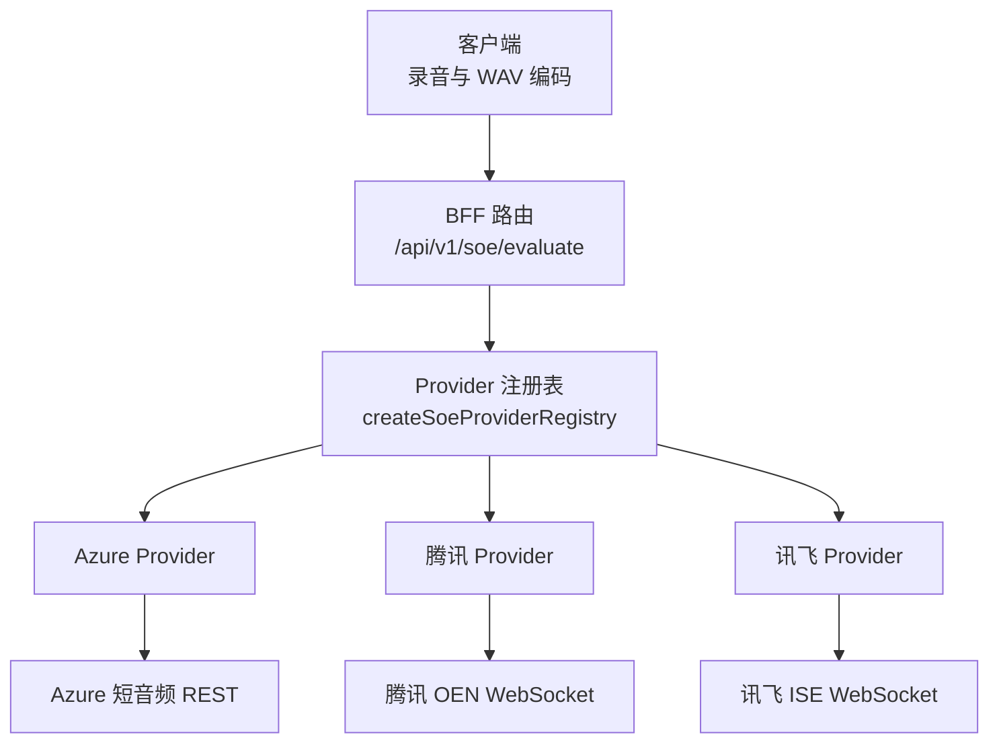
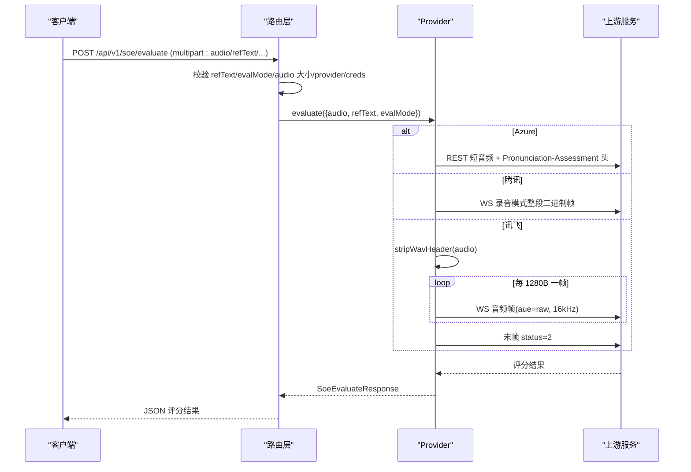
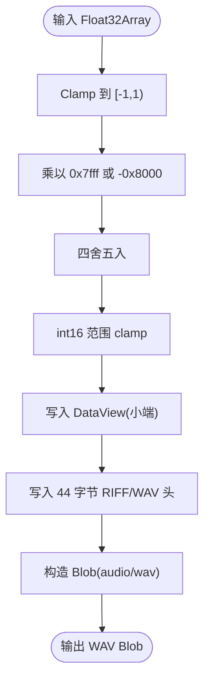
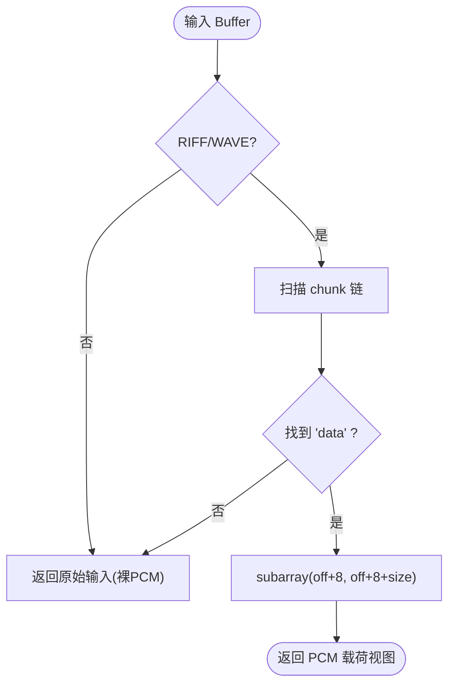
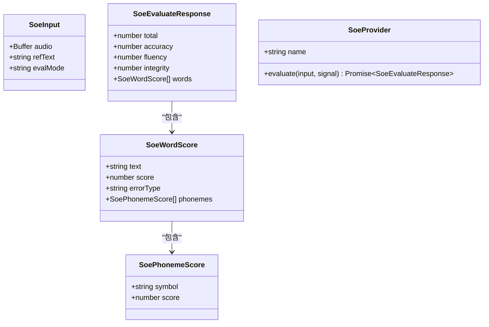
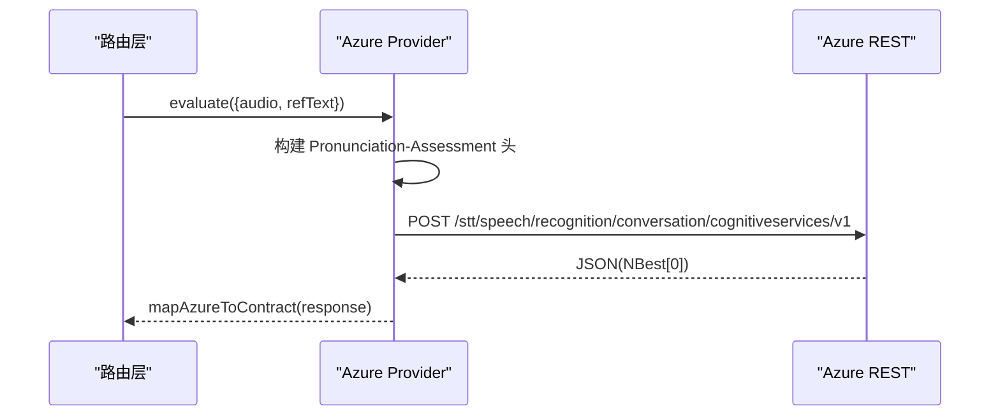
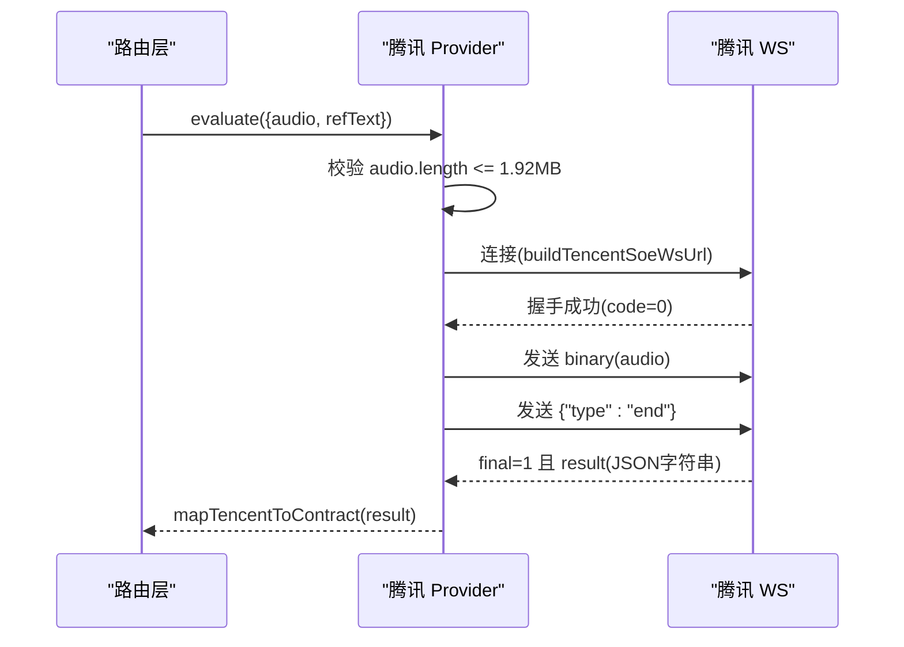
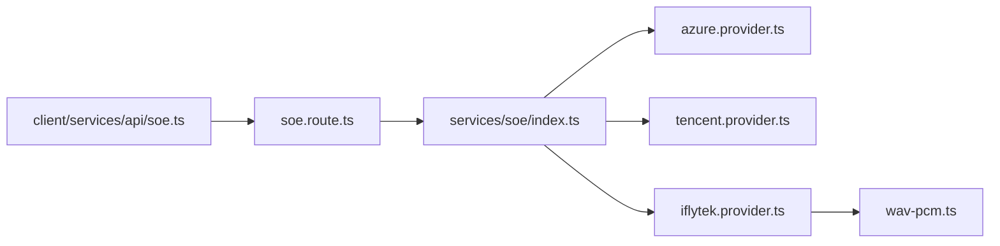

# 音频处理模块

<cite>
**本文引用的文件**   
- [wav-pcm.ts](file://server/src/services/soe/wav-pcm.ts)
- [wav-encoder.ts](file://client/core/audio/wav-encoder.ts)
- [soe-provider.ts](file://server/src/services/soe/soe-provider.ts)
- [index.ts](file://server/src/services/soe/index.ts)
- [soe.route.ts](file://server/src/routes/soe.route.ts)
- [soe.ts](file://client/services/api/soe.ts)
- [azure.provider.ts](file://server/src/services/soe/azure.provider.ts)
- [tencent.provider.ts](file://server/src/services/soe/tencent.provider.ts)
- [iflytek.provider.ts](file://server/src/services/soe/iflytek.provider.ts)
</cite>

## 目录
1. [简介](#简介)
2. [项目结构](#项目结构)
3. [核心组件](#核心组件)
4. [架构总览](#架构总览)
5. [详细组件分析](#详细组件分析)
6. [依赖关系分析](#依赖关系分析)
7. [性能与内存优化](#性能与内存优化)
8. [故障诊断与排错](#故障诊断与排错)
9. [结论](#结论)
10. [附录：最佳实践清单](#附录最佳实践清单)

## 简介
本技术文档聚焦 SOE（口语评测）音频处理模块，围绕“WAV 到 PCM 的转换、采样率与声道处理、位深度转换、数据流与内存管理、格式校验与质量检查”展开。该模块贯穿客户端录音编码、服务端路由解析、多供应商 Provider 适配以及上游语音服务对接，目标是保证 16kHz 单声道 16bit PCM 数据在端到端链路中稳定、可测、可观测。

## 项目结构
SOE 音频处理涉及前端与后端两部分：
- 前端负责将 Float32 PCM 样本编码为 WAV Blob，统一目标采样率为 16kHz，并作为 multipart/form-data 上传。
- 后端接收 WAV 或裸 PCM，按不同 Provider 协议进行适配：Azure 直接透传 WAV；腾讯 OEN 整段二进制发送；讯飞 ISE 需要剥离 WAV 头并按帧发送裸 PCM。



**图表来源**
- [soe.route.ts:64-106](file://server/src/routes/soe.route.ts#L64-L106)
- [index.ts:21-28](file://server/src/services/soe/index.ts#L21-L28)
- [azure.provider.ts:24-109](file://server/src/services/soe/azure.provider.ts#L24-L109)
- [tencent.provider.ts:50-192](file://server/src/services/soe/tencent.provider.ts#L50-L192)
- [iflytek.provider.ts:54-234](file://server/src/services/soe/iflytek.provider.ts#L54-L234)

**章节来源**
- [soe.route.ts:1-110](file://server/src/routes/soe.route.ts#L1-L110)
- [index.ts:1-82](file://server/src/services/soe/index.ts#L1-L82)

## 核心组件
- 客户端 WAV 编码器：将 Float32 PCM 转换为标准 44 字节 RIFF/WAV 头 + 16bit PCM 载荷，固定 16kHz 单声道。
- 服务端 WAV 头剥离器：为讯飞 ISE 提供裸 PCM 载荷，零拷贝 subarray 视图。
- Provider 接口与契约：定义 SoeInput、SoeEvaluateResponse 等类型，约束输入输出。
- Provider 实现：Azure、腾讯、讯飞三种实现，分别处理认证、传输、错误映射。
- 路由层：解析 multipart 请求、校验参数、选择 Provider、调用 evaluate。

**章节来源**
- [wav-encoder.ts:1-59](file://client/core/audio/wav-encoder.ts#L1-L59)
- [wav-pcm.ts:1-24](file://server/src/services/soe/wav-pcm.ts#L1-L24)
- [soe-provider.ts:1-47](file://server/src/services/soe/soe-provider.ts#L1-L47)
- [soe.route.ts:64-106](file://server/src/routes/soe.route.ts#L64-L106)

## 架构总览
SOE 音频处理的关键流程如下：
1. 客户端采集 Float32 PCM，使用 encodeWav 生成 16kHz mono 16bit WAV Blob。
2. 通过 FormData 上传至 /api/v1/soe/evaluate，携带 refText、evalMode、可选 provider 与 creds。
3. 路由层校验字段与大小，解析凭据，选择 Provider。
4. Provider 根据协议处理音频：
   - Azure：原样发送 WAV，Content-Type 指定 samplerate=16000。
   - 腾讯：整段 WAV 作为二进制帧发送。
   - 讯飞：stripWavHeader 剥离 WAV 头，按 1280B 分帧发送裸 PCM。
5. Provider 将上游响应映射为 SoeEvaluateResponse，返回给客户端。



**图表来源**
- [soe.route.ts:64-106](file://server/src/routes/soe.route.ts#L64-L106)
- [azure.provider.ts:54-109](file://server/src/services/soe/azure.provider.ts#L54-L109)
- [tencent.provider.ts:137-182](file://server/src/services/soe/tencent.provider.ts#L137-L182)
- [iflytek.provider.ts:174-225](file://server/src/services/soe/iflytek.provider.ts#L174-L225)

## 详细组件分析

### 客户端 WAV 编码器
- 功能：将 Float32 PCM 样本编码为标准 WAV Blob，包含 44 字节 RIFF 头与 16bit PCM 数据。
- 采样率：默认 TARGET_SAMPLE_RATE = 16000，符合 ADR-5 约定。
- 声道：NumChannels = 1（单声道）。
- 位深度：BitsPerSample = 16。
- 数值范围：Float32 [-1, 1) → int16，四舍五入并 clamp 防溢出，NaN 归零。
- 时长计算：wavDurationMs 由样本数与采样率推导毫秒时长。



**图表来源**
- [wav-encoder.ts:19-52](file://client/core/audio/wav-encoder.ts#L19-L52)

**章节来源**
- [wav-encoder.ts:1-59](file://client/core/audio/wav-encoder.ts#L1-L59)

### 服务端 WAV 头剥离器
- 功能：从 WAV 文件中提取 data chunk 的 PCM 载荷，返回 Buffer.subarray 视图，避免拷贝。
- 兼容性：非 RIFF/WAVE 或找不到 data chunk 时原样返回输入，作为裸 PCM 兜底。
- 遍历规则：按 RIFF chunk 链解析，支持 fmt/LIST 等任意前置 chunk，奇数尺寸 chunk 后补 1 字节对齐。



**图表来源**
- [wav-pcm.ts:11-23](file://server/src/services/soe/wav-pcm.ts#L11-L23)

**章节来源**
- [wav-pcm.ts:1-24](file://server/src/services/soe/wav-pcm.ts#L1-L24)

### Provider 接口与契约
- SoeInput：包含 audio(Buffer)、refText(string)、evalMode('sentence')。
- SoeEvaluateResponse：total、accuracy、fluency、integrity、words[]，其中 words 含 text/score/errorType/phonemes[]。
- SoeProvider：name 与 evaluate(input, signal?) 方法。



**图表来源**
- [soe-provider.ts:8-46](file://server/src/services/soe/soe-provider.ts#L8-L46)

**章节来源**
- [soe-provider.ts:1-47](file://server/src/services/soe/soe-provider.ts#L1-L47)

### Azure Provider
- 传输方式：REST 短音频接口，Content-Type 指定 audio/wav; codecs=audio/pcm; samplerate=16000。
- 认证：Ocp-Apim-Subscription-Key，Pronunciation-Assessment 头为 base64 JSON。
- 维度：Dimension=Comprehensive，Granularity=Phoneme，EnableMiscue=True，PhonemeAlphabet=IPA。
- 错误映射：NoMatch/InitialSilenceTimeout/BabbleTimeout → SOE_NO_SPEECH；401/403 → 认证失败；429 → 限流；400 → 音频格式不符。



**图表来源**
- [azure.provider.ts:24-109](file://server/src/services/soe/azure.provider.ts#L24-L109)

**章节来源**
- [azure.provider.ts:1-110](file://server/src/services/soe/azure.provider.ts#L1-L110)

### 腾讯 Provider
- 传输方式：WebSocket 录音模式，URL 查询参数含签名，首帧握手成功后整段 WAV 作为二进制帧发送，随后发送文本帧 {"type":"end"}。
- 限制：整段音频上限约 60s（1.92MB），超过直接拒绝。
- 错误映射：4002 鉴权失败；4006 并发超限；4008 分片等待超时；4105 无人声。



**图表来源**
- [tencent.provider.ts:50-192](file://server/src/services/soe/tencent.provider.ts#L50-L192)

**章节来源**
- [tencent.provider.ts:1-193](file://server/src/services/soe/tencent.provider.ts#L1-L193)

### 讯飞 Provider
- 传输方式：WebSocket ISE 流式版，init 帧携带业务参数，音频帧 aue=raw，按 1280B 分帧发送，末帧 status=2。
- 预处理：stripWavHeader 剥离 WAV 头，得到裸 PCM。
- 帧间隔：IFLYTEK_FRAME_INTERVAL_MS 控制帧间等待（官方建议 40ms）。
- 结果：累积 base64 XML 分片，status=2 时解析并映射为 SoeEvaluateResponse。

```mermaid
sequenceDiagram
participant R as "路由层"
participant F as "讯飞 Provider"
participant S as "WS 会话"
R->>F : evaluate({audio, refText})
F->>S : 连接(buildIflytekWsUrl)
F->>S : init(cmd=ssb, aue=raw, auf=audio/L16;rate=16000)
F->>F : pcm = stripWavHeader(audio)
loop 每 1280B
F->>S : 音频帧(status=1, base64 PCM)
end
F->>S : 末帧(status=2)
S-->>F : 累积 XML 分片
F-->>R : parseIflytekResultXml + mapIflytekToContract
```

**图表来源**
- [iflytek.provider.ts:54-234](file://server/src/services/soe/iflytek.provider.ts#L54-L234)
- [wav-pcm.ts:11-23](file://server/src/services/soe/wav-pcm.ts#L11-L23)

**章节来源**
- [iflytek.provider.ts:1-236](file://server/src/services/soe/iflytek.provider.ts#L1-L236)

## 依赖关系分析
- 路由层依赖 Provider 注册表与 Env 配置，动态选择 Provider。
- Provider 之间无直接依赖，均依赖 soe-provider 的类型定义。
- 讯飞 Provider 依赖 wav-pcm 剥离 WAV 头。
- 客户端 SOE 服务依赖 BFF 路由，封装 FormData 上传与错误映射。



**图表来源**
- [soe.route.ts:64-106](file://server/src/routes/soe.route.ts#L64-L106)
- [index.ts:21-28](file://server/src/services/soe/index.ts#L21-L28)
- [wav-pcm.ts:11-23](file://server/src/services/soe/wav-pcm.ts#L11-L23)
- [soe.ts:9-28](file://client/services/api/soe.ts#L9-L28)

**章节来源**
- [soe.route.ts:1-110](file://server/src/routes/soe.route.ts#L1-L110)
- [index.ts:1-82](file://server/src/services/soe/index.ts#L1-L82)
- [soe.ts:1-30](file://client/services/api/soe.ts#L1-L30)

## 性能与内存优化
- 客户端 WAV 编码：
  - 使用 ArrayBuffer + DataView 直接写入，避免中间对象创建。
  - Float32 → int16 转换采用 Math.round 与 clamp，减少异常分支。
  - 目标采样率固定 16kHz，降低后续重采样开销。
- 服务端 WAV 头剥离：
  - 使用 Buffer.subarray 返回视图，零拷贝，避免额外内存分配。
  - 仅遍历 chunk 链直到 data，尽早返回。
- Provider 传输：
  - 腾讯整段二进制帧，避免 Base64 编解码开销。
  - 讯飞按 1280B 分帧，平衡延迟与网络吞吐，支持帧间隔可调。
  - Azure 直接透传 WAV，Content-Type 明确 samplerate=16000。
- 错误与重试：
  - 所有 Provider 统一超时与重试策略，区分可重试与不可重试错误，避免无效重试。

**章节来源**
- [wav-encoder.ts:19-52](file://client/core/audio/wav-encoder.ts#L19-L52)
- [wav-pcm.ts:11-23](file://server/src/services/soe/wav-pcm.ts#L11-L23)
- [tencent.provider.ts:50-192](file://server/src/services/soe/tencent.provider.ts#L50-L192)
- [iflytek.provider.ts:174-225](file://server/src/services/soe/iflytek.provider.ts#L174-L225)
- [azure.provider.ts:54-109](file://server/src/services/soe/azure.provider.ts#L54-L109)

## 故障诊断与排错
- 客户端上传失败：
  - 检查 FormData 是否包含 audio/refText/evalMode。
  - 确认 WAV Blob MIME 类型为 audio/wav。
- 路由层校验失败：
  - refText 为空或超长（≤1000 字符）。
  - evalMode 不为 sentence。
  - audio 为空或超过 25MB。
  - provider 未知名或凭据缺失。
- Provider 错误：
  - Azure：401/403 认证失败；429 限流；400 音频格式不符；RecognitionStatus 非 Success。
  - 腾讯：4002 鉴权失败；4006 并发超限；4008 分片等待超时；4105 无人声。
  - 讯飞：WS 握手失败；base64 XML 解析失败；status≠0 的业务错误码。
- 无语音问题：
  - Azure：NoMatch/InitialSilenceTimeout/BabbleTimeout。
  - 腾讯：4105。
  - 讯飞：parseIflytekResultXml 标记 isRejected。

**章节来源**
- [soe.route.ts:64-106](file://server/src/routes/soe.route.ts#L64-L106)
- [azure.provider.ts:78-100](file://server/src/services/soe/azure.provider.ts#L78-L100)
- [tencent.provider.ts:36-48](file://server/src/services/soe/tencent.provider.ts#L36-L48)
- [iflytek.provider.ts:149-171](file://server/src/services/soe/iflytek.provider.ts#L149-L171)

## 结论
SOE 音频处理模块通过统一的 16kHz 单声道 16bit WAV 规范，结合客户端编码与服务端多 Provider 适配，实现了稳定、可扩展的口语评测能力。关键优化点包括零拷贝 WAV 头剥离、按帧流式传输、统一错误映射与重试策略。建议在录音阶段严格遵循采样率与声道规范，并在服务端启用合理的超时与重试机制，以提升整体鲁棒性。

## 附录：最佳实践清单
- 录音阶段：
  - 使用 encodeWav 生成 16kHz mono 16bit WAV，避免额外重采样。
  - 控制录音时长，避免超过各 Provider 限制（如腾讯 60s）。
- 上传阶段：
  - 确保 FormData 字段完整，refText 不超过 1000 字符。
  - 合理设置 provider 与 creds，优先使用服务端默认配置。
- 服务端调优：
  - 根据上游负载调整 SOE_RETRY 与 SOE_TIMEOUT_MS。
  - 对讯飞 ISE 适当调整 IFLYTEK_FRAME_INTERVAL_MS 以平衡延迟与吞吐。
- 监控与日志：
  - 记录 provider、音频大小、refText 前缀，便于问题定位。
  - 捕获并分类上游错误码，提供用户友好提示。