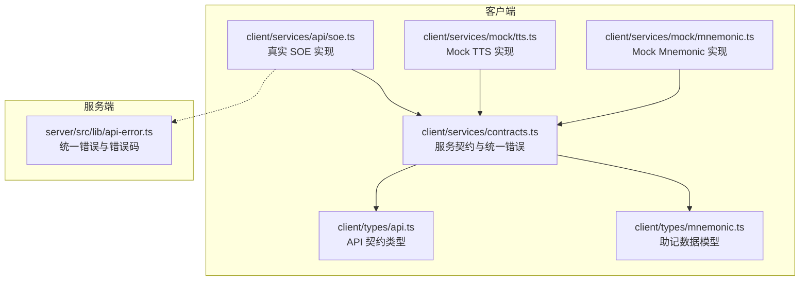
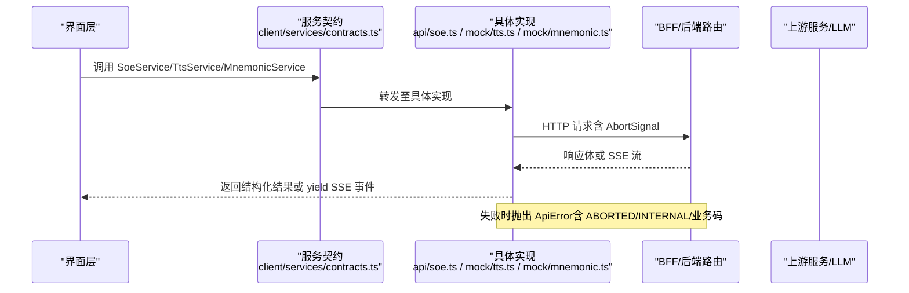
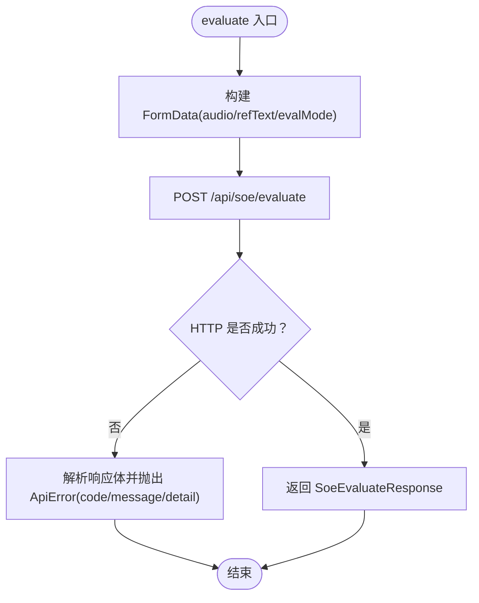
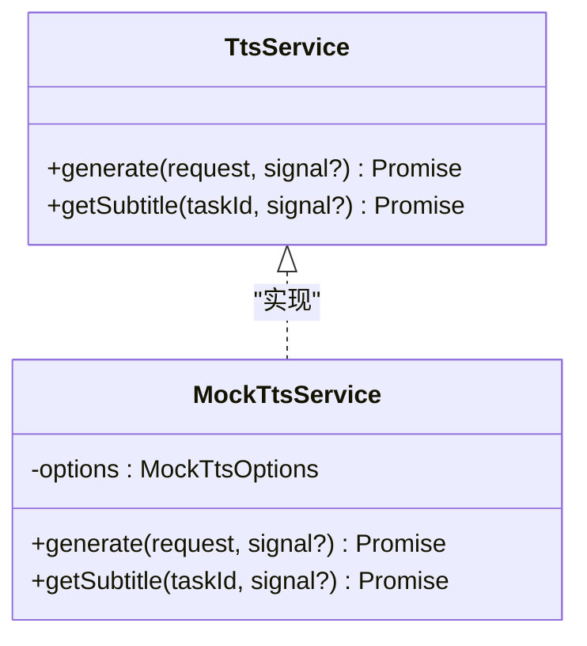
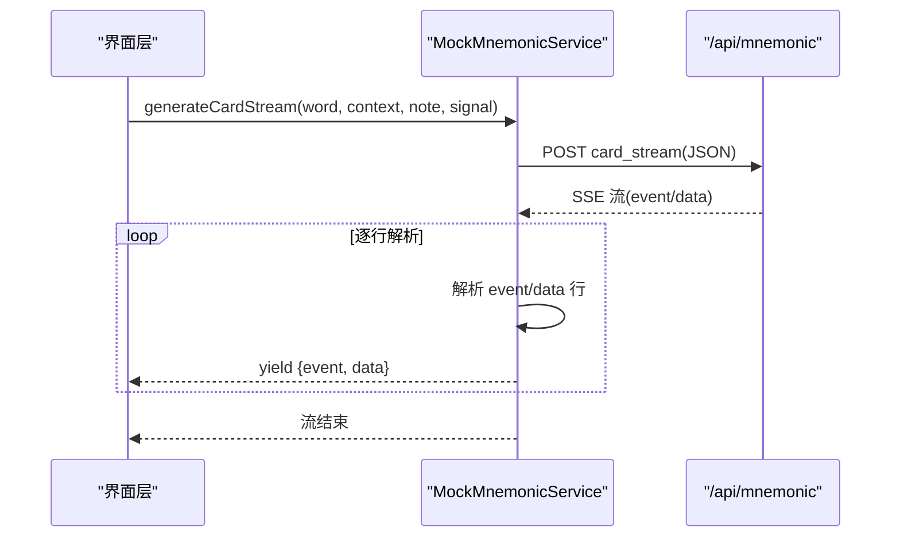
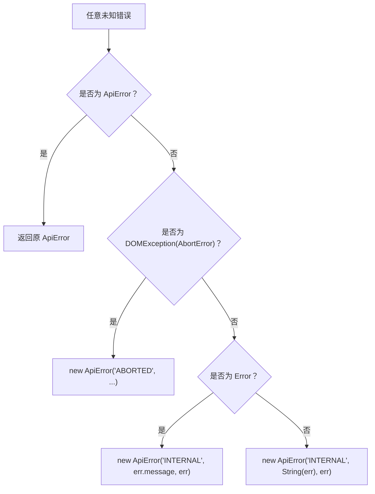
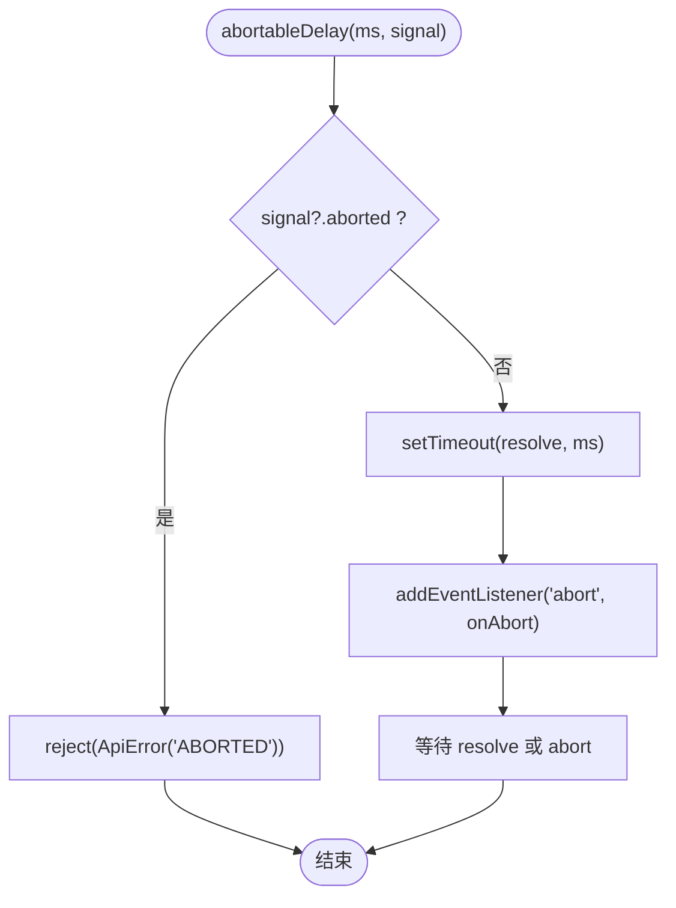
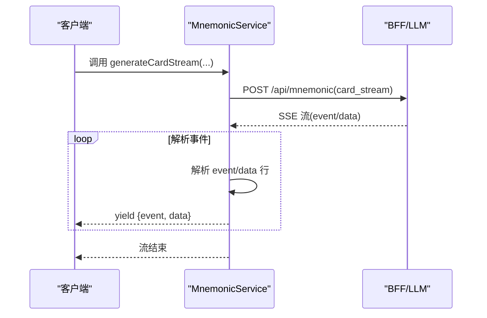
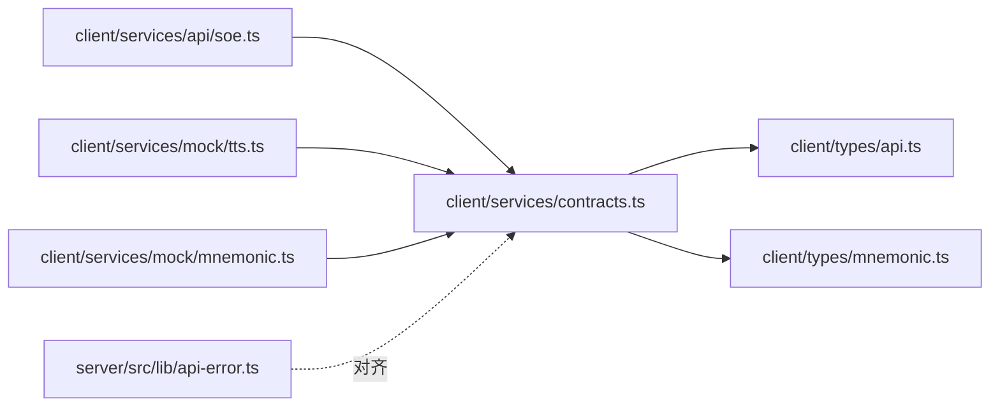

# 服务契约定义

<cite>
**本文引用的文件**   
- [client/services/contracts.ts](file://client/services/contracts.ts)
- [client/types/api.ts](file://client/types/api.ts)
- [client/types/mnemonic.ts](file://client/types/mnemonic.ts)
- [client/services/api/soe.ts](file://client/services/api/soe.ts)
- [client/services/mock/tts.ts](file://client/services/mock/tts.ts)
- [client/services/mock/mnemonic.ts](file://client/services/mock/mnemonic.ts)
- [server/src/lib/api-error.ts](file://server/src/lib/api-error.ts)
</cite>

## 目录
1. [引言](#引言)
2. [项目结构](#项目结构)
3. [核心组件](#核心组件)
4. [架构总览](#架构总览)
5. [详细组件分析](#详细组件分析)
6. [依赖关系分析](#依赖关系分析)
7. [性能与可靠性考虑](#性能与可靠性考虑)
8. [故障排查指南](#故障排查指南)
9. [结论](#结论)
10. [附录：接口调用示例与最佳实践](#附录接口调用示例与最佳实践)

## 引言
本文件面向“服务契约定义”的技术文档，聚焦以下目标：
- 解释 SoeService、TtsService、MnemonicService 等核心接口的设计理念与实现要点。
- 说明统一错误处理 ApiError 的机制与错误码（ABORTED、INTERNAL、TEXT_TOO_LONG、SUBTITLE_NOT_FOUND），并给出前后端对齐方式。
- 阐述 AbortSignal 取消机制与 abortableDelay 的实现原理。
- 解析 SSE（Server-Sent Events）流式响应的 AsyncGenerator 模式，事件序列为 status → token → result → done。
- 提供具体的接口调用示例与最佳实践，包括服务切换机制与 Mock 服务的实现方式。

## 项目结构
围绕服务契约的相关代码主要分布在客户端 services 与 types 目录，以及服务端统一错误定义中：
- client/services/contracts.ts：定义服务接口、统一错误类、AbortSignal 工具函数。
- client/types/api.ts：定义 API 契约类型（SOE/TTS/SSE 事件）。
- client/types/mnemonic.ts：定义助记数据模型与 SSE 事件类型。
- client/services/api/soe.ts：真实 SOE 服务实现（BFF 中转）。
- client/services/mock/tts.ts：Mock TTS 服务（离线模拟、字幕缓存、时间轴生成）。
- client/services/mock/mnemonic.ts：Mock Mnemonic 服务（SSE 流式解析）。
- server/src/lib/api-error.ts：服务端统一错误类与错误码映射。

**图表来源**
- [client/services/contracts.ts:1-144](file://client/services/contracts.ts#L1-L144)
- [client/types/api.ts:1-154](file://client/types/api.ts#L1-L154)
- [client/types/mnemonic.ts:1-141](file://client/types/mnemonic.ts#L1-L141)
- [client/services/api/soe.ts:1-30](file://client/services/api/soe.ts#L1-L30)
- [client/services/mock/tts.ts:1-190](file://client/services/mock/tts.ts#L1-L190)
- [client/services/mock/mnemonic.ts:1-125](file://client/services/mock/mnemonic.ts#L1-L125)
- [server/src/lib/api-error.ts:1-36](file://server/src/lib/api-error.ts#L1-L36)

**章节来源**
- [client/services/contracts.ts:1-144](file://client/services/contracts.ts#L1-L144)
- [client/types/api.ts:1-154](file://client/types/api.ts#L1-L154)
- [client/types/mnemonic.ts:1-141](file://client/types/mnemonic.ts#L1-L141)
- [client/services/api/soe.ts:1-30](file://client/services/api/soe.ts#L1-L30)
- [client/services/mock/tts.ts:1-190](file://client/services/mock/tts.ts#L1-L190)
- [client/services/mock/mnemonic.ts:1-125](file://client/services/mock/mnemonic.ts#L1-L125)
- [server/src/lib/api-error.ts:1-36](file://server/src/lib/api-error.ts#L1-L36)

## 核心组件
本节概述三大服务接口与统一错误机制的设计要点：
- SoeService：发音评测接口，接收音频与参考文本，返回结构化评分结果。
- TtsService：文字转语音接口，返回音频二进制与元信息；另提供按 taskId 领取字幕的接口。
- MnemonicService：生词助记接口，支持即时卡片、联想、练习、造句批改，并提供流式生成卡片的 AsyncGenerator。
- ApiError：统一错误对象，包含 code、message、detail；前端通过 toApiError 将 DOMException/AccortError 归一化为 ABORTED，其他错误归一化为 INTERNAL。
- AbortSignal 与 abortableDelay：所有服务方法接受可选 signal；abortableDelay 在超时或中止时抛出 ApiError('ABORTED')。

**章节来源**
- [client/services/contracts.ts:33-87](file://client/services/contracts.ts#L33-L87)
- [client/services/contracts.ts:92-136](file://client/services/contracts.ts#L92-L136)
- [client/types/api.ts:6-11](file://client/types/api.ts#L6-L11)
- [client/types/api.ts:50-91](file://client/types/api.ts#L50-L91)

## 架构总览
下图展示从客户端到 BFF/后端的请求路径、SSE 流式响应与错误处理的整体流程。

**图表来源**
- [client/services/contracts.ts:92-136](file://client/services/contracts.ts#L92-L136)
- [client/services/api/soe.ts:9-29](file://client/services/api/soe.ts#L9-L29)
- [client/services/mock/tts.ts:148-189](file://client/services/mock/tts.ts#L148-L189)
- [client/services/mock/mnemonic.ts:42-124](file://client/services/mock/mnemonic.ts#L42-L124)

## 详细组件分析

### SoeService（发音评测）
- 职责：提交 wav/pcm 音频与参考文本，返回整体与分词评分。
- 输入：Blob 音频、参考文本、评测模式（sentence）。
- 输出：SoeEvaluateResponse（总分、准确度、流畅度、完整性、分词评分）。
- 错误：网络异常或上游不可达时抛出 ApiError；若 signal 中止则抛 ABORTED。
- 实现要点：使用 FormData 上传音频与参数；对非 ok 响应解析 body.code/message/detail 并转为 ApiError。

**图表来源**
- [client/services/api/soe.ts:9-29](file://client/services/api/soe.ts#L9-L29)

**章节来源**
- [client/services/contracts.ts:92-106](file://client/services/contracts.ts#L92-L106)
- [client/services/api/soe.ts:1-30](file://client/services/api/soe.ts#L1-L30)
- [client/types/api.ts:21-48](file://client/types/api.ts#L21-L48)

### TtsService（文字转语音）
- 职责：
  - generate：合成音频二进制与元信息（taskId、durationMs、sentenceCount）。
  - getSubtitle：根据 taskId 领取 SRT 字幕。
- 约束：
  - text 上限 5000 字符，超限抛 ApiError('TEXT_TOO_LONG')。
  - 未命中字幕缓存抛 ApiError('SUBTITLE_NOT_FOUND')。
- Mock 实现特性：
  - 分句切分、时长估算、时间轴构建、SRT 生成、占位音 WAV 合成。
  - 模块级 Map 缓存字幕（LRU 500 条），taskId 作为领取凭据。
  - 支持 onProgress 进度回调与 paceScale 延迟缩放。

**图表来源**
- [client/services/contracts.ts:108-122](file://client/services/contracts.ts#L108-L122)
- [client/services/mock/tts.ts:148-189](file://client/services/mock/tts.ts#L148-L189)

**章节来源**
- [client/services/contracts.ts:108-122](file://client/services/contracts.ts#L108-L122)
- [client/services/mock/tts.ts:1-190](file://client/services/mock/tts.ts#L1-L190)
- [client/types/api.ts:104-134](file://client/types/api.ts#L104-L134)

### MnemonicService（生词助记）
- 职责：
  - 非流式：生成卡片、联想、练习题、造句批改。
  - 流式：generateCardStream 返回 AsyncGenerator<MnemonicSseEvent>，逐字段 yield 事件。
- SSE 事件类型：
  - field：某个顶层字段已解析完成。
  - done：完整卡片生成完成，附带 timing 统计。
  - error：错误事件。
- 实现要点：
  - 非流式方法直接 POST /api/mnemonic，失败抛错。
  - 流式方法读取 Response.body 流，按行解析 event:/data: 片段，yield 标准化事件。

**图表来源**
- [client/services/mock/mnemonic.ts:42-124](file://client/services/mock/mnemonic.ts#L42-L124)

**章节来源**
- [client/services/contracts.ts:124-136](file://client/services/contracts.ts#L124-L136)
- [client/types/mnemonic.ts:119-141](file://client/types/mnemonic.ts#L119-L141)
- [client/services/mock/mnemonic.ts:1-125](file://client/services/mock/mnemonic.ts#L1-L125)

### 统一错误处理 ApiError
- 前端：
  - ApiError 类包含 code、message、detail。
  - toApiError 将 DOMException(AbortError) 归一为 'ABORTED'，其他 Error 归一为 'INTERNAL'。
  - throwIfAborted 在 signal.aborted 时立即抛出 'ABORTED'。
- 服务端：
  - ApiError 类与 ERR 常量映射（如 INTERNAL、UPSTREAM_*、PROVIDER_UNAVAILABLE 等），用于构造带 HTTP 状态语义的错误。
- 契约对齐：
  - 前后端统一错误格式 { code, message, detail? }，便于上层统一捕获与提示。

**图表来源**
- [client/services/contracts.ts:33-59](file://client/services/contracts.ts#L33-L59)
- [server/src/lib/api-error.ts:6-35](file://server/src/lib/api-error.ts#L6-L35)

**章节来源**
- [client/services/contracts.ts:33-59](file://client/services/contracts.ts#L33-L59)
- [server/src/lib/api-error.ts:1-36](file://server/src/lib/api-error.ts#L1-L36)

### AbortSignal 取消机制与 abortableDelay
- 设计原则：
  - 所有服务方法接受可选 AbortSignal，保证可被外部取消。
  - throwIfAborted 在入口处快速失败，避免无效工作。
  - abortableDelay 封装 setTimeout，监听 abort 事件，确保清理定时器并抛出 'ABORTED'。
- 使用场景：
  - Mock TTS 的延迟阶段（模型加载、逐句合成）均支持中止。
  - 流式 SSE 读取过程中，若外层取消，应配合信号传递以中断 fetch。

**图表来源**
- [client/services/contracts.ts:61-87](file://client/services/contracts.ts#L61-L87)

**章节来源**
- [client/services/contracts.ts:61-87](file://client/services/contracts.ts#L61-L87)
- [client/services/mock/tts.ts:152-180](file://client/services/mock/tts.ts#L152-L180)

### SSE 流式响应与 AsyncGenerator 模式
- 事件序列：status → token → result → done（或 error）。
- 类型定义：
  - SseStatusEvent、SseTokenEvent、SseResultEvent、SseDoneEvent、SseErrorEvent。
  - 统一类型 SseEvent 联合上述事件。
- 应用示例：
  - MnemonicService.generateCardStream 通过读取 Response.body 流，按行解析 event/data，yield 标准化事件。
  - 上层 UI 可逐步渲染字段，并在 error 事件中终止流。

**图表来源**
- [client/types/api.ts:50-91](file://client/types/api.ts#L50-L91)
- [client/services/mock/mnemonic.ts:50-102](file://client/services/mock/mnemonic.ts#L50-L102)

**章节来源**
- [client/types/api.ts:50-91](file://client/types/api.ts#L50-L91)
- [client/services/mock/mnemonic.ts:50-102](file://client/services/mock/mnemonic.ts#L50-L102)

## 依赖关系分析
- 契约层（contracts.ts）依赖类型定义（types/api.ts、types/mnemonic.ts），并导出统一错误与工具函数。
- 具体实现（api/soe.ts、mock/tts.ts、mock/mnemonic.ts）依赖契约层与服务类型。
- 服务端错误定义（api-error.ts）与前端统一错误格式保持一致，便于跨端协作。

**图表来源**
- [client/services/contracts.ts:1-144](file://client/services/contracts.ts#L1-L144)
- [client/types/api.ts:1-154](file://client/types/api.ts#L1-L154)
- [client/types/mnemonic.ts:1-141](file://client/types/mnemonic.ts#L1-L141)
- [client/services/api/soe.ts:1-30](file://client/services/api/soe.ts#L1-L30)
- [client/services/mock/tts.ts:1-190](file://client/services/mock/tts.ts#L1-L190)
- [client/services/mock/mnemonic.ts:1-125](file://client/services/mock/mnemonic.ts#L1-L125)
- [server/src/lib/api-error.ts:1-36](file://server/src/lib/api-error.ts#L1-L36)

**章节来源**
- [client/services/contracts.ts:1-144](file://client/services/contracts.ts#L1-L144)
- [client/types/api.ts:1-154](file://client/types/api.ts#L1-L154)
- [client/types/mnemonic.ts:1-141](file://client/types/mnemonic.ts#L1-L141)
- [client/services/api/soe.ts:1-30](file://client/services/api/soe.ts#L1-L30)
- [client/services/mock/tts.ts:1-190](file://client/services/mock/tts.ts#L1-L190)
- [client/services/mock/mnemonic.ts:1-125](file://client/services/mock/mnemonic.ts#L1-L125)
- [server/src/lib/api-error.ts:1-36](file://server/src/lib/api-error.ts#L1-L36)

## 性能与可靠性考虑
- 取消与资源释放：
  - 所有异步操作支持 AbortSignal，避免不必要的计算与网络开销。
  - abortableDelay 确保定时器与事件监听器正确清理。
- 流式处理：
  - SSE 流式解析采用增量读取与行缓冲，减少内存占用。
  - 流结束时释放 reader lock，防止资源泄漏。
- 缓存策略：
  - Mock TTS 的字幕缓存采用 FIFO 淘汰，限制最大条目数，避免无限增长。
- 错误收敛：
  - 统一将未知错误归一为 INTERNAL，便于上层统一处理与上报。

[本节为通用指导，不直接分析具体文件]

## 故障排查指南
- 常见错误码与含义：
  - ABORTED：用户主动取消或信号中止。
  - INTERNAL：未知错误或内部异常。
  - TEXT_TOO_LONG：TTS 文本超过 5000 字符。
  - SUBTITLE_NOT_FOUND：字幕不存在或已过期（缓存 TTL）。
- 定位步骤：
  - 检查调用处是否正确传入 AbortSignal，并在 UI 取消时触发 signal.abort()。
  - 对于 TTS，确认文本长度不超过上限；若需更长文本，建议分批或优化 prompt。
  - 对于字幕领取，确认 taskId 来自 generate 返回的 meta.taskId，且未被缓存淘汰。
  - 查看上层捕获的 ApiError.detail，获取原始错误上下文。

**章节来源**
- [client/services/contracts.ts:33-87](file://client/services/contracts.ts#L33-L87)
- [client/services/mock/tts.ts:148-189](file://client/services/mock/tts.ts#L148-L189)

## 结论
本契约通过清晰的接口定义、统一的错误模型与完善的取消机制，实现了高内聚、低耦合的服务抽象。SoeService、TtsService、MnemonicService 分别覆盖发音评测、语音合成与助记生成三大能力，并通过 SSE 流式模式提升交互体验。Mock 服务提供了离线可测的实现，便于开发与测试。前后端统一错误格式确保了跨端一致的错误处理策略。

[本节为总结性内容，不直接分析具体文件]

## 附录：接口调用示例与最佳实践
- 调用 SoeService.evaluate：
  - 准备 Blob 音频与参考文本，设置 evalMode 为 sentence。
  - 传入 AbortSignal 以便取消。
  - 捕获 ApiError，区分 ABORTED 与其他错误。
- 调用 TtsService.generate：
  - 校验文本长度不超过 5000 字符。
  - 设置 voice、speed、format、withSubtitle。
  - 从返回的 meta 中获取 taskId，后续用 getSubtitle 领取字幕。
- 调用 MnemonicService.generateCardStream：
  - 使用 for await...of 遍历 AsyncGenerator，逐步渲染字段。
  - 在 error 事件中停止渲染并提示用户。
- 服务切换机制：
  - 通过 AppServices 聚合 soe/tts/mnemonic，由工厂注入具体实现（api/* 或 mock/*）。
  - 开发环境使用 mock 实现，生产环境替换为真实实现。
- 最佳实践：
  - 始终传入 AbortSignal，并在 UI 取消时及时 abort。
  - 统一捕获 ApiError，避免暴露底层细节给用户。
  - 对长文本进行分块或节流，避免触发 TEXT_TOO_LONG。
  - 合理使用字幕缓存，避免频繁重复领取相同 taskId。

**章节来源**
- [client/services/contracts.ts:92-143](file://client/services/contracts.ts#L92-L143)
- [client/services/api/soe.ts:9-29](file://client/services/api/soe.ts#L9-L29)
- [client/services/mock/tts.ts:148-189](file://client/services/mock/tts.ts#L148-L189)
- [client/services/mock/mnemonic.ts:42-124](file://client/services/mock/mnemonic.ts#L42-L124)