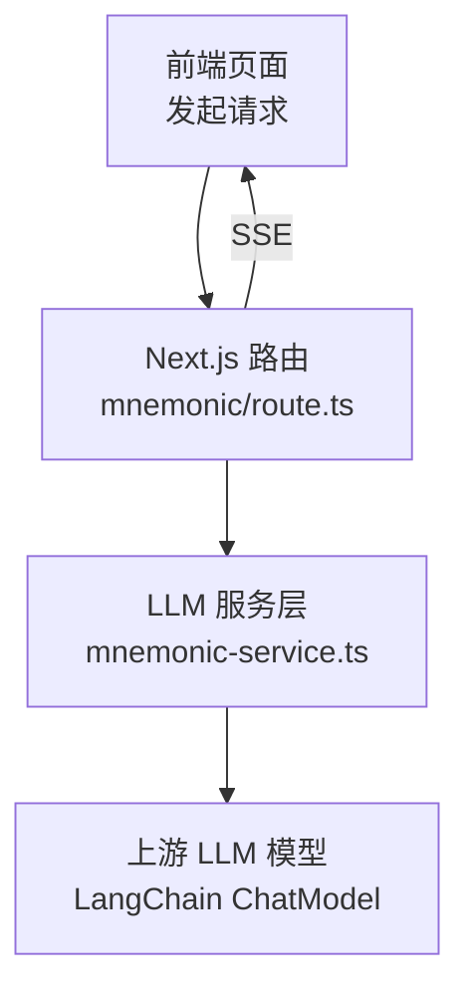
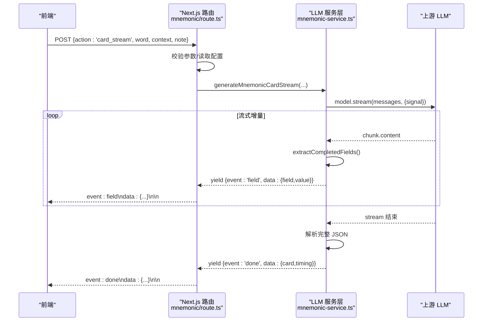
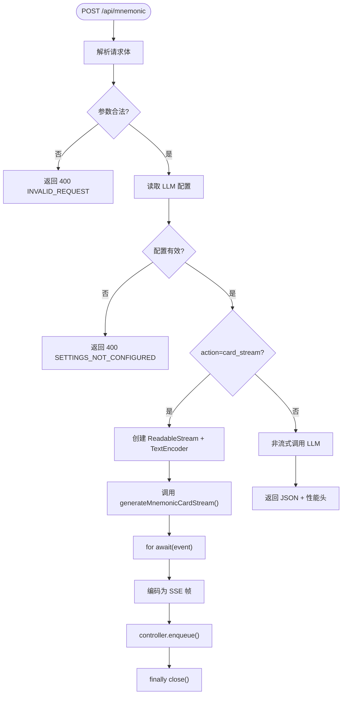
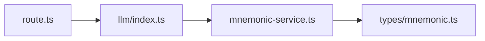

# 流式响应处理

<cite>
**本文引用的文件**   
- [client/app/api/mnemonic/route.ts](file://client/app/api/mnemonic/route.ts)
- [client/lib/llm/index.ts](file://client/lib/llm/index.ts)
- [client/lib/llm/mnemonic-service.ts](file://client/lib/llm/mnemonic-service.ts)
- [client/types/mnemonic.ts](file://client/types/mnemonic.ts)
- [client/services/mock/mnemonic.ts](file://client/services/mock/mnemonic.ts)
</cite>

## 目录
1. [引言](#引言)
2. [项目结构](#项目结构)
3. [核心组件](#核心组件)
4. [架构总览](#架构总览)
5. [详细组件分析](#详细组件分析)
6. [依赖关系分析](#依赖关系分析)
7. [性能考虑](#性能考虑)
8. [故障排查指南](#故障排查指南)
9. [结论](#结论)
10. [附录](#附录)

## 引言
本文件面向“流式响应处理”的技术文档，聚焦于本项目中基于 SSE（Server-Sent Events）的实时数据推送方案。内容涵盖：
- SSE 协议在前端与后端的实现方式
- AsyncGenerator 的使用模式与事件序列管理
- 流式数据传输协议、错误处理与连接管理
- LLM 报告生成的流式输出，包括增量字段更新与最终状态同步
- 性能优化技巧与最佳实践
- 调试工具与常见问题解决方案
- 与 WebSocket 等实时通信方式的对比与选择建议

## 项目结构
本项目在 Next.js 前端工程内实现了 BFF 层路由，通过 SSE 将 LLM 助记卡片生成结果以增量字段的方式推送到前端。关键路径如下：
- 路由层：`client/app/api/mnemonic/route.ts`
- LLM 服务层：`client/lib/llm/mnemonic-service.ts`
- 类型定义：`client/types/mnemonic.ts`
- 统一导出入口：`client/lib/llm/index.ts`
- Mock 服务（用于测试与演示）：`client/services/mock/mnemonic.ts`



**图示来源**
- [client/app/api/mnemonic/route.ts:148-179](file://client/app/api/mnemonic/route.ts#L148-L179)
- [client/lib/llm/mnemonic-service.ts:359-423](file://client/lib/llm/mnemonic-service.ts#L359-L423)

**章节来源**
- [client/app/api/mnemonic/route.ts:1-272](file://client/app/api/mnemonic/route.ts#L1-L272)
- [client/lib/llm/index.ts:1-23](file://client/lib/llm/index.ts#L1-L23)

## 核心组件
- 路由处理器：负责解析请求参数、校验输入、读取配置、构造 ChatModelConfig，并在 action=card_stream 时返回 SSE 流。
- LLM 服务层：封装提示词、JSON 解析策略、非流式调用与流式调用；流式调用使用 AsyncGenerator 逐字段产出事件。
- 类型系统：定义 MnemonicCard 及其子结构、SSE 事件类型 MnemonicSseEvent。
- Mock 服务：提供 card_stream 的模拟实现，便于前端联调。

**章节来源**
- [client/app/api/mnemonic/route.ts:44-179](file://client/app/api/mnemonic/route.ts#L44-L179)
- [client/lib/llm/mnemonic-service.ts:123-218](file://client/lib/llm/mnemonic-service.ts#L123-L218)
- [client/types/mnemonic.ts:57-141](file://client/types/mnemonic.ts#L57-L141)
- [client/services/mock/mnemonic.ts:56-56](file://client/services/mock/mnemonic.ts#L56-L56)

## 架构总览
下图展示从前端到 LLM 的完整调用链，以及 SSE 事件的流向。



**图示来源**
- [client/app/api/mnemonic/route.ts:148-179](file://client/app/api/mnemonic/route.ts#L148-L179)
- [client/lib/llm/mnemonic-service.ts:359-423](file://client/lib/llm/mnemonic-service.ts#L359-L423)

## 详细组件分析

### 路由层：SSE 流式响应
- 职责
  - 解析并校验请求体，支持 action 为 card、card_stream、association、exercises、evaluate。
  - 读取 LLM 配置，构建 ChatModelConfig。
  - 当 action=card_stream 时，创建 ReadableStream，将 LLM 服务层的 AsyncGenerator 事件转换为 SSE 文本帧，设置 Content-Type=text/event-stream。
  - 非流式分支返回标准 JSON 响应，附带性能指标头。
- 超时与取消
  - 使用 AbortController 与 AbortSignal.any 合并请求取消信号与服务端超时信号。
  - 对客户端断开或超时的情况返回 499 或 504。
- 错误映射
  - 捕获 LlmError 并映射为合适的 HTTP 状态码。
  - 其他异常统一包装为 MNEMONIC_UPSTREAM_ERROR。



**图示来源**
- [client/app/api/mnemonic/route.ts:44-179](file://client/app/api/mnemonic/route.ts#L44-L179)
- [client/app/api/mnemonic/route.ts:182-270](file://client/app/api/mnemonic/route.ts#L182-L270)

**章节来源**
- [client/app/api/mnemonic/route.ts:44-179](file://client/app/api/mnemonic/route.ts#L44-L179)
- [client/app/api/mnemonic/route.ts:182-270](file://client/app/api/mnemonic/route.ts#L182-L270)

### LLM 服务层：AsyncGenerator 与增量字段
- 职责
  - 封装提示词与 JSON 解析策略。
  - 提供非流式 callLlm 与流式 callLlmStream。
  - 流式模式下，累积 LLM 输出的片段，尝试提取已完整闭合的顶层字段，逐个 yield 事件。
  - 流结束时解析完整 JSON，yield done 事件，包含最终卡片与耗时统计。
- 增量字段解析算法
  - 维护 accumulated 字符串与 yielded 集合。
  - 扫描字符，跟踪 depth、inString、escaped，识别顶层字段名与其值边界。
  - 对每个已闭合字段尝试 JSON.parse，成功则 yield field 事件。
- 错误处理
  - 空内容或解析失败时 yield error 事件。
  - 统一将底层异常转换为 LlmError 或 toLlmError。

```mermaid
classDiagram
class MnemonicService {
+callLlm(systemPrompt, userMessage, config, signal) Promise~LlmResult~
+callLlmStream(systemPrompt, userMessage, config, signal) AsyncGenerator~MnemonicSseEvent~
+generateMnemonicCard(word, context, note, config, signal) Promise~LlmResult~
+generateMnemonicCardStream(word, context, note, config, signal) AsyncGenerator~MnemonicSseEvent~
-extractJsonObject(content) any
-extractCompletedFields(text, yielded) {field,value}[]
}
class MnemonicTypes {
<<interface>>
+MnemonicCard
+CoreMeaning
+PhoneticMnemonic
+WordRoots
+MnemonicExample
+Collocation
+Association
+Exercises
+SentenceEvaluation
+MnemonicSseEvent
}
MnemonicService --> MnemonicTypes : "使用"
```

**图示来源**
- [client/lib/llm/mnemonic-service.ts:123-218](file://client/lib/llm/mnemonic-service.ts#L123-L218)
- [client/lib/llm/mnemonic-service.ts:220-423](file://client/lib/llm/mnemonic-service.ts#L220-L423)
- [client/types/mnemonic.ts:57-141](file://client/types/mnemonic.ts#L57-L141)

**章节来源**
- [client/lib/llm/mnemonic-service.ts:123-218](file://client/lib/llm/mnemonic-service.ts#L123-L218)
- [client/lib/llm/mnemonic-service.ts:220-423](file://client/lib/llm/mnemonic-service.ts#L220-L423)
- [client/types/mnemonic.ts:57-141](file://client/types/mnemonic.ts#L57-L141)

### 类型系统：SSE 事件契约
- MnemonicSseEvent 定义三类事件：
  - field：某个顶层字段已解析完成，携带字段名与值。
  - done：流结束，携带完整卡片与耗时统计。
  - error：发生错误，携带错误消息。
- 该契约确保前后端对增量更新的语义一致，便于前端逐步渲染与状态同步。

**章节来源**
- [client/types/mnemonic.ts:133-141](file://client/types/mnemonic.ts#L133-L141)

### Mock 服务：card_stream 模拟
- 提供与真实路由一致的 card_stream 行为，便于前端在无后端环境下的联调与测试。

**章节来源**
- [client/services/mock/mnemonic.ts:56-56](file://client/services/mock/mnemonic.ts#L56-L56)

## 依赖关系分析
- 路由层依赖 LLM 服务层导出的 generateMnemonicCardStream。
- LLM 服务层依赖工厂 createChatModel 与 LangChain 的 ChatModel 接口。
- 类型定义被服务层与路由层共同引用，保证数据结构一致性。



**图示来源**
- [client/app/api/mnemonic/route.ts:11-21](file://client/app/api/mnemonic/route.ts#L11-L21)
- [client/lib/llm/index.ts:5-9](file://client/lib/llm/index.ts#L5-L9)
- [client/lib/llm/mnemonic-service.ts:7-11](file://client/lib/llm/mnemonic-service.ts#L7-L11)
- [client/types/mnemonic.ts:1-141](file://client/types/mnemonic.ts#L1-L141)

**章节来源**
- [client/app/api/mnemonic/route.ts:11-21](file://client/app/api/mnemonic/route.ts#L11-L21)
- [client/lib/llm/index.ts:1-23](file://client/lib/llm/index.ts#L1-L23)
- [client/lib/llm/mnemonic-service.ts:7-11](file://client/lib/llm/mnemonic-service.ts#L7-L11)
- [client/types/mnemonic.ts:1-141](file://client/types/mnemonic.ts#L1-L141)

## 性能考虑
- 流式传输
  - 使用 ReadableStream + TextEncoder 将事件逐块写入，避免整包缓冲，降低首字节延迟。
  - 设置 Cache-Control=no-cache 与 Connection=keep-alive，确保长连接稳定。
- 增量解析
  - 仅对已闭合的顶层字段进行 JSON.parse，减少重复解析开销。
  - 使用 yielded 集合去重，避免重复发送同一字段。
- 超时与取消
  - 合并 request.signal 与服务端超时信号，及时释放资源，防止悬挂连接。
- 日志与可观测性
  - 记录 invokeMs、parseMs、contentLength 等指标，便于定位瓶颈。
- 前端渲染建议
  - 按字段增量更新 UI，避免整段重绘。
  - 对高频更新做节流或批处理，控制渲染频率。

[本节为通用指导，不直接分析具体文件]

## 故障排查指南
- 常见错误
  - SETTINGS_NOT_CONFIGURED：未配置 Base URL 或 API Key。
  - INVALID_REQUEST：缺少必要参数或 action 非法。
  - RESPONSE_EMPTY：LLM 返回空内容。
  - RESPONSE_FORMAT_ERROR：JSON 无法解析。
  - UPSTREAM_ERROR：上游模型服务异常。
  - REQUEST_TIMEOUT：请求超时。
- 诊断步骤
  - 检查路由日志中的配置读取与模型信息。
  - 查看 LLM 服务层的 timing 日志，确认 invokeMs 与 parseMs。
  - 在浏览器开发者工具的 Network 面板中观察 SSE 帧，确认 event 与 data 格式。
  - 使用 Mock 服务验证前端解析逻辑是否正确。
- 恢复策略
  - 重试机制：对临时网络错误进行有限次数重试。
  - 降级策略：若流式失败，回退为非流式请求。
  - 用户反馈：在错误事件中显示友好提示，并提供重试按钮。

**章节来源**
- [client/app/api/mnemonic/route.ts:231-270](file://client/app/api/mnemonic/route.ts#L231-L270)
- [client/lib/llm/mnemonic-service.ts:418-423](file://client/lib/llm/mnemonic-service.ts#L418-L423)

## 结论
本项目通过 Next.js 路由层与 LLM 服务层的协作，实现了基于 SSE 的流式响应。服务端使用 AsyncGenerator 将 LLM 的增量输出转化为字段级事件，前端可按需增量渲染，显著提升用户体验。同时，完善的错误处理、超时管理与性能指标为稳定性与可观测性提供了保障。对于需要更高双向交互的场景，可评估 WebSocket；但对于单向实时推送，SSE 更轻量且易于实现。

[本节为总结性内容，不直接分析具体文件]

## 附录

### SSE 与 WebSocket 对比与选择建议
- SSE
  - 适用场景：单向实时推送（如 LLM 流式输出、监控告警）。
  - 优点：简单、原生支持、自动重连、跨域友好。
  - 缺点：不支持双向通信。
- WebSocket
  - 适用场景：双向实时通信（如聊天室、协同编辑）。
  - 优点：全双工、低延迟。
  - 缺点：实现复杂、需自行处理心跳与重连。
- 选择建议
  - 优先使用 SSE 实现单向流式数据推送。
  - 当需要双向交互或更低延迟时再考虑 WebSocket。

[本节为概念性内容，不直接分析具体文件]