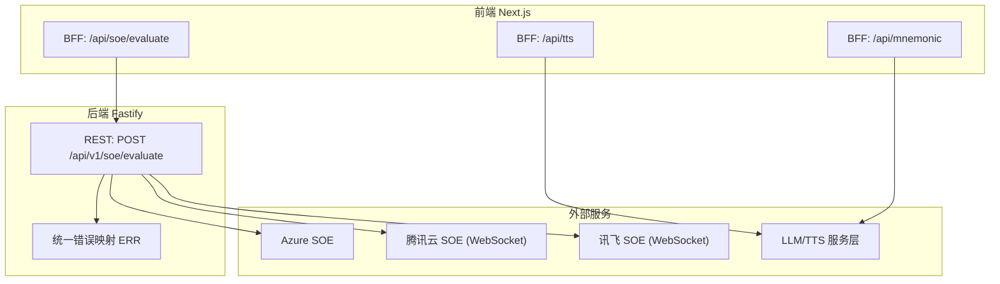
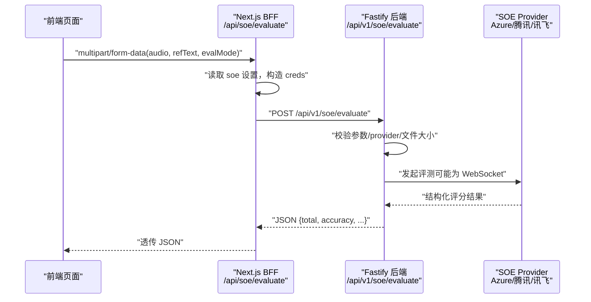
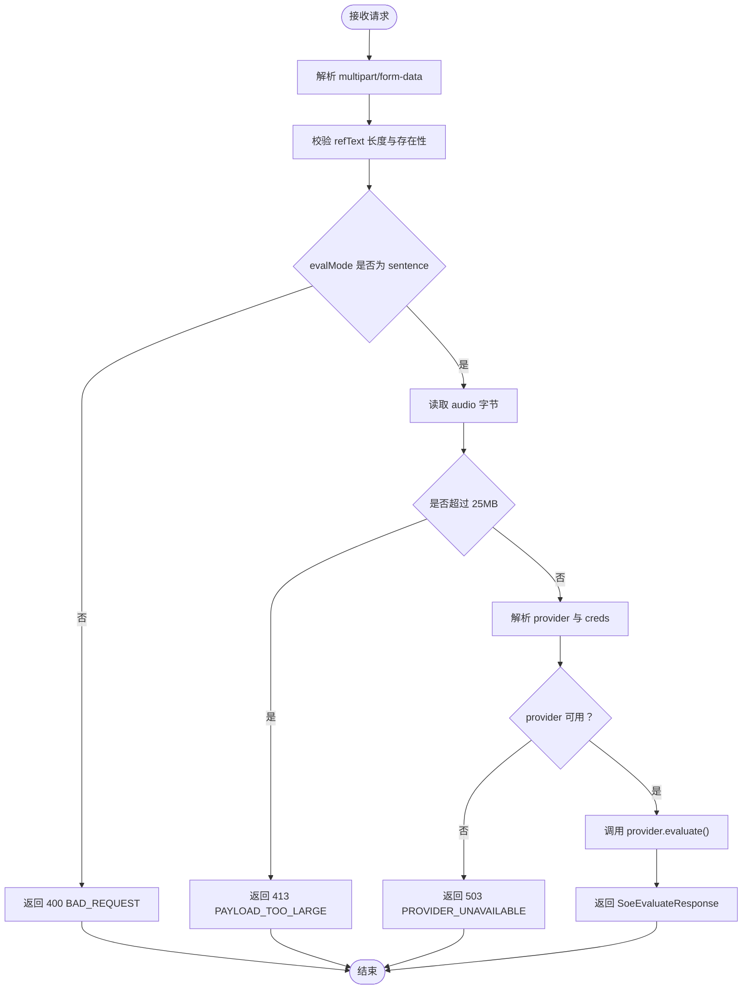
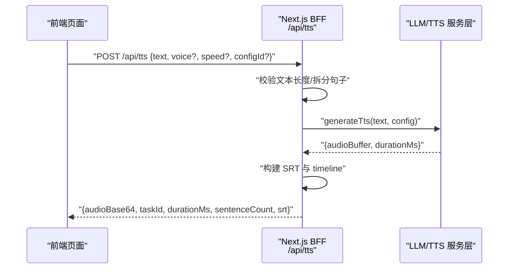
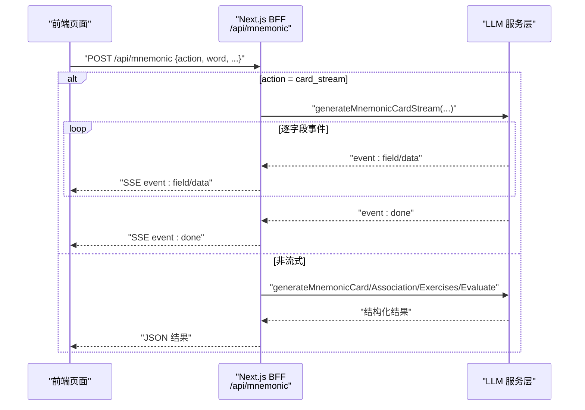
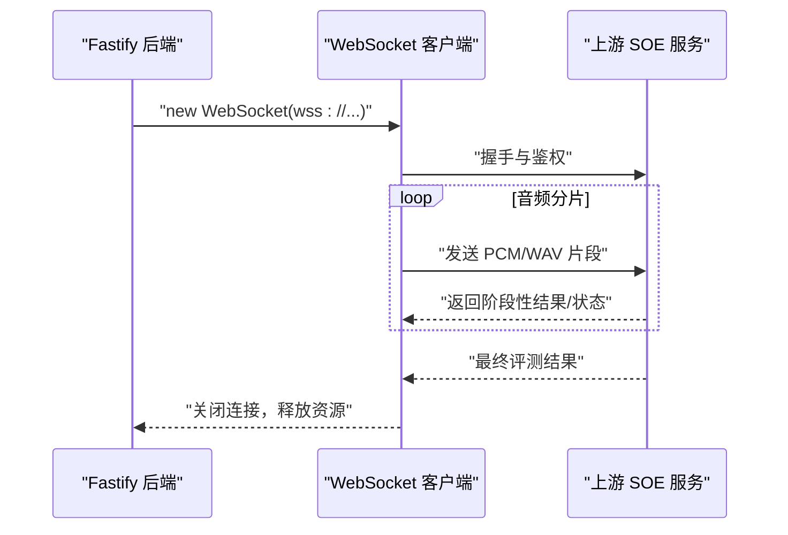
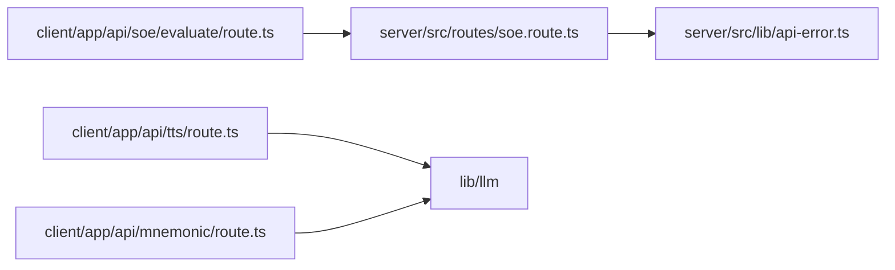

# API 参考

<cite>
**本文引用的文件**   
- [client/types/api.ts](file://client/types/api.ts)
- [client/services/contracts.ts](file://client/services/contracts.ts)
- [client/app/api/soe/evaluate/route.ts](file://client/app/api/soe/evaluate/route.ts)
- [client/app/api/tts/route.ts](file://client/app/api/tts/route.ts)
- [client/app/api/mnemonic/route.ts](file://client/app/api/mnemonic/route.ts)
- [server/src/routes/soe.route.ts](file://server/src/routes/soe.route.ts)
- [server/src/lib/api-error.ts](file://server/src/lib/api-error.ts)
- [client/types/material.ts](file://client/types/material.ts)
- [client/types/subtitle.ts](file://client/types/subtitle.ts)
- [client/types/progress.ts](file://client/types/progress.ts)
- [client/types/mnemonic.ts](file://client/types/mnemonic.ts)
</cite>

## 目录
1. [简介](#简介)
2. [项目结构](#项目结构)
3. [核心组件](#核心组件)
4. [架构总览](#架构总览)
5. [详细接口说明](#详细接口说明)
6. [依赖关系分析](#依赖关系分析)
7. [性能与限制](#性能与限制)
8. [故障排查指南](#故障排查指南)
9. [结论](#结论)
10. [附录：TypeScript 类型参考](#附录typescript-类型参考)

## 简介
本参考文档面向前端开发者与后端集成方，系统化梳理本仓库的 API 契约与服务端 RESTful 端点，覆盖以下能力：
- SOE 发音评分：POST /api/v1/soe/evaluate（服务端 Fastify 路由）及 BFF 中转。
- TTS 文字转语音：BFF 聚合调用 LLM/TTS 服务层，返回音频与字幕元信息。
- Mnemonic 生词助记：BFF 统一入口，支持非流式与 SSE 流式两种模式。
- WebSocket 连接处理：SOE 上游 provider（腾讯、讯飞）通过 WebSocket 进行实时评测。
- TypeScript 类型定义：Material、Subtitle、Training、Progress、Mnemonic 等数据模型。

## 项目结构
本项目采用“前端 Next.js + 后端 Fastify”的双端架构：
- 前端 Next.js 提供 BFF（Backend for Frontend）路由，负责参数校验、配置注入、上游转发与错误归一化。
- 后端 Fastify 暴露标准 REST 接口，封装多 provider（mock/azure/tencent/iflytek）的 SOE 评测实现。
- 类型定义集中在 client/types 下，作为前后端契约来源。

图表来源
- [client/app/api/soe/evaluate/route.ts:18-67](file://client/app/api/soe/evaluate/route.ts#L18-L67)
- [server/src/routes/soe.route.ts:64-107](file://server/src/routes/soe.route.ts#L64-L107)
- [server/src/lib/api-error.ts:18-35](file://server/src/lib/api-error.ts#L18-L35)

章节来源
- [client/app/api/soe/evaluate/route.ts:1-67](file://client/app/api/soe/evaluate/route.ts#L1-L67)
- [server/src/routes/soe.route.ts:1-110](file://server/src/routes/soe.route.ts#L1-L110)
- [server/src/lib/api-error.ts:1-36](file://server/src/lib/api-error.ts#L1-L36)

## 核心组件
- 前端契约与服务接口：client/services/contracts.ts 定义了 SoeService、TtsService、MnemonicService 的统一方法签名与错误约定。
- 前端类型契约：client/types/api.ts 定义了请求/响应体与 SSE 事件类型。
- 业务数据模型：client/types/material.ts、subtitle.ts、progress.ts、mnemonic.ts 定义了学习材料、字幕、进度与助记卡片等数据结构。
- 后端路由与错误：server/src/routes/soe.route.ts 实现 SOE 评估；server/src/lib/api-error.ts 提供统一错误码与 HTTP 状态映射。

章节来源
- [client/services/contracts.ts:1-144](file://client/services/contracts.ts#L1-L144)
- [client/types/api.ts:1-154](file://client/types/api.ts#L1-L154)
- [client/types/material.ts:1-36](file://client/types/material.ts#L1-L36)
- [client/types/subtitle.ts:1-35](file://client/types/subtitle.ts#L1-L35)
- [client/types/progress.ts:1-20](file://client/types/progress.ts#L1-L20)
- [client/types/mnemonic.ts:1-141](file://client/types/mnemonic.ts#L1-L141)
- [server/src/routes/soe.route.ts:1-110](file://server/src/routes/soe.route.ts#L1-L110)
- [server/src/lib/api-error.ts:1-36](file://server/src/lib/api-error.ts#L1-L36)

## 架构总览
SOE 发音评分链路：
- 前端调用 BFF /api/soe/evaluate，读取本地 soe 设置，将所选 provider 的密钥以 multipart creds 字段注入后转发到后端。
- 后端 Fastify 解析 multipart/form-data，校验 refText、evalMode、audio 大小与 provider 可用性，选择对应 provider 执行评测。
- 若使用腾讯或讯飞 provider，则通过 WebSocket 与上游服务建立连接并传输音频流。

图表来源
- [client/app/api/soe/evaluate/route.ts:18-67](file://client/app/api/soe/evaluate/route.ts#L18-L67)
- [server/src/routes/soe.route.ts:64-107](file://server/src/routes/soe.route.ts#L64-L107)

## 详细接口说明

### SOE 发音评分
- 后端 REST 端点
  - URL 与方法：POST /api/v1/soe/evaluate
  - 请求体：multipart/form-data
    - audio：wav/pcm，16kHz mono，≤25MB
    - refText：参考原文，必填，≤1000 字符
    - evalMode：固定 'sentence'
    - provider：可选，覆盖默认 provider（mock/azure/tencent/iflytek）
    - creds：可选 JSON 文本，请求级密钥（优先于环境变量），结构见后端 schema
  - 响应体：SoeEvaluateResponse
    - total：总分
    - accuracy：准确度
    - fluency：流利度
    - integrity：完整度
    - words：词级评分数组，包含 text、score、phonemes、errorType
  - 错误：统一 { code, message, detail? }，HTTP 状态由 ERR 映射决定

- 前端 BFF 中转
  - URL 与方法：POST /api/soe/evaluate
  - 行为：读取 soe 设置，注入 provider 与 creds，转发至后端；原样回传状态码与 JSON

- 前端契约类型
  - SoeEvaluateRequest：audio、refText、evalMode
  - SoeEvaluateResponse：total、accuracy、fluency、integrity、words[]
  - SoeWordScore：text、score、phonemes[]、errorType

- 错误码与状态码（后端）
  - BAD_REQUEST → 400
  - PAYLOAD_TOO_LARGE → 413
  - PROVIDER_UNAVAILABLE → 503
  - SOE_UPSTREAM_ERROR → 502
  - UPSTREAM_TIMEOUT → 504
  - INTERNAL → 500

图表来源
- [server/src/routes/soe.route.ts:64-107](file://server/src/routes/soe.route.ts#L64-L107)
- [server/src/lib/api-error.ts:18-35](file://server/src/lib/api-error.ts#L18-L35)

章节来源
- [server/src/routes/soe.route.ts:1-110](file://server/src/routes/soe.route.ts#L1-L110)
- [client/app/api/soe/evaluate/route.ts:1-67](file://client/app/api/soe/evaluate/route.ts#L1-L67)
- [client/types/api.ts:21-48](file://client/types/api.ts#L21-L48)
- [server/src/lib/api-error.ts:1-36](file://server/src/lib/api-error.ts#L1-L36)

### TTS 文字转语音
- 前端 BFF 端点
  - URL 与方法：POST /api/tts
  - 请求体：JSON
    - text：待合成文本，上限 5000 字符
    - voice：声音 ID（可选，缺省取默认）
    - speed：语速 0.5~2.0（可选，缺省 1.0）
    - configId：可选，指定 LLM/TTS 配置 ID
  - 响应体：JSON
    - audioBase64：音频 Base64
    - taskId：任务 ID（用于字幕领取）
    - durationMs：音频时长（毫秒）
    - sentenceCount：句子数量
    - srt：SRT 字幕文本
  - 错误：{ error, code }，常见 code 包括 SETTINGS_NOT_CONFIGURED

- 前端契约类型
  - TtsGenerateRequest：text、voice、speed、format、withSubtitle
  - TtsGenerateResponseMeta：taskId、durationMs、sentenceCount
  - TtsSubtitleResponse：srt、sentenceCount

- 说明
  - 当前 BFF 实现返回 Base64 音频与 SRT 字幕，便于前端直接播放与展示。
  - 架构设计中的二进制音频 + X-Tts-* 头元信息为契约目标，当前实现以 JSON 形式返回。

图表来源
- [client/app/api/tts/route.ts:23-115](file://client/app/api/tts/route.ts#L23-L115)
- [client/types/api.ts:104-134](file://client/types/api.ts#L104-L134)

章节来源
- [client/app/api/tts/route.ts:1-116](file://client/app/api/tts/route.ts#L1-L116)
- [client/types/api.ts:104-134](file://client/types/api.ts#L104-L134)

### Mnemonic 生词助记
- 前端 BFF 端点
  - URL 与方法：POST /api/mnemonic
  - 请求体：JSON
    - action：card | card_stream | association | exercises | evaluate
    - word：必填
    - context：card/card_stream 必填
    - note：可选
    - meaning：association/exercises/evaluate 需要
    - collocations：exercises 需要
    - difficulty：exercises 需要
    - sentence：evaluate 需要
    - configId：可选，指定 LLM 配置 ID
  - 响应体：根据 action 返回不同结构
    - card：MnemonicCard
    - association：Association
    - exercises：Exercises
    - evaluate：SentenceEvaluation
  - SSE 流式：当 action=card_stream，返回 text/event-stream，逐字段 yield 事件

- 前端契约类型
  - MnemonicService：generateCard、generateCardStream、generateAssociation、generateExercises、evaluateSentence
  - MnemonicCard、Association、Exercises、SentenceEvaluation、MnemonicSseEvent

- 错误处理
  - 超时：MNEMONIC_TIMEOUT → 504
  - 上游错误：MNEMONIC_UPSTREAM_ERROR → 502
  - 配置缺失：SETTINGS_NOT_CONFIGURED → 400

图表来源
- [client/app/api/mnemonic/route.ts:44-271](file://client/app/api/mnemonic/route.ts#L44-L271)
- [client/types/mnemonic.ts:57-141](file://client/types/mnemonic.ts#L57-L141)

章节来源
- [client/app/api/mnemonic/route.ts:1-272](file://client/app/api/mnemonic/route.ts#L1-L272)
- [client/types/mnemonic.ts:1-141](file://client/types/mnemonic.ts#L1-L141)
- [client/services/contracts.ts:124-136](file://client/services/contracts.ts#L124-L136)

### WebSocket 连接处理（SOE Provider）
- 适用场景：腾讯与讯飞 provider 使用 WebSocket 进行实时音频流评测。
- 关键流程：
  - 鉴权：生成带签名的 wss URL（如 tencent-ws-auth）。
  - 连接：new WebSocket(url)，设置握手超时。
  - 消息：发送音频分片，接收评测结果事件。
  - 断开：监听 close 事件，清理资源。

图表来源
- [server/src/services/soe/tencent.provider.ts:91-123](file://server/src/services/soe/tencent.provider.ts#L91-L123)
- [server/src/services/soe/iflytek.provider.ts:91-123](file://server/src/services/soe/iflytek.provider.ts#L91-L123)
- [server/src/services/soe/tencent-ws-auth.ts:40-40](file://server/src/services/soe/tencent-ws-auth.ts#L40-L40)

章节来源
- [server/src/services/soe/tencent.provider.ts:1-123](file://server/src/services/soe/tencent.provider.ts#L1-L123)
- [server/src/services/soe/iflytek.provider.ts:1-123](file://server/src/services/soe/iflytek.provider.ts#L1-L123)
- [server/src/services/soe/tencent-ws-auth.ts:1-40](file://server/src/services/soe/tencent-ws-auth.ts#L1-L40)

## 依赖关系分析
- 前端 BFF 依赖：
  - SOE：client/app/api/soe/evaluate/route.ts 依赖 server 端 /api/v1/soe/evaluate。
  - TTS：client/app/api/tts/route.ts 依赖 lib/llm.generateTts。
  - Mnemonic：client/app/api/mnemonic/route.ts 依赖 lib/llm 的多项生成函数。
- 后端依赖：
  - SOE 路由依赖 provider 注册表与 env 配置，动态解析 provider 与凭据。
  - 统一错误模块提供 ERR 常量与 apiError 构造器。

图表来源
- [client/app/api/soe/evaluate/route.ts:18-67](file://client/app/api/soe/evaluate/route.ts#L18-L67)
- [client/app/api/tts/route.ts:23-115](file://client/app/api/tts/route.ts#L23-L115)
- [client/app/api/mnemonic/route.ts:44-271](file://client/app/api/mnemonic/route.ts#L44-L271)
- [server/src/routes/soe.route.ts:64-107](file://server/src/routes/soe.route.ts#L64-L107)
- [server/src/lib/api-error.ts:18-35](file://server/src/lib/api-error.ts#L18-L35)

章节来源
- [client/app/api/soe/evaluate/route.ts:1-67](file://client/app/api/soe/evaluate/route.ts#L1-L67)
- [client/app/api/tts/route.ts:1-116](file://client/app/api/tts/route.ts#L1-L116)
- [client/app/api/mnemonic/route.ts:1-272](file://client/app/api/mnemonic/route.ts#L1-L272)
- [server/src/routes/soe.route.ts:1-110](file://server/src/routes/soe.route.ts#L1-L110)
- [server/src/lib/api-error.ts:1-36](file://server/src/lib/api-error.ts#L1-L36)

## 性能与限制
- SOE 音频上传上限：25MB（后端校验），超限返回 413。
- SOE 参考文本上限：1000 字符（后端校验），超限返回 400。
- TTS 文本上限：5000 字符（BFF 校验），超限返回 400。
- Mnemonic 单次上游调用超时：120 秒，超时返回 504。
- SSE 流式：Mnemonic card_stream 逐字段推送，减少首屏等待时间。

[本节为通用指导，不直接分析具体文件]

## 故障排查指南
- 常见错误码与处理建议：
  - BAD_REQUEST：检查 multipart 字段是否齐全、refText 是否为空或超长。
  - PAYLOAD_TOO_LARGE：压缩音频或降低采样率，确保 ≤25MB。
  - PROVIDER_UNAVAILABLE：检查环境变量或请求级 creds 是否配置齐全。
  - SOE_UPSTREAM_ERROR：检查上游 provider 可达性与网络状况。
  - MNEMONIC_TIMEOUT：增加超时阈值或优化 prompt，避免大上下文。
  - SETTINGS_NOT_CONFIGURED：在设置页配置 Base URL 与 API Key。

章节来源
- [server/src/lib/api-error.ts:18-35](file://server/src/lib/api-error.ts#L18-L35)
- [client/app/api/mnemonic/route.ts:231-271](file://client/app/api/mnemonic/route.ts#L231-L271)
- [client/app/api/tts/route.ts:101-115](file://client/app/api/tts/route.ts#L101-L115)

## 结论
本仓库通过 BFF 与后端 Fastify 分层协作，实现了 SOE 发音评分、TTS 文字转语音与 Mnemonic 生词助记三大核心能力。类型定义集中管理，错误处理统一规范，SSE 流式提升交互体验。建议在集成时严格遵循契约类型与错误码约定，合理控制请求体积与超时策略，确保端到端稳定性。

[本节为总结性内容，不直接分析具体文件]

## 附录：TypeScript 类型参考
- Material 与 MaterialCollection：学习材料与材料集元数据。
- SubtitleSentence 与 SubtitleData：字幕句子与解析结果。
- LearningProgress 与 Favorite：学习进度与收藏条目。
- MnemonicCard、Association、Exercises、SentenceEvaluation、MnemonicSseEvent：助记卡片与相关数据结构。

章节来源
- [client/types/material.ts:1-36](file://client/types/material.ts#L1-L36)
- [client/types/subtitle.ts:1-35](file://client/types/subtitle.ts#L1-L35)
- [client/types/progress.ts:1-20](file://client/types/progress.ts#L1-L20)
- [client/types/mnemonic.ts:1-141](file://client/types/mnemonic.ts#L1-L141)