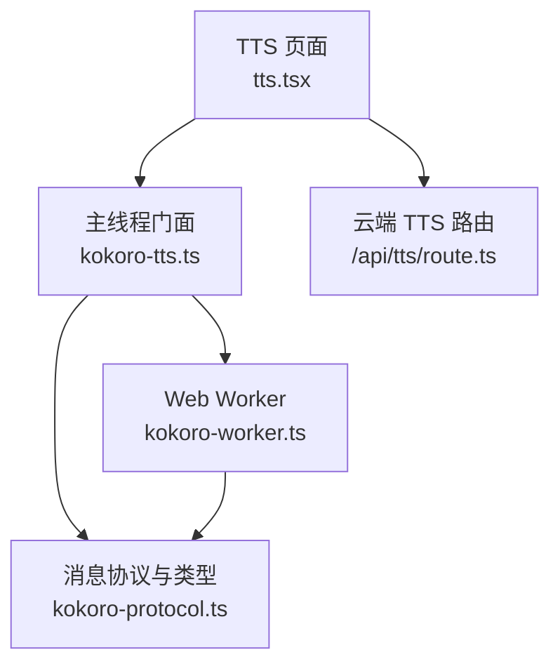
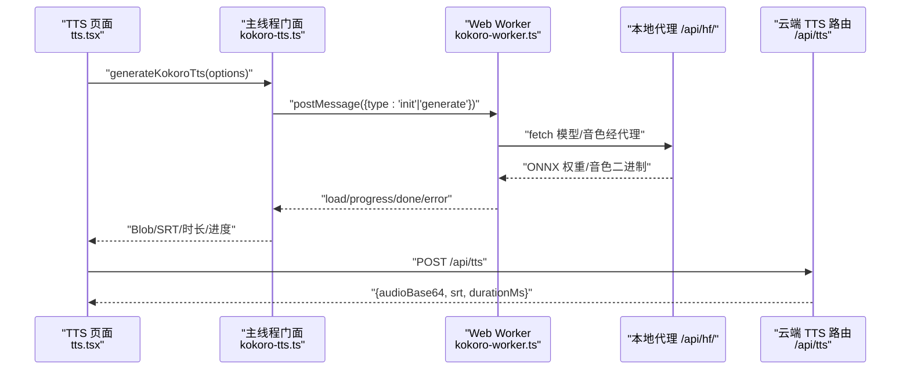
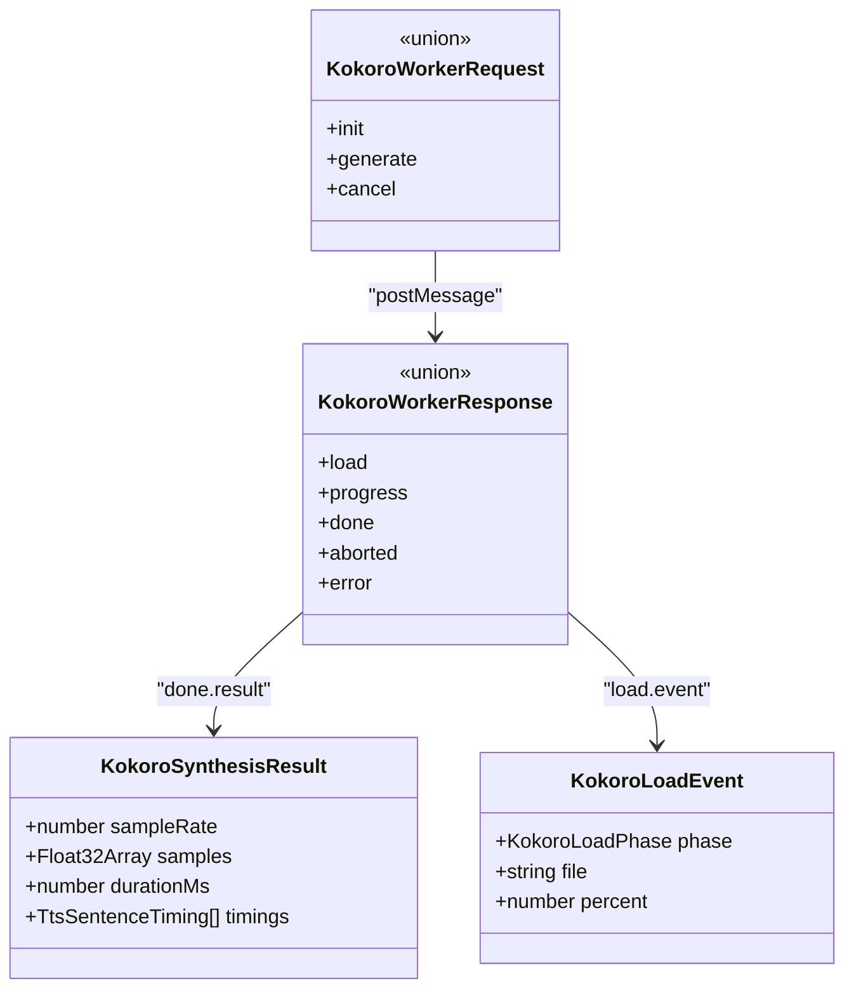
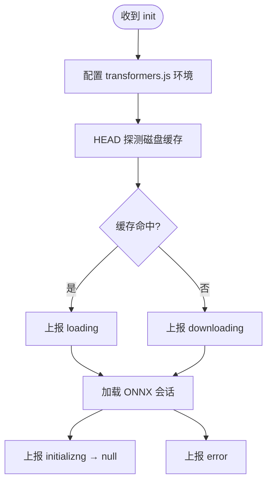
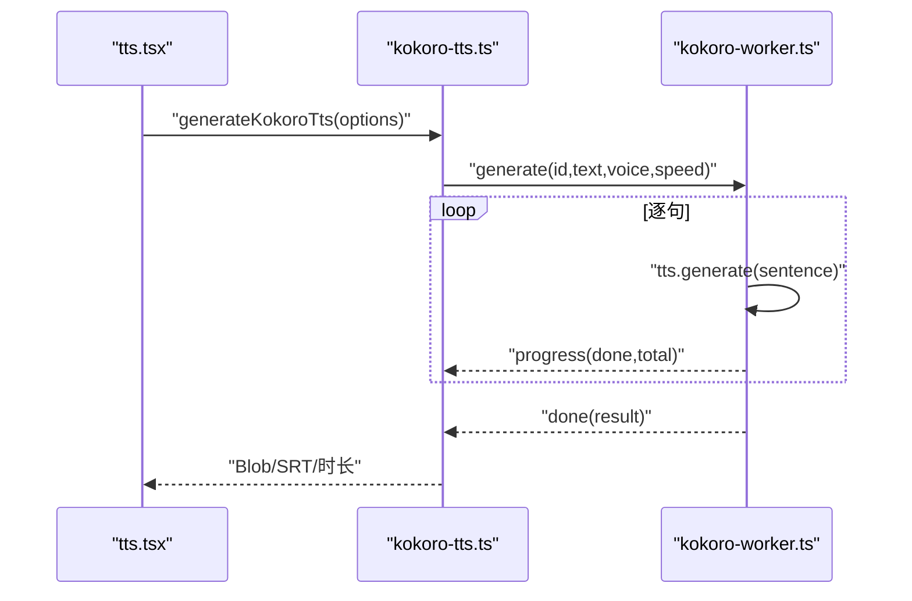
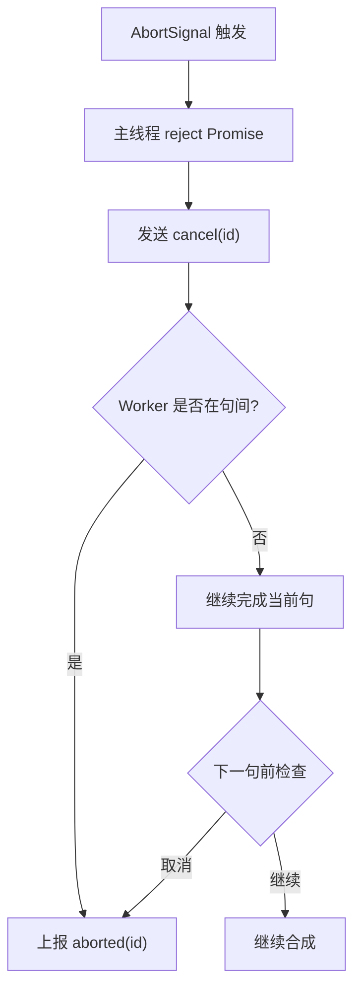
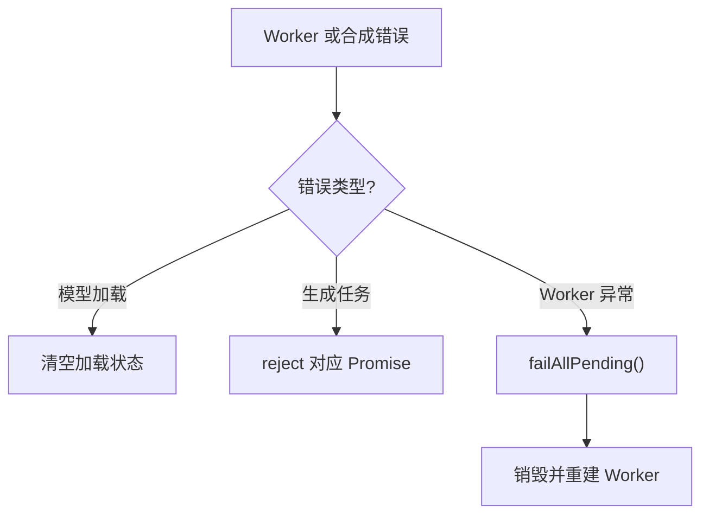
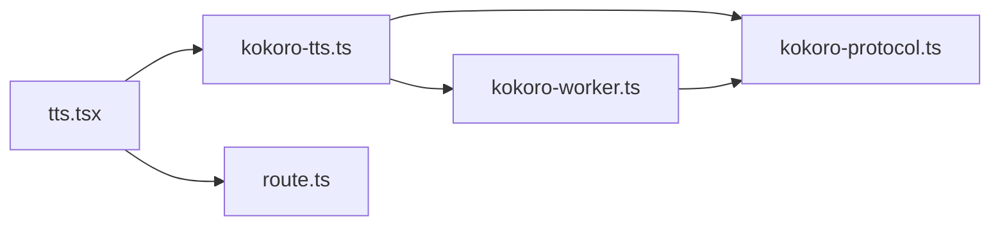

# WebSocket 接口

<cite>
**本文引用的文件**   
- [kokoro-protocol.ts](file://client/platform/kokoro-protocol.ts)
- [kokoro-tts.ts](file://client/platform/kokoro-tts.ts)
- [kokoro-worker.ts](file://client/platform/kokoro-worker.ts)
- [tts.tsx](file://client/components/pages/tts.tsx)
- [route.ts](file://client/app/api/tts/route.ts)
</cite>

## 目录
1. [简介](#简介)
2. [项目结构](#项目结构)
3. [核心组件](#核心组件)
4. [架构总览](#架构总览)
5. [详细组件分析](#详细组件分析)
6. [依赖关系分析](#依赖关系分析)
7. [性能与兼容性](#性能与兼容性)
8. [故障排查](#故障排查)
9. [结论](#结论)

## 简介
本文件面向“Kokoro TTS 引擎”的客户端实现，重点说明：
- 主线程与 Web Worker 之间的通信协议（消息类型、字段、生命周期）。
- 模型加载、音频合成、进度回调、取消与错误处理流程。
- 与云端 TTS 路由的关系，以及当前仓库中是否实现了基于 WebSocket 的流式音频传输。
- 连接池、重连机制与性能优化建议。
- 不同浏览器环境下的兼容性与限制。

需要特别说明的是：**当前仓库并未实现 Kokoro TTS 的 WebSocket 流式音频传输**。Kokoro 推理在浏览器端以 Web Worker + ONNX Runtime Web 的方式运行，音频数据通过 `postMessage` 零拷贝传递；而云端 TTS 走 HTTP POST `/api/tts`，返回 Base64 音频与 SRT。因此，本节将把“WebSocket 接口”理解为“Worker 通信协议”，并明确标注哪些内容属于 WebSocket 范畴、哪些不属于。

## 项目结构
与 Kokoro TTS 相关的代码集中在以下位置：
- `client/platform/kokoro-protocol.ts`：定义主线程与 Worker 的消息协议和共享类型。
- `client/platform/kokoro-tts.ts`：主线程门面，负责 UI 驱动、WAV 编码、SRT 构建、Worker 生命周期管理。
- `client/platform/kokoro-worker.ts`：Web Worker，执行 ONNX 推理、模型/音色加载、句级时间轴拼接。
- `client/components/pages/tts.tsx`：TTS 页面，选择引擎（云端或本地 Kokoro），调用生成接口并展示进度。
- `client/app/api/tts/route.ts`：云端 TTS 路由，封装 LLM 服务层，返回 Base64 音频与 SRT。

**图示来源**
- [tts.tsx:29-44](file://client/components/pages/tts.tsx#L29-L44)
- [kokoro-tts.ts:19-28](file://client/platform/kokoro-tts.ts#L19-L28)
- [kokoro-protocol.ts:10-50](file://client/platform/kokoro-protocol.ts#L10-L50)
- [kokoro-worker.ts:12-18](file://client/platform/kokoro-worker.ts#L12-L18)
- [route.ts:23-100](file://client/app/api/tts/route.ts#L23-L100)

**章节来源**
- [kokoro-protocol.ts:1-50](file://client/platform/kokoro-protocol.ts#L1-L50)
- [kokoro-tts.ts:1-237](file://client/platform/kokoro-tts.ts#L1-L237)
- [kokoro-worker.ts:1-273](file://client/platform/kokoro-worker.ts#L1-L273)
- [tts.tsx:29-44](file://client/components/pages/tts.tsx#L29-L44)
- [route.ts:23-116](file://client/app/api/tts/route.ts#L23-L116)

## 核心组件
### 主线程门面：kokoro-tts.ts
职责：
- 暴露 `generateKokoroTts` 供 UI 调用。
- 管理 Web Worker 实例、请求 ID、待完成 Promise。
- 订阅模型加载状态，支持动态切换模型 ID。
- 将 Worker 返回的 PCM 转换为 WAV Blob，并生成 SRT。

关键行为：
- 使用 `ensureWorker` 创建并复用 Worker，监听 `message` 与 `error`。
- 使用 `pending` Map 维护每个生成任务的 Promise 与进度回调。
- 支持 `AbortSignal` 取消：主线程立即 reject，并向 Worker 发送 `cancel`。
- 模型加载失败时清空 pending 并重置加载状态。

**章节来源**
- [kokoro-tts.ts:43-128](file://client/platform/kokoro-tts.ts#L43-L128)
- [kokoro-tts.ts:130-160](file://client/platform/kokoro-tts.ts#L130-L160)
- [kokoro-tts.ts:184-237](file://client/platform/kokoro-tts.ts#L184-L237)

### Worker：kokoro-worker.ts
职责：
- 懒加载 kokoro-js，配置 transformers.js 环境变量，统一模型/音色请求到本地代理。
- 幂等加载模型，按阶段上报 `load` 事件。
- 逐句合成，插入句间静音，累计时间轴。
- 通过 `postMessage` 返回 `progress`、`done`、`aborted`、`error`。

关键行为：
- `installHfProxy` 重写 fetch，将 huggingface.co 的请求改写为 `/api/hf/...`。
- `isCachedOnDisk` 通过 HEAD 请求判断磁盘缓存命中。
- `loadModel` 分阶段上报 loading/downloading/initializing。
- `handleGenerate` 逐句调用 `tts.generate`，并在句间检查取消标记。
- 最终结果通过 transferable buffer 零拷贝传回主线程。

**章节来源**
- [kokoro-worker.ts:69-118](file://client/platform/kokoro-worker.ts#L69-L118)
- [kokoro-worker.ts:120-182](file://client/platform/kokoro-worker.ts#L120-L182)
- [kokoro-worker.ts:184-250](file://client/platform/kokoro-worker.ts#L184-L250)
- [kokoro-worker.ts:252-273](file://client/platform/kokoro-worker.ts#L252-L273)

### 消息协议：kokoro-protocol.ts
定义主线程与 Worker 之间使用的消息类型与数据结构：
- 加载阶段：`KokoroLoadPhase`、`KokoroLoadEvent`、`KokoroLoadState`。
- Worker 请求：`init`、`generate`、`cancel`。
- Worker 响应：`load`、`progress`、`done`、`aborted`、`error`。
- 合成结果：`KokoroSynthesisResult`，包含采样率、PCM、时长、句级时间轴。

该模块被设计为独立文件，避免主线程门面与 Worker 互相 import 导致 bundle 污染。

**章节来源**
- [kokoro-protocol.ts:1-50](file://client/platform/kokoro-protocol.ts#L1-L50)

### 云端 TTS 路由：route.ts
职责：
- 接收文本、音色、语速、配置 ID。
- 校验输入长度与句子分割。
- 读取 LLM/TTS 设置，调用服务层生成音频。
- 返回 Base64 音频、任务 ID、时长、句数、SRT。

注意：该路由是 HTTP POST，不是 WebSocket。它用于云端 TTS，与本地 Kokoro 推理路径并行存在。

**章节来源**
- [route.ts:23-116](file://client/app/api/tts/route.ts#L23-L116)

## 架构总览
下图展示 TTS 页面的两种调用路径：云端 HTTP 与本地 Kokoro Worker。

**图示来源**
- [tts.tsx:237-243](file://client/components/pages/tts.tsx#L237-L243)
- [kokoro-tts.ts:184-237](file://client/platform/kokoro-tts.ts#L184-L237)
- [kokoro-worker.ts:136-182](file://client/platform/kokoro-worker.ts#L136-L182)
- [route.ts:66-100](file://client/app/api/tts/route.ts#L66-L100)

## 详细组件分析

### 主线程与 Worker 通信协议
协议由 `kokoro-protocol.ts` 统一定义，主线程与 Worker 通过 `postMessage` 交换结构化消息。

#### 请求类型
- `init`：启动 Worker 并加载模型，参数包含 `modelId`。
- `generate`：开始合成，参数包含 `id`、`text`、`voice`、`speed`。
- `cancel`：取消某次生成，参数包含 `id`。

#### 响应类型
- `load`：模型加载阶段事件，携带 `event`（可能为 null 表示就绪）。
- `progress`：句级进度，携带 `id`、`done`、`total`。
- `done`：合成完成，携带 `id`、`result`（PCM、采样率、时长、时间轴）。
- `aborted`：已取消，携带 `id`。
- `error`：错误，携带 `id`（模型加载错误为 null）与 `message`。

**图示来源**
- [kokoro-protocol.ts:10-50](file://client/platform/kokoro-protocol.ts#L10-L50)

**章节来源**
- [kokoro-protocol.ts:10-50](file://client/platform/kokoro-protocol.ts#L10-L50)
- [kokoro-tts.ts:82-113](file://client/platform/kokoro-tts.ts#L82-L113)
- [kokoro-worker.ts:252-273](file://client/platform/kokoro-worker.ts#L252-L273)

### 模型加载与生命周期
模型加载分为三个阶段：
- `downloading`：从 HuggingFace 下载（经本地代理），可带百分比。
- `loading`：命中磁盘缓存，读本地文件。
- `initializing`：权重就位，构建 ONNX 会话。

加载完成后，`event` 为 null，表示就绪。若加载失败，会发送 `error` 且 `id` 为 null。

**图示来源**
- [kokoro-worker.ts:136-182](file://client/platform/kokoro-worker.ts#L136-L182)

**章节来源**
- [kokoro-worker.ts:136-182](file://client/platform/kokoro-worker.ts#L136-L182)
- [kokoro-tts.ts:43-63](file://client/platform/kokoro-tts.ts#L43-L63)

### 音频合成与进度回调
合成流程：
1. 主线程发送 `generate`，附带 `id`、`text`、`voice`、`speed`。
2. Worker 逐句拆分文本，调用 `tts.generate`。
3. 每句合成后上报 `progress`，包含已完成句数与总句数。
4. 句间插入 120ms 静音，累计时间轴。
5. 全部完成后上报 `done`，携带 PCM、采样率、时长、时间轴。
6. 主线程将 PCM 编码为 WAV Blob，并生成 SRT。

**图示来源**
- [kokoro-tts.ts:184-237](file://client/platform/kokoro-tts.ts#L184-L237)
- [kokoro-worker.ts:206-249](file://client/platform/kokoro-worker.ts#L206-L249)

**章节来源**
- [kokoro-tts.ts:184-237](file://client/platform/kokoro-tts.ts#L184-L237)
- [kokoro-worker.ts:206-249](file://client/platform/kokoro-worker.ts#L206-L249)

### 取消机制
取消流程：
- 主线程检测到 `AbortSignal.aborted`，立即 reject 当前 Promise，并向 Worker 发送 `cancel`。
- Worker 在句与句之间检查取消标记，若已取消则上报 `aborted`。
- 单句推理无法中断，但用户感知上是“立刻取消”。

**图示来源**
- [kokoro-tts.ts:208-224](file://client/platform/kokoro-tts.ts#L208-L224)
- [kokoro-worker.ts:214-233](file://client/platform/kokoro-worker.ts#L214-L233)

**章节来源**
- [kokoro-tts.ts:208-224](file://client/platform/kokoro-tts.ts#L208-L224)
- [kokoro-worker.ts:214-233](file://client/platform/kokoro-worker.ts#L214-L233)

### 错误处理
错误类型：
- 模型加载错误：`error` 且 `id` 为 null，主线程清空加载状态并记录日志。
- 生成错误：`error` 且 `id` 非 null，主线程 reject 对应 Promise。
- Worker 异常：主线程捕获 `worker.onerror`，清空所有 pending 并重建 Worker。

**图示来源**
- [kokoro-tts.ts:115-128](file://client/platform/kokoro-tts.ts#L115-L128)
- [kokoro-tts.ts:101-113](file://client/platform/kokoro-tts.ts#L101-L113)
- [kokoro-worker.ts:246-249](file://client/platform/kokoro-worker.ts#L246-L249)

**章节来源**
- [kokoro-tts.ts:101-128](file://client/platform/kokoro-tts.ts#L101-L128)
- [kokoro-worker.ts:246-249](file://client/platform/kokoro-worker.ts#L246-L249)

### 云端 TTS 与本地 Kokoro 的区别
- 云端 TTS：HTTP POST `/api/tts`，返回 Base64 音频与 SRT，适合远程模型。
- 本地 Kokoro：Web Worker + ONNX Runtime Web，音频在浏览器内合成，无需网络。

两者在 UI 层通过 `engine` 切换，但底层协议完全不同。

**章节来源**
- [route.ts:23-116](file://client/app/api/tts/route.ts#L23-L116)
- [tts.tsx:29-44](file://client/components/pages/tts.tsx#L29-L44)

## 依赖关系分析

**图示来源**
- [tts.tsx:29-44](file://client/components/pages/tts.tsx#L29-L44)
- [kokoro-tts.ts:19-28](file://client/platform/kokoro-tts.ts#L19-L28)
- [kokoro-worker.ts:12-18](file://client/platform/kokoro-worker.ts#L12-L18)
- [route.ts:23-116](file://client/app/api/tts/route.ts#L23-L116)

**章节来源**
- [tts.tsx:29-44](file://client/components/pages/tts.tsx#L29-L44)
- [kokoro-tts.ts:19-28](file://client/platform/kokoro-tts.ts#L19-L28)
- [kokoro-worker.ts:12-18](file://client/platform/kokoro-worker.ts#L12-L18)
- [route.ts:23-116](file://client/app/api/tts/route.ts#L23-L116)

## 性能与兼容性

### 性能特性
- **零拷贝传输**：Worker 通过 `transferable` buffer 将 PCM 直接传给主线程，避免重复复制。
- **句级进度**：每句合成后上报 `progress`，UI 可实时反馈。
- **模型常驻**：模型加载一次后常驻 Worker，避免重复加载。
- **句间静音**：固定 120ms 静音，保证自然停顿。
- **WASM 推理**：ONNX Runtime Web 在 Worker 中同步计算，避免阻塞主线程。

### 兼容性
- **Web Worker**：现代浏览器均支持，但受限上下文（如某些 iframe）可能不可用。
- **Transferable ArrayBuffer**：主流浏览器支持，旧版 IE 不支持。
- **Cache API**：Worker 尝试删除 kokoro-js 的 Cache Storage，若不可用则忽略。
- **fetch 重写**：Worker 内重写 fetch 以指向本地代理，需确保代理可用。

### 连接池与重连
- **Worker 单例**：主线程只维护一个 Worker 实例，避免多实例开销。
- **自动重建**：Worker 异常时清空 pending 并重建，避免请求挂起。
- **无 WebSocket 连接池**：当前未实现 WebSocket 连接池，因为 Kokoro 推理不走 WebSocket。

### 优化建议
- **预加载模型**：应用启动时调用 `preloadKokoroModel`，减少首次延迟。
- **批量合成**：合并短文本，减少多次 Worker 调用。
- **进度节流**：UI 层对 `progress` 进行节流，避免频繁更新。
- **错误重试**：对网络错误（模型下载）增加重试与退避策略。

[本节为通用指导，不直接分析具体文件]

## 故障排查

### 常见问题
- **模型加载失败**：检查 `/api/hf/` 代理是否可达，确认磁盘缓存路径配置正确。
- **Worker 异常**：查看控制台日志，确认 WASM 与 ONNX Runtime Web 是否受支持。
- **取消无效**：确认 `AbortSignal` 是否正确触发，Worker 是否在句间检查取消。
- **音频无声**：检查 PCM 采样率与 WAV 编码是否正确，SRT 时间轴是否合理。

### 调试技巧
- 订阅 `subscribeKokoroLoad`，观察加载阶段变化。
- 在 Worker 中打印 `progress` 与 `done` 消息，确认合成流程。
- 使用浏览器开发者工具监控 Network，查看 `/api/hf/` 请求状态。

**章节来源**
- [kokoro-tts.ts:43-63](file://client/platform/kokoro-tts.ts#L43-L63)
- [kokoro-worker.ts:69-118](file://client/platform/kokoro-worker.ts#L69-L118)
- [kokoro-worker.ts:136-182](file://client/platform/kokoro-worker.ts#L136-L182)

## 结论
当前仓库中的 Kokoro TTS 实现**不使用 WebSocket 流式音频传输**，而是采用 Web Worker + ONNX Runtime Web 的本地推理方案。主线程与 Worker 之间通过结构化消息协议通信，支持模型加载、句级进度、取消与错误处理。云端 TTS 则通过 HTTP POST `/api/tts` 返回 Base64 音频。

若未来需要引入 WebSocket 流式传输，建议：
- 定义明确的 WebSocket 子协议（如 `ws://host/tts?engine=kokoro`）。
- 设计帧格式（控制帧、音频帧、结束帧）。
- 实现背压与缓冲管理，避免内存溢出。
- 提供连接池与自动重连机制。
- 在浏览器端使用 `AudioContext.decodeAudioData` 或流式解码器播放。

[本节为总结性内容，不直接分析具体文件]