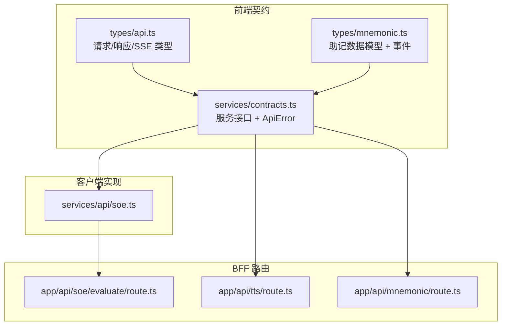
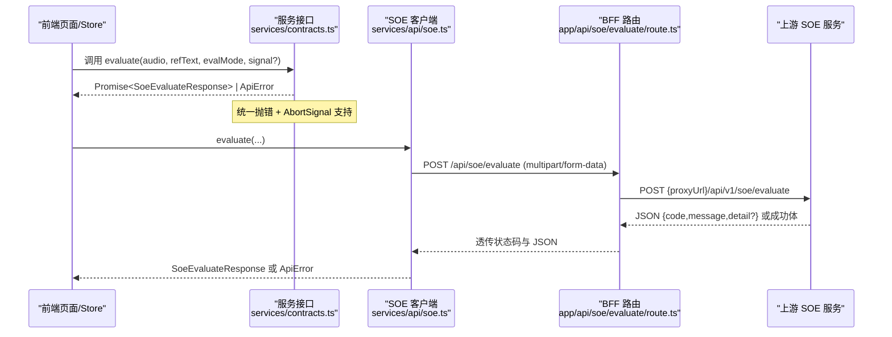
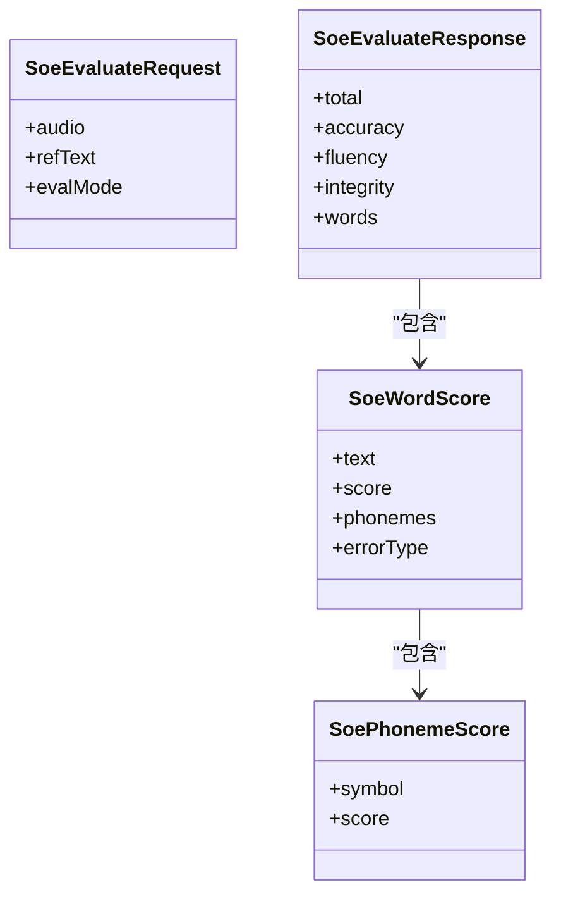
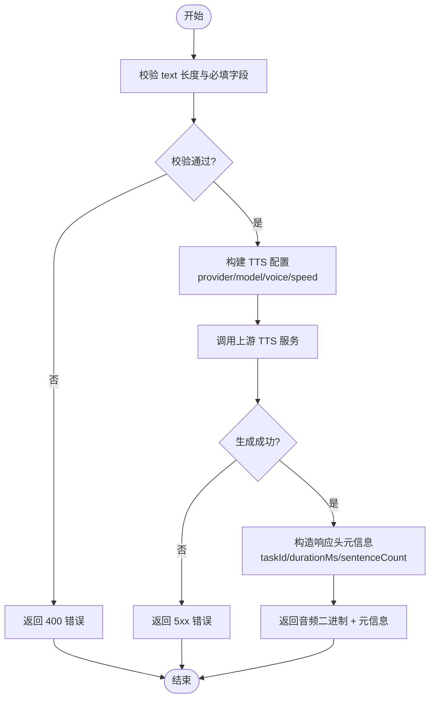
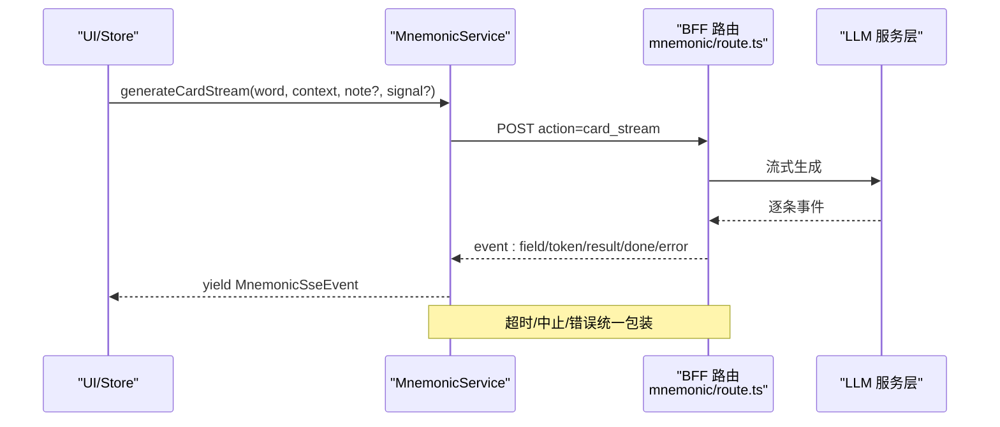
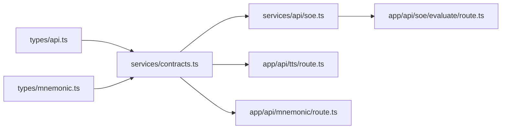

# 前端服务契约

<cite>
**本文引用的文件**   
- [client/types/api.ts](file://client/types/api.ts)
- [client/services/contracts.ts](file://client/services/contracts.ts)
- [client/services/api/soe.ts](file://client/services/api/soe.ts)
- [client/app/api/soe/evaluate/route.ts](file://client/app/api/soe/evaluate/route.ts)
- [client/app/api/tts/route.ts](file://client/app/api/tts/route.ts)
- [client/app/api/mnemonic/route.ts](file://client/app/api/mnemonic/route.ts)
- [client/types/mnemonic.ts](file://client/types/mnemonic.ts)
</cite>

## 目录
1. [简介](#简介)
2. [项目结构](#项目结构)
3. [核心组件](#核心组件)
4. [架构总览](#架构总览)
5. [详细组件分析](#详细组件分析)
6. [依赖关系分析](#依赖关系分析)
7. [性能与可靠性考虑](#性能与可靠性考虑)
8. [故障排查指南](#故障排查指南)
9. [结论](#结论)
10. [附录：调用示例与最佳实践](#附录调用示例与最佳实践)

## 简介
本文件为前端服务契约的权威说明，覆盖以下三类服务的 TypeScript 类型定义与接口规范：
- SOE 发音评分（SoeEvaluateRequest / SoeEvaluateResponse）
- TTS 文字转语音（TtsGenerateRequest、响应元信息、字幕领取）
- Mnemonic 生词助记（LlmExplainRequest 语义对齐、MnemonicService 流式与非流式接口）

文档同时给出 SSE 事件序列（status → token → result → done/error）的类型定义与处理流程，统一错误格式 ApiError 与 SseErrorEvent，以及面向开发者的调用示例与最佳实践。

## 项目结构
前端契约相关代码主要分布在以下位置：
- types/api.ts：API 契约类型（SOE/TTS/Mnemonic/SSE/翻译等）
- services/contracts.ts：服务接口与统一错误封装
- services/api/soe.ts：真实 SOE 客户端实现
- app/api/*：Next.js BFF 路由（SOE/TTS/Mnemonic）
- types/mnemonic.ts：生词助记数据模型与 SSE 事件

图示来源
- [client/types/api.ts:21-134](file://client/types/api.ts#L21-L134)
- [client/services/contracts.ts:33-143](file://client/services/contracts.ts#L33-L143)
- [client/types/mnemonic.ts:57-141](file://client/types/mnemonic.ts#L57-L141)
- [client/services/api/soe.ts:9-29](file://client/services/api/soe.ts#L9-L29)
- [client/app/api/soe/evaluate/route.ts:18-67](file://client/app/api/soe/evaluate/route.ts#L18-L67)
- [client/app/api/tts/route.ts:23-115](file://client/app/api/tts/route.ts#L23-L115)
- [client/app/api/mnemonic/route.ts:44-271](file://client/app/api/mnemonic/route.ts#L44-L271)

章节来源
- [client/types/api.ts:1-154](file://client/types/api.ts#L1-L154)
- [client/services/contracts.ts:1-144](file://client/services/contracts.ts#L1-L144)
- [client/types/mnemonic.ts:1-141](file://client/types/mnemonic.ts#L1-L141)

## 核心组件
本节聚焦三类服务契约的核心类型与接口：
- SOE 发音评分：SoeEvaluateRequest、SoeEvaluateResponse、SSE 事件类型
- TTS 文字转语音：TtsGenerateRequest、TtsGenerateResponseMeta、TtsSubtitleResponse
- Mnemonic 生词助记：LlmExplainRequest、MnemonicService、MnemonicSseEvent

关键要点
- 所有服务方法可接受 AbortSignal；失败统一抛出 ApiError（含中止 code 'ABORTED'）。
- SSE 流式以 AsyncGenerator<SseEvent> 表达，事件序 status → token → result → done，错误走 error 事件后终止流。
- 统一错误格式 ApiError：{ code, message, detail? }。

章节来源
- [client/services/contracts.ts:33-143](file://client/services/contracts.ts#L33-L143)
- [client/types/api.ts:6-134](file://client/types/api.ts#L6-L134)

## 架构总览
下图展示前端到 BFF 再到上游服务的整体交互路径，以及各契约在系统中的落点。

图示来源
- [client/services/contracts.ts:92-106](file://client/services/contracts.ts#L92-L106)
- [client/services/api/soe.ts:9-29](file://client/services/api/soe.ts#L9-L29)
- [client/app/api/soe/evaluate/route.ts:18-67](file://client/app/api/soe/evaluate/route.ts#L18-L67)

## 详细组件分析

### SOE 发音评分
- 请求对象 SoeEvaluateRequest
  - audio：File | Blob（wav/pcm，16kHz mono）
  - refText：参考原文
  - evalMode：固定为 'sentence'
- 响应对象 SoeEvaluateResponse
  - total、accuracy、fluency、integrity：总体与维度分数
  - words：词级评分数组，包含 phonemes 音素评分与可选 errorType（漏读/增读/误读）
- SSE 事件类型（用于 LLM 讲解/助记等通用 SSE）
  - SseStatusEvent：阶段进度
  - SseTokenEvent：流式文本片段
  - SseResultEvent：结构化结果
  - SseDoneEvent：完成
  - SseErrorEvent：错误（携带 ApiError）
- 服务接口 SoeService.evaluate
  - 参数：audio、refText、evalMode、signal?
  - 返回：Promise<SoeEvaluateResponse>
  - 异常：统一抛出 ApiError（含 ABORTED）

图示来源
- [client/types/api.ts:23-48](file://client/types/api.ts#L23-L48)

章节来源
- [client/types/api.ts:21-48](file://client/types/api.ts#L21-L48)
- [client/services/contracts.ts:89-106](file://client/services/contracts.ts#L89-L106)
- [client/services/api/soe.ts:9-29](file://client/services/api/soe.ts#L9-L29)

### TTS 文字转语音
- 请求对象 TtsGenerateRequest
  - text：上限 5000 字符，超限返回 400
  - voice：Kokoro 声音 ID
  - speed：0.5 ~ 2.0
  - format：'wav' | 'mp3'
  - withSubtitle：是否生成分句对齐的 SRT
- 响应元信息 TtsGenerateResponseMeta
  - taskId：字幕领取凭据
  - durationMs：音频时长
  - sentenceCount：句子数量
- 字幕领取 TtsSubtitleResponse
  - srt：SRT 文本
  - sentenceCount：句子数量
- 服务接口 TtsService
  - generate(request, signal?)：返回 TtsGenerateResult（audio Blob + meta）
  - getSubtitle(taskId, signal?)：返回 TtsSubtitleResponse

图示来源
- [client/types/api.ts:104-134](file://client/types/api.ts#L104-L134)
- [client/app/api/tts/route.ts:23-115](file://client/app/api/tts/route.ts#L23-L115)

章节来源
- [client/types/api.ts:104-134](file://client/types/api.ts#L104-L134)
- [client/services/contracts.ts:108-122](file://client/services/contracts.ts#L108-L122)
- [client/app/api/tts/route.ts:23-115](file://client/app/api/tts/route.ts#L23-L115)

### Mnemonic 生词助记
- 请求对象 LlmExplainRequest
  - word / sentence / materialId：用于单词或句子讲解
- 服务接口 MnemonicService
  - generateCard(word, context, note?, signal?)：非流式卡片
  - generateCardStream(word, context, note?, signal?)：流式卡片（AsyncGenerator<MnemonicSseEvent>）
  - generateAssociation / generateExercises / evaluateSentence：联想、练习、造句批改
- 助记 SSE 事件 MnemonicSseEvent
  - field：某个顶层字段已解析完成
  - done：完整卡片已生成（含 timing）
  - error：错误（error 字符串）

图示来源
- [client/services/contracts.ts:124-136](file://client/services/contracts.ts#L124-L136)
- [client/app/api/mnemonic/route.ts:148-180](file://client/app/api/mnemonic/route.ts#L148-L180)
- [client/types/mnemonic.ts:133-141](file://client/types/mnemonic.ts#L133-L141)

章节来源
- [client/types/api.ts:93-102](file://client/types/api.ts#L93-L102)
- [client/services/contracts.ts:124-136](file://client/services/contracts.ts#L124-L136)
- [client/types/mnemonic.ts:57-141](file://client/types/mnemonic.ts#L57-L141)
- [client/app/api/mnemonic/route.ts:44-271](file://client/app/api/mnemonic/route.ts#L44-L271)

## 依赖关系分析
- 类型依赖
  - services/contracts.ts 依赖 types/api.ts 中的 SoeEvaluateResponse、SseEvent、TtsGenerateRequest、TtsGenerateResponseMeta、TtsSubtitleResponse
  - services/contracts.ts 依赖 types/mnemonic.ts 中的 MnemonicCard、Association、Exercises、SentenceEvaluation、MnemonicSseEvent
- 运行时依赖
  - services/api/soe.ts 依赖 contracts.ts 的 ApiError 与 SoeService 接口
  - BFF 路由依赖各自的服务设置与上游服务（SOE/TTS/Mnemonic）

图示来源
- [client/types/api.ts:1-154](file://client/types/api.ts#L1-L154)
- [client/services/contracts.ts:1-144](file://client/services/contracts.ts#L1-L144)
- [client/types/mnemonic.ts:1-141](file://client/types/mnemonic.ts#L1-L141)
- [client/services/api/soe.ts:1-30](file://client/services/api/soe.ts#L1-L30)
- [client/app/api/soe/evaluate/route.ts:1-68](file://client/app/api/soe/evaluate/route.ts#L1-L68)
- [client/app/api/tts/route.ts:1-116](file://client/app/api/tts/route.ts#L1-L116)
- [client/app/api/mnemonic/route.ts:1-272](file://client/app/api/mnemonic/route.ts#L1-L272)

章节来源
- [client/services/contracts.ts:17-31](file://client/services/contracts.ts#L17-L31)
- [client/services/api/soe.ts:5-7](file://client/services/api/soe.ts#L5-L7)

## 性能与可靠性考虑
- 文本长度限制：TTS 输入 text 上限 5000 字符，超限应直接返回 400，避免无效上游调用。
- 速率控制：speed 范围 0.5 ~ 2.0，超出需裁剪至边界值。
- 超时保护：Mnemonic 路由对单次上游调用设置超时（约 120 秒），并区分客户端中止与服务端超时。
- 流式体验：SSE 事件按 status → token → result → done/error 顺序推送，便于渐进渲染与即时反馈。
- 错误归一化：统一使用 ApiError，便于上层捕获与用户提示；AbortSignal 中止统一为 code 'ABORTED'。

[本节为通用指导，不直接分析具体文件]

## 故障排查指南
常见错误与定位建议：
- 400 参数错误
  - SOE：缺少 multipart/audio/refText/evalMode 时返回 400。
  - TTS：text 为空或超长、未配置 baseUrl/apiKey 时返回 400。
  - Mnemonic：action 非法或缺少必要参数时返回 400。
- 5xx 上游错误
  - SOE：代理不可达或上游返回错误时，BFF 原样透传 JSON 错误信封。
  - TTS：上游 LLM/TTS 报错时返回 5xx，并附带 code/message。
  - Mnemonic：上游 LLM 报错映射为不同 HTTP 状态（如 400/502/504）。
- 中止与取消
  - 前端传入 AbortSignal 后，统一抛出 ApiError('ABORTED')；BFF 侧可能返回 499。

章节来源
- [client/app/api/soe/evaluate/route.ts:18-67](file://client/app/api/soe/evaluate/route.ts#L18-L67)
- [client/app/api/tts/route.ts:23-115](file://client/app/api/tts/route.ts#L23-L115)
- [client/app/api/mnemonic/route.ts:44-271](file://client/app/api/mnemonic/route.ts#L44-L271)
- [client/services/contracts.ts:49-64](file://client/services/contracts.ts#L49-L64)

## 结论
本契约明确了 SOE、TTS、Mnemonic 三类服务的请求/响应类型、SSE 事件序列与统一错误处理模式。通过 BFF 路由集中管理密钥与上游转发，前端只需关注类型安全与用户体验。遵循本文档的类型定义与调用约定，可确保前后端协作稳定可靠。

[本节为总结性内容，不直接分析具体文件]

## 附录：调用示例与最佳实践
- SOE 发音评分
  - 构造 FormData，依次追加 audio、refText、evalMode，POST 到 /api/soe/evaluate。
  - 监听 AbortSignal，若中止则捕获 ApiError('ABORTED') 并静默处理。
  - 成功后渲染 SoeEvaluateResponse.words 与维度分数。
- TTS 文字转语音
  - 校验 text 长度与必填字段，构造 TtsGenerateRequest。
  - 调用 TtsService.generate 获取 audio Blob 与 meta（taskId/durationMs/sentenceCount）。
  - 如需字幕，使用 TtsService.getSubtitle(taskId) 拉取 SRT。
- Mnemonic 生词助记
  - 非流式：generateCard 直接拿到 MnemonicCard。
  - 流式：generateCardStream 逐字段渲染，最终收到 done 事件（含 timing）。
  - 错误处理：捕获 error 事件并提示用户。

最佳实践
- 始终使用 AbortSignal 支持取消操作。
- 统一捕获 ApiError，根据 code 分支处理（ABORTED、TEXT_TOO_LONG、SETTINGS_NOT_CONFIGURED 等）。
- 对 SSE 流进行健壮解析，优先消费 status/token 提升感知速度，再渲染 result/done。
- 对长文本先分句（splitTtsSentences），再逐个合成，降低失败成本。

[本节为通用指导，不直接分析具体文件]