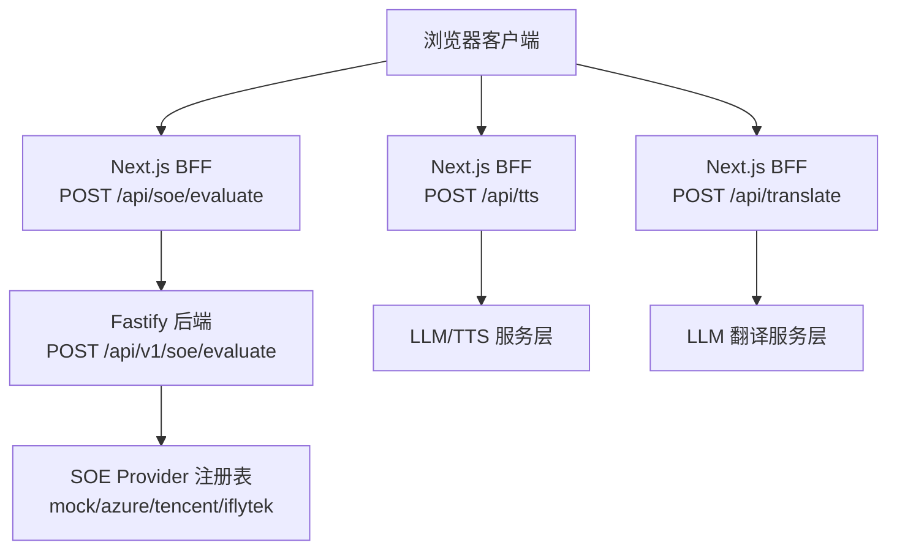
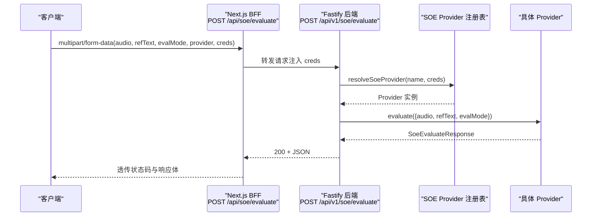
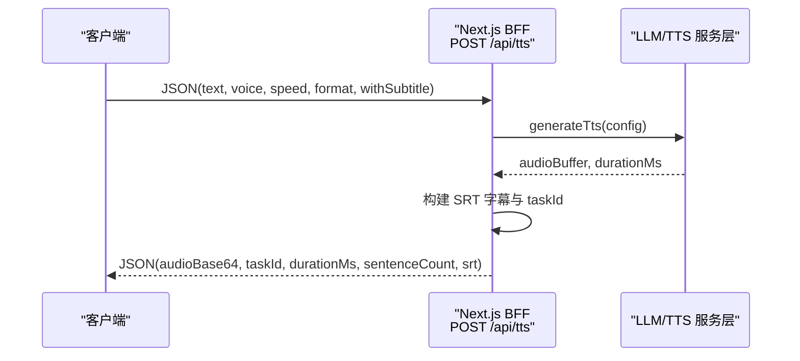
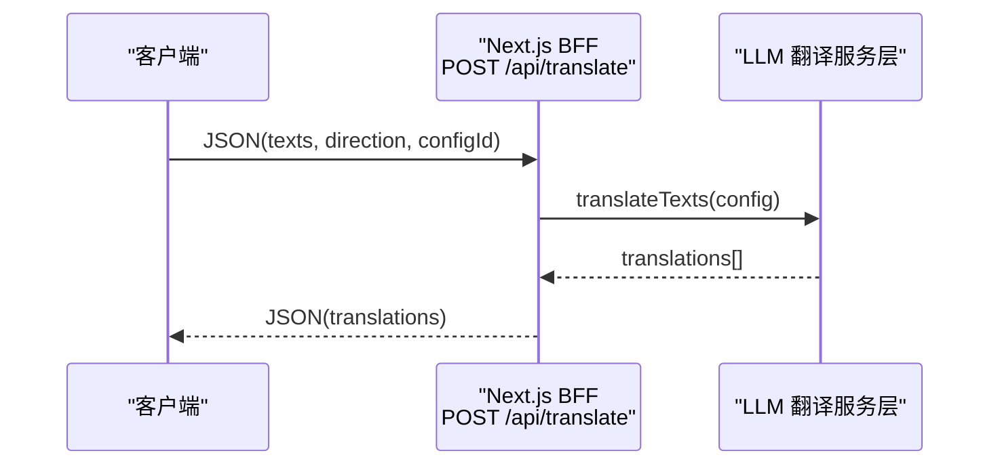

# 后端 REST API

<cite>
**本文引用的文件**   
- [server/src/app.ts](file://server/src/app.ts)
- [server/src/routes/soe.route.ts](file://server/src/routes/soe.route.ts)
- [server/src/services/soe/index.ts](file://server/src/services/soe/index.ts)
- [server/src/lib/api-error.ts](file://server/src/lib/api-error.ts)
- [client/app/api/soe/evaluate/route.ts](file://client/app/api/soe/evaluate/route.ts)
- [client/app/api/tts/route.ts](file://client/app/api/tts/route.ts)
- [client/app/api/translate/route.ts](file://client/app/api/translate/route.ts)
- [client/types/api.ts](file://client/types/api.ts)
- [client/lib/service-endpoints.ts](file://client/lib/service-endpoints.ts)
</cite>

## 目录
1. [简介](#简介)
2. [项目结构与接口边界](#项目结构与接口边界)
3. [核心接口总览](#核心接口总览)
4. [发音评分接口 POST /api/v1/soe/evaluate](#发音评分接口-post-apiv1soeevaluate)
5. [文字转语音接口 POST /api/v1/tts/generate](#文字转语音接口-post-apiv1ttsgenerate)
6. [字幕领取接口 GET /api/v1/tts/subtitle/:taskId](#字幕领取接口-get-apiv1ttssubtitletaskid)
7. [BFF 翻译接口 POST /api/translate](#bff-翻译接口-post-apitranslate)
8. [统一错误与状态码](#统一错误与状态码)
9. [API 版本管理与向后兼容](#api-版本管理与向后兼容)
10. [依赖关系与架构视图](#依赖关系与架构视图)
11. [性能与限制](#性能与限制)
12. [故障排查指南](#故障排查指南)
13. [结论](#结论)

## 简介
本文件面向后端与 BFF（前端 Next.js API 路由）的 RESTful 接口，聚焦以下能力：
- 发音评测（SOE）：通过 Fastify 后端提供 `/api/v1/soe/evaluate`，由 Next.js BFF 转发并注入凭据。
- 文字转语音（TTS）：Next.js BFF 调用 LLM/TTS 服务层生成音频、构建 SRT 字幕，并返回任务 ID。
- 字幕领取：按 TTS 任务 ID 获取生成的 SRT 字幕文本。
- 批量翻译：BFF 层 `POST /api/translate` 支持数组输入与方向自动判定。

文档同时给出请求体结构、响应字段、状态码、错误处理策略以及版本管理建议。

## 项目结构与接口边界
当前仓库包含前端 Next.js 应用与独立 Fastify 后端：
- Fastify 后端负责 SOE 评分代理，注册 CORS、multipart 解析、统一错误处理，并暴露 `/api/v1/soe/evaluate`。
- Next.js BFF 提供 `/api/soe/evaluate`、`/api/tts`、`/api/translate` 等路由，作为浏览器侧入口，封装上游调用、配置读取与错误映射。



**图表来源**
- [server/src/app.ts:14-45](file://server/src/app.ts#L14-L45)
- [server/src/routes/soe.route.ts:64-107](file://server/src/routes/soe.route.ts#L64-L107)
- [client/app/api/soe/evaluate/route.ts:18-67](file://client/app/api/soe/evaluate/route.ts#L18-L67)
- [client/app/api/tts/route.ts:23-115](file://client/app/api/tts/route.ts#L23-L115)
- [client/app/api/translate/route.ts:24-151](file://client/app/api/translate/route.ts#L24-L151)

**章节来源**
- [server/src/app.ts:14-45](file://server/src/app.ts#L14-L45)
- [client/lib/service-endpoints.ts:116-160](file://client/lib/service-endpoints.ts#L116-L160)

## 核心接口总览
| 接口 | HTTP 方法 | URL | 说明 |
|---|---:|---|---|
| 发音评分 | POST | `/api/v1/soe/evaluate` | 接收音频与参考文本，返回发音评分结果 |
| 文字转语音 | POST | `/api/v1/tts/generate` | 根据文本、音色、语速等参数生成音频与字幕 |
| 字幕领取 | GET | `/api/v1/tts/subtitle/:taskId` | 根据任务 ID 领取已生成的 SRT 字幕 |
| 批量翻译 | POST | `/api/translate` | 批量翻译文本数组，支持方向自动判定 |

注意：
- 浏览器侧通常调用 Next.js BFF 路由（如 `/api/soe/evaluate`、`/api/tts`、`/api/translate`），再由 BFF 转发到后端或 LLM 服务层。
- 直接对接后端时，SOE 使用 `/api/v1/soe/evaluate`；TTS 与字幕接口在契约中定义为 `/api/v1/tts/*`。

**章节来源**
- [server/src/routes/soe.route.ts:1-12](file://server/src/routes/soe.route.ts#L1-L12)
- [client/types/api.ts:104-134](file://client/types/api.ts#L104-L134)
- [client/types/api.ts:136-153](file://client/types/api.ts#L136-L153)

## 发音评分接口 POST /api/v1/soe/evaluate
### 接口定义
- URL：`/api/v1/soe/evaluate`
- 方法：POST
- Content-Type：`multipart/form-data`
- 认证：无（凭据通过请求级 `creds` 或环境变量注入）

### 请求体字段
| 字段 | 类型 | 必填 | 默认值 | 约束与说明 |
|---|---|---:|---|---|
| `audio` | File/Blob | 是 | — | wav/pcm，16kHz mono，单文件，≤25MB |
| `refText` | string | 是 | — | 参考原文，≤1000 字符，需非空 |
| `evalMode` | string | 否 | `sentence` | 仅支持 `sentence` |
| `provider` | string | 否 | 服务端默认实现 | 可选 `mock`/`azure`/`tencent`/`iflytek` |
| `creds` | string(JSON) | 否 | — | 请求级密钥 JSON，优先于环境变量；结构见下节 |

`creds` 支持的键：
- `azure`: `{ key?, region?, host? }`
- `tencent`: `{ appId?, secretId?, secretKey? }`
- `iflytek`: `{ appId?, apiKey?, apiSecret? }`

### 成功响应
HTTP 200，JSON 体为 `SoeEvaluateResponse`：
| 字段 | 类型 | 说明 |
|---|---|---|
| `total` | number | 总分 |
| `accuracy` | number | 准确度 |
| `fluency` | number | 流畅度 |
| `integrity` | number | 完整性 |
| `words` | SoeWordScore[] | 词级评分详情 |

`SoeWordScore`：
| 字段 | 类型 | 说明 |
|---|---|---|
| `text` | string | 单词文本 |
| `score` | number | 词级分数 |
| `phonemes` | SoePhonemeScore[] | 音素级评分 |
| `errorType` | string? | 词级错误类型（漏读/增读/误读），真实 provider 返回；mock 不填 |

`SoePhonemeScore`：
| 字段 | 类型 | 说明 |
|---|---|---|
| `symbol` | string | 音素符号 |
| `score` | number | 音素分数 |

### 失败响应
- 400：缺少必要字段、文本超长、不支持的 `evalMode`、未知 provider、音频为空等。
- 413：音频超过 25MB。
- 502：上游评分服务不可达。
- 503：指定 provider 未在服务端配置（缺少对应密钥）。
- 500：服务器内部错误。

### 示例
请求（multipart/form-data）：
- `audio`: audio.wav
- `refText`: "Hello world"
- `evalMode`: sentence
- `provider`: azure
- `creds`: `{"azure":{"key":"...","region":"..."}}`

成功响应（200）：
```json
{
  "total": 92,
  "accuracy": 95,
  "fluency": 90,
  "integrity": 93,
  "words": [
    {
      "text": "Hello",
      "score": 96,
      "phonemes": [
        {"symbol": "h", "score": 98},
        {"symbol": "ə", "score": 94}
      ],
      "errorType": "None"
    },
    {
      "text": "world",
      "score": 88,
      "phonemes": [
        {"symbol": "w", "score": 90},
        {"symbol": "ɜː", "score": 86}
      ],
      "errorType": "Mispronunciation"
    }
  ]
}
```

失败响应（400）：
```json
{
  "code": "BAD_REQUEST",
  "message": "缺少参考原文 refText"
}
```

**章节来源**
- [server/src/routes/soe.route.ts:1-12](file://server/src/routes/soe.route.ts#L1-L12)
- [server/src/routes/soe.route.ts:64-107](file://server/src/routes/soe.route.ts#L64-L107)
- [server/src/services/soe/index.ts:14-28](file://server/src/services/soe/index.ts#L14-L28)
- [server/src/services/soe/index.ts:30-79](file://server/src/services/soe/index.ts#L30-L79)
- [client/types/api.ts:21-48](file://client/types/api.ts#L21-L48)

## 文字转语音接口 POST /api/v1/tts/generate
### 接口定义
- URL：`/api/v1/tts/generate`
- 方法：POST
- Content-Type：`application/json`
- 认证：由 LLM/TTS 服务层决定（通常通过 API Key）

### 请求体字段
| 字段 | 类型 | 必填 | 默认值 | 约束与说明 |
|---|---|---:|---|---|
| `text` | string | 是 | — | 待合成文本，上限 5000 字符（契约定义） |
| `voice` | string | 否 | 提供者默认音色 | Kokoro 声音 ID |
| `speed` | number | 否 | 1.0 | 范围 0.5 ~ 2.0 |
| `format` | string | 否 | `wav` | 可选 `wav` 或 `mp3`（mp3 需镜像内 ffmpeg） |
| `withSubtitle` | boolean | 否 | false | 是否生成分句对齐的 SRT |

### 成功响应
- 二进制音频流（`audio/wav` 或 `audio/mpeg`），附带元信息头：
  - `X-Tts-Task-Id`：字幕领取凭据
  - `X-Tts-Duration-Ms`：音频时长（毫秒）
  - `X-Tts-Sentence-Count`：分句数量

若 BFF 层封装了 JSON 响应（例如 Next.js `/api/tts`），则返回：
| 字段 | 类型 | 说明 |
|---|---|---|
| `audioBase64` | string | Base64 编码的音频数据 |
| `taskId` | string | 任务 ID，用于后续字幕领取 |
| `durationMs` | number | 音频时长（毫秒） |
| `sentenceCount` | number | 分句数量 |
| `srt` | string | 生成的 SRT 字幕文本 |

### 失败响应
- 400：文本为空、文本超长、未配置模型等。
- 500：LLM/TTS 服务层错误。
- 502：上游服务不可达。
- 504：上游超时。

### 示例
请求：
```json
{
  "text": "Welcome to the English learning assistant.",
  "voice": "longanlingxin",
  "speed": 1.0,
  "format": "wav",
  "withSubtitle": true
}
```

成功响应（BFF JSON）：
```json
{
  "audioBase64": "UklGRiQAAABXQVZFZm10IBAAAAABAAEAQB8AAIAWAAgACgAdABY...",
  "taskId": "tts_abc123xyz",
  "durationMs": 3200,
  "sentenceCount": 2,
  "srt": "1\n00:00:00,000 --> 00:00:01,500\nWelcome to the English learning assistant.\n\n2\n00:00:01,500 --> 00:00:03,200\nEnjoy your study journey."
}
```

**章节来源**
- [client/types/api.ts:104-127](file://client/types/api.ts#L104-L127)
- [client/app/api/tts/route.ts:23-115](file://client/app/api/tts/route.ts#L23-L115)
- [client/lib/service-endpoints.ts:100-107](file://client/lib/service-endpoints.ts#L100-L107)

## 字幕领取接口 GET /api/v1/tts/subtitle/:taskId
### 接口定义
- URL：`/api/v1/tts/subtitle/:taskId`
- 方法：GET
- 路径参数：
  - `taskId`：字符串，TTS 生成时返回的任务 ID

### 成功响应
HTTP 200，JSON 体为 `TtsSubtitleResponse`：
| 字段 | 类型 | 说明 |
|---|---|---|
| `srt` | string | SRT 字幕文本 |
| `sentenceCount` | number | 分句数量 |

### 失败响应
- 404：任务不存在或已过期。
- 500：服务器内部错误。

### 任务 ID 机制
- 任务 ID 由 TTS 生成阶段产生，用于唯一标识一次字幕生成任务。
- 客户端在收到 TTS 响应后保存 `taskId`，随后通过该 ID 领取字幕。
- 任务 ID 的生命周期与服务端缓存策略相关；若任务过期，将返回 404。

### 示例
请求：
```
GET /api/v1/tts/subtitle/tts_abc123xyz
```

成功响应（200）：
```json
{
  "srt": "1\n00:00:00,000 --> 00:00:01,500\nWelcome to the English learning assistant.\n\n2\n00:00:01,500 --> 00:00:03,200\nEnjoy your study journey.",
  "sentenceCount": 2
}
```

**章节来源**
- [client/types/api.ts:129-134](file://client/types/api.ts#L129-L134)

## BFF 翻译接口 POST /api/translate
### 接口定义
- URL：`/api/translate`
- 方法：POST
- Content-Type：`application/json`
- 认证：由 LLM 服务层决定（通常通过 API Key）

### 请求体字段
| 字段 | 类型 | 必填 | 默认值 | 约束与说明 |
|---|---|---:|---|---|
| `texts` | string[] | 是 | — | 待翻译文本数组，每 50 条一块分批提交，单次最多 500 条 |
| `direction` | string | 否 | `auto` | 可选 `auto`、`en2zh`、`zh2en`；缺省或 `auto` 时由服务端按抽样文本自动判定方向 |
| `configId` | string | 否 | — | 指定模型配置 ID；缺省使用默认配置 |

### 成功响应
HTTP 200，JSON 体为 `TranslateResponse`：
| 字段 | 类型 | 说明 |
|---|---|---|
| `translations` | string[] | 与输入 `texts` 等长的译文数组 |

### 失败响应
- 400：请求体非法、文本为空、文本长度超限、方向无效、未配置模型等。
- 499：客户端主动断开。
- 502：上游服务不可达或响应格式错误。
- 504：翻译请求超时。

### 示例
请求：
```json
{
  "texts": ["Hello world", "How are you?", "I am fine"],
  "direction": "auto",
  "configId": "default-translate-config"
}
```

成功响应（200）：
```json
{
  "translations": ["你好世界", "你好吗？", "我很好"]
}
```

失败响应（400）：
```json
{
  "error": "待翻译文本不能为空",
  "code": "INVALID_REQUEST"
}
```

**章节来源**
- [client/app/api/translate/route.ts:1-152](file://client/app/api/translate/route.ts#L1-L152)
- [client/types/api.ts:136-153](file://client/types/api.ts#L136-L153)

## 统一错误与状态码
后端 Fastify 层统一错误处理：
- 400：参数错误（如缺少字段、文本超长、不支持的参数）。
- 413：负载过大（如音频超过 25MB）。
- 429：上游限流。
- 502：上游服务不可达或响应异常。
- 503：Provider 未配置（缺少密钥）。
- 500：服务器内部错误。

错误体结构：
```json
{
  "code": "BAD_REQUEST",
  "message": "描述性错误消息",
  "detail": {} // 可选，附加上下文
}
```

BFF 层对上游错误进行映射：
- 上游 502 → BFF 返回 502，携带错误码与消息。
- 上游 504 → BFF 返回 504，携带超时错误码。
- 客户端断开 → BFF 返回 499。

**章节来源**
- [server/src/app.ts:23-35](file://server/src/app.ts#L23-L35)
- [server/src/lib/api-error.ts:1-36](file://server/src/lib/api-error.ts#L1-L36)
- [client/app/api/translate/route.ts:107-150](file://client/app/api/translate/route.ts#L107-L150)

## API 版本管理与向后兼容
- SOE 接口使用 `/api/v1/soe/evaluate`，明确 v1 版本前缀，便于未来演进。
- TTS 与字幕接口在契约中定义为 `/api/v1/tts/*`，保持版本化命名。
- BFF 层 `/api/translate` 未带版本前缀，建议未来迁移至 `/api/v1/translate` 以保持一致性。
- 向后兼容策略：
  - 新增可选字段（如 `withSubtitle`、`configId`）不应破坏现有客户端。
  - 错误码保持稳定，新增错误码应记录在统一错误枚举中。
  - Provider 切换通过 `provider` 字段与 `creds` 实现，避免硬编码依赖。

**章节来源**
- [server/src/routes/soe.route.ts:1-12](file://server/src/routes/soe.route.ts#L1-L12)
- [client/types/api.ts:104-134](file://client/types/api.ts#L104-L134)
- [client/app/api/translate/route.ts:1-8](file://client/app/api/translate/route.ts#L1-L8)

## 依赖关系与架构视图
### SOE 评分流程


**图表来源**
- [client/app/api/soe/evaluate/route.ts:18-67](file://client/app/api/soe/evaluate/route.ts#L18-L67)
- [server/src/routes/soe.route.ts:64-107](file://server/src/routes/soe.route.ts#L64-L107)
- [server/src/services/soe/index.ts:37-79](file://server/src/services/soe/index.ts#L37-L79)

### TTS 生成流程


**图表来源**
- [client/app/api/tts/route.ts:23-115](file://client/app/api/tts/route.ts#L23-L115)

### 翻译流程


**图表来源**
- [client/app/api/translate/route.ts:24-151](file://client/app/api/translate/route.ts#L24-L151)

## 性能与限制
- SOE 音频大小限制：25MB（Fastify multipart 插件配置）。
- SOE 参考文本长度：≤1000 字符。
- TTS 文本长度：≤5000 字符（契约定义）。
- 翻译批次：单次最多 500 条，建议每 50 条分批提交。
- 翻译超时：120 秒（BFF 层设置）。
- 并发与重试：建议在客户端实现指数退避重试，避免瞬时拥塞。

**章节来源**
- [server/src/app.ts:18-21](file://server/src/app.ts#L18-L21)
- [server/src/routes/soe.route.ts:20-21](file://server/src/routes/soe.route.ts#L20-L21)
- [client/types/api.ts:107-117](file://client/types/api.ts#L107-L117)
- [client/app/api/translate/route.ts:15-18](file://client/app/api/translate/route.ts#L15-L18)

## 故障排查指南
- 400 错误：检查必填字段是否缺失、文本是否超长、参数是否合法。
- 413 错误：确认音频文件大小不超过 25MB。
- 502 错误：检查上游服务是否可达，网络连通性与凭据是否正确。
- 503 错误：确认 Provider 已在服务端配置（环境变量或请求级 creds）。
- 504 错误：检查上游服务响应时间，考虑增加超时或优化请求批次。
- 499 错误：客户端主动断开连接，无需重试。

**章节来源**
- [server/src/lib/api-error.ts:18-29](file://server/src/lib/api-error.ts#L18-L29)
- [client/app/api/translate/route.ts:107-150](file://client/app/api/translate/route.ts#L107-L150)

## 结论
本文档详细说明了后端 REST API 的核心接口，包括发音评分、文字转语音、字幕领取与批量翻译。通过统一的错误处理、版本化管理与清晰的依赖关系，系统具备良好的可维护性与扩展性。建议在实际部署中严格遵循请求体约束、错误码规范与性能限制，以确保稳定可靠的 API 服务。