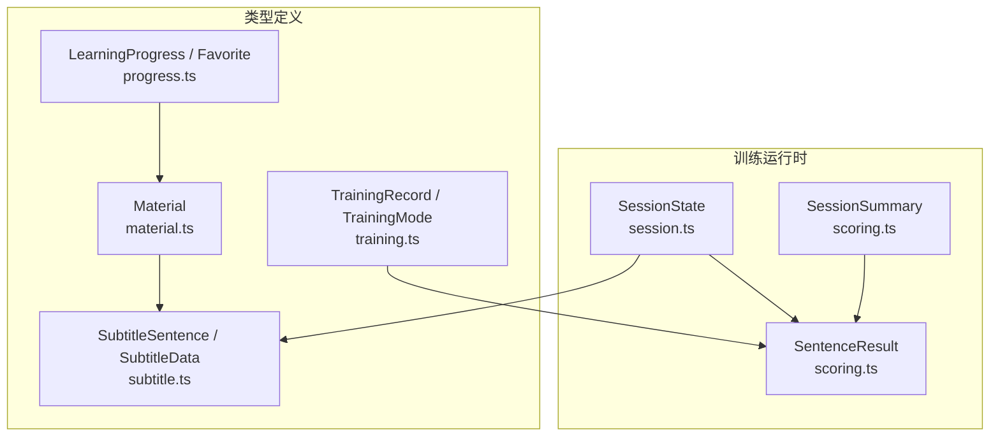
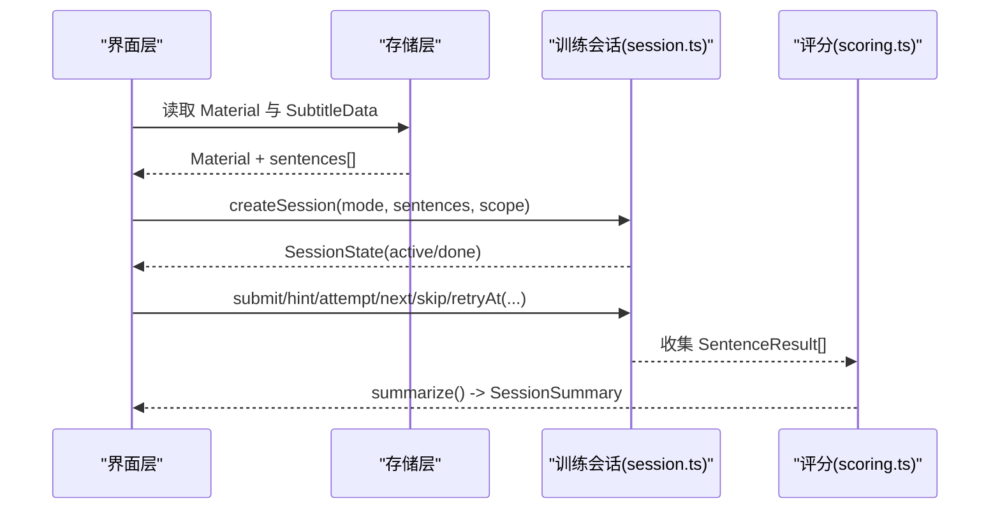
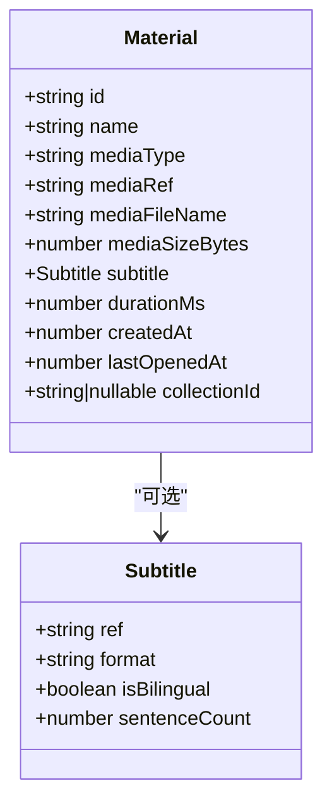
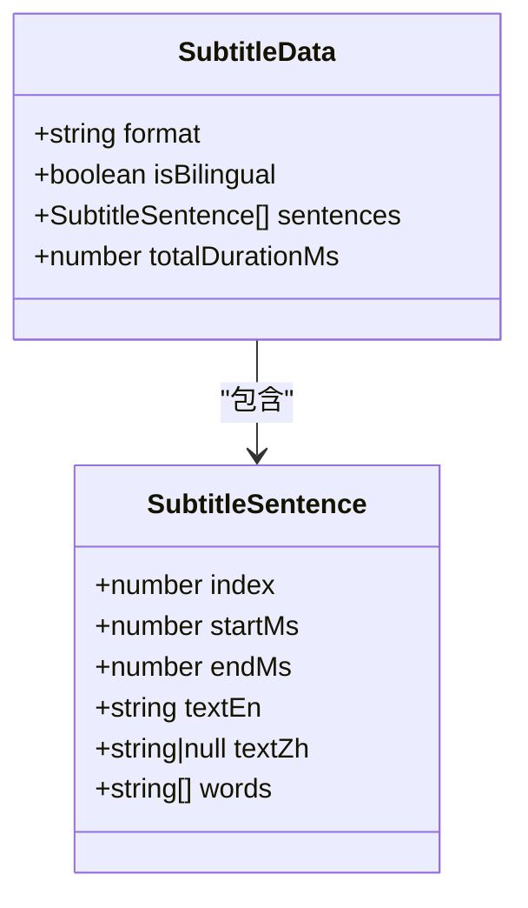
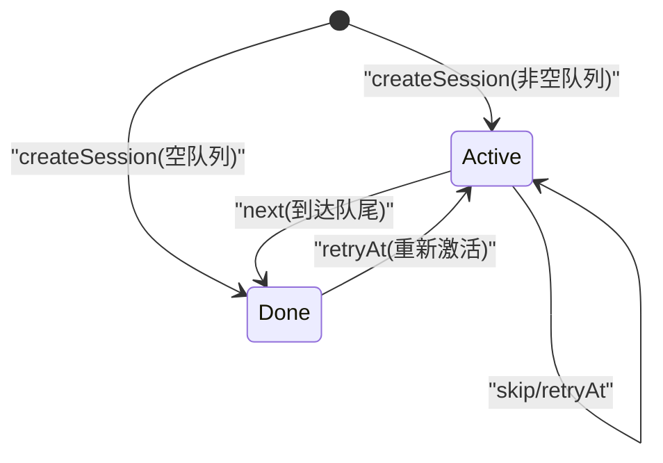
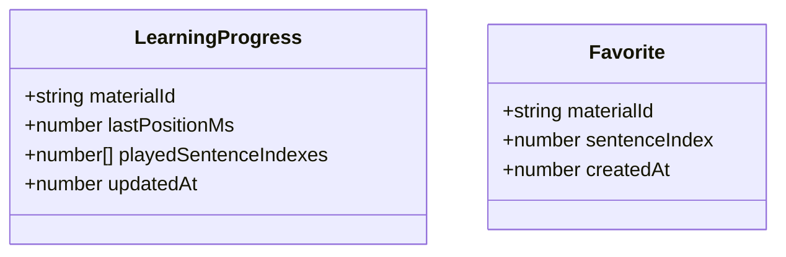
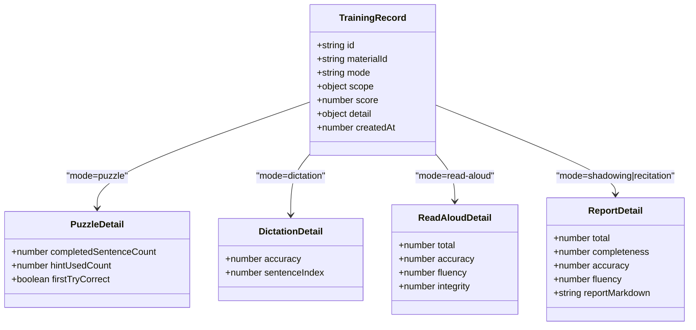
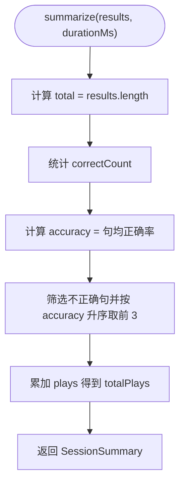
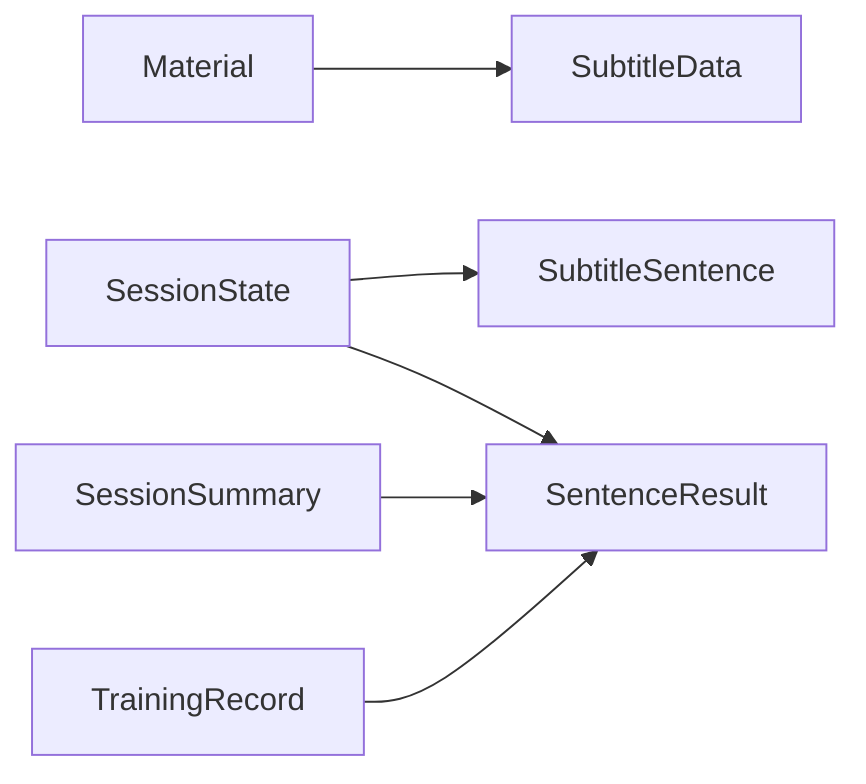

# 数据模型参考

<cite>
**本文引用的文件**   
- [client/types/material.ts](file://client/types/material.ts)
- [client/types/subtitle.ts](file://client/types/subtitle.ts)
- [client/types/progress.ts](file://client/types/progress.ts)
- [client/types/training.ts](file://client/types/training.ts)
- [client/core/training/session.ts](file://client/core/training/session.ts)
- [client/core/training/scoring.ts](file://client/core/training/scoring.ts)
</cite>

## 目录
1. [引言](#引言)
2. [项目结构](#项目结构)
3. [核心数据模型总览](#核心数据模型总览)
4. [架构概览](#架构概览)
5. [详细模型分析](#详细模型分析)
6. [依赖关系分析](#依赖关系分析)
7. [性能与复杂度说明](#性能与复杂度说明)
8. [字段验证规则](#字段验证规则)
9. [示例数据](#示例数据)
10. [数据迁移指南](#数据迁移指南)
11. [版本兼容性说明](#版本兼容性说明)
12. [故障排查](#故障排查)
13. [结论](#结论)

## 引言
本参考文档聚焦于学习应用中的核心数据模型，包括材料、字幕、学习进度、训练会话与评分结果。目标是帮助开发者快速理解类型定义、字段含义、状态转换规则以及数据流转方式，并提供可操作的验证规则、示例数据与迁移建议。

## 项目结构
本项目在前端侧将“业务模型”集中在 types 目录，而“训练会话状态机”和“评分汇总逻辑”放在 core/training 下：
- client/types：Material、SubtitleSentence、LearningProgress、TrainingRecord 等类型定义
- client/core/training：SessionState、SentenceResult、SessionSummary 等运行时数据结构与纯函数状态机

**图表来源**
- [client/types/material.ts:7-28](file://client/types/material.ts#L7-L28)
- [client/types/subtitle.ts:6-31](file://client/types/subtitle.ts#L6-L31)
- [client/types/progress.ts:6-19](file://client/types/progress.ts#L6-L19)
- [client/types/training.ts:50-67](file://client/types/training.ts#L50-L67)
- [client/core/training/session.ts:18-32](file://client/core/training/session.ts#L18-L32)
- [client/core/training/scoring.ts:8-37](file://client/core/training/scoring.ts#L8-L37)

**章节来源**
- [client/types/material.ts:1-36](file://client/types/material.ts#L1-L36)
- [client/types/subtitle.ts:1-35](file://client/types/subtitle.ts#L1-L35)
- [client/types/progress.ts:1-20](file://client/types/progress.ts#L1-L20)
- [client/types/training.ts:1-68](file://client/types/training.ts#L1-L68)
- [client/core/training/session.ts:1-119](file://client/core/training/session.ts#L1-L119)
- [client/core/training/scoring.ts:1-58](file://client/core/training/scoring.ts#L1-L58)

## 核心数据模型总览
- Material：学习材料的元数据与媒体引用
- SubtitleSentence / SubtitleData：句子级字幕结构与解析结果
- LearningProgress / Favorite：每材料的学习进度与收藏句
- SessionState：训练会话的状态机（active/done）
- SentenceResult / SessionSummary：单句结果与会话小结
- TrainingRecord / TrainingMode：训练记录与模式枚举

**章节来源**
- [client/types/material.ts:7-35](file://client/types/material.ts#L7-L35)
- [client/types/subtitle.ts:6-31](file://client/types/subtitle.ts#L6-L31)
- [client/types/progress.ts:6-19](file://client/types/progress.ts#L6-L19)
- [client/core/training/session.ts:16-32](file://client/core/training/session.ts#L16-L32)
- [client/core/training/scoring.ts:8-37](file://client/core/training/scoring.ts#L8-L37)
- [client/types/training.ts:50-67](file://client/types/training.ts#L50-L67)

## 架构概览
下图展示从“材料 + 字幕”到“训练会话 + 评分结果”的数据流：

**图表来源**
- [client/types/material.ts:7-28](file://client/types/material.ts#L7-L28)
- [client/types/subtitle.ts:22-31](file://client/types/subtitle.ts#L22-L31)
- [client/core/training/session.ts:44-62](file://client/core/training/session.ts#L44-L62)
- [client/core/training/session.ts:70-113](file://client/core/training/session.ts#L70-L113)
- [client/core/training/scoring.ts:40-50](file://client/core/training/scoring.ts#L40-L50)

## 详细模型分析

### Material 材料模型
Material 是学习材料的元数据模型，包含媒体标识、本地引用、字幕信息与时间戳等。注意：该模型不包含展示型字段（如颜色、进度、最近打开标记），这些由组件根据 id 派生。

关键字段说明：
- id：材料唯一标识（nanoid）
- name：材料名称
- mediaType：'video' | 'audio'
- mediaRef：端内本地引用（H5 为 IndexedDB Blob key；小程序为本地路径）
- mediaFileName：媒体文件名
- mediaSizeBytes：媒体大小（字节）
- subtitle：字幕对象或 null
  - ref：字幕文件本地引用
  - format：'srt' | 'lrc'
  - isBilingual：是否双语
  - sentenceCount：句子数量
- durationMs：媒体时长（毫秒）
- createdAt：创建时间戳
- lastOpenedAt：最后打开时间戳
- collectionId：所属材料集 ID（可为 null/undefined，表示未分组）

补充说明：
- 若需要“标题 title、音频地址 audioUrl、副标题 subtitleUrl”，请将其视为“展示型字段”，由组件基于 Material.id 派生，不进入持久化模型。
- 如需扩展，可在 Material.subtitle 中增加更多元信息，但需保持向后兼容。

**图表来源**
- [client/types/material.ts:7-28](file://client/types/material.ts#L7-L28)

**章节来源**
- [client/types/material.ts:1-36](file://client/types/material.ts#L1-L36)

### SubtitleSentence 字幕句子对象
SubtitleSentence 表示单个字幕句子，用于训练题目队列与播放对齐。

关键字段说明：
- index：句子序号（从 0 开始）
- startMs：起始时间（毫秒）
- endMs：结束时间（毫秒）
- textEn：英文原文
- textZh：中文译文（可为空，如纯英文字幕）
- words：按空格拆分的单词数组（已剥离标点，供九宫格训练使用）

SubtitleData 是字幕文件解析结果：
- format：'srt' | 'lrc'
- isBilingual：是否双语
- sentences：按时间排序的句子列表
- totalDurationMs：总时长（毫秒）

**图表来源**
- [client/types/subtitle.ts:6-31](file://client/types/subtitle.ts#L6-L31)

**章节来源**
- [client/types/subtitle.ts:1-35](file://client/types/subtitle.ts#L1-L35)

### TrainingSessionState 训练会话状态
训练会话采用纯函数状态机，所有事件迁移返回新状态对象，避免副作用。

状态值：
- SessionStatus：'active' | 'done'

SessionState 关键字段：
- mode：TrainingMode（训练模式）
- queue：题目队列（按范围过滤后的句子，保持原时间轴顺序）
- cursor：当前题目游标
- status：会话状态
- results：已收集结果（按提交顺序）
- hintCount：当前句已用提示次数
- attemptCount：当前句提交次数
- startedAt：会话开始时间戳

状态转换规则（关键事件）：
- createSession：初始化会话；若队列为空则直接 done
- submit：收集当前句结果（覆盖同句上一次提交）
- attempt：每次点击提交先计数（驱动上限）
- hint：使用一次提示
- next：推进游标；超出队尾 → done
- skip：记一条 0 分结果并推进
- retryAt：跳回指定句位置，重置 hint/attempt 计数

**图表来源**
- [client/core/training/session.ts:16-32](file://client/core/training/session.ts#L16-L32)
- [client/core/training/session.ts:44-62](file://client/core/training/session.ts#L44-L62)
- [client/core/training/session.ts:70-113](file://client/core/training/session.ts#L70-L113)

**章节来源**
- [client/core/training/session.ts:1-119](file://client/core/training/session.ts#L1-L119)

### Progress 学习进度
LearningProgress 表示每材料的学习进度，驱动材料库进度条与播放器定位。

关键字段说明：
- materialId：材料 ID
- lastPositionMs：上次播放位置（毫秒）
- playedSentenceIndexes：精听/训练中播放过的句子索引数组
- updatedAt：更新时间戳

Favorite 表示收藏句：
- materialId：材料 ID
- sentenceIndex：句子索引
- createdAt：收藏时间戳

**图表来源**
- [client/types/progress.ts:6-19](file://client/types/progress.ts#L6-L19)

**章节来源**
- [client/types/progress.ts:1-20](file://client/types/progress.ts#L1-L20)

### 训练记录与模式
TrainingRecord 是五模式训练的统一记录类型，detail 字段按模式区分。

TrainingMode：
- 'puzzle'：九宫格选词拼句
- 'dictation'：单句听写
- 'read-aloud'：跟读评分
- 'shadowing'：影子跟读
- 'recitation'：全文背诵

各模式 detail：
- PuzzleDetail：completedSentenceCount、hintUsedCount、firstTryCorrect
- DictationDetail：accuracy、sentenceIndex
- ReadAloudDetail：total、accuracy、fluency、integrity
- ReportDetail：total、completeness、accuracy、fluency、reportMarkdown

**图表来源**
- [client/types/training.ts:6-48](file://client/types/training.ts#L6-L48)
- [client/types/training.ts:50-67](file://client/types/training.ts#L50-L67)

**章节来源**
- [client/types/training.ts:1-68](file://client/types/training.ts#L1-L68)

### 评分结果与会话小结
SentenceResult 是单句训练结果的最小集合，被 SessionState.results 聚合。

关键字段说明：
- sentenceIndex：句子索引
- correct：是否正确
- accuracy：单句正确率（0-100）
- hints：使用提示次数（九宫格）
- attempts：提交次数
- plays：播放/重听次数（听写）
- skipped：是否跳过

SessionSummary 是会话小结：
- total：总句数
- correctCount：全对句数
- accuracy：平均正确率（按句均）
- durationMs：总用时（毫秒）
- weakest：最弱句 TOP3（正确率升序的 sentenceIndex）
- totalPlays：总播放次数（听写）

**图表来源**
- [client/core/training/scoring.ts:8-37](file://client/core/training/scoring.ts#L8-L37)
- [client/core/training/scoring.ts:40-50](file://client/core/training/scoring.ts#L40-L50)

**章节来源**
- [client/core/training/scoring.ts:1-58](file://client/core/training/scoring.ts#L1-L58)

## 依赖关系分析
- Material 与 SubtitleData：材料通过 subtitle.ref/format/isBilingual/sentenceCount 关联字幕解析结果
- SessionState 依赖 SubtitleSentence（题目队列）与 SentenceResult（结果收集）
- SessionSummary 由 SentenceResult[] 汇总生成
- TrainingRecord.detail 与 SentenceResult 口径对齐，便于跨模式统一统计

**图表来源**
- [client/types/material.ts:7-28](file://client/types/material.ts#L7-L28)
- [client/types/subtitle.ts:22-31](file://client/types/subtitle.ts#L22-L31)
- [client/core/training/session.ts:18-32](file://client/core/training/session.ts#L18-L32)
- [client/core/training/scoring.ts:8-37](file://client/core/training/scoring.ts#L8-L37)
- [client/types/training.ts:50-67](file://client/types/training.ts#L50-L67)

**章节来源**
- [client/types/material.ts:1-36](file://client/types/material.ts#L1-L36)
- [client/types/subtitle.ts:1-35](file://client/types/subtitle.ts#L1-L35)
- [client/core/training/session.ts:1-119](file://client/core/training/session.ts#L1-L119)
- [client/core/training/scoring.ts:1-58](file://client/core/training/scoring.ts#L1-L58)
- [client/types/training.ts:1-68](file://client/types/training.ts#L1-L68)

## 性能与复杂度说明
- sentencesInScope：O(n) 过滤，使用 Set 查找 O(1)，适合大量句子场景
- summarize：O(n log n) 排序取最弱句 TOP3，n 为结果句数
- SessionState.next/skip/retryAt：O(1) 或 O(n)（findIndex），通常 n 较小
- 建议：当句子量很大时，优先在 UI 层缓存过滤后的 queue，避免重复计算

[本节为通用性能指导，不直接分析具体文件]

## 字段验证规则
以下为推荐的前端校验规则，确保数据一致性：

- Material
  - id：非空字符串
  - name：非空字符串
  - mediaType：'video' | 'audio'
  - mediaRef：非空字符串
  - mediaFileName：非空字符串
  - mediaSizeBytes：非负整数
  - subtitle：null 或满足 Subtitle 约束
  - durationMs：非负整数
  - createdAt：正整数
  - lastOpenedAt：非负整数
  - collectionId：字符串或 null/undefined

- SubtitleSentence
  - index：非负整数
  - startMs：非负整数
  - endMs：非负整数且 ≥ startMs
  - textEn：非空字符串
  - textZh：字符串或 null
  - words：字符串数组，元素非空

- SubtitleData
  - format：'srt' | 'lrc'
  - isBilingual：布尔
  - sentences：SubtitleSentence[]，按 startMs 升序
  - totalDurationMs：非负整数

- LearningProgress
  - materialId：非空字符串
  - lastPositionMs：非负整数
  - playedSentenceIndexes：非负整数数组，去重且 ≤ 最大句子索引
  - updatedAt：正整数

- SessionState
  - mode：TrainingMode
  - queue：SubtitleSentence[]
  - cursor：非负整数且 < queue.length（active 时）
  - status：'active' | 'done'
  - results：SentenceResult[]
  - hintCount：非负整数
  - attemptCount：非负整数
  - startedAt：正整数

- SentenceResult
  - sentenceIndex：非负整数
  - correct：布尔
  - accuracy：0-100 数值
  - hints/attempts/plays：非负整数（可选）
  - skipped：布尔（可选）

- SessionSummary
  - total：非负整数
  - correctCount：非负整数且 ≤ total
  - accuracy：0-100 数值
  - durationMs：非负整数
  - weakest：非负整数数组，长度 ≤ 3
  - totalPlays：非负整数

- TrainingRecord
  - id：非空字符串
  - materialId：非空字符串
  - mode：TrainingMode
  - scope：{type:'all'} 或 {type:'favorites'}
  - score：0-100 数值
  - detail：与 mode 匹配的 detail 类型
  - createdAt：正整数

[本节为通用校验建议，不直接分析具体文件]

## 示例数据
以下示例仅展示字段结构，不包含代码内容：

- Material 示例
  - id：随机字符串
  - name：材料名称
  - mediaType：'audio'
  - mediaRef：本地引用键
  - mediaFileName：文件名
  - mediaSizeBytes：数字
  - subtitle：{ref, format:'srt', isBilingual:true, sentenceCount:20}
  - durationMs：数字
  - createdAt：时间戳
  - lastOpenedAt：时间戳
  - collectionId：字符串或 null

- SubtitleSentence 示例
  - index：0
  - startMs：0
  - endMs：3000
  - textEn："Hello world"
  - textZh："你好世界"
  - words：["hello","world"]

- LearningProgress 示例
  - materialId：材料 id
  - lastPositionMs：12000
  - playedSentenceIndexes：[0,1,2]
  - updatedAt：时间戳

- SessionState 示例
  - mode：'puzzle'
  - queue：[SubtitleSentence...]
  - cursor：0
  - status：'active'
  - results：[]
  - hintCount：0
  - attemptCount：0
  - startedAt：时间戳

- SentenceResult 示例
  - sentenceIndex：0
  - correct：true
  - accuracy：100
  - hints：0
  - attempts：1
  - plays：1

- SessionSummary 示例
  - total：20
  - correctCount：15
  - accuracy：85
  - durationMs：120000
  - weakest：[5,12,18]
  - totalPlays：30

- TrainingRecord 示例
  - id：记录 id
  - materialId：材料 id
  - mode：'dictation'
  - scope：{type:'all'}
  - score：80
  - detail：{accuracy:80, sentenceIndex:0}
  - createdAt：时间戳

[本节为概念性示例，不直接分析具体文件]

## 数据迁移指南
- 新增展示型字段（如 title、audioUrl、subtitleUrl）
  - 建议在组件层派生，不修改 Material 持久化结构，保证向后兼容
  - 若必须持久化，新增字段应允许 null/undefined，并在读取时提供默认值
- 字幕格式升级
  - 保持 format 为 'srt' | 'lrc'，新增字段需在解析器中兼容旧版
  - SubtitleData.sentences 必须按 startMs 升序，迁移后需校验排序
- 学习进度迁移
  - playedSentenceIndexes 需去重并限制在有效范围内
  - lastPositionMs 与 durationMs 保持一致性检查
- 训练会话迁移
  - SessionState.status 仅支持 'active' | 'done'，旧状态需映射
  - results 中的 hints/attempts/plays 为可选字段，旧记录缺失时应赋默认值 0
- 训练记录迁移
  - TrainingRecord.detail 需按 mode 匹配对应 detail 类型
  - score 必须在 0-100 之间，超出需修正或标记异常

[本节为通用迁移建议，不直接分析具体文件]

## 版本兼容性说明
- Material.subtitle 为可选字段，旧记录可能为 null
- Material.collectionId 可为 null/undefined，视为未分组
- SubtitleSentence.textZh 可为 null，表示纯英文字幕
- SentenceResult.hints/attempts/plays/skipped 为可选字段，旧记录缺失时需兼容
- SessionStatus 仅 'active' | 'done'，未来扩展需显式迁移策略

[本节为通用兼容性说明，不直接分析具体文件]

## 故障排查
常见问题与建议：
- 播放位置异常
  - 检查 LearningProgress.lastPositionMs 是否在 [0, durationMs] 范围内
  - 校验 Material.durationMs 是否为非负整数
- 字幕错位
  - 校验 SubtitleSentence.startMs/endMs 是否递增且合理
  - 确认 SubtitleData.sentences 已按时间排序
- 训练状态卡住
  - 检查 SessionState.cursor 是否越界
  - 确认 next/skip/retryAt 调用顺序是否符合状态机规则
- 小结分数异常
  - 检查 SentenceResult.accuracy 是否在 0-100
  - 确认 summarize 输入 results 非空且字段完整

[本节为通用故障排查建议，不直接分析具体文件]

## 结论
本文系统梳理了 Material、SubtitleSentence、LearningProgress、SessionState、SentenceResult、SessionSummary 与 TrainingRecord 等核心数据模型，明确了字段含义、状态转换规则与数据流转路径。通过统一的类型定义与纯函数状态机，项目在可扩展性与可测试性上具备良好基础。建议在后续迭代中遵循本文的验证规则与迁移指南，确保数据一致性与版本兼容。