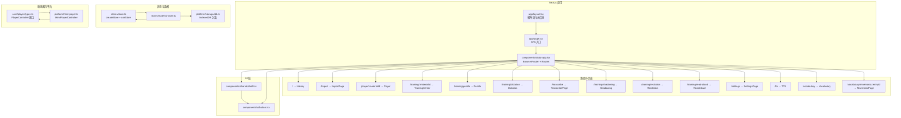
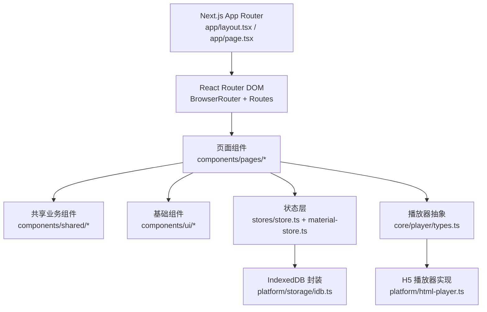
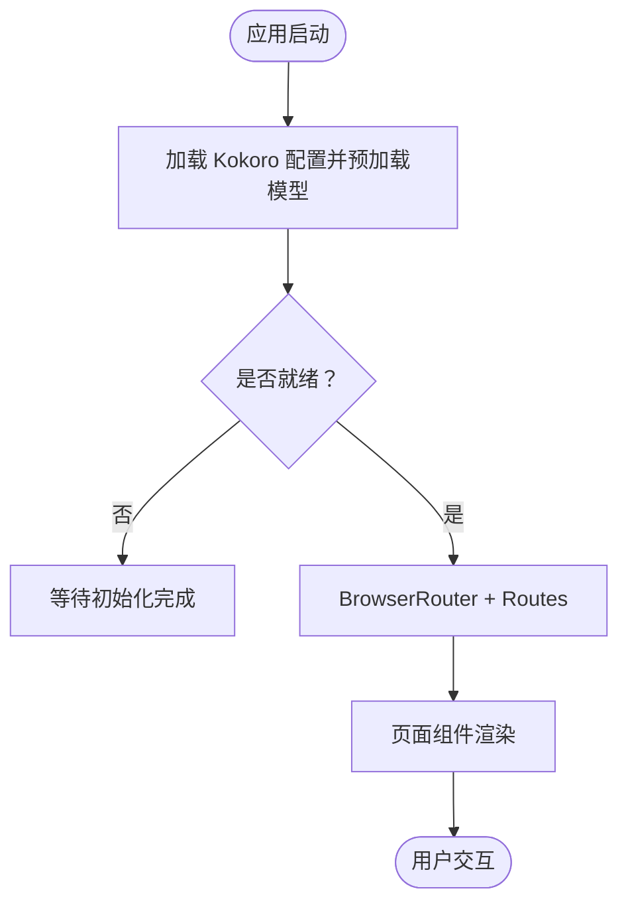
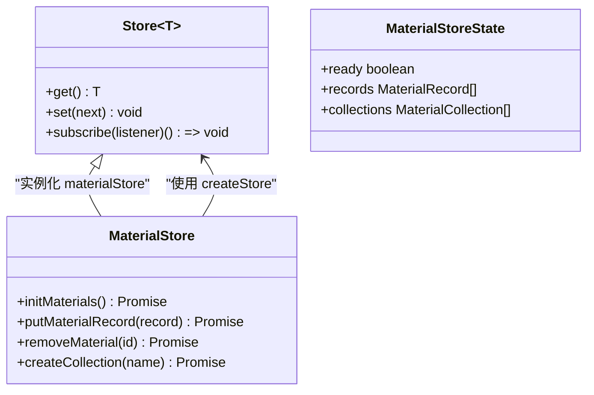
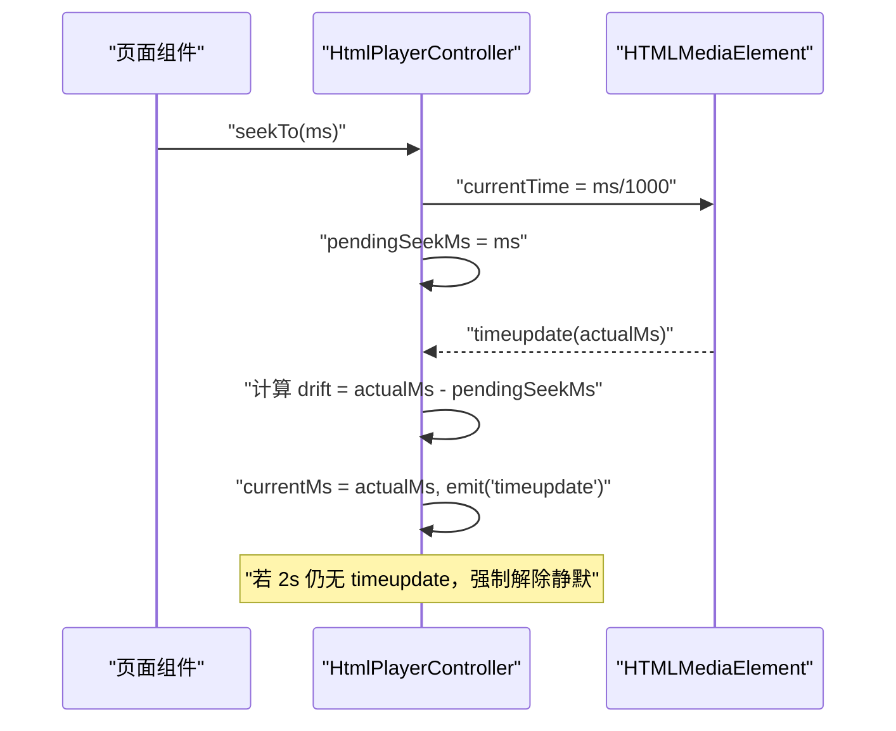
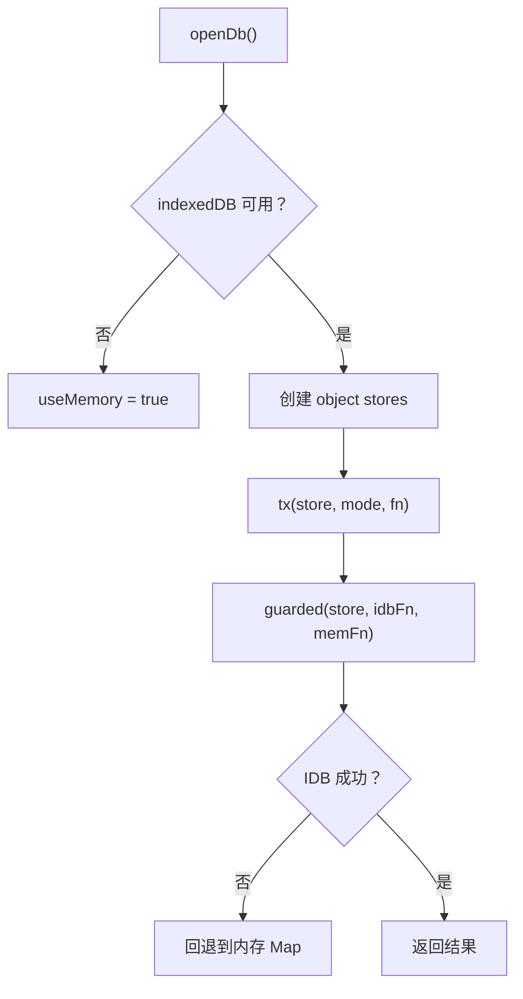
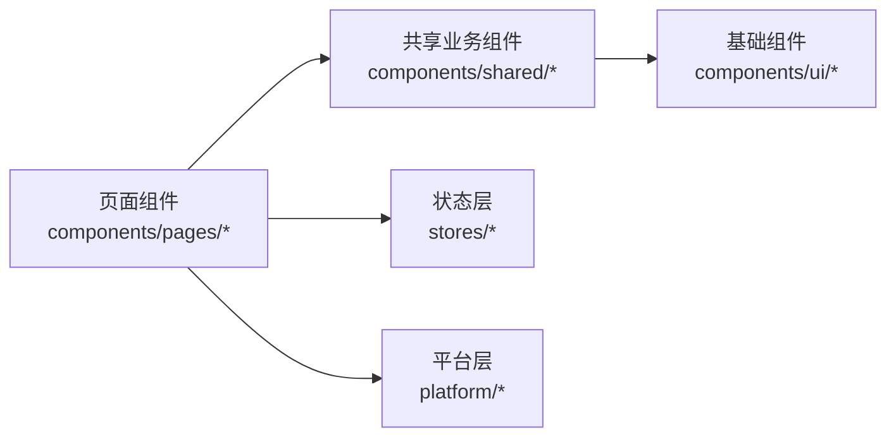
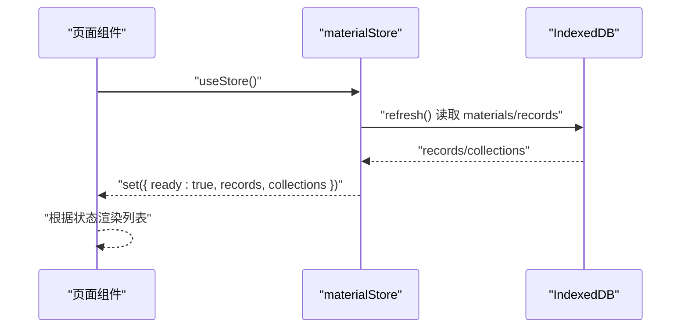
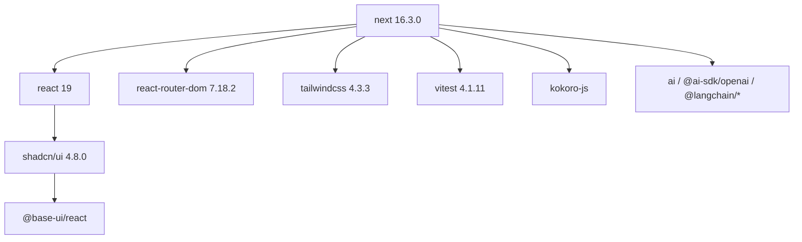

# 前端架构

<cite>
**本文引用的文件**   
- [README.md](file://client/README.md)
- [package.json](file://client/package.json)
- [layout.tsx](file://client/app/layout.tsx)
- [page.tsx](file://client/app/page.tsx)
- [study-app.tsx](file://client/components/study-app.tsx)
- [store.ts](file://client/stores/store.ts)
- [material-store.ts](file://client/stores/material-store.ts)
- [html-player.ts](file://client/platform/html-player.ts)
- [idb.ts](file://client/platform/storage/idb.ts)
- [library.tsx](file://client/components/pages/library.tsx)
- [shell.tsx](file://client/components/shared/shell.tsx)
- [button.tsx](file://client/components/ui/button.tsx)
- [types.ts](file://client/core/player/types.ts)
</cite>

## 目录
1. [引言](#引言)
2. [项目结构](#项目结构)
3. [核心组件](#核心组件)
4. [架构总览](#架构总览)
5. [详细组件分析](#详细组件分析)
6. [依赖关系分析](#依赖关系分析)
7. [性能考量](#性能考量)
8. [故障排查指南](#故障排查指南)
9. [结论](#结论)
10. [附录](#附录)

## 引言
本文件为“英语精听助手”前端的技术文档，聚焦基于 Next.js 的 SPA 实现、App Router 与 React Router DOM 路由管理、自研状态管理 createStore + useStore、平台适配层（HTMLAudioElement 控制器、IndexedDB 存储）以及组件层次结构与通信模式。同时给出开发环境搭建、构建配置与调试技巧，帮助读者快速理解并扩展系统。

## 项目结构
本项目采用 Next.js App Router 作为应用壳，SPA 入口在 app/page.tsx 中挂载 StudyApp；StudyApp 内部使用 BrowserRouter + Routes 管理 14+ 条页面路由。UI 采用 Tailwind CSS 4 与 shadcn/ui 基础组件，业务组件位于 components/pages 与 components/shared，平台无关逻辑集中在 core，平台适配在 platform，数据持久化通过 platform/storage/idb.ts 封装 IndexedDB。

图示来源
- [study-app.tsx:41-62](file://client/components/study-app.tsx#L41-L62)
- [layout.tsx:5-49](file://client/app/layout.tsx#L5-L49)
- [page.tsx:1-6](file://client/app/page.tsx#L1-L6)
- [store.ts:14-33](file://client/stores/store.ts#L14-L33)
- [material-store.ts:40-52](file://client/stores/material-store.ts#L40-L52)
- [idb.ts:27-50](file://client/platform/storage/idb.ts#L27-L50)
- [types.ts:36-55](file://client/core/player/types.ts#L36-L55)
- [html-player.ts:24-63](file://client/platform/html-player.ts#L24-L63)
- [shell.tsx:17-20](file://client/components/shared/shell.tsx#L17-L20)
- [button.tsx:43-55](file://client/components/ui/button.tsx#L43-L55)

章节来源
- [README.md:21-95](file://client/README.md#L21-L95)
- [package.json:11-33](file://client/package.json#L11-L33)

## 核心组件
- 应用壳与路由：app/layout.tsx 提供站点元信息与主题色；app/page.tsx 渲染 SPA 入口 StudyApp；StudyApp 内用 BrowserRouter + Routes 声明所有页面路由。
- 状态管理：stores/store.ts 提供 createStore 与 useStore，基于 React.useSyncExternalStore 实现 SSR 安全订阅；stores/material-store.ts 负责材料库 CRUD、集合分组、最近学习排序与种子注入。
- 平台适配：platform/html-player.ts 实现 HtmlPlayerController，封装 HTMLAudioElement/HTMLVideoElement 播放控制；platform/storage/idb.ts 手写 Promise 化 IndexedDB 封装，支持内存降级。
- 组件分层：components/pages 为页面级组件（P0-P11），components/shared 为共享业务组件（Shell、训练外壳等），components/ui 为 shadcn/ui 基础组件（Button、Card 等）。

章节来源
- [layout.tsx:5-49](file://client/app/layout.tsx#L5-L49)
- [page.tsx:1-6](file://client/app/page.tsx#L1-L6)
- [study-app.tsx:24-62](file://client/components/study-app.tsx#L24-L62)
- [store.ts:1-33](file://client/stores/store.ts#L1-L33)
- [material-store.ts:1-163](file://client/stores/material-store.ts#L1-L163)
- [html-player.ts:1-272](file://client/platform/html-player.ts#L1-L272)
- [idb.ts:1-117](file://client/platform/storage/idb.ts#L1-L117)
- [library.tsx:1-143](file://client/components/pages/library.tsx#L1-L143)
- [shell.tsx:1-24](file://client/components/shared/shell.tsx#L1-L24)
- [button.tsx:1-59](file://client/components/ui/button.tsx#L1-L59)

## 架构总览
系统采用“本地优先”的 SPA 架构：
- 渲染层：Next.js App Router 仅承担站点壳与 SEO 元信息，实际 SPA 由 React Router DOM 管理。
- 状态层：轻量 createStore + useStore，零外部状态库依赖，SSR 安全。
- 平台层：播放器抽象 PlayerController 与 HtmlPlayerController 解耦具体媒体元素；IndexedDB 封装统一 KV 接口并提供内存降级。
- 服务层：AI 能力（ASR/SOE/TTS/报告）通过接口抽象，当前以 Mock 为主，预留 API 切换。

图示来源
- [layout.tsx:5-49](file://client/app/layout.tsx#L5-L49)
- [page.tsx:1-6](file://client/app/page.tsx#L1-L6)
- [study-app.tsx:41-62](file://client/components/study-app.tsx#L41-L62)
- [store.ts:14-33](file://client/stores/store.ts#L14-L33)
- [material-store.ts:40-52](file://client/stores/material-store.ts#L40-L52)
- [idb.ts:89-102](file://client/platform/storage/idb.ts#L89-L102)
- [types.ts:36-55](file://client/core/player/types.ts#L36-L55)
- [html-player.ts:24-63](file://client/platform/html-player.ts#L24-L63)

## 详细组件分析

### 路由与页面设计（14 条路由）
StudyApp 使用 BrowserRouter + Routes 定义以下路由：
- / → Library（P0 材料库）
- /collection/:collectionId → CollectionDetail
- /favorites → Favorites
- /import → ImportPage（P1 导入材料）
- /player/:materialId → Player（P2 精听播放器）
- /training/:materialId → TrainingCenter（P3 训练中心）
- /training/puzzle → Puzzle（P4 九宫格）
- /training/dictation → Dictation（P5 单句听写）
- /transcribe → TranscribePage（P6 录音转写）
- /training/shadowing → Shadowing（P7 影子跟读）
- /training/recitation → Recitation（P8 全文背诵）
- /training/read-aloud → ReadAloud（P8.5 朗读评分）
- /settings → SettingsPage（P10 设置）
- /tts → TTS（P11 文字转语音）
- /vocabulary → Vocabulary（生词本）
- /vocabulary/mnemonic/:entryId → MnemonicPage（记忆卡片）
- * → Placeholder（未找到页）

图示来源
- [study-app.tsx:24-37](file://client/components/study-app.tsx#L24-L37)
- [study-app.tsx:41-62](file://client/components/study-app.tsx#L41-L62)

章节来源
- [study-app.tsx:24-62](file://client/components/study-app.tsx#L24-L62)
- [README.md:167-183](file://client/README.md#L167-L183)

### 自研状态管理 createStore + useStore
- createStore 返回 Store<T>，包含 get/set/subscribe，内部维护 state 与 listeners Set。
- useStore 基于 React.useSyncExternalStore，传入 subscribe/get/getServerSnapshot，确保 SSR 安全。
- material-store.ts 使用 materialStore 暴露 ready/records/collections 状态，并提供 initMaterials、putMaterialRecord、removeMaterial、createCollection 等方法，结合 IndexedDB 进行持久化。

图示来源
- [store.ts:8-33](file://client/stores/store.ts#L8-L33)
- [material-store.ts:24-30](file://client/stores/material-store.ts#L24-L30)
- [material-store.ts:40-73](file://client/stores/material-store.ts#L40-L73)

章节来源
- [store.ts:1-33](file://client/stores/store.ts#L1-L33)
- [material-store.ts:1-163](file://client/stores/material-store.ts#L1-L163)

### 平台适配层：HTMLAudioElement 控制器
- HtmlPlayerController 实现 PlayerController 接口，封装 load/play/pause/seekTo/setRate/setVolume/setLoop/clearLoop/on/off/destroy 等。
- seek 落点校准：记录 pendingSeekMs，首个 timeupdate 时计算漂移量 seekDriftMs，偏差 >300ms 记录供上层修正循环容差；超时 2s 强制解除静默。
- 进度采样：原生 timeupdate（~4Hz）兜底，播放中使用 requestAnimationFrame（~60Hz）高频读取 currentTime，保证进度条平滑。
- A-B 循环：controller 级区间循环，无次数限制；带次数的循环由 SentencePlayer 承担。

图示来源
- [html-player.ts:103-113](file://client/platform/html-player.ts#L103-L113)
- [html-player.ts:178-192](file://client/platform/html-player.ts#L178-L192)
- [html-player.ts:206-216](file://client/platform/html-player.ts#L206-L216)
- [html-player.ts:223-251](file://client/platform/html-player.ts#L223-L251)

章节来源
- [html-player.ts:1-272](file://client/platform/html-player.ts#L1-L272)
- [types.ts:36-55](file://client/core/player/types.ts#L36-L55)

### 平台适配层：IndexedDB 存储
- 手写 Promise 化 IndexedDB 封装，三个 object store：materials/blobs/records。
- SSR/隐私模式打开失败时优雅降级为内存 Map，永不抛崩溃。
- guarded() 统一兜底：IDB 失败 → 永久切换到 memory 模式。
- 提供 KvStore 最小 KV API（get/put/delete/allKeys/clear），并暴露 materialsStore/blobsStore/recordsStore 单例。

图示来源
- [idb.ts:27-50](file://client/platform/storage/idb.ts#L27-L50)
- [idb.ts:53-68](file://client/platform/storage/idb.ts#L53-L68)
- [idb.ts:71-78](file://client/platform/storage/idb.ts#L71-L78)
- [idb.ts:89-102](file://client/platform/storage/idb.ts#L89-L102)

章节来源
- [idb.ts:1-117](file://client/platform/storage/idb.ts#L1-L117)

### 组件层次结构与职责划分
- 页面组件（components/pages）：Library、Import、Player、TrainingCenter、Puzzle、Dictation、Transcribe、Shadowing、Recitation、ReadAloud、Settings、TTS、Vocabulary、Mnemonic、Placeholder 等，承载具体业务视图与交互。
- 共享业务组件（components/shared）：Shell（页面外壳）、training-session-shell（训练会话外壳）、player-parts（播放器子组件）、record-button（录音按钮）、score-panel（评分面板）等。
- 基础组件（components/ui）：shadcn/ui 提供的 Button、Card、Input、Dialog、Progress、Separator、Sheet、Switch、Tabs、Textarea 等。

图示来源
- [library.tsx:1-143](file://client/components/pages/library.tsx#L1-L143)
- [shell.tsx:17-20](file://client/components/shared/shell.tsx#L17-L20)
- [button.tsx:43-55](file://client/components/ui/button.tsx#L43-L55)

章节来源
- [README.md:29-60](file://client/README.md#L29-L60)
- [library.tsx:1-143](file://client/components/pages/library.tsx#L1-L143)
- [shell.tsx:1-24](file://client/components/shared/shell.tsx#L1-L24)
- [button.tsx:1-59](file://client/components/ui/button.tsx#L1-L59)

### 组件通信模式与事件处理机制
- 状态驱动：页面组件通过 useStore(materialStore) 订阅 ready/records/collections，变更触发重渲染。
- 事件总线：HtmlPlayerController 通过 on/off 派发 timeupdate/statechange/ended/error 事件，页面组件监听更新 UI。
- 导航与副作用：Shell 提供返回按钮，点击前暂停所有媒体元素，避免主线程占用导致无响应。

图示来源
- [library.tsx:14-27](file://client/components/pages/library.tsx#L14-L27)
- [material-store.ts:40-52](file://client/stores/material-store.ts#L40-L52)
- [idb.ts:89-102](file://client/platform/storage/idb.ts#L89-L102)

章节来源
- [library.tsx:14-27](file://client/components/pages/library.tsx#L14-L27)
- [material-store.ts:40-52](file://client/stores/material-store.ts#L40-L52)
- [shell.tsx:9-15](file://client/components/shared/shell.tsx#L9-L15)

## 依赖关系分析
- 框架与运行时：Next.js 16.3.0、React 19、TypeScript 5.7.3。
- 路由：react-router-dom 7.18.2。
- UI：Tailwind CSS 4.3.3、shadcn/ui（base-nova）4.8.0、@base-ui/react、lucide-react。
- AI 与服务：kokoro-js、ai、@ai-sdk/openai、@langchain/*、undici。
- 工具与测试：vitest 4.1.11、fflate、https-proxy-agent。

图示来源
- [package.json:11-33](file://client/package.json#L11-L33)
- [package.json:34-43](file://client/package.json#L34-L43)

章节来源
- [package.json:1-60](file://client/package.json#L1-L60)

## 性能考量
- 进度条平滑：HtmlPlayerController 在播放中使用 requestAnimationFrame 高频采样 currentTime，弥补原生 timeupdate 低频问题。
- Seek 校准：避免 seek 后进度跳变，首个 timeupdate 才派发 currentMs，防止 UI 闪烁。
- 资源卸载：destroy() 停止 rAF、解绑全部监听、移除 src 并清空事件表，防止内存泄漏。
- 存储降级：IndexedDB 不可用时自动回退内存 Map，保证功能可用且不崩溃。
- 首屏优化：StudyApp 启动时异步加载 Kokoro 配置并预加载模型，减少首次 TTS 延迟。

[本节为通用性能建议，不直接分析具体文件]

## 故障排查指南
- 播放被拦截：HtmlPlayerController.play() 捕获 AbortError 等良性竞态，其他错误上报 PLAY_BLOCKED；检查浏览器策略与用户手势要求。
- 媒体错误：error 事件携带 code/message，如 MEDIA_ERROR_*；检查媒体源 URL/Blob 有效性。
- IndexedDB 打开失败：控制台输出 open failed/falling back to memory；确认隐私模式或权限限制，必要时清理旧连接。
- 进度卡死：若 seek 后长时间无 timeupdate，2s 超时强制解除静默；检查元素是否已加载元数据。
- 页面空白：StudyApp 初始 ready=false，等待 Kokoro 配置加载完成后渲染；检查网络请求与后端可用性。

章节来源
- [html-player.ts:85-97](file://client/platform/html-player.ts#L85-L97)
- [html-player.ts:171-175](file://client/platform/html-player.ts#L171-L175)
- [idb.ts:37-48](file://client/platform/storage/idb.ts#L37-L48)
- [study-app.tsx:27-37](file://client/components/study-app.tsx#L27-L37)

## 结论
该前端架构以 Next.js App Router 为壳、React Router DOM 管理 SPA 路由，配合自研 createStore + useStore 实现轻量状态管理；平台适配层将播放器与存储抽象，便于扩展与维护。组件分层清晰，UI 基于 shadcn/ui 与 Tailwind，具备良好的可维护性与可扩展性。建议在后续迭代中继续强化错误边界、性能监控与服务层切换机制。

[本节为总结性内容，不直接分析具体文件]

## 附录
- 开发环境搭建
  - 安装依赖：pnpm install
  - 开发服务器：pnpm dev（默认 http://localhost:3000）
  - 生产构建：pnpm build；启动生产服务器：pnpm start
  - 单元测试：pnpm test（运行 core/ 与 services/mock 的单元测试）

- 构建配置
  - Next.js 配置：next.config.mjs
  - TypeScript 配置：tsconfig.json
  - PostCSS 配置：postcss.config.mjs
  - Vitest 配置：vitest.config.mts

- 调试技巧
  - 浏览器开发者工具：Network 面板观察 Kokoro 配置与 TTS 请求；Console 查看 IDB 降级日志。
  - 性能面板：观察 rAF 调用频率与 media 事件时间线，验证 seek 校准与进度平滑。
  - 存储面板：IndexedDB 中检查 materials/blobs/records 三张表的数据一致性。

章节来源
- [README.md:98-124](file://client/README.md#L98-L124)