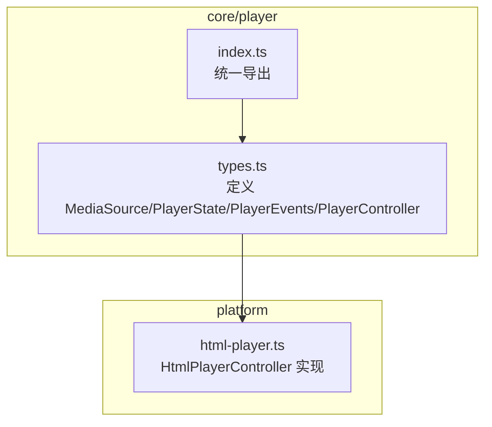
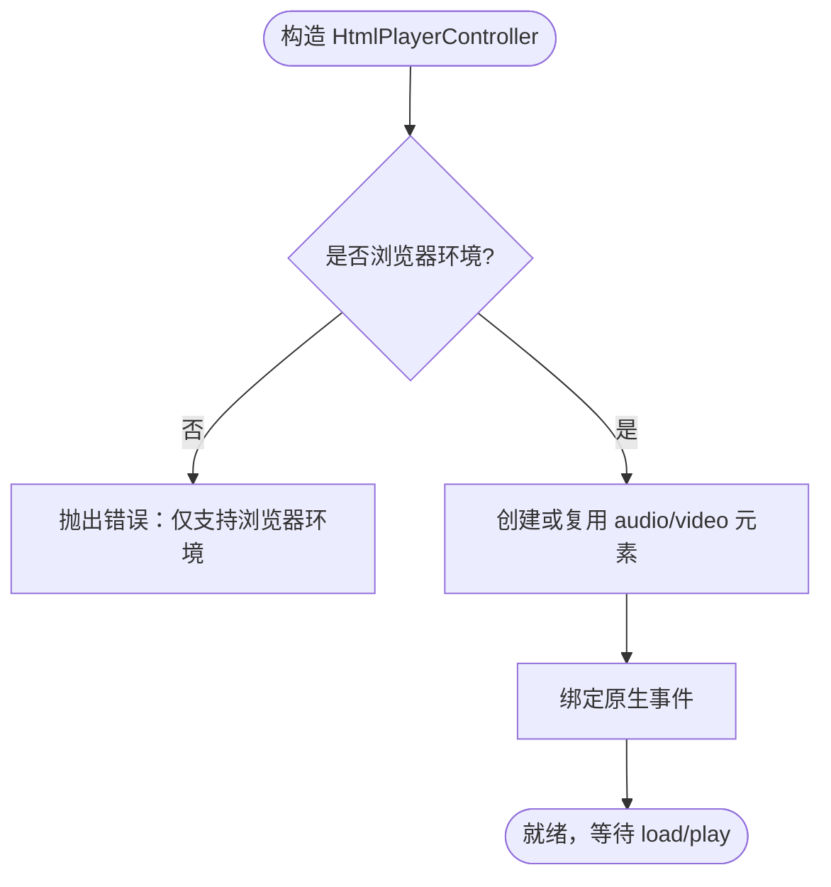
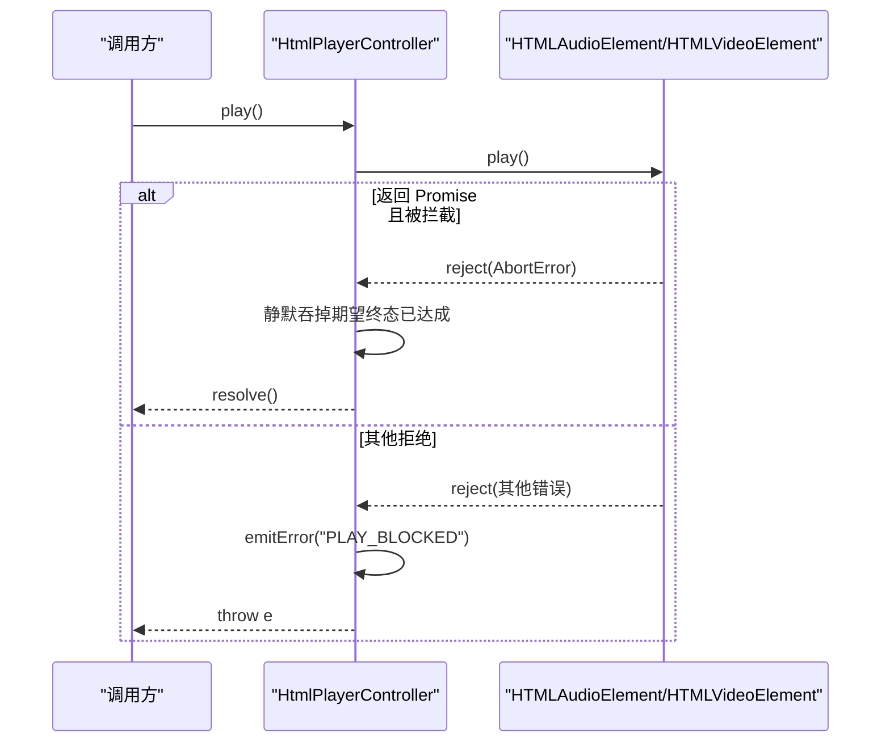
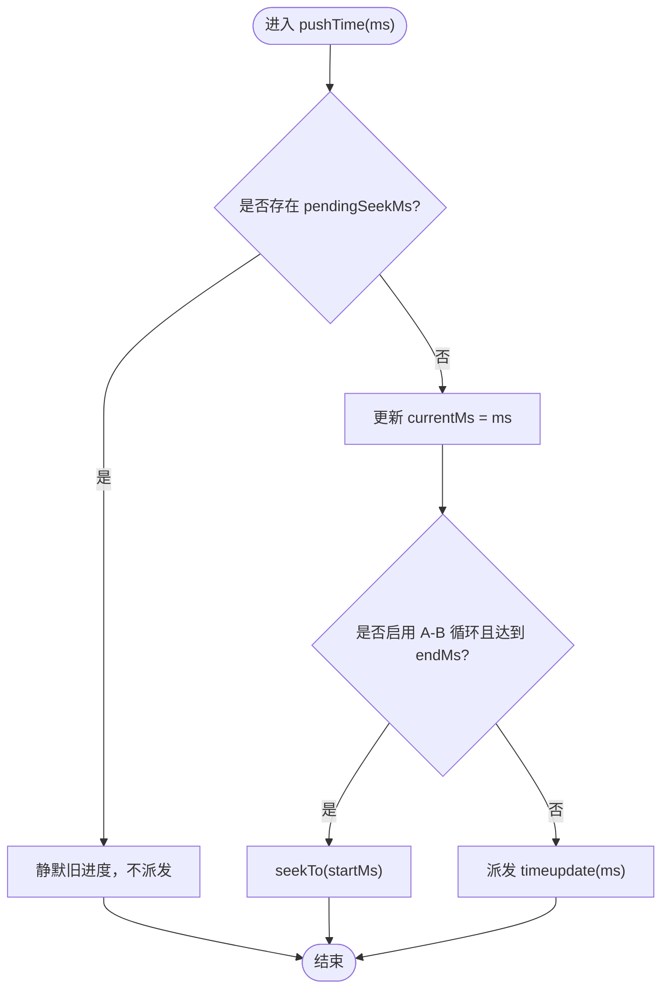
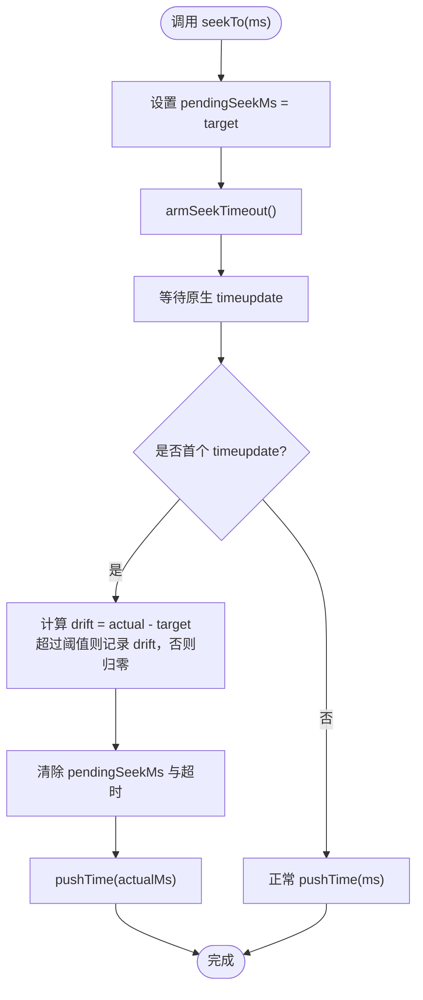
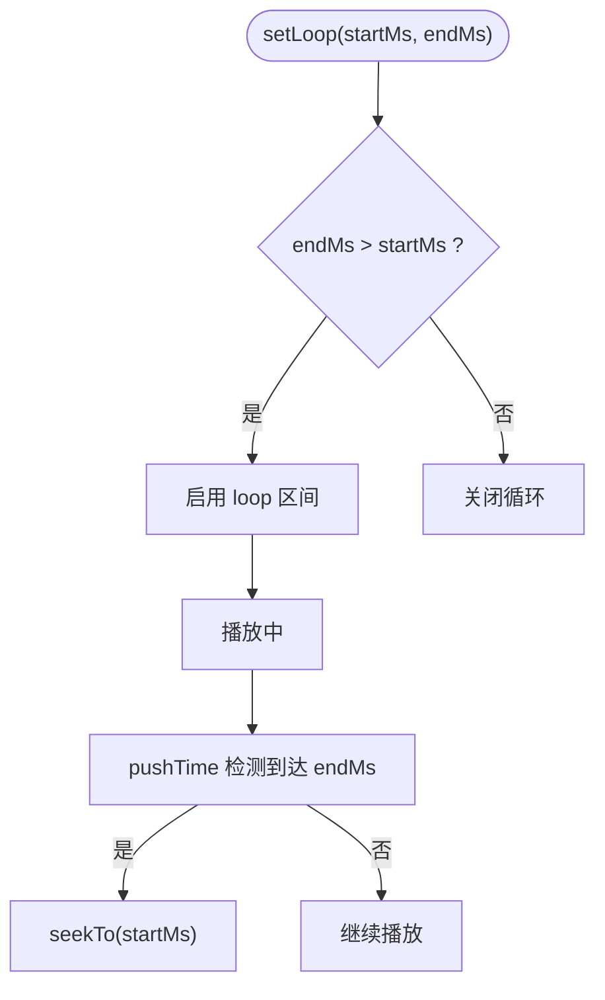
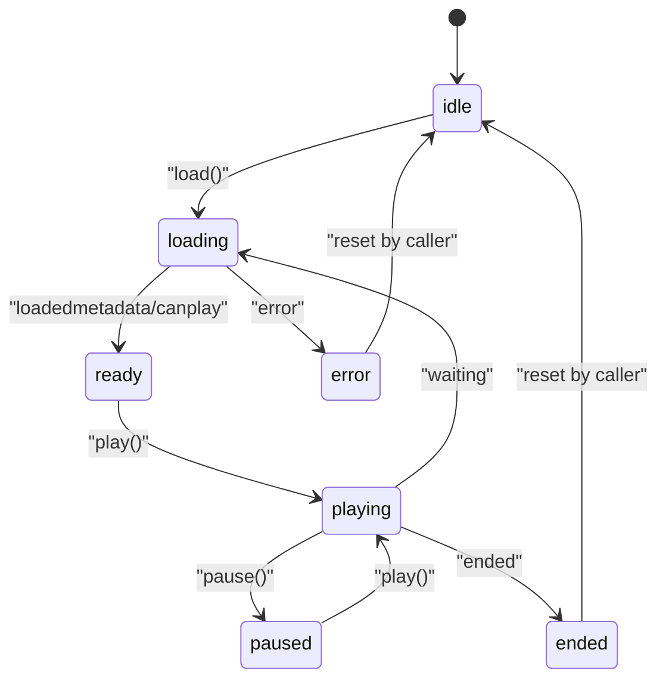
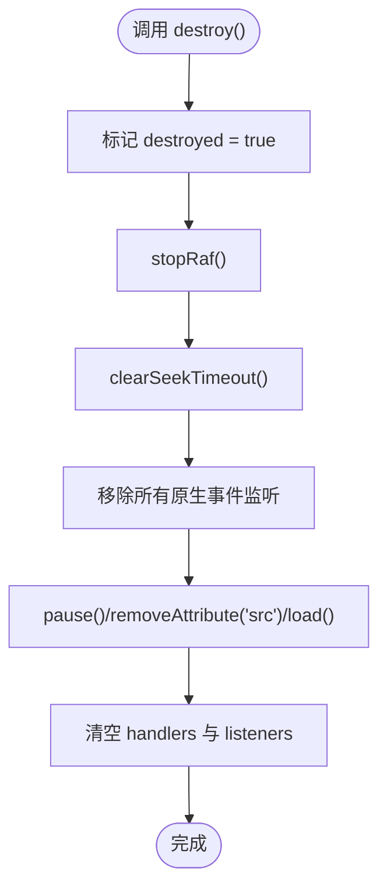
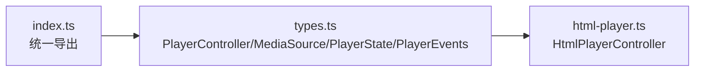

# HTML 音频播放器控制器

<cite>
**本文引用的文件**   
- [client/platform/html-player.ts](file://client/platform/html-player.ts)
- [client/core/player/types.ts](file://client/core/player/types.ts)
- [client/core/player/index.ts](file://client/core/player/index.ts)
</cite>

## 目录
1. [简介](#简介)
2. [项目结构](#项目结构)
3. [核心组件](#核心组件)
4. [架构总览](#架构总览)
5. [详细组件分析](#详细组件分析)
6. [依赖关系分析](#依赖关系分析)
7. [性能考量](#性能考量)
8. [故障排查指南](#故障排查指南)
9. [结论](#结论)
10. [附录：使用示例与调试技巧](#附录使用示例与调试技巧)

## 简介
本文围绕 `HtmlPlayerController` 类，系统化梳理其在浏览器环境下对原生 `HTMLAudioElement` / `HTMLVideoElement` 的封装方式、播放控制接口、进度追踪机制、倍速与 A-B 循环能力，以及关键的 seek 落点校准策略、状态机转换、错误处理、内存泄漏防护和 SSR 安全设计。文档同时给出面向上层（如句子播放器）的集成要点、常见问题的排查思路与调试建议。

## 项目结构
本项目中与播放器相关的代码主要位于以下位置：
- `client/platform/html-player.ts`：H5 平台下的 `PlayerController` 实现，基于原生媒体元素。
- `client/core/player/types.ts`：平台无关的播放器类型定义，包括 `MediaSource`、`PlayerState`、`PlayerEvents`、`PlayerController` 等。
- `client/core/player/index.ts`：core 层统一导出入口，暴露类型与更高层的 `SentencePlayer`（不在本文重点）。



**图表来源**
- [client/core/player/types.ts:7-55](file://client/core/player/types.ts#L7-L55)
- [client/core/player/index.ts:1-5](file://client/core/player/index.ts#L1-L5)
- [client/platform/html-player.ts:17-271](file://client/platform/html-player.ts#L17-L271)

**章节来源**
- [client/platform/html-player.ts:1-15](file://client/platform/html-player.ts#L1-L15)
- [client/core/player/types.ts:1-56](file://client/core/player/types.ts#L1-L56)
- [client/core/player/index.ts:1-5](file://client/core/player/index.ts#L1-L5)

## 核心组件
- `HtmlPlayerController`：实现 `PlayerController` 接口，封装原生媒体元素，提供加载、播放、暂停、跳转、倍速、音量、A-B 循环、事件订阅与销毁等能力。
- `createHtmlPlayer`：工厂函数，按媒体类型创建控制器实例。
- `PlayerController` 接口：抽象出跨平台的播放器能力，供上层业务（如句子播放器）调用。

关键职责划分：
- 底层媒体操作：由 `HtmlPlayerController` 通过 `HTMLAudioElement` / `HTMLVideoElement` 完成。
- 上层业务逻辑：由 `SentencePlayer` 等组合控制器负责（本仓库 core 层导出），不直接耦合 DOM。

**章节来源**
- [client/platform/html-player.ts:24-271](file://client/platform/html-player.ts#L24-L271)
- [client/core/player/types.ts:32-55](file://client/core/player/types.ts#L32-L55)

## 架构总览
下图展示 H5 播放器在系统中的角色与交互关系：

```mermaid
classDiagram
class PlayerController {
+load(source) Promise~void~
+play() Promise~void~
+pause() void
+seekTo(ms) void
+setRate(rate) void
+setVolume(volume) void
+setLoop(startMs, endMs) void
+clearLoop() void
+getCurrentTimeMs() number
+getDurationMs() number
+getState() PlayerState
+on(event, cb) void
+off(event, cb) void
+destroy() void
}
class HtmlPlayerController {
-el : HTMLAudioElement|HTMLVideoElement
-ownsElement : boolean
-handlers : Map
-state : PlayerState
-currentMs : number
-durationMs : number
-rafId : number|null
-pendingSeekMs : number|null
-seekTimer : number|null
-seekDriftMs : number
-loop : {startMs,endMs}|null
-destroyed : boolean
-listeners : Array
+constructor(kind, element?)
+load(source) Promise~void~
+play() Promise~void~
+pause() void
+seekTo(ms) void
+setRate(rate) void
+setVolume(volume) void
+setLoop(startMs, endMs) void
+clearLoop() void
+getCurrentTimeMs() number
+getDurationMs() number
+getState() PlayerState
+getSeekDriftMs() number
+isSeeking() boolean
+on(event, cb) void
+off(event, cb) void
+destroy() void
}
class PlayerEvents {
<<interface>>
+timeupdate(currentMs)
+statechange(state)
+ended()
+error(err)
}
class MediaSource {
<<interface>>
+type : "video"|"audio"
+src : string
}
class PlayerState {
<<type>>
}
PlayerController <|.. HtmlPlayerController
HtmlPlayerController --> PlayerEvents : "派发事件"
HtmlPlayerController --> MediaSource : "加载"
HtmlPlayerController --> PlayerState : "状态管理"
```

**图表来源**
- [client/platform/html-player.ts:24-271](file://client/platform/html-player.ts#L24-L271)
- [client/core/player/types.ts:7-55](file://client/core/player/types.ts#L7-L55)

## 详细组件分析

### HtmlPlayerController 类概览
- 媒体元素封装：支持传入已有元素或内部创建 `audio`/`video`；仅在浏览器环境构造。
- 事件系统：维护 `timeupdate/statechange/ended/error` 四类事件监听集合，统一派发。
- 状态机：维护 `idle/loading/ready/playing/paused/ended/error` 七种状态，并通过 `statechange` 事件通知。
- 进度追踪：原生 `timeupdate` 作为兜底采样（约 4Hz），播放中另起 `requestAnimationFrame` 高频采样（约 60Hz），保证 UI 平滑。
- 倍速与音量：分别映射到 `playbackRate` 与 `volume`，并做范围裁剪。
- A-B 循环：控制器级区间循环，无次数限制；带次数的循环由上层（如 `SentencePlayer`）承担。
- Seek 落点校准：记录目标值、静默旧进度、首个 `timeupdate` 校准、漂移量计算与容差修正。
- 资源清理：`destroy()` 停止 rAF、解绑监听、卸载 src、清空事件表与引用，防止内存泄漏。
- SSR 安全：模块顶层不触碰 DOM，仅在浏览器内由调用方 new。



**图表来源**
- [client/platform/html-player.ts:52-63](file://client/platform/html-player.ts#L52-L63)
- [client/platform/html-player.ts:158-176](file://client/platform/html-player.ts#L158-L176)

**章节来源**
- [client/platform/html-player.ts:1-23](file://client/platform/html-player.ts#L1-L23)
- [client/platform/html-player.ts:24-63](file://client/platform/html-player.ts#L24-L63)
- [client/platform/html-player.ts:158-176](file://client/platform/html-player.ts#L158-L176)

### 播放控制接口
- `load(source)`：设置 `src` 并触发加载；在 `loadedmetadata` 或 `canplay` 时进入 `ready`；失败则进入 `error` 并派发错误事件。
- `play()`：调用原生 `play()`，捕获非 `AbortError` 异常并派发 `PLAY_BLOCKED`；对期望被中断的竞态进行静默吞掉。
- `pause()`：调用原生 `pause()`。
- `seekTo(ms)`：将毫秒转换为秒写入 `currentTime`，并启动待校准流程。
- `setRate(rate)`：限制在 0.5 ~ 2.0 范围内。
- `setVolume(volume)`：限制在 0 ~ 1 范围内。



**图表来源**
- [client/platform/html-player.ts:85-97](file://client/platform/html-player.ts#L85-L97)

**章节来源**
- [client/platform/html-player.ts:66-121](file://client/platform/html-player.ts#L66-L121)

### 进度追踪机制
- 原生 `timeupdate`：作为兜底采样，频率较低，用于基础进度更新与 seek 校准。
- `requestAnimationFrame`：播放中高频读取 `currentTime`，提升进度条与句级定位的平滑度。
- `pushTime`：在 seek 待校准期间静默旧进度，避免 UI 回跳闪烁；到达循环终点时自动跳转到起点。



**图表来源**
- [client/platform/html-player.ts:242-251](file://client/platform/html-player.ts#L242-L251)

**章节来源**
- [client/platform/html-player.ts:178-192](file://client/platform/html-player.ts#L178-L192)
- [client/platform/html-player.ts:223-240](file://client/platform/html-player.ts#L223-L240)
- [client/platform/html-player.ts:242-251](file://client/platform/html-player.ts#L242-L251)

### Seek 落点校准机制
该机制确保 seek 后进度准确、UI 不闪烁，并为上层提供漂移量以修正循环边界容差。

- 目标值记录：`seekTo` 时将目标毫秒数写入 `pendingSeekMs`。
- 静默旧进度：在 `pushTime` 中检测到 `pendingSeekMs !== null` 时，静默派发，避免旧进度干扰。
- 首个 `timeupdate` 校准：当原生 `timeupdate` 触发时，用实际落点校准 `currentMs`，并清除 `pendingSeekMs` 与超时。
- 漂移量计算：`seekDriftMs = actualMs - pendingSeekMs`；若偏差绝对值不超过阈值（默认 300ms），视为可接受，置零。
- 容差修正：上层可通过 `getSeekDriftMs()` 获取漂移量，用于调整 A-B 循环边界容差。
- 兜底超时：若长时间未收到 `timeupdate`，强制解除静默并按当前实际位置派发，防止进度卡死。



**图表来源**
- [client/platform/html-player.ts:103-113](file://client/platform/html-player.ts#L103-L113)
- [client/platform/html-player.ts:178-192](file://client/platform/html-player.ts#L178-L192)
- [client/platform/html-player.ts:206-221](file://client/platform/html-player.ts#L206-L221)

**章节来源**
- [client/platform/html-player.ts:19-22](file://client/platform/html-player.ts#L19-L22)
- [client/platform/html-player.ts:103-113](file://client/platform/html-player.ts#L103-L113)
- [client/platform/html-player.ts:178-192](file://client/platform/html-player.ts#L178-L192)
- [client/platform/html-player.ts:206-221](file://client/platform/html-player.ts#L206-L221)
- [client/platform/html-player.ts:242-251](file://client/platform/html-player.ts#L242-L251)

### 倍速播放控制
- 通过 `setRate(rate)` 设置 `playbackRate`，并在 0.5 ~ 2.0 范围内裁剪。
- 默认保留音高（preservesPitch 行为由浏览器决定），适合语言学习场景。

**章节来源**
- [client/platform/html-player.ts:115-117](file://client/platform/html-player.ts#L115-L117)

### A-B 循环功能
- `setLoop(startMs, endMs)`：开启区间循环，要求 `endMs > startMs`，否则关闭循环。
- `clearLoop()`：关闭循环。
- 循环触发时机：在 `pushTime` 中检测到达 `endMs` 时自动 `seekTo(startMs)`。
- 注意：控制器级循环无次数限制；需要有限次数循环的场景由上层（如 `SentencePlayer`）实现。



**图表来源**
- [client/platform/html-player.ts:123-129](file://client/platform/html-player.ts#L123-L129)
- [client/platform/html-player.ts:242-251](file://client/platform/html-player.ts#L242-L251)

**章节来源**
- [client/platform/html-player.ts:123-129](file://client/platform/html-player.ts#L123-L129)
- [client/platform/html-player.ts:242-251](file://client/platform/html-player.ts#L242-L251)

### 状态管理机制
状态包括：`idle`、`loading`、`ready`、`playing`、`paused`、`ended`、`error`。

- 初始状态：`idle`。
- `load`：进入 `loading`；成功进入 `ready`；失败进入 `error`。
- `play`：进入 `playing`；缓冲时可能短暂进入 `loading`。
- `pause`：进入 `paused`（除非已到 `ended` 或 `error`）。
- `ended`：进入 `ended` 并派发 `ended` 事件。
- `error`：进入 `error` 并派发错误事件。



**图表来源**
- [client/platform/html-player.ts:33-33](file://client/platform/html-player.ts#L33-L33)
- [client/platform/html-player.ts:66-83](file://client/platform/html-player.ts#L66-L83)
- [client/platform/html-player.ts:166-175](file://client/platform/html-player.ts#L166-L175)

**章节来源**
- [client/platform/html-player.ts:66-83](file://client/platform/html-player.ts#L66-L83)
- [client/platform/html-player.ts:166-175](file://client/platform/html-player.ts#L166-L175)
- [client/platform/html-player.ts:253-257](file://client/platform/html-player.ts#L253-L257)

### 错误处理策略
- 加载失败：派发 `LOAD_FAILED`，状态变为 `error`。
- 播放被拦截：捕获非 `AbortError` 的拒绝，派发 `PLAY_BLOCKED`，并向上抛出异常。
- 媒体错误：根据原生 `error.code` 生成错误码（如 `MEDIA_ERROR_...`），派发错误事件。
- 通用错误派发：通过 `emitError(code, message)` 统一派发 `error` 事件。

**章节来源**
- [client/platform/html-player.ts:66-83](file://client/platform/html-player.ts#L66-L83)
- [client/platform/html-player.ts:85-97](file://client/platform/html-player.ts#L85-L97)
- [client/platform/html-player.ts:171-175](file://client/platform/html-player.ts#L171-L175)
- [client/platform/html-player.ts:263-265](file://client/platform/html-player.ts#L263-L265)

### 内存泄漏防护与 destroy 方法
- 停止 rAF：`stopRaf()` 取消动画帧回调。
- 清理 seek 超时：`clearSeekTimeout()` 清除定时器。
- 解绑监听：遍历 `listeners` 数组，逐一移除原生事件监听。
- 卸载媒体源：调用 `pause()`、移除 `src` 属性、再调用 `load()` 释放资源。
- 清空事件表与引用：清空 handlers 与 listeners，标记 `destroyed = true`。



**图表来源**
- [client/platform/html-player.ts:142-155](file://client/platform/html-player.ts#L142-L155)
- [client/platform/html-player.ts:237-240](file://client/platform/html-player.ts#L237-L240)
- [client/platform/html-player.ts:218-221](file://client/platform/html-player.ts#L218-L221)

**章节来源**
- [client/platform/html-player.ts:142-155](file://client/platform/html-player.ts#L142-L155)

### SSR 安全性设计
- 模块顶层不访问 DOM，仅在构造函数中判断 `typeof document !== 'undefined'`。
- 在非浏览器环境构造会抛出错误，提示“仅支持浏览器环境”。
- 建议在框架的 `useEffect` 或类似生命周期中创建控制器，避免服务端渲染阶段执行。

**章节来源**
- [client/platform/html-player.ts:52-61](file://client/platform/html-player.ts#L52-L61)

## 依赖关系分析
- `HtmlPlayerController` 依赖 `PlayerController` 接口与相关类型（`MediaSource`、`PlayerState`、`PlayerEvents`）。
- `index.ts` 统一导出 core 层类型与更高层的 `SentencePlayer`，便于上层模块按需引入。



**图表来源**
- [client/core/player/types.ts:7-55](file://client/core/player/types.ts#L7-L55)
- [client/core/player/index.ts:1-5](file://client/core/player/index.ts#L1-L5)
- [client/platform/html-player.ts:17-17](file://client/platform/html-player.ts#L17-L17)

**章节来源**
- [client/core/player/types.ts:7-55](file://client/core/player/types.ts#L7-L55)
- [client/core/player/index.ts:1-5](file://client/core/player/index.ts#L1-L5)
- [client/platform/html-player.ts:17-17](file://client/platform/html-player.ts#L17-L17)

## 性能考量
- 双通道进度采样：原生 `timeupdate`（约 4Hz）+ `requestAnimationFrame`（约 60Hz），兼顾准确性与流畅性。
- 节流与防抖：rAF 仅在播放中运行，暂停或结束时停止，避免无效开销。
- 倍速与音量裁剪：减少非法输入导致的额外计算。
- 资源释放：`destroy()` 完整清理定时器、监听器与媒体源，降低内存占用。

[本节为通用指导，不涉及具体文件分析]

## 故障排查指南
- 播放被拦截：检查用户手势策略与自动播放策略；关注 `PLAY_BLOCKED` 错误码。
- 进度不更新：确认是否在播放中；检查 rAF 是否被正确启动与停止；验证 `pendingSeekMs` 是否因超时被解除。
- 循环不生效：确认 `setLoop` 参数满足 `endMs > startMs`；检查是否在上层覆盖了循环逻辑。
- 内存泄漏：确保在组件卸载时调用 `destroy()`；检查是否有残留的监听器或定时器。
- SSR 报错：确认控制器仅在浏览器环境中创建；避免在模块顶层初始化。

**章节来源**
- [client/platform/html-player.ts:85-97](file://client/platform/html-player.ts#L85-L97)
- [client/platform/html-player.ts:142-155](file://client/platform/html-player.ts#L142-L155)
- [client/platform/html-player.ts:206-221](file://client/platform/html-player.ts#L206-L221)

## 结论
`HtmlPlayerController` 提供了稳定、高性能且易于集成的 H5 播放器实现。其关键优势包括：
- 精确的 seek 落点校准与漂移补偿，保障 UI 与业务逻辑的一致性。
- 双通道进度采样，兼顾准确性与流畅度。
- 完善的错误处理与资源清理机制，提升健壮性与可维护性。
- SSR 安全设计，适配现代前端框架的生命周期。

上层业务（如句子播放器）可在该控制器之上构建更复杂的播放体验，而无需关心底层 DOM 细节。

[本节为总结性内容，不涉及具体文件分析]

## 附录：使用示例与调试技巧

### 基本用法
- 创建控制器：
  - 使用工厂函数 `createHtmlPlayer('audio'|'video', element?)`。
  - 或在浏览器环境中直接 `new HtmlPlayerController(kind, element?)`。
- 加载媒体：
  - 调用 `load({ type, src })`，监听 `statechange` 与 `error`。
- 播放控制：
  - `play()`、`pause()`、`seekTo(ms)`。
- 倍速与音量：
  - `setRate(rate)`、`setVolume(volume)`。
- A-B 循环：
  - `setLoop(startMs, endMs)` 与 `clearLoop()`。
- 事件订阅：
  - `on('timeupdate', handler)`、`on('statechange', handler)`、`on('ended', handler)`、`on('error', handler)`。
- 销毁：
  - 组件卸载时调用 `destroy()`。

**章节来源**
- [client/platform/html-player.ts:24-63](file://client/platform/html-player.ts#L24-L63)
- [client/platform/html-player.ts:66-137](file://client/platform/html-player.ts#L66-L137)
- [client/platform/html-player.ts:139-155](file://client/platform/html-player.ts#L139-L155)
- [client/platform/html-player.ts:269-271](file://client/platform/html-player.ts#L269-L271)

### 调试技巧
- 打印状态变化：订阅 `statechange`，观察状态流转是否符合预期。
- 监控进度：订阅 `timeupdate`，对比 `currentMs` 与 UI 显示。
- 校验 seek 漂移：调用 `getSeekDriftMs()`，在上层调整循环容差。
- 检查资源释放：在 `destroy()` 前后断点，确认 rAF、定时器与监听器被清理。
- 模拟错误：注入无效 URL 或网络异常，验证 `LOAD_FAILED` 与 `MEDIA_ERROR_*` 的处理路径。

**章节来源**
- [client/platform/html-player.ts:131-137](file://client/platform/html-player.ts#L131-L137)
- [client/platform/html-player.ts:171-175](file://client/platform/html-player.ts#L171-L175)
- [client/platform/html-player.ts:259-265](file://client/platform/html-player.ts#L259-L265)