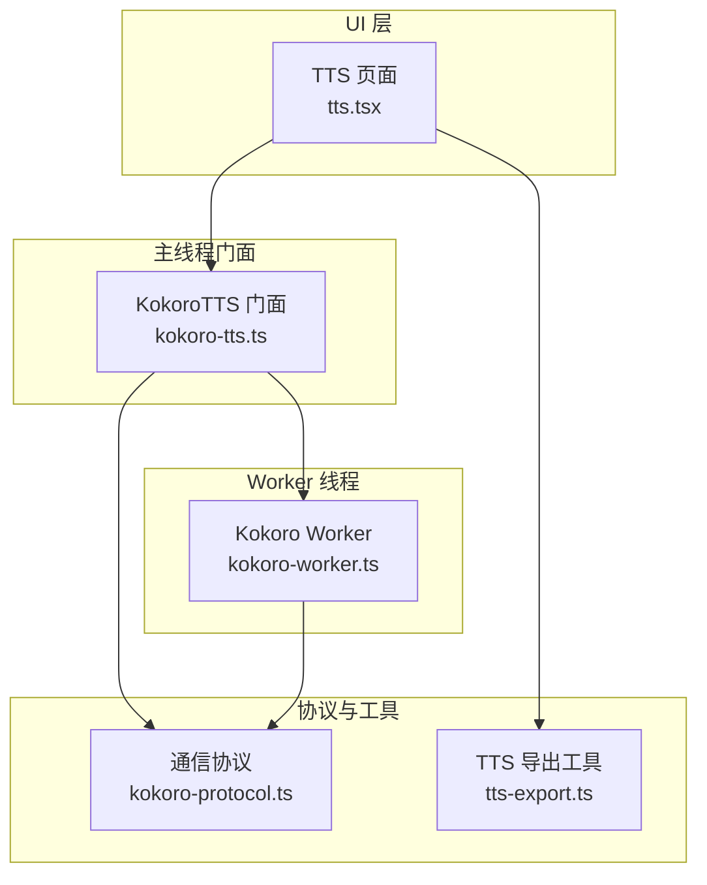
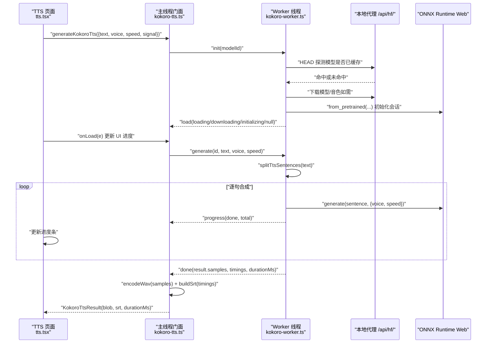
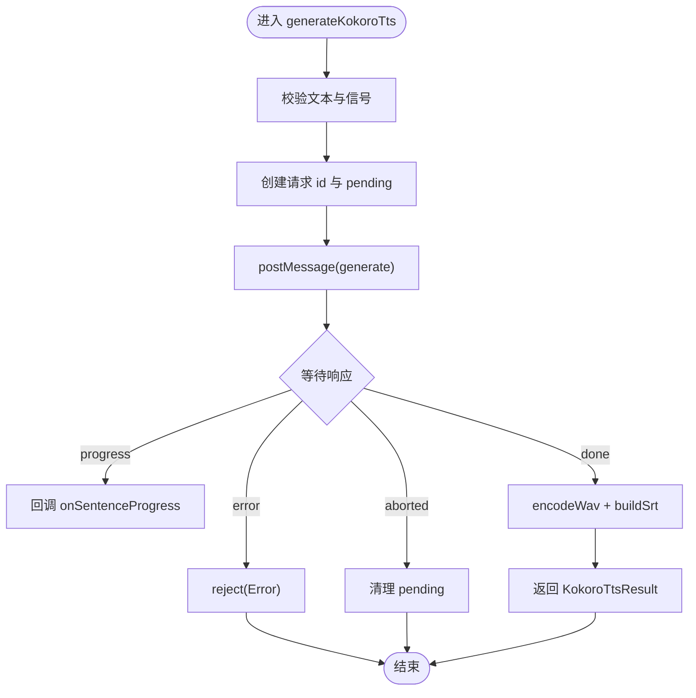
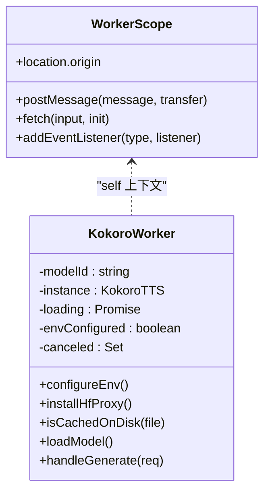
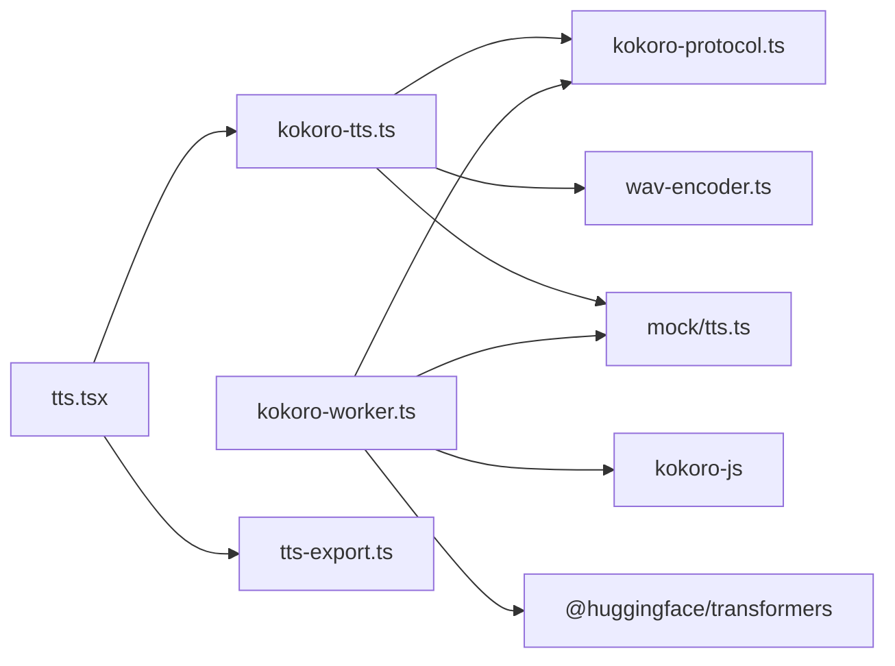

# Kokoro TTS 集成

<cite>
**本文引用的文件**   
- [kokoro-tts.ts](file://client/platform/kokoro-tts.ts)
- [kokoro-worker.ts](file://client/platform/kokoro-worker.ts)
- [kokoro-protocol.ts](file://client/platform/kokoro-protocol.ts)
- [tts.tsx](file://client/components/pages/tts.tsx)
- [tts-export.ts](file://client/lib/tts-export.ts)
</cite>

## 目录
1. [简介](#简介)
2. [项目结构](#项目结构)
3. [核心组件](#核心组件)
4. [架构总览](#架构总览)
5. [详细组件分析](#详细组件分析)
6. [依赖关系分析](#依赖关系分析)
7. [性能与内存优化](#性能与内存优化)
8. [集成示例](#集成示例)
9. [故障排除指南](#故障排除指南)
10. [结论](#结论)

## 简介
本技术文档围绕 Kokoro TTS 在浏览器端的本地离线语音合成实现展开，重点解释以下目标：
- KokoroTTS 主线程门面类的职责、Web Worker 异步处理机制、模型预加载流程与语音合成请求处理。
- kokoro-protocol.ts 中定义的通信协议：消息格式、事件类型、错误码语义。
- kokoro-worker.ts 中的 Worker 线程管理：初始化、模型加载、语音生成、资源清理。
- 主线程与 Worker 的通信机制：postMessage 数据传递、事件监听、错误传播。
- 性能优化策略：模型缓存、并发控制、内存管理。
- 应用层集成示例与常见问题的排查方法。

该实现将 ONNX Runtime Web 的同步推理从主线程迁移到 Web Worker，避免页面卡顿；同时通过本地代理统一模型与音色文件的下载与磁盘缓存，确保“首次下载、后续读盘”的体验。

## 项目结构
Kokoro TTS 相关代码集中在 client/platform 目录下，并与 UI 层和导出模块协作：
- client/platform/kokoro-tts.ts：主线程门面，负责 Worker 生命周期、请求编排、WAV 编码与 SRT 构建。
- client/platform/kokoro-worker.ts：Worker 线程，负责 ONNX 推理、模型/音色加载、句级拼接与进度上报。
- client/platform/kokoro-protocol.ts：主线程与 Worker 共享的消息协议与类型定义。
- client/components/pages/tts.tsx：TTS 页面，调用 generateKokoroTts，展示进度、试听、保存与导入。
- client/lib/tts-export.ts：TTS 产物（音频 Blob + SRT）写入 IDB 与 sessionStorage，供导入页使用。

图表来源
- [tts.tsx:236-254](file://client/components/pages/tts.tsx#L236-L254)
- [kokoro-tts.ts:184-237](file://client/platform/kokoro-tts.ts#L184-L237)
- [kokoro-worker.ts:252-273](file://client/platform/kokoro-worker.ts#L252-L273)
- [kokoro-protocol.ts:37-50](file://client/platform/kokoro-protocol.ts#L37-L50)
- [tts-export.ts:37-63](file://client/lib/tts-export.ts#L37-L63)

章节来源
- [tts.tsx:1-564](file://client/components/pages/tts.tsx#L1-L564)
- [kokoro-tts.ts:1-237](file://client/platform/kokoro-tts.ts#L1-L237)
- [kokoro-worker.ts:1-273](file://client/platform/kokoro-worker.ts#L1-L273)
- [kokoro-protocol.ts:1-50](file://client/platform/kokoro-protocol.ts#L1-L50)
- [tts-export.ts:1-64](file://client/lib/tts-export.ts#L1-L64)

## 核心组件
- KokoroTTS 门面（kokoro-tts.ts）
  - 暴露 setKokoroModelId、preloadKokoroModel、generateKokoroTts 等 API。
  - 维护 Worker 实例、待处理请求队列、加载状态订阅。
  - 负责 WAV 编码、SRT 构建、任务 ID 生成、取消信号绑定。
- Worker（kokoro-worker.ts）
  - 配置 transformers.js 环境，重写 fetch 以走本地代理 /api/hf/。
  - 幂等加载模型与音色，按句分片合成，插入句间静音，返回 PCM 与时间轴。
  - 支持 cancel 标记，在句与句之间响应取消。
- 协议（kokoro-protocol.ts）
  - 定义 load/progress/done/aborted/error 等消息类型与负载字段。
  - 定义加载阶段 loading/downloading/initializing 与结果数据结构。
- 页面集成（tts.tsx）
  - 选择引擎（云端或本地 Kokoro），渲染进度条、试听、保存与导入。
  - 调用 generateKokoroTts，并透传 onSentenceProgress 与 onLoad。
- 导出工具（tts-export.ts）
  - 将 TTS 产物（Blob + SRT）持久化到 IDB 与 sessionStorage，供导入页读取。

章节来源
- [kokoro-tts.ts:30-160](file://client/platform/kokoro-tts.ts#L30-L160)
- [kokoro-worker.ts:98-182](file://client/platform/kokoro-worker.ts#L98-L182)
- [kokoro-protocol.ts:10-35](file://client/platform/kokoro-protocol.ts#L10-L35)
- [tts.tsx:236-254](file://client/components/pages/tts.tsx#L236-L254)
- [tts-export.ts:37-63](file://client/lib/tts-export.ts#L37-L63)

## 架构总览
下图展示了从 UI 发起合成到 Worker 完成推理、再回传结果的完整时序。

图表来源
- [tts.tsx:236-254](file://client/components/pages/tts.tsx#L236-L254)
- [kokoro-tts.ts:184-237](file://client/platform/kokoro-tts.ts#L184-L237)
- [kokoro-worker.ts:136-182](file://client/platform/kokoro-worker.ts#L136-L182)
- [kokoro-worker.ts:184-249](file://client/platform/kokoro-worker.ts#L184-L249)

## 详细组件分析

### KokoroTTS 门面（kokoro-tts.ts）
- 模型与音色
  - 默认模型 ID 为 onnx-community/Kokoro-82M-v1.0-ONNX，可通过 setKokoroModelId 动态切换。
  - 内置英文音色列表 KOKORO_VOICES（美式女/男）。
- Worker 生命周期
  - ensureWorker：懒创建 Worker，绑定 message 与 error 事件；异常时销毁并重建。
  - ensureModelLoaded：发送 init 消息触发模型加载；模型常驻 Worker。
  - preloadKokoroModel：启动时静默预加载，失败不抛异常。
- 请求处理
  - generateKokoroTts：校验文本、绑定 AbortSignal、注册 pending 请求、发送 generate 消息。
  - 收到 progress 回调 onSentenceProgress；收到 done 后 encodeWav + buildSrt，返回统一结果。
  - 收到 error 则 reject；收到 aborted 清理 pending。
- 加载状态订阅
  - subscribeKokoroLoad：支持订阅者即时回放 lastLoad，避免错过预加载进度。

图表来源
- [kokoro-tts.ts:184-237](file://client/platform/kokoro-tts.ts#L184-L237)

章节来源
- [kokoro-tts.ts:30-160](file://client/platform/kokoro-tts.ts#L30-L160)
- [kokoro-tts.ts:184-237](file://client/platform/kokoro-tts.ts#L184-L237)

### Worker 线程（kokoro-worker.ts）
- 环境与缓存
  - configureEnv：设置 transformers.js remoteHost 指向 /api/hf/，禁用浏览器 Cache Storage，删除 kokoro-js 自身音色缓存。
  - installHfProxy：拦截 huggingface.co 的请求，改写为本地代理路径，并对非 ok 响应抛出明确错误。
  - isCachedOnDisk：HEAD 探测磁盘缓存，根据 x-cache 判断是否命中。
- 模型加载
  - loadModel：幂等加载，先探测磁盘缓存，再 from_pretrained 初始化 ONNX 会话；通过 progress_callback 上报 loading/downloading/initializing。
- 语音生成
  - handleGenerate：分句 splitTtsSentences，循环调用 tts.generate，记录每句时长与起止时间，插入句间静音，合并 Float32Array。
  - 取消机制：canceled Set 存储被取消的 id，在句间检查并 post aborted。
- 消息处理
  - init：设置 modelId，触发 loadModel。
  - generate：异步执行 handleGenerate，不 await 以保持事件循环可接收 cancel。
  - cancel：加入 canceled 集合。

图表来源
- [kokoro-worker.ts:36-56](file://client/platform/kokoro-worker.ts#L36-L56)
- [kokoro-worker.ts:98-182](file://client/platform/kokoro-worker.ts#L98-L182)
- [kokoro-worker.ts:184-273](file://client/platform/kokoro-worker.ts#L184-L273)

章节来源
- [kokoro-worker.ts:69-118](file://client/platform/kokoro-worker.ts#L69-L118)
- [kokoro-worker.ts:120-182](file://client/platform/kokoro-worker.ts#L120-L182)
- [kokoro-worker.ts:184-273](file://client/platform/kokoro-worker.ts#L184-L273)

### 通信协议（kokoro-protocol.ts）
- 加载阶段
  - loading：磁盘命中，正在读取本地文件。
  - downloading：磁盘未命中，从 huggingface.co 下载（完成后落盘）。
  - initializing：权重就位，正在建立 ONNX 会话。
- 消息类型
  - 主线程 → Worker：
    - init：{ type: 'init', modelId: string }
    - generate：{ type: 'generate', id: number, text: string, voice: string, speed: number }
    - cancel：{ type: 'cancel', id: number }
  - Worker → 主线程：
    - load：{ type: 'load', event: KokoroLoadState }
    - progress：{ type: 'progress', id: number, done: number, total: number }
    - done：{ type: 'done', id: number, result: KokoroSynthesisResult }
    - aborted：{ type: 'aborted', id: number }
    - error：{ type: 'error', id: number | null, message: string }
- 结果结构
  - KokoroSynthesisResult：包含 sampleRate、samples(Float32Array)、durationMs、timings(TtsSentenceTiming[])。

章节来源
- [kokoro-protocol.ts:10-50](file://client/platform/kokoro-protocol.ts#L10-L50)

### 页面集成（tts.tsx）
- 引擎选择：云端 TTS 或本地 Kokoro；当无云端配置时自动回退到本地。
- 本地合成流程：
  - 调用 generateKokoroTts，传入 text、voice、speed、signal、onSentenceProgress、onLoad。
  - 将返回的 blob 转为 Object URL 用于播放，srt 用于字幕预览与导入。
- 进度与状态：
  - 显示下载/加载/初始化进度，以及句级合成进度。
  - 支持取消生成、试听、保存到设备、导入为学习材料。

章节来源
- [tts.tsx:236-254](file://client/components/pages/tts.tsx#L236-L254)
- [tts.tsx:263-318](file://client/components/pages/tts.tsx#L263-L318)
- [tts.tsx:482-507](file://client/components/pages/tts.tsx#L482-L507)

## 依赖关系分析
- 主线程门面依赖：
  - wav-encoder：将 Float32Array 编码为 WAV Blob。
  - mock/tts：splitTtsSentences 与 buildSrt。
  - kokoro-protocol：消息与类型定义。
- Worker 依赖：
  - kokoro-js：ONNX 推理接口。
  - @huggingface/transformers：模型加载与环境配置。
  - mock/tts：分句逻辑。
- UI 依赖：
  - platform/kokoro-tts：调用 generateKokoroTts。
  - lib/tts-export：将产物写入 IDB 与 sessionStorage。

图表来源
- [kokoro-tts.ts:19-26](file://client/platform/kokoro-tts.ts#L19-L26)
- [kokoro-worker.ts:12-18](file://client/platform/kokoro-worker.ts#L12-L18)
- [tts.tsx:236-254](file://client/components/pages/tts.tsx#L236-L254)
- [tts-export.ts:37-63](file://client/lib/tts-export.ts#L37-L63)

章节来源
- [kokoro-tts.ts:19-26](file://client/platform/kokoro-tts.ts#L19-L26)
- [kokoro-worker.ts:12-18](file://client/platform/kokoro-worker.ts#L12-L18)
- [tts.tsx:236-254](file://client/components/pages/tts.tsx#L236-L254)
- [tts-export.ts:37-63](file://client/lib/tts-export.ts#L37-L63)

## 性能与内存优化
- 模型与音色缓存
  - 通过 /api/hf/ 代理统一读写磁盘缓存，避免浏览器侧重复副本。
  - HEAD 探测 x-cache 头区分“读缓存”与“真下载”，UI 反馈更准确。
  - 关闭 transformers.js 的浏览器 Cache Storage 与 kokoro-js 的音色缓存，保持单一真源。
- 并发控制
  - pending Map 管理多个合成请求，每个请求有唯一 id；cancel 通过 Set 标记，句间检查。
  - 模型加载幂等：loading Promise 复用，避免重复初始化。
- 内存管理
  - 合成结果 samples 使用 Transferable（ArrayBuffer）零拷贝传输，减少主线程复制开销。
  - 句间静音以 Float32Array 追加，最终一次性合并，避免频繁分配。
  - 页面侧对 Object URL 进行 revoke，防止内存泄漏。
- 计算卸载
  - ONNX 推理在 Worker 中进行，主线程仅负责 UI 与编解码，避免页面卡顿。

章节来源
- [kokoro-worker.ts:98-118](file://client/platform/kokoro-worker.ts#L98-L118)
- [kokoro-worker.ts:120-182](file://client/platform/kokoro-worker.ts#L120-L182)
- [kokoro-worker.ts:235-249](file://client/platform/kokoro-worker.ts#L235-L249)
- [tts.tsx:188-191](file://client/components/pages/tts.tsx#L188-L191)

## 集成示例
- 在页面中启用本地 Kokoro 合成：
  - 选择引擎为 kokoro，设置 voice 与 speed。
  - 调用 generateKokoroTts，监听 onSentenceProgress 与 onLoad。
  - 将返回的 blob 转为 Object URL 播放，srt 用于字幕预览与导入。
- 将 TTS 产物导入学习材料：
  - 调用 writeTtsExport(taskId, audioBlob, meta)，其中 meta 包含 name、audioFileName、subtitleText、subtitleFormat、createdAt。
  - 跳转导入页，由 readTtsExport 自动填充音频与字幕。

章节来源
- [tts.tsx:236-254](file://client/components/pages/tts.tsx#L236-L254)
- [tts-export.ts:37-63](file://client/lib/tts-export.ts#L37-L63)

## 故障排除指南
- 模型加载失败
  - 现象：UI 显示加载失败，控制台输出模型加载失败警告。
  - 可能原因：/api/hf/ 代理不可用、网络问题、磁盘缓存损坏。
  - 处理：检查代理路由与权限；清理 ~/.ping-eng/kokoro-models 后重试；确认 x-cache 头行为。
- 音色文件下载失败
  - 现象：首次使用某音色时报错，提示字节长度不为 4 的倍数。
  - 原因：kokoro-js 不检查 response.ok，直接解析二进制导致错误。
  - 处理：worker 已拦截非 ok 响应并抛出明确错误；检查代理返回状态与上游可用性。
- 合成被取消
  - 现象：点击取消后，当前句继续完成，下一句不再执行。
  - 行为：主线程立即 reject，Worker 在句间检查 canceled 并 post aborted。
  - 处理：无需额外处理；若需彻底停止，可在 UI 层释放 AbortController。
- 进度不更新
  - 现象：进度条不动或百分比异常。
  - 排查：确认 onLoad 与 onSentenceProgress 回调是否正确挂载；检查 progress 与 load 消息是否到达。
- 内存泄漏
  - 现象：长时间使用后内存增长。
  - 排查：确保 Object URL 在组件卸载或 URL 变化时 revoke；避免重复创建 Worker。

章节来源
- [kokoro-tts.ts:101-113](file://client/platform/kokoro-tts.ts#L101-L113)
- [kokoro-worker.ts:85-96](file://client/platform/kokoro-worker.ts#L85-L96)
- [kokoro-worker.ts:214-249](file://client/platform/kokoro-worker.ts#L214-L249)
- [tts.tsx:188-191](file://client/components/pages/tts.tsx#L188-L191)

## 结论
本项目通过主线程门面与 Worker 分离，将 ONNX 推理从主线程卸载，显著改善交互体验；借助本地代理统一模型与音色缓存，实现“首次下载、后续读盘”的稳定路径。协议清晰、消息完备，便于扩展与调试。建议在集成时关注缓存命中反馈、进度回调与内存回收，以获得最佳用户体验。