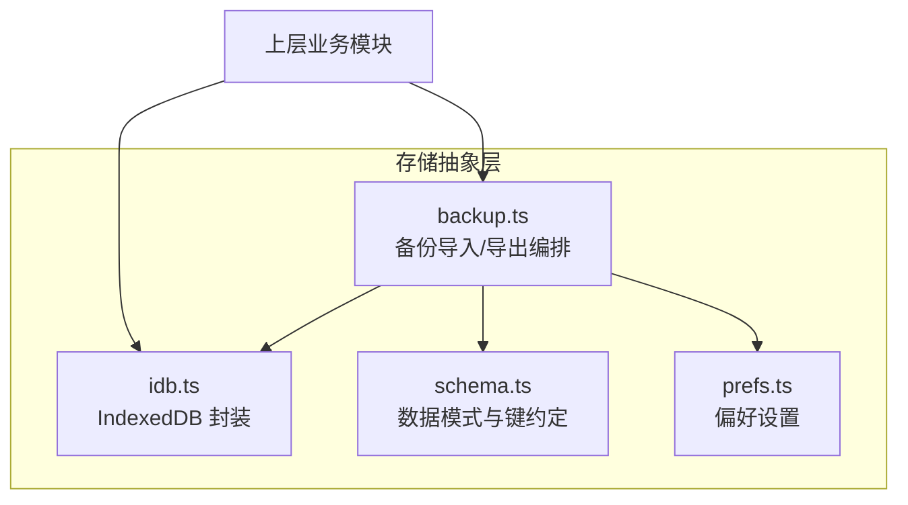
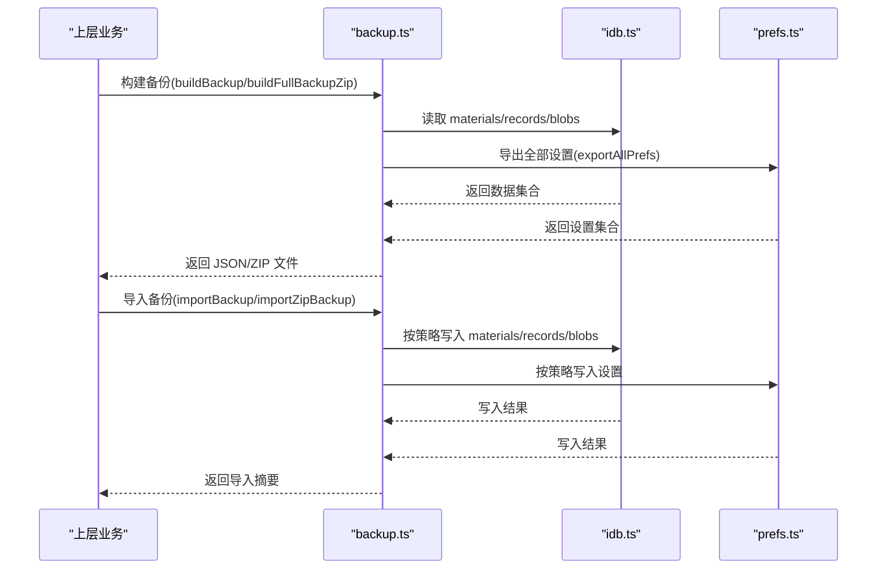
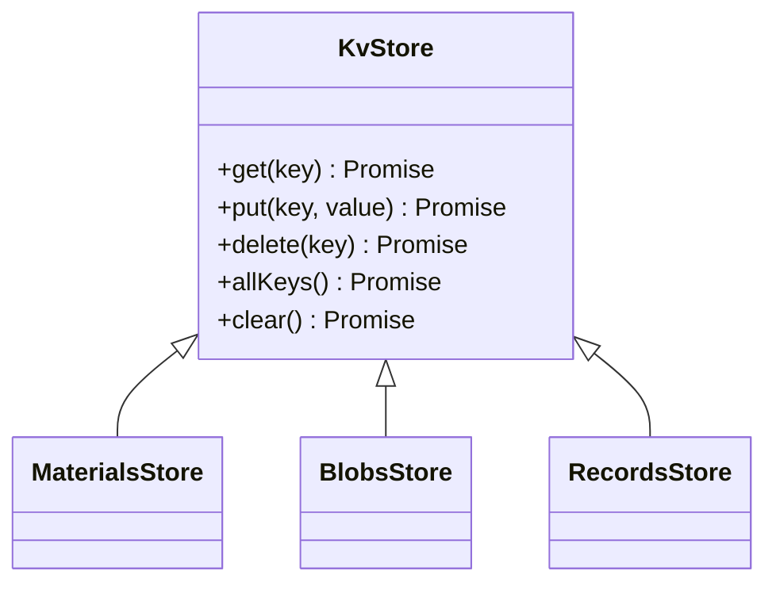
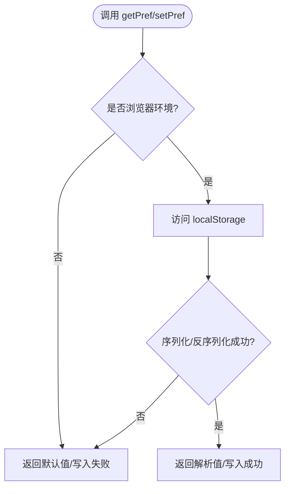
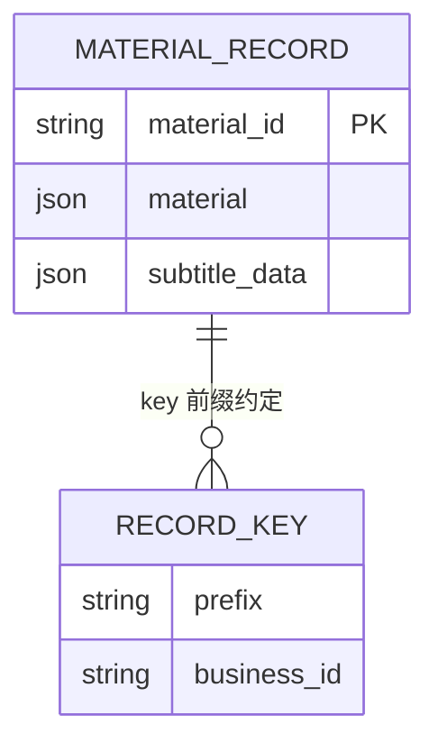
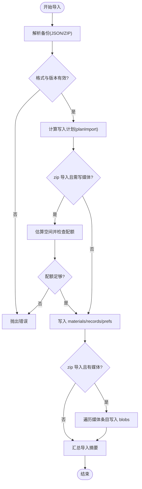
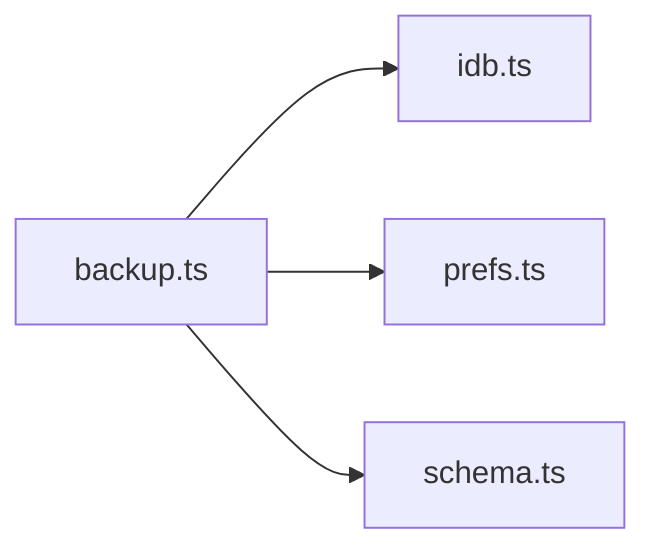

# 存储抽象层

<cite>
**本文引用的文件**   
- [idb.ts](file://client/platform/storage/idb.ts)
- [schema.ts](file://client/platform/storage/schema.ts)
- [prefs.ts](file://client/platform/storage/prefs.ts)
- [backup.ts](file://client/platform/storage/backup.ts)
</cite>

## 目录
1. [引言](#引言)
2. [项目结构](#项目结构)
3. [核心组件](#核心组件)
4. [架构总览](#架构总览)
5. [详细组件分析](#详细组件分析)
6. [依赖关系分析](#依赖关系分析)
7. [性能考虑](#性能考虑)
8. [故障排查指南](#故障排查指南)
9. [结论](#结论)
10. [附录：使用示例与最佳实践](#附录使用示例与最佳实践)

## 引言
本技术文档聚焦于“存储抽象层”，围绕 IndexedDB 封装类 IdbStore（实际实现为 idb.ts 中的 KV 抽象）、偏好设置存储机制、数据模式定义、备份恢复流程以及错误处理与性能优化策略展开。目标是帮助开发者理解并正确使用该层，同时提供可操作的优化建议与排障指引。

## 项目结构
存储抽象层位于 client/platform/storage 目录下，包含四个关键文件：
- idb.ts：IndexedDB 封装与内存降级兜底
- schema.ts：记录结构与键前缀约定
- prefs.ts：localStorage 偏好设置封装
- backup.ts：备份导出/导入编排（轻量 JSON 与完整 zip）

图表来源
- [idb.ts:1-117](file://client/platform/storage/idb.ts#L1-L117)
- [schema.ts:1-27](file://client/platform/storage/schema.ts#L1-L27)
- [prefs.ts:1-52](file://client/platform/storage/prefs.ts#L1-L52)
- [backup.ts:1-243](file://client/platform/storage/backup.ts#L1-L243)

章节来源
- [idb.ts:1-117](file://client/platform/storage/idb.ts#L1-L117)
- [schema.ts:1-27](file://client/platform/storage/schema.ts#L1-L27)
- [prefs.ts:1-52](file://client/platform/storage/prefs.ts#L1-L52)
- [backup.ts:1-243](file://client/platform/storage/backup.ts#L1-L243)

## 核心组件
- IndexedDB 封装（KvStore）
  - 暴露统一的 get/put/delete/allKeys/clear 接口
  - 自动事务封装与错误捕获
  - 失败时自动降级到内存 Map，保证调用方不崩溃
- 偏好设置（localStorage）
  - 安全访问 localStorage，JSON 序列化失败静默降级
  - 支持导出全部设置项用于备份
- 数据模式（schema）
  - 定义 MaterialRecord 结构与 records 的 key 前缀约定
- 备份恢复（backup）
  - 轻量 JSON 与完整 zip 两种格式
  - 冲突策略合并（跳过/覆盖/保留本地）
  - 媒体清单校验与配额预检

章节来源
- [idb.ts:12-117](file://client/platform/storage/idb.ts#L12-L117)
- [prefs.ts:6-52](file://client/platform/storage/prefs.ts#L6-L52)
- [schema.ts:9-26](file://client/platform/storage/schema.ts#L9-L26)
- [backup.ts:1-243](file://client/platform/storage/backup.ts#L1-L243)

## 架构总览
存储抽象层在应用中的角色如下：
- 上层业务通过 KvStore 直接读写 materials/blobs/records
- 偏好设置通过 prefs.ts 读写 localStorage
- 备份模块协调 IDB 与 localStorage，完成数据的导出/导入与压缩/解压

图表来源
- [backup.ts:51-121](file://client/platform/storage/backup.ts#L51-L121)
- [backup.ts:138-243](file://client/platform/storage/backup.ts#L138-L243)
- [idb.ts:89-102](file://client/platform/storage/idb.ts#L89-L102)
- [prefs.ts:31-43](file://client/platform/storage/prefs.ts#L31-L43)

## 详细组件分析

### IndexedDB 封装（KvStore）
- 数据库连接管理
  - 单例打开数据库，版本升级时创建 object store
  - 打开失败或被阻塞时切换到内存降级
- 事务处理
  - tx() 统一包装事务请求，成功/失败回调标准化
- CRUD 操作
  - makeStore() 生成 KV 接口，get/put/delete/allKeys/clear
  - guarded() 对每次调用进行兜底：IDB 失败则回落到内存 Map
- 索引优化
  - 当前未显式创建索引；如需范围查询或复合查询，可在 onupgradeneeded 中为常用字段添加索引
- 容量估算
  - estimateUsage() 返回已用空间与配额，供 UI 展示或配额预检

图表来源
- [idb.ts:80-102](file://client/platform/storage/idb.ts#L80-L102)

章节来源
- [idb.ts:17-51](file://client/platform/storage/idb.ts#L17-L51)
- [idb.ts:53-78](file://client/platform/storage/idb.ts#L53-L78)
- [idb.ts:89-117](file://client/platform/storage/idb.ts#L89-L117)

### 偏好设置存储机制（localStorage）
- 选择策略
  - 小体积、简单结构的偏好设置走 localStorage，避免频繁 IO 开销
- 数据序列化
  - 所有值以 JSON 字符串形式存取，异常时静默降级
- 版本迁移
  - 当前无显式版本字段；如需迁移，可在 setPref/getPref 中根据 key 或全局配置进行兼容处理
- 导出与冲突判断
  - exportAllPrefs() 导出全部设置项（去前缀），hasPref() 用于导入时的冲突判断

图表来源
- [prefs.ts:8-22](file://client/platform/storage/prefs.ts#L8-L22)
- [prefs.ts:31-43](file://client/platform/storage/prefs.ts#L31-L43)
- [prefs.ts:45-51](file://client/platform/storage/prefs.ts#L45-L51)

章节来源
- [prefs.ts:6-52](file://client/platform/storage/prefs.ts#L6-L52)

### 数据模式定义（schema.ts）
- 表结构与字段约束
  - MaterialRecord：material（材料元数据）+ subtitleData（解析后的字幕数据，可为 null）
- 关系映射
  - records store 的 key 采用类型前缀 + 业务 id 的组合，如 progress:/fav:/note:/train:/vocabbook:/vocabentry:/mnemonic:/collection:
- 设计要点
  - 将解析后的字幕数据缓存到 materials store，避免重复解析
  - 通过 RECORD_KEYS 统一管理 key 生成规则，降低硬编码风险

图表来源
- [schema.ts:9-26](file://client/platform/storage/schema.ts#L9-L26)

章节来源
- [schema.ts:1-27](file://client/platform/storage/schema.ts#L1-L27)

### 备份恢复功能（backup.ts）
- 数据导出/导入
  - 轻量 JSON：materials + records + prefs，不含媒体
  - 完整 zip：backup.json（含 media 清单）+ media/{materialId}（零压缩）
- 压缩处理
  - 使用 createZipWriter 流式写入，定期合并分片以降低内存峰值
- 完整性校验
  - parseBackupJson 校验格式与版本
  - openBackupZip 检查 backup.json 存在性与媒体缺失情况
- 冲突策略
  - planImport 决定 toWrite/skipped，支持 skipExisting/overwrite/keepLocal 等策略
- 配额预检
  - importZipBackup 在写入前估算所需空间并与 quota 比较，不足则抛出错误

图表来源
- [backup.ts:138-179](file://client/platform/storage/backup.ts#L138-L179)
- [backup.ts:187-243](file://client/platform/storage/backup.ts#L187-L243)

章节来源
- [backup.ts:1-243](file://client/platform/storage/backup.ts#L1-L243)

## 依赖关系分析
- 组件耦合
  - backup.ts 依赖 idb.ts 与 prefs.ts 进行数据读写
  - schema.ts 被 backup.ts 与上层业务引用，作为数据契约
- 外部依赖
  - navigator.storage.estimate 用于配额估算
  - ZIP 原语由 core/backup/zip.ts 提供（不在本文档范围内）
- 潜在循环依赖
  - 当前无循环依赖；各模块职责清晰

图表来源
- [backup.ts:13-17](file://client/platform/storage/backup.ts#L13-L17)
- [idb.ts:104-117](file://client/platform/storage/idb.ts#L104-L117)

章节来源
- [backup.ts:1-243](file://client/platform/storage/backup.ts#L1-L243)
- [idb.ts:104-117](file://client/platform/storage/idb.ts#L104-L117)

## 性能考虑
- 批量操作
  - 使用 Promise.all 并行写入 materials/records，减少往返次数
  - 媒体写入采用流式写入与分片合并，控制 JS 堆峰值
- 查询优化
  - 当前未创建索引；若需范围查询或高频过滤，建议在 onupgradeneeded 中为常用字段建立索引
  - 优先使用 allKeys 后批量 get，避免多次独立事务
- 缓存策略
  - 将解析后的字幕数据缓存到 materials store，避免重复解析
  - 偏好设置走 localStorage，适合小体积、频繁读写的场景
- 降级与容错
  - IDB 不可用时自动切换内存 Map，确保 UI 可用
  - 配额不足时提前抛错，避免部分写入导致状态不一致

[本节为通用指导，无需具体文件分析]

## 故障排查指南
- 数据库不可用降级
  - 现象：控制台输出 “[IDB] open failed...” 或 “open blocked”
  - 处理：确认是否处于隐私模式或 SSR 环境；UI 可通过 isMemoryFallback() 提示用户
- 数据损坏恢复
  - 现象：JSON 解析失败或备份格式无效
  - 处理：parseBackupJson 会返回错误信息；建议重新导出或仅导入轻量备份
- 事务回滚
  - 现象：tx() 捕获错误并 reject
  - 处理：检查 key 合法性与对象 store 是否存在；必要时清理相关 store 后重试
- 存储空间不足
  - 现象：importZipBackup 抛出配额不足错误
  - 处理：清理旧媒体或使用轻量备份；先释放空间再导入

章节来源
- [idb.ts:37-48](file://client/platform/storage/idb.ts#L37-L48)
- [idb.ts:59-66](file://client/platform/storage/idb.ts#L59-L66)
- [backup.ts:176-179](file://client/platform/storage/backup.ts#L176-L179)
- [backup.ts:218-223](file://client/platform/storage/backup.ts#L218-L223)

## 结论
存储抽象层通过 KvStore 统一了 IndexedDB 的 CRUD 操作，并在不可用时优雅降级到内存；偏好设置采用 localStorage 以提升小数据读写效率；备份模块提供轻量与完整两种格式，具备冲突策略、完整性校验与配额预检能力。整体设计兼顾可靠性与可扩展性，适合在复杂前端应用中稳定运行。

[本节为总结性内容，无需具体文件分析]

## 附录：使用示例与最佳实践
- 基本读写
  - 使用 materialsStore.get/put/delete 管理材料元数据与字幕缓存
  - 使用 recordsStore 管理进度、收藏、笔记等记录，遵循 RECORD_KEYS 前缀约定
- 偏好设置
  - 使用 getPref/setPref 存取用户偏好；使用 exportAllPrefs 导出用于备份
- 备份与恢复
  - 轻量备份：buildBackup → downloadJsonBackup → importBackup
  - 完整备份：buildFullBackupZip → downloadBlob → prepareZipImport → importZipBackup
- 最佳实践
  - 在 onupgradeneeded 中按需创建索引，提升范围查询性能
  - 大批量写入时使用 Promise.all 并行化，但注意并发上限与磁盘压力
  - 导入前进行配额预检，避免中途失败导致数据不一致
  - 对敏感或临时媒体（如 tts:/transcribe:）不要纳入备份清单

章节来源
- [idb.ts:89-102](file://client/platform/storage/idb.ts#L89-L102)
- [schema.ts:16-26](file://client/platform/storage/schema.ts#L16-L26)
- [prefs.ts:8-43](file://client/platform/storage/prefs.ts#L8-L43)
- [backup.ts:61-121](file://client/platform/storage/backup.ts#L61-L121)
- [backup.ts:176-243](file://client/platform/storage/backup.ts#L176-L243)