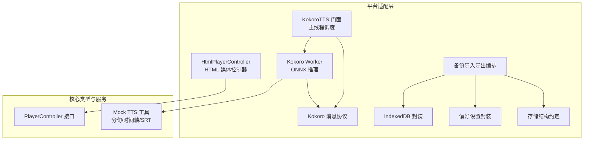
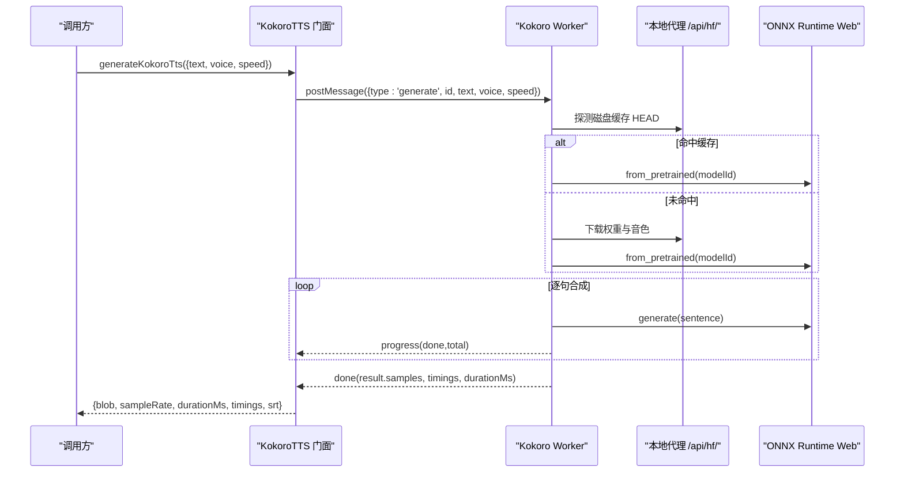
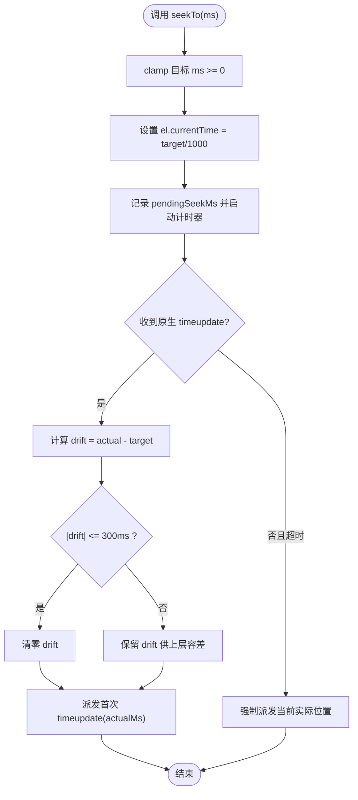
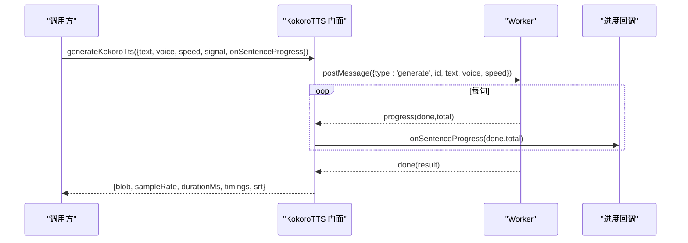
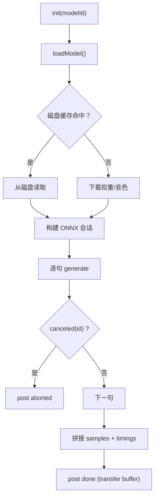
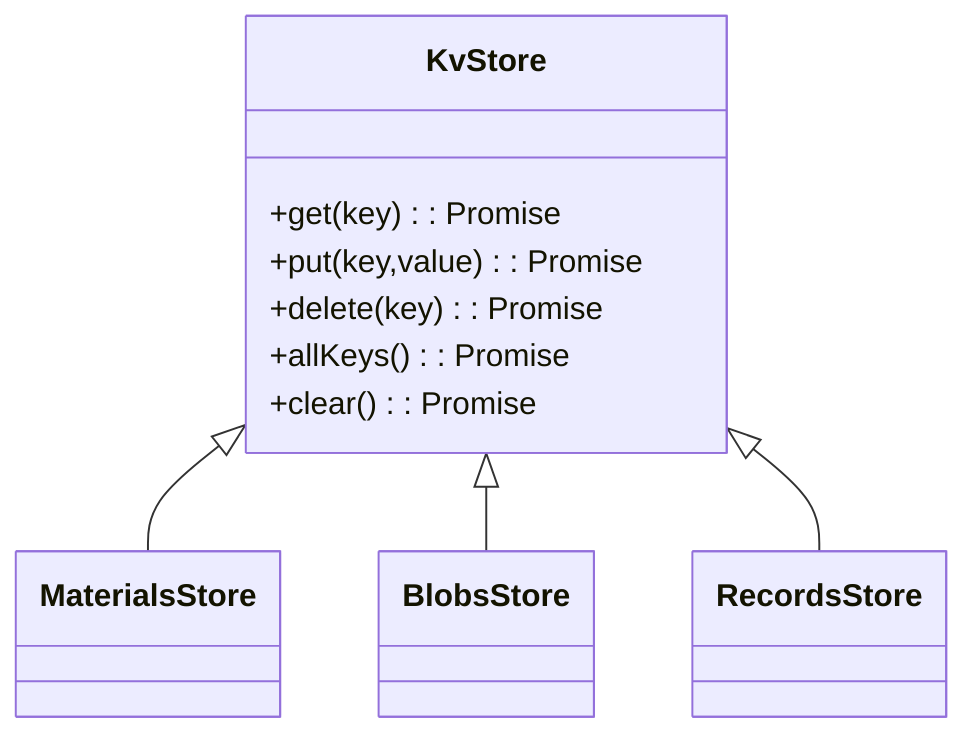
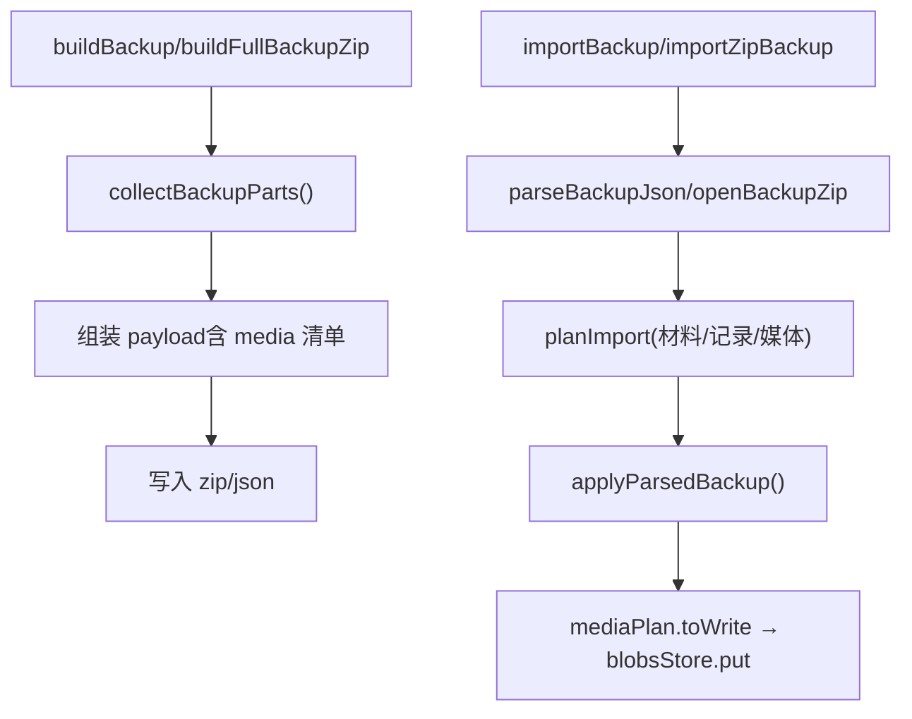
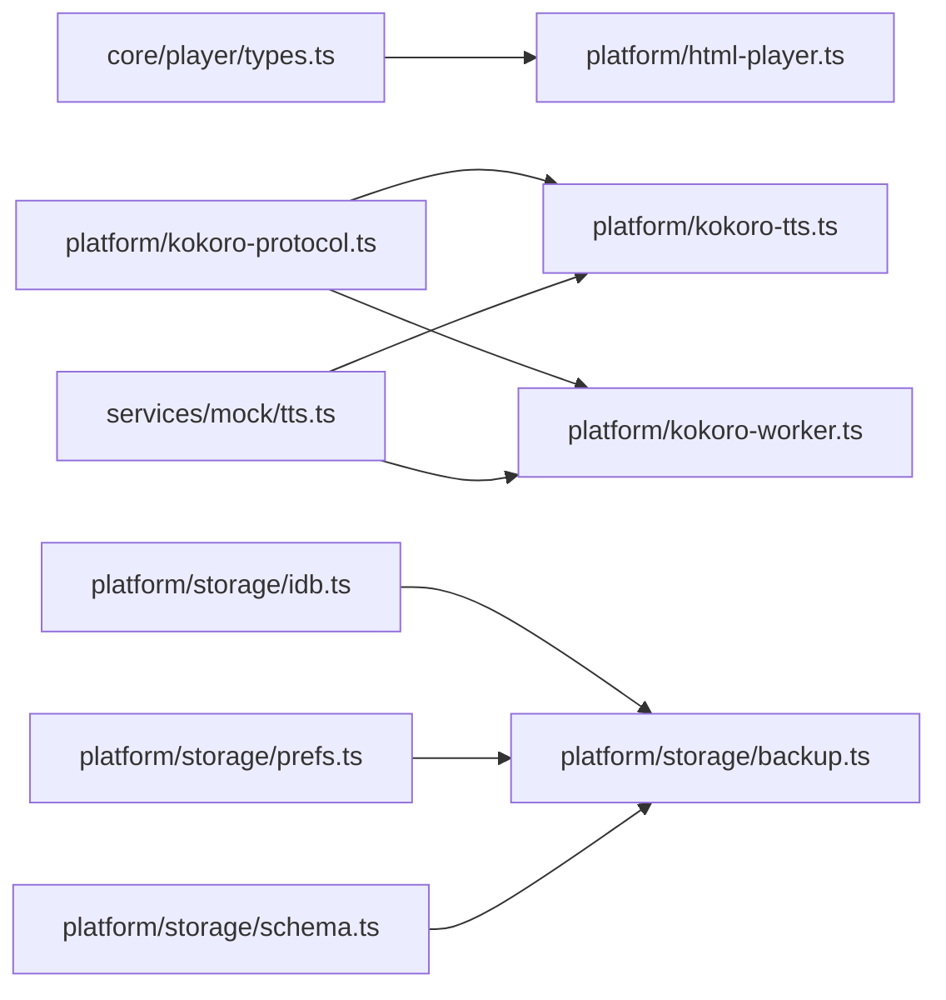

# 平台适配层

<cite>
**本文引用的文件**   
- [html-player.ts](file://client/platform/html-player.ts)
- [kokoro-tts.ts](file://client/platform/kokoro-tts.ts)
- [kokoro-worker.ts](file://client/platform/kokoro-worker.ts)
- [kokoro-protocol.ts](file://client/platform/kokoro-protocol.ts)
- [idb.ts](file://client/platform/storage/idb.ts)
- [prefs.ts](file://client/platform/storage/prefs.ts)
- [schema.ts](file://client/platform/storage/schema.ts)
- [backup.ts](file://client/platform/storage/backup.ts)
- [types.ts](file://client/core/player/types.ts)
- [tts.ts](file://client/services/mock/tts.ts)
</cite>

## 目录
1. [引言](#引言)
2. [项目结构](#项目结构)
3. [核心组件](#核心组件)
4. [架构总览](#架构总览)
5. [详细组件分析](#详细组件分析)
6. [依赖关系分析](#依赖关系分析)
7. [性能与兼容性](#性能与兼容性)
8. [故障排查指南](#故障排查指南)
9. [结论](#结论)
10. [附录：扩展与调试](#附录扩展与调试)

## 引言
本技术文档聚焦“平台适配层”，围绕以下目标展开：
- HTMLAudioElement 控制器实现：播放控制、进度追踪、事件监听、A-B 循环、seek 落点校准。
- Kokoro TTS 集成：Web Worker 异步推理、模型预加载、语音合成流程、句级时间轴与 SRT 字幕。
- IndexedDB 存储封装：数据库操作、事务处理、降级策略、数据查询优化。
- 本地偏好设置存储机制：localStorage 封装、备份导出。
- 浏览器兼容性与错误恢复：SSR 安全、隐私模式降级、Worker 异常恢复。
- 平台抽象接口定义与扩展指南：PlayerController 接口、如何新增平台实现。
- 具体代码示例路径与调试技巧：通过源码定位关键逻辑，提供可操作的排错建议。

## 项目结构
平台适配层位于 `client/platform`，主要包含：
- 播放器实现：`html-player.ts`（HTMLMediaElement 控制器）。
- Kokoro TTS：`kokoro-tts.ts`（主线程门面）、`kokoro-worker.ts`（Worker 推理）、`kokoro-protocol.ts`（消息协议）。
- 存储层：`storage/idb.ts`（IndexedDB 封装）、`storage/prefs.ts`（偏好设置）、`storage/schema.ts`（记录结构约定）、`storage/backup.ts`（备份导入导出编排）。

**图表来源**
- [html-player.ts:24-271](file://client/platform/html-player.ts#L24-L271)
- [kokoro-tts.ts:1-237](file://client/platform/kokoro-tts.ts#L1-L237)
- [kokoro-worker.ts:1-273](file://client/platform/kokoro-worker.ts#L1-L273)
- [kokoro-protocol.ts:1-50](file://client/platform/kokoro-protocol.ts#L1-L50)
- [idb.ts:1-117](file://client/platform/storage/idb.ts#L1-L117)
- [prefs.ts:1-52](file://client/platform/storage/prefs.ts#L1-L52)
- [schema.ts:1-27](file://client/platform/storage/schema.ts#L1-L27)
- [backup.ts:1-243](file://client/platform/storage/backup.ts#L1-L243)
- [types.ts:1-56](file://client/core/player/types.ts#L1-L56)
- [tts.ts:1-190](file://client/services/mock/tts.ts#L1-L190)

**章节来源**
- [html-player.ts:1-272](file://client/platform/html-player.ts#L1-L272)
- [kokoro-tts.ts:1-237](file://client/platform/kokoro-tts.ts#L1-L237)
- [kokoro-worker.ts:1-273](file://client/platform/kokoro-worker.ts#L1-L273)
- [kokoro-protocol.ts:1-50](file://client/platform/kokoro-protocol.ts#L1-L50)
- [idb.ts:1-117](file://client/platform/storage/idb.ts#L1-L117)
- [prefs.ts:1-52](file://client/platform/storage/prefs.ts#L1-L52)
- [schema.ts:1-27](file://client/platform/storage/schema.ts#L1-L27)
- [backup.ts:1-243](file://client/platform/storage/backup.ts#L1-L243)
- [types.ts:1-56](file://client/core/player/types.ts#L1-L56)
- [tts.ts:1-190](file://client/services/mock/tts.ts#L1-L190)

## 核心组件
- HtmlPlayerController：基于 HTMLAudioElement/HTMLVideoElement 的播放器控制器，实现 PlayerController 接口，负责加载、播放、暂停、倍速、音量、A-B 循环、进度采样、事件派发与销毁。
- KokoroTTS 门面：主线程入口，管理 Worker 生命周期、模型预加载、生成请求、进度回调、取消、结果拼装（WAV Blob、时长、句级时间轴、SRT）。
- Kokoro Worker：ONNX Runtime Web 推理执行环境，统一模型与音色下载到本地代理，按句合成并拼接音频，支持取消与进度上报。
- IndexedDB 封装：Promise 化 KV 操作，自动降级内存 Map，提供 materials/blobs/records 三个 store 的统一访问。
- 偏好设置封装：localStorage 读写、导出全部设置项、存在性判断。
- 存储结构约定：MaterialRecord、records key 前缀规范。
- 备份编排：轻量 JSON 与完整 zip 两种格式，材料/记录/设置合并策略，媒体清单校验与写入。

**章节来源**
- [html-player.ts:24-271](file://client/platform/html-player.ts#L24-L271)
- [kokoro-tts.ts:18-237](file://client/platform/kokoro-tts.ts#L18-L237)
- [kokoro-worker.ts:12-273](file://client/platform/kokoro-worker.ts#L12-L273)
- [idb.ts:12-117](file://client/platform/storage/idb.ts#L12-L117)
- [prefs.ts:6-52](file://client/platform/storage/prefs.ts#L6-L52)
- [schema.ts:9-27](file://client/platform/storage/schema.ts#L9-L27)
- [backup.ts:12-243](file://client/platform/storage/backup.ts#L12-L243)

## 架构总览
平台适配层采用“接口抽象 + 平台实现”的分层设计：
- core/player/types.ts 定义跨平台的 PlayerController 接口。
- platform/html-player.ts 提供 H5 端实现。
- platform/kokoro-* 模块将重型 ONNX 推理卸载到 Worker，主线程仅做 UI 调度与结果拼装。
- storage/* 模块提供持久化能力，并在不可用时优雅降级。

**图表来源**
- [kokoro-tts.ts:184-237](file://client/platform/kokoro-tts.ts#L184-L237)
- [kokoro-worker.ts:136-249](file://client/platform/kokoro-worker.ts#L136-L249)
- [kokoro-protocol.ts:37-50](file://client/platform/kokoro-protocol.ts#L37-L50)

**章节来源**
- [types.ts:32-55](file://client/core/player/types.ts#L32-L55)
- [html-player.ts:24-271](file://client/platform/html-player.ts#L24-L271)
- [kokoro-tts.ts:18-237](file://client/platform/kokoro-tts.ts#L18-L237)
- [kokoro-worker.ts:12-273](file://client/platform/kokoro-worker.ts#L12-L273)

## 详细组件分析

### HTML 媒体控制器（HtmlPlayerController）
职责与特性：
- 支持 audio/video 两种元素；可在构造时复用已有 DOM 节点或内部创建。
- 状态机：idle → loading → ready → playing/paused → ended/error。
- 进度采样：原生 timeupdate（~4Hz）兜底，播放中用 requestAnimationFrame（~60Hz）高频读取 currentTime，保证进度条平滑。
- seek 落点校准：记录 pendingSeekMs，首个 timeupdate 作为实际落点，计算 drift；偏差超过阈值记录 seekDriftMs 供上层修正循环容差；超时兜底解除静默。
- A-B 循环：controller 级区间循环（无次数限制），更复杂的带次数循环由 SentencePlayer 承担。
- 事件派发：timeupdate/statechange/ended/error，统一 on/off 订阅。
- destroy：停止 rAF、解绑监听、移除 src、清空事件表与引用，避免内存泄漏。

**图表来源**
- [html-player.ts:103-137](file://client/platform/html-player.ts#L103-L137)
- [html-player.ts:178-221](file://client/platform/html-player.ts#L178-L221)

**章节来源**
- [html-player.ts:24-271](file://client/platform/html-player.ts#L24-L271)
- [types.ts:32-55](file://client/core/player/types.ts#L32-L55)

### Kokoro TTS 集成（主线程门面）
职责与特性：
- 模型与音色统一经 `/api/hf/` 本地代理加载，优先读磁盘缓存，未命中才下载一次。
- 预加载：应用挂载时调用 preloadKokoroModel()，失败不抛异常。
- Worker 生命周期：ensureWorker() 单例，error 时 failAllPending 并重建。
- 合成流程：splitTtsSentences(text) → 逐句推理 → 拼接 PCM Float32Array → encodeWav → 构建 SRT。
- 进度与取消：onSentenceProgress 回调；AbortSignal 触发 cancel 消息，worker 在句间停下。
- 加载状态订阅：subscribeKokoroLoad 回放 lastLoad，便于晚订阅者看到预加载进度。

**图表来源**
- [kokoro-tts.ts:184-237](file://client/platform/kokoro-tts.ts#L184-L237)
- [kokoro-worker.ts:184-249](file://client/platform/kokoro-worker.ts#L184-L249)

**章节来源**
- [kokoro-tts.ts:18-237](file://client/platform/kokoro-tts.ts#L18-L237)
- [kokoro-protocol.ts:1-50](file://client/platform/kokoro-protocol.ts#L1-L50)
- [tts.ts:54-111](file://client/services/mock/tts.ts#L54-L111)

### Kokoro Worker（ONNX 推理）
职责与特性：
- 隔离重型同步计算，避免主线程卡顿。
- 配置 transformers.js：remoteHost 指向本地代理，禁用浏览器 Cache Storage，清理 kokoro-js 自身音色缓存。
- 模型与音色缓存探测：HEAD 请求 /api/hf/，根据 x-cache 头判断是否命中磁盘缓存。
- 逐句合成：splitTtsSentences → tts.generate → 累计 timings 与 chunks → 插入 120ms 静音 → 拼接 samples。
- 取消机制：canceled Set 标记待取消 id，在句间检查并返回 aborted。
- 传输优化：最终 samples.buffer 通过 transfer 零拷贝回传主线程。

**图表来源**
- [kokoro-worker.ts:98-182](file://client/platform/kokoro-worker.ts#L98-L182)
- [kokoro-worker.ts:184-249](file://client/platform/kokoro-worker.ts#L184-L249)

**章节来源**
- [kokoro-worker.ts:12-273](file://client/platform/kokoro-worker.ts#L12-L273)
- [kokoro-protocol.ts:37-50](file://client/platform/kokoro-protocol.ts#L37-L50)

### IndexedDB 存储封装
职责与特性：
- Promise 化封装，暴露 KvStore 接口：get/put/delete/allKeys/clear。
- 三对象存储：materials（材料元数据+字幕JSON）、blobs（媒体Blob）、records（训练/收藏/进度等，key 带类型前缀）。
- 降级策略：SSR/无 indexedDB/打开失败/阻塞均切换为内存 Map，永不崩溃。
- guarded 统一兜底：IDB 失败后永久切换到内存模式。
- 使用量估算：navigator.storage.estimate 获取 usage/quota。

**图表来源**
- [idb.ts:80-102](file://client/platform/storage/idb.ts#L80-L102)

**章节来源**
- [idb.ts:1-117](file://client/platform/storage/idb.ts#L1-L117)
- [schema.ts:9-27](file://client/platform/storage/schema.ts#L9-L27)

### 本地偏好设置存储
职责与特性：
- localStorage 封装：getPref/setPref/removePref/exportAllPrefs/hasPref。
- SSR 安全：typeof localStorage === 'undefined' 直接返回默认值或 false。
- 备份导出：exportAllPrefs 遍历所有以固定前缀开头的键，跳过损坏项。

**章节来源**
- [prefs.ts:1-52](file://client/platform/storage/prefs.ts#L1-L52)

### 存储结构与备份
- schema.ts 定义 MaterialRecord 与 records key 前缀规范（progress:/fav:/note:/train:/vocabbook:/vocabentry:/mnemonic:/collection:）。
- backup.ts 支持两种备份格式：
  - 轻量 JSON：materials + records + prefs，不含媒体。
  - 完整 zip：backup.json + media/{materialId}（STORE 零压缩），导入时校验媒体清单并写回 blobs store。
- 冲突策略：planImport 决定覆盖/跳过，applyParsedBackup 统一写回材料/记录/设置。
- 配额预检：importZipBackup 在写入前估算体积并与 quota 比较，防止空间不足。

**图表来源**
- [backup.ts:50-121](file://client/platform/storage/backup.ts#L50-L121)
- [backup.ts:138-243](file://client/platform/storage/backup.ts#L138-L243)

**章节来源**
- [schema.ts:1-27](file://client/platform/storage/schema.ts#L1-L27)
- [backup.ts:1-243](file://client/platform/storage/backup.ts#L1-L243)

## 依赖关系分析
- HtmlPlayerController 依赖 core/player/types.ts 的 PlayerController 接口。
- KokoroTTS 门面依赖 kokoro-protocol.ts 的消息协议与 services/mock/tts.ts 的分句/时间轴/SRT 工具。
- Kokoro Worker 依赖 kokoro-protocol.ts 与 services/mock/tts.ts，并通过本地代理 /api/hf/ 与后端交互。
- 备份编排依赖 storage/idb.ts、storage/prefs.ts、storage/schema.ts 以及 core/backup 下的格式与 zip 原语（不在本文重点）。

**图表来源**
- [types.ts:1-56](file://client/core/player/types.ts#L1-L56)
- [html-player.ts:17-17](file://client/platform/html-player.ts#L17-L17)
- [kokoro-tts.ts:19-26](file://client/platform/kokoro-tts.ts#L19-L26)
- [kokoro-worker.ts:12-18](file://client/platform/kokoro-worker.ts#L12-L18)
- [idb.ts:15-15](file://client/platform/storage/idb.ts#L15-L15)
- [prefs.ts:6-6](file://client/platform/storage/prefs.ts#L6-L6)
- [schema.ts:6-7](file://client/platform/storage/schema.ts#L6-L7)
- [backup.ts:13-17](file://client/platform/storage/backup.ts#L13-L17)

**章节来源**
- [types.ts:1-56](file://client/core/player/types.ts#L1-L56)
- [html-player.ts:17-17](file://client/platform/html-player.ts#L17-L17)
- [kokoro-tts.ts:19-26](file://client/platform/kokoro-tts.ts#L19-L26)
- [kokoro-worker.ts:12-18](file://client/platform/kokoro-worker.ts#L12-L18)
- [idb.ts:15-15](file://client/platform/storage/idb.ts#L15-L15)
- [prefs.ts:6-6](file://client/platform/storage/prefs.ts#L6-L6)
- [schema.ts:6-7](file://client/platform/storage/schema.ts#L6-L7)
- [backup.ts:13-17](file://client/platform/storage/backup.ts#L13-L17)

## 性能与兼容性
- 进度采样：原生 timeupdate 频率低，rAF 高频补偿，确保 UI 流畅。
- 模型加载：优先磁盘缓存，减少网络 IO；transformers.js 关闭浏览器缓存，避免重复存储。
- Worker 推理：ONNX 同步计算放 Worker，主线程保持响应；取消在句间生效，避免长时间卡顿。
- 数据传输：Float32Array.buffer 通过 transfer 零拷贝，降低主线程压力。
- 降级策略：IDB 打开失败/阻塞/隐私模式 → 内存 Map；localStorage 不可用 → 静默降级。
- SSR 安全：仅在浏览器内 new HtmlPlayerController；pref 读写检测 typeof localStorage。

[本节为通用指导，不直接分析具体文件]

## 故障排查指南
- 播放被拦截：play() promise reject 非 AbortError 时派发 PLAY_BLOCKED 错误；检查用户手势策略与自动播放策略。
- 媒体错误：error 事件映射 MEDIA_ERROR_{code}，结合 el.error.code 与 message 定位。
- seek 漂移：若偏差 >300ms，记录 seekDriftMs，上层应调整循环边界容差。
- Worker 异常：ensureWorker 的 error 处理器会 failAllPending 并重建 worker；检查 /api/hf/ 代理可达性与 CORS。
- 模型加载失败：load 阶段 event=null 表示失败；查看 console.warn 中的消息；确认远程主机与磁盘缓存路径。
- 存储空间不足：importZipBackup 会在写入前估算体积并与 quota 比较，抛出明确错误信息。
- 偏好设置损坏：exportAllPrefs 跳过损坏项；必要时清理 localStorage 对应前缀键。

**章节来源**
- [html-player.ts:85-96](file://client/platform/html-player.ts#L85-L96)
- [html-player.ts:171-175](file://client/platform/html-player.ts#L171-L175)
- [html-player.ts:181-189](file://client/platform/html-player.ts#L181-L189)
- [kokoro-tts.ts:115-128](file://client/platform/kokoro-tts.ts#L115-L128)
- [kokoro-worker.ts:174-179](file://client/platform/kokoro-worker.ts#L174-L179)
- [backup.ts:218-223](file://client/platform/storage/backup.ts#L218-L223)
- [prefs.ts:31-43](file://client/platform/storage/prefs.ts#L31-L43)

## 结论
平台适配层通过清晰的接口抽象与稳健的实现细节，实现了：
- 跨平台的播放器控制（H5 端已实现）。
- 高性能的离线语音合成（Worker + ONNX + 本地代理缓存）。
- 可靠的本地持久化（IndexedDB + localStorage + 内存降级）。
- 完善的备份与迁移（轻量 JSON 与完整 zip）。
该设计在保证用户体验的同时，兼顾了可维护性与可扩展性。

[本节为总结，不直接分析具体文件]

## 附录：扩展与调试

### 平台抽象接口定义
- PlayerController 接口定义了 load/play/pause/seekTo/setRate/setVolume/setLoop/clearLoop/getCurrentTimeMs/getDurationMs/getState/on/off/destroy 等方法。
- 新增平台实现需实现该接口，并在 createPlayer 工厂中注册分支（参考 html-player.ts 的 createHtmlPlayer）。

**章节来源**
- [types.ts:32-55](file://client/core/player/types.ts#L32-L55)
- [html-player.ts:268-271](file://client/platform/html-player.ts#L268-L271)

### 调试技巧
- 进度调试：监听 statechange 与 timeupdate，打印 currentMs/durationMs，观察 rAF 与原生 timeupdate 的一致性。
- seek 校准：关注 isSeeking() 与 getSeekDriftMs()，在 UI 上冻结进度显示直到首个 timeupdate。
- Worker 通信：在 ensureWorker 的 message 处理器中添加日志，跟踪 load/progress/done/aborted/error。
- 模型缓存：通过 /api/hf/ 代理的 HEAD 请求与 x-cache 头判断是否命中磁盘缓存。
- 存储降级：isMemoryFallback() 返回 true 时说明已切换到内存模式；检查 IDB 打开错误与 blocked 场景。
- 备份导入：prepareZipImport 预览媒体缺失与体积，再决定是否正式导入。

**章节来源**
- [html-player.ts:131-137](file://client/platform/html-player.ts#L131-L137)
- [html-player.ts:178-221](file://client/platform/html-player.ts#L178-L221)
- [kokoro-tts.ts:82-128](file://client/platform/kokoro-tts.ts#L82-L128)
- [kokoro-worker.ts:120-134](file://client/platform/kokoro-worker.ts#L120-L134)
- [idb.ts:104-117](file://client/platform/storage/idb.ts#L104-L117)
- [backup.ts:187-205](file://client/platform/storage/backup.ts#L187-L205)