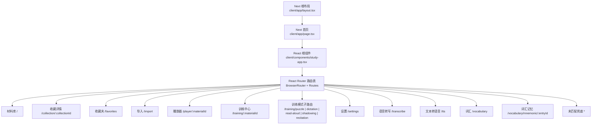
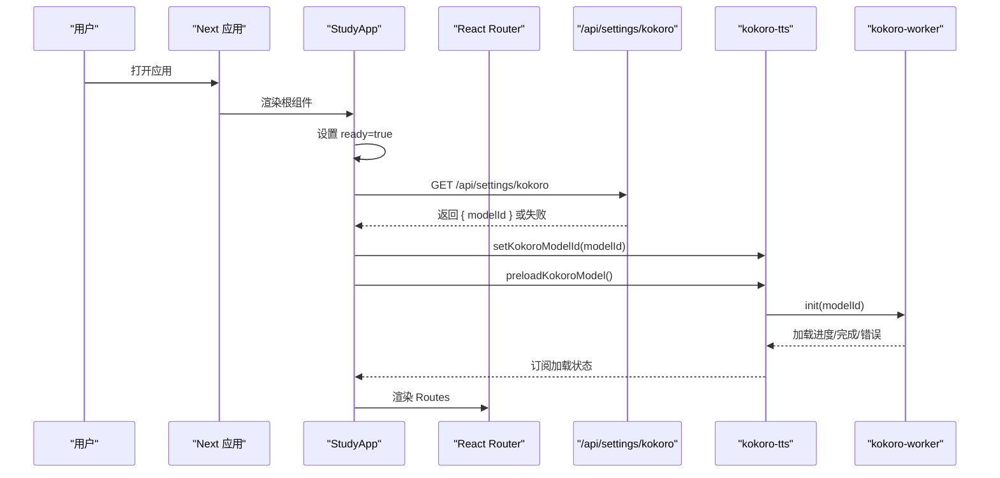
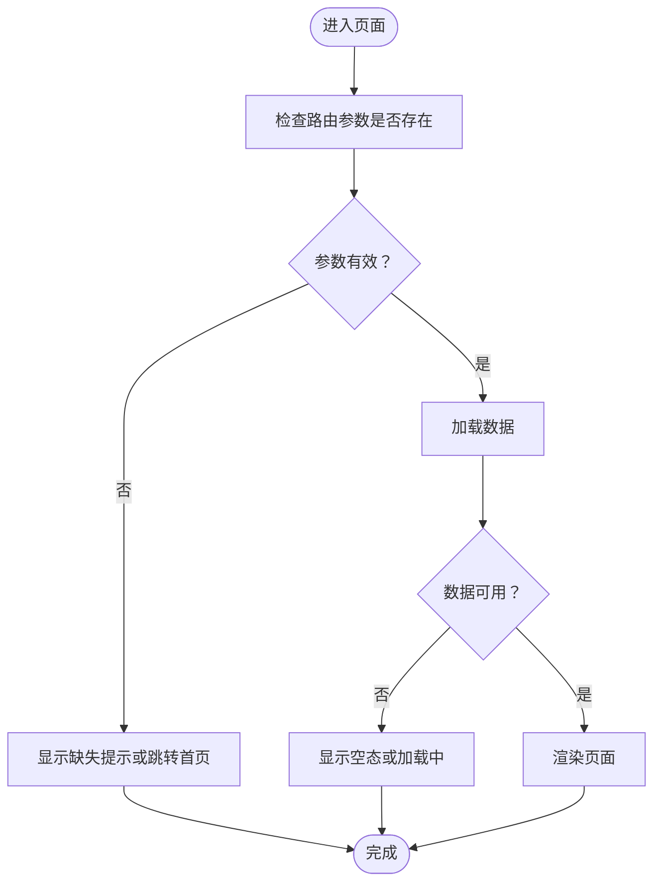
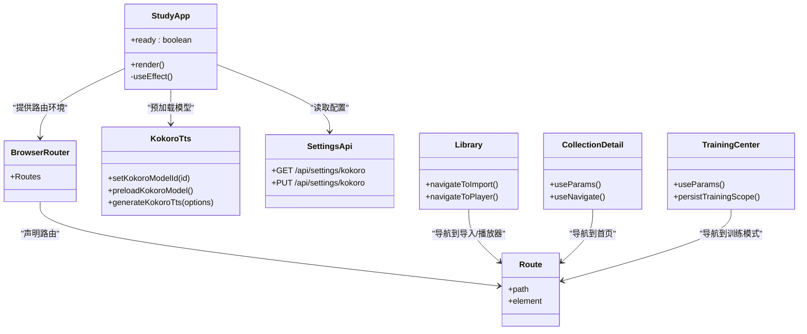

# 应用入口与路由

<cite>
**本文引用的文件**   
- [client/app/layout.tsx](file://client/app/layout.tsx)
- [client/app/page.tsx](file://client/app/page.tsx)
- [client/components/study-app.tsx](file://client/components/study-app.tsx)
- [client/platform/kokoro-tts.ts](file://client/platform/kokoro-tts.ts)
- [client/app/api/settings/kokoro/route.ts](file://client/app/api/settings/kokoro/route.ts)
- [client/components/pages/library.tsx](file://client/components/pages/library.tsx)
- [client/components/pages/collection.tsx](file://client/components/pages/collection.tsx)
- [client/components/pages/training-center.tsx](file://client/components/pages/training-center.tsx)
</cite>

## 目录
1. [简介](#简介)
2. [项目结构与入口定位](#项目结构与入口定位)
3. [核心组件：StudyApp 的职责](#核心组件studyapp-的职责)
4. [路由总览与 14 条页面设计](#路由总览与-14-条页面设计)
5. [启动流程与 Kokoro TTS 预加载](#启动流程与-kokoro-tts-预加载)
6. [路由参数传递与页面导航模式](#路由参数传递与页面导航模式)
7. [错误处理与兜底策略](#错误处理与兜底策略)
8. [懒加载、SEO 与性能建议](#懒加载seo-与性能建议)
9. [依赖关系与架构视图](#依赖关系与架构视图)
10. [最佳实践与配置示例](#最佳实践与配置示例)
11. [故障排查](#故障排查)
12. [结论](#结论)

## 简介
本文聚焦前端 Next.js 应用中基于 `react-router-dom` 的入口与路由系统，重点说明根组件 `StudyApp` 的职责、Kokoro TTS 模型预加载与服务配置初始化流程，以及 14 条页面路由的设计意图。文档同时覆盖路由参数传递、页面间导航模式、错误处理策略、懒加载优化和 SEO 考虑，并给出可落地的路由配置建议与最佳实践。

## 项目结构与入口定位
该应用使用 Next.js App Router 作为外层框架，但实际客户端路由由 `react-router-dom` 在 `StudyApp` 中管理。Next 根布局负责站点元信息、图标、视口与分析脚本；Next 首页 `page.tsx` 仅渲染 `StudyApp`，从而把浏览器端路由能力交给 React Router。

**图表来源**
- [client/app/layout.tsx:5-49](file://client/app/layout.tsx#L5-L49)
- [client/app/page.tsx:1-6](file://client/app/page.tsx#L1-L6)
- [client/components/study-app.tsx:4-60](file://client/components/study-app.tsx#L4-L60)

**章节来源**
- [client/app/layout.tsx:5-49](file://client/app/layout.tsx#L5-L49)
- [client/app/page.tsx:1-6](file://client/app/page.tsx#L1-L6)

## 核心组件：StudyApp 的职责
`StudyApp` 是客户端应用的根组件，承担以下职责：
- 提供 `BrowserRouter` 环境，使所有页面组件可使用 `Link`、`useNavigate`、`useParams` 等路由 API。
- 集中声明全部页面路由，形成统一的路由表。
- 在首次挂载时读取 Kokoro TTS 配置，设置当前模型 ID，并触发模型预加载。
- 通过“就绪状态”避免在初始化未完成前渲染路由树，减少闪烁。

关键行为包括：
- 使用 `useEffect` 发起 `/api/settings/kokoro` 请求，获取 `modelId` 后调用 `setKokoroModelId`。
- 无论配置是否成功，最终都会调用 `preloadKokoroModel`，确保 Worker 与 ONNX 推理链路尽早准备。
- 将 14 条路由以 `<Route>` 形式注册，包含路径参数、训练模式子路由与兜底页。

**章节来源**
- [client/components/study-app.tsx:24-60](file://client/components/study-app.tsx#L24-L60)

## 路由总览与 14 条页面设计
以下是当前应用中的 14 条路由及其用途：

| 序号 | 路由路径 | 页面组件 | 用途说明 |
|---|---|---|---|
| 1 | `/` | `Library` | 材料库主页，展示材料集与材料卡片，支持搜索、新建集合、导入入口 |
| 2 | `/collection/:collectionId` | `CollectionDetail` | 材料集详情页，按集合筛选材料，支持重命名、删除集合、移动材料 |
| 3 | `/favorites` | `Favorites` | 收藏夹列表（代码中已引入） |
| 4 | `/import` | `ImportPage` | 导入材料入口（代码中已引入） |
| 5 | `/player/:materialId` | `Player` | 精听播放器，承载字幕、播放控制与收藏句逻辑 |
| 6 | `/training/:materialId` | `TrainingCenter` | 训练中心，选择训练模式并持久化当前材料与范围 |
| 7 | `/training/puzzle` | `Puzzle` | 九宫格拼句训练 |
| 8 | `/training/dictation` | `Dictation` | 单句听写训练 |
| 9 | `/training/read-aloud` | `ReadAloud` | 跟读评分训练 |
| 10 | `/training/shadowing` | `Shadowing` | 影子跟读训练 |
| 11 | `/training/recitation` | `Recitation` | 全文背诵训练 |
| 12 | `/settings` | `SettingsPage` | 全局设置页 |
| 13 | `/transcribe` | `TranscribePage` | 语音转写工具页 |
| 14 | `/tts` | `TTS` | 文本转语音工具页 |
| 15 | `/vocabulary` | `Vocabulary` | 词汇管理入口（代码中已引入） |
| 16 | `/vocabulary/mnemonic/:entryId` | `MnemonicPage` | 词汇记忆条目页（代码中已引入） |
| 17 | `*` | `Placeholder` | 未匹配路由兜底，显示“页面未找到” |

注意：虽然标题强调“14 条”，但从路由定义看，实际注册了 17 个 `<Route>`，其中包含多个训练模式与词汇相关路由。若严格限定为 14 条，可按业务优先级裁剪或合并部分辅助页面。

**章节来源**
- [client/components/study-app.tsx:42-60](file://client/components/study-app.tsx#L42-L60)

## 启动流程与 Kokoro TTS 预加载
`StudyApp` 的启动流程如下：

关键点：
- 配置读取失败不会阻断应用启动，`preloadKokoroModel` 仍会执行。
- Kokoro 模型加载发生在 Worker 中，避免阻塞主线程。
- 模型切换会销毁旧 Worker，下次生成时重建。

**图表来源**
- [client/components/study-app.tsx:27-37](file://client/components/study-app.tsx#L27-L37)
- [client/platform/kokoro-tts.ts:130-160](file://client/platform/kokoro-tts.ts#L130-L160)
- [client/app/api/settings/kokoro/route.ts:4-11](file://client/app/api/settings/kokoro/route.ts#L4-L11)

**章节来源**
- [client/components/study-app.tsx:27-37](file://client/components/study-app.tsx#L27-L37)
- [client/platform/kokoro-tts.ts:130-160](file://client/platform/kokoro-tts.ts#L130-L160)
- [client/app/api/settings/kokoro/route.ts:4-11](file://client/app/api/settings/kokoro/route.ts#L4-L11)

## 路由参数传递与页面导航模式
### 路径参数
- `/collection/:collectionId`：通过 `useParams()` 获取 `collectionId`，用于筛选集合成员。
- `/player/:materialId`：播放器根据 `materialId` 加载材料与字幕。
- `/training/:materialId`：训练中心根据 `materialId` 加载材料并持久化到本地偏好。
- `/vocabulary/mnemonic/:entryId`：词汇记忆页根据 `entryId` 加载条目。

### 编程式导航
- 使用 `useNavigate()` 进行跳转，例如删除集合后先跳转到首页再异步删除数据，避免空态闪烁。
- 使用 `Link` 进行声明式导航，如从材料库跳转到导入、TTS、转写等工具页。

### 查询参数
- `/import?collection=${collectionId}`：导入页可通过 URL 查询参数接收目标集合 ID，实现从集合详情页快速添加材料。

### 页面间导航模式
- 材料库 → 导入：通过 `Link to="/import"`。
- 材料库 → 播放器：点击材料卡片进入 `/player/:materialId`。
- 播放器 → 训练中心：进入 `/training/:materialId`。
- 训练中心 → 各训练模式：进入 `/training/puzzle`、`/training/dictation`、`/training/read-aloud`、`/training/shadowing`、`/training/recitation`。
- 集合详情 → 导入：`/import?collection=${collectionId}`。

**章节来源**
- [client/components/pages/collection.tsx:18-21](file://client/components/pages/collection.tsx#L18-L21)
- [client/components/pages/collection.tsx:47-52](file://client/components/pages/collection.tsx#L47-L52)
- [client/components/pages/library.tsx:62-65](file://client/components/pages/library.tsx#L62-L65)
- [client/components/pages/training-center.tsx:31-43](file://client/components/pages/training-center.tsx#L31-L43)

## 错误处理与兜底策略
- 未匹配路由：使用 `path="*"` 指向 `Placeholder`，显示“页面未设置”提示，避免白屏。
- 集合不存在：当 `collectionId` 找不到对应集合时，显示“材料集不存在或已被删除”，并提供返回材料库的链接。
- 训练中心材料缺失：当 `getMaterialRecord(materialId)` 返回 null 时，使用 `Navigate to="/" replace` 跳回首页。
- Kokoro 配置读取失败：静默忽略错误，不影响应用启动。
- Worker 异常：销毁不可用 Worker，清空待处理请求，重新订阅加载状态。

**图表来源**
- [client/components/study-app.tsx:60](file://client/components/study-app.tsx#L60)
- [client/components/pages/collection.tsx:62-64](file://client/components/pages/collection.tsx#L62-L64)
- [client/components/pages/training-center.tsx:68-70](file://client/components/pages/training-center.tsx#L68-L70)

**章节来源**
- [client/components/study-app.tsx:60](file://client/components/study-app.tsx#L60)
- [client/components/pages/collection.tsx:62-64](file://client/components/pages/collection.tsx#L62-L64)
- [client/components/pages/training-center.tsx:68-70](file://client/components/pages/training-center.tsx#L68-L70)

## 懒加载、SEO 与性能建议
### 懒加载
- 当前路由采用同步 import，所有页面组件随 `StudyApp` 一起加载。
- 建议对重型页面（如播放器、训练模式、TTS、转写）使用 `React.lazy` 与 `Suspense` 拆分 chunk，降低首屏体积。
- 对训练模式路由可进一步按模式拆分，仅在用户点击进入时加载对应组件。

### SEO
- Next 根布局设置了 `metadata.title`、`description`、`icons` 与 `viewport`，有利于搜索引擎与移动端体验。
- 建议在每个页面组件内按需设置页面级 metadata（标题、描述），以提升不同页面的索引质量。
- 对于动态路由（如 `/player/:materialId`、`/training/:materialId`），可在服务端或静态生成阶段预取内容，提升 SEO 友好度。

### 性能
- Kokoro TTS 模型预加载在后台进行，避免首次合成卡顿。
- Worker 隔离 ONNX 推理，防止主线程阻塞。
- 建议对音频资源与字幕文件启用缓存策略，减少重复下载。

[本节为通用建议，不直接分析具体文件]

## 依赖关系与架构视图

**图表来源**
- [client/components/study-app.tsx:4-60](file://client/components/study-app.tsx#L4-L60)
- [client/platform/kokoro-tts.ts:130-160](file://client/platform/kokoro-tts.ts#L130-L160)
- [client/app/api/settings/kokoro/route.ts:4-33](file://client/app/api/settings/kokoro/route.ts#L4-L33)
- [client/components/pages/library.tsx:62-65](file://client/components/pages/library.tsx#L62-L65)
- [client/components/pages/collection.tsx:47-52](file://client/components/pages/collection.tsx#L47-L52)
- [client/components/pages/training-center.tsx:31-43](file://client/components/pages/training-center.tsx#L31-L43)

**章节来源**
- [client/components/study-app.tsx:4-60](file://client/components/study-app.tsx#L4-L60)
- [client/platform/kokoro-tts.ts:130-160](file://client/platform/kokoro-tts.ts#L130-L160)
- [client/app/api/settings/kokoro/route.ts:4-33](file://client/app/api/settings/kokoro/route.ts#L4-L33)
- [client/components/pages/library.tsx:62-65](file://client/components/pages/library.tsx#L62-L65)
- [client/components/pages/collection.tsx:47-52](file://client/components/pages/collection.tsx#L47-L52)
- [client/components/pages/training-center.tsx:31-43](file://client/components/pages/training-center.tsx#L31-L43)

## 最佳实践与配置示例
### 路由守卫
- 当前未实现全局路由守卫。建议在 `StudyApp` 中增加认证或权限检查逻辑，例如：
  - 检查用户登录状态，未登录时重定向到登录页。
  - 检查功能开关，禁用某些训练模式或工具页。
- 可使用高阶组件或自定义 Hook 封装守卫逻辑，统一拦截 `useNavigate` 与 `Link`。

### 懒加载示例思路
- 对重型页面使用 `React.lazy`：
  - 将 `Player`、`TrainingCenter`、`TTS`、`TranscribePage` 等组件延迟加载。
  - 配合 `Suspense` 显示加载骨架屏。
- 对训练模式路由按模式拆分，减少初始包体。

### SEO 配置示例思路
- 在每个页面组件中设置页面级 `title` 与 `description`。
- 对动态路由使用服务端数据预取，生成静态或 SSR 内容。
- 为重要页面添加结构化数据（如 `Article`、`VideoObject`）。

### 路由配置建议
- 将路由表抽离为独立配置文件，便于维护与扩展。
- 使用常量定义路径与参数，避免硬编码字符串。
- 对训练模式路由使用分组命名空间，保持路径清晰。

[本节为通用建议，不直接分析具体文件]

## 故障排查
- 无法加载 Kokoro 配置：
  - 检查 `/api/settings/kokoro` 接口是否返回正确结构。
  - 确认后端服务正常运行且路径映射正确。
- 模型预加载失败：
  - 查看控制台警告日志，确认 Worker 是否正常创建。
  - 检查网络代理与模型缓存路径配置。
- 页面空白或白屏：
  - 检查路由是否正确注册，路径参数是否匹配。
  - 查看兜底页 `Placeholder` 是否被触发。
- 集合详情页为空：
  - 确认 `collectionId` 是否存在于集合列表。
  - 检查删除集合后的导航逻辑是否先跳转再异步删除。

**章节来源**
- [client/app/api/settings/kokoro/route.ts:4-33](file://client/app/api/settings/kokoro/route.ts#L4-L33)
- [client/platform/kokoro-tts.ts:115-128](file://client/platform/kokoro-tts.ts#L115-L128)
- [client/components/study-app.tsx:60](file://client/components/study-app.tsx#L60)
- [client/components/pages/collection.tsx:62-64](file://client/components/pages/collection.tsx#L62-L64)

## 结论
`StudyApp` 作为应用根组件，统一管理 React Router 路由与 Kokoro TTS 预加载流程，确保应用在启动时准备好语音合成能力。14 条以上路由覆盖了材料库、收藏、导入、播放器、训练中心与各训练模式，形成完整的学习闭环。通过路径参数、编程式导航与查询参数，页面间交互流畅。错误处理与兜底策略提升了用户体验。未来可进一步优化懒加载、SEO 与路由守卫，提升性能与可维护性。