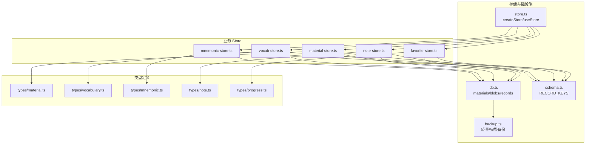
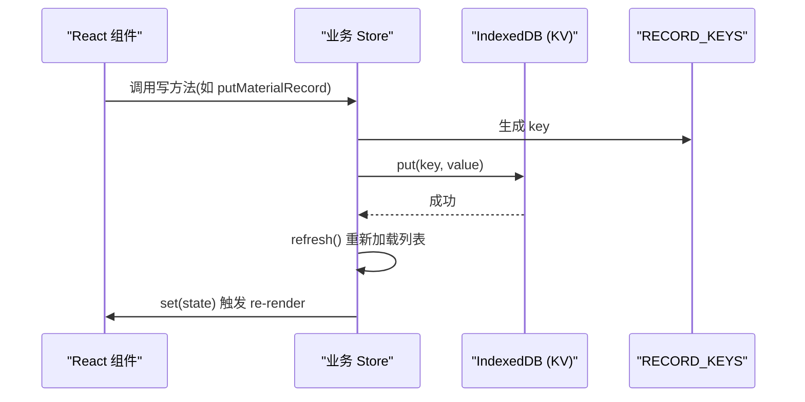
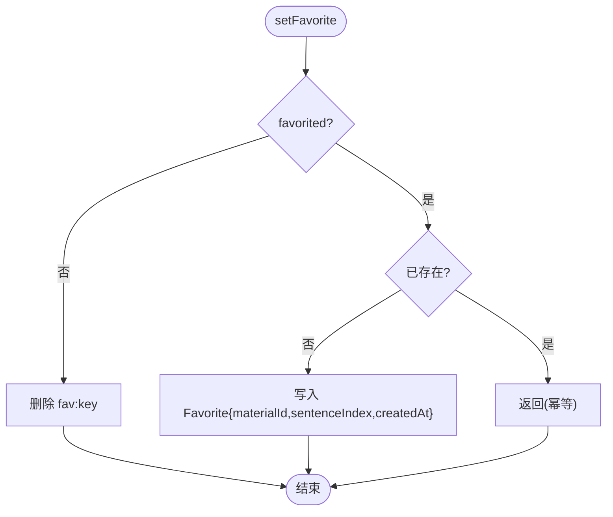
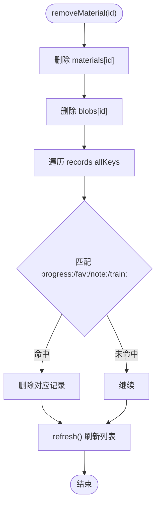
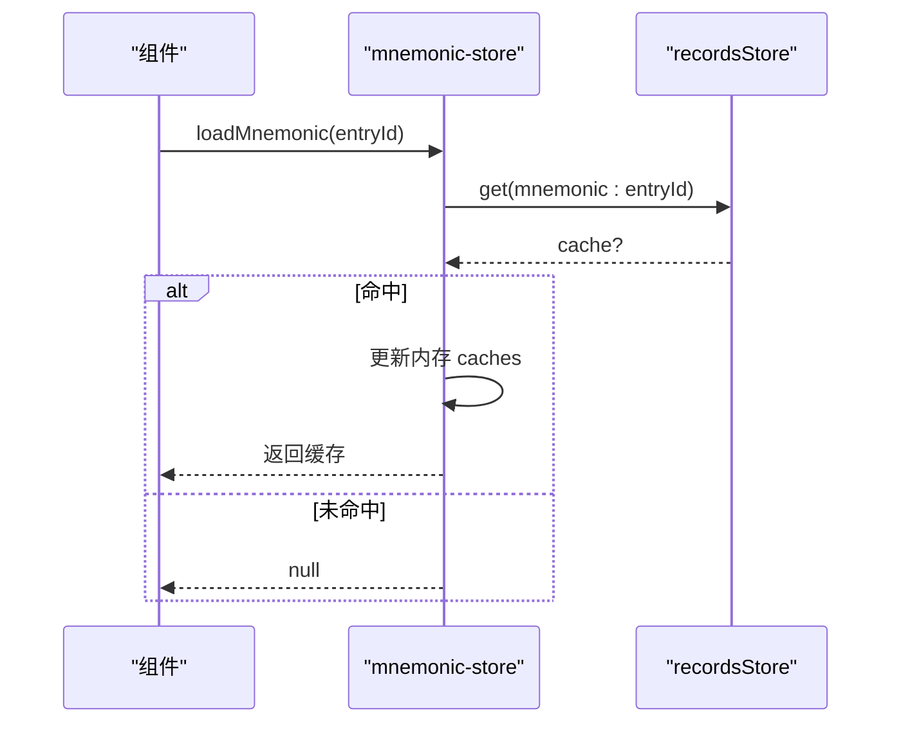
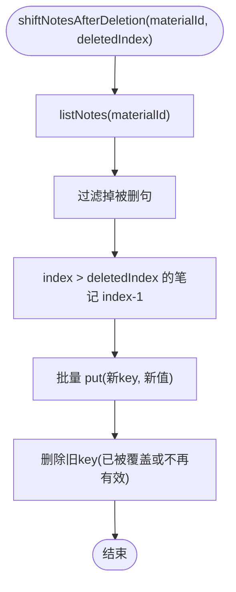
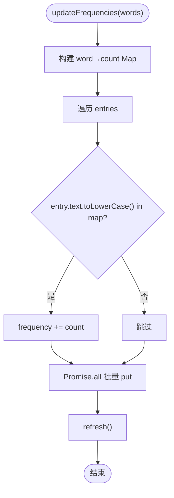
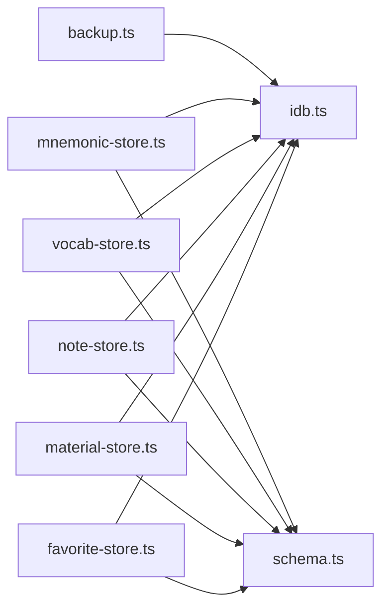

# 业务 Store 实现

<cite>
**本文引用的文件**   
- [client/stores/store.ts](file://client/stores/store.ts)
- [client/stores/favorite-store.ts](file://client/stores/favorite-store.ts)
- [client/stores/material-store.ts](file://client/stores/material-store.ts)
- [client/stores/mnemonic-store.ts](file://client/stores/mnemonic-store.ts)
- [client/stores/note-store.ts](file://client/stores/note-store.ts)
- [client/stores/vocab-store.ts](file://client/stores/vocab-store.ts)
- [client/platform/storage/idb.ts](file://client/platform/storage/idb.ts)
- [client/platform/storage/schema.ts](file://client/platform/storage/schema.ts)
- [client/platform/storage/backup.ts](file://client/platform/storage/backup.ts)
- [client/types/material.ts](file://client/types/material.ts)
- [client/types/vocabulary.ts](file://client/types/vocabulary.ts)
- [client/types/mnemonic.ts](file://client/types/mnemonic.ts)
- [client/types/note.ts](file://client/types/note.ts)
- [client/types/progress.ts](file://client/types/progress.ts)
</cite>

## 目录
1. [引言](#引言)
2. [项目结构](#项目结构)
3. [核心组件](#核心组件)
4. [架构总览](#架构总览)
5. [详细组件分析](#详细组件分析)
6. [依赖关系分析](#依赖关系分析)
7. [性能与一致性](#性能与一致性)
8. [使用示例与调试](#使用示例与调试)
9. [扩展新 Store 指南](#扩展新-store-指南)
10. [故障排查](#故障排查)
11. [结论](#结论)

## 引言
本文件面向“英语助手”前端中的业务 Store 层，系统性说明以下五个 Store 的职责、数据模型、持久化策略与使用模式：
- favorite-store：收藏管理（添加/删除/查询收藏材料句）
- material-store：材料管理（材料 CRUD、集合分组、媒体 Blob、最近学习排序、级联清理）
- mnemonic-store：助记缓存（LLM 生成的助记卡片本地缓存、联想记忆与练习题）
- note-store：句子笔记（Markdown 文本、按句索引、删句后序号平移）
- vocab-store：生词本（多生词本、词条 CRUD、频率统计、默认本保护）

同时总结统一的 Store 抽象、IndexedDB 集成、自动同步机制、备份恢复能力，并给出在 React 组件中使用这些 Store 的范式、错误处理与调试建议。

## 项目结构
Store 层位于 `client/stores`，统一基于极简的 `createStore` 订阅封装；数据持久化通过 `client/platform/storage/idb.ts` 提供的 KV 接口完成；键空间与类型由 `schema.ts` 与对应 `types/*.ts` 约束；备份导出/导入由 `platform/storage/backup.ts` 编排。

**图表来源**
- [client/stores/store.ts:14-33](file://client/stores/store.ts#L14-L33)
- [client/stores/favorite-store.ts:1-42](file://client/stores/favorite-store.ts#L1-L42)
- [client/stores/material-store.ts:1-163](file://client/stores/material-store.ts#L1-L163)
- [client/stores/note-store.ts:1-72](file://client/stores/note-store.ts#L1-L72)
- [client/stores/vocab-store.ts:1-193](file://client/stores/vocab-store.ts#L1-L193)
- [client/stores/mnemonic-store.ts:1-70](file://client/stores/mnemonic-store.ts#L1-L70)
- [client/platform/storage/idb.ts:1-117](file://client/platform/storage/idb.ts#L1-L117)
- [client/platform/storage/schema.ts:1-27](file://client/platform/storage/schema.ts#L1-L27)
- [client/platform/storage/backup.ts:1-243](file://client/platform/storage/backup.ts#L1-L243)
- [client/types/material.ts:1-36](file://client/types/material.ts#L1-L36)
- [client/types/vocabulary.ts:1-41](file://client/types/vocabulary.ts#L1-L41)
- [client/types/mnemonic.ts:1-141](file://client/types/mnemonic.ts#L1-L141)
- [client/types/note.ts:1-14](file://client/types/note.ts#L1-L14)
- [client/types/progress.ts:1-20](file://client/types/progress.ts#L1-L20)

**章节来源**
- [client/stores/store.ts:1-34](file://client/stores/store.ts#L1-L34)
- [client/platform/storage/idb.ts:1-117](file://client/platform/storage/idb.ts#L1-L117)
- [client/platform/storage/schema.ts:1-27](file://client/platform/storage/schema.ts#L1-L27)
- [client/platform/storage/backup.ts:1-243](file://client/platform/storage/backup.ts#L1-L243)

## 核心组件
- createStore/useStore：零依赖状态容器，提供 get/set/subscribe，React 侧通过 useSyncExternalStore 订阅，SSR 安全。
- IndexedDB 封装：三个 object store（materials、blobs、records），支持内存降级，保障 SSR/隐私模式不崩溃。
- RECORD_KEYS：集中维护 records 前缀键生成规则，避免散落的字符串拼接。
- 备份系统：轻量 JSON 与完整 zip 两种格式，支持冲突策略合并、配额预检、媒体流式写入。

**章节来源**
- [client/stores/store.ts:14-33](file://client/stores/store.ts#L14-L33)
- [client/platform/storage/idb.ts:12-102](file://client/platform/storage/idb.ts#L12-L102)
- [client/platform/storage/schema.ts:16-26](file://client/platform/storage/schema.ts#L16-L26)
- [client/platform/storage/backup.ts:61-136](file://client/platform/storage/backup.ts#L61-L136)

## 架构总览
各 Store 遵循统一模式：
- 初始化：调用 initXxx() 确保种子/默认数据存在，再加载列表到内存状态。
- 状态结构：每个 Store 暴露一个 StoreState 接口，包含 ready 标志与列表数据。
- 操作方法：所有写操作先落盘 IndexedDB，再刷新内存状态，触发订阅者更新 UI。
- 键空间：通过 RECORD_KEYS 生成 records 前缀键，避免命名冲突。
- 级联清理：删除材料时，同时清理 media blob、进度、收藏、笔记、训练记录等关联数据。

**图表来源**
- [client/stores/material-store.ts:81-85](file://client/stores/material-store.ts#L81-L85)
- [client/stores/vocab-store.ts:103-116](file://client/stores/vocab-store.ts#L103-L116)
- [client/platform/storage/schema.ts:16-26](file://client/platform/storage/schema.ts#L16-L26)

## 详细组件分析

### favorite-store（收藏管理）
职责
- 以 `fav:{materialId}:{sentenceIndex}` 为键，维护句子收藏。
- 提供按材料过滤的收藏列表、幂等的收藏/取消收藏、以及已收藏句序号数组（用于训练范围过滤）。

数据结构
- Favorite：materialId、sentenceIndex、createdAt。

关键流程
- listFavorites：扫描 records 中匹配前缀的键，批量读取并按 createdAt 降序返回。
- setFavorite：若取消则直接删除；若新增且不存在则写入当前时间戳；重复收藏不更新时间戳。
- favoriteSentenceIndexes：从收藏列表提取句序号并升序排序。

**图表来源**
- [client/stores/favorite-store.ts:26-36](file://client/stores/favorite-store.ts#L26-L36)

**章节来源**
- [client/stores/favorite-store.ts:1-42](file://client/stores/favorite-store.ts#L1-L42)
- [client/types/progress.ts:14-19](file://client/types/progress.ts#L14-L19)
- [client/platform/storage/schema.ts:16-26](file://client/platform/storage/schema.ts#L16-L26)

### material-store（材料管理）
职责
- 首次启动注入种子材料（data/seed.ts），加载 materials + collections 到内存。
- 材料 CRUD、打开更新 lastOpenedAt、媒体 Blob 读写、学习进度读取。
- 材料集 CRUD（collection 前缀），成员关系通过 material.collectionId 维护。
- 删除材料时级联清理：media blob、progress、fav、note、train 记录。

数据结构
- MaterialRecord：material + subtitleData（解析后的字幕，避免每次启动重复解析）。
- MaterialCollection：扁平集合，key 为 collection:{id}。

关键流程
- initMaterials：幂等初始化（种子注入 + 首次加载）。
- refresh：加载 materials 与 records 中 collection 前缀项，排序后写入 store。
- removeMaterial：删除 material、blob，并遍历 records 清理相关键。
- assignMaterialCollection：移动材料到集合或移出到未分组，含陈旧 ID 防护。

**图表来源**
- [client/stores/material-store.ts:107-121](file://client/stores/material-store.ts#L107-L121)

**章节来源**
- [client/stores/material-store.ts:1-163](file://client/stores/material-store.ts#L1-L163)
- [client/types/material.ts:1-36](file://client/types/material.ts#L1-L36)
- [client/platform/storage/schema.ts:16-26](file://client/platform/storage/schema.ts#L1-L27)

### mnemonic-store（助记缓存）
职责
- 将 LLM 生成的助记卡片缓存到 IndexedDB，避免重复调用。
- 支持保存联想记忆与练习题，并提供内存快速读取。

数据结构
- MnemonicCache：id(entryId)、card、association、exercises、createdAt。

关键流程
- loadMnemonic：从 records 读取缓存，若存在则更新内存 caches。
- saveMnemonic：写入 records 并更新内存 caches。
- clearMnemonic：删除 records 条目并从内存移除。
- saveAssociation/saveExercises：在已有缓存基础上追加字段并持久化。

**图表来源**
- [client/stores/mnemonic-store.ts:20-39](file://client/stores/mnemonic-store.ts#L20-L39)

**章节来源**
- [client/stores/mnemonic-store.ts:1-70](file://client/stores/mnemonic-store.ts#L1-L70)
- [client/types/mnemonic.ts:119-131](file://client/types/mnemonic.ts#L119-L131)
- [client/platform/storage/schema.ts:16-26](file://client/platform/storage/schema.ts#L16-L26)

### note-store（句子笔记）
职责
- 以 `note:{materialId}:{sentenceIndex}` 为键，维护句子 Markdown 笔记。
- 支持按材料过滤的笔记列表、单句笔记读写、删句后序号平移。

数据结构
- SentenceNote：materialId、sentenceIndex、content、createdAt、updatedAt。

关键流程
- listNotes：扫描前缀键，批量读取并按 sentenceIndex 升序返回。
- saveSentenceNote：空内容视为删除；新建固定 createdAt，编辑只更新 updatedAt。
- shiftNotesAfterDeletion：被删句笔记移除，其后笔记 index -1，旧 key 删除并重写新 key。

**图表来源**
- [client/stores/note-store.ts:61-71](file://client/stores/note-store.ts#L61-L71)

**章节来源**
- [client/stores/note-store.ts:1-72](file://client/stores/note-store.ts#L1-L72)
- [client/types/note.ts:1-14](file://client/types/note.ts#L1-L14)
- [client/platform/storage/schema.ts:16-26](file://client/platform/storage/schema.ts#L16-L26)

### vocab-store（生词本）
职责
- 支持多生词本 + 词条 CRUD，默认生词本不可删除。
- 导入材料后扫描字幕单词，累加词条 frequency。
- 提供 hasText 查重、clearEntriesByBook 清空等操作。

数据结构
- VocabBook：id、name、createdAt、updatedAt。
- VocabEntry：id、text、context、materialId、sentenceIndex、bookId、addedAt、frequency、definition、note。

关键流程
- initVocab：确保默认生词本存在，再加载 books/entries。
- createBook/removeBook/renameBook：集合级 CRUD，删除本时级联删除其 entries。
- addEntry/updateEntry/removeEntry：词条级 CRUD，写后 refresh。
- updateFrequencies：构建 word→count Map，匹配 entries 累加 frequency，批量写入。

**图表来源**
- [client/stores/vocab-store.ts:167-192](file://client/stores/vocab-store.ts#L167-L192)

**章节来源**
- [client/stores/vocab-store.ts:1-193](file://client/stores/vocab-store.ts#L1-L193)
- [client/types/vocabulary.ts:1-41](file://client/types/vocabulary.ts#L1-L41)
- [client/platform/storage/schema.ts:16-26](file://client/platform/storage/schema.ts#L16-L26)

## 依赖关系分析
- Store 对 IndexedDB 的依赖：所有写操作通过 idb.ts 暴露的 KvStore 接口进行，保证 SSR 与隐私模式下的内存降级。
- Store 对 schema 的依赖：统一通过 RECORD_KEYS 生成键，避免硬编码字符串。
- Store 对 types 的依赖：各 Store 严格使用对应业务类型，保证数据契约稳定。
- 备份对 storage 的依赖：备份导出/导入直接操作 materials、records、blobs 与 prefs，形成跨 Store 的数据迁移闭环。

**图表来源**
- [client/stores/favorite-store.ts:8-10](file://client/stores/favorite-store.ts#L8-L10)
- [client/stores/material-store.ts:19-22](file://client/stores/material-store.ts#L19-L22)
- [client/stores/note-store.ts:8-10](file://client/stores/note-store.ts#L8-L10)
- [client/stores/vocab-store.ts:8-12](file://client/stores/vocab-store.ts#L8-L12)
- [client/stores/mnemonic-store.ts:8-11](file://client/stores/mnemonic-store.ts#L8-L11)
- [client/platform/storage/idb.ts:99-102](file://client/platform/storage/idb.ts#L99-L102)
- [client/platform/storage/schema.ts:16-26](file://client/platform/storage/schema.ts#L16-L26)
- [client/platform/storage/backup.ts:13-17](file://client/platform/storage/backup.ts#L13-L17)

**章节来源**
- [client/platform/storage/idb.ts:1-117](file://client/platform/storage/idb.ts#L1-L117)
- [client/platform/storage/schema.ts:1-27](file://client/platform/storage/schema.ts#L1-L27)
- [client/platform/storage/backup.ts:1-243](file://client/platform/storage/backup.ts#L1-L243)

## 性能与一致性
- 批量读取：listFavorites、refresh 等方法使用 Promise.all 并行读取，降低 I/O 延迟。
- 排序策略：材料按 lastOpenedAt 降序、从未学习的按 createdAt 靠后；收藏按 createdAt 降序；笔记按 sentenceIndex 升序；生词本 entries 按 addedAt 降序。
- 幂等性：setFavorite 重复收藏不更新时间戳；initMaterials/initVocab 使用 initPromise 保证幂等。
- 内存降级：idb.ts 在 open 失败或 blocked 时切换到内存 Map，保证应用不崩溃。
- 级联清理：removeMaterial 精确匹配 progress 键，避免误删其他材料；train 记录通过 materialId 判断。

[本节为通用性能讨论，不直接分析具体代码片段]

## 使用示例与调试

### 在 React 组件中使用 Store
- 订阅状态：使用 useStore(store) 获取当前状态，任何 store.set 都会触发重渲染。
- 异步操作：在事件回调或 useEffect 中调用异步方法（如 initMaterials、putMaterialRecord），并在 finally 中处理错误提示。
- 错误处理：try/catch 包裹异步调用，捕获 IDB 异常或业务校验错误，向用户展示友好提示。
- 状态调试：可通过 store.get() 直接读取当前状态，或在控制台打印 store.get().records/books/entries 等。

参考路径
- [client/stores/store.ts:30-33](file://client/stores/store.ts#L30-L33)
- [client/stores/material-store.ts:70-85](file://client/stores/material-store.ts#L70-L85)
- [client/stores/vocab-store.ts:52-55](file://client/stores/vocab-store.ts#L52-L55)

### 处理异步与错误
- 所有 IndexedDB 操作均返回 Promise，建议在组件中 await 调用。
- 对于可能失败的步骤（如导入材料、备份导入），应捕获 Error 并区分“存储空间不足”“格式校验失败”等场景。
- 在浏览器环境可使用 isMemoryFallback() 检测是否处于内存降级模式，必要时提示用户。

参考路径
- [client/platform/storage/idb.ts:104-117](file://client/platform/storage/idb.ts#L104-L117)
- [client/platform/storage/backup.ts:176-180](file://client/platform/storage/backup.ts#L176-L180)

### 状态调试技巧
- 在控制台执行 store.get() 查看当前状态快照。
- 对 material-store，可检查 ready 标志与 records/collections 长度。
- 对 vocab-store，可检查 books/entries 数量与默认本是否存在。
- 对 mnemonic-store，可检查 caches 对象中是否已有 entryId 对应的缓存。

参考路径
- [client/stores/material-store.ts:24-30](file://client/stores/material-store.ts#L24-L30)
- [client/stores/vocab-store.ts:14-20](file://client/stores/vocab-store.ts#L14-L20)
- [client/stores/mnemonic-store.ts:13-18](file://client/stores/mnemonic-store.ts#L13-L18)

## 扩展新 Store 指南
最佳实践
- 使用 createStore 创建 Store，暴露 get/set/subscribe，并通过 useStore 在 React 中订阅。
- 定义清晰的 StoreState 接口，包含 ready 标志与列表数据。
- 所有写操作先持久化 IndexedDB，再调用 refresh 刷新内存状态。
- 使用 RECORD_KEYS 生成 records 前缀键，避免命名冲突。
- 如需种子数据或默认数据，提供 initXxx() 并保证幂等（共享 initPromise）。
- 删除操作需考虑级联清理，避免悬挂引用。
- 对外暴露的方法应明确返回值与副作用，便于测试与调试。

步骤清单
1. 定义类型：在 types/ 下新增业务类型。
2. 定义键空间：在 schema.ts 的 RECORD_KEYS 中添加前缀生成器。
3. 实现 Store：在 stores/ 下新建 store 文件，使用 createStore 与 idb.ts 的 KvStore。
4. 提供初始化：initXxx() 确保默认数据存在并加载列表。
5. 提供 CRUD 方法：写操作后 refresh()。
6. 提供查询方法：按前缀过滤 keys，批量读取并排序。
7. 编写使用示例：在组件中通过 useStore 订阅，异步调用方法并处理错误。

参考路径
- [client/stores/store.ts:14-33](file://client/stores/store.ts#L14-L33)
- [client/platform/storage/schema.ts:16-26](file://client/platform/storage/schema.ts#L16-L26)
- [client/stores/vocab-store.ts:50-55](file://client/stores/vocab-store.ts#L50-L55)

## 故障排查
常见问题
- IndexedDB 打开失败：应用自动降级到内存 Map，功能可用但数据不持久。可通过 isMemoryFallback() 检测。
- 存储空间不足：完整备份导入时会预检配额，若不足抛出错误，建议改用轻量备份或清理空间。
- 键冲突：删除材料时精确匹配 progress 键，避免误删其他材料；train 记录通过 materialId 判断。
- 陈旧 ID：assignMaterialCollection 会校验目标集合是否存在，防止写入无效 ID。

定位建议
- 检查 store.get() 的状态快照，确认 ready 标志与列表数据。
- 在控制台打印 recordsStore.allKeys() 的结果，核对前缀键是否正确。
- 对备份导入，检查 ImportSummary 中的 written/skipped/missing 计数，定位缺失媒体或跳过条目。

参考路径
- [client/platform/storage/idb.ts:27-50](file://client/platform/storage/idb.ts#L27-L50)
- [client/platform/storage/backup.ts:218-223](file://client/platform/storage/backup.ts#L218-L223)
- [client/stores/material-store.ts:107-121](file://client/stores/material-store.ts#L107-L121)
- [client/stores/material-store.ts:153-161](file://client/stores/material-store.ts#L153-L161)

## 结论
本项目的业务 Store 层采用统一的 createStore 抽象与 IndexedDB 持久化，结合 RECORD_KEYS 的键空间约定，实现了收藏、材料、助记、笔记、生词本等模块的一致性与可维护性。通过幂等初始化、批量读取、排序策略与级联清理，保证了性能与数据一致性。备份系统提供了轻量与完整两种格式，支持跨设备迁移与媒体流式写入。扩展新 Store 时，遵循本文的最佳实践，可快速集成到现有架构中，并保持与 UI 层的解耦与可测试性。