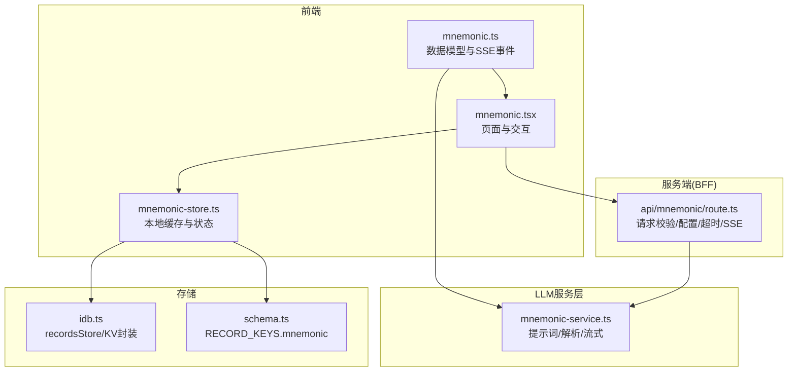
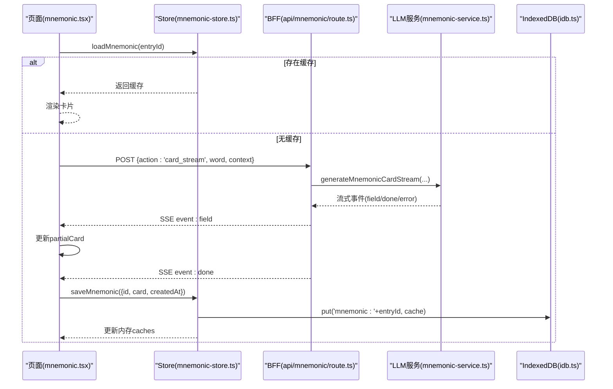
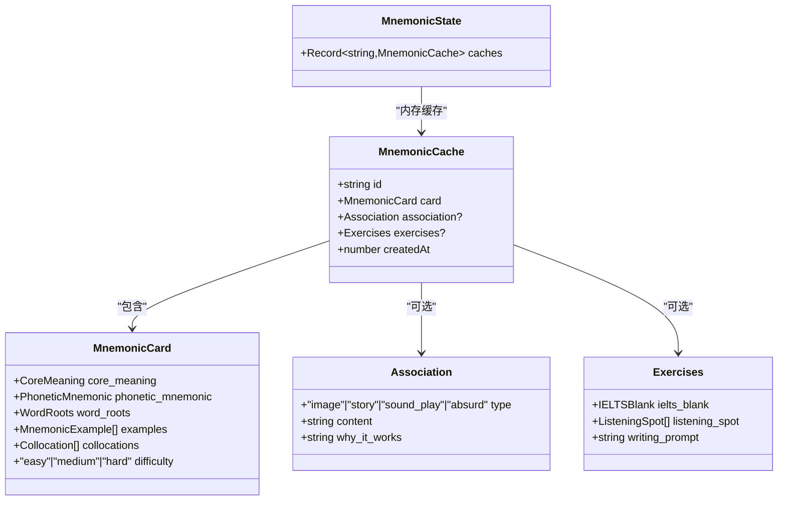
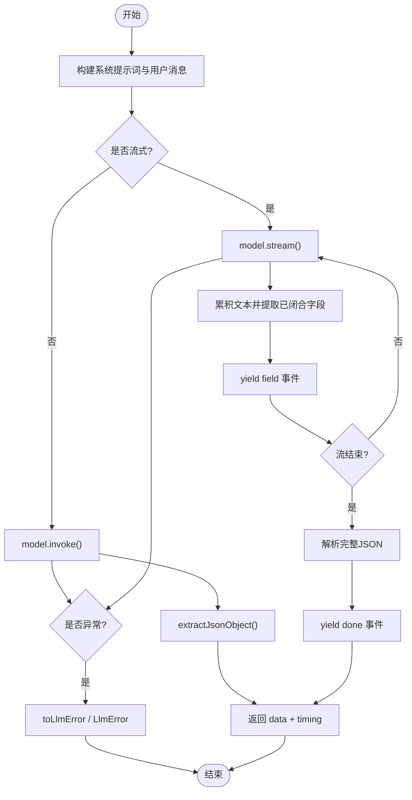
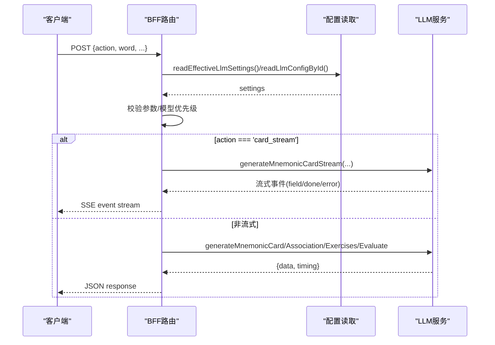
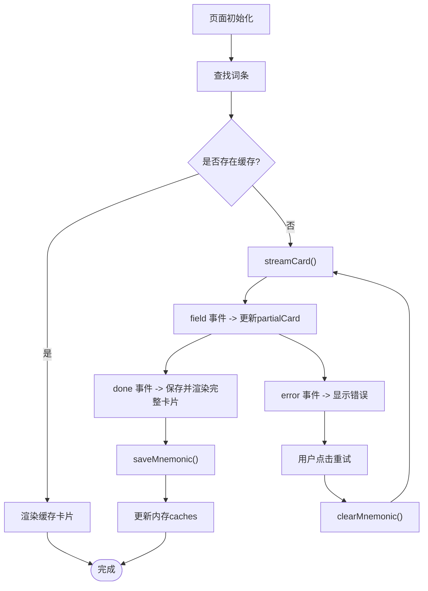
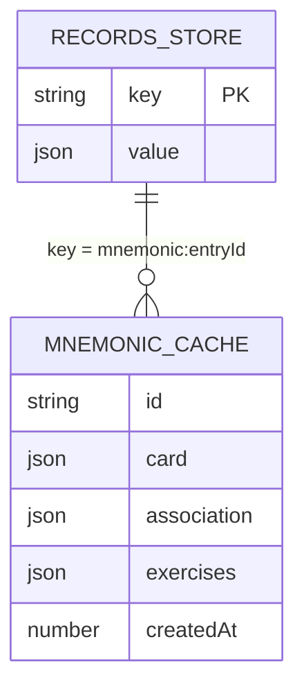
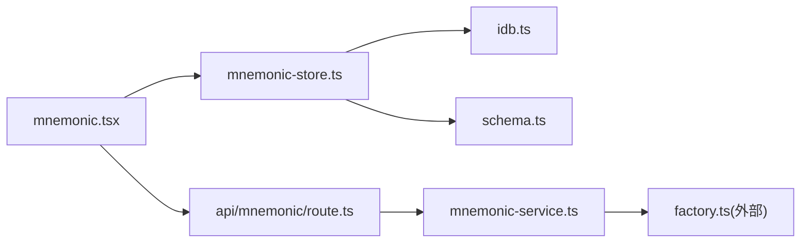

# 助记 Store

<cite>
**本文引用的文件**   
- [client/stores/mnemonic-store.ts](file://client/stores/mnemonic-store.ts)
- [client/types/mnemonic.ts](file://client/types/mnemonic.ts)
- [client/app/api/mnemonic/route.ts](file://client/app/api/mnemonic/route.ts)
- [client/components/pages/mnemonic.tsx](file://client/components/pages/mnemonic.tsx)
- [client/lib/llm/mnemonic-service.ts](file://client/lib/llm/mnemonic-service.ts)
- [client/platform/storage/idb.ts](file://client/platform/storage/idb.ts)
- [client/platform/storage/schema.ts](file://client/platform/storage/schema.ts)
</cite>

## 目录
1. [引言](#引言)
2. [项目结构](#项目结构)
3. [核心组件](#核心组件)
4. [架构总览](#架构总览)
5. [详细组件分析](#详细组件分析)
6. [依赖关系分析](#依赖关系分析)
7. [性能与优化建议](#性能与优化建议)
8. [故障排查指南](#故障排查指南)
9. [结论](#结论)

## 引言
本技术文档围绕“助记 Store”展开，目标是说明如何通过 LLM 为英语单词生成助记卡片、联想记忆和练习题，并持久化到 IndexedDB。重点包括：
- 业务目标：用 LLM 生成的结构化助记内容帮助学习者加深词汇理解与记忆。
- 状态模型：当前实现以 MnemonicState 为主，包含内存缓存；类型层定义了完整的 MnemonicCache 结构。
- 核心方法：loadMnemonic、saveMnemonic、clearMnemonic、getMnemonicFromMemory、saveAssociation、saveExercises。
- LLM 集成：BFF 路由统一转发请求，支持流式 SSE 响应、超时控制、错误映射与降级。
- 存储与索引：基于 recordsStore 的 KV 存储，key 前缀约定为 mnemonic:entryId。
- 使用示例：页面组件展示如何触发流式生成、处理 field/done/error 事件、保存缓存与刷新。

需要特别说明的是：仓库中并未出现名为 MnemonicStoreState 的状态结构；实际前端状态为 MnemonicState（仅含 caches），而完整的数据模型在 types/mnemonic.ts 中定义。

**章节来源**
- [client/stores/mnemonic-store.ts:1-70](file://client/stores/mnemonic-store.ts#L1-L70)
- [client/types/mnemonic.ts:119-141](file://client/types/mnemonic.ts#L119-L141)

## 项目结构
助记功能涉及客户端 Store、类型定义、BFF API 路由、LLM 服务层、IndexedDB 封装与页面 UI。

**图表来源**
- [client/components/pages/mnemonic.tsx:517-613](file://client/components/pages/mnemonic.tsx#L517-L613)
- [client/stores/mnemonic-store.ts:1-70](file://client/stores/mnemonic-store.ts#L1-L70)
- [client/app/api/mnemonic/route.ts:44-179](file://client/app/api/mnemonic/route.ts#L44-L179)
- [client/lib/llm/mnemonic-service.ts:17-121](file://client/lib/llm/mnemonic-service.ts#L17-L121)
- [client/platform/storage/idb.ts:89-102](file://client/platform/storage/idb.ts#L89-L102)
- [client/platform/storage/schema.ts:16-26](file://client/platform/storage/schema.ts#L16-L26)

**章节来源**
- [client/components/pages/mnemonic.tsx:1-11](file://client/components/pages/mnemonic.tsx#L1-L11)
- [client/app/api/mnemonic/route.ts:1-9](file://client/app/api/mnemonic/route.ts#L1-L9)

## 核心组件
- 前端 Store：负责从 IndexedDB 加载、写入、删除助记缓存，并在内存中维护当前会话的缓存对象。
- 类型定义：定义助记卡片、联想、练习、句子批改结果、缓存结构与 SSE 事件。
- BFF 路由：统一接收 action、word、上下文等参数，读取 LLM 配置，调用 LLM 服务，返回 JSON 或 SSE 流。
- LLM 服务层：封装提示词、JSON 容错解析、同步与流式调用，输出结构化数据。
- 存储层：IndexedDB 封装与 key 前缀约定，确保助记记录可被稳定检索。

**章节来源**
- [client/stores/mnemonic-store.ts:13-70](file://client/stores/mnemonic-store.ts#L13-L70)
- [client/types/mnemonic.ts:57-141](file://client/types/mnemonic.ts#L57-L141)
- [client/app/api/mnemonic/route.ts:44-179](file://client/app/api/mnemonic/route.ts#L44-L179)
- [client/lib/llm/mnemonic-service.ts:17-121](file://client/lib/llm/mnemonic-service.ts#L17-L121)
- [client/platform/storage/idb.ts:89-102](file://client/platform/storage/idb.ts#L89-L102)
- [client/platform/storage/schema.ts:16-26](file://client/platform/storage/schema.ts#L16-L26)

## 架构总览
助记功能的端到端流程如下：
- 用户进入词条助记页面，页面先尝试从缓存加载；若无缓存则发起流式请求。
- 页面通过 services.mnemonic.generateCardStream 调用 BFF 路由。
- BFF 路由校验参数、读取 LLM 配置、构造 ChatModelConfig，并以 SSE 形式转发 LLM 流式字段。
- LLM 服务层按字段顺序逐步解析已闭合的 JSON 片段，逐条 yield field 事件，最终 yield done。
- 页面收到 field 事件后更新部分卡片；收到 done 事件后保存完整卡片到 IndexedDB 并更新内存缓存。
- 若发生 error 事件，页面显示错误并提供重试。

**图表来源**
- [client/components/pages/mnemonic.tsx:531-576](file://client/components/pages/mnemonic.tsx#L531-L576)
- [client/app/api/mnemonic/route.ts:148-179](file://client/app/api/mnemonic/route.ts#L148-L179)
- [client/lib/llm/mnemonic-service.ts:359-423](file://client/lib/llm/mnemonic-service.ts#L359-L423)
- [client/stores/mnemonic-store.ts:32-39](file://client/stores/mnemonic-store.ts#L32-L39)
- [client/platform/storage/idb.ts:89-102](file://client/platform/storage/idb.ts#L89-L102)

## 详细组件分析

### 助记 Store 与状态模型
- 当前 Store 暴露的状态类型为 MnemonicState，包含 caches 字段，用于内存中快速访问已加载的 MnemonicCache。
- 关键方法：
  - loadMnemonic：从 IndexedDB 读取缓存，命中则更新内存 caches。
  - saveMnemonic：写入 IndexedDB 并更新内存 caches。
  - clearMnemonic：删除 IndexedDB 中的缓存并从内存 caches 移除。
  - getMnemonicFromMemory：同步读取内存缓存。
  - saveAssociation/saveExercises：在已有缓存基础上追加联想或练习并持久化。

注意：文档目标中提到的 MnemonicStoreState 在当前代码中并不存在；实际状态是 MnemonicState。完整的数据结构（如 MnemonicCache、MnemonicCard、Association、Exercises）定义在类型文件中。

**图表来源**
- [client/stores/mnemonic-store.ts:13-18](file://client/stores/mnemonic-store.ts#L13-L18)
- [client/types/mnemonic.ts:57-131](file://client/types/mnemonic.ts#L57-L131)

**章节来源**
- [client/stores/mnemonic-store.ts:13-70](file://client/stores/mnemonic-store.ts#L13-L70)
- [client/types/mnemonic.ts:57-131](file://client/types/mnemonic.ts#L57-L131)

### 与 LLM 服务的集成模式
- 非流式接口：generateMnemonicCard、generateAssociation、generateMnemonicExercises、evaluateSentence。
- 流式接口：generateMnemonicCardStream，按字段顺序 yield field 事件，结束时 yield done。
- JSON 解析容错：剥离 markdown fence、截取首个{至末个}、JSON.parse、兜底 sanitizeJsonString。
- 错误处理：统一转换为 LlmError，携带 code 与 message；BFF 路由将不同错误映射为 HTTP 状态码。

**图表来源**
- [client/lib/llm/mnemonic-service.ts:17-121](file://client/lib/llm/mnemonic-service.ts#L17-L121)
- [client/lib/llm/mnemonic-service.ts:136-166](file://client/lib/llm/mnemonic-service.ts#L136-L166)
- [client/lib/llm/mnemonic-service.ts:359-423](file://client/lib/llm/mnemonic-service.ts#L359-L423)

**章节来源**
- [client/lib/llm/mnemonic-service.ts:17-121](file://client/lib/llm/mnemonic-service.ts#L17-L121)
- [client/lib/llm/mnemonic-service.ts:136-166](file://client/lib/llm/mnemonic-service.ts#L136-L166)
- [client/lib/llm/mnemonic-service.ts:359-423](file://client/lib/llm/mnemonic-service.ts#L359-L423)

### BFF 路由与 SSE 流式响应
- 请求校验：检查 action、word、context、meaning、collocations、difficulty、sentence 等必要参数。
- 配置读取：优先使用 configId 指定配置，否则读取有效设置；若未配置 baseUrl/apiKey/model，返回 SETTINGS_NOT_CONFIGURED。
- 超时控制：单次上游调用超时 REQUEST_TIMEOUT_MS=120000ms，结合 AbortSignal.any(request.signal, controller.signal)。
- SSE 流式：当 action=card_stream 时，将 LLM 流式事件包装为 text/event-stream 返回。
- 错误映射：LlmError.code 映射为 HTTP 状态码；未知错误返回 MNEMONIC_UPSTREAM_ERROR。

**图表来源**
- [client/app/api/mnemonic/route.ts:44-179](file://client/app/api/mnemonic/route.ts#L44-L179)
- [client/app/api/mnemonic/route.ts:182-244](file://client/app/api/mnemonic/route.ts#L182-L244)
- [client/app/api/mnemonic/route.ts:245-270](file://client/app/api/mnemonic/route.ts#L245-L270)

**章节来源**
- [client/app/api/mnemonic/route.ts:44-179](file://client/app/api/mnemonic/route.ts#L44-L179)
- [client/app/api/mnemonic/route.ts:182-244](file://client/app/api/mnemonic/route.ts#L182-L244)
- [client/app/api/mnemonic/route.ts:245-270](file://client/app/api/mnemonic/route.ts#L245-L270)

### 页面交互与异步流式处理
- 初始化流程：根据 URL 获取 entryId，查找词条，检查缓存；有缓存直接渲染，无缓存则触发流式生成。
- 流式处理：
  - field 事件：更新 partialCard，UI 渐进显示。
  - done 事件：设置完整 card，保存到 IndexedDB，更新内存缓存。
  - error 事件：显示错误信息，提供重试按钮。
- 刷新逻辑：清空缓存后重新流式生成。

**图表来源**
- [client/components/pages/mnemonic.tsx:517-613](file://client/components/pages/mnemonic.tsx#L517-L613)
- [client/components/pages/mnemonic.tsx:615-629](file://client/components/pages/mnemonic.tsx#L615-L629)
- [client/stores/mnemonic-store.ts:32-48](file://client/stores/mnemonic-store.ts#L32-L48)

**章节来源**
- [client/components/pages/mnemonic.tsx:517-613](file://client/components/pages/mnemonic.tsx#L517-L613)
- [client/components/pages/mnemonic.tsx:615-629](file://client/components/pages/mnemonic.tsx#L615-L629)
- [client/stores/mnemonic-store.ts:32-48](file://client/stores/mnemonic-store.ts#L32-L48)

### 存储结构与索引策略
- 存储位置：IndexedDB 的 records store。
- Key 约定：RECORD_KEYS.mnemonic(entryId) => `mnemonic:${entryId}`。
- 值结构：MnemonicCache，包含 id、card、association、exercises、createdAt。
- 读写路径：
  - 读：loadMnemonic -> recordsStore.get(RECORD_KEYS.mnemonic(entryId))。
  - 写：saveMnemonic -> recordsStore.put(key, cache)。
  - 删：clearMnemonic -> recordsStore.delete(key)。

**图表来源**
- [client/platform/storage/schema.ts:16-26](file://client/platform/storage/schema.ts#L16-L26)
- [client/types/mnemonic.ts:119-131](file://client/types/mnemonic.ts#L119-L131)
- [client/stores/mnemonic-store.ts:20-48](file://client/stores/mnemonic-store.ts#L20-L48)

**章节来源**
- [client/platform/storage/schema.ts:16-26](file://client/platform/storage/schema.ts#L16-L26)
- [client/types/mnemonic.ts:119-131](file://client/types/mnemonic.ts#L119-L131)
- [client/stores/mnemonic-store.ts:20-48](file://client/stores/mnemonic-store.ts#L20-L48)

## 依赖关系分析
- 页面组件依赖 Store 进行缓存读写，同时通过 services.mnemonic 调用 BFF 路由。
- Store 依赖 IndexedDB 封装与 schema 的 key 前缀约定。
- BFF 路由依赖 LLM 服务层与配置读取模块。
- LLM 服务层依赖工厂函数创建 ChatModel，并使用统一的错误转换。

**图表来源**
- [client/components/pages/mnemonic.tsx:42-49](file://client/components/pages/mnemonic.tsx#L42-L49)
- [client/stores/mnemonic-store.ts:8-11](file://client/stores/mnemonic-store.ts#L8-L11)
- [client/app/api/mnemonic/route.ts:11-21](file://client/app/api/mnemonic/route.ts#L11-L21)
- [client/lib/llm/mnemonic-service.ts:7-10](file://client/lib/llm/mnemonic-service.ts#L7-L10)

**章节来源**
- [client/components/pages/mnemonic.tsx:42-49](file://client/components/pages/mnemonic.tsx#L42-L49)
- [client/stores/mnemonic-store.ts:8-11](file://client/stores/mnemonic-store.ts#L8-L11)
- [client/app/api/mnemonic/route.ts:11-21](file://client/app/api/mnemonic/route.ts#L11-L21)
- [client/lib/llm/mnemonic-service.ts:7-10](file://client/lib/llm/mnemonic-service.ts#L7-L10)

## 性能与优化建议
- 批量请求合并：当前页面按词条逐个生成；可在高频场景下对同一批次的多个词条进行去重与合并请求，减少重复 LLM 调用。
- 缓存策略：
  - 内存缓存：已在 Store 中使用 caches 提升读取速度。
  - 本地持久化：IndexedDB 避免重复生成；建议在缓存中加入版本号或更新时间戳，便于失效与增量更新。
- 流式优化：
  - 字段级渲染已实现，可减少首屏等待时间。
  - 可增加节流机制，避免频繁 setState 导致重绘开销。
- 错误降级：
  - 网络或上游失败时，优先展示部分已收到的字段，再提示重试。
  - 对于 SETTINGS_NOT_CONFIGURED，引导用户前往设置页配置。
- 超时与取消：
  - 保持 REQUEST_TIMEOUT_MS 与 AbortSignal 的使用，避免长时间挂起。
  - 页面卸载时主动取消请求，释放资源。

[本节为通用指导，不直接分析具体文件]

## 故障排查指南
- 配置缺失：
  - 现象：返回 SETTINGS_NOT_CONFIGURED。
  - 排查：确认 baseUrl、apiKey、mnemonicModel/translateModel 是否已配置。
- 上游错误：
  - 现象：MNEMONIC_UPSTREAM_ERROR 或 LlmError 映射状态码。
  - 排查：查看 LLM 提供商日志，检查模型是否可用、API Key 是否有效。
- 流式中断：
  - 现象：只收到部分 field 事件，无 done。
  - 排查：检查网络稳定性与服务端流式输出；页面已做 partialCard 兜底。
- 存储异常：
  - 现象：IndexedDB 打开失败或事务错误。
  - 排查：idb.ts 已自动降级为内存 Map；可检查 isMemoryFallback 标志位。

**章节来源**
- [client/app/api/mnemonic/route.ts:122-136](file://client/app/api/mnemonic/route.ts#L122-L136)
- [client/app/api/mnemonic/route.ts:245-270](file://client/app/api/mnemonic/route.ts#L245-L270)
- [client/platform/storage/idb.ts:26-50](file://client/platform/storage/idb.ts#L26-L50)
- [client/platform/storage/idb.ts:70-78](file://client/platform/storage/idb.ts#L70-L78)

## 结论
助记 Store 通过前端 Store 与 IndexedDB 实现了助记内容的本地缓存与快速访问；BFF 路由统一了 LLM 调用、配置管理与错误映射；LLM 服务层提供了健壮的 JSON 解析与流式字段输出能力。页面组件展示了完整的用户交互流程，包括流式渲染、缓存保存与错误重试。尽管当前状态结构并非 MnemonicStoreState，但整体设计清晰可扩展，适合在后续版本中引入更复杂的批量合并、缓存失效策略与多模型切换。

[本节为总结性内容，不直接分析具体文件]