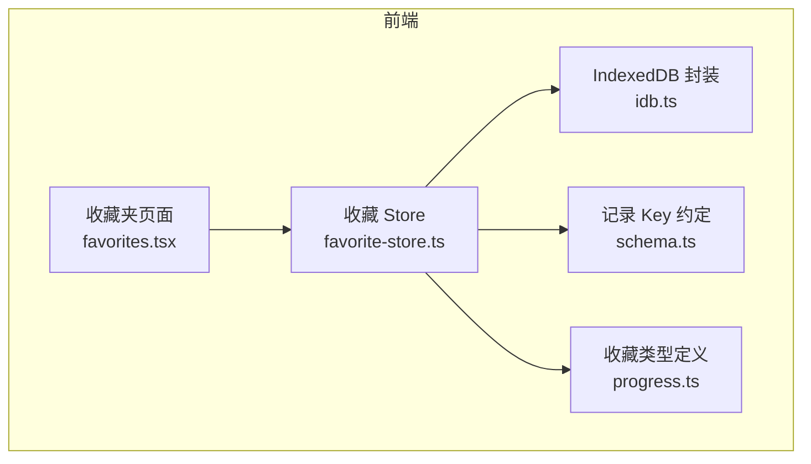
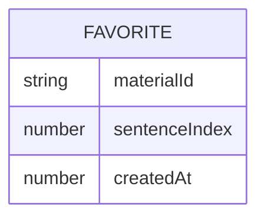
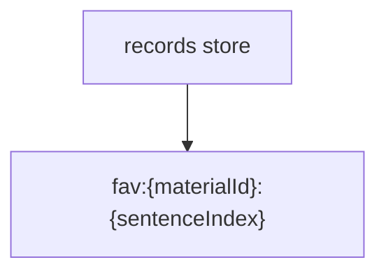
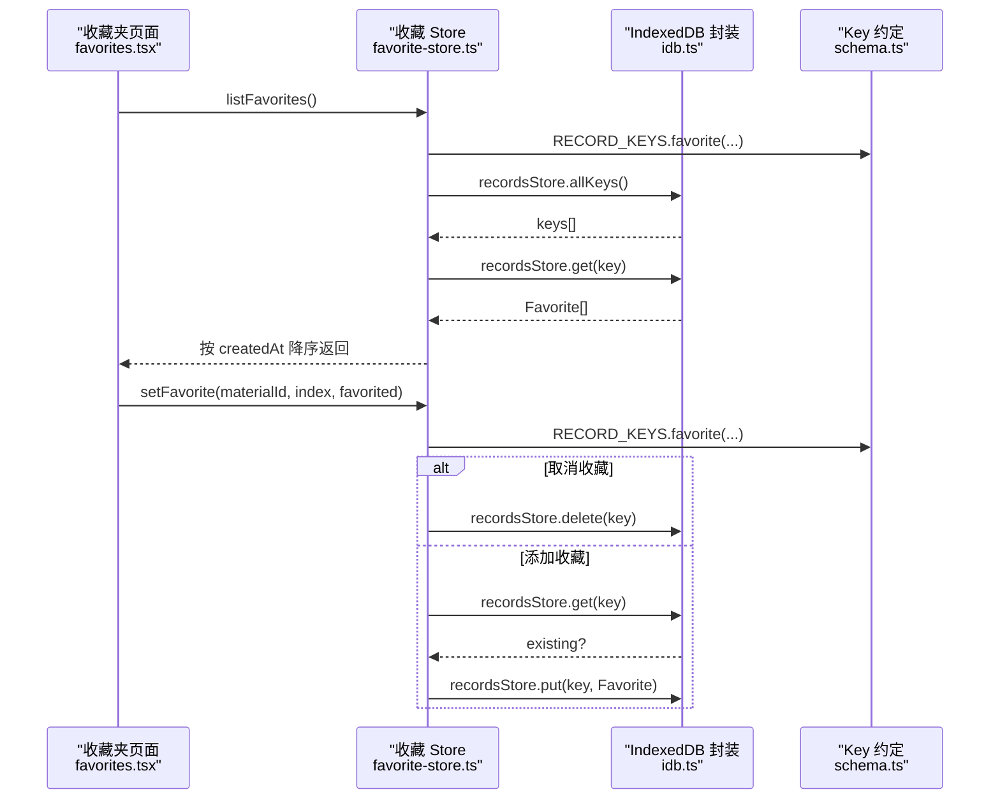
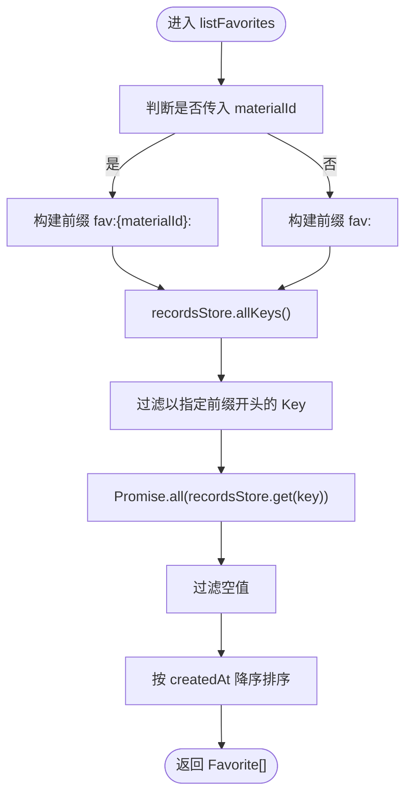
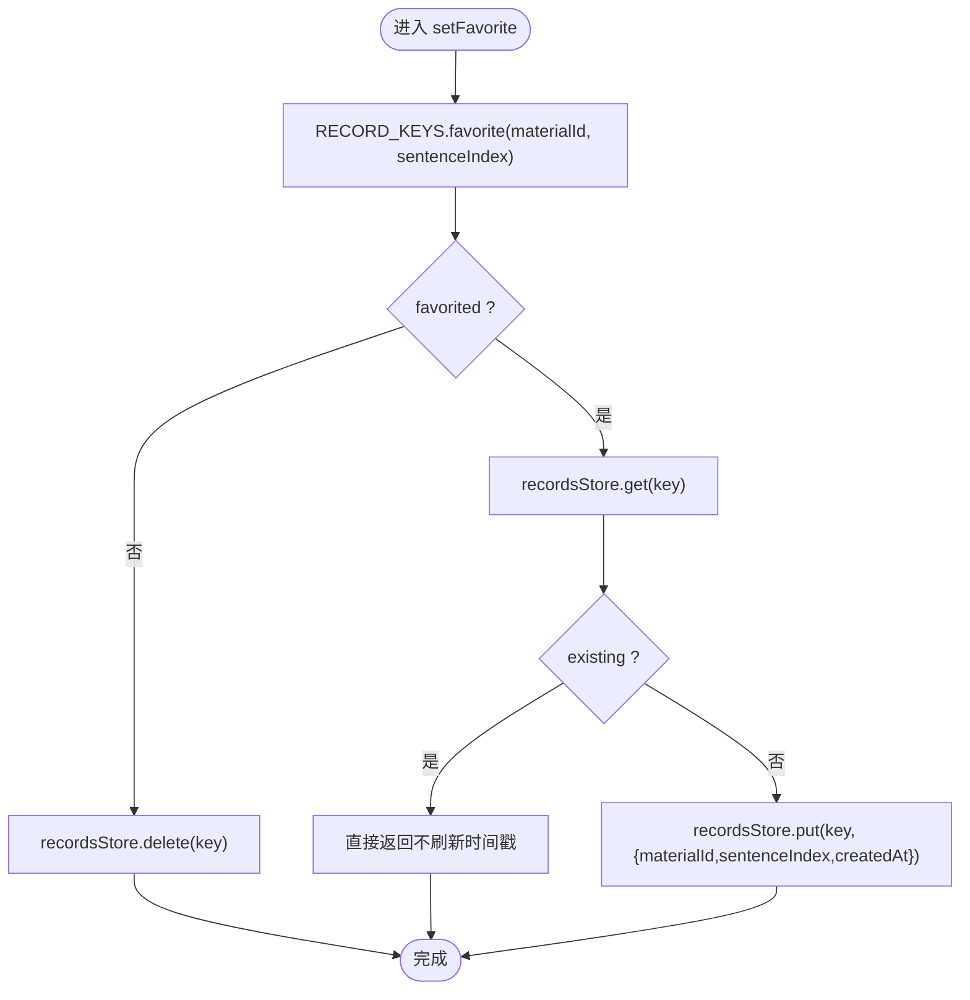
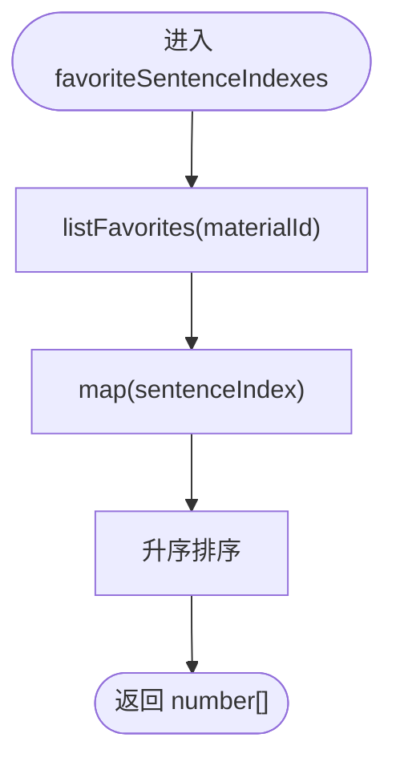
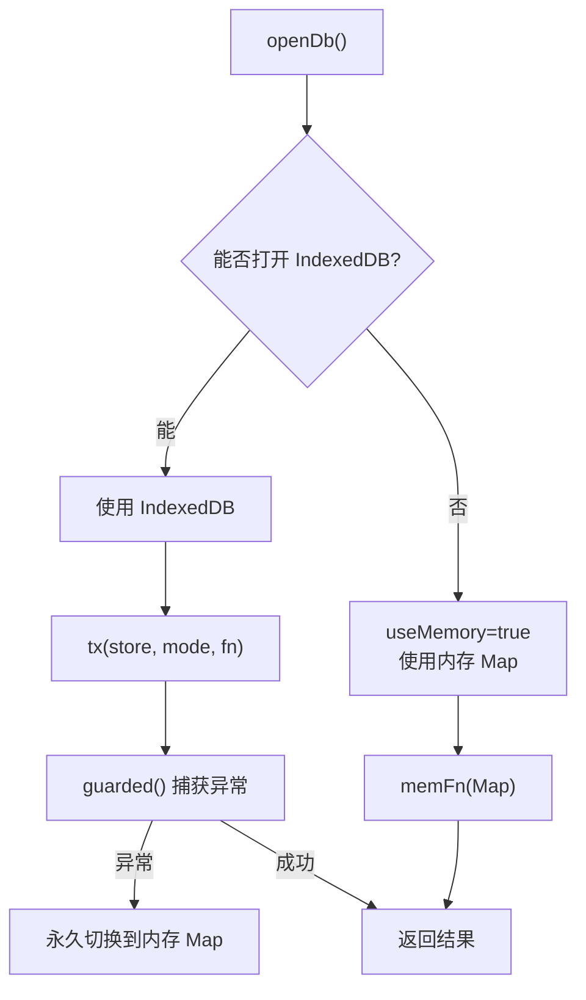
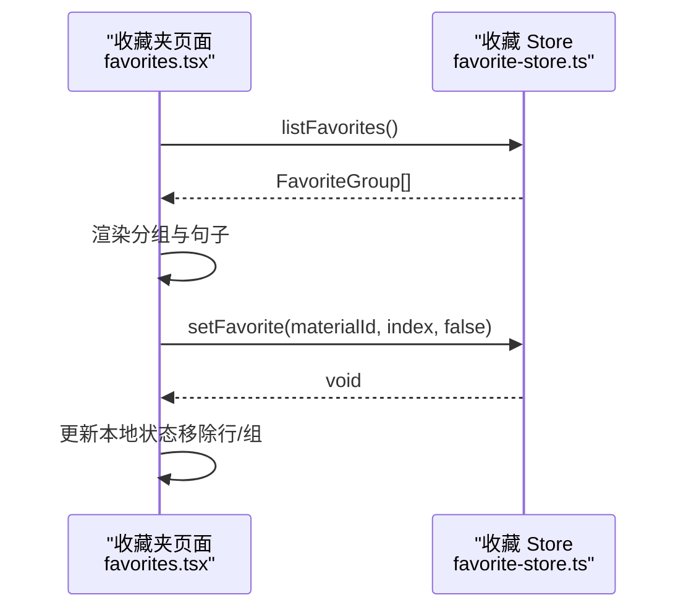
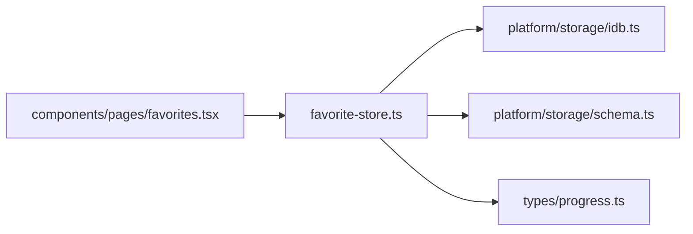

# 收藏 Store

<cite>
**本文引用的文件**   
- [favorite-store.ts](file://client/stores/favorite-store.ts)
- [idb.ts](file://client/platform/storage/idb.ts)
- [schema.ts](file://client/platform/storage/schema.ts)
- [progress.ts](file://client/types/progress.ts)
- [favorites.tsx](file://client/components/pages/favorites.tsx)
</cite>

## 目录
1. [简介](#简介)
2. [项目结构定位](#项目结构定位)
3. [核心职责与能力边界](#核心职责与能力边界)
4. [数据结构设计](#数据结构设计)
5. [架构总览](#架构总览)
6. [核心方法详解](#核心方法详解)
7. [IndexedDB 集成与持久化策略](#indexeddb-集成与持久化策略)
8. [组件使用示例](#组件使用示例)
9. [依赖关系分析](#依赖关系分析)
10. [性能优化建议](#性能优化建议)
11. [故障排查指南](#故障排查指南)
12. [结论](#结论)

## 简介
本技术文档聚焦“收藏 Store”，说明其在应用中的核心职责、数据模型、与 IndexedDB 的集成方式，以及如何在页面组件中调用收藏功能。需要特别说明的是：当前仓库实现以 `listFavorites`、`setFavorite`、`favoriteSentenceIndexes` 三个函数为核心；文档中提到的 `toggleFavorite`、`isFavorite`、`getFavorites` 是业务语义上的等价概念，实际调用时应映射到现有 API。

## 项目结构定位
收藏功能位于前端客户端模块，主要涉及以下位置：
- 业务 Store：`client/stores/favorite-store.ts`
- 本地存储封装：`client/platform/storage/idb.ts`
- 记录 Key 约定：`client/platform/storage/schema.ts`
- 收藏数据类型：`client/types/progress.ts`
- 收藏页面 UI：`client/components/pages/favorites.tsx`

**图表来源**
- [favorites.tsx:10-19](file://client/components/pages/favorites.tsx#L10-L19)
- [favorite-store.ts:8-10](file://client/stores/favorite-store.ts#L8-L10)
- [idb.ts:12-15](file://client/platform/storage/idb.ts#L12-L15)
- [schema.ts:16-26](file://client/platform/storage/schema.ts#L16-L26)
- [progress.ts:14-19](file://client/types/progress.ts#L14-L19)

**章节来源**
- [favorite-store.ts:1-42](file://client/stores/favorite-store.ts#L1-L42)
- [idb.ts:1-117](file://client/platform/storage/idb.ts#L1-L117)
- [schema.ts:1-27](file://client/platform/storage/schema.ts#L1-L27)
- [progress.ts:1-20](file://client/types/progress.ts#L1-L20)
- [favorites.tsx:1-170](file://client/components/pages/favorites.tsx#L1-L170)

## 核心职责与能力边界
- 管理用户收藏的句子集合，按材料维度组织。
- 提供查询全部收藏、按材料过滤收藏、获取已收藏句序号列表的能力。
- 支持添加和取消收藏（幂等），并维护收藏时间戳用于排序与展示。
- 通过 records store 将收藏数据持久化到 IndexedDB，并在不可用时降级为内存 Map。
- 不直接处理媒体播放、字幕解析或材料元数据变更；这些由其他模块负责。

注意：当前实现未暴露名为 `toggleFavorite`、`isFavorite`、`getFavorites` 的方法，但语义上可由现有 API 组合达成：
- “切换收藏” = 先查是否已收藏，再调用 `setFavorite` 设置目标状态。
- “检查是否收藏” = 基于 `listFavorites` 判断是否存在对应 materialId + sentenceIndex。
- “获取收藏列表” = 直接使用 `listFavorites`。

**章节来源**
- [favorite-store.ts:1-6](file://client/stores/favorite-store.ts#L1-L6)
- [favorite-store.ts:19-41](file://client/stores/favorite-store.ts#L19-L41)

## 数据结构设计
### Favorite 模型
收藏实体包含三项字段：
- materialId：所属材料标识
- sentenceIndex：句子在字幕数组中的索引
- createdAt：收藏创建时间戳（毫秒）

该模型用于排序、分组与 UI 展示，例如“今天收藏”“昨天收藏”。

**图表来源**
- [progress.ts:14-19](file://client/types/progress.ts#L14-L19)

### 存储 Key 约定
所有训练进度、收藏、笔记等记录统一存放在 records store，Key 采用“类型前缀 + 业务键”的形式。收藏 Key 格式为：
- `fav:{materialId}:{sentenceIndex}`

这使同一材料下的多条收藏可被前缀扫描快速筛选。

**图表来源**
- [schema.ts:16-26](file://client/platform/storage/schema.ts#L16-L26)
- [favorite-store.ts:12-12](file://client/stores/favorite-store.ts#L12-L12)

**章节来源**
- [progress.ts:14-19](file://client/types/progress.ts#L14-L19)
- [schema.ts:16-26](file://client/platform/storage/schema.ts#L16-L26)
- [favorite-store.ts:12-12](file://client/stores/favorite-store.ts#L12-L12)

## 架构总览
收藏 Store 作为领域层服务，向上暴露简洁 API，向下委托 IndexedDB 封装进行读写。UI 层仅关心业务结果，无需感知底层存储细节。

**图表来源**
- [favorites.tsx:17-19](file://client/components/pages/favorites.tsx#L17-L19)
- [favorite-store.ts:19-36](file://client/stores/favorite-store.ts#L19-L36)
- [idb.ts:89-102](file://client/platform/storage/idb.ts#L89-L102)
- [schema.ts:16-26](file://client/platform/storage/schema.ts#L16-L26)

## 核心方法详解

### listFavorites
- 作用：读取收藏记录，可按 materialId 过滤；返回按收藏时间降序的结果。
- 行为要点：
  - 若传入 materialId，则使用前缀 `fav:{materialId}:` 过滤；否则取全部。
  - 通过 allKeys 获取所有 Key，再批量 get 值。
  - 过滤无效项后按 createdAt 降序排序。
- 复杂度：O(K log K)，K 为匹配 Key 数量。

**图表来源**
- [favorite-store.ts:19-24](file://client/stores/favorite-store.ts#L19-L24)

**章节来源**
- [favorite-store.ts:19-24](file://client/stores/favorite-store.ts#L19-L24)

### setFavorite
- 作用：添加或取消收藏，幂等操作。
- 行为要点：
  - 根据 schema 生成 Key。
  - 若取消收藏，直接删除 Key。
  - 若添加收藏且已存在，则不覆盖时间戳（避免刷新最近收藏顺序）。
  - 否则写入 Favorite 对象，包含 createdAt。
- 错误处理：依赖 idb.ts 的 guarded 机制，失败时回退到内存 Map，保证调用方不崩溃。

**图表来源**
- [favorite-store.ts:26-36](file://client/stores/favorite-store.ts#L26-L36)
- [schema.ts:16-26](file://client/platform/storage/schema.ts#L16-L26)

**章节来源**
- [favorite-store.ts:26-36](file://client/stores/favorite-store.ts#L26-L36)
- [schema.ts:16-26](file://client/platform/storage/schema.ts#L16-L26)

### favoriteSentenceIndexes
- 作用：返回某材料下已收藏句子的序号数组（升序），常用于训练范围过滤。
- 行为要点：
  - 复用 listFavorites 获取该材料的收藏。
  - 提取 sentenceIndex 并升序排序。

**图表来源**
- [favorite-store.ts:38-41](file://client/stores/favorite-store.ts#L38-L41)

**章节来源**
- [favorite-store.ts:38-41](file://client/stores/favorite-store.ts#L38-L41)

### 关于 toggleFavorite / isFavorite / getFavorites
- 当前仓库未直接导出同名函数。
- 推荐实现思路（供参考，非仓库代码）：
  - toggleFavorite：先调用 listFavorites 判断是否已收藏，再调用 setFavorite 设置目标状态。
  - isFavorite：基于 listFavorites 或 favoriteSentenceIndexes 判断是否存在对应 sentenceIndex。
  - getFavorites：即 listFavorites。

[本节为概念性说明，不涉及具体源码行号]

## IndexedDB 集成与持久化策略

### 存储后端
- 数据库名：ping-english-assistant
- 版本：2
- Object Stores：materials、blobs、records
- 收藏数据存储在 records store，Key 带类型前缀 fav:

### 降级策略
- SSR、隐私模式或打开失败时自动切换到内存 Map 兜底。
- guarded 包装确保任何异常都转为内存操作，避免 UI 崩溃。
- 提供 isMemoryFallback 供 UI 提示当前是否处于降级模式。

**图表来源**
- [idb.ts:26-50](file://client/platform/storage/idb.ts#L26-L50)
- [idb.ts:53-78](file://client/platform/storage/idb.ts#L53-L78)
- [idb.ts:89-102](file://client/platform/storage/idb.ts#L89-L102)

### KV 接口
- get<T>(key): Promise<T | undefined>
- put(key, value): Promise<void>
- delete(key): Promise<void>
- allKeys(): Promise<string[]>
- clear(): Promise<void>

收藏 Store 通过 recordsStore 访问上述接口。

**章节来源**
- [idb.ts:12-15](file://client/platform/storage/idb.ts#L12-L15)
- [idb.ts:17-24](file://client/platform/storage/idb.ts#L17-L24)
- [idb.ts:26-50](file://client/platform/storage/idb.ts#L26-L50)
- [idb.ts:53-78](file://client/platform/storage/idb.ts#L53-L78)
- [idb.ts:89-102](file://client/platform/storage/idb.ts#L89-L102)
- [idb.ts:115-117](file://client/platform/storage/idb.ts#L115-L117)

## 组件使用示例

### 在收藏夹页面加载与展示
- 页面在挂载时调用 listFavorites 获取全部收藏，并按材料聚合分组。
- 组内按 sentenceIndex 升序排列，便于播放器跳转。
- 点击行跳转到播放器并定位到对应句子。
- 取消收藏时调用 setFavorite(false)，并即时从本地状态移除该行，必要时移除整组。

**图表来源**
- [favorites.tsx:49-94](file://client/components/pages/favorites.tsx#L49-L94)
- [favorites.tsx:126-158](file://client/components/pages/favorites.tsx#L126-L158)
- [favorite-store.ts:19-36](file://client/stores/favorite-store.ts#L19-L36)

### 在播放器或训练中心中使用
- 播放器可在单材料场景下调用 favoriteSentenceIndexes 获取已收藏句序号，用于高亮或限制训练范围。
- 训练中心可基于该序号列表过滤待训练句子。

[本节为使用场景说明，不涉及具体源码行号]

### 异步与错误处理最佳实践
- 组件侧对异步加载使用 try/catch 或 .catch 分支，避免白屏。
- 当 IndexedDB 不可用时，idb.ts 会自动降级到内存 Map，UI 仍可工作但数据可能不跨会话持久。
- 建议在 UI 中结合 isMemoryFallback 提示用户当前为临时存储。

**章节来源**
- [favorites.tsx:77-94](file://client/components/pages/favorites.tsx#L77-L94)
- [idb.ts:115-117](file://client/platform/storage/idb.ts#L115-L117)

## 依赖关系分析

**图表来源**
- [favorite-store.ts:8-10](file://client/stores/favorite-store.ts#L8-L10)
- [favorites.tsx:17-19](file://client/components/pages/favorites.tsx#L17-L19)

**章节来源**
- [favorite-store.ts:8-10](file://client/stores/favorite-store.ts#L8-L10)
- [favorites.tsx:17-19](file://client/components/pages/favorites.tsx#L17-L19)

## 性能优化建议
- 批量读取优化：listFavorites 已使用 Promise.all 并行读取多个 Key，适合中等规模收藏集。
- 前缀过滤：利用 records store 的 allKeys 与前缀匹配，减少不必要的数据传输。
- 排序开销：按 createdAt 降序排序的时间复杂度为 O(K log K)，在收藏量较大时可考虑分页或懒加载。
- 去重与幂等：setFavorite 对重复收藏不做时间戳更新，避免无意义写放大。
- 降级路径：IDB 失败自动降级内存 Map，保证可用性；但在生产环境应监控 isMemoryFallback 并提示用户。
- 缓存策略：对于频繁读取的材料级收藏序号，可在组件层做短期缓存，避免重复计算。

[本节为通用性能建议，不涉及具体源码行号]

## 故障排查指南
- 收藏不显示：
  - 检查是否在内存降级模式：调用 isMemoryFallback 确认。
  - 检查 records store 中是否存在对应 Key：可通过调试工具查看 IndexedDB。
- 取消收藏无效：
  - 确认 setFavorite 调用参数是否正确（materialId、sentenceIndex、favorited=false）。
  - 检查 UI 状态更新逻辑是否同步移除行或组。
- 收藏顺序异常：
  - 确认 createdAt 是否一致；重复收藏不会更新时间戳，因此首次收藏时间决定排序。
- 浏览器兼容问题：
  - 在 Safari 隐私模式或 SSR 环境下会降级内存 Map，属预期行为。

**章节来源**
- [idb.ts:37-48](file://client/platform/storage/idb.ts#L37-L48)
- [idb.ts:70-78](file://client/platform/storage/idb.ts#L70-L78)
- [idb.ts:115-117](file://client/platform/storage/idb.ts#L115-L117)
- [favorite-store.ts:26-36](file://client/stores/favorite-store.ts#L26-L36)

## 结论
收藏 Store 以简洁的 API 封装了收藏数据的增删查能力，并通过 IndexedDB 实现持久化，同时在不可用环境中优雅降级到内存 Map。其 Key 约定清晰、幂等性强，配合收藏夹页面的分组与交互，提供了良好的用户体验。未来可在大数据量场景下引入分页、懒加载与更细粒度的缓存策略，进一步提升性能与可扩展性。