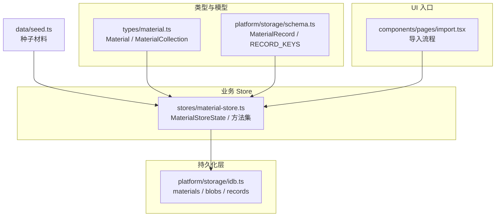
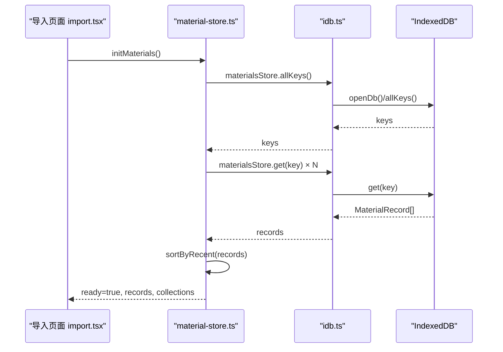
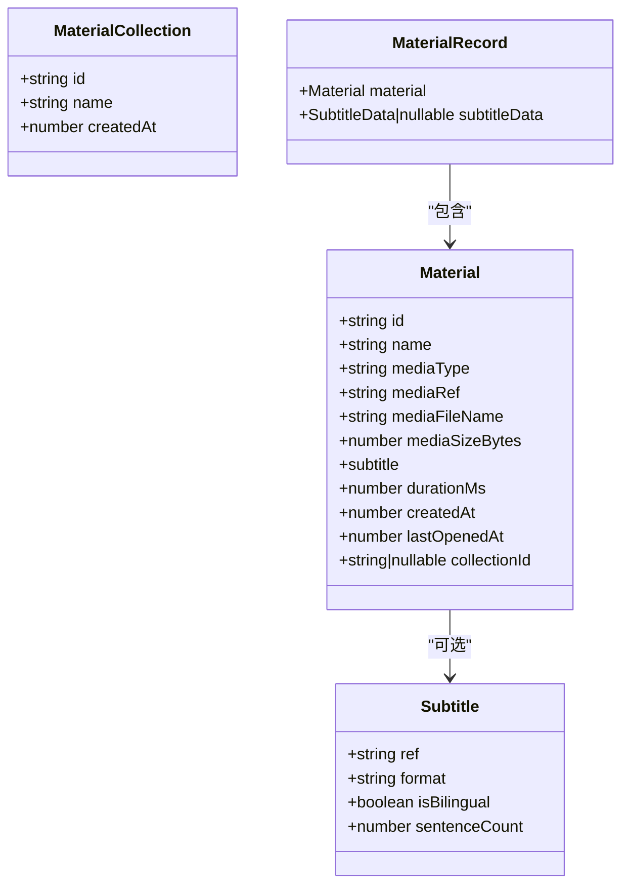
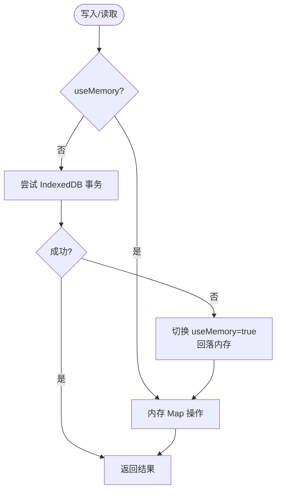
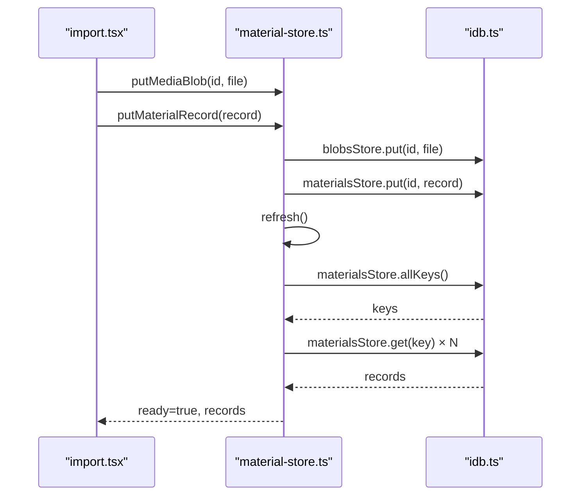
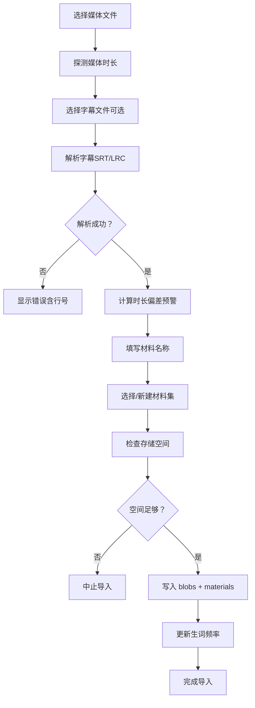
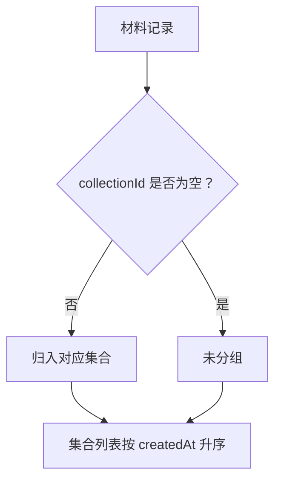
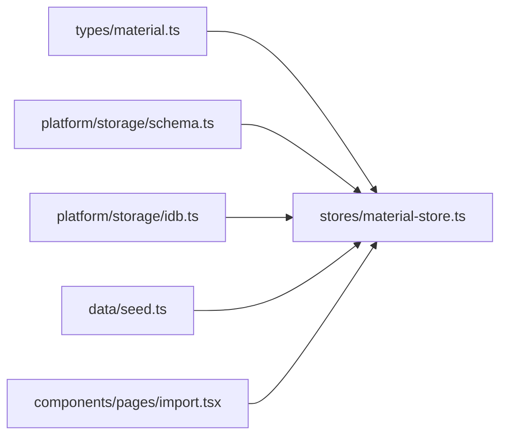

# 材料 Store

<cite>
**本文引用的文件**   
- [material-store.ts](file://client/stores/material-store.ts)
- [material.ts](file://client/types/material.ts)
- [idb.ts](file://client/platform/storage/idb.ts)
- [schema.ts](file://client/platform/storage/schema.ts)
- [import.tsx](file://client/components/pages/import.tsx)
- [seed.ts](file://client/data/seed.ts)
</cite>

## 目录
1. [简介](#简介)
2. [项目结构](#项目结构)
3. [核心组件](#核心组件)
4. [架构总览](#架构总览)
5. [详细组件分析](#详细组件分析)
6. [依赖关系分析](#依赖关系分析)
7. [性能与扩展性](#性能与扩展性)
8. [故障排查指南](#故障排查指南)
9. [结论](#结论)
10. [附录：使用示例与最佳实践](#附录使用示例与最佳实践)

## 简介
本文件为“材料 Store”的完整技术文档，聚焦材料管理的核心能力：材料的增删改查、导入导出、搜索过滤、集合分组、媒体与字幕管理，以及与 IndexedDB 的交互逻辑。文档同时解释数据模型 MaterialRecord 与状态结构 MaterialStoreState，并给出常见使用场景的代码路径指引（不直接粘贴代码），以及数据迁移与版本兼容性处理方案。

## 项目结构
围绕材料管理的关键文件组织如下：
- 类型定义：Material、MaterialCollection
- 存储层封装：IndexedDB Promise 化封装、对象仓库划分
- 存储键约定：MaterialRecord、RECORD_KEYS
- Store 实现：材料记录 CRUD、集合 CRUD、最近学习排序、种子注入
- 导入页面：文件选择、字幕解析、媒体时长探测、存储空间检查、失败回滚

图表来源
- [material-store.ts:24-30](file://client/stores/material-store.ts#L24-L30)
- [material.ts:7-35](file://client/types/material.ts#L7-L35)
- [schema.ts:10-26](file://client/platform/storage/schema.ts#L10-L26)
- [idb.ts:12-102](file://client/platform/storage/idb.ts#L12-L102)
- [import.tsx:120-271](file://client/components/pages/import.tsx#L120-L271)
- [seed.ts:23-28](file://client/data/seed.ts#L23-L28)

章节来源
- [material-store.ts:1-163](file://client/stores/material-store.ts#L1-L163)
- [material.ts:1-36](file://client/types/material.ts#L1-L36)
- [idb.ts:1-117](file://client/platform/storage/idb.ts#L1-L117)
- [schema.ts:1-27](file://client/platform/storage/schema.ts#L1-L27)
- [import.tsx:1-374](file://client/components/pages/import.tsx#L1-L374)
- [seed.ts:1-29](file://client/data/seed.ts#L1-L29)

## 核心组件
- 类型与模型
  - Material：材料元数据（ID、名称、媒体类型、本地引用、文件名、大小、字幕信息、时长、创建/打开时间、所属集合）
  - MaterialCollection：材料集（扁平结构，ID、名称、创建时间）
- 存储层
  - materials：材料记录（MaterialRecord），key=material.id
  - blobs：媒体 Blob，key=materialId
  - records：训练记录/收藏/进度/集合等，key 带前缀（如 progress:、fav:、train:、collection:）
- Store 接口
  - initMaterials：初始化（种子注入 + 首次加载）
  - getMaterialRecord：读取单条材料记录
  - putMaterialRecord：新增/覆盖材料记录
  - touchMaterial：更新 lastOpenedAt
  - removeMaterial：删除材料（级联清理 blob 与相关 records）
  - createCollection/renameCollection/removeCollection/assignMaterialCollection：集合 CRUD 与成员归属
  - putMediaBlob/getMediaBlob/deleteMediaBlob：媒体 Blob 读写
  - getProgress：读取学习进度

章节来源
- [material.ts:7-35](file://client/types/material.ts#L7-L35)
- [schema.ts:10-26](file://client/platform/storage/schema.ts#L10-L26)
- [material-store.ts:24-163](file://client/stores/material-store.ts#L24-L163)

## 架构总览
材料 Store 采用“类型定义 → 存储封装 → Store 业务逻辑 → UI 调用”的分层架构。所有浏览器 API（IndexedDB）仅在异步函数内访问，保证 SSR 安全；当 IndexedDB 不可用时自动降级到内存 Map，确保应用不崩溃。

图表来源
- [import.tsx:205-210](file://client/components/pages/import.tsx#L205-L210)
- [material-store.ts:40-52](file://client/stores/material-store.ts#L40-L52)
- [idb.ts:27-50](file://client/platform/storage/idb.ts#L27-L50)

## 详细组件分析

### 数据模型与状态
- MaterialRecord
  - material：Material 元数据
  - subtitleData：解析后的字幕数据（避免每次启动重复解析）
- MaterialStoreState
  - ready：是否完成初始化
  - records：MaterialRecord[]（按“最近学习”排序）
  - collections：MaterialCollection[]（按创建时间升序）

图表来源
- [material.ts:7-35](file://client/types/material.ts#L7-L35)
- [schema.ts:10-14](file://client/platform/storage/schema.ts#L10-L14)

章节来源
- [material.ts:7-35](file://client/types/material.ts#L7-L35)
- [schema.ts:10-14](file://client/platform/storage/schema.ts#L10-L14)
- [material-store.ts:24-30](file://client/stores/material-store.ts#L24-L30)

### 存储层与 IndexedDB 交互
- 对象仓库
  - materials：MaterialRecord，key=material.id
  - blobs：Blob，key=materialId
  - records：多类型记录，key 带前缀（progress:/fav:/note:/train:/vocabbook:/vocabentry:/mnemonic:/collection:）
- 事务与错误恢复
  - 统一 tx() 封装事务请求，onerror 时拒绝 Promise
  - guarded() 在异常时永久切换到内存模式，保证调用方永不因存储层崩溃
  - openDb() 支持 onupgradeneeded 建表、onblocked 降级、catch 兜底
- 批量操作
  - allKeys() + Promise.all(get) 并行加载
  - removeMaterial 中遍历 records 键并条件删除（精确匹配或前缀匹配）

图表来源
- [idb.ts:27-78](file://client/platform/storage/idb.ts#L27-L78)
- [idb.ts:89-97](file://client/platform/storage/idb.ts#L89-L97)

章节来源
- [idb.ts:12-102](file://client/platform/storage/idb.ts#L12-L102)
- [schema.ts:16-26](file://client/platform/storage/schema.ts#L16-L26)

### 材料增删改查与集合管理
- 添加材料
  - 通过 putMaterialRecord(record) 写入 materials store，随后 refresh() 刷新列表
  - 导入流程中先写 blobs，再写 record，成功后更新生词频率
- 更新材料
  - touchMaterial(id) 更新 lastOpenedAt，驱动“最近学习”排序
  - assignMaterialCollection(materialId, collectionId|null) 调整归属
- 删除材料
  - removeMaterial(id) 级联删除：material 记录、blob、records 中的进度/收藏/笔记/训练记录
- 搜索与过滤
  - 当前未提供内置 searchMaterials；可在 UI 层基于 materialStore.get().records 进行过滤
- 导出与导入
  - 导出：可基于 materialStore.get().records 序列化（当前仓库未提供导出实现）
  - 导入：由 import.tsx 负责文件选择、字幕解析、媒体时长探测、存储空间检查、失败回滚

图表来源
- [import.tsx:218-271](file://client/components/pages/import.tsx#L218-L271)
- [material-store.ts:82-85](file://client/stores/material-store.ts#L82-L85)
- [material-store.ts:40-52](file://client/stores/material-store.ts#L40-L52)

章节来源
- [material-store.ts:75-121](file://client/stores/material-store.ts#L75-L121)
- [material-store.ts:126-162](file://client/stores/material-store.ts#L126-L162)
- [import.tsx:218-271](file://client/components/pages/import.tsx#L218-L271)

### 导入流程与数据验证
- 支持的媒体格式：audio/*、video/*（例如 mp3、wav、m4a、mp4、mov）
- 支持的字幕格式：SRT、LRC
- 关键校验与处理
  - 媒体时长探测：probeMediaDuration，失败不阻断导入
  - 字幕解析：parseSubtitle，失败抛出 SubtitleParseError（含行号）
  - LRC 末句补全：根据媒体时长回填 totalDurationMs
  - 存储空间检查：estimateUsage，quota-usage 不足则中止
  - 失败回滚：deleteMediaBlob、removeCollection（新建集合）

图表来源
- [import.tsx:20-34](file://client/components/pages/import.tsx#L20-L34)
- [import.tsx:140-160](file://client/components/pages/import.tsx#L140-L160)
- [import.tsx:218-271](file://client/components/pages/import.tsx#L218-L271)

章节来源
- [import.tsx:20-34](file://client/components/pages/import.tsx#L20-L34)
- [import.tsx:140-160](file://client/components/pages/import.tsx#L140-L160)
- [import.tsx:218-271](file://client/components/pages/import.tsx#L218-L271)

### 最近学习排序与集合分组
- 最近学习排序
  - sortByRecent：lastOpenedAt 降序；从未学习（0）排后，按 createdAt 降序
- 集合分组
  - createCollection/renameCollection/removeCollection：集合 CRUD
  - assignMaterialCollection：移动材料到集合或移出到未分组
  - 删除集合仅解除归属（collectionId 置 null），材料本身保留

图表来源
- [material-store.ts:32-38](file://client/stores/material-store.ts#L32-L38)
- [material-store.ts:46-51](file://client/stores/material-store.ts#L46-L51)
- [material-store.ts:144-162](file://client/stores/material-store.ts#L144-L162)

章节来源
- [material-store.ts:32-38](file://client/stores/material-store.ts#L32-L38)
- [material-store.ts:46-51](file://client/stores/material-store.ts#L46-L51)
- [material-store.ts:144-162](file://client/stores/material-store.ts#L144-L162)

## 依赖关系分析
- 模块耦合
  - material-store.ts 依赖 types/material.ts、platform/storage/schema.ts、platform/storage/idb.ts、data/seed.ts
  - import.tsx 依赖 material-store.ts、core/subtitle、lib/tts-export、lib/transcribe-export
- 外部依赖
  - IndexedDB（浏览器原生）
  - crypto.randomUUID（生成 ID）
  - navigator.storage.estimate（磁盘占用估算）

图表来源
- [material-store.ts:15-22](file://client/stores/material-store.ts#L15-L22)
- [import.tsx:12-18](file://client/components/pages/import.tsx#L12-L18)

章节来源
- [material-store.ts:15-22](file://client/stores/material-store.ts#L15-L22)
- [import.tsx:12-18](file://client/components/pages/import.tsx#L12-L18)

## 性能与扩展性
- 并发加载
  - refresh() 使用 Promise.all 并行获取所有材料记录，提升首屏渲染速度
- 排序优化
  - sortByRecent 在内存中进行，避免频繁排序开销
- 可扩展点
  - 搜索过滤：可在 UI 层对 materialStore.get().records 进行过滤（名称、集合、媒体类型、时间范围）
  - 分页加载：可按页切片 records 数组，结合滚动加载
  - 导出功能：可将 records 序列化为 JSON 或 ZIP（含字幕文本），便于备份与迁移

[本节为通用指导，不涉及具体文件分析]

## 故障排查指南
- IndexedDB 不可用或阻塞
  - 现象：控制台输出 “[IDB] open failed...” 或 “[IDB] open blocked...”
  - 处理：自动降级到内存模式，应用继续运行但数据非持久化
- 导入失败
  - 可能原因：存储空间不足、字幕解析失败、媒体时长探测失败
  - 处理：查看 finishError 提示；检查 estimateUsage 返回值；确认字幕格式与内容
- 删除材料后仍有残留
  - 检查 records 前缀键（progress:/fav:/note:/train:）是否正确清理
  - 注意精确匹配 progress:key，避免误删其他材料的前缀

章节来源
- [idb.ts:37-48](file://client/platform/storage/idb.ts#L37-L48)
- [idb.ts:70-78](file://client/platform/storage/idb.ts#L70-L78)
- [import.tsx:218-271](file://client/components/pages/import.tsx#L218-L271)
- [material-store.ts:107-121](file://client/stores/material-store.ts#L107-L121)

## 结论
材料 Store 以清晰的类型定义与分层架构实现了材料的全生命周期管理，并通过 IndexedDB 封装提供了稳健的持久化能力与内存降级机制。导入流程具备完善的校验与回滚策略，集合分组与最近学习排序提升了用户体验。未来可在搜索过滤、分页加载与导出备份方面进一步扩展。

[本节为总结性内容，不涉及具体文件分析]

## 附录：使用示例与最佳实践

- 初始化与加载
  - 调用 initMaterials() 完成种子注入与首次加载
  - 监听 materialStore 的 ready 状态，确保数据就绪后再渲染列表

- 添加材料（导入）
  - 使用 import.tsx 的导入流程，最终调用 putMediaBlob 与 putMaterialRecord
  - 建议在导入前调用 estimateUsage 检查存储空间

- 更新材料
  - 打开材料时调用 touchMaterial 更新 lastOpenedAt
  - 调整集合归属使用 assignMaterialCollection

- 删除材料
  - 调用 removeMaterial 进行级联清理

- 搜索与过滤
  - 从 materialStore.get().records 中按名称、集合、媒体类型、时间范围过滤
  - 如需分页，可对过滤后的数组进行切片

- 导出数据
  - 将 records 序列化为 JSON（包含 material 与 subtitleData）
  - 可结合字幕文本与媒体元数据生成备份包

- 数据迁移与版本兼容
  - IndexedDB 版本：DB_VERSION = 2
  - 升级策略：在 onupgradeneeded 中按需迁移旧字段（如 collectionId 缺失视为未分组）
  - 兼容旧记录：collectionId 为 undefined/null 视为未分组

章节来源
- [material-store.ts:62-73](file://client/stores/material-store.ts#L62-L73)
- [material-store.ts:87-94](file://client/stores/material-store.ts#L87-L94)
- [material-store.ts:107-121](file://client/stores/material-store.ts#L107-L121)
- [idb.ts:13-14](file://client/platform/storage/idb.ts#L13-L14)
- [idb.ts:32-35](file://client/platform/storage/idb.ts#L32-L35)