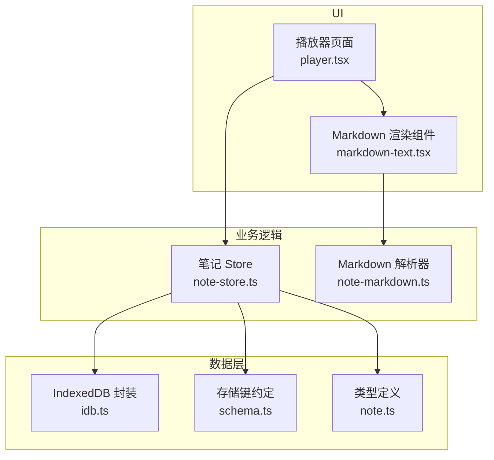
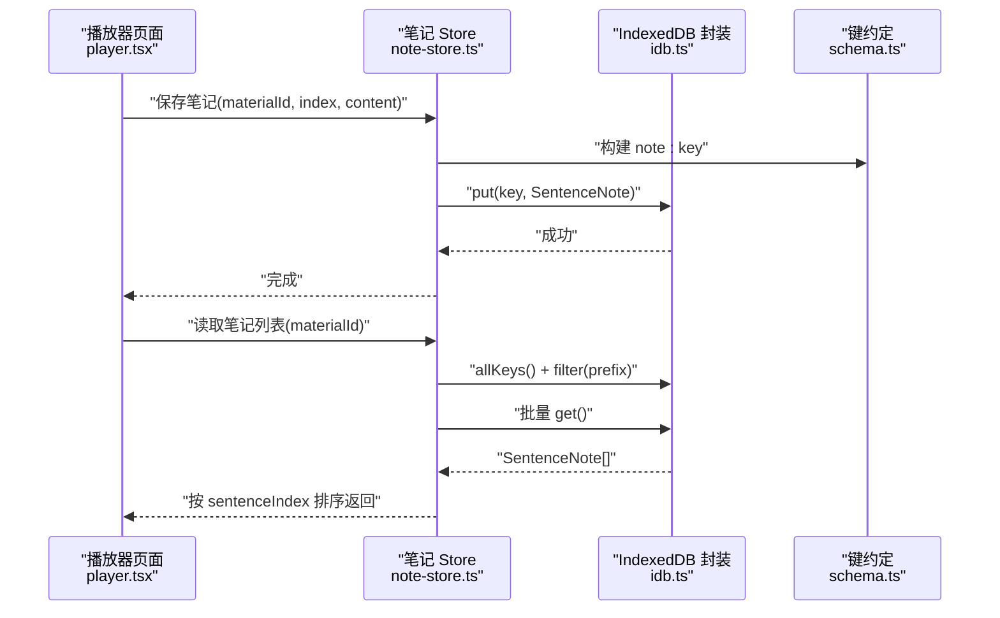
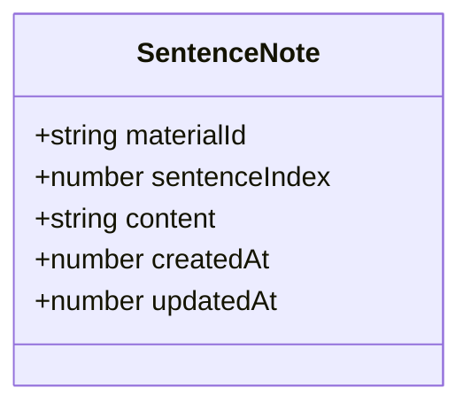
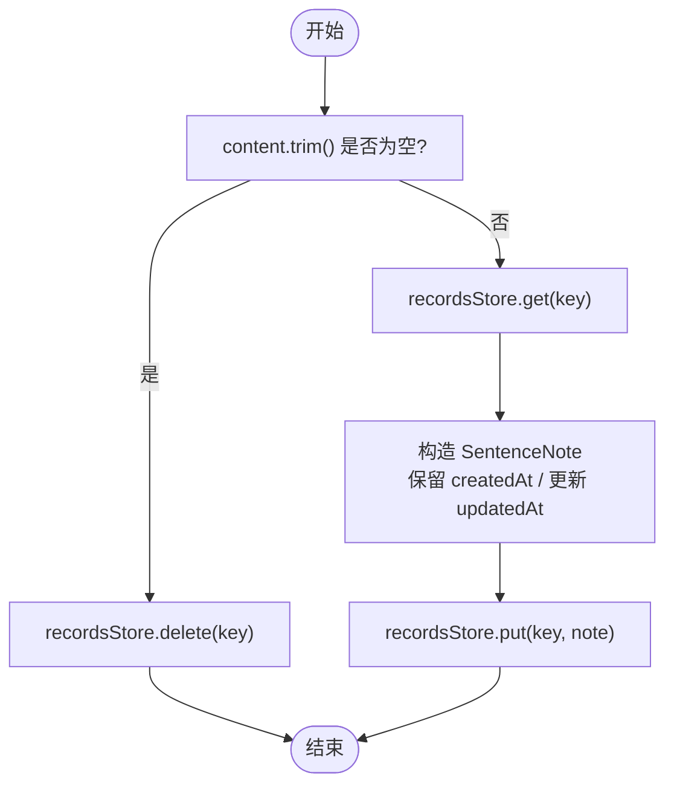
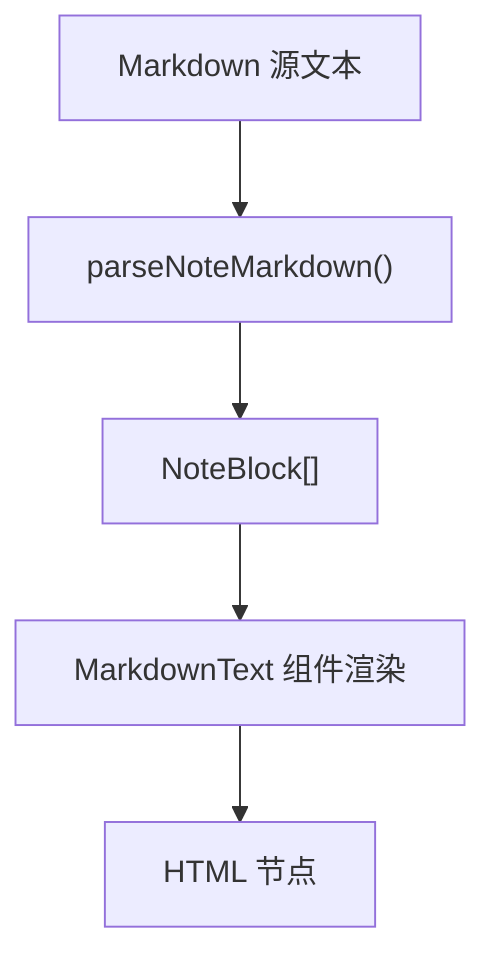
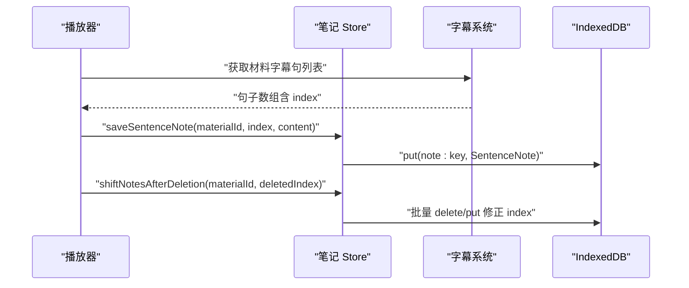
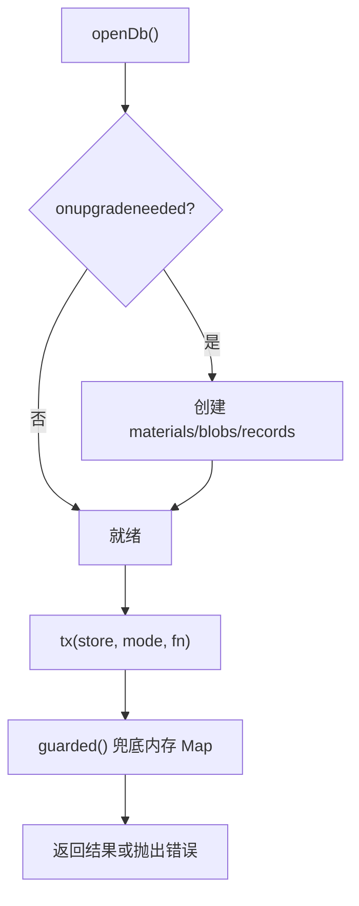
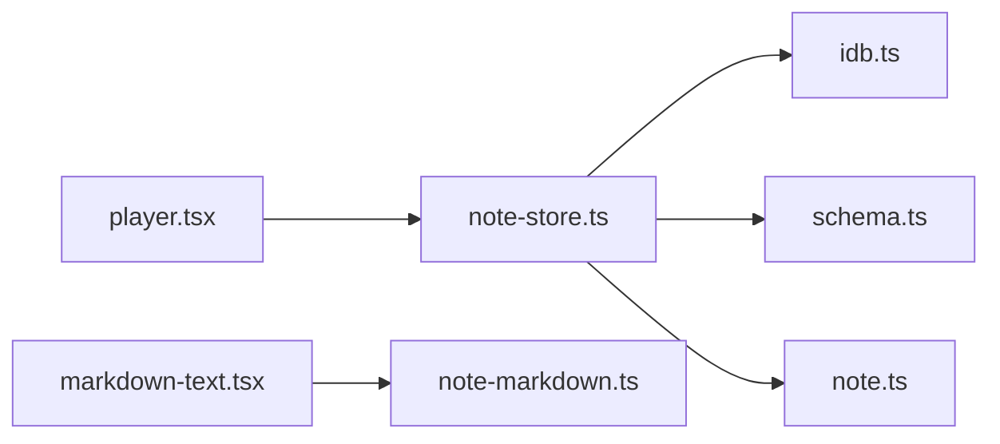

# 笔记 Store

<cite>
**本文引用的文件**   
- [note-store.ts](file://client/stores/note-store.ts)
- [note.ts](file://client/types/note.ts)
- [idb.ts](file://client/platform/storage/idb.ts)
- [schema.ts](file://client/platform/storage/schema.ts)
- [note-markdown.ts](file://client/core/markdown/note-markdown.ts)
- [markdown-text.tsx](file://client/components/shared/markdown-text.tsx)
- [player.tsx](file://client/components/pages/player.tsx)
</cite>

## 目录
1. [简介](#简介)
2. [项目结构](#项目结构)
3. [核心组件](#核心组件)
4. [架构总览](#架构总览)
5. [详细组件分析](#详细组件分析)
6. [依赖关系分析](#依赖关系分析)
7. [性能与扩展性](#性能与扩展性)
8. [故障排查指南](#故障排查指南)
9. [结论](#结论)
10. [附录：使用示例与配置](#附录使用示例与配置)

## 简介
本技术文档围绕“笔记 Store”展开，说明学习过程中的句子级笔记管理方案。该功能支持 Markdown 语法记录、富文本渲染、按时间戳与字幕句关联、IndexedDB 持久化，并提供增删改查等核心能力。文档重点解释数据模型 NoteRecord（在代码中为 SentenceNote）、状态组织方式、核心方法 addNote/updateNote/deleteNote/getNotes/searchNotes/exportNotes 的实现思路与调用位置，并给出 Markdown 处理流程、索引策略与集成字幕系统的实践建议。

## 项目结构
笔记相关代码分布在以下模块：
- 类型定义：`client/types/note.ts`
- 笔记 Store：`client/stores/note-store.ts`
- IndexedDB 封装：`client/platform/storage/idb.ts`
- 存储键约定：`client/platform/storage/schema.ts`
- Markdown 解析器：`client/core/markdown/note-markdown.ts`
- Markdown 渲染组件：`client/components/shared/markdown-text.tsx`
- 播放器集成入口：`client/components/pages/player.tsx`

**图表来源**
- [player.tsx:1-20](file://client/components/pages/player.tsx#L1-L20)
- [note-store.ts:1-72](file://client/stores/note-store.ts#L1-L72)
- [markdown-text.tsx:1-61](file://client/components/shared/markdown-text.tsx#L1-L61)
- [note-markdown.ts:1-115](file://client/core/markdown/note-markdown.ts#L1-L115)
- [idb.ts:1-117](file://client/platform/storage/idb.ts#L1-L117)
- [schema.ts:1-27](file://client/platform/storage/schema.ts#L1-L27)
- [note.ts:1-14](file://client/types/note.ts#L1-L14)

**章节来源**
- [note-store.ts:1-72](file://client/stores/note-store.ts#L1-L72)
- [note.ts:1-14](file://client/types/note.ts#L1-L14)
- [idb.ts:1-117](file://client/platform/storage/idb.ts#L1-L117)
- [schema.ts:1-27](file://client/platform/storage/schema.ts#L1-L27)
- [note-markdown.ts:1-115](file://client/core/markdown/note-markdown.ts#L1-L115)
- [markdown-text.tsx:1-61](file://client/components/shared/markdown-text.tsx#L1-L61)
- [player.tsx:1-20](file://client/components/pages/player.tsx#L1-L20)

## 核心组件
本节聚焦笔记领域的关键对象与方法，并映射到仓库中的具体实现。

- 数据模型 SentenceNote（对应文档中的 NoteRecord）
  - materialId：材料标识
  - sentenceIndex：句子序号（与字幕句一一对应）
  - content：Markdown 源文本
  - createdAt/updatedAt：创建与更新时间戳
- 状态组织
  - 当前仓库未提供独立的 NoteStoreState 类；笔记以 KV 形式存储在 IndexedDB 的 records 表，并通过前缀 `note:{materialId}:{sentenceIndex}` 进行命名空间隔离。
- 核心方法
  - addNote：保存新笔记或更新已有笔记（内容去空白后为空则删除）
  - updateNote：同 addNote 语义，通过覆盖 updatedAt 刷新编辑时间
  - deleteNote：删除指定句的笔记
  - getNotes：获取某材料的全部笔记并按 sentenceIndex 升序排序
  - searchNotes：当前未直接暴露；可通过 listNotes + 前端过滤实现
  - exportNotes：当前未直接暴露；可基于 listNotes 导出 JSON/CSV/Markdown

**章节来源**
- [note.ts:1-14](file://client/types/note.ts#L1-L14)
- [note-store.ts:14-71](file://client/stores/note-store.ts#L14-L71)

## 架构总览
笔记系统由 UI 层、业务层和数据层组成：
- UI 层：播放器页面负责触发笔记操作；MarkdownText 组件负责渲染。
- 业务层：note-store 提供对笔记的增删改查与序号平移；note-markdown 提供轻量 Markdown 解析。
- 数据层：idb.ts 封装 IndexedDB，schema.ts 统一 key 前缀，note.ts 定义数据结构。

**图表来源**
- [player.tsx:150-340](file://client/components/pages/player.tsx#L150-L340)
- [note-store.ts:19-55](file://client/stores/note-store.ts#L19-L55)
- [idb.ts:89-102](file://client/platform/storage/idb.ts#L89-L102)
- [schema.ts:16-26](file://client/platform/storage/schema.ts#L16-L26)

## 详细组件分析

### 数据模型与状态
- SentenceNote 字段含义清晰，适合绑定到单个字幕句。
- 状态并非集中式 store 对象，而是分布式 KV 记录，便于按材料维度独立管理。
- 时间戳用于审计与排序，createdAt 仅在首次创建时固定，后续仅更新 updatedAt。

**图表来源**
- [note.ts:1-14](file://client/types/note.ts#L1-L14)

**章节来源**
- [note.ts:1-14](file://client/types/note.ts#L1-L14)

### 笔记 Store 核心方法
- listNotes(materialId?)
  - 行为：按前缀筛选所有笔记 key，批量读取并返回按 sentenceIndex 升序的结果。
  - 复杂度：O(N log N)，N 为匹配到的笔记数（排序开销）。
- getSentenceNote(materialId, sentenceIndex)
  - 行为：根据 RECORD_KEYS.note 精确查询单条笔记。
- saveSentenceNote(materialId, sentenceIndex, content)
  - 行为：若 content 去空白后为空则执行删除；否则 put 一条 SentenceNote，保留 createdAt，更新 updatedAt。
- deleteSentenceNote(materialId, sentenceIndex)
  - 行为：直接删除对应 key。
- shiftNotesAfterDeletion(materialId, deletedIndex)
  - 行为：删除被删句的笔记，并将其后所有笔记的 sentenceIndex 减 1，同时重写旧 key，保证与字幕重排后的 index 对齐。

**图表来源**
- [note-store.ts:31-50](file://client/stores/note-store.ts#L31-L50)

**章节来源**
- [note-store.ts:19-71](file://client/stores/note-store.ts#L19-L71)

### Markdown 处理逻辑
- 解析器 note-markdown.ts
  - 行内标记：粗体、斜体、高亮、行内代码。
  - 块级结构：标题（# ~ ###）、无序列表、引用、围栏代码块、表格（第二行为分隔行）。
  - 输出结构化 NoteBlock/InlineToken，便于渲染层复用。
- 渲染器 markdown-text.tsx
  - 将 NoteBlock 转换为 JSX，包含样式类名，支持暗色主题适配。
  - 解析失败不抛错，纯文本也能正常渲染。

**图表来源**
- [note-markdown.ts:58-114](file://client/core/markdown/note-markdown.ts#L58-L114)
- [markdown-text.tsx:53-60](file://client/components/shared/markdown-text.tsx#L53-L60)

**章节来源**
- [note-markdown.ts:1-115](file://client/core/markdown/note-markdown.ts#L1-L115)
- [markdown-text.tsx:1-61](file://client/components/shared/markdown-text.tsx#L1-L61)

### 与字幕系统的集成
- 键约定：RECORD_KEYS.note(materialId, sentenceIndex) 生成 `note:{materialId}:{sentenceIndex}`。
- 播放场景：播放器页面在用户编辑笔记时调用 saveSentenceNote；当字幕句删除或重排时调用 shiftNotesAfterDeletion 保持同步。
- 时间戳关联：当前模型以 sentenceIndex 作为关联键；如需按时间戳关联，可在上层服务中将 sentenceIndex 映射到字幕时间戳，或在扩展模型中增加 timestamp 字段。

**图表来源**
- [player.tsx:150-340](file://client/components/pages/player.tsx#L150-L340)
- [note-store.ts:57-71](file://client/stores/note-store.ts#L57-L71)
- [schema.ts:16-26](file://client/platform/storage/schema.ts#L16-L26)

**章节来源**
- [player.tsx:150-340](file://client/components/pages/player.tsx#L150-L340)
- [note-store.ts:57-71](file://client/stores/note-store.ts#L57-L71)
- [schema.ts:16-26](file://client/platform/storage/schema.ts#L16-L26)

### IndexedDB 存储策略
- 数据库名：ping-english-assistant，版本 2。
- Object Stores：materials、blobs、records。
- 降级策略：SSR/隐私模式打开失败时自动回退到内存 Map，确保调用方永不崩溃。
- 事务封装：tx/guarded 统一错误处理与兜底。
- 全文搜索索引：当前未内置全文索引；searchNotes 需在前端通过 listNotes 结果进行字符串匹配。
- 版本控制：IDB 版本号递增并在 onupgradeneeded 中创建 object store；未来可扩展 schema 迁移逻辑。

**图表来源**
- [idb.ts:26-78](file://client/platform/storage/idb.ts#L26-L78)

**章节来源**
- [idb.ts:1-117](file://client/platform/storage/idb.ts#L1-L117)

## 依赖关系分析
- note-store.ts 依赖：
  - idb.ts：recordsStore 的 get/put/delete/allKeys
  - schema.ts：RECORD_KEYS.note 生成键
  - types/note.ts：SentenceNote 类型约束
- markdown-text.tsx 依赖：
  - core/markdown/note-markdown.ts：解析出 NoteBlock/InlineToken
- player.tsx 依赖：
  - stores/note-store.ts：listNotes/saveSentenceNote/deleteSentenceNote/shiftNotesAfterDeletion

**图表来源**
- [player.tsx:1-20](file://client/components/pages/player.tsx#L1-L20)
- [note-store.ts:1-11](file://client/stores/note-store.ts#L1-L11)
- [markdown-text.tsx:1-6](file://client/components/shared/markdown-text.tsx#L1-L6)

**章节来源**
- [player.tsx:1-20](file://client/components/pages/player.tsx#L1-L20)
- [note-store.ts:1-11](file://client/stores/note-store.ts#L1-L11)
- [markdown-text.tsx:1-6](file://client/components/shared/markdown-text.tsx#L1-L6)

## 性能与扩展性
- 查询性能
  - listNotes 会遍历 records 的所有 key 并过滤前缀，随后批量 get。对于大量笔记的场景，建议在上层维护一个按 materialId 分组的索引表（例如在应用内存或额外 object store），以减少全量扫描。
- 写入性能
  - saveSentenceNote 先 get 再 put，存在一次读放大；可考虑合并写队列或批量提交以提升吞吐。
- 渲染性能
  - Markdown 解析为 O(n) 线性扫描，渲染为 React 树遍历；长文档建议分页或虚拟滚动。
- 扩展方向
  - 全文搜索：引入轻量倒排索引（如 lunr.js）或后端 ES，避免前端全量扫描。
  - 版本控制：在 SentenceNote 中增加 version 字段，配合 schema 迁移策略。
  - 时间戳关联：在 SentenceNote 中增加 timestamp 字段，并与字幕时间轴联动。

[本节为通用指导，无需特定文件来源]

## 故障排查指南
- IndexedDB 不可用
  - 现象：控制台出现 “[IDB] open failed...” 或 “open blocked”，自动切换内存模式。
  - 排查：检查浏览器隐私模式、多标签页占用、权限限制；确认 isMemoryFallback() 返回值。
- 笔记未保存
  - 现象：保存后刷新丢失。
  - 排查：确认 content.trim() 非空；检查 RECORD_KEYS.note 生成的 key 是否正确；查看 recordsStore.put 是否成功。
- 序号错位
  - 现象：字幕句删除后笔记与句不对齐。
  - 排查：确保调用 shiftNotesAfterDeletion 并传入正确的 deletedIndex；检查 notes 排序与过滤逻辑。
- Markdown 渲染异常
  - 现象：特殊字符或嵌套语法显示异常。
  - 排查：确认 parseNoteMarkdown 支持的子集；必要时扩展解析规则并补充测试。

**章节来源**
- [idb.ts:31-49](file://client/platform/storage/idb.ts#L31-L49)
- [note-store.ts:31-71](file://client/stores/note-store.ts#L31-L71)
- [note-markdown.ts:58-114](file://client/core/markdown/note-markdown.ts#L58-L114)

## 结论
笔记 Store 以简洁的 KV 结构与轻量 Markdown 解析为核心，满足学习过程中“边听边记”的需求。其优势在于零依赖、易扩展、与播放器/字幕系统解耦良好。未来可在全文检索、版本控制、时间戳关联等方面进一步增强，以满足更复杂的学习场景。

[本节为总结，无需特定文件来源]

## 附录：使用示例与配置

### 基本用法（创建、编辑、删除、读取）
- 创建/编辑笔记
  - 调用 saveSentenceNote(materialId, sentenceIndex, content)。
  - 若 content 去空白后为空，等价于删除。
- 删除笔记
  - 调用 deleteSentenceNote(materialId, sentenceIndex)。
- 读取笔记列表
  - 调用 listNotes(materialId) 获取按 sentenceIndex 升序的数组。
- 读取单条笔记
  - 调用 getSentenceNote(materialId, sentenceIndex)。

参考路径
- [note-store.ts:19-55](file://client/stores/note-store.ts#L19-L55)
- [player.tsx:150-340](file://client/components/pages/player.tsx#L150-L340)

### 搜索笔记（searchNotes）
- 当前未直接暴露 searchNotes。
- 推荐实现：在前端调用 listNotes(materialId) 后对 content 进行字符串匹配或正则过滤。
- 扩展建议：引入倒排索引或后端全文检索服务，提升大规模数据下的搜索性能。

参考路径
- [note-store.ts:19-24](file://client/stores/note-store.ts#L19-L24)

### 导出笔记（exportNotes）
- 当前未直接暴露 exportNotes。
- 推荐实现：调用 listNotes(materialId) 后导出为 JSON、CSV 或 Markdown 文本。
- 注意：导出前可对 content 进行清洗或格式化。

参考路径
- [note-store.ts:19-24](file://client/stores/note-store.ts#L19-L24)

### Markdown 扩展语法与自定义渲染器
- 扩展语法
  - 在 note-markdown.ts 中扩展 tokenizeInline 与 parseNoteMarkdown，新增语法（如链接、图片、任务列表等）。
- 自定义渲染器
  - 在 markdown-text.tsx 中扩展 Block/Inline 组件，添加新的 JSX 节点与样式类名。
- 测试建议
  - 为新增语法编写单元测试，确保解析与渲染一致性。

参考路径
- [note-markdown.ts:29-114](file://client/core/markdown/note-markdown.ts#L29-L114)
- [markdown-text.tsx:7-50](file://client/components/shared/markdown-text.tsx#L7-L50)