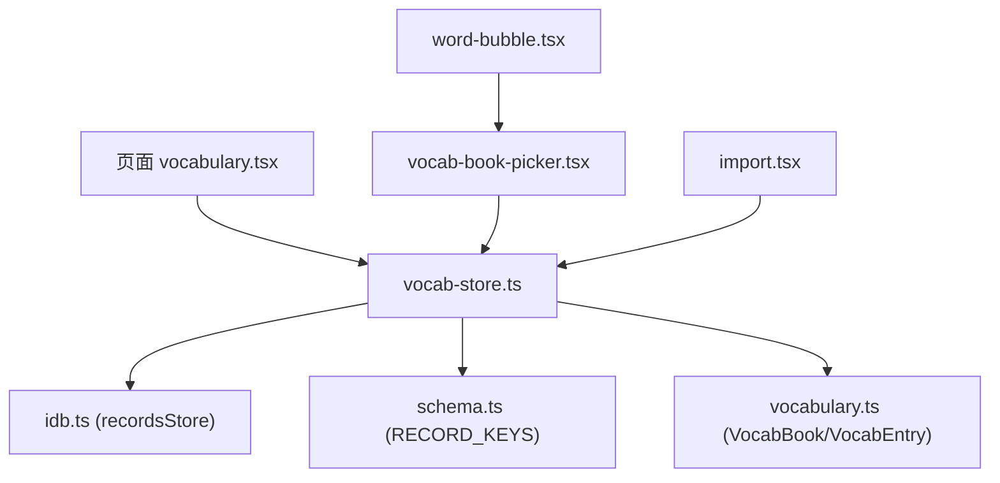
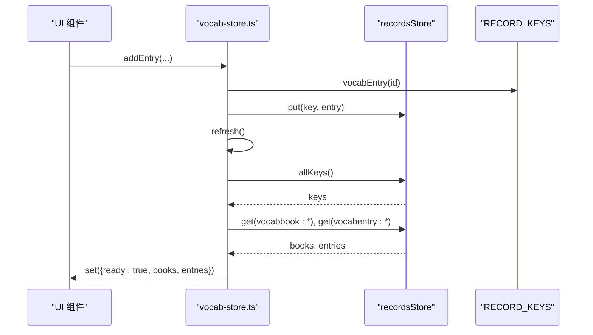
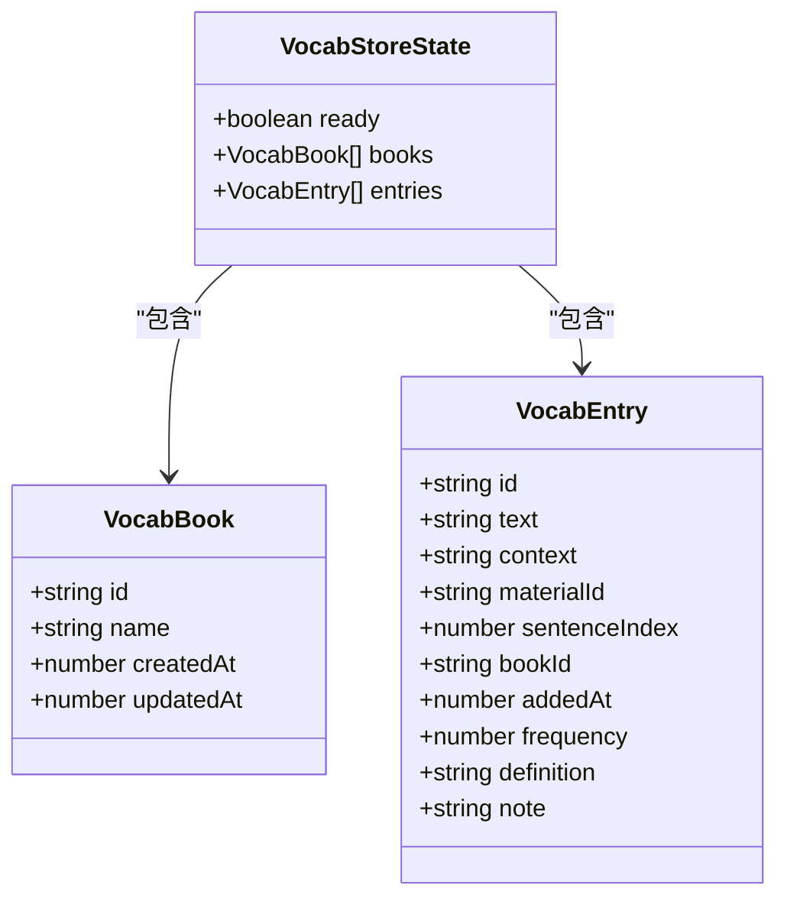
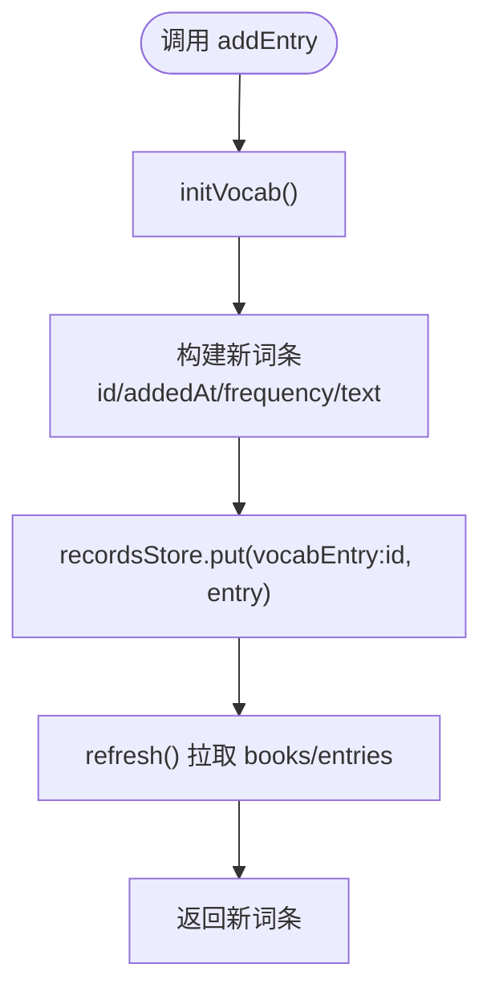
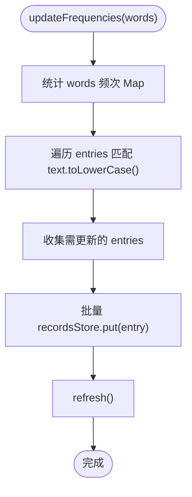
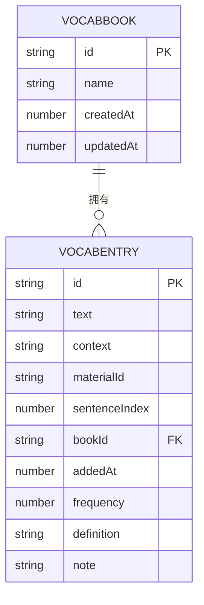
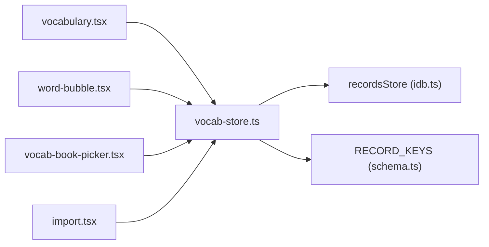

# 词汇 Store

<cite>
**本文引用的文件**   
- [client/stores/vocab-store.ts](file://client/stores/vocab-store.ts)
- [client/types/vocabulary.ts](file://client/types/vocabulary.ts)
- [client/platform/storage/schema.ts](file://client/platform/storage/schema.ts)
- [client/platform/storage/idb.ts](file://client/platform/storage/idb.ts)
- [client/components/pages/vocabulary.tsx](file://client/components/pages/vocabulary.tsx)
- [client/components/shared/word-bubble.tsx](file://client/components/shared/word-bubble.tsx)
- [client/components/shared/vocab-book-picker.tsx](file://client/components/shared/vocab-book-picker.tsx)
- [client/components/pages/import.tsx](file://client/components/pages/import.tsx)
</cite>

## 目录
1. [引言](#引言)
2. [项目结构](#项目结构)
3. [核心组件](#核心组件)
4. [架构总览](#架构总览)
5. [详细组件分析](#详细组件分析)
6. [依赖关系分析](#依赖关系分析)
7. [性能与复杂度](#性能与复杂度)
8. [故障排查指南](#故障排查指南)
9. [结论](#结论)
10. [附录：使用示例与扩展建议](#附录使用示例与扩展建议)

## 引言
本技术文档围绕“生词本”能力展开，说明词汇 Store 如何管理学习过程中遇到的生词，支持词汇的添加、分组、复习辅助与进度统计。重点包括：
- VocabWord 数据模型（实际实现为 VocabEntry）与 VocabStoreState 状态结构
- 核心方法：addVocab/addEntry、removeVocab/removeEntry、updateVocab/updateEntry、getVocabList/getEntriesByBook、getVocabStats（当前未实现）、exportVocab（当前未实现）
- 词汇学习算法：艾宾浩斯遗忘曲线与复习间隔计算（当前未实现，提供设计建议）
- 与训练系统的集成：自动从导入材料中扫描字幕单词并累加 frequency
- IndexedDB 数据结构：records store 中的 vocabbook: 与 vocabentry: 前缀键空间
- 使用示例：批量导入、智能复习与数据分析（含缺失能力的扩展方案）

## 项目结构
词汇 Store 位于 client/stores/vocab-store.ts，类型定义在 client/types/vocabulary.ts，持久化通过 client/platform/storage/idb.ts 提供的 recordsStore 写入，键空间由 client/platform/storage/schema.ts 统一约定。UI 层涉及：
- 生词本管理页面：client/components/pages/vocabulary.tsx
- 选词气泡与添加到生词本弹窗：client/components/shared/word-bubble.tsx、client/components/shared/vocab-book-picker.tsx
- 导入流程中更新频率：client/components/pages/import.tsx

图表来源
- [client/stores/vocab-store.ts:1-193](file://client/stores/vocab-store.ts#L1-L193)
- [client/platform/storage/idb.ts:1-117](file://client/platform/storage/idb.ts#L1-L117)
- [client/platform/storage/schema.ts:16-26](file://client/platform/storage/schema.ts#L16-L26)
- [client/types/vocabulary.ts:1-41](file://client/types/vocabulary.ts#L1-L41)
- [client/components/pages/vocabulary.tsx:1-475](file://client/components/pages/vocabulary.tsx#L1-L475)
- [client/components/shared/word-bubble.tsx:1-206](file://client/components/shared/word-bubble.tsx#L1-L206)
- [client/components/shared/vocab-book-picker.tsx:1-158](file://client/components/shared/vocab-book-picker.tsx#L1-L158)
- [client/components/pages/import.tsx:218-271](file://client/components/pages/import.tsx#L218-L271)

章节来源
- [client/stores/vocab-store.ts:1-193](file://client/stores/vocab-store.ts#L1-L193)
- [client/platform/storage/idb.ts:1-117](file://client/platform/storage/idb.ts#L1-L117)
- [client/platform/storage/schema.ts:16-26](file://client/platform/storage/schema.ts#L16-L26)
- [client/types/vocabulary.ts:1-41](file://client/types/vocabulary.ts#L1-L41)

## 核心组件
- VocabStoreState：包含 ready、books、entries，用于驱动 UI 渲染与交互。
- VocabBook：生词本元信息（id、name、createdAt、updatedAt）。
- VocabEntry：词条元信息（id、text、context、materialId、sentenceIndex、bookId、addedAt、frequency、definition、note）。
- 核心 API：
  - addEntry（对应 addVocab 语义）
  - removeEntry（对应 removeVocab 语义）
  - updateEntry（对应 updateVocab 语义）
  - getEntriesByBook（对应 getVocabList 语义）
  - hasText（查重）
  - updateFrequencies（导入后批量更新 frequency）
  - createBook / removeBook / renameBook / clearEntriesByBook（分组管理）

章节来源
- [client/stores/vocab-store.ts:14-193](file://client/stores/vocab-store.ts#L14-L193)
- [client/types/vocabulary.ts:1-41](file://client/types/vocabulary.ts#L1-L41)

## 架构总览
词汇 Store 采用“内存状态 + IndexedDB 持久化”的双层结构：
- 内存状态：通过 createStore 暴露 VocabStoreState，供 React 组件订阅。
- 持久化：所有读写走 recordsStore，键空间以 vocabbook:/vocabentry: 前缀区分。
- 初始化：首次加载确保默认生词本存在，并刷新 books/entries。
- 同步策略：每次写操作后调用 refresh() 重新拉取 records store 全量数据，排序后更新状态。

图表来源
- [client/stores/vocab-store.ts:104-116](file://client/stores/vocab-store.ts#L104-L116)
- [client/stores/vocab-store.ts:22-34](file://client/stores/vocab-store.ts#L22-L34)
- [client/platform/storage/schema.ts:22-23](file://client/platform/storage/schema.ts#L22-L23)
- [client/platform/storage/idb.ts:89-97](file://client/platform/storage/idb.ts#L89-L97)

## 详细组件分析

### 数据模型与状态
- VocabBook：表示一个生词本，包含 id、name、createdAt、updatedAt。
- VocabEntry：表示一条词条，包含 text、context、materialId、sentenceIndex、bookId、addedAt、frequency、definition、note。
- VocabStoreState：包含 ready、books、entries；ready 标识是否完成初始化与首次加载。

图表来源
- [client/types/vocabulary.ts:4-37](file://client/types/vocabulary.ts#L4-L37)
- [client/stores/vocab-store.ts:14-18](file://client/stores/vocab-store.ts#L14-L18)

章节来源
- [client/types/vocabulary.ts:1-41](file://client/types/vocabulary.ts#L1-L41)
- [client/stores/vocab-store.ts:14-18](file://client/stores/vocab-store.ts#L14-L18)

### 核心方法详解

#### addEntry（添加生词）
- 职责：创建新词条，生成 id、addedAt、frequency=0，规范化 text，写入 recordsStore，刷新状态。
- 输入：Omit<VocabEntry, 'id' | 'addedAt' | 'frequency'>
- 输出：VocabEntry
- 关键点：
  - 先 initVocab() 确保默认生词本存在
  - 使用 RECORD_KEYS.vocabEntry(newEntry.id) 作为 key
  - 写库后 refresh() 拉取最新列表

图表来源
- [client/stores/vocab-store.ts:104-116](file://client/stores/vocab-store.ts#L104-L116)
- [client/stores/vocab-store.ts:52-55](file://client/stores/vocab-store.ts#L52-L55)
- [client/stores/vocab-store.ts:22-34](file://client/stores/vocab-store.ts#L22-L34)

章节来源
- [client/stores/vocab-store.ts:104-116](file://client/stores/vocab-store.ts#L104-L116)

#### removeEntry（移除生词）
- 职责：根据 entryId 删除词条，刷新状态。
- 关键点：同样先 initVocab()，再 delete(vocabEntry:id)，最后 refresh()。

章节来源
- [client/stores/vocab-store.ts:119-123](file://client/stores/vocab-store.ts#L119-L123)

#### updateEntry（更新词汇信息）
- 职责：仅允许更新 note 字段，合并更新后写回 recordsStore，刷新状态。
- 关键点：读取原条目，合并 updates，put 后 refresh()。

章节来源
- [client/stores/vocab-store.ts:126-133](file://client/stores/vocab-store.ts#L126-L133)

#### getEntriesByBook（获取词汇列表）
- 职责：按 bookId 过滤 entries，返回列表。
- 注意：当前未实现全局 getVocabList，但可通过 getAllBooks 与 entries 自行聚合。

章节来源
- [client/stores/vocab-store.ts:136-138](file://client/stores/vocab-store.ts#L136-L138)

#### getVocabStats（获取学习统计）
- 现状：未实现。
- 建议：基于 entries 计算 total、newCount、reviewDue、mastered、accuracy 等指标；可结合复习算法结果。

[本节为概念性补充，不直接分析具体文件]

#### exportVocab（导出词汇数据）
- 现状：未实现。
- 建议：导出 JSON 或 CSV，包含 VocabBook 与 VocabEntry 列表；支持按 bookId 筛选。

[本节为概念性补充，不直接分析具体文件]

### 分组管理
- createBook：创建新本，分配随机 id，写入 recordsStore，刷新状态。
- removeBook：不允许删除默认本；删除时会级联删除该本下所有词条。
- renameBook：重命名并更新时间戳。
- clearEntriesByBook：清空指定本下的所有词条。

章节来源
- [client/stores/vocab-store.ts:60-99](file://client/stores/vocab-store.ts#L60-L99)
- [client/stores/vocab-store.ts:141-148](file://client/stores/vocab-store.ts#L141-L148)

### 查重与频率更新
- hasText：大小写不敏感匹配，可选限定 bookId。
- updateFrequencies：传入字幕扁平单词数组，统计每个词出现次数，匹配 entries 的 text，累加 frequency，批量写回。

图表来源
- [client/stores/vocab-store.ts:167-192](file://client/stores/vocab-store.ts#L167-L192)

章节来源
- [client/stores/vocab-store.ts:154-161](file://client/stores/vocab-store.ts#L154-L161)
- [client/stores/vocab-store.ts:167-192](file://client/stores/vocab-store.ts#L167-L192)

### 与训练系统集成的触发点
- 导入流程：import.tsx 在完成材料保存后，提取 subtitle.data.sentences 的 words 数组，调用 updateFrequencies(allWords)。
- 播放器：player.tsx 也调用 updateFrequencies(allWords) 进行频率累计。
- 听写与练习：当前听写页面 dictation.tsx 主要记录训练成绩，未直接写入生词；但可通过后续扩展将错误词自动加入生词本。

章节来源
- [client/components/pages/import.tsx:255-259](file://client/components/pages/import.tsx#L255-L259)
- [client/components/pages/player.tsx:383-383](file://client/components/pages/player.tsx#L383-L383)

### IndexedDB 数据结构
- 数据库名：ping-english-assistant
- Object Stores：materials、blobs、records
- 词汇相关键空间：
  - vocabbook:{bookId}
  - vocabentry:{entryId}
- 降级策略：SSR/隐私模式失败时回退到内存 Map，保证调用方不崩溃。

图表来源
- [client/platform/storage/idb.ts:12-15](file://client/platform/storage/idb.ts#L12-L15)
- [client/platform/storage/schema.ts:22-23](file://client/platform/storage/schema.ts#L22-L23)
- [client/types/vocabulary.ts:4-37](file://client/types/vocabulary.ts#L4-L37)

章节来源
- [client/platform/storage/idb.ts:1-117](file://client/platform/storage/idb.ts#L1-L117)
- [client/platform/storage/schema.ts:16-26](file://client/platform/storage/schema.ts#L16-L26)

## 依赖关系分析
- UI 层依赖：
  - vocabulary.tsx 依赖 vocab-store 的 CRUD 与状态订阅
  - word-bubble.tsx 依赖 hasText 与 initVocab
  - vocab-book-picker.tsx 依赖 createBook 与 addEntry
  - import.tsx 依赖 updateFrequencies
- 存储层依赖：
  - vocab-store.ts 依赖 recordsStore 与 RECORD_KEYS
  - idb.ts 提供 KV 接口与降级逻辑

图表来源
- [client/components/pages/vocabulary.tsx:15-15](file://client/components/pages/vocabulary.tsx#L15-L15)
- [client/components/shared/word-bubble.tsx:14-16](file://client/components/shared/word-bubble.tsx#L14-L16)
- [client/components/shared/vocab-book-picker.tsx:16-16](file://client/components/shared/vocab-book-picker.tsx#L16-L16)
- [client/components/pages/import.tsx:14-14](file://client/components/pages/import.tsx#L14-L14)
- [client/stores/vocab-store.ts:10-12](file://client/stores/vocab-store.ts#L10-L12)

章节来源
- [client/components/pages/vocabulary.tsx:1-475](file://client/components/pages/vocabulary.tsx#L1-L475)
- [client/components/shared/word-bubble.tsx:1-206](file://client/components/shared/word-bubble.tsx#L1-L206)
- [client/components/shared/vocab-book-picker.tsx:1-158](file://client/components/shared/vocab-book-picker.tsx#L1-L158)
- [client/components/pages/import.tsx:1-374](file://client/components/pages/import.tsx#L1-L374)
- [client/stores/vocab-store.ts:1-193](file://client/stores/vocab-store.ts#L1-L193)

## 性能与复杂度
- 初始化与刷新：
  - refresh() 会读取 recordsStore 全部 keys，并按前缀过滤 vocabbook:/vocabentry:，然后并发 get 所有条目，时间复杂度 O(N+M)，N 为 vocabbook 数量，M 为 vocabentry 数量。
- 添加/删除/更新：
  - 单次写操作 O(1)，随后 refresh() 再次 O(N+M)。
- 频率更新：
  - updateFrequencies(words) 对 words 做计数 O(W)，再遍历 entries O(M)，总体 O(W+M)。
- 优化建议：
  - 引入增量更新：避免每次写后全量刷新，改为局部 diff 更新状态。
  - 对 entries 建立索引：如 text→id、bookId→entries[]，降低过滤与查找成本。
  - 分页/懒加载：当 entries 规模较大时，按需加载。

章节来源
- [client/stores/vocab-store.ts:22-34](file://client/stores/vocab-store.ts#L22-L34)
- [client/stores/vocab-store.ts:167-192](file://client/stores/vocab-store.ts#L167-L192)

## 故障排查指南
- 初始化失败：
  - 检查 initVocab 是否被调用；确认默认生词本 ensureDefaultBook 已执行。
- 数据未持久化：
  - 检查 recordsStore 是否可用；若处于内存降级模式，数据不会落盘。
- 频率未更新：
  - 确认导入流程是否正确调用 updateFrequencies(allWords)，且 subtitle.data.sentences.words 非空。
- 重复添加：
  - 使用 hasText 进行查重；注意大小写不敏感匹配。

章节来源
- [client/stores/vocab-store.ts:52-55](file://client/stores/vocab-store.ts#L52-L55)
- [client/platform/storage/idb.ts:17-24](file://client/platform/storage/idb.ts#L17-L24)
- [client/components/pages/import.tsx:255-259](file://client/components/pages/import.tsx#L255-L259)
- [client/stores/vocab-store.ts:154-161](file://client/stores/vocab-store.ts#L154-L161)

## 结论
词汇 Store 提供了完整的生词本基础能力：多本管理、词条 CRUD、频率统计与 IndexedDB 持久化。当前尚未实现复习算法与导出功能，但已有充分的数据基础与扩展点。建议在后续迭代中：
- 实现 getVocabStats 与 exportVocab
- 引入艾宾浩斯复习算法，维护 nextReviewAt、interval、easeFactor 等字段
- 优化 refresh 策略，减少全量刷新开销
- 扩展训练系统集成，自动从错误词中提取生词

[本节为总结性内容，不直接分析具体文件]

## 附录：使用示例与扩展建议

### 完整操作流程示例
- 批量导入材料：
  - 在 import.tsx 中选择媒体与字幕，完成后自动解析字幕并调用 updateFrequencies(allWords) 更新词条频率。
- 智能复习：
  - 当前未实现；建议基于艾宾浩斯算法计算下次复习时间，并在 UI 展示待复习列表。
- 数据分析：
  - 当前未实现；建议基于 entries 统计新增数、掌握率、高频词等指标。

章节来源
- [client/components/pages/import.tsx:255-259](file://client/components/pages/import.tsx#L255-L259)

### 词汇数据的导入导出格式规范
- 导入：
  - 支持 SRT/LRC 字幕，解析为 SubtitleData，提取 sentences.words 用于频率统计。
- 导出：
  - 建议导出 JSON：包含 books 与 entries 两个数组；CSV：每行一个 entry，包含 text、context、bookName、frequency、note 等字段。

[本节为概念性补充，不直接分析具体文件]

### 第三方工具集成方法
- 与 TTS/转写工具：
  - import.tsx 支持从 TTS/转写产物一键带入音频与字幕，并在导入后更新频率。
- 与翻译/词典服务：
  - 可在 addEntry 或 updateEntry 时调用 LLM 释义接口，填充 definition 字段。

章节来源
- [client/components/pages/import.tsx:169-201](file://client/components/pages/import.tsx#L169-L201)

### 词汇学习算法设计建议（艾宾浩斯遗忘曲线）
- 目标：
  - 根据用户复习表现动态调整复习间隔，提升长期记忆效果。
- 关键参数：
  - interval：下次复习间隔（天）
  - easeFactor：难度系数（初始值约 2.5，正确回答增加，错误回答重置）
  - nextReviewAt：下次复习时间戳
  - reviewHistory：复习历史（可选）
- 算法步骤：
  - 初次添加：interval=1，easeFactor=2.5，nextReviewAt=now+1天
  - 正确回答：interval = interval * easeFactor，easeFactor += 0.1
  - 错误回答：interval=1，easeFactor=2.5
  - 到期提醒：UI 展示待复习列表，支持一键复习
- 数据模型扩展：
  - 在 VocabEntry 中新增 nextReviewAt、interval、easeFactor、reviewHistory 字段
  - 在 VocabStoreState 中新增 dueEntries、stats 等字段

[本节为概念性补充，不直接分析具体文件]