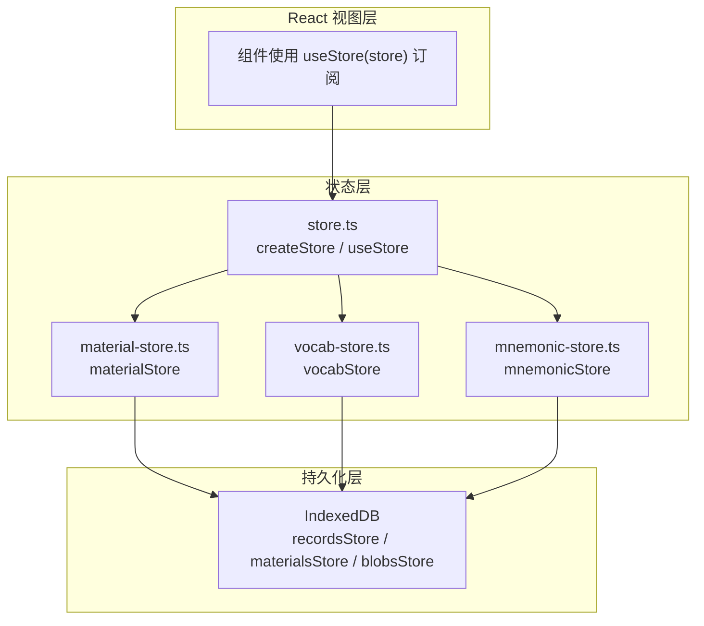
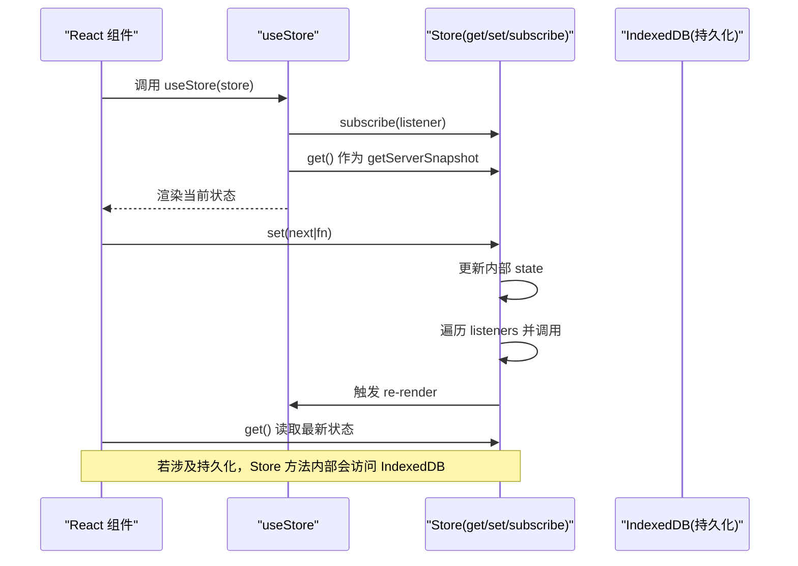
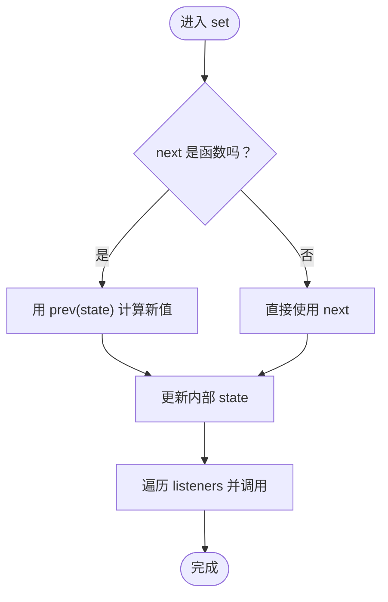
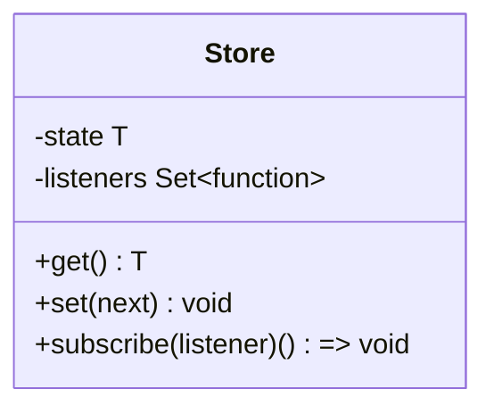
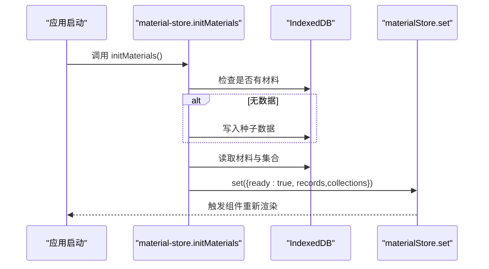
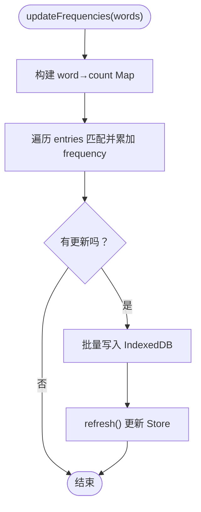
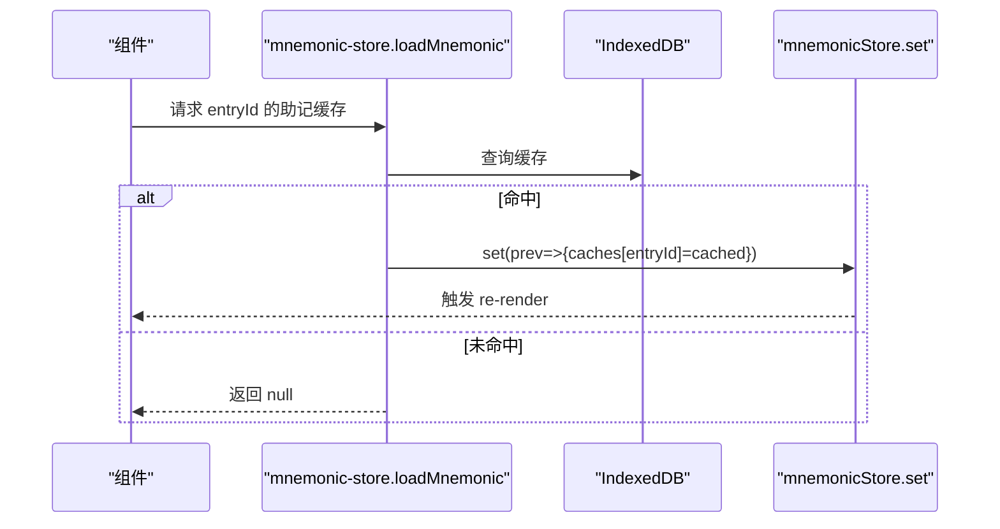
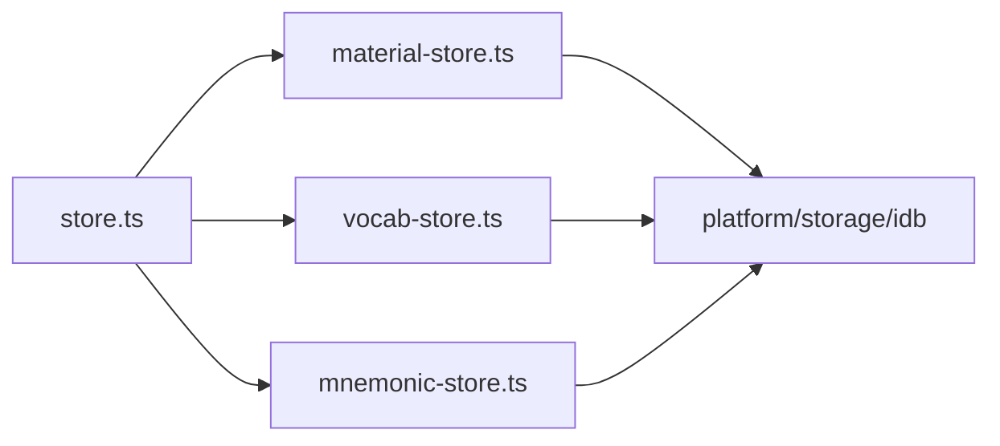

# 核心存储机制

<cite>
**本文引用的文件**   
- [client/stores/store.ts](file://client/stores/store.ts)
- [client/stores/material-store.ts](file://client/stores/material-store.ts)
- [client/stores/vocab-store.ts](file://client/stores/vocab-store.ts)
- [client/stores/mnemonic-store.ts](file://client/stores/mnemonic-store.ts)
</cite>

## 目录
1. [引言](#引言)
2. [项目结构](#项目结构)
3. [核心组件](#核心组件)
4. [架构总览](#架构总览)
5. [详细组件分析](#详细组件分析)
6. [依赖关系分析](#依赖关系分析)
7. [性能与优化建议](#性能与优化建议)
8. [故障排查指南](#故障排查指南)
9. [结论](#结论)

## 引言
本文件聚焦于项目的状态管理核心机制，围绕 createStore 与 useStore 的实现原理展开，解释其基于 React 的 useSyncExternalStore 的设计动机、订阅机制、SSR 安全性以及内存泄漏防护。同时结合 material-store、vocab-store、mnemonic-store 等具体 Store 的使用方式，说明该机制在实际业务中的落地形态，并与 zustand/Pinia 等第三方库进行对比，给出零依赖设计的考量、性能优化建议与最佳实践。

## 项目结构
本项目在 client/stores 目录下集中实现领域 Store：
- store.ts：提供通用的 createStore/useStore 能力，作为所有领域 Store 的基础设施。
- material-store.ts：材料库 Store，负责材料记录、集合、媒体 Blob、进度等数据加载与更新。
- vocab-store.ts：生词本 Store，支持多生词本与词条 CRUD、频率统计等。
- mnemonic-store.ts：助记缓存 Store，将 LLM 生成的卡片持久化到 IndexedDB，并提供内存缓存。
- favorite-store.ts、note-store.ts 等：以 recordsStore 为真源的数据读写工具函数（不直接持有全局状态）。

图表来源
- [client/stores/store.ts:1-34](file://client/stores/store.ts#L1-L34)
- [client/stores/material-store.ts:20-30](file://client/stores/material-store.ts#L20-L30)
- [client/stores/vocab-store.ts:10-20](file://client/stores/vocab-store.ts#L10-L20)
- [client/stores/mnemonic-store.ts:8-18](file://client/stores/mnemonic-store.ts#L8-L18)

章节来源
- [client/stores/store.ts:1-34](file://client/stores/store.ts#L1-L34)
- [client/stores/material-store.ts:1-30](file://client/stores/material-store.ts#L1-L30)
- [client/stores/vocab-store.ts:1-20](file://client/stores/vocab-store.ts#L1-L20)
- [client/stores/mnemonic-store.ts:1-18](file://client/stores/mnemonic-store.ts#L1-L18)

## 核心组件
- Store 接口：get/set/subscribe
  - get：同步读取当前状态快照。
  - set：接受新值或基于旧值的更新函数，写入后通知所有订阅者。
  - subscribe：注册监听器并返回取消订阅函数，用于清理 listener。
- createStore：创建 Store 实例，内部维护 state 与 listeners（Set），提供最小化的响应式能力。
- useStore：React Hook，基于 useSyncExternalStore 订阅 Store，并在 SSR 场景下通过 getServerSnapshot 安全获取初始值。

章节来源
- [client/stores/store.ts:8-33](file://client/stores/store.ts#L8-L33)

## 架构总览
下图展示从 React 组件到 Store 再到持久化层的完整调用链，以及 useSyncExternalStore 在其中的作用。

图表来源
- [client/stores/store.ts:14-33](file://client/stores/store.ts#L14-L33)
- [client/stores/material-store.ts:40-52](file://client/stores/material-store.ts#L40-L52)
- [client/stores/vocab-store.ts:22-34](file://client/stores/vocab-store.ts#L22-L34)

## 详细组件分析

### createStore 与 useStore 实现原理
- 设计要点
  - 纯 JS Store：state 与 listeners 由闭包持有，与 React 解耦。
  - 最小 API：仅暴露 get/set/subscribe，避免框架耦合。
  - 订阅模型：listener 集合使用 Set，保证去重与 O(1) 删除。
  - SSR 安全：useStore 传入三个参数给 useSyncExternalStore——subscribe、get、getServerSnapshot；其中第三个参数同样使用 store.get，确保在服务端渲染时也能拿到一致的状态快照。
- 复杂度
  - set：O(1) 赋值 + O(n) 通知 n 个 listener。
  - subscribe：O(1) 添加/删除。
  - get：O(1)。
- 内存泄漏防护
  - subscribe 返回取消函数，调用 listeners.delete(listener)，防止悬挂引用。
  - 建议在组件卸载或依赖变化时及时取消订阅（useSyncExternalStore 会自动处理生命周期）。

图表来源
- [client/stores/store.ts:14-27](file://client/stores/store.ts#L14-L27)

章节来源
- [client/stores/store.ts:14-33](file://client/stores/store.ts#L14-L33)

### Store 接口设计与职责边界
- get：供 React 与外部逻辑同步读取当前状态快照。
- set：统一变更入口，支持函数式更新，便于基于旧状态派生新状态。
- subscribe：对外暴露订阅能力，使 useSyncExternalStore 能感知状态变化。
- 职责边界
  - Store 只负责内存状态与订阅分发，不负责 I/O。
  - 各业务 Store（如 material-store）封装持久化逻辑，并在完成后调用 store.set 广播变更。

章节来源
- [client/stores/store.ts:8-27](file://client/stores/store.ts#L8-L27)
- [client/stores/material-store.ts:40-52](file://client/stores/material-store.ts#L40-L52)

### 订阅机制工作原理
- listener 集合管理
  - 使用 Set 存储 listener，天然去重，且删除操作高效。
- 状态更新通知流程
  - set 中先更新 state，再遍历 listeners 调用，确保回调读取到的都是最新值。
- 取消订阅
  - subscribe 返回取消函数，内部执行 listeners.delete(listener)，避免内存泄漏。

图表来源
- [client/stores/store.ts:8-27](file://client/stores/store.ts#L8-L27)

章节来源
- [client/stores/store.ts:14-27](file://client/stores/store.ts#L14-L27)

### SSR 安全性与 getServerSnapshot
- useSyncExternalStore 签名：subscribe、get、getServerSnapshot。
- 本项目将 getServerSnapshot 设置为 store.get，从而在服务端渲染时也能获得一致的快照，避免客户端与服务端输出不一致。
- 优势
  - 无需额外服务端状态容器，保持 Store 纯函数式。
  - 简化 SSR 集成，减少框架差异带来的心智负担。

章节来源
- [client/stores/store.ts:30-33](file://client/stores/store.ts#L30-L33)

### 业务 Store 示例与实践

#### 材料库 Store（material-store）
- 初始化与种子注入
  - initMaterials 幂等执行，首次为空则注入种子数据，然后 refresh 加载真实数据。
- 刷新与排序
  - refresh 从 IndexedDB 拉取材料与集合，按 lastOpenedAt 降序排序，设置 ready 标志并广播。
- 级联清理
  - removeMaterial 删除材料、Blob 及相关 records（进度/收藏/笔记/训练），确保数据一致性。

图表来源
- [client/stores/material-store.ts:61-73](file://client/stores/material-store.ts#L61-L73)
- [client/stores/material-store.ts:40-52](file://client/stores/material-store.ts#L40-L52)

章节来源
- [client/stores/material-store.ts:20-73](file://client/stores/material-store.ts#L20-L73)
- [client/stores/material-store.ts:107-121](file://client/stores/material-store.ts#L107-L121)

#### 生词本 Store（vocab-store）
- 默认生词本保障
  - ensureDefaultBook 确保存在默认生词本，避免空仓。
- 批量更新频率
  - updateFrequencies 扫描字幕单词，匹配词条累加 frequency，批量写入后 refresh。

图表来源
- [client/stores/vocab-store.ts:167-192](file://client/stores/vocab-store.ts#L167-L192)
- [client/stores/vocab-store.ts:22-34](file://client/stores/vocab-store.ts#L22-L34)

章节来源
- [client/stores/vocab-store.ts:20-55](file://client/stores/vocab-store.ts#L20-L55)
- [client/stores/vocab-store.ts:167-192](file://client/stores/vocab-store.ts#L167-L192)

#### 助记缓存 Store（mnemonic-store）
- 内存缓存与持久化
  - loadMnemonic 优先读 IndexedDB，命中则更新内存 caches。
  - saveMnemonic 写盘并更新内存。
  - clearMnemonic 删除磁盘与内存缓存。
- 原子性更新
  - saveAssociation/saveExercises 基于已有缓存合并字段，避免覆盖其他属性。

图表来源
- [client/stores/mnemonic-store.ts:20-39](file://client/stores/mnemonic-store.ts#L20-L39)

章节来源
- [client/stores/mnemonic-store.ts:13-53](file://client/stores/mnemonic-store.ts#L13-L53)

## 依赖关系分析
- 模块内聚与耦合
  - store.ts 提供最小能力，被多个业务 Store 复用，内聚度高、耦合低。
  - 业务 Store 通过 recordsStore/materialsStore/blobsStore 与 IndexedDB 交互，职责清晰。
- 外部依赖
  - React：useSyncExternalStore 提供订阅与 SSR 安全能力。
  - IndexedDB：通过 platform/storage/idb 提供的抽象访问。
- 循环依赖
  - 未发现循环导入；Store 之间通过各自独立模块组织。

图表来源
- [client/stores/store.ts:1-34](file://client/stores/store.ts#L1-L34)
- [client/stores/material-store.ts:19-30](file://client/stores/material-store.ts#L19-L30)
- [client/stores/vocab-store.ts:10-20](file://client/stores/vocab-store.ts#L10-L20)
- [client/stores/mnemonic-store.ts:8-18](file://client/stores/mnemonic-store.ts#L8-L18)

章节来源
- [client/stores/store.ts:1-34](file://client/stores/store.ts#L1-L34)
- [client/stores/material-store.ts:19-30](file://client/stores/material-store.ts#L19-L30)
- [client/stores/vocab-store.ts:10-20](file://client/stores/vocab-store.ts#L10-L20)
- [client/stores/mnemonic-store.ts:8-18](file://client/stores/mnemonic-store.ts#L8-L18)

## 性能与优化建议
- 使用函数式 set
  - 当更新依赖旧状态时，优先使用 set(prev => ...)，避免竞态与重复读取。
- 批量更新
  - 对多条记录更新，尽量合并为一次 set，减少多次通知导致的多次 re-render。
- 选择订阅粒度
  - 在组件中使用 useStore 时，尽量只订阅需要的子集（例如通过 selector 模式扩展 useStore），避免整棵状态树变更导致的大范围重渲染。
- 惰性初始化
  - 参考 initMaterials/initVocab 的模式，延迟加载数据，减少首屏开销。
- 避免不必要的持久化
  - 仅在必要时写盘，频繁写盘会影响性能；可考虑节流/批处理策略。
- 与 zustand/Pinia 的对比
  - 优势
    - 零依赖：仅依赖 React，降低引入成本与维护负担。
    - 透明订阅：基于 useSyncExternalStore，天然支持 SSR 与并发特性。
    - 简单明确：API 极简，易于理解与测试。
  - 权衡
    - 缺少高级特性（如中间件、时间旅行调试、DevTools），但可通过组合轻量工具实现。
    - 需要自行实现 selector 与批量更新策略以获得更细粒度的性能控制。

[本节为通用指导，不直接分析具体文件]

## 故障排查指南
- 组件不更新
  - 检查是否调用了 set，确认 listeners 是否被正确通知。
  - 确认 useStore 订阅的是正确的 Store 实例。
- 内存泄漏
  - 检查 subscribe 返回的取消函数是否在合适时机调用（useSyncExternalStore 通常自动处理）。
  - 避免在 listener 中持有长生命周期对象引用。
- SSR 不一致
  - 确认 useStore 的 getServerSnapshot 与 get 返回一致的值。
  - 避免在服务端渲染阶段执行副作用（如网络请求、随机数生成）。
- 数据不一致
  - 检查 refresh 是否在所有写操作后调用，确保 Store 状态与持久化一致。
  - 注意级联清理逻辑（如 removeMaterial）是否覆盖了所有相关键。

章节来源
- [client/stores/store.ts:14-33](file://client/stores/store.ts#L14-L33)
- [client/stores/material-store.ts:107-121](file://client/stores/material-store.ts#L107-L121)

## 结论
本项目通过 createStore/useStore 提供了简洁、可靠、SSR 安全的状态管理机制。它基于 useSyncExternalStore，具备零依赖、易测试、易维护的优势，并通过业务 Store 的组合满足复杂场景需求。配合合理的订阅粒度、批量更新与惰性初始化策略，可在保证一致性的同时获得良好性能。对于需要更丰富生态的场景，可在现有基础上扩展 selector、中间件与 DevTools，而不改变核心订阅语义。