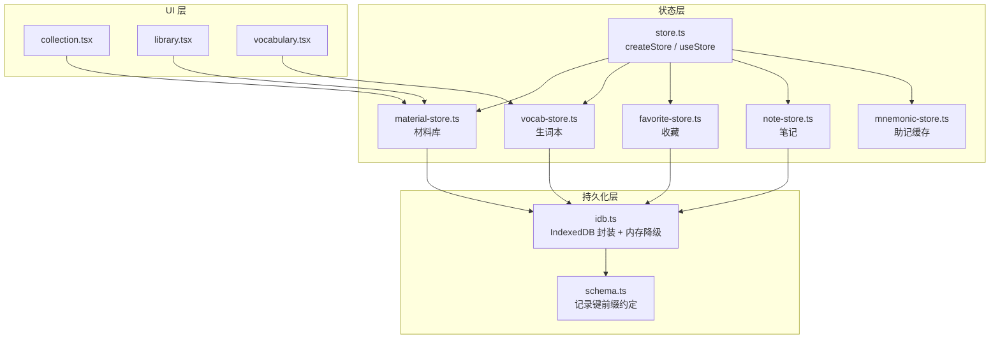
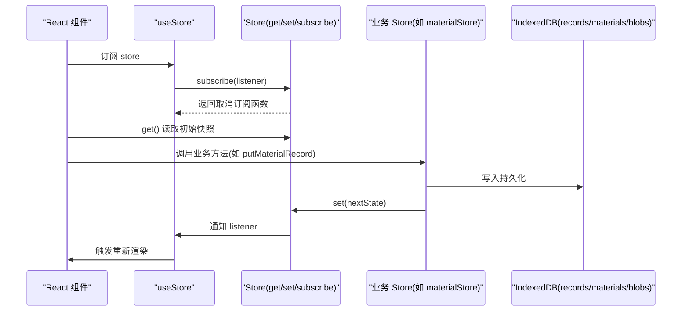
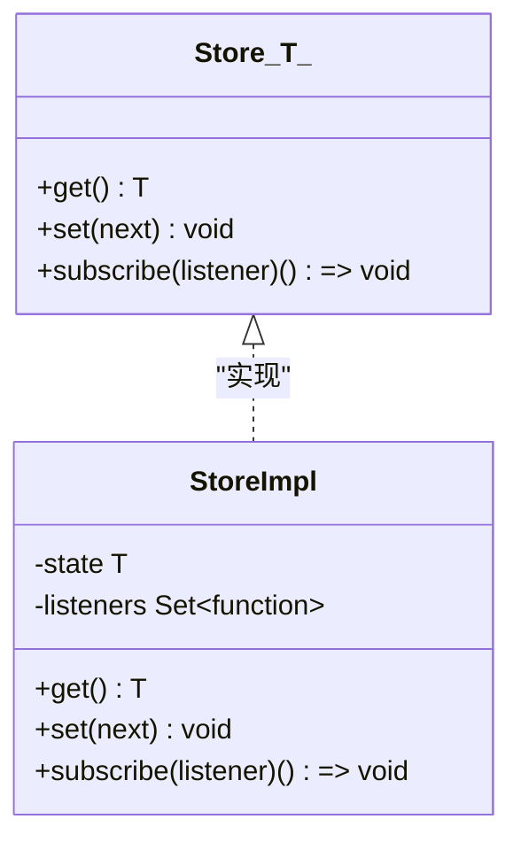
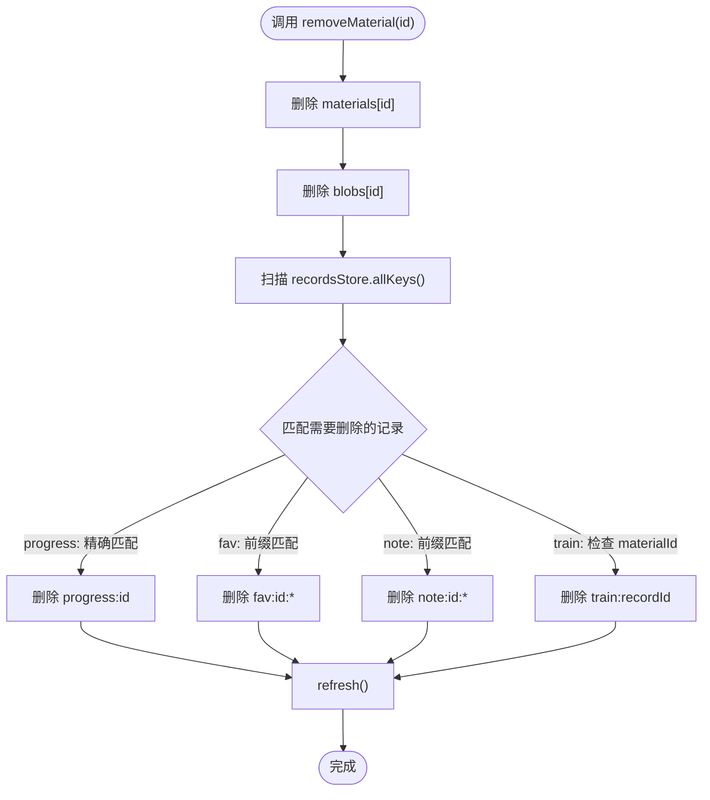
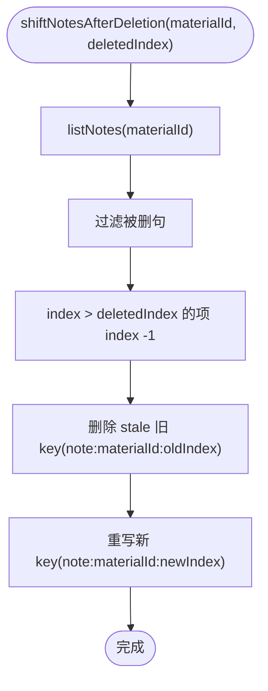
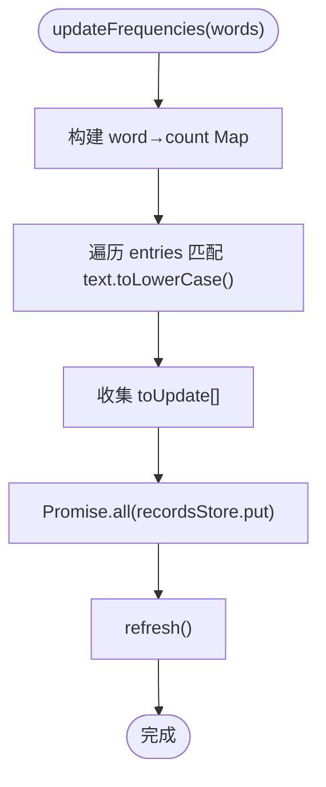
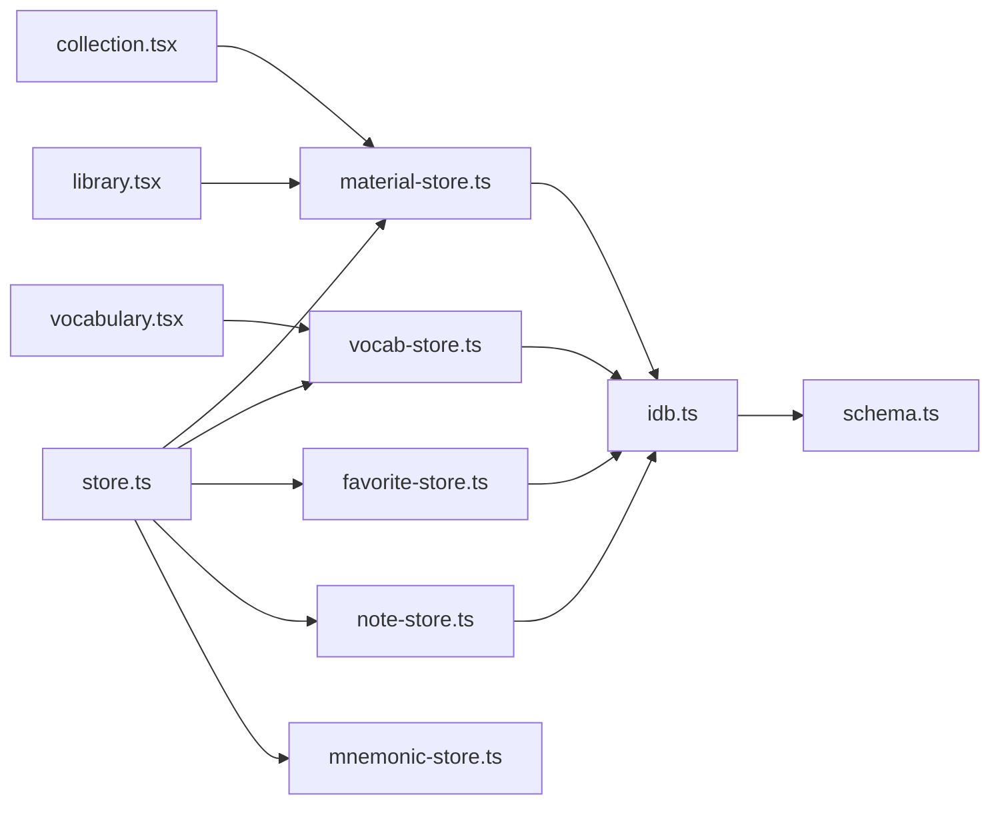

# 状态管理系统

<cite>
**本文引用的文件**   
- [client/stores/store.ts](file://client/stores/store.ts)
- [client/stores/favorite-store.ts](file://client/stores/favorite-store.ts)
- [client/stores/material-store.ts](file://client/stores/material-store.ts)
- [client/stores/mnemonic-store.ts](file://client/stores/mnemonic-store.ts)
- [client/stores/note-store.ts](file://client/stores/note-store.ts)
- [client/stores/vocab-store.ts](file://client/stores/vocab-store.ts)
- [client/platform/storage/idb.ts](file://client/platform/storage/idb.ts)
- [client/platform/storage/schema.ts](file://client/platform/storage/schema.ts)
- [client/components/pages/collection.tsx](file://client/components/pages/collection.tsx)
- [client/components/pages/library.tsx](file://client/components/pages/library.tsx)
- [client/components/pages/vocabulary.tsx](file://client/components/pages/vocabulary.tsx)
</cite>

## 目录
1. [引言](#引言)
2. [项目结构](#项目结构)
3. [核心组件](#核心组件)
4. [架构总览](#架构总览)
5. [详细组件分析](#详细组件分析)
6. [依赖关系分析](#依赖关系分析)
7. [性能与优化](#性能与优化)
8. [调试与测试](#调试与测试)
9. [使用示例与最佳实践](#使用示例与最佳实践)
10. [故障排查](#故障排查)
11. [结论](#结论)

## 引言
本技术文档围绕自研状态管理子系统展开，重点解释 createStore + useStore 的实现原理、基于 useSyncExternalStore 的优势与性能特性，并深入剖析 Store 架构：工厂函数、订阅机制、状态更新流程。同时梳理各业务 store 的职责边界：收藏管理、材料管理、助记缓存、笔记管理、生词本管理。文档还涵盖状态持久化策略（IndexedDB + 内存降级）、数据同步机制、性能优化技巧、调试与测试策略，以及扩展指南和具体使用示例。

## 项目结构
状态管理相关代码集中在 client/stores 目录，底层持久化在 client/platform/storage。React 组件通过 useStore 订阅对应 store 的状态变化。

图表来源
- [client/stores/store.ts:1-34](file://client/stores/store.ts#L1-L34)
- [client/stores/material-store.ts:1-163](file://client/stores/material-store.ts#L1-L163)
- [client/stores/vocab-store.ts:1-193](file://client/stores/vocab-store.ts#L1-L193)
- [client/stores/favorite-store.ts:1-42](file://client/stores/favorite-store.ts#L1-L42)
- [client/stores/note-store.ts:1-72](file://client/stores/note-store.ts#L1-L72)
- [client/stores/mnemonic-store.ts:1-70](file://client/stores/mnemonic-store.ts#L1-L70)
- [client/platform/storage/idb.ts:1-117](file://client/platform/storage/idb.ts#L1-L117)
- [client/platform/storage/schema.ts:1-27](file://client/platform/storage/schema.ts#L1-L27)
- [client/components/pages/collection.tsx:21](file://client/components/pages/collection.tsx#L21)
- [client/components/pages/library.tsx:16](file://client/components/pages/library.tsx#L16)
- [client/components/pages/vocabulary.tsx:78](file://client/components/pages/vocabulary.tsx#L78)

章节来源
- [client/stores/store.ts:1-34](file://client/stores/store.ts#L1-L34)
- [client/platform/storage/idb.ts:1-117](file://client/platform/storage/idb.ts#L1-L117)
- [client/platform/storage/schema.ts:1-27](file://client/platform/storage/schema.ts#L1-L27)

## 核心组件
- createStore：创建最小化的 Store 对象，包含 get/set/subscribe，内部维护 state 与 listeners Set，set 时触发所有监听器。
- useStore：基于 React 的 useSyncExternalStore 封装，提供 SSR 安全（getServerSnapshot 使用 store.get），避免额外依赖。
- IndexedDB 封装：提供 materials/blobs/records 三个 object store 的最小 KV API，并在 IDB 不可用时优雅降级为内存 Map。
- 键前缀约定：统一 records 存储的 key 命名规范，便于按前缀批量查询与清理。

关键实现要点
- Store 是纯 JS 对象，与 React 解耦；useStore 仅负责订阅与渲染。
- set 支持函数式更新，保证基于最新 state 计算 next。
- subscribe 返回取消订阅函数，避免内存泄漏。
- idb.ts 对 open/tx/guarded 进行 Promise 化封装，异常路径统一回落内存，确保调用方不崩溃。

章节来源
- [client/stores/store.ts:8-33](file://client/stores/store.ts#L8-L33)
- [client/platform/storage/idb.ts:17-117](file://client/platform/storage/idb.ts#L17-L117)
- [client/platform/storage/schema.ts:16-27](file://client/platform/storage/schema.ts#L16-L27)

## 架构总览
状态管理采用“轻量 Store + 业务 Store + 持久化”的分层设计：
- 基础层：store.ts 提供 createStore/useStore。
- 业务层：material-store、vocab-store、favorite-store、note-store、mnemonic-store 各自封装领域逻辑与 IndexedDB 操作。
- 持久化层：idb.ts 提供 KV 接口与降级策略；schema.ts 定义记录键前缀。

图表来源
- [client/stores/store.ts:14-33](file://client/stores/store.ts#L14-L33)
- [client/stores/material-store.ts:81-85](file://client/stores/material-store.ts#L81-L85)
- [client/platform/storage/idb.ts:89-102](file://client/platform/storage/idb.ts#L89-L102)

## 详细组件分析

### 基础 Store：createStore 与 useStore
- 数据结构
  - Store<T>：包含 get/set/subscribe。
  - 内部 state 与 listeners Set。
- 行为
  - set 支持函数式更新，遍历 listeners 触发重渲染。
  - subscribe 添加/移除监听器，返回取消函数。
- useStore
  - 使用 useSyncExternalStore(store.subscribe, store.get, store.get)，SSR 安全且零额外依赖。

图表来源
- [client/stores/store.ts:8-28](file://client/stores/store.ts#L8-L28)

章节来源
- [client/stores/store.ts:1-34](file://client/stores/store.ts#L1-L34)

### 材料库 Store：material-store
职责
- 首次启动种子注入（seedMaterials）。
- 材料列表 CRUD 后广播变更（refresh）。
- “最近学习”排序（lastOpenedAt 降序，未学习按 createdAt 靠后）。
- 删除材料级联清理 blob 与 records（进度/收藏/训练记录）。
- 材料集 CRUD（records store，collection: 前缀），成员关系存于 material.collectionId。

关键流程
- initMaterials：幂等初始化（种子注入 + 首次加载）。
- refresh：从 materialsStore 与 recordsStore 加载 records 与 collections，排序后 set。
- removeMaterial：删除 material、blob，并按前缀或字段匹配清理 records。
- assignMaterialCollection：移动材料到集合，含陈旧 ID 防护。

图表来源
- [client/stores/material-store.ts:107-121](file://client/stores/material-store.ts#L107-L121)

章节来源
- [client/stores/material-store.ts:24-163](file://client/stores/material-store.ts#L24-L163)

### 收藏 Store：favorite-store
职责
- 基于 records store 的 fav:{materialId}:{sentenceIndex} 前缀管理收藏。
- 提供 listFavorites、setFavorite、favoriteSentenceIndexes。
- 幂等收藏：重复收藏不刷新时间戳。

数据流
- listFavorites：按前缀过滤 keys，批量 get，按 createdAt 倒序。
- setFavorite：根据 favorited 决定 put/delete，已存在则跳过。
- favoriteSentenceIndexes：提取句序号并升序排序。

章节来源
- [client/stores/favorite-store.ts:12-42](file://client/stores/favorite-store.ts#L12-L42)

### 笔记 Store：note-store
职责
- 基于 records store 的 note:{materialId}:{sentenceIndex} 前缀管理句子笔记。
- 提供 listNotes、getSentenceNote、saveSentenceNote、deleteSentenceNote、shiftNotesAfterDeletion。
- 删句后平移笔记：被删句移除，其后笔记 index -1，旧 key 直接删除并重写新 key。

图表来源
- [client/stores/note-store.ts:61-71](file://client/stores/note-store.ts#L61-L71)

章节来源
- [client/stores/note-store.ts:12-72](file://client/stores/note-store.ts#L12-L72)

### 助记缓存 Store：mnemonic-store
职责
- 将 LLM 生成的助记卡片缓存到 IndexedDB，优先读缓存避免重复调用 LLM。
- 提供 loadMnemonic、saveMnemonic、clearMnemonic、getMnemonicFromMemory、saveAssociation、saveExercises。
- 内存缓存与持久化双写，保持快速访问与可恢复性。

章节来源
- [client/stores/mnemonic-store.ts:13-70](file://client/stores/mnemonic-store.ts#L13-L70)

### 生词本 Store：vocab-store
职责
- 多生词本 + 词条 CRUD，默认生词本自动创建。
- 提供 createBook/removeBook/renameBook/getAllBooks、addEntry/removeEntry/updateEntry/getEntriesByBook/clearEntriesByBook/hasText/updateFrequencies。
- updateFrequencies：扫描字幕单词与词条匹配，累加 frequency，批量写入。

图表来源
- [client/stores/vocab-store.ts:167-192](file://client/stores/vocab-store.ts#L167-L192)

章节来源
- [client/stores/vocab-store.ts:14-193](file://client/stores/vocab-store.ts#L14-L193)

## 依赖关系分析
- 业务 store 均依赖 createStore/useStore 作为状态容器。
- 业务 store 通过 idb.ts 提供的 KvStore 接口读写 IndexedDB。
- schema.ts 统一 records 的 key 前缀，确保跨模块一致性。
- UI 组件通过 useStore 订阅 materialStore 与 vocabStore，驱动页面刷新。

图表来源
- [client/stores/store.ts:1-34](file://client/stores/store.ts#L1-L34)
- [client/stores/material-store.ts:1-163](file://client/stores/material-store.ts#L1-L163)
- [client/stores/vocab-store.ts:1-193](file://client/stores/vocab-store.ts#L1-L193)
- [client/stores/favorite-store.ts:1-42](file://client/stores/favorite-store.ts#L1-L42)
- [client/stores/note-store.ts:1-72](file://client/stores/note-store.ts#L1-L72)
- [client/stores/mnemonic-store.ts:1-70](file://client/stores/mnemonic-store.ts#L1-L70)
- [client/platform/storage/idb.ts:1-117](file://client/platform/storage/idb.ts#L1-L117)
- [client/platform/storage/schema.ts:1-27](file://client/platform/storage/schema.ts#L1-L27)
- [client/components/pages/collection.tsx:21](file://client/components/pages/collection.tsx#L21)
- [client/components/pages/library.tsx:16](file://client/components/pages/library.tsx#L16)
- [client/components/pages/vocabulary.tsx:78](file://client/components/pages/vocabulary.tsx#L78)

章节来源
- [client/stores/store.ts:1-34](file://client/stores/store.ts#L1-L34)
- [client/platform/storage/idb.ts:1-117](file://client/platform/storage/idb.ts#L1-L117)
- [client/platform/storage/schema.ts:1-27](file://client/platform/storage/schema.ts#L1-L27)

## 性能与优化
- useSyncExternalStore 优势
  - 原生集成 React 调度，避免自定义订阅带来的多余渲染。
  - getServerSnapshot 支持 SSR，服务端渲染时直接读取当前值。
  - 零依赖替代 zustand/Pinia，减少运行时开销。
- 批量与并发
  - refresh 中 Promise.all 并行加载多个记录，缩短首屏等待。
  - updateFrequencies 批量写入，减少多次事务开销。
- 内存与持久化
  - idb.ts 在 IDB 不可用时回退到内存 Map，保证可用性。
  - 媒体 Blob 独立存储，避免大对象阻塞主线程。
- 排序与索引
  - 材料“最近学习”排序在内存中进行，避免频繁 IO。
  - 使用 key 前缀过滤，减少全表扫描范围。

[本节为通用性能指导，不直接分析具体文件]

## 调试与测试
- 调试建议
  - 在 set 前后打印 state 快照，观察变更来源。
  - 使用 isMemoryFallback 判断是否处于内存降级模式，辅助定位持久化问题。
  - 针对 records 前缀（fav:/note:/train:/vocabbook:/vocabentry:/mnemonic:/collection:）进行批量导出与校验。
- 测试策略
  - 单元测试：对业务 store 的 CRUD 与排序逻辑进行断言（如 sortByRecent、shiftNotesAfterDeletion、updateFrequencies）。
  - 集成测试：mock idb.ts 的 KvStore 接口，验证 IndexedDB 交互路径与降级行为。
  - 组件测试：模拟 useStore 订阅，验证 UI 在状态变更后正确刷新。

章节来源
- [client/platform/storage/idb.ts:104-117](file://client/platform/storage/idb.ts#L104-L117)
- [client/stores/material-store.ts:32-38](file://client/stores/material-store.ts#L32-L38)
- [client/stores/note-store.ts:61-71](file://client/stores/note-store.ts#L61-L71)
- [client/stores/vocab-store.ts:167-192](file://client/stores/vocab-store.ts#L167-L192)

## 使用示例与最佳实践
- 在组件中订阅 materialStore
  - 通过 useStore(materialStore) 获取 ready/records/collections，用于列表渲染与分组展示。
  - 示例参考：collection.tsx、library.tsx。
- 在组件中订阅 vocabStore
  - 通过 useStore(vocabStore) 获取 books/entries/ready，用于生词本选择与词条列表。
  - 示例参考：vocabulary.tsx。
- 最佳实践
  - 使用函数式 set 更新，避免闭包过期导致的脏数据。
  - 对批量操作使用 Promise.all，减少往返次数。
  - 对敏感数据（如媒体 Blob）单独存取，避免污染 records。
  - 使用 RECORD_KEYS 生成 key，避免硬编码字符串导致不一致。

章节来源
- [client/components/pages/collection.tsx:21](file://client/components/pages/collection.tsx#L21)
- [client/components/pages/library.tsx:16](file://client/components/pages/library.tsx#L16)
- [client/components/pages/vocabulary.tsx:78](file://client/components/pages/vocabulary.tsx#L78)
- [client/platform/storage/schema.ts:16-27](file://client/platform/storage/schema.ts#L16-L27)

## 故障排查
- IDB 打开失败或阻塞
  - 现象：控制台输出 [IDB] open failed/open blocked，应用回退到内存模式。
  - 处理：检查浏览器隐私模式、多标签页占用、版本升级冲突；必要时清除站点数据。
- 记录未生效
  - 现象：刷新后数据丢失。
  - 处理：确认是否处于内存降级模式（isMemoryFallback），检查 recordsStore.put 是否成功。
- 级联清理不完整
  - 现象：删除材料后仍有残留记录。
  - 处理：核对 removeMaterial 中的前缀匹配逻辑（fav:/note:/train:）与精确匹配（progress:）。
- 排序异常
  - 现象：“最近学习”顺序不符合预期。
  - 处理：检查 lastOpenedAt 与 createdAt 赋值逻辑，确认 sortByRecent 比较规则。

章节来源
- [client/platform/storage/idb.ts:27-51](file://client/platform/storage/idb.ts#L27-L51)
- [client/platform/storage/idb.ts:104-117](file://client/platform/storage/idb.ts#L104-L117)
- [client/stores/material-store.ts:107-121](file://client/stores/material-store.ts#L107-L121)
- [client/stores/material-store.ts:32-38](file://client/stores/material-store.ts#L32-L38)

## 结论
该状态管理系统以 createStore + useStore 为核心，结合 useSyncExternalStore 提供高效、SSR 安全的订阅机制；业务 store 聚焦领域逻辑与 IndexedDB 交互；idb.ts 提供健壮的持久化与降级策略。整体架构清晰、职责分明，具备良好的可扩展性与可维护性。通过统一的键前缀约定与批量并发优化，系统在性能与可靠性之间取得平衡。建议在后续扩展中继续遵循现有模式，新增业务 store 时复用 createStore/useStore 与 RECORD_KEYS，确保一致性与可观测性。