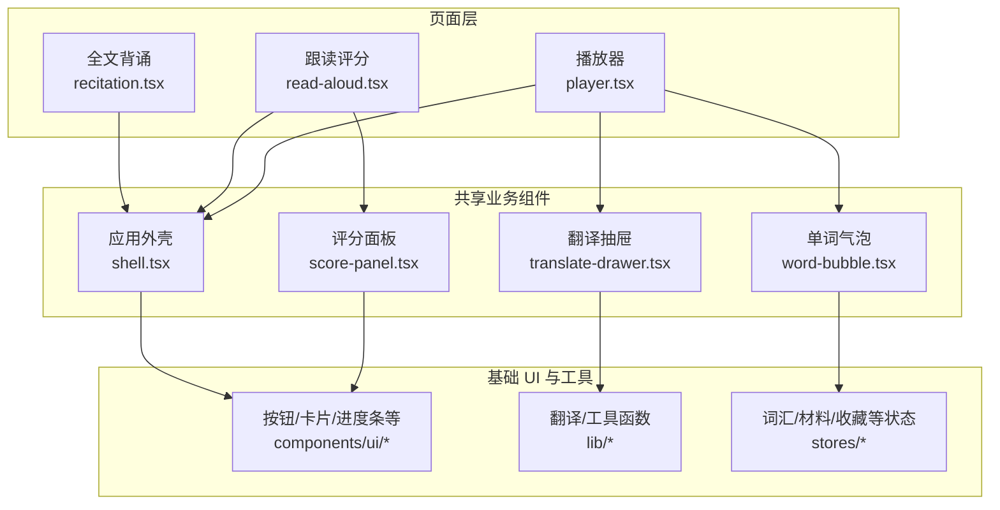
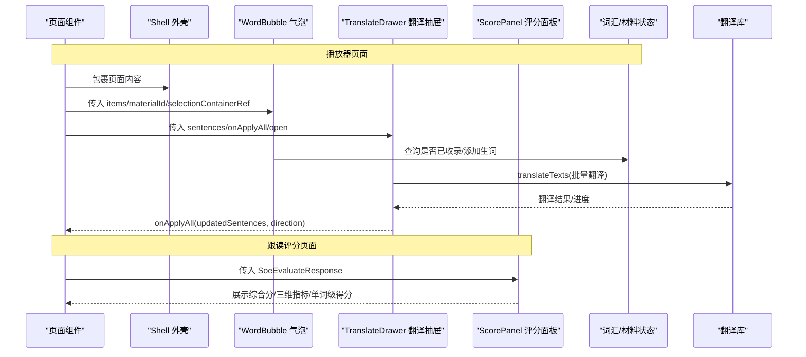
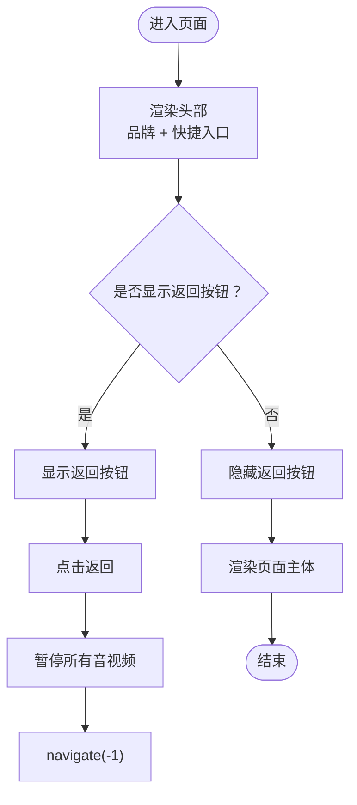
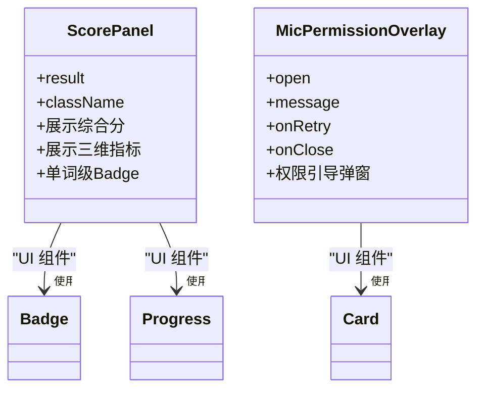
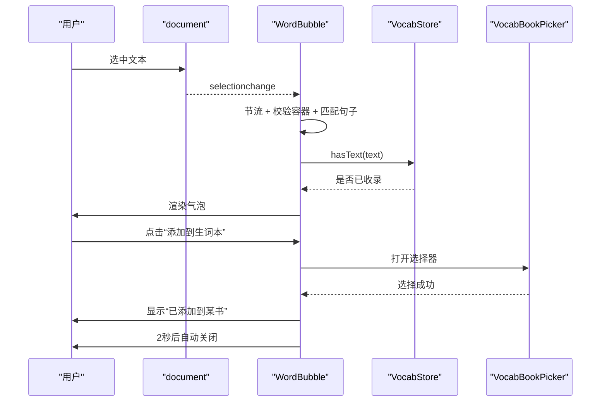
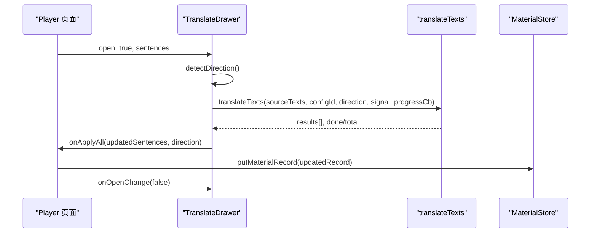
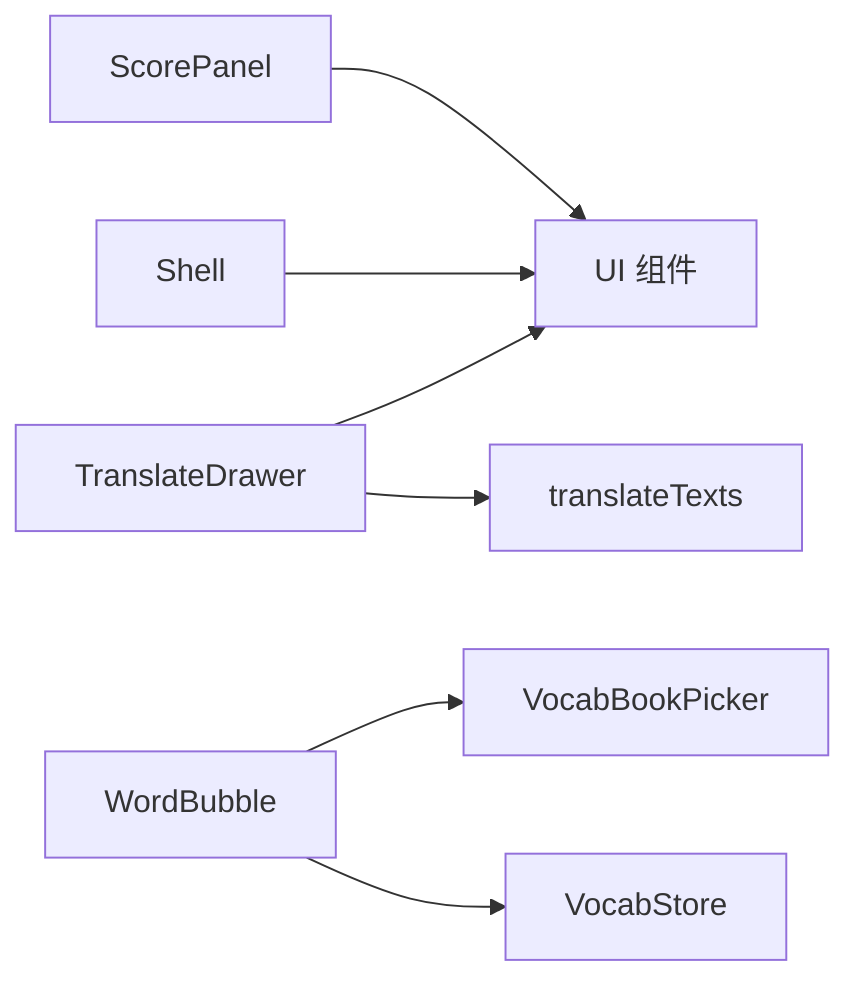

# 共享业务组件

<cite>
**本文引用的文件**   
- [shell.tsx](file://client/components/shared/shell.tsx)
- [score-panel.tsx](file://client/components/shared/score-panel.tsx)
- [word-bubble.tsx](file://client/components/shared/word-bubble.tsx)
- [translate-drawer.tsx](file://client/components/shared/translate-drawer.tsx)
- [player.tsx](file://client/components/pages/player.tsx)
- [read-aloud.tsx](file://client/components/pages/training/read-aloud.tsx)
- [recitation.tsx](file://client/components/pages/training/recitation.tsx)
</cite>

## 目录
1. [引言](#引言)
2. [项目结构](#项目结构)
3. [核心组件](#核心组件)
4. [架构总览](#架构总览)
5. [详细组件分析](#详细组件分析)
6. [依赖关系分析](#依赖关系分析)
7. [性能与可访问性](#性能与可访问性)
8. [故障排查指南](#故障排查指南)
9. [结论](#结论)
10. [附录：接口与扩展点](#附录接口与扩展点)

## 引言
本文件面向“英语精听助手”前端中的共享业务组件，聚焦以下四个关键组件：
- 应用外壳 Shell：统一布局、导航与返回行为。
- 评分面板 ScorePanel：训练模式下的发音评分展示。
- 单词气泡 WordBubble：选词后浮现的浮动操作浮层。
- 翻译抽屉 TranslateDrawer：批量字幕翻译与结果应用。

文档将从系统架构、组件职责、数据流、事件回调、配置项、主题定制、响应式适配以及组合模式等维度进行系统化说明，帮助读者快速理解这些组件如何被页面复用，以及如何扩展和定制。

## 项目结构
这些共享组件位于 client/components/shared 目录下，由多个页面组件（如播放器、跟读、背诵）直接复用。它们不直接管理路由，但通过 React Router 提供的 useNavigate 完成导航；同时通过 stores 与 lib 层提供数据与能力支撑。

图表来源
- [player.tsx:6-13](file://client/components/pages/player.tsx#L6-L13)
- [read-aloud.tsx:17-19](file://client/components/pages/training/read-aloud.tsx#L17-L19)
- [recitation.tsx:19-20](file://client/components/pages/training/recitation.tsx#L19-L20)
- [shell.tsx:1-23](file://client/components/shared/shell.tsx#L1-L23)
- [score-panel.tsx:6-12](file://client/components/shared/score-panel.tsx#L6-L12)
- [word-bubble.tsx:11-18](file://client/components/shared/word-bubble.tsx#L11-L18)
- [translate-drawer.tsx:1-9](file://client/components/shared/translate-drawer.tsx#L1-L9)

章节来源
- [shell.tsx:1-23](file://client/components/shared/shell.tsx#L1-L23)
- [score-panel.tsx:1-95](file://client/components/shared/score-panel.tsx#L1-L95)
- [word-bubble.tsx:1-206](file://client/components/shared/word-bubble.tsx#L1-L206)
- [translate-drawer.tsx:1-330](file://client/components/shared/translate-drawer.tsx#L1-L330)
- [player.tsx:1-535](file://client/components/pages/player.tsx#L1-L535)
- [read-aloud.tsx:1-280](file://client/components/pages/training/read-aloud.tsx#L1-L280)
- [recitation.tsx:1-285](file://client/components/pages/training/recitation.tsx#L1-L285)

## 核心组件
本节概述四个共享组件的职责、输入输出与交互要点。

- 应用外壳 Shell
  - 职责：统一页面头部、品牌标识、常用入口（收藏、生词本、设置），并提供可选返回按钮；封装媒体暂停逻辑，避免视频播放时主线程阻塞导致返回无响应。
  - 主要 props：children、back（是否显示返回按钮）。
  - 导出：Shell、PageIntro、pauseAllMedia。
  - 响应式：头部在移动端与桌面端使用不同间距与尺寸；整体容器最小高度与最大宽度保证大屏体验。
  - 主题：使用 Tailwind 语义化颜色（background、foreground、card、primary 等），便于主题切换。

- 评分面板 ScorePanel
  - 职责：展示综合分、准确度/流利度/完整度三维条形图，以及单词级得分与错误类型提示。
  - 主要 props：result（SOE 评分结果）、className。
  - 阈值：低于 60 分的单词 Badge 标红。
  - 附加能力：麦克风权限引导浮层 MicPermissionOverlay，用于录音授权失败时的用户引导。

- 单词气泡 WordBubble
  - 职责：监听用户在指定容器内的文本选择，匹配到对应句子后，在选中位置上方渲染浮动气泡，支持添加到生词本。
  - 主要 props：items（所有字幕句）、materialId（素材 ID）、selectionContainerRef（选区目标容器 ref）。
  - 交互：selectionchange 节流、点击外部关闭、Esc 关闭并清空选区、Portal 渲染到 body。
  - 集成：与词汇存储 vocab-store 联动，判断是否已收录，打开生词本选择器。

- 翻译抽屉 TranslateDrawer
  - 职责：对当前字幕列表进行批量翻译，支持方向切换、模型配置选择、进度反馈、错误提示、结果预览与全部应用。
  - 主要 props：open、onOpenChange、sentences、onApplyAll。
  - 能力：自动检测语言方向、AbortController 取消请求、抽屉关闭期间仍保持后台翻译并在完成后以 toast 通知。

章节来源
- [shell.tsx:5-23](file://client/components/shared/shell.tsx#L5-L23)
- [score-panel.tsx:14-95](file://client/components/shared/score-panel.tsx#L14-L95)
- [word-bubble.tsx:20-206](file://client/components/shared/word-bubble.tsx#L20-L206)
- [translate-drawer.tsx:11-330](file://client/components/shared/translate-drawer.tsx#L11-L330)

## 架构总览
下图展示了页面组件如何组合共享组件，以及关键数据与事件流向。

图表来源
- [player.tsx:6-13](file://client/components/pages/player.tsx#L6-L13)
- [player.tsx:476-492](file://client/components/pages/player.tsx#L476-L492)
- [word-bubble.tsx:14-18](file://client/components/shared/word-bubble.tsx#L14-L18)
- [translate-drawer.tsx:6-8](file://client/components/shared/translate-drawer.tsx#L6-L8)
- [read-aloud.tsx:17-19](file://client/components/pages/training/read-aloud.tsx#L17-L19)

## 详细组件分析

### 应用外壳 Shell：布局结构与导航系统
- 布局结构
  - 顶部固定 Header：左侧为返回按钮（可选）与品牌标题；右侧为收藏、生词本、设置快捷入口。
  - 主体区域：通过 children 注入页面内容，保持统一的背景与排版风格。
- 导航系统
  - 返回按钮：调用浏览器历史后退，并在点击前暂停所有音视频元素，解决主线程占用导致的无响应问题。
  - 快捷入口：通过 Link 跳转到收藏、生词本、设置页。
- 可配置性与主题
  - back 属性控制返回按钮显隐。
  - 使用 Tailwind 语义类名，适配暗色/亮色主题与自定义主题变量。
- 响应式适配
  - 头部在不同屏幕下调整内边距与字号；整体容器限制最大宽度，保证大屏可读性。

图表来源
- [shell.tsx:5-19](file://client/components/shared/shell.tsx#L5-L19)

章节来源
- [shell.tsx:5-23](file://client/components/shared/shell.tsx#L5-L23)

### 评分面板 ScorePanel：展示逻辑与权限引导
- 展示逻辑
  - 综合分大字展示，配合三个维度（准确度、流利度、完整度）的 Progress 条形图。
  - 单词级 Badge 展示，低于阈值的单词标红，并根据 errorType 显示“漏/增/误”提示。
- 权限引导
  - MicPermissionOverlay 在录音权限拒绝时弹出，引导用户前往浏览器设置允许麦克风，并提供重试入口。
- 可配置性
  - className 支持外层样式覆盖。
  - LOW_SCORE_THRESHOLD 常量定义单词级标红阈值。
- 响应式适配
  - 卡片宽度自适应，Badge 换行排列，在小屏设备上保持良好的可读性。

图表来源
- [score-panel.tsx:14-95](file://client/components/shared/score-panel.tsx#L14-L95)

章节来源
- [score-panel.tsx:14-95](file://client/components/shared/score-panel.tsx#L14-L95)
- [read-aloud.tsx:249-269](file://client/components/pages/training/read-aloud.tsx#L249-L269)

### 单词气泡 WordBubble：选词交互与生词本集成
- 交互流程
  - 监听 document.selectionchange，通过 requestAnimationFrame 节流处理。
  - 校验选区是否在目标容器内，遍历所有句子进行文本包含匹配。
  - 计算选中范围矩形，定位气泡位置，并通过 Portal 渲染到 body。
  - 点击外部或按 Esc 关闭气泡；若已收录则显示“已收录”，否则提供“添加到生词本”按钮。
- 数据与状态
  - 使用 vocab-store 初始化与查询是否已收录。
  - 打开 VocabBookPicker 选择生词本，成功后短暂显示“已添加到某书”。
- 可配置性
  - items：所有字幕句，用于全句匹配。
  - materialId：素材 ID，用于生词本关联。
  - selectionContainerRef：选区监听的目标容器 ref。
- 性能优化
  - rAF 节流 selectionchange。
  - Portal 渲染避免层级遮挡。
  - 清理 mousedown/keydown 监听，防止内存泄漏。

图表来源
- [word-bubble.tsx:44-206](file://client/components/shared/word-bubble.tsx#L44-L206)

章节来源
- [word-bubble.tsx:44-206](file://client/components/shared/word-bubble.tsx#L44-L206)
- [player.tsx:524-531](file://client/components/pages/player.tsx#L524-L531)

### 翻译抽屉 TranslateDrawer：批量翻译与应用
- 功能实现
  - 自动检测语言方向（基于 textEn），支持手动切换。
  - 根据 selectedConfigId 调用 translateTexts 进行批量翻译，支持 AbortController 取消。
  - 逐句状态跟踪（pending/translating/done/error），全局进度与错误提示。
  - 翻译完成后，点击“全部应用”将译文写回字幕，并关闭抽屉。
- 状态持久化与用户体验
  - 即使抽屉关闭，翻译任务仍可继续执行；完成后以 toast 通知，点击可重新打开抽屉。
  - 切换方向或更换句子列表时，重置翻译状态，避免脏数据。
- 可配置性
  - open/onOpenChange：控制抽屉显隐。
  - sentences：待翻译的字幕句数组。
  - onApplyAll：应用翻译结果的回调。
- 主题与响应式
  - 使用 Sheet 组件承载内容，适配移动端侧滑抽屉。
  - 进度条与状态图标随翻译过程动态更新。

图表来源
- [translate-drawer.tsx:26-179](file://client/components/shared/translate-drawer.tsx#L26-L179)
- [player.tsx:476-492](file://client/components/pages/player.tsx#L476-L492)

章节来源
- [translate-drawer.tsx:26-179](file://client/components/shared/translate-drawer.tsx#L26-L179)
- [player.tsx:476-492](file://client/components/pages/player.tsx#L476-L492)

## 依赖关系分析
- 组件耦合
  - Shell 与 UI 组件解耦，仅负责布局与导航。
  - ScorePanel 依赖 UI 组件（Badge、Card、Progress）与类型定义。
  - WordBubble 依赖 vocab-store 与 VocabBookPicker，与页面通过 props 解耦。
  - TranslateDrawer 依赖 lib/translate 与 UI 组件，通过回调与页面解耦。
- 外部依赖
  - React Router：useNavigate、Link。
  - lucide-react：图标。
  - Tailwind CSS：样式与主题。
  - stores/lib：状态管理与翻译能力。

图表来源
- [shell.tsx:1-23](file://client/components/shared/shell.tsx#L1-L23)
- [score-panel.tsx:6-12](file://client/components/shared/score-panel.tsx#L6-L12)
- [word-bubble.tsx:14-18](file://client/components/shared/word-bubble.tsx#L14-L18)
- [translate-drawer.tsx:1-9](file://client/components/shared/translate-drawer.tsx#L1-L9)

章节来源
- [shell.tsx:1-23](file://client/components/shared/shell.tsx#L1-L23)
- [score-panel.tsx:6-12](file://client/components/shared/score-panel.tsx#L6-L12)
- [word-bubble.tsx:14-18](file://client/components/shared/word-bubble.tsx#L14-L18)
- [translate-drawer.tsx:1-9](file://client/components/shared/translate-drawer.tsx#L1-L9)

## 性能与可访问性
- 性能
  - WordBubble 使用 requestAnimationFrame 节流 selectionchange，避免频繁重排。
  - Player 页面中时间更新节流（每 100ms 一次），减少 React 渲染压力。
  - TranslateDrawer 使用 AbortController 取消未完成的翻译请求，避免资源浪费。
- 可访问性
  - Shell 返回按钮提供 aria-label。
  - MicPermissionOverlay 使用 role="dialog" 与 aria-modal 提升无障碍体验。
  - TranslateDrawer 的 toast 支持键盘操作（Enter/Space 关闭）。

章节来源
- [word-bubble.tsx:105-118](file://client/components/shared/word-bubble.tsx#L105-L118)
- [player.tsx:209-226](file://client/components/pages/player.tsx#L209-L226)
- [translate-drawer.tsx:193-218](file://client/components/shared/translate-drawer.tsx#L193-L218)
- [score-panel.tsx:70-92](file://client/components/shared/score-panel.tsx#L70-L92)

## 故障排查指南
- 返回按钮无响应
  - 现象：视频播放时点击返回无响应。
  - 原因：主线程被视频渲染与状态更新阻塞。
  - 解决：Shell 在返回前调用 pauseAllMedia 暂停所有音视频。
- 单词气泡不出现
  - 检查 selectionContainerRef 是否正确传入且包含选区节点。
  - 检查 items 是否包含匹配的英文句子。
- 翻译结果未应用
  - 确认 onApplyAll 回调是否被调用，且 updatedSentences 非空。
  - 检查 MaterialStore 写入是否成功。
- 录音权限拒绝
  - 现象：MicPermissionOverlay 弹出。
  - 解决：引导用户允许麦克风权限，然后重试录音。

章节来源
- [shell.tsx:5-19](file://client/components/shared/shell.tsx#L5-L19)
- [word-bubble.tsx:66-103](file://client/components/shared/word-bubble.tsx#L66-L103)
- [translate-drawer.tsx:170-179](file://client/components/shared/translate-drawer.tsx#L170-L179)
- [score-panel.tsx:70-92](file://client/components/shared/score-panel.tsx#L70-L92)

## 结论
这四个共享组件构成了“英语精听助手”的核心交互骨架：Shell 提供一致的布局与导航，ScorePanel 标准化评分展示，WordBubble 增强选词与生词本集成，TranslateDrawer 提供高效的批量翻译能力。它们通过清晰的 props 接口与回调机制与页面解耦，具备良好的可配置性、主题适配与响应式表现。在实际使用中，建议遵循现有组合模式，按需扩展 props 与事件，以保持代码的一致性与可维护性。

## 附录：接口与扩展点

### Shell 接口
- props
  - children: React.ReactNode
  - back?: boolean
- 导出
  - Shell
  - PageIntro
  - pauseAllMedia

章节来源
- [shell.tsx:17-23](file://client/components/shared/shell.tsx#L17-L23)

### ScorePanel 接口
- props
  - result: SoeEvaluateResponse
  - className?: string
- 导出
  - ScorePanel
  - MicPermissionOverlay

章节来源
- [score-panel.tsx:21-95](file://client/components/shared/score-panel.tsx#L21-L95)

### WordBubble 接口
- props
  - items: SubtitleSentence[]
  - materialId: string
  - selectionContainerRef: React.RefObject<HTMLElement | null>
- 导出
  - WordBubble

章节来源
- [word-bubble.tsx:20-49](file://client/components/shared/word-bubble.tsx#L20-L49)

### TranslateDrawer 接口
- props
  - open: boolean
  - onOpenChange: (open: boolean) => void
  - sentences: SubtitleSentence[]
  - onApplyAll: (updated: SubtitleSentence[], direction: TranslateDirection) => void
- 导出
  - TranslateDrawer

章节来源
- [translate-drawer.tsx:11-16](file://client/components/shared/translate-drawer.tsx#L11-L16)