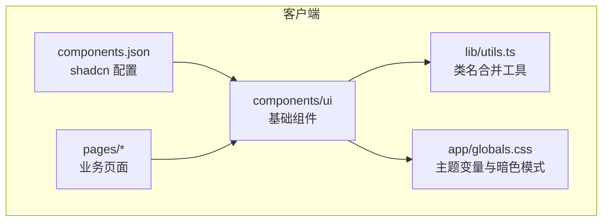
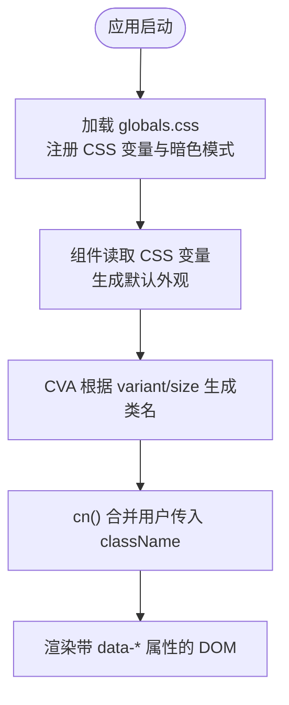
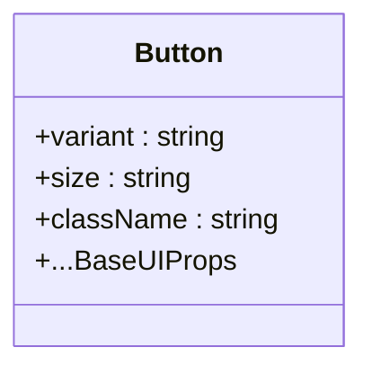
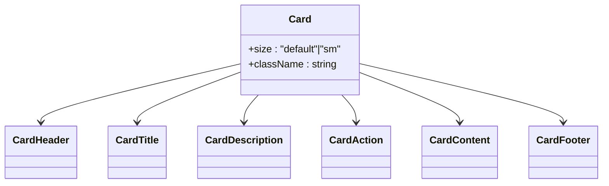
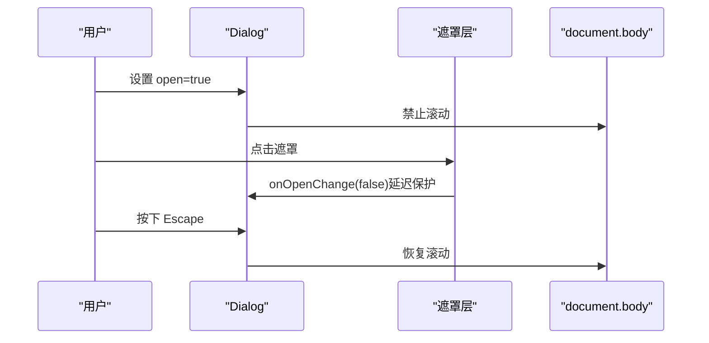
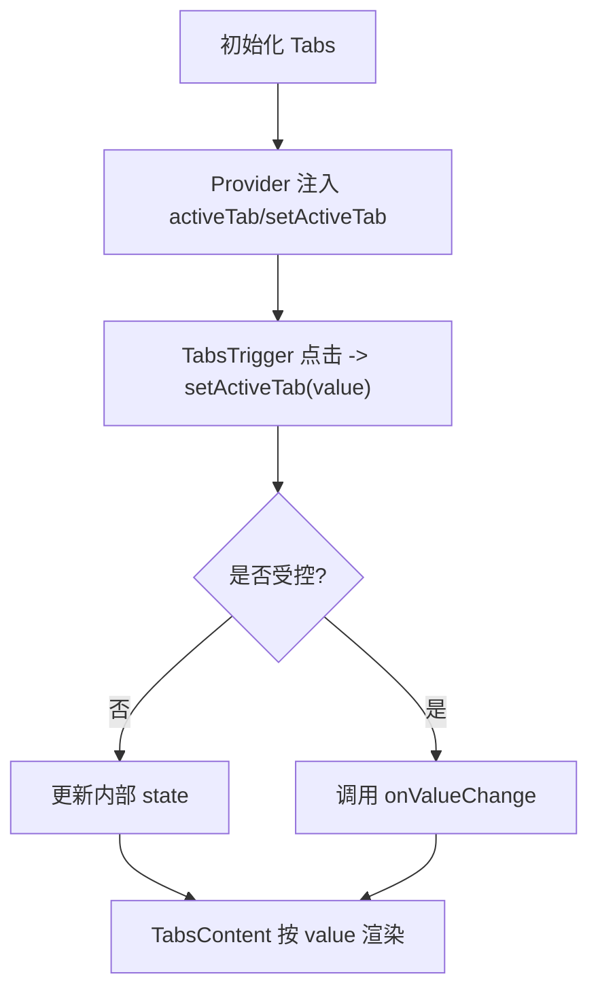
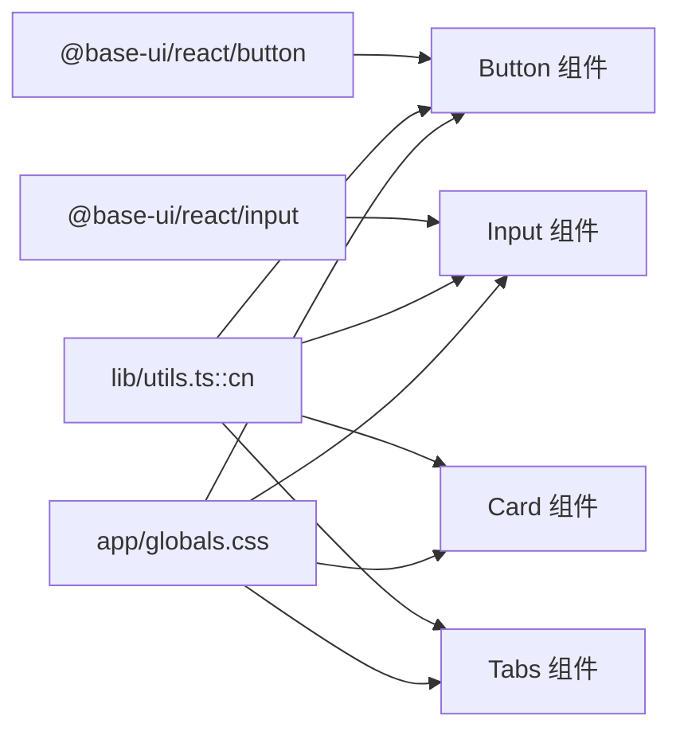

# 基础 UI 组件

<cite>
**本文引用的文件**   
- [client/components/ui/button.tsx](file://client/components/ui/button.tsx)
- [client/components/ui/card.tsx](file://client/components/ui/card.tsx)
- [client/components/ui/dialog.tsx](file://client/components/ui/dialog.tsx)
- [client/components/ui/input.tsx](file://client/components/ui/input.tsx)
- [client/components/ui/tabs.tsx](file://client/components/ui/tabs.tsx)
- [client/lib/utils.ts](file://client/lib/utils.ts)
- [client/app/globals.css](file://client/app/globals.css)
- [client/components.json](file://client/components.json)
- [client/components/pages/collection.tsx](file://client/components/pages/collection.tsx)
- [client/components/pages/dictation.tsx](file://client/components/pages/dictation.tsx)
</cite>

## 目录
1. [引言](#引言)
2. [项目结构](#项目结构)
3. [核心组件总览](#核心组件总览)
4. [架构与主题体系](#架构与主题体系)
5. [组件详细分析](#组件详细分析)
6. [依赖关系分析](#依赖关系分析)
7. [性能与可访问性](#性能与可访问性)
8. [使用示例与组合模式](#使用示例与组合模式)
9. [样式定制与主题适配](#样式定制与主题适配)
10. [命名规范与设计原则](#命名规范与设计原则)
11. [版本管理与维护建议](#版本管理与维护建议)
12. [故障排查](#故障排查)
13. [结论](#结论)

## 引言
本文件面向“基础 UI 组件”的开发者与使用者，系统梳理基于 shadcn/ui 风格的基础原子组件：Button、Card、Dialog、Input、Tabs。文档从实现原理、Props 接口、样式定制、可访问性、主题适配、设计原则、命名规范到版本管理策略进行完整说明，并给出实际页面中的组合用法与常见问题排查方法。

## 项目结构
本项目采用 Next.js + TypeScript 的前端工程，UI 组件统一位于 `client/components/ui`，通过 Tailwind CSS 和 CSS 变量构建主题化样式；工具函数集中在 `client/lib/utils.ts`，全局主题变量定义在 `client/app/globals.css`，shadcn 配置位于 `client/components.json`。



**图表来源**
- [client/components.json:1-22](file://client/components.json#L1-L22)
- [client/app/globals.css:1-46](file://client/app/globals.css#L1-L46)
- [client/lib/utils.ts:1-7](file://client/lib/utils.ts#L1-L7)

**章节来源**
- [client/components.json:1-22](file://client/components.json#L1-L22)
- [client/app/globals.css:1-46](file://client/app/globals.css#L1-L46)
- [client/lib/utils.ts:1-7](file://client/lib/utils.ts#L1-L7)

## 核心组件总览
- Button：基于 Base UI 的按钮封装，支持多 variant/size、图标对齐、焦点环与无障碍属性。
- Card：卡片容器及其 Header/Title/Description/Action/Content/Footer 子组件，支持尺寸与间距变量。
- Dialog：轻量对话框，包含遮罩、关闭按钮、ESC 关闭、滚动锁定与打开后短时点击保护。
- Input：基于 Base UI 的输入框封装，支持禁用态、无效态、深色模式与聚焦环。
- Tabs：自研标签页，提供 Tabs/TabsList/TabsTrigger/TabsContent，内置受控与非受控模式与 ARIA。

**章节来源**
- [client/components/ui/button.tsx:1-59](file://client/components/ui/button.tsx#L1-L59)
- [client/components/ui/card.tsx:1-104](file://client/components/ui/card.tsx#L1-L104)
- [client/components/ui/dialog.tsx:1-79](file://client/components/ui/dialog.tsx#L1-L79)
- [client/components/ui/input.tsx:1-21](file://client/components/ui/input.tsx#L1-L21)
- [client/components/ui/tabs.tsx:1-106](file://client/components/ui/tabs.tsx#L1-L106)

## 架构与主题体系
- 样式引擎：Tailwind CSS + class-variance-authority（CVA）+ clsx/tailwind-merge。
- 主题变量：CSS 变量集中定义于 `globals.css`，并通过 `@theme inline` 暴露给 Tailwind。
- 暗色模式：通过 `.dark` 类与 `prefers-color-scheme` 自动切换。
- 组件样式：通过 `cn()` 合并类名，结合 data-slot/data-state 等语义属性选择器实现变体与状态样式。



**图表来源**
- [client/app/globals.css:7-46](file://client/app/globals.css#L7-L46)
- [client/app/globals.css:48-117](file://client/app/globals.css#L48-L117)
- [client/lib/utils.ts:1-7](file://client/lib/utils.ts#L1-L7)
- [client/components/ui/button.tsx:6-41](file://client/components/ui/button.tsx#L6-L41)

**章节来源**
- [client/app/globals.css:1-205](file://client/app/globals.css#L1-L205)
- [client/lib/utils.ts:1-7](file://client/lib/utils.ts#L1-L7)

## 组件详细分析

### Button（按钮）
- 设计要点
  - 基于 `@base-ui/react/button`，保留原生交互与无障碍能力。
  - 使用 CVA 定义 `variant` 与 `size` 两套变体族，默认 `default/default`。
  - 通过 `data-icon="inline-start|inline-end"` 控制图标内边距，保证文本与图标的视觉对齐。
  - 支持 `aria-invalid` 无效态、`focus-visible` 焦点环、`disabled` 禁用态。
- Props 接口
  - 继承 Base UI Button 的所有 props。
  - 扩展 `variant`: default | outline | secondary | ghost | destructive | link。
  - 扩展 `size`: default | xs | sm | lg | icon | icon-xs | icon-sm | icon-lg。
  - 支持 `className` 覆盖。
- 样式定制
  - 通过 `variant`/`size` 快速切换外观。
  - 通过 `className` 追加或覆盖样式；推荐使用 `cn()` 合并。
- 可访问性
  - 透传所有无障碍属性；支持键盘操作与屏幕阅读器。
  - 无效态时提供 `aria-invalid` 与破坏性颜色提示。
- 复杂度
  - 时间复杂度 O(1)，空间复杂度 O(1)。



**图表来源**
- [client/components/ui/button.tsx:6-58](file://client/components/ui/button.tsx#L6-L58)

**章节来源**
- [client/components/ui/button.tsx:1-59](file://client/components/ui/button.tsx#L1-L59)

### Card（卡片）
- 设计要点
  - 由 `Card` 容器与多个语义子组件组成：Header、Title、Description、Action、Content、Footer。
  - 使用 CSS 自定义属性 `--card-spacing` 控制间距，支持 `size="default|sm"`。
  - 首尾圆角与图片自适应处理，便于在不同内容下保持一致的视觉节奏。
- Props 接口
  - `Card`: `className`, `size`。
  - 子组件均接受标准 HTML div 的 props 与 `className`。
- 样式定制
  - 通过 `size` 调整间距与字号。
  - 通过 `className` 覆盖局部样式；注意保持 `data-slot` 选择器可用。
- 可访问性
  - 作为布局容器，不直接承担交互语义；标题与描述用于信息层级表达。
- 复杂度
  - 时间复杂度 O(1)，空间复杂度 O(1)。



**图表来源**
- [client/components/ui/card.tsx:5-103](file://client/components/ui/card.tsx#L5-L103)

**章节来源**
- [client/components/ui/card.tsx:1-104](file://client/components/ui/card.tsx#L1-L104)

### Dialog（对话框）
- 设计要点
  - 轻量实现：遮罩层、居中卡片、右上角关闭按钮。
  - 打开后 300ms 内屏蔽遮罩点击，避免双击误关。
  - ESC 关闭、body 滚动锁定、关闭时恢复。
- Props 接口
  - `open`: boolean，控制显示。
  - `onOpenChange`: (open: boolean) => void，受控更新。
  - `children`: ReactNode，承载头部与内容。
  - 配套子组件：`DialogHeader`、`DialogTitle`、`DialogDescription`、`DialogContent`。
- 样式定制
  - 遮罩背景、卡片最大宽高、阴影与圆角已预设；可通过外层包裹或子组件 `className` 微调。
- 可访问性
  - 关闭按钮具备 `aria-label`；ESC 键关闭提升键盘可达性。
  - 建议在外部为触发元素添加 `aria-controls`/`aria-expanded` 以增强可访问性。
- 复杂度
  - 事件监听与 ref 操作均为 O(1)。



**图表来源**
- [client/components/ui/dialog.tsx:17-59](file://client/components/ui/dialog.tsx#L17-L59)

**章节来源**
- [client/components/ui/dialog.tsx:1-79](file://client/components/ui/dialog.tsx#L1-L79)

### Input（输入框）
- 设计要点
  - 基于 `@base-ui/react/input`，继承其无障碍与行为。
  - 统一的边框、圆角、占位符颜色、禁用态与无效态样式。
  - 支持 `type` 与所有原生 input 属性。
- Props 接口
  - 继承原生 input 的 props，包括 `type`、`value`、`onChange`、`placeholder`、`disabled` 等。
  - 支持 `className` 覆盖。
- 样式定制
  - 通过 `className` 追加样式；注意保留 `data-slot="input"` 以便后续扩展。
- 可访问性
  - 透传无障碍属性；无效态提供 `aria-invalid` 与破坏性边框/环。
- 复杂度
  - 时间复杂度 O(1)，空间复杂度 O(1)。

**章节来源**
- [client/components/ui/input.tsx:1-21](file://client/components/ui/input.tsx#L1-L21)

### Tabs（标签页）
- 设计要点
  - 自研实现，提供受控与非受控两种模式：当未提供 `value` 时使用内部状态。
  - 通过 Context 共享 `activeTab` 与 `setActiveTab`。
  - 使用 ARIA 角色 `tablist`、`tab`、`tabpanel` 与 `aria-selected`。
- Props 接口
  - `Tabs`: `defaultValue`, `value?`, `onValueChange?`, `children`, `className`。
  - `TabsList`: `children`, `className`。
  - `TabsTrigger`: `value`, `children`, `className`。
  - `TabsContent`: `value`, `children`, `className`。
- 样式定制
  - 激活态通过 `data-[state=active]` 选择器驱动下划线动画。
  - 列表横向滚动，适合移动端。
- 可访问性
  - 提供必要的 ARIA 角色与选中状态；建议配合键盘导航（如左右方向键）进一步完善。
- 复杂度
  - 状态切换 O(1)，渲染按需显示当前面板。



**图表来源**
- [client/components/ui/tabs.tsx:25-42](file://client/components/ui/tabs.tsx#L25-L42)
- [client/components/ui/tabs.tsx:64-85](file://client/components/ui/tabs.tsx#L64-L85)
- [client/components/ui/tabs.tsx:94-102](file://client/components/ui/tabs.tsx#L94-L102)

**章节来源**
- [client/components/ui/tabs.tsx:1-106](file://client/components/ui/tabs.tsx#L1-L106)

## 依赖关系分析
- 组件对外依赖
  - Base UI：Button、Input 的行为与无障碍。
  - Tailwind CSS：原子化样式。
  - class-variance-authority：变体样式。
  - clsx/tailwind-merge：类名合并。
- 内部依赖
  - `cn()` 工具函数被所有组件复用。
  - 主题变量来自 `globals.css`。
- 耦合度
  - 组件之间低耦合，主要通过 props 与上下文（Tabs）协作。
  - Dialog 与业务页面解耦，仅通过 `open`/`onOpenChange` 通信。



**图表来源**
- [client/components/ui/button.tsx:1-5](file://client/components/ui/button.tsx#L1-L5)
- [client/components/ui/input.tsx:1-5](file://client/components/ui/input.tsx#L1-L5)
- [client/lib/utils.ts:1-7](file://client/lib/utils.ts#L1-L7)
- [client/app/globals.css:1-46](file://client/app/globals.css#L1-L46)

**章节来源**
- [client/components/ui/button.tsx:1-59](file://client/components/ui/button.tsx#L1-L59)
- [client/components/ui/input.tsx:1-21](file://client/components/ui/input.tsx#L1-L21)
- [client/lib/utils.ts:1-7](file://client/lib/utils.ts#L1-L7)
- [client/app/globals.css:1-46](file://client/app/globals.css#L1-L46)

## 性能与可访问性
- 性能
  - 组件均为无状态或轻量状态，渲染开销小。
  - Dialog 仅在 `open=true` 时挂载 DOM，减少不必要的渲染。
  - Tabs 使用条件渲染，仅显示激活面板。
- 可访问性
  - Button/Input 继承 Base UI 的无障碍特性。
  - Dialog 提供 ESC 关闭与关闭按钮的 `aria-label`。
  - Tabs 使用 ARIA 角色与选中状态，建议补充键盘导航以提升体验。

**章节来源**
- [client/components/ui/dialog.tsx:21-34](file://client/components/ui/dialog.tsx#L21-L34)
- [client/components/ui/dialog.tsx:49-55](file://client/components/ui/dialog.tsx#L49-L55)
- [client/components/ui/tabs.tsx:44-55](file://client/components/ui/tabs.tsx#L44-L55)
- [client/components/ui/tabs.tsx:64-85](file://client/components/ui/tabs.tsx#L64-L85)

## 使用示例与组合模式
- 材料集详情页面中组合使用 Button、Card、Input、Dialog：
  - 使用 `Card` 展示空态与加载态。
  - 使用 `Button` 触发重命名与删除等操作。
  - 使用 `Dialog` 包裹 `DialogHeader`/`DialogTitle`/`DialogDescription`/`DialogContent`，并在其中放置 `Input` 完成编辑。
- 听写页面中组合使用 Button、Card、Textarea：
  - 使用 `Card` 与 `CardContent` 组织训练界面。
  - 使用 `Button` 控制播放、核对、清空与下一步。

```mermaid
sequenceDiagram
participant Page as "collection.tsx"
participant Dialog as "Dialog"
participant Header as "DialogHeader"
participant Title as "DialogTitle"
participant Desc as "DialogDescription"
participant Content as "DialogContent"
participant Input as "Input"
participant Button as "Button"
Page->>Dialog : open={renameOpen}
Dialog->>Header : children
Header->>Title : 重命名材料集
Header->>Desc : 修改名称说明
Dialog->>Content : children
Content->>Input : value/onKeyDown
Content->>Button : 取消/保存
```

**图表来源**
- [client/components/pages/collection.tsx:93-108](file://client/components/pages/collection.tsx#L93-L108)

**章节来源**
- [client/components/pages/collection.tsx:1-117](file://client/components/pages/collection.tsx#L1-L117)
- [client/components/pages/dictation.tsx:1-147](file://client/components/pages/dictation.tsx#L1-L147)

## 样式定制与主题适配
- 主题变量
  - 在 `globals.css` 中定义亮色与暗色两套 CSS 变量，涵盖 primary、background、card、border、ring、destructive 等。
  - 通过 `@theme inline` 将变量暴露给 Tailwind，使组件可直接使用语义化颜色。
- 暗色模式
  - 通过 `.dark` 类与 `prefers-color-scheme: dark` 自动切换。
- 组件级定制
  - 使用 `className` 追加或覆盖样式；推荐通过 `cn()` 合并。
  - 利用 `data-slot`/`data-state` 选择器精准定位组件状态样式。
- 最佳实践
  - 优先使用语义化颜色变量，而非硬编码颜色值。
  - 对复杂样式使用 CVA 扩展变体，保持组件 API 简洁。

**章节来源**
- [client/app/globals.css:7-46](file://client/app/globals.css#L7-L46)
- [client/app/globals.css:48-117](file://client/app/globals.css#L48-L117)
- [client/app/globals.css:119-153](file://client/app/globals.css#L119-L153)

## 命名规范与设计原则
- 命名规范
  - 组件文件以小写下划线分隔或驼峰命名（如 `button.tsx`、`card.tsx`）。
  - 导出命名与文件名一致，子组件使用 PascalCase（如 `CardHeader`、`DialogListener`）。
  - 使用 `data-slot` 标识组件内部区域，便于样式选择与测试定位。
- 设计原则
  - 原子化：每个组件职责单一，组合灵活。
  - 主题化：通过 CSS 变量与语义化颜色实现主题切换。
  - 可访问性：优先使用原生语义与 ARIA 属性。
  - 可控性：关键组件（如 Dialog、Tabs）支持受控模式，便于上层状态管理。

**章节来源**
- [client/components/ui/card.tsx:5-21](file://client/components/ui/card.tsx#L5-L21)
- [client/components/ui/dialog.tsx:4-8](file://client/components/ui/dialog.tsx#L4-L8)
- [client/components/ui/tabs.tsx:17-23](file://client/components/ui/tabs.tsx#L17-L23)

## 版本管理与维护建议
- shadcn 配置
  - `components.json` 指定样式风格、RSC、TSX、Tailwind 配置路径、别名与图标库。
- 升级策略
  - 优先通过 shadcn CLI 升级组件，确保与官方实现同步。
  - 若需深度定制，建议在本地副本上修改，并记录变更日志。
- 变更影响
  - 关注 Base UI 与 Tailwind 的版本兼容性。
  - 主题变量变更可能影响所有组件外观，需谨慎评估。

**章节来源**
- [client/components.json:1-22](file://client/components.json#L1-L22)

## 故障排查
- Dialog 打开后立即关闭
  - 现象：双击“打开按钮”后弹窗瞬间关闭。
  - 原因：第二次点击落在遮罩层，触发了关闭逻辑。
  - 解决：组件内置 300ms 保护期，期间忽略遮罩点击；若仍出现，检查是否在外部提前关闭了弹窗。
- Tabs 无法切换
  - 现象：点击 Tab 无响应或未渲染内容。
  - 原因：未正确设置 `value` 或 `defaultValue`，或 `TabsContent` 的 `value` 与 `TabsTrigger` 不一致。
  - 解决：确保受控模式下 `value` 与 `onValueChange` 同步；非受控模式下使用 `defaultValue`。
- Input 样式异常
  - 现象：边框、圆角或颜色不符合预期。
  - 原因：外部 `className` 覆盖了默认样式。
  - 解决：使用 `cn()` 合并类名，避免覆盖 `data-slot` 相关样式。

**章节来源**
- [client/components/ui/dialog.tsx:10-15](file://client/components/ui/dialog.tsx#L10-L15)
- [client/components/ui/dialog.tsx:43-46](file://client/components/ui/dialog.tsx#L43-L46)
- [client/components/ui/tabs.tsx:25-42](file://client/components/ui/tabs.tsx#L25-L42)
- [client/components/ui/input.tsx:6-17](file://client/components/ui/input.tsx#L6-L17)

## 结论
本项目的基础 UI 组件以 shadcn/ui 风格为蓝本，结合 Base UI 的可访问性与 Tailwind 的主题化能力，提供了稳定、可扩展且易于定制的原子组件。通过清晰的 Props 接口、数据驱动的样式系统与良好的可访问性支持，这些组件能够在不同业务场景中灵活组合，同时保持视觉一致性与主题一致性。建议在后续迭代中继续遵循现有命名规范与设计原则，并通过 shadcn 官方渠道进行版本升级与维护。