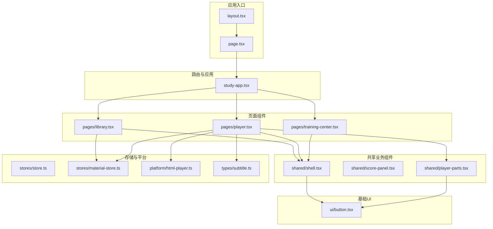
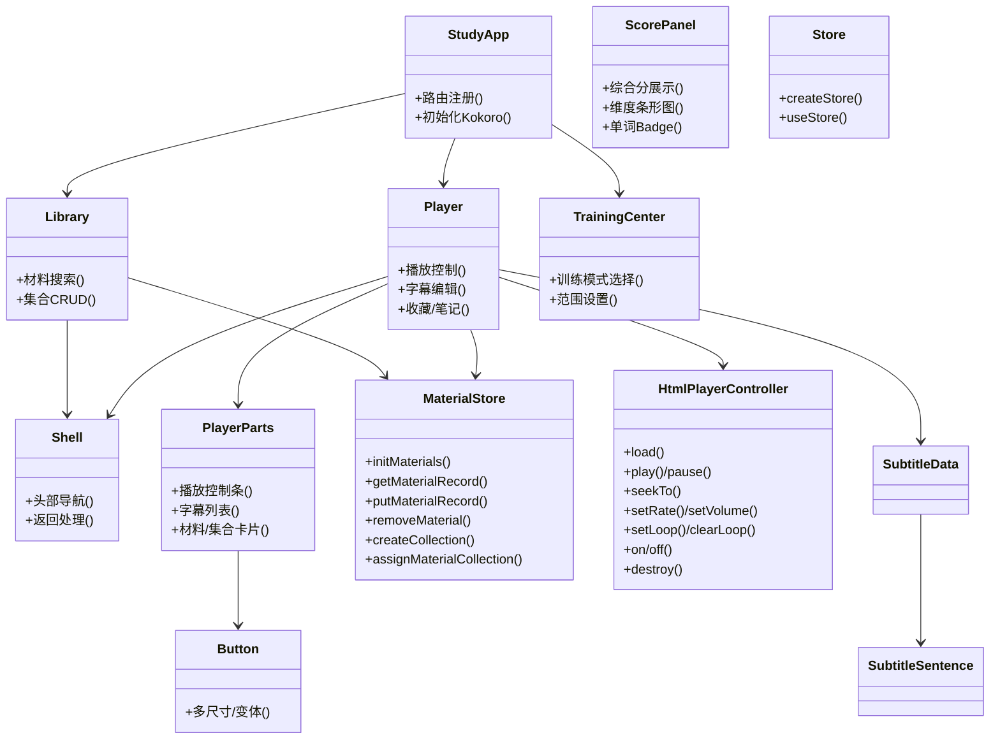
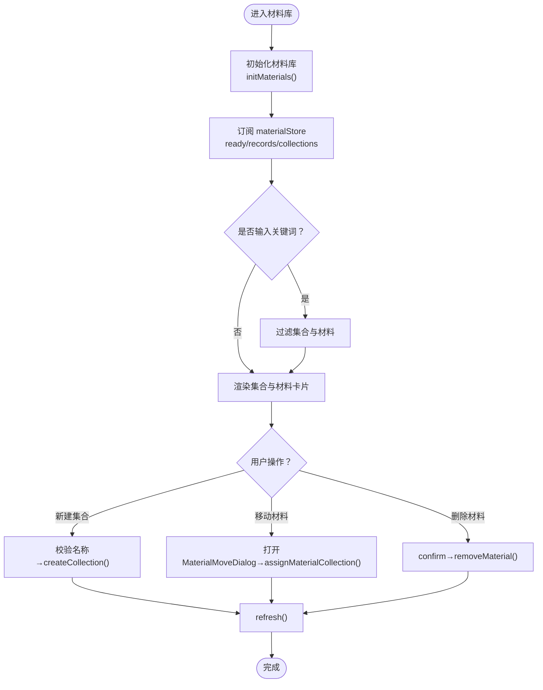
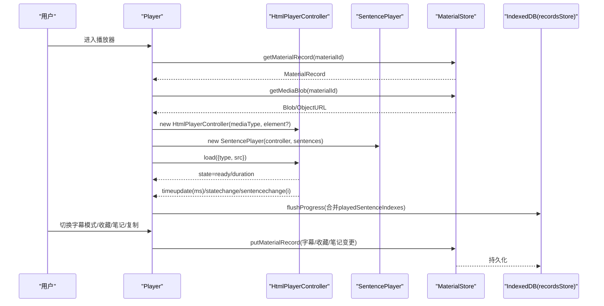
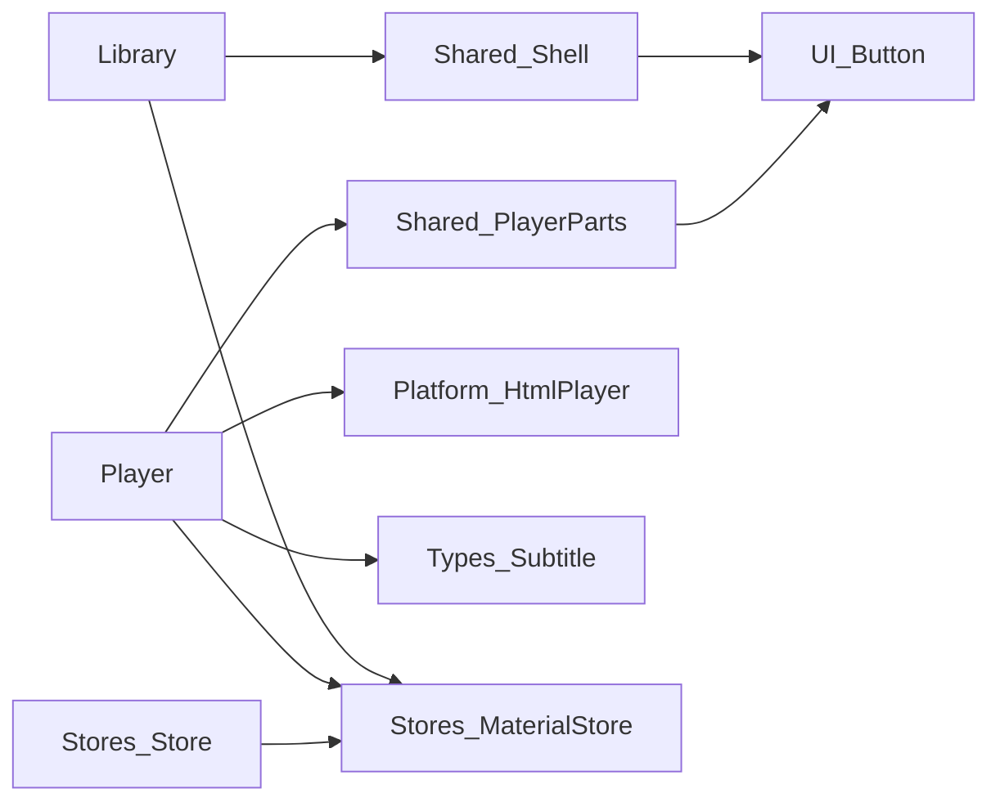

# 组件系统

<cite>
**本文引用的文件**   
- [client/app/layout.tsx](file://client/app/layout.tsx)
- [client/app/page.tsx](file://client/app/page.tsx)
- [client/components/study-app.tsx](file://client/components/study-app.tsx)
- [client/components/pages/library.tsx](file://client/components/pages/library.tsx)
- [client/components/pages/player.tsx](file://client/components/pages/player.tsx)
- [client/components/pages/training-center.tsx](file://client/components/pages/training-center.tsx)
- [client/components/shared/shell.tsx](file://client/components/shared/shell.tsx)
- [client/components/shared/score-panel.tsx](file://client/components/shared/score-panel.tsx)
- [client/components/shared/player-parts.tsx](file://client/components/shared/player-parts.tsx)
- [client/components/ui/button.tsx](file://client/components/ui/button.tsx)
- [client/stores/store.ts](file://client/stores/store.ts)
- [client/stores/material-store.ts](file://client/stores/material-store.ts)
- [client/platform/html-player.ts](file://client/platform/html-player.ts)
- [client/core/player/index.ts](file://client/core/player/index.ts)
- [client/types/subtitle.ts](file://client/types/subtitle.ts)
</cite>

## 目录
1. [引言](#引言)
2. [项目结构](#项目结构)
3. [核心组件](#核心组件)
4. [架构总览](#架构总览)
5. [详细组件分析](#详细组件分析)
6. [依赖关系分析](#依赖关系分析)
7. [性能与优化](#性能与优化)
8. [可访问性与主题定制](#可访问性与主题定制)
9. [响应式设计实现](#响应式设计实现)
10. [组件通信模式](#组件通信模式)
11. [状态管理与生命周期](#状态管理与生命周期)
12. [开发规范与复用模式](#开发规范与复用模式)
13. [测试策略](#测试策略)
14. [故障排查指南](#故障排查指南)
15. [结论](#结论)

## 引言
本文件面向“英语精听助手”客户端的组件系统，系统性梳理三层组件架构：页面组件（P0-P11）负责业务逻辑与界面展示；共享业务组件提供通用能力；shadcn/ui 基础组件提供原子化 UI。文档重点解释组件通信、状态管理、生命周期、性能优化、响应式与可访问性、主题定制、开发规范、测试策略与复用模式，并给出可视化架构图与流程图，帮助读者快速理解与扩展系统。

## 项目结构
客户端采用 Next.js App Router + React Router 的双路由组合：Next.js 负责应用壳与元信息，React Router 负责页面级路由与导航。组件按职责分层组织：
- 页面组件：位于 components/pages，承载具体业务场景（材料库、播放器、训练中心等）。
- 共享业务组件：位于 components/shared，封装跨页面复用的业务功能（Shell 外壳、评分面板、播放控制条、字幕列表等）。
- 基础 UI 组件：位于 components/ui，基于 shadcn/ui 提供的原子化按钮、卡片、进度条等。
- 存储层：stores 提供轻量 store 抽象与领域数据操作（material-store）。
- 平台适配层：platform 提供媒体控制器 HtmlPlayerController。
- 核心类型：types 定义字幕、进度、训练等数据结构。

图示来源
- [client/app/layout.tsx:1-50](file://client/app/layout.tsx#L1-L50)
- [client/app/page.tsx:1-6](file://client/app/page.tsx#L1-L6)
- [client/components/study-app.tsx:24-64](file://client/components/study-app.tsx#L24-L64)
- [client/components/pages/library.tsx:14-143](file://client/components/pages/library.tsx#L14-L143)
- [client/components/pages/player.tsx:79-535](file://client/components/pages/player.tsx#L79-L535)
- [client/components/pages/training-center.tsx:31-135](file://client/components/pages/training-center.tsx#L31-L135)
- [client/components/shared/shell.tsx:17-24](file://client/components/shared/shell.tsx#L17-L24)
- [client/components/shared/score-panel.tsx:21-95](file://client/components/shared/score-panel.tsx#L21-L95)
- [client/components/shared/player-parts.tsx:113-234](file://client/components/shared/player-parts.tsx#L113-L234)
- [client/components/ui/button.tsx:43-59](file://client/components/ui/button.tsx#L43-L59)
- [client/stores/store.ts:14-34](file://client/stores/store.ts#L14-L34)
- [client/stores/material-store.ts:30-163](file://client/stores/material-store.ts#L30-L163)
- [client/platform/html-player.ts:24-272](file://client/platform/html-player.ts#L24-L272)
- [client/types/subtitle.ts:6-35](file://client/types/subtitle.ts#L6-L35)

章节来源
- [client/app/layout.tsx:1-50](file://client/app/layout.tsx#L1-L50)
- [client/app/page.tsx:1-6](file://client/app/page.tsx#L1-L6)
- [client/components/study-app.tsx:24-64](file://client/components/study-app.tsx#L24-L64)

## 核心组件
- 应用装配器 StudyApp：初始化 Kokoro TTS 配置与模型预加载，注册所有页面路由。
- 页面组件 Library/Player/TrainingCenter：分别承担材料库浏览、音视频播放与字幕编辑、训练模式选择等业务。
- 共享组件 Shell/ScorePanel/PlayerParts：提供统一头部导航、评分面板、播放控制条与字幕列表等通用能力。
- 基础组件 Button：基于 class-variance-authority 的多变体按钮，支持尺寸、样式与无障碍属性。
- 存储 Store：极简 useSyncExternalStore 封装，提供 createStore/useStore 订阅机制。
- 材料 Store MaterialStore：材料集 CRUD、最近学习排序、进度与收藏/笔记清理、种子注入。
- 平台控制器 HtmlPlayerController：HTMLMediaElement 封装，提供播放、暂停、seek、倍速、音量、A-B 循环、事件派发与 seek 漂移校准。
- 类型 SubtitleData/SubtitleSentence：句子级字幕数据模型。

章节来源
- [client/components/study-app.tsx:24-64](file://client/components/study-app.tsx#L24-L64)
- [client/components/pages/library.tsx:14-143](file://client/components/pages/library.tsx#L14-L143)
- [client/components/pages/player.tsx:79-535](file://client/components/pages/player.tsx#L79-L535)
- [client/components/pages/training-center.tsx:31-135](file://client/components/pages/training-center.tsx#L31-L135)
- [client/components/shared/shell.tsx:17-24](file://client/components/shared/shell.tsx#L17-L24)
- [client/components/shared/score-panel.tsx:21-95](file://client/components/shared/score-panel.tsx#L21-L95)
- [client/components/shared/player-parts.tsx:113-234](file://client/components/shared/player-parts.tsx#L113-L234)
- [client/components/ui/button.tsx:43-59](file://client/components/ui/button.tsx#L43-L59)
- [client/stores/store.ts:14-34](file://client/stores/store.ts#L14-L34)
- [client/stores/material-store.ts:30-163](file://client/stores/material-store.ts#L30-L163)
- [client/platform/html-player.ts:24-272](file://client/platform/html-player.ts#L24-L272)
- [client/types/subtitle.ts:6-35](file://client/types/subtitle.ts#L6-L35)

## 架构总览
系统采用“页面组件 → 共享业务组件 → 基础 UI 组件”的三层结构，配合 stores 与 platform 层解耦业务与平台细节。

图示来源
- [client/components/study-app.tsx:24-64](file://client/components/study-app.tsx#L24-L64)
- [client/components/pages/library.tsx:14-143](file://client/components/pages/library.tsx#L14-L143)
- [client/components/pages/player.tsx:79-535](file://client/components/pages/player.tsx#L79-L535)
- [client/components/pages/training-center.tsx:31-135](file://client/components/pages/training-center.tsx#L31-L135)
- [client/components/shared/shell.tsx:17-24](file://client/components/shared/shell.tsx#L17-L24)
- [client/components/shared/score-panel.tsx:21-95](file://client/components/shared/score-panel.tsx#L21-L95)
- [client/components/shared/player-parts.tsx:113-234](file://client/components/shared/player-parts.tsx#L113-L234)
- [client/components/ui/button.tsx:43-59](file://client/components/ui/button.tsx#L43-L59)
- [client/stores/store.ts:14-34](file://client/stores/store.ts#L14-L34)
- [client/stores/material-store.ts:30-163](file://client/stores/material-store.ts#L30-L163)
- [client/platform/html-player.ts:24-272](file://client/platform/html-player.ts#L24-L272)
- [client/types/subtitle.ts:6-35](file://client/types/subtitle.ts#L6-L35)

## 详细组件分析

### 页面组件：Library（材料库）
- 职责：材料检索、集合创建/移动、删除材料、显示进度百分比与最近学习标签。
- 关键流程：
  - 初始化时调用 initMaterials 注入种子并刷新列表。
  - 使用 useStore(materialStore) 订阅 ready/records/collections。
  - 计算未分组材料与搜索结果，渲染集合与材料卡片。
  - 通过 Dialog 新建集合，MaterialMoveDialog 移动材料。
- 交互与状态：
  - query 控制搜索过滤。
  - percents 由 loadProgressPercents 异步计算。
  - moveTarget 控制移动弹窗目标。

图示来源
- [client/components/pages/library.tsx:14-143](file://client/components/pages/library.tsx#L14-L143)
- [client/stores/material-store.ts:70-163](file://client/stores/material-store.ts#L70-L163)

章节来源
- [client/components/pages/library.tsx:14-143](file://client/components/pages/library.tsx#L14-L143)
- [client/stores/material-store.ts:70-163](file://client/stores/material-store.ts#L70-L163)

### 页面组件：Player（播放器）
- 职责：音视频播放、字幕编辑、收藏与笔记、翻译与导出、键盘快捷键、背景轮播。
- 关键流程：
  - 根据 materialId 读取记录、媒体 Blob、收藏与笔记，恢复上次播放位置。
  - 装配 HtmlPlayerController + SentencePlayer，监听 timeupdate/statechange/sentencechange。
  - 节流更新 currentMs（100ms），增量收集 playedSentenceIndexes，每 5s 落盘 progress。
  - 字幕数据变化时同步 setSentences，避免引擎句列表过期。
  - 提供复制原文/译文、AI 转字幕、导入字幕、纠错保存、批量翻译应用、导出 SRT。
  - 收藏切换、笔记抽屉锚定、N 键打开笔记、鼠标悬停控制栏显示/隐藏。
- 性能要点：
  - 时间更新节流、播放进度节流落盘、ObjectURL 在卸载时 revoke。
  - 字幕列表滚动自动跟随但允许手动滚动后暂停跟随 5s。

图示来源
- [client/components/pages/player.tsx:127-245](file://client/components/pages/player.tsx#L127-L245)
- [client/platform/html-player.ts:66-137](file://client/platform/html-player.ts#L66-L137)
- [client/stores/material-store.ts:75-121](file://client/stores/material-store.ts#L75-L121)

章节来源
- [client/components/pages/player.tsx:79-535](file://client/components/pages/player.tsx#L79-L535)
- [client/platform/html-player.ts:24-272](file://client/platform/html-player.ts#L24-L272)
- [client/stores/material-store.ts:75-121](file://client/stores/material-store.ts#L75-L121)

### 页面组件：TrainingCenter（训练中心）
- 职责：展示训练模式（九宫格、单句听写、跟读评分、影子跟读、全文背诵），支持全文/收藏句范围选择。
- 关键流程：
  - 读取当前材料与收藏句数量，查询各模式最近成绩。
  - 当选择收藏句范围时，全文类模式置灰不可选。
  - 将 training-material 偏好写入本地存储。

章节来源
- [client/components/pages/training-center.tsx:31-135](file://client/components/pages/training-center.tsx#L31-L135)

### 共享业务组件：Shell（外壳）
- 职责：统一头部导航、返回按钮（点击前暂停所有媒体）、品牌标识与快捷入口（收藏、生词本、设置）。
- 可访问性：为图标按钮提供 aria-label。

章节来源
- [client/components/shared/shell.tsx:17-24](file://client/components/shared/shell.tsx#L17-L24)

### 共享业务组件：ScorePanel（评分面板）
- 职责：展示综合分与准确度/流利度/完整度三维条形，单词级 Badge 标红阈值（低于 60 分）。
- 附加能力：麦克风权限拒绝时的引导浮层，含重试与关闭操作。

章节来源
- [client/components/shared/score-panel.tsx:21-95](file://client/components/shared/score-panel.tsx#L21-L95)

### 共享业务组件：PlayerParts（播放控制条与字幕列表）
- 播放控制条：进度条拖拽 seek、倍速循环、音量滑块、字幕模式切换。
- 字幕列表：当前句高亮与自动滚动、收藏标记、笔记按钮、导入/AI/翻译/导出等操作。
- 材料/集合卡片：进度与最近学习标签、移动/删除操作。

章节来源
- [client/components/shared/player-parts.tsx:113-234](file://client/components/shared/player-parts.tsx#L113-L234)

### 基础 UI 组件：Button
- 基于 class-variance-authority 的多变体按钮，支持 default/outline/secondary/ghost/destructive/link 等变体与 xs/sm/lg/icon 等尺寸。
- 内置 focus-visible、aria-invalid、dark 模式等样式规则。

章节来源
- [client/components/ui/button.tsx:43-59](file://client/components/ui/button.tsx#L43-L59)

## 依赖关系分析
- 页面组件依赖共享业务组件与基础 UI 组件，并通过 stores 与 platform 层进行数据与媒体控制。
- 存储层通过 createStore/useStore 提供最小化订阅机制，避免引入外部状态库。
- 媒体控制器 HtmlPlayerController 暴露标准接口供上层编排 SentencePlayer（由 core/player 导出）。

图示来源
- [client/components/pages/library.tsx:14-143](file://client/components/pages/library.tsx#L14-L143)
- [client/components/pages/player.tsx:79-535](file://client/components/pages/player.tsx#L79-L535)
- [client/components/shared/shell.tsx:17-24](file://client/components/shared/shell.tsx#L17-L24)
- [client/components/shared/player-parts.tsx:113-234](file://client/components/shared/player-parts.tsx#L113-L234)
- [client/components/ui/button.tsx:43-59](file://client/components/ui/button.tsx#L43-L59)
- [client/stores/store.ts:14-34](file://client/stores/store.ts#L14-L34)
- [client/stores/material-store.ts:30-163](file://client/stores/material-store.ts#L30-L163)
- [client/platform/html-player.ts:24-272](file://client/platform/html-player.ts#L24-L272)
- [client/types/subtitle.ts:6-35](file://client/types/subtitle.ts#L6-L35)

章节来源
- [client/stores/store.ts:14-34](file://client/stores/store.ts#L14-L34)
- [client/stores/material-store.ts:30-163](file://client/stores/material-store.ts#L30-L163)
- [client/platform/html-player.ts:24-272](file://client/platform/html-player.ts#L24-L272)

## 性能与优化
- 播放器时间更新节流：每 100ms 更新一次 currentMs，降低 React 重渲染频率。
- 播放进度落盘节流：累计 playedSentenceIndexes，每 5s 合并写入 recordsStore。
- 字幕列表滚动优化：程序化滚动后暂停自动跟随 5s，避免频繁 scrollIntoView。
- ObjectURL 生命周期管理：进入页面创建，卸载时 revoke，防止内存泄漏。
- 媒体控制器 rAF 高频采样：播放中用 requestAnimationFrame 提升进度条平滑度。
- Seek 漂移校准：首个原生 timeupdate 到达后校准 currentMs，偏差超过阈值记录 drift 供上层容差修正。

章节来源
- [client/components/pages/player.tsx:209-245](file://client/components/pages/player.tsx#L209-L245)
- [client/components/shared/player-parts.tsx:135-153](file://client/components/shared/player-parts.tsx#L135-L153)
- [client/platform/html-player.ts:223-251](file://client/platform/html-player.ts#L223-L251)

## 可访问性与主题定制
- 可访问性：
  - 按钮与控件提供 aria-label、aria-pressed、aria-valuemin/max/now 等语义属性。
  - 对话框与遮罩使用 role="dialog" 与 aria-modal。
  - 字幕项支持键盘 Enter/Space 选择。
- 主题定制：
  - layout.tsx 声明 colorScheme 与 themeColor，支持 light/dark。
  - 全局 CSS 与 Tailwind 变量驱动主题色（primary、background、card 等）。
  - Button 等基础组件内置 dark 模式样式。

章节来源
- [client/app/layout.tsx:28-49](file://client/app/layout.tsx#L28-L49)
- [client/components/shared/score-panel.tsx:70-92](file://client/components/shared/score-panel.tsx#L70-L92)
- [client/components/shared/player-parts.tsx:119-120](file://client/components/shared/player-parts.tsx#L119-L120)
- [client/components/ui/button.tsx:6-41](file://client/components/ui/button.tsx#L6-L41)

## 响应式设计实现
- 布局断点：大量使用 md:px-8、lg:grid-cols 等 Tailwind 断点实现移动端到桌面端的自适应。
- 播放器区域：h-[calc(100vh-180px)] 与 lg:grid-cols 控制主视觉区与字幕列比例。
- 控制栏：max-md:pointer-events-auto 与 opacity 过渡确保移动端可用性与体验。

章节来源
- [client/components/shared/shell.tsx:17-24](file://client/components/shared/shell.tsx#L17-L24)
- [client/components/pages/player.tsx:521-531](file://client/components/pages/player.tsx#L521-L531)

## 组件通信模式
- Props 传递：
  - Player 向 PlayerParts 传递播放状态、模式、循环、速率、音量等 props。
  - Library 向 MaterialCard/CollectionCard 传入进度、最近标签与回调。
- 事件回调：
  - PlayerParts 通过 onSelect/onImportSubtitle/onAiConvert/onDeleteSentence/onEditSentence/onExportSubtitle/onTranslate 等回调与父组件通信。
  - HtmlPlayerController 通过 on('timeupdate'|'statechange'|'sentencechange'|'error') 向上层派发事件。
- Context API 使用：
  - 当前代码未直接使用 React Context；跨组件状态通过 props 与 store 订阅（useStore）实现。

章节来源
- [client/components/shared/player-parts.tsx:113-234](file://client/components/shared/player-parts.tsx#L113-L234)
- [client/platform/html-player.ts:139-140](file://client/platform/html-player.ts#L139-L140)
- [client/stores/store.ts:30-34](file://client/stores/store.ts#L30-L34)

## 状态管理与生命周期
- 状态管理：
  - 使用 createStore/useStore 提供最小化订阅机制，store 本体为纯 JS 对象，React 侧仅订阅。
  - MaterialStore 负责材料集与材料记录的 CRUD、最近学习排序、进度与收藏/笔记清理。
- 生命周期：
  - useEffect 用于初始化数据、装配播放器、监听键盘事件、清理定时器与 ObjectURL。
  - useCallback 缓存回调以稳定引用，减少子组件重渲染。
  - useRef 保存 playerRef、pendingNotesRef、controlsTimerRef 等非渲染状态。

章节来源
- [client/stores/store.ts:14-34](file://client/stores/store.ts#L14-L34)
- [client/stores/material-store.ts:30-163](file://client/stores/material-store.ts#L30-L163)
- [client/components/pages/player.tsx:127-335](file://client/components/pages/player.tsx#L127-L335)

## 开发规范与复用模式
- 组件分层：
  - 页面组件专注业务编排与路由；共享业务组件封装跨页面能力；基础 UI 组件保持原子化。
- 命名与导出：
  - 页面组件默认导出；共享组件按需导出（如 Shell/PageIntro/ScorePanel/PlayerControlBar/SubtitleList）。
- 复用模式：
  - 通过 props 与回调实现“受控组件”模式（如 PlayerControlBar、SubtitleList）。
  - 使用 useStore 订阅全局状态，避免 prop drilling。
- 错误处理：
  - 存储失败静默处理，不影响主流程；媒体加载失败保持静态展示。

章节来源
- [client/components/shared/player-parts.tsx:113-234](file://client/components/shared/player-parts.tsx#L113-L234)
- [client/components/pages/player.tsx:370-492](file://client/components/pages/player.tsx#L370-L492)

## 测试策略
- 单元测试：
  - 针对核心算法与工具函数（如洗牌、字幕解析、评分阈值）编写用例。
  - 对服务层（SOE/TTS）与平台层（wav-pcm、iflytek/tencent 映射）进行隔离测试。
- 集成测试：
  - 验证播放器装配流程、事件派发与 seek 校准行为。
  - 验证 MaterialStore 的 CRUD 与级联清理逻辑。
- 建议：
  - 使用 Vitest 运行测试（仓库已包含 vitest.config.mts）。
  - 对 UI 组件进行快照测试与交互测试（可结合 Testing Library）。

章节来源
- [client/platform/html-player.ts:24-272](file://client/platform/html-player.ts#L24-L272)
- [client/stores/material-store.ts:107-163](file://client/stores/material-store.ts#L107-L163)

## 故障排查指南
- 播放器无响应或返回按钮卡顿：
  - 检查 timeupdate 节流与 rAF 采样是否正常；确认 pauseAllMedia 在返回前执行。
- 进度不更新或回跳：
  - 检查 seek 校准逻辑与 pendingSeekMs 状态；确认 pushTime 在待校准期间静默旧值。
- 字幕列表滚动异常：
  - 检查 programmaticRef 与 manualUntilRef 逻辑，确保手动滚动后暂停自动跟随。
- 收藏/笔记丢失：
  - 确认 flushProgress 与笔记防抖落盘逻辑；检查卸载时 pendingNotesRef 的立即 flush。

章节来源
- [client/components/shared/shell.tsx:9-15](file://client/components/shared/shell.tsx#L9-L15)
- [client/platform/html-player.ts:178-251](file://client/platform/html-player.ts#L178-L251)
- [client/components/pages/player.tsx:307-335](file://client/components/pages/player.tsx#L307-L335)

## 结论
该组件系统通过清晰的三层架构与最小化状态管理，实现了可扩展、高性能且可访问的学习型媒体应用。页面组件聚焦业务编排，共享业务组件沉淀通用能力，基础 UI 组件保证一致性。播放器与存储层解耦，便于替换平台实现与扩展新功能。建议在后续迭代中继续遵循现有通信与状态管理模式，完善测试覆盖，并持续优化可访问性与主题定制能力。