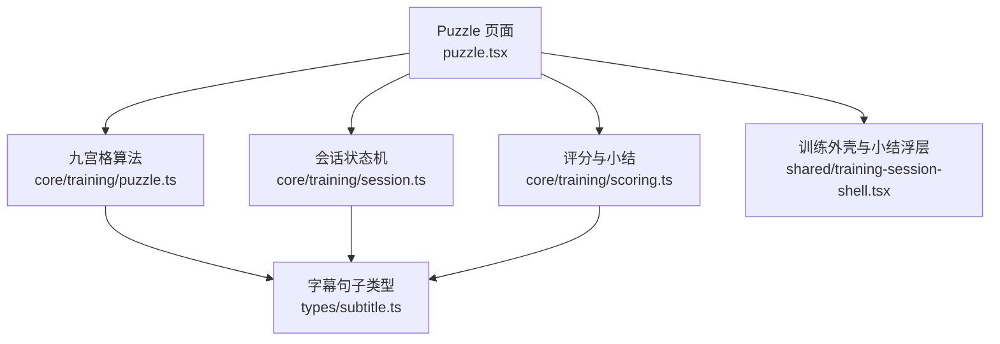
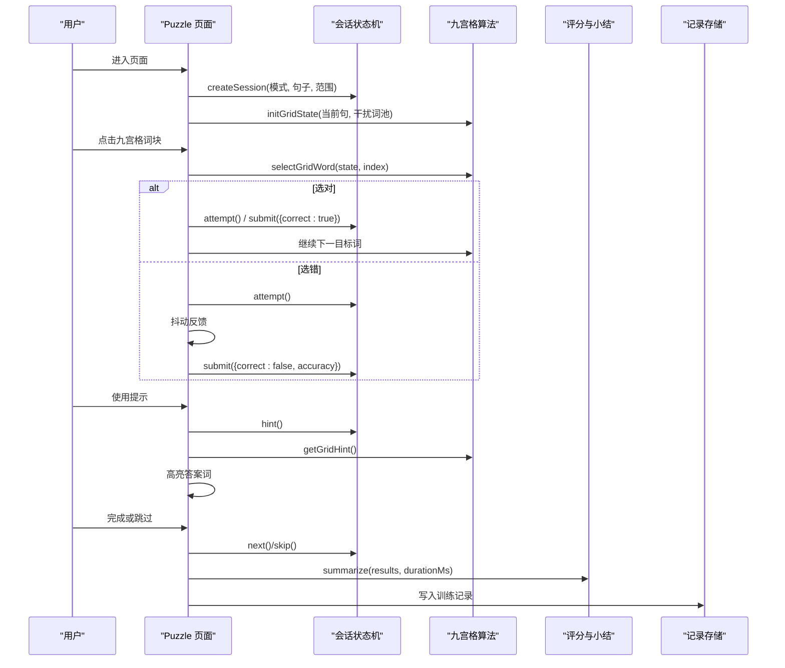
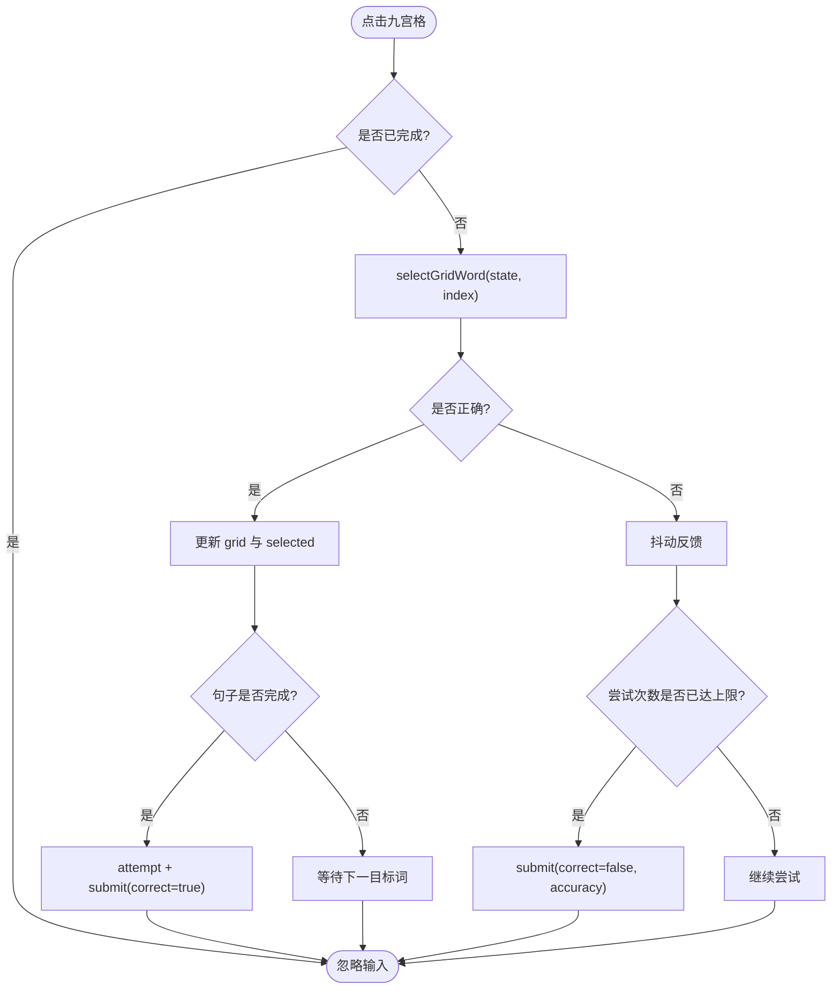
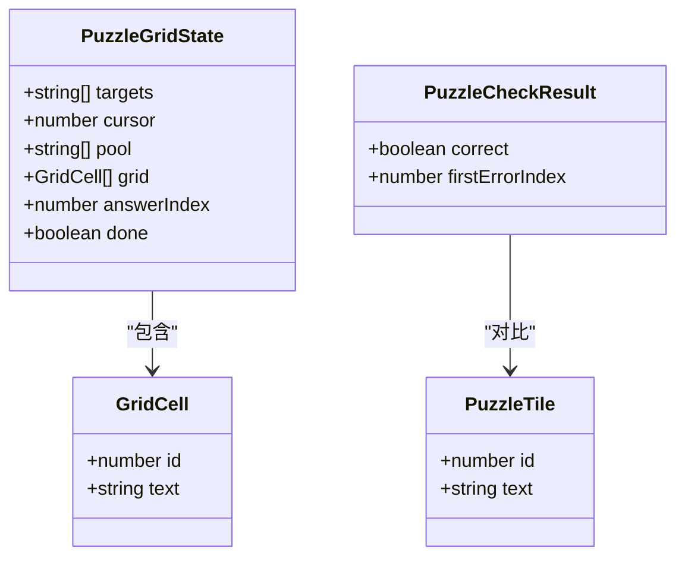
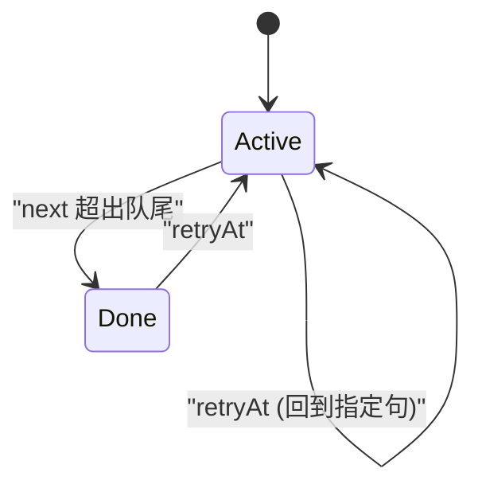
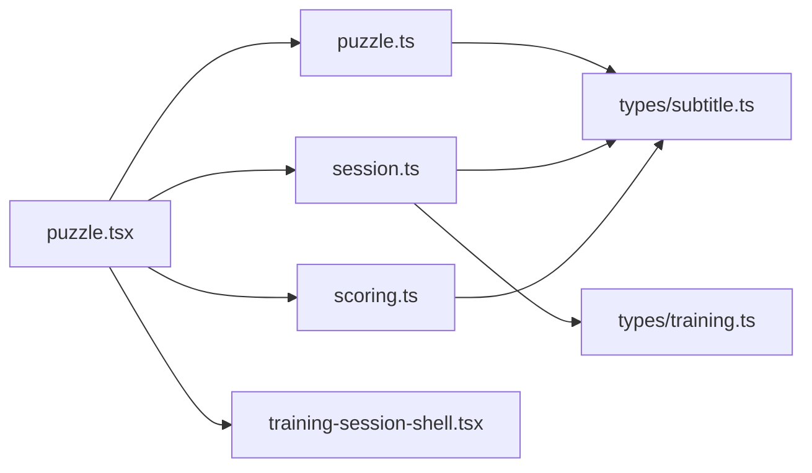

# 九宫格练习页面

<cite>
**本文引用的文件**   
- [puzzle.tsx](file://client/components/pages/puzzle.tsx)
- [puzzle.ts](file://client/core/training/puzzle.ts)
- [scoring.ts](file://client/core/training/scoring.ts)
- [session.ts](file://client/core/training/session.ts)
- [index.ts](file://client/core/training/index.ts)
- [training-session-shell.tsx](file://client/components/shared/training-session-shell.tsx)
- [puzzle.test.ts](file://client/core/training/__tests__/puzzle.test.ts)
- [puzzle-grid.test.ts](file://client/core/training/__tests__/puzzle-grid.test.ts)
- [session.test.ts](file://client/core/training/__tests__/session.test.ts)
</cite>

## 目录
1. [引言](#引言)
2. [项目结构](#项目结构)
3. [核心组件](#核心组件)
4. [架构总览](#架构总览)
5. [详细组件分析](#详细组件分析)
6. [依赖关系分析](#依赖关系分析)
7. [性能与可扩展性](#性能与可扩展性)
8. [故障排查指南](#故障排查指南)
9. [结论](#结论)
10. [附录：自定义规则与扩展玩法](#附录自定义规则与扩展玩法)

## 引言
本文件为“九宫格练习页面”的完整技术文档，聚焦 Puzzle 组件及其核心算法模块。内容覆盖：
- 九宫格布局与滑窗算法
- 单词随机排列与干扰词生成
- 拖拽/点击交互逻辑（当前实现为点击选择）
- 实时评分、提示机制与提交上限
- 训练会话状态机、范围过滤、结果汇总
- 动画反馈、错误抖动与高亮提示
- 测试策略、性能优化与扩展点

该页面以 React 组件作为 UI 层，纯函数式 core/training 模块承载全部游戏逻辑，便于测试与复用。

## 项目结构
九宫格练习相关代码分布在 UI 组件与核心训练模块两个层次：
- UI 层：`client/components/pages/puzzle.tsx` 负责渲染、用户交互、播放控制、记录写入。
- 核心层：`client/core/training/*` 提供零依赖的纯函数算法与状态机，包括拼句、九宫格、评分与会话管理。
- 共享外壳：`client/components/shared/training-session-shell.tsx` 提供统一进度条、小结浮层与材料加载 Hook。

图表来源
- [puzzle.tsx:1-293](file://client/components/pages/puzzle.tsx#L1-L293)
- [puzzle.ts:1-284](file://client/core/training/puzzle.ts#L1-L284)
- [session.ts:1-119](file://client/core/training/session.ts#L1-L119)
- [scoring.ts:1-58](file://client/core/training/scoring.ts#L1-L58)
- [training-session-shell.tsx:1-67](file://client/components/shared/training-session-shell.tsx#L1-L67)

章节来源
- [puzzle.tsx:1-293](file://client/components/pages/puzzle.tsx#L1-L293)
- [training-session-shell.tsx:1-67](file://client/components/shared/training-session-shell.tsx#L1-L67)

## 核心组件
- Puzzle 页面组件：封装训练流程、音频播放、九宫格交互、提示与提交、结果统计与持久化。
- 九宫格算法模块：目标序列拆分、乱序打散、干扰词收集、九宫格初始化与滑窗更新、答案判定与提示定位。
- 会话状态机：题目队列、游标推进、提交/提示/跳过/重试等事件迁移，以及记录 ID 生成。
- 评分与小结：正确率、用时、最弱句 TOP3、总播放次数汇总与时间格式化。

章节来源
- [puzzle.tsx:1-293](file://client/components/pages/puzzle.tsx#L1-L293)
- [puzzle.ts:1-284](file://client/core/training/puzzle.ts#L1-L284)
- [session.ts:1-119](file://client/core/training/session.ts#L1-L119)
- [scoring.ts:1-58](file://client/core/training/scoring.ts#L1-L58)

## 架构总览
整体采用“UI 组件 + 纯函数核心”的分层设计：
- UI 组件不直接实现业务规则，仅调用 core/training 提供的函数更新本地状态。
- 核心模块无 React/DOM 依赖，可独立单元测试，保证算法稳定性。
- 训练会话通过纯函数状态机驱动，所有事件返回新状态对象，避免隐式副作用。

图表来源
- [puzzle.tsx:31-293](file://client/components/pages/puzzle.tsx#L31-L293)
- [session.ts:44-119](file://client/core/training/session.ts#L44-L119)
- [puzzle.ts:168-284](file://client/core/training/puzzle.ts#L168-L284)
- [scoring.ts:40-58](file://client/core/training/scoring.ts#L40-L58)

## 详细组件分析

### Puzzle 页面组件
职责与行为：
- 加载材料与媒体资源，构造 SentencePlayer 播放引擎。
- 根据当前句与干扰词池初始化九宫格状态。
- 处理点击选择：正确则推进 grid 与 selected，错误则抖动并消耗尝试次数。
- 支持每句最多 MAX_HINTS=3 次提示，每次提示扣 2 分。
- 自动提交：当九宫格完成整句时，自动提交正确结果。
- 达到最大尝试次数后提交错误结果，并计算准确率。
- 会话结束时汇总得分、最弱句，并写入训练记录。

关键交互流程：
- onGridPick：选择词块 → selectGridWord → 正确则推进 cursor 与 selected；若 done 则自动提交。
- useHintAction：getGridHint → 高亮同文本答案格 → hint(session)。
- playSegment：SentencePlayer.playRange(sentence.startMs, sentence.endMs)，计数 plays。
- 完成时：summarize → 计算 gridScore → 写入 recordsStore。

图表来源
- [puzzle.tsx:134-171](file://client/components/pages/puzzle.tsx#L134-L171)
- [puzzle.ts:222-269](file://client/core/training/puzzle.ts#L222-L269)

章节来源
- [puzzle.tsx:31-293](file://client/components/pages/puzzle.tsx#L31-L293)

### 九宫格算法模块
核心能力：
- splitTargets：按标点或固定长度并块，用于长句拆分为可操作的目标序列。
- buildTiles：Fisher-Yates 洗牌，确保初始顺序不与正序相同。
- checkAnswer：逐位对比 picked 与 targets，返回首个错误位。
- collectDistractorWords：从其他句子收集干扰词，去重且不区分大小写重复。
- initGridState：将前 GRID_SIZE 个目标词放入九宫格，不足时用干扰词补齐，定位 answerIndex。
- selectGridWord：判对错、推进 cursor、移除选中格、从 pool 补词、重新洗牌并定位新答案。
- getGridHint：返回答案在 grid 中的 index。
- gridScore：每句基础 10 分，每次提示 -2，下限 0。

复杂度与特性：
- shuffle 为 O(n)，initGridState/selectGridWord 均包含一次洗牌与若干线性扫描。
- isSameWord 严格区分大小写，保证专有名词与首字母大写的准确性。
- 重复词多格场景下，任意同文本格均可命中，但大小写不同视为不同词。

图表来源
- [puzzle.ts:12-22](file://client/core/training/puzzle.ts#L12-L22)
- [puzzle.ts:100-123](file://client/core/training/puzzle.ts#L100-L123)

章节来源
- [puzzle.ts:1-284](file://client/core/training/puzzle.ts#L1-L284)

### 训练会话状态机
职责：
- sentencesInScope：按全文或收藏句过滤，保持原时间轴顺序。
- createSession：初始化队列、游标、状态、计时起点。
- currentSentence：读取当前句。
- submit：收集结果，同句重复提交覆盖上一条。
- attempt/hint：累计尝试与提示次数。
- next/skip/retryAt：推进/跳过/回跳指定句，重置 per-sentence 计数。
- makeRecordId：生成训练记录 ID。

状态迁移要点：
- active → done：当 cursor 超出队尾。
- 每句 hintCount/attemptCount 在 next 时重置。
- skip 记一条 skipped=true 的结果并推进。

图表来源
- [session.ts:16-119](file://client/core/training/session.ts#L16-L119)

章节来源
- [session.ts:1-119](file://client/core/training/session.ts#L1-L119)

### 评分与小结
职责：
- summarize：计算 total、correctCount、accuracy（句均）、durationMs、weakest（TOP3 错误句索引）、totalPlays。
- formatElapsed：将毫秒转为 mm:ss 字符串。

与 Puzzle 页面的结合：
- 页面在会话完成时计算 gridScore(correctCount, totalHints) 作为最终得分。
- 展示最弱句列表，支持回跳重练。

章节来源
- [scoring.ts:1-58](file://client/core/training/scoring.ts#L1-L58)
- [puzzle.tsx:103-125](file://client/components/pages/puzzle.tsx#L103-L125)

### 训练外壳与材料加载
职责：
- TrainingSessionShell：页头标题、徽标进度、真实进度条。
- SessionSummaryOverlay：完成小结浮层，展示正确率、用时、得分与最弱句。
- useTrainingMaterial：从偏好设置中读取最近训练材料与范围，解析收藏句索引，若无收藏则回落全文。

章节来源
- [training-session-shell.tsx:1-67](file://client/components/shared/training-session-shell.tsx#L1-L67)

## 依赖关系分析
模块间依赖清晰，UI 层依赖核心层，核心层不依赖 UI：
- puzzle.tsx 依赖 puzzle.ts、session.ts、scoring.ts、training-session-shell.tsx。
- puzzle.ts 依赖 types/subtitle.ts（通过引用路径）。
- session.ts 依赖 types/subtitle.ts、types/training.ts、scoring.ts 的类型定义。
- scoring.ts 依赖 types/subtitle.ts 的类型定义。

图表来源
- [puzzle.tsx:1-293](file://client/components/pages/puzzle.tsx#L1-L293)
- [puzzle.ts:1-284](file://client/core/training/puzzle.ts#L1-L284)
- [session.ts:1-119](file://client/core/training/session.ts#L1-L119)
- [scoring.ts:1-58](file://client/core/training/scoring.ts#L1-L58)
- [training-session-shell.tsx:1-67](file://client/components/shared/training-session-shell.tsx#L1-L67)

章节来源
- [puzzle.tsx:1-293](file://client/components/pages/puzzle.tsx#L1-L293)
- [puzzle.ts:1-284](file://client/core/training/puzzle.ts#L1-L284)
- [session.ts:1-119](file://client/core/training/session.ts#L1-L119)
- [scoring.ts:1-58](file://client/core/training/scoring.ts#L1-L58)
- [training-session-shell.tsx:1-67](file://client/components/shared/training-session-shell.tsx#L1-L67)

## 性能与可扩展性
性能要点：
- Fisher-Yates 洗牌 O(n)，单次交互开销低。
- 九宫格滑窗仅在选中正确词时执行一次洗牌与线性扫描，避免频繁重排。
- 干扰词收集使用 Set 去重，降低重复成本。
- 动画反馈使用 CSS 类切换（抖动、高亮），避免 JS 动画循环。

可扩展性建议：
- 将难度参数注入到 splitTargets 与 initGridState，例如调整 CHUNK_THRESHOLD、GRID_SIZE、干扰词比例。
- 扩展提示策略：除高亮外，可增加发音提示、例句片段播放。
- 增加更多模式：如拖拽排序、限时挑战、连击奖励等，通过扩展 SessionState 与 UI 层组合实现。

[本节为通用指导，不直接分析具体文件]

## 故障排查指南
常见问题与定位：
- 九宫格始终无法完成：检查 isSameWord 的大小写匹配是否与素材一致；确认 splitWords 与 splitTargets 的行为是否符合预期。
- 提示无效：确认 session.hintCount < MAX_HINTS，且 getGridHint 返回有效 index。
- 提交次数用尽但未结束：检查 MAX_ATTEMPTS 与 attemptCount 累加逻辑，确保 submit 在达到上限后被触发。
- 记录未写入：检查 recordsStore.put 是否成功，注意异步异常不影响主流程。
- 小结为空或数据异常：确认 session.results 非空，summarize 的 total 与 weakest 计算正确。

章节来源
- [puzzle.tsx:103-125](file://client/components/pages/puzzle.tsx#L103-L125)
- [puzzle.ts:138-140](file://client/core/training/puzzle.ts#L138-L140)
- [puzzle.ts:274-284](file://client/core/training/puzzle.ts#L274-L284)
- [session.ts:70-119](file://client/core/training/session.ts#L70-L119)
- [scoring.ts:40-58](file://client/core/training/scoring.ts#L40-L58)

## 结论
九宫格练习页面通过清晰的 UI 与核心模块分层，实现了稳定的拼句训练体验。核心算法具备可测性与可扩展性，会话状态机保证了训练流程的可控与可追溯。评分与小结为用户提供了明确的反馈与改进方向。建议在后续迭代中引入难度调节、更多交互方式与更丰富的提示策略，以提升训练效果与用户体验。

[本节为总结性内容，不直接分析具体文件]

## 附录：自定义规则与扩展玩法
- 自定义难度：
  - 调整 CHUNK_THRESHOLD 以改变长句并块阈值。
  - 调整 GRID_SIZE 以改变九宫格规模。
  - 调整干扰词池大小与去重策略。
- 扩展玩法：
  - 限时挑战：在 SessionState 中加入倒计时字段，超时自动提交。
  - 连击奖励：连续正确加分，错误清零。
  - 拖拽排序：在 UI 层实现拖拽交换，核心层提供 compareOrder 校验。
  - 多语言提示：结合 TTS 或翻译 API，提供发音与释义提示。
- 集成测试建议：
  - 使用确定性 rng 验证洗牌分布与答案位置均匀性。
  - 覆盖边界条件：空句、单句、重复词、大小写差异、超长句。
  - 验证会话状态机在所有事件下的幂等性与不可变性。

章节来源
- [puzzle.ts:24-52](file://client/core/training/puzzle.ts#L24-L52)
- [puzzle.ts:97-123](file://client/core/training/puzzle.ts#L97-L123)
- [puzzle.ts:146-213](file://client/core/training/puzzle.ts#L146-L213)
- [puzzle.test.ts:28-93](file://client/core/training/__tests__/puzzle.test.ts#L28-L93)
- [puzzle-grid.test.ts:31-97](file://client/core/training/__tests__/puzzle-grid.test.ts#L31-L97)
- [session.test.ts:46-76](file://client/core/training/__tests__/session.test.ts#L46-L76)