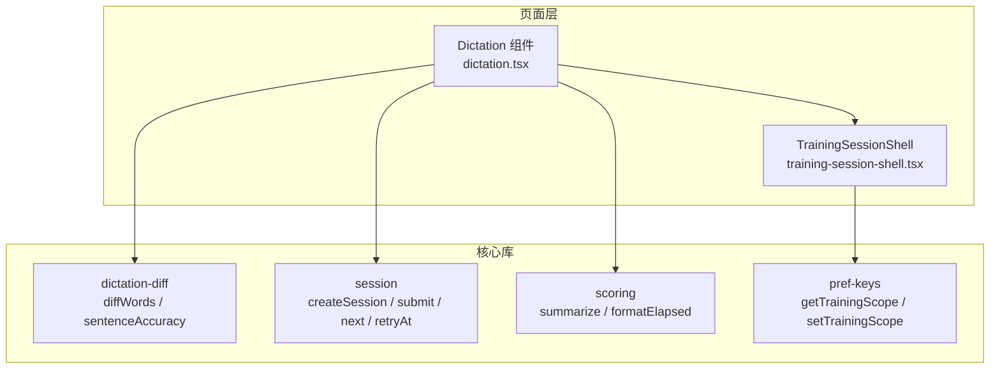
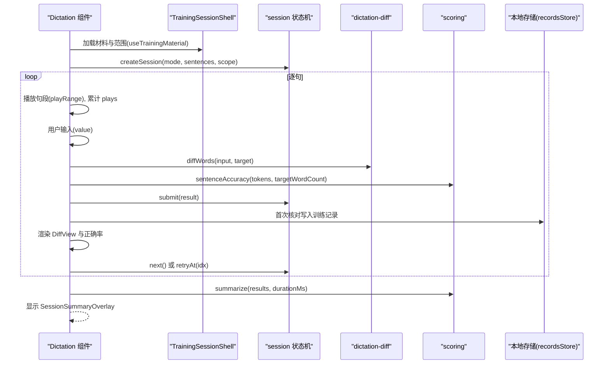
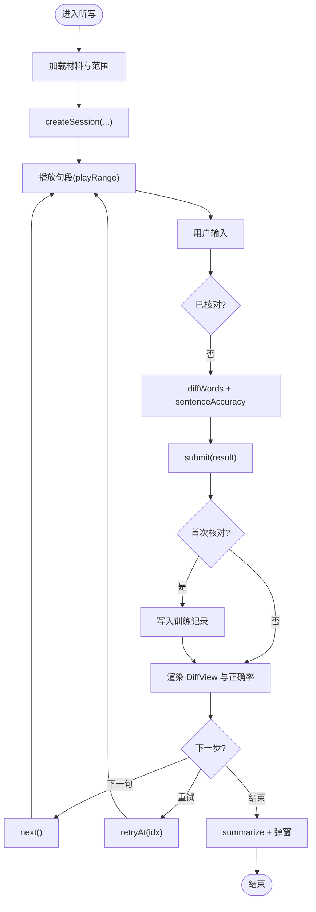
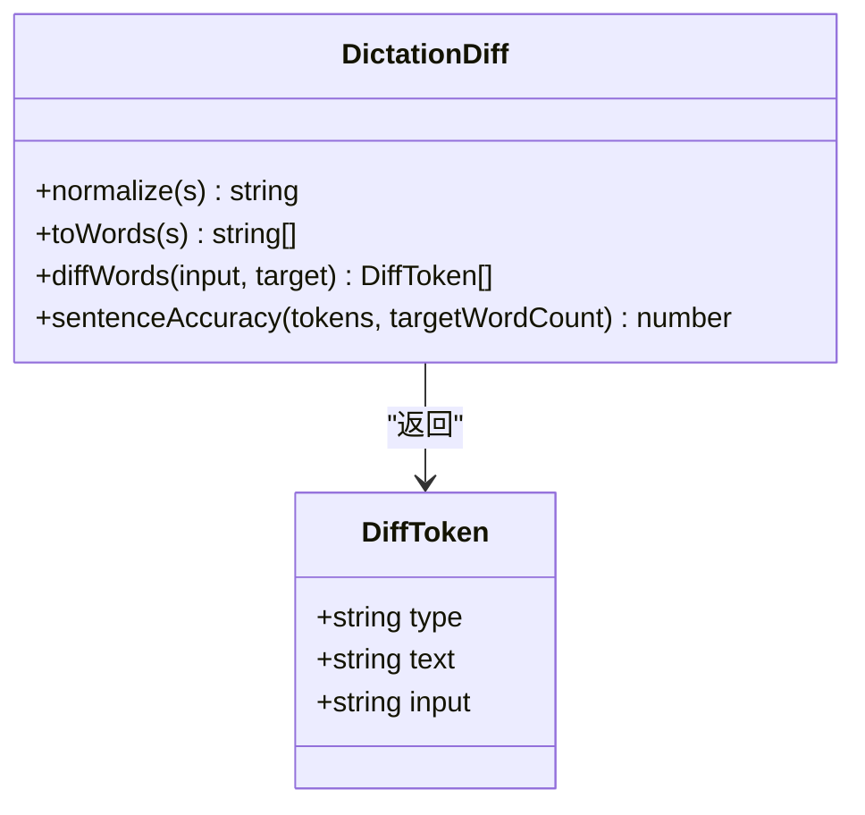
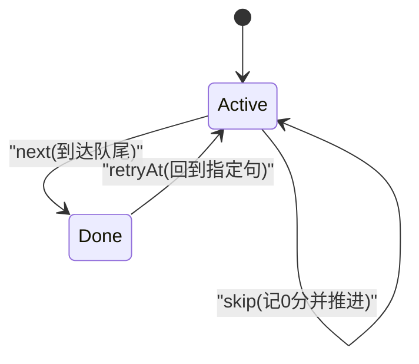
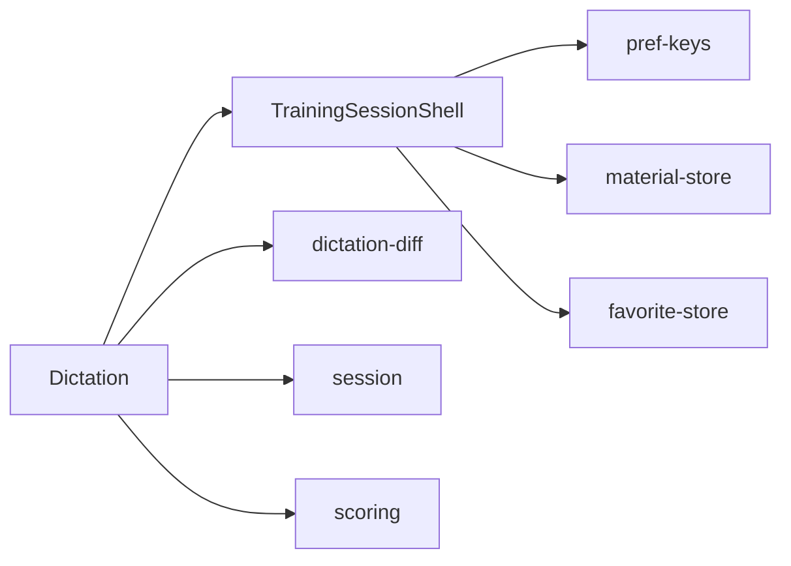
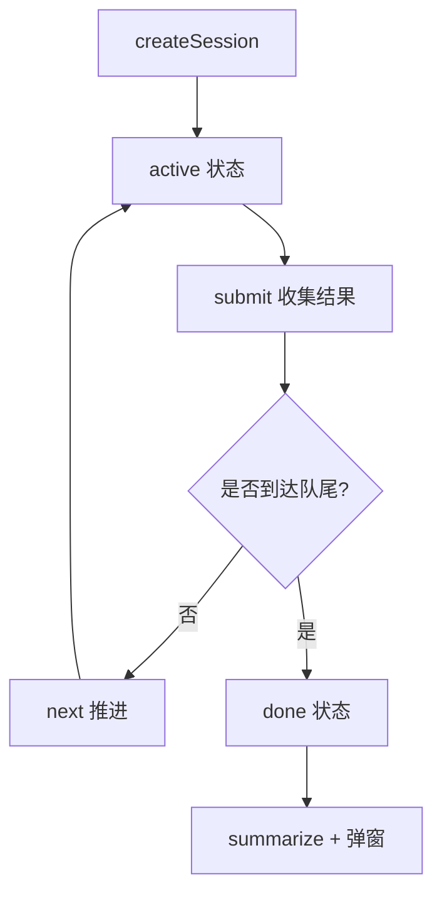
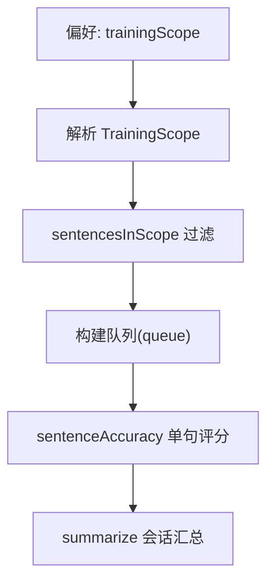

# 听写练习页面

<cite>
**本文引用的文件**   
- [dictation.tsx](file://client/components/pages/dictation.tsx)
- [training-session-shell.tsx](file://client/components/shared/training-session-shell.tsx)
- [dictation-diff.ts](file://client/core/training/dictation-diff.ts)
- [session.ts](file://client/core/training/session.ts)
- [scoring.ts](file://client/core/training/scoring.ts)
- [pref-keys.ts](file://client/lib/pref-keys.ts)
- [dictation-diff.test.ts](file://client/core/training/__tests__/dictation-diff.test.ts)
- [session.test.ts](file://client/core/training/__tests__/session.test.ts)
</cite>

## 目录
1. [简介](#简介)
2. [项目结构](#项目结构)
3. [核心组件](#核心组件)
4. [架构总览](#架构总览)
5. [详细组件分析](#详细组件分析)
6. [依赖关系分析](#依赖关系分析)
7. [性能与复杂度](#性能与复杂度)
8. [训练会话生命周期](#训练会话生命周期)
9. [听写模式配置与自动评分](#听写模式配置与自动评分)
10. [数据导入、导出与批量处理](#数据导入导出与批量处理)
11. [故障排查指南](#故障排查指南)
12. [结论](#结论)

## 简介
本文件为“听写练习页面”的完整技术文档，聚焦 Dictation 组件及其底层能力：题目生成、用户输入处理、拼写检查、差异对比分析、训练会话管理、进度追踪、成绩统计、模式配置与自动评分。同时给出 dictation-diff 模块的差异算法实现说明，包括字符级归一化、词级 LCS 对齐、错误类型分类（正确/错词/漏词/多词）、相似度与正确率计算等逻辑。文末提供训练数据的导入导出与批量处理方法建议，便于扩展与集成。

## 项目结构
听写功能由“页面组件 + 共享外壳 + 纯函数核心库”组成：
- 页面层：Dictation 组件负责 UI 交互、播放控制、提交核对、结果展示与小结弹窗。
- 共享外壳：TrainingSessionShell 提供页头、进度条、完成小结浮层，以及按偏好加载材料与范围的能力。
- 核心库：
  - dictation-diff：词级差异对比与正确率计算。
  - session：训练会话状态机（创建、提交、推进、跳过、重练）。
  - scoring：会话小结汇总与用时格式化。
  - pref-keys：训练范围偏好读写（全文/收藏句）。

**图表来源**
- [dictation.tsx:1-147](file://client/components/pages/dictation.tsx#L1-L147)
- [training-session-shell.tsx:1-67](file://client/components/shared/training-session-shell.tsx#L1-L67)
- [dictation-diff.ts:1-109](file://client/core/training/dictation-diff.ts#L1-L109)
- [session.ts:1-119](file://client/core/training/session.ts#L1-L119)
- [scoring.ts:1-58](file://client/core/training/scoring.ts#L1-L58)
- [pref-keys.ts:28-34](file://client/lib/pref-keys.ts#L28-L34)

**章节来源**
- [dictation.tsx:1-147](file://client/components/pages/dictation.tsx#L1-L147)
- [training-session-shell.tsx:1-67](file://client/components/shared/training-session-shell.tsx#L1-L67)

## 核心组件
- Dictation 组件
  - 使用 useTrainingMaterial 获取当前材料、加载状态与训练范围。
  - 基于 createSession 初始化会话，维护当前句、队列、播放次数、DiffToken 结果。
  - 通过 SentencePlayer 与 HtmlPlayerController 播放当前句段，并记录播放次数。
  - 用户输入经 diffWords 对比目标句，计算 sentenceAccuracy，调用 submit 保存结果。
  - 首次核对时写入本地训练记录（recordsStore），包含准确率、句索引等。
  - 支持清空、核对、下一句、重试指定句、重新开始。
  - 完成后显示 SessionSummaryOverlay，展示平均正确率、总播放次数、最弱句 TOP3。

- TrainingSessionShell
  - 统一页头（eyebrow/title/进度徽标）与真实进度条。
  - 完成小结浮层（SessionSummaryOverlay）与统计行（SummaryStat）。
  - useTrainingMaterial 根据偏好读取最近训练材料与范围（全文/收藏句），若收藏为空则回退全文。

- dictation-diff
  - normalize：小写、去标点、压缩空格、引号标准化。
  - toWords：归一化后按空格分词。
  - diffWords：基于 LCS 的词级对齐，输出 correct/wrong/missing/extra 四类标记。
  - sentenceAccuracy：正确率 = 正确词数 / max(目标词数, 输入词数)，四舍五入到整数百分比。

- session
  - TrainingScope：{type:'all'} 或 {type:'favorites', sentenceIndexes}。
  - createSession：依据范围过滤句子，构建初始状态（active/done）。
  - currentSentence：取当前句。
  - submit：收集单句结果（覆盖同句旧结果），附带 hints/attempts。
  - attempt/hint：计数事件。
  - next/skip/retryAt：推进、跳过、重练指定句。
  - makeRecordId：零依赖 ID 生成。

- scoring
  - SentenceResult：单句结果最小集（含 plays、skipped 等可选字段）。
  - SessionSummary：会话小结（total/correctCount/accuracy/durationMs/weakest/totalPlays）。
  - summarize：句均正确率、最弱句 TOP3、总播放次数汇总。
  - formatElapsed：mm:ss 格式化。

**章节来源**
- [dictation.tsx:1-147](file://client/components/pages/dictation.tsx#L1-L147)
- [training-session-shell.tsx:1-67](file://client/components/shared/training-session-shell.tsx#L1-L67)
- [dictation-diff.ts:1-109](file://client/core/training/dictation-diff.ts#L1-L109)
- [session.ts:1-119](file://client/core/training/session.ts#L1-L119)
- [scoring.ts:1-58](file://client/core/training/scoring.ts#L1-L58)

## 架构总览
听写流程从材料加载开始，进入会话状态机，逐句进行播放、输入、核对、结果收集，最终生成小结。

**图表来源**
- [dictation.tsx:41-143](file://client/components/pages/dictation.tsx#L41-L143)
- [session.ts:44-113](file://client/core/training/session.ts#L44-L113)
- [dictation-diff.ts:20-108](file://client/core/training/dictation-diff.ts#L20-L108)
- [scoring.ts:39-57](file://client/core/training/scoring.ts#L39-L57)

## 详细组件分析

### Dictation 组件
- 职责
  - 管理会话状态、音频播放、用户输入、差异对比、结果持久化与小结展示。
- 关键流程
  - 材料就绪 → createSession('dictation', sentences, scope)。
  - 媒体 Blob → ObjectURL，构造 HtmlPlayerController 与 SentencePlayer。
  - 游标变化 → 重置输入与 tokens。
  - 播放句段 → 增加 plays 计数。
  - 核对答案 → diffWords + sentenceAccuracy → submit → 首次核对写入 recordsStore。
  - 导航 → next / retryAt / restart。
  - 完成 → 计算 summary 并弹出 SessionSummaryOverlay。

**图表来源**
- [dictation.tsx:41-143](file://client/components/pages/dictation.tsx#L41-L143)

**章节来源**
- [dictation.tsx:1-147](file://client/components/pages/dictation.tsx#L1-L147)

### dictation-diff 模块
- 设计要点
  - 纯 TS 零依赖，可独立测试。
  - normalize 将大小写、标点、空格规范化，保证跨输入一致性。
  - diffWords 以目标句为基准，使用 LCS DP 表对齐，输出四类 token。
  - sentenceAccuracy 考虑漏词与多词的惩罚，避免“夹带多词也拿满分”。

**图表来源**
- [dictation-diff.ts:9-108](file://client/core/training/dictation-diff.ts#L9-L108)

**章节来源**
- [dictation-diff.ts:1-109](file://client/core/training/dictation-diff.ts#L1-L109)
- [dictation-diff.test.ts:1-107](file://client/core/training/__tests__/dictation-diff.test.ts#L1-L107)

### 训练会话状态机（session）
- 状态与事件
  - 状态：mode、queue、cursor、status、results、hintCount、attemptCount、startedAt。
  - 事件：submit、attempt、hint、next、skip、retryAt。
- 行为
  - sentencesInScope：按范围过滤并保持时间轴顺序。
  - createSession：初始化队列与状态；空队列直接 done。
  - submit：覆盖同句旧结果，附带 hints/attempts。
  - next：推进游标，超出队尾 → done。
  - skip：记 0 分 skipped 结果并推进。
  - retryAt：跳回指定句并恢复 active。

**图表来源**
- [session.ts:13-113](file://client/core/training/session.ts#L13-L113)

**章节来源**
- [session.ts:1-119](file://client/core/training/session.ts#L1-L119)
- [session.test.ts:1-186](file://client/core/training/__tests__/session.test.ts#L1-L186)

### 共享外壳与范围加载（training-session-shell）
- TrainingSessionShell：页头标题、n/total 徽标、Progress 进度条。
- SessionSummaryOverlay：完成小结全屏遮罩，复用 Card/Badge。
- SummaryStat：统计行 label/value。
- useTrainingMaterial：
  - 从偏好中读取 training-material 与 trainingScope。
  - 若选择收藏句且存在收藏，则按 sentenceIndexes 过滤；否则回退全文。
  - 返回 record、loading、scope 供页面使用。

**章节来源**
- [training-session-shell.tsx:1-67](file://client/components/shared/training-session-shell.tsx#L1-L67)
- [pref-keys.ts:28-34](file://client/lib/pref-keys.ts#L28-L34)

## 依赖关系分析
- 页面层依赖
  - Dictation 依赖 TrainingSessionShell（UI 外壳）、dictation-diff（差异对比）、session（会话状态）、scoring（小结汇总）、本地存储（recordsStore）。
- 核心库内部依赖
  - session 依赖 SubtitleSentence 类型与 SentenceResult 类型。
  - scoring 定义 SentenceResult 与 SessionSummary 接口。
  - training-session-shell 依赖 material-store、favorite-store、prefs 与 pref-keys。

**图表来源**
- [dictation.tsx:1-147](file://client/components/pages/dictation.tsx#L1-L147)
- [training-session-shell.tsx:1-67](file://client/components/shared/training-session-shell.tsx#L1-L67)
- [pref-keys.ts:28-34](file://client/lib/pref-keys.ts#L28-L34)

**章节来源**
- [dictation.tsx:1-147](file://client/components/pages/dictation.tsx#L1-L147)
- [training-session-shell.tsx:1-67](file://client/components/shared/training-session-shell.tsx#L1-L67)

## 性能与复杂度
- dictation-diff
  - normalize/toWords：线性 O(n)。
  - lcsTable：DP 矩阵 O(n*m)，n、m 为输入/目标词数；句子长度有限，足够高效。
  - diffWords：回溯与合并 O(n+m)。
  - sentenceAccuracy：O(k)，k 为 token 数量。
- session
  - 各操作均为常数或线性（filter/replace），整体开销低。
- UI 渲染
  - DiffView 对 tokens 线性遍历渲染。
  - 播放控制仅在句切换时重建控制器与播放器实例，避免频繁销毁。

优化建议
- 对超长文本可考虑分段或增量 diff。
- 在大量历史记录场景下，可对 results 做分页或懒加载。
- 音频资源可使用预加载策略减少首播延迟。

[本节为通用性能讨论，不直接分析具体文件]

## 训练会话生命周期
- 初始化
  - useTrainingMaterial 加载材料与范围。
  - createSession 构建 queue、cursor=0、status='active'。
- 进行中
  - 播放句段 → 用户输入 → diffWords → sentenceAccuracy → submit。
  - 首次核对写入训练记录（recordsStore）。
  - next 推进游标；retryAt 回到指定句；skip 记 0 分并推进。
- 结束
  - 当 cursor 到达队尾，status='done'。
  - summarize 汇总 total、correctCount、accuracy、durationMs、weakest、totalPlays。
  - 显示 SessionSummaryOverlay，支持“返回训练中心”和“再来一轮”。

**图表来源**
- [session.ts:44-113](file://client/core/training/session.ts#L44-L113)
- [scoring.ts:39-57](file://client/core/training/scoring.ts#L39-L57)
- [dictation.tsx:124-143](file://client/components/pages/dictation.tsx#L124-L143)

**章节来源**
- [session.ts:1-119](file://client/core/training/session.ts#L1-L119)
- [scoring.ts:1-58](file://client/core/training/scoring.ts#L1-L58)
- [dictation.tsx:119-143](file://client/components/pages/dictation.tsx#L119-L143)

## 听写模式配置与自动评分
- 训练范围配置
  - PrefTrainingScope：'all' | 'favorites'。
  - getTrainingScope/setTrainingScope 读写偏好键 'pref:trainingScope'。
  - useTrainingMaterial 根据偏好解析 TrainingScope，并在收藏为空时回退全文。
- 自动评分机制
  - 单句：sentenceAccuracy 基于 diffTokens 与目标词数计算百分比。
  - 会话：summarize 计算句均正确率、最弱句 TOP3、总播放次数。
  - 记录：首次核对写入 TrainingRecord，包含 mode、score、detail、createdAt 等。

**图表来源**
- [pref-keys.ts:28-34](file://client/lib/pref-keys.ts#L28-L34)
- [training-session-shell.tsx:43-63](file://client/components/shared/training-session-shell.tsx#L43-L63)
- [session.ts:38-62](file://client/core/training/session.ts#L38-L62)
- [dictation-diff.ts:101-108](file://client/core/training/dictation-diff.ts#L101-L108)
- [scoring.ts:39-57](file://client/core/training/scoring.ts#L39-L57)

**章节来源**
- [pref-keys.ts:28-34](file://client/lib/pref-keys.ts#L28-L34)
- [training-session-shell.tsx:38-63](file://client/components/shared/training-session-shell.tsx#L38-L63)
- [session.ts:38-62](file://client/core/training/session.ts#L38-L62)
- [dictation-diff.ts:101-108](file://client/core/training/dictation-diff.ts#L101-L108)
- [scoring.ts:39-57](file://client/core/training/scoring.ts#L39-L57)

## 数据导入、导出与批量处理
当前仓库未提供专门的听写数据导入导出与批量处理 API。以下为实现建议与示例路径，便于后续扩展：

- 导入
  - 从外部源（如 CSV/JSON）解析句子列表，映射为 SubtitleSentence 数组。
  - 使用 sentencesInScope 过滤后传入 createSession 启动训练。
  - 参考路径：[session.ts:38-62](file://client/core/training/session.ts#L38-L62)、[dictation.tsx:41-46](file://client/components/pages/dictation.tsx#L41-L46)。

- 导出
  - 将 SessionState.results 序列化为 JSON，包含 sentenceIndex、accuracy、plays、hints、attempts、skipped 等字段。
  - 可结合 summarize 输出 SessionSummary 作为报告。
  - 参考路径：[scoring.ts:7-57](file://client/core/training/scoring.ts#L7-L57)、[dictation.tsx:124-143](file://client/components/pages/dictation.tsx#L124-L143)。

- 批量处理
  - 对多份材料循环执行 createSession → submit → summarize，聚合结果。
  - 使用 recordsStore 批量写入 TrainingRecord，或使用事务提升性能。
  - 参考路径：[dictation.tsx:99-113](file://client/components/pages/dictation.tsx#L99-L113)、[session.ts:69-78](file://client/core/training/session.ts#L69-L78)。

[本节为概念性指导，不直接分析具体实现文件]

## 故障排查指南
- 无字幕材料
  - 现象：提示“该材料暂无字幕，无法进行听写训练”。
  - 原因：record.subtitleData?.sentences 为空。
  - 处理：确保材料包含字幕数据；或回退至材料库。
  - 参考路径：[dictation.tsx:120-122](file://client/components/pages/dictation.tsx#L120-L122)。

- 播放失败
  - 现象：播放按钮置灰或无声音。
  - 原因：mediaUrl 为空或 load 失败。
  - 处理：检查 getMediaBlob 返回值与 HTML 播放器控制器初始化。
  - 参考路径：[dictation.tsx:48-74](file://client/components/pages/dictation.tsx#L48-L74)。

- 差异对比异常
  - 现象：错词/漏词/多词标记不正确。
  - 原因：normalize 或 diffWords 边界情况（空串、全标点、引号）。
  - 处理：对照单元测试用例验证。
  - 参考路径：[dictation-diff.test.ts:7-107](file://client/core/training/__tests__/dictation-diff.test.ts#L7-L107)。

- 会话状态卡住
  - 现象：next 无效或始终 active。
  - 原因：状态非 active 或 cursor 越界。
  - 处理：检查 next 与 status 分支；确认 retryAt 参数有效。
  - 参考路径：[session.ts:92-113](file://client/core/training/session.ts#L92-L113)、[session.test.ts:107-145](file://client/core/training/__tests__/session.test.ts#L107-L145)。

**章节来源**
- [dictation.tsx:48-74](file://client/components/pages/dictation.tsx#L48-L74)
- [dictation.tsx:120-122](file://client/components/pages/dictation.tsx#L120-L122)
- [dictation-diff.test.ts:7-107](file://client/core/training/__tests__/dictation-diff.test.ts#L7-L107)
- [session.ts:92-113](file://client/core/training/session.ts#L92-L113)
- [session.test.ts:107-145](file://client/core/training/__tests__/session.test.ts#L107-L145)

## 结论
听写练习页面以 React 组件为核心，结合纯函数核心库实现稳定的题目生成、差异对比与会话管理。dictation-diff 提供可靠的词级 LCS 对齐与正确率计算；session 提供清晰的状态机语义；scoring 提供简洁的小结汇总。通过 TrainingSessionShell 与偏好系统，页面能灵活适配全文与收藏句两种训练范围，并在完成后给出可视化总结与薄弱句强化入口。未来可在导入导出与批量处理方面扩展更多工具方法，以满足更大规模的学习数据分析需求。