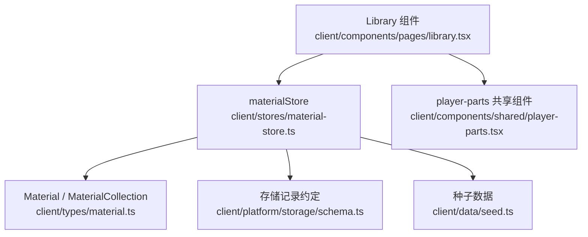
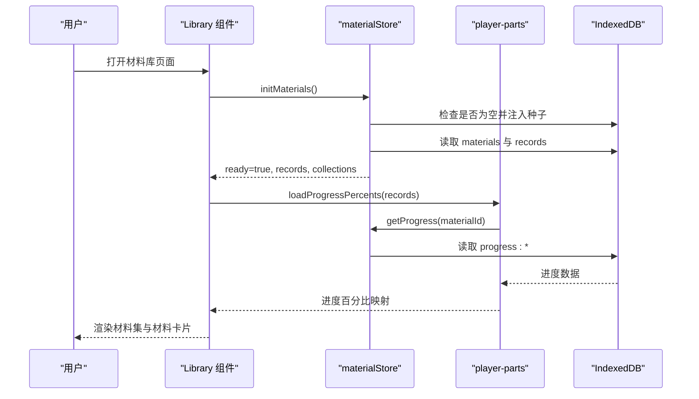
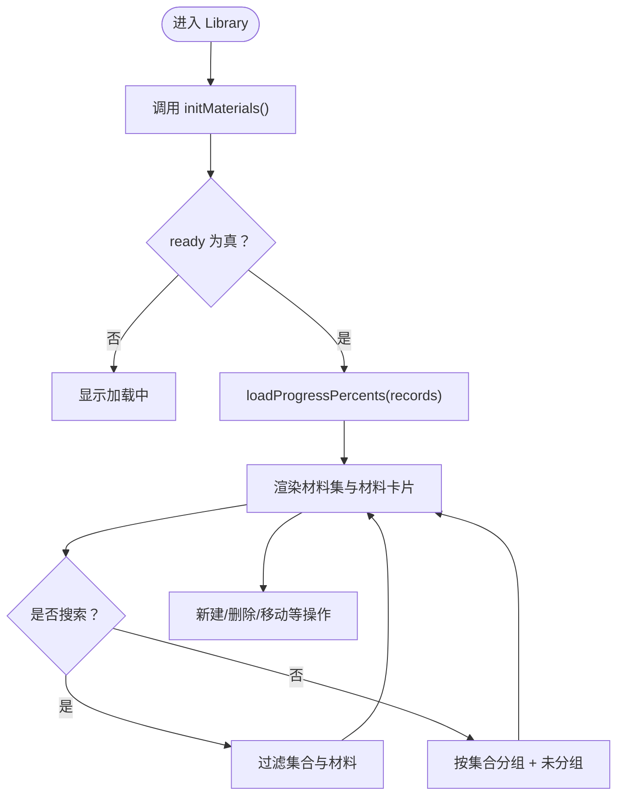
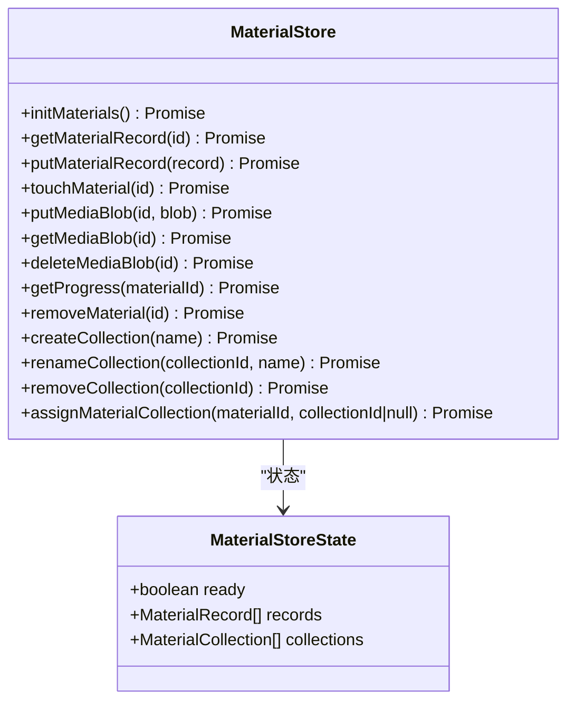
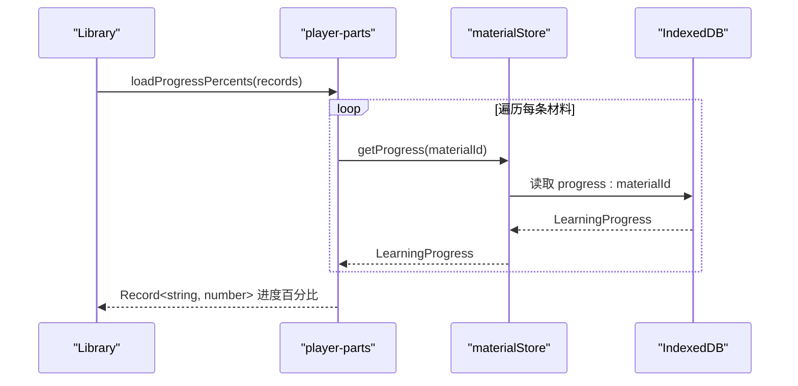
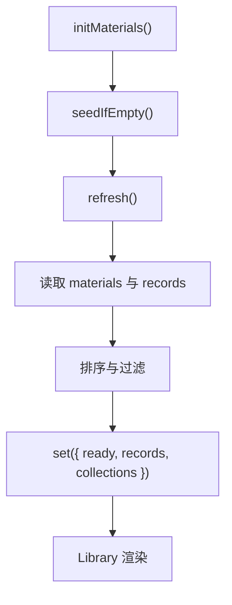
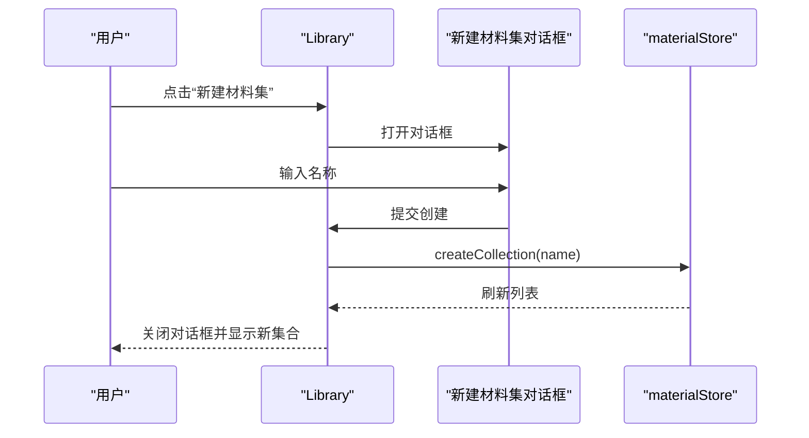
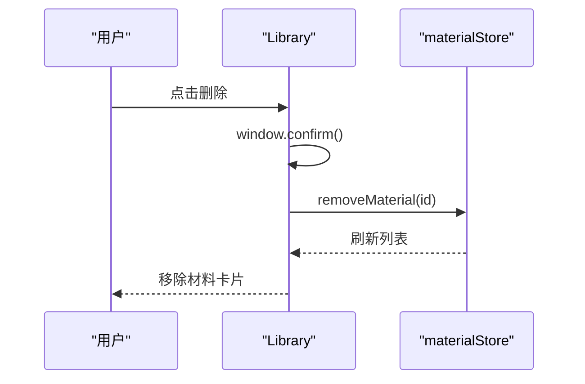
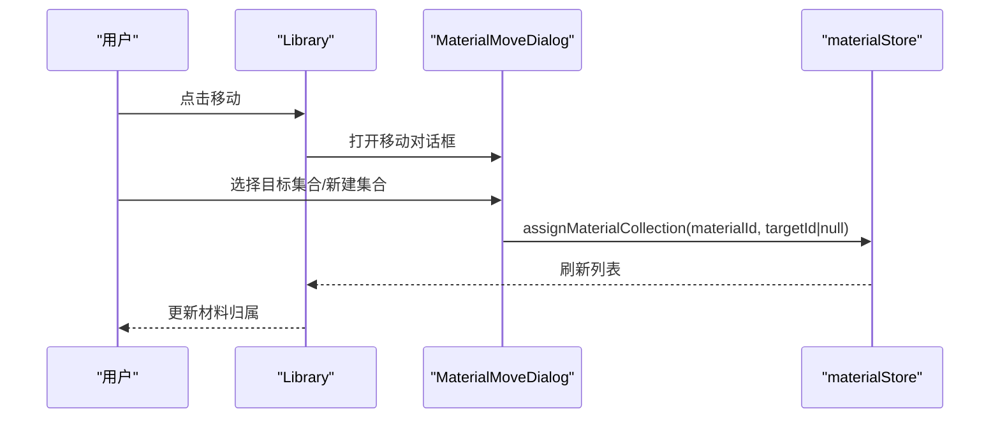
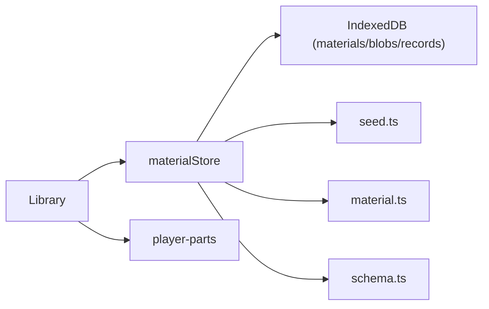

# 材料库页面

<cite>
**本文引用的文件**   
- [library.tsx](file://client/components/pages/library.tsx)
- [material-store.ts](file://client/stores/material-store.ts)
- [player-parts.tsx](file://client/components/shared/player-parts.tsx)
- [material.ts](file://client/types/material.ts)
- [schema.ts](file://client/platform/storage/schema.ts)
- [seed.ts](file://client/data/seed.ts)
</cite>

## 目录
1. [简介](#简介)
2. [项目结构定位](#项目结构定位)
3. [核心组件与职责](#核心组件与职责)
4. [架构总览](#架构总览)
5. [详细组件分析](#详细组件分析)
6. [数据流与状态管理](#数据流与状态管理)
7. [用户交互流程](#用户交互流程)
8. [依赖关系分析](#依赖关系分析)
9. [性能与优化策略](#性能与优化策略)
10. [错误处理与健壮性](#错误处理与健壮性)
11. [常见问题排查](#常见问题排查)
12. [结论](#结论)

## 简介
材料库页面是学习应用的核心入口之一，负责展示、搜索、分组和管理音视频学习材料。它通过 `Library` 组件提供材料集管理与材料卡片展示，结合 `materialStore` 完成材料的增删改查、集合分组、最近学习排序，以及进度百分比的计算与显示。该页面同时支持新建材料集、删除材料、移动材料到不同集合等高频操作，并在 UI 层提供搜索过滤、未分组区、空态引导和加载态提示。

## 项目结构定位
材料库页面位于客户端前端代码中，属于“页面级组件”；其业务逻辑由独立的 store 模块承载，UI 复用共享的播放器相关组件。

**图表来源**
- [library.tsx:1-143](file://client/components/pages/library.tsx#L1-L143)
- [material-store.ts:1-163](file://client/stores/material-store.ts#L1-L163)
- [player-parts.tsx:1-234](file://client/components/shared/player-parts.tsx#L1-L234)
- [material.ts:1-36](file://client/types/material.ts#L1-L36)
- [schema.ts:1-27](file://client/platform/storage/schema.ts#L1-L27)
- [seed.ts:1-29](file://client/data/seed.ts#L1-L29)

**章节来源**
- [library.tsx:1-143](file://client/components/pages/library.tsx#L1-L143)

## 核心组件与职责
- `Library`：页面容器，负责渲染材料集网格、未分组材料列表、搜索框、新建材料集对话框、移动材料对话框，并协调 store 数据与 UI 状态。
- `materialStore`：材料库的数据源与变更总线，封装 IndexedDB 读写、种子注入、材料 CRUD、集合 CRUD、媒体 Blob 管理、进度读取、最近学习排序等。
- `player-parts`：共享 UI 组件，包含材料卡片、材料集卡片、移动材料弹窗、播放控制条、字幕列表等，其中进度计算函数 `loadProgressPercents` 被材料库复用。
- `types/material`：定义材料与材料集的领域模型。
- `platform/storage/schema`：定义 IndexedDB 记录结构与 key 前缀约定。
- `data/seed`：提供初始种子材料与句子数据，用于首次启动填充。

**章节来源**
- [library.tsx:1-143](file://client/components/pages/library.tsx#L1-L143)
- [material-store.ts:1-163](file://client/stores/material-store.ts#L1-L163)
- [player-parts.tsx:1-234](file://client/components/shared/player-parts.tsx#L1-L234)
- [material.ts:1-36](file://client/types/material.ts#L1-L36)
- [schema.ts:1-27](file://client/platform/storage/schema.ts#L1-L27)
- [seed.ts:1-29](file://client/data/seed.ts#L1-L29)

## 架构总览
材料库采用“页面组件 + 独立 store + 共享 UI 组件”的分层结构。页面只负责视图与轻量交互，复杂数据逻辑下沉到 store；UI 复用提升一致性。

**图表来源**
- [library.tsx:14-27](file://client/components/pages/library.tsx#L14-L27)
- [material-store.ts:61-73](file://client/stores/material-store.ts#L61-L73)
- [material-store.ts:40-52](file://client/stores/material-store.ts#L40-L52)
- [player-parts.tsx:38-47](file://client/components/shared/player-parts.tsx#L38-L47)
- [schema.ts:16-26](file://client/platform/storage/schema.ts#L16-L26)

## 详细组件分析

### Library 组件
- 功能要点
  - 从 `useStore(materialStore)` 订阅 `ready`、`records`、`collections`。
  - 维护本地 UI 状态：查询关键词 `query`、新建材料集对话框开关与名称、移动目标材料。
  - 初始化时调用 `initMaterials()`，并在 `ready` 为真后异步计算所有材料的进度百分比。
  - 分组派生：按现存集合分组；无归属或陈旧集合 ID 的材料归入“未分组”。
  - 搜索模式：同时匹配材料名与集合名，平铺搜索结果。
  - 新建材料集：校验非空且唯一，成功后关闭对话框并清空输入。
  - 删除材料：二次确认后调用 `removeMaterial(id)`。
  - 移动材料：打开 `MaterialMoveDialog`，选择目标集合或新建集合。

- 关键实现路径
  - 初始化与进度加载：[library.tsx:21-27](file://client/components/pages/library.tsx#L21-L27)
  - 删除材料：[library.tsx:28-31](file://client/components/pages/library.tsx#L28-L31)
  - 分组与搜索：[library.tsx:32-43](file://client/components/pages/library.tsx#L32-L43)
  - 新建材料集：[library.tsx:44-49](file://client/components/pages/library.tsx#L44-L49)
  - 渲染材料集与材料卡片：[library.tsx:50-56](file://client/components/pages/library.tsx#L50-L56)
  - 主布局与交互入口：[library.tsx:57-137](file://client/components/pages/library.tsx#L57-L137)

**图表来源**
- [library.tsx:14-56](file://client/components/pages/library.tsx#L14-L56)
- [library.tsx:57-137](file://client/components/pages/library.tsx#L57-L137)

**章节来源**
- [library.tsx:14-137](file://client/components/pages/library.tsx#L14-L137)

### materialStore
- 功能要点
  - 首次启动种子注入：当 `materials` 为空时写入种子材料与解析后的字幕数据。
  - 刷新列表：读取所有材料记录并按“最近学习”排序；读取集合记录并按创建时间升序。
  - 材料 CRUD：新增/覆盖材料、更新最近打开时间、删除材料（级联清理 blob 与相关 records）。
  - 集合 CRUD：创建、重命名、删除（仅解除成员归属）；移动材料到集合或移出到未分组。
  - 进度读取：根据 `progress:` key 获取已播放句子的去重数量，计算百分比。

- 关键实现路径
  - 排序与刷新：[material-store.ts:32-52](file://client/stores/material-store.ts#L32-L52)
  - 种子注入与初始化：[material-store.ts:54-73](file://client/stores/material-store.ts#L54-L73)
  - 材料读写与最近打开：[material-store.ts:75-94](file://client/stores/material-store.ts#L75-L94)
  - 媒体 Blob 管理：[material-store.ts:96-100](file://client/stores/material-store.ts#L96-L100)
  - 进度读取：[material-store.ts:102-105](file://client/stores/material-store.ts#L102-L105)
  - 删除材料（级联清理）：[material-store.ts:107-121](file://client/stores/material-store.ts#L107-L121)
  - 集合 CRUD 与移动材料：[material-store.ts:123-162](file://client/stores/material-store.ts#L123-L162)

**图表来源**
- [material-store.ts:24-30](file://client/stores/material-store.ts#L24-L30)
- [material-store.ts:70-162](file://client/stores/material-store.ts#L70-L162)

**章节来源**
- [material-store.ts:32-162](file://client/stores/material-store.ts#L32-L162)

### player-parts 共享组件
- 功能要点
  - `MaterialCard`：展示材料卡片，支持 hover 显示删除与移动按钮，显示进度与最近学习文案。
  - `CollectionCard`：展示材料集卡片，显示成员数与最近学习文案。
  - `MaterialMoveDialog`：移动材料弹窗，支持选择其他集合、移出到未分组、现场新建集合。
  - `loadProgressPercents`：批量计算材料进度百分比，基于 `playedSentenceIndexes` 去重计数与总句数。
  - `lastLabel`：将 `lastOpenedAt` 转换为“今天学过/昨天学过/X 天前/从未学习”等文案。

- 关键实现路径
  - 进度计算：[player-parts.tsx:38-47](file://client/components/shared/player-parts.tsx#L38-L47)
  - 最近学习文案：[player-parts.tsx:29-36](file://client/components/shared/player-parts.tsx#L29-L36)
  - 材料卡片：[player-parts.tsx:49-58](file://client/components/shared/player-parts.tsx#L49-L58)
  - 移动材料弹窗：[player-parts.tsx:63-111](file://client/components/shared/player-parts.tsx#L63-L111)

**图表来源**
- [player-parts.tsx:38-47](file://client/components/shared/player-parts.tsx#L38-L47)
- [material-store.ts:102-105](file://client/stores/material-store.ts#L102-L105)
- [schema.ts:16-26](file://client/platform/storage/schema.ts#L16-L26)

**章节来源**
- [player-parts.tsx:29-111](file://client/components/shared/player-parts.tsx#L29-L111)

### 类型与存储约定
- `Material`：材料元数据，包括 id、name、mediaType、mediaRef、subtitle、durationMs、createdAt、lastOpenedAt、collectionId。
- `MaterialCollection`：材料集，扁平结构，id、name、createdAt。
- `MaterialRecord`：materials store 的单条记录，包含 material 与解析后的 subtitleData。
- `RECORD_KEYS`：records store 的 key 前缀约定，如 `progress:`、`fav:`、`note:`、`train:`、`collection:`。

**章节来源**
- [material.ts:1-36](file://client/types/material.ts#L1-L36)
- [schema.ts:1-27](file://client/platform/storage/schema.ts#L1-L27)

## 数据流与状态管理
- 数据来源
  - 首次启动：若 `materials` 为空，则注入种子数据（含字幕解析结果），随后刷新列表。
  - 正常加载：读取所有材料记录与集合记录，分别排序后设置到 store。
- 状态订阅
  - `Library` 通过 `useStore(materialStore)` 订阅 `ready`、`records`、`collections`。
  - 进度百分比在 `ready` 为真后异步计算，避免阻塞渲染。
- 变更广播
  - 所有写操作（新增材料、删除材料、集合 CRUD、移动材料）均调用 `refresh()`，触发 UI 重新渲染。

**图表来源**
- [material-store.ts:61-73](file://client/stores/material-store.ts#L61-L73)
- [material-store.ts:40-52](file://client/stores/material-store.ts#L40-L52)
- [library.tsx:21-27](file://client/components/pages/library.tsx#L21-L27)

**章节来源**
- [material-store.ts:40-73](file://client/stores/material-store.ts#L40-L73)
- [library.tsx:21-27](file://client/components/pages/library.tsx#L21-L27)

## 用户交互流程

### 新建材料集
- 用户点击“新建材料集”，弹出对话框。
- 输入名称并进行校验：非空且不重复。
- 确认后调用 `createCollection(name)`，store 写入集合记录并刷新列表。

**图表来源**
- [library.tsx:40-49](file://client/components/pages/library.tsx#L40-L49)
- [material-store.ts:125-132](file://client/stores/material-store.ts#L125-L132)

**章节来源**
- [library.tsx:40-49](file://client/components/pages/library.tsx#L40-L49)
- [material-store.ts:125-132](file://client/stores/material-store.ts#L125-L132)

### 删除材料
- 用户点击材料卡片的删除按钮，弹出浏览器确认框。
- 确认后调用 `removeMaterial(id)`，store 级联删除材料、媒体 Blob 及相关 records（进度、收藏、笔记、训练记录）。

**图表来源**
- [library.tsx:28-31](file://client/components/pages/library.tsx#L28-L31)
- [material-store.ts:107-121](file://client/stores/material-store.ts#L107-L121)

**章节来源**
- [library.tsx:28-31](file://client/components/pages/library.tsx#L28-L31)
- [material-store.ts:107-121](file://client/stores/material-store.ts#L107-L121)

### 移动材料到不同集合
- 用户点击材料卡片的移动按钮，打开 `MaterialMoveDialog`。
- 可选择：移动到其它集合、移出到未分组、现场新建集合。
- 确认后调用 `assignMaterialCollection(materialId, collectionId|null)`，store 更新材料的 `collectionId` 并刷新列表。

**图表来源**
- [library.tsx:54-56](file://client/components/pages/library.tsx#L54-L56)
- [player-parts.tsx:63-111](file://client/components/shared/player-parts.tsx#L63-L111)
- [material-store.ts:153-162](file://client/stores/material-store.ts#L153-L162)

**章节来源**
- [library.tsx:54-56](file://client/components/pages/library.tsx#L54-L56)
- [player-parts.tsx:63-111](file://client/components/shared/player-parts.tsx#L63-L111)
- [material-store.ts:153-162](file://client/stores/material-store.ts#L153-L162)

## 依赖关系分析
- 组件耦合
  - `Library` 依赖 `materialStore` 提供数据与变更能力，依赖 `player-parts` 提供卡片与弹窗。
  - `materialStore` 依赖 `platform/storage/idb`（通过导入名可见）、`data/seed`、`types/material`、`platform/storage/schema`。
- 外部依赖
  - IndexedDB：通过 `materialsStore`、`blobsStore`、`recordsStore` 进行读写。
  - React Router：用于跳转到 TTS、转写、导入、播放器与集合详情页。

**图表来源**
- [library.tsx:1-143](file://client/components/pages/library.tsx#L1-L143)
- [material-store.ts:1-163](file://client/stores/material-store.ts#L1-L163)
- [player-parts.tsx:1-234](file://client/components/shared/player-parts.tsx#L1-L234)
- [material.ts:1-36](file://client/types/material.ts#L1-L36)
- [schema.ts:1-27](file://client/platform/storage/schema.ts#L1-L27)
- [seed.ts:1-29](file://client/data/seed.ts#L1-L29)

**章节来源**
- [library.tsx:1-143](file://client/components/pages/library.tsx#L1-L143)
- [material-store.ts:1-163](file://client/stores/material-store.ts#L1-L163)

## 性能与优化策略
- 异步初始化与幂等保护
  - `initMaterials()` 使用闭包变量缓存 Promise，确保多次调用共享同一初始化流程，避免重复种子注入与重复刷新。
- 批量进度计算
  - `loadProgressPercents` 使用 `Promise.all` 并行读取各材料的进度，减少等待时间。
- 排序与过滤
  - “最近学习”排序在 store 层完成，避免组件层重复排序。
  - 搜索仅在 UI 层对内存数据进行过滤，避免频繁 IO。
- 条件渲染
  - 根据 `ready`、`records.length`、`collections.length` 切换加载态、空态与内容态，减少无效渲染。

**章节来源**
- [material-store.ts:68-73](file://client/stores/material-store.ts#L68-L73)
- [player-parts.tsx:38-47](file://client/components/shared/player-parts.tsx#L38-L47)
- [library.tsx:74-117](file://client/components/pages/library.tsx#L74-L117)

## 错误处理与健壮性
- 初始化失败兜底
  - `initMaterials().catch(() => {})` 忽略异常，因为存储层有内存兜底，不会将错误传播到页面之外。
- 进度计算异常忽略
  - `loadProgressPercents(...).then(...).catch(() => {})` 忽略异常，保证 UI 仍可渲染。
- 陈旧集合 ID 防护
  - `assignMaterialCollection` 在写入前校验目标集合是否存在，不存在则静默返回，避免脏数据写入。
- 删除材料级联清理
  - 删除材料时精确匹配 `progress:` key，避免误删互为前缀的其他材料记录；对 `train:` 记录按 `materialId` 字段判断再删除。

**章节来源**
- [library.tsx:21-27](file://client/components/pages/library.tsx#L21-L27)
- [material-store.ts:107-121](file://client/stores/material-store.ts#L107-L121)
- [material-store.ts:153-162](file://client/stores/material-store.ts#L153-L162)

## 常见问题排查
- 页面一直显示“正在加载材料库…”
  - 检查 `materialStore.initMaterials()` 是否成功执行，确认 IndexedDB 可用。
  - 查看控制台是否有初始化或读取异常被捕获。
- 进度百分比始终为 0
  - 确认 `records` 中的 `subtitle.sentenceCount` 是否正确。
  - 检查 `progress:materialId` 记录是否存在且 `playedSentenceIndexes` 非空。
- 新建材料集后未显示
  - 确认名称非空且不重复；检查 `createCollection` 是否成功写入并触发 `refresh()`。
- 移动材料后归属未更新
  - 检查目标集合是否存在；确认 `assignMaterialCollection` 被调用且参数正确。
- 删除材料后仍有残留数据
  - 检查级联清理逻辑是否执行，特别是 `progress:`、`fav:`、`note:`、`train:` 相关记录。

**章节来源**
- [library.tsx:21-27](file://client/components/pages/library.tsx#L21-L27)
- [material-store.ts:107-121](file://client/stores/material-store.ts#L107-L121)
- [material-store.ts:125-162](file://client/stores/material-store.ts#L125-L162)

## 结论
材料库页面通过清晰的组件分层与 store 驱动的数据流，实现了材料集管理、材料卡片展示、搜索过滤、分组管理等核心功能。`materialStore` 提供了稳健的 CRUD 能力与级联清理机制，`player-parts` 提供了可复用的 UI 组件与进度计算逻辑。整体架构具备良好的可读性与扩展性，适合进一步增加更多材料操作与性能优化。