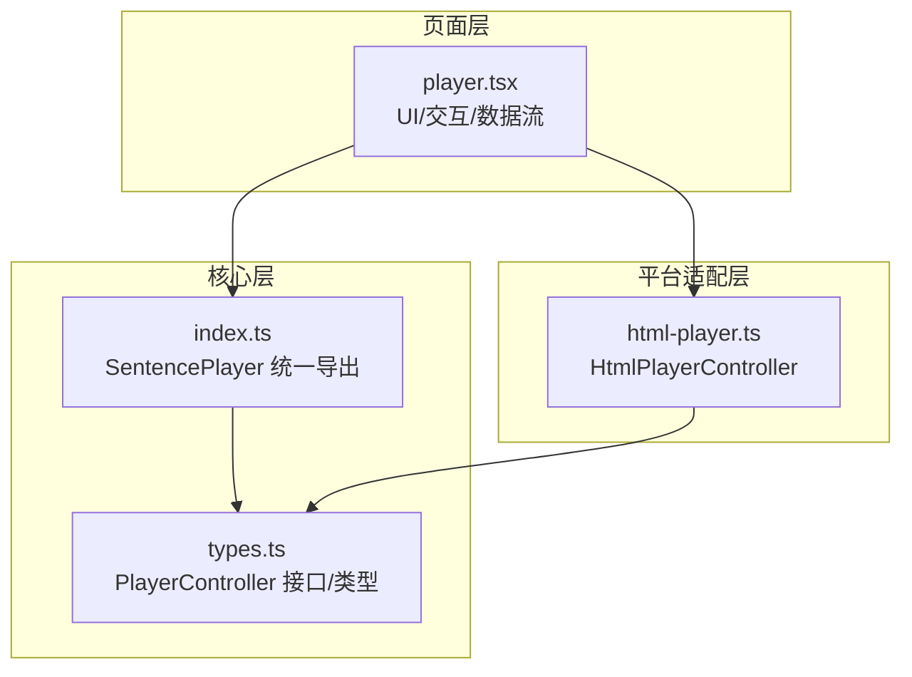
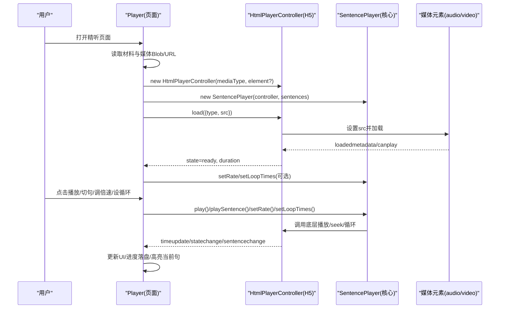
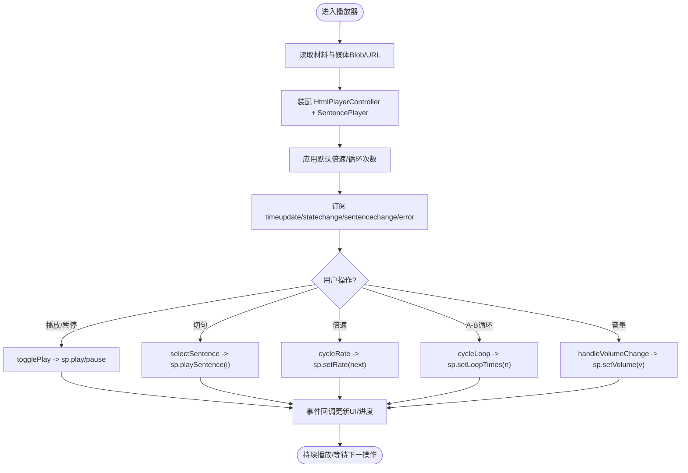
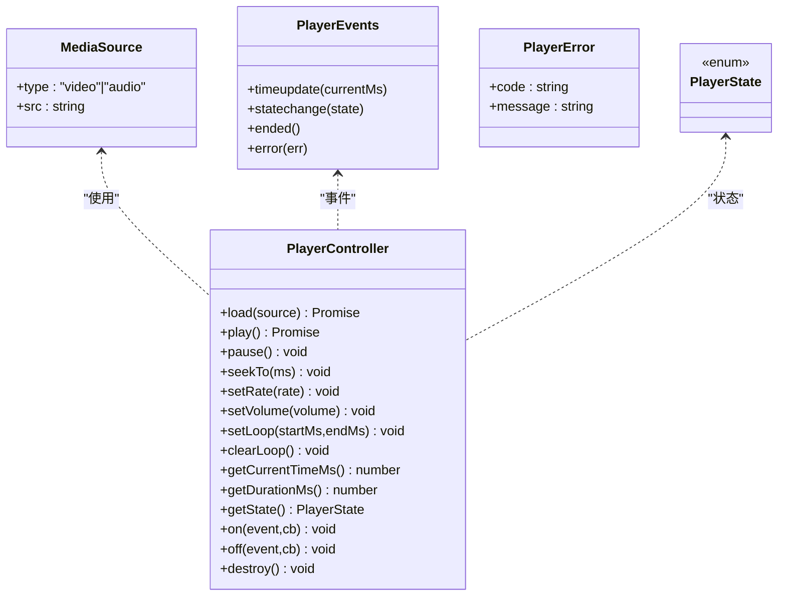
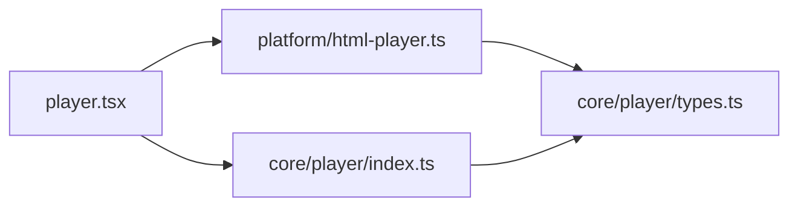

# 精听播放器页面

<cite>
**本文引用的文件**   
- [player.tsx](file://client/components/pages/player.tsx)
- [html-player.ts](file://client/platform/html-player.ts)
- [types.ts](file://client/core/player/types.ts)
- [index.ts](file://client/core/player/index.ts)
</cite>

## 目录
1. [简介](#简介)
2. [项目结构](#项目结构)
3. [核心组件](#核心组件)
4. [架构总览](#架构总览)
5. [详细组件分析](#详细组件分析)
6. [依赖关系分析](#依赖关系分析)
7. [性能与体验优化](#性能与体验优化)
8. [故障排查指南](#故障排查指南)
9. [结论](#结论)
10. [附录：配置项与扩展方法](#附录配置项与扩展方法)

## 简介
本文件面向“精听播放器”页面，系统性说明 Player 组件如何驱动逐句播放、A-B 循环、倍速调节、字幕同步等高级能力；并解释其与 sentence-player 核心模块的集成方式、HTML 音频播放器的平台适配层实现、播放状态管理、时间轴同步与字幕渲染机制，以及音频加载、格式支持与错误处理等底层细节。文档同时提供可操作的配置项与自定义扩展建议，帮助开发者快速理解并二次开发该播放器。

## 项目结构
播放器相关代码主要分布在三层：
- 页面层：components/pages/player.tsx 负责 UI、交互、数据持久化与事件编排。
- 核心层：core/player/types.ts 定义平台无关的播放器抽象接口与类型；core/player/index.ts 统一导出 SentencePlayer 及其类型。
- 平台适配层：platform/html-player.ts 基于 HTMLAudioElement/HTMLVideoElement 实现跨端一致的播放器控制器。



**图示来源**
- [player.tsx:1-28](file://client/components/pages/player.tsx#L1-L28)
- [types.ts:1-56](file://client/core/player/types.ts#L1-L56)
- [index.ts:1-5](file://client/core/player/index.ts#L1-L5)
- [html-player.ts:1-23](file://client/platform/html-player.ts#L1-L23)

**章节来源**
- [player.tsx:1-28](file://client/components/pages/player.tsx#L1-L28)
- [types.ts:1-56](file://client/core/player/types.ts#L1-L56)
- [index.ts:1-5](file://client/core/player/index.ts#L1-L5)
- [html-player.ts:1-23](file://client/platform/html-player.ts#L1-L23)

## 核心组件
- Player（页面组件）
  - 职责：从材料库读取材料与媒体 Blob、装配 HtmlPlayerController + SentencePlayer、订阅播放事件、维护播放进度与收藏/笔记等本地数据、渲染字幕列表与当前句、提供 A-B 循环/倍速/音量/翻译/纠错/导入导出等交互。
  - 关键行为：
    - 根据 mediaType 选择复用隐藏 <audio> 或 <video>，或创建新元素。
    - 通过 HtmlPlayerController.load 加载媒体，设置时长、收藏夹跳转定位。
    - 订阅 timeupdate/statechange/sentencechange/error，驱动 UI 与进度落盘。
    - 键盘快捷键：空格播放/暂停，左右箭头切句；N 键打开当前句笔记抽屉。
    - 字幕编辑/导入/导出、AI 转字幕、整篇翻译、收藏与笔记持久化。
- HtmlPlayerController（H5 平台适配器）
  - 职责：封装原生媒体元素，暴露统一的 PlayerController 接口；实现 seek 落点校准、rAF 高频进度采样、A-B 循环边界回跳、事件派发与销毁清理。
  - 关键机制：
    - 原生 timeupdate 兜底（约 4Hz），播放中用 requestAnimationFrame 高频采样（约 60Hz）。
    - seekTo 后记录目标值，首个 timeupdate 作为实际落点校准；偏差超阈值记录 drift 供上层容差修正。
    - setLoop 仅做区间控制，次数由 SentencePlayer 承担。
- types.ts（抽象接口与类型）
  - 定义 MediaSource、PlayerState、PlayerError、PlayerEvents、PlayerController 等类型契约，确保 core 层纯 TS、零框架依赖。

**章节来源**
- [player.tsx:79-126](file://client/components/pages/player.tsx#L79-L126)
- [player.tsx:177-245](file://client/components/pages/player.tsx#L177-L245)
- [player.tsx:273-305](file://client/components/pages/player.tsx#L273-L305)
- [html-player.ts:24-63](file://client/platform/html-player.ts#L24-L63)
- [html-player.ts:103-137](file://client/platform/html-player.ts#L103-L137)
- [html-player.ts:158-176](file://client/platform/html-player.ts#L158-L176)
- [types.ts:7-55](file://client/core/player/types.ts#L7-L55)

## 架构总览
播放器整体采用“页面编排 + 核心逻辑 + 平台适配”的分层设计：
- 页面层负责业务编排与 UI 状态，不直接操作 DOM 媒体元素。
- 核心层通过 PlayerController 抽象屏蔽平台差异，SentencePlayer 在其上实现句子级播放、A-B 循环、倍速等高级特性。
- 平台适配层以 HtmlPlayerController 实现 H5 端的真实播放能力，并提供 seek 校准、rAF 平滑进度等增强。



**图示来源**
- [player.tsx:180-245](file://client/components/pages/player.tsx#L180-L245)
- [html-player.ts:66-83](file://client/platform/html-player.ts#L66-L83)
- [html-player.ts:158-176](file://client/platform/html-player.ts#L158-L176)

## 详细组件分析

### Player 组件（页面层）
- 媒体与数据装配
  - 从材料库获取 MaterialRecord，构造 ObjectURL 并保存 File 对象用于 AI 转字幕。
  - 根据 material.mediaType 选择复用隐藏 <audio>/<video> 或创建新元素。
  - 初始化 SentencePlayer 并应用默认倍速与循环次数。
- 播放事件与状态同步
  - timeupdate：节流更新 currentMs，增量标记已播句子，定时 flush 到进度存储。
  - statechange：映射为 playing 状态。
  - sentencechange：切换 active 句序号，并在开启循环时对新句重新设置循环区间。
  - error：停止播放态，避免 UI 误报。
- 字幕与学习辅助
  - 支持导入/解析字幕、AI 转字幕、单句纠错、批量翻译、导出 SRT。
  - 收藏与句子笔记：本地即时编辑 + 防抖落盘，删除/平移索引一致性保障。
- 交互与快捷键
  - 空格播放/暂停，←/→ 切句，N 打开当前句笔记抽屉。
  - 鼠标悬停显示/隐藏控制栏，提升视频观看体验。



**图示来源**
- [player.tsx:180-245](file://client/components/pages/player.tsx#L180-L245)
- [player.tsx:337-360](file://client/components/pages/player.tsx#L337-L360)

**章节来源**
- [player.tsx:127-175](file://client/components/pages/player.tsx#L127-L175)
- [player.tsx:177-245](file://client/components/pages/player.tsx#L177-L245)
- [player.tsx:273-305](file://client/components/pages/player.tsx#L273-L305)
- [player.tsx:337-360](file://client/components/pages/player.tsx#L337-L360)
- [player.tsx:370-492](file://client/components/pages/player.tsx#L370-L492)

### HtmlPlayerController（H5 平台适配层）
- 生命周期与事件绑定
  - 构造函数可选择复用已有媒体元素或内部创建 audio/video。
  - bind 统一监听 timeupdate/loadedmetadata/durationchange/play/pause/ended/waiting/playing/error。
- 媒体加载与状态机
  - load：监听 loadedmetadata/canplay 触发 ready，error 触发 error 状态并派发错误事件。
  - play/pause：封装原生 API，捕获 AbortError 等良性竞态，避免未处理拒绝。
- 时间轴与 seek 校准
  - seekTo：设置目标 ms，启动待校准计时器；首个 timeupdate 作为实际落点，计算漂移量并校准 currentMs。
  - rAF 高频采样：播放中周期性 pushTime，保证进度条流畅；timeupdate 作为兜底。
- A-B 循环与倍速/音量
  - setLoop：仅维护区间，到达 endMs 自动 seekTo startMs。
  - setRate：限制在 0.5~2.0；setVolume：限制在 0~1。
- 资源清理
  - destroy：停止 rAF、清超时、解绑事件、移除 src 并清空处理器集合。

```mermaid
classDiagram
class HtmlPlayerController {
- el : HTMLAudioElement | HTMLVideoElement
- ownsElement : boolean
- handlers : Map
- state : PlayerState
- currentMs : number
- durationMs : number
- rafId : number
- pendingSeekMs : number
- seekTimer : number
- seekDriftMs : number
- loop : {startMs,endMs}
- destroyed : boolean
+ constructor(kind, element?)
+ load(source) Promise<void>
+ play() Promise<void>
+ pause() void
+ seekTo(ms) void
+ setRate(rate) void
+ setVolume(volume) void
+ setLoop(startMs,endMs) void
+ clearLoop() void
+ getCurrentTimeMs() number
+ getDurationMs() number
+ getState() PlayerState
+ getSeekDriftMs() number
+ isSeeking() boolean
+ on(event,cb) void
+ off(event,cb) void
+ destroy() void
}
```

**图示来源**
- [html-player.ts:24-63](file://client/platform/html-player.ts#L24-L63)
- [html-player.ts:66-137](file://client/platform/html-player.ts#L66-L137)
- [html-player.ts:158-176](file://client/platform/html-player.ts#L158-L176)
- [html-player.ts:242-265](file://client/platform/html-player.ts#L242-L265)

**章节来源**
- [html-player.ts:24-63](file://client/platform/html-player.ts#L24-L63)
- [html-player.ts:66-137](file://client/platform/html-player.ts#L66-L137)
- [html-player.ts:158-176](file://client/platform/html-player.ts#L158-L176)
- [html-player.ts:206-265](file://client/platform/html-player.ts#L206-L265)

### 类型与接口（core/player/types.ts）
- MediaSource：描述媒体来源（video/audio + src）。
- PlayerState：idle/loading/ready/playing/paused/ended/error。
- PlayerError：code/message。
- PlayerEvents：timeupdate/statechange/ended/error。
- PlayerController：统一播放器控制器接口，包含加载、播放、暂停、seek、倍速、音量、A-B 循环、查询、事件订阅与销毁。



**图示来源**
- [types.ts:7-55](file://client/core/player/types.ts#L7-L55)

**章节来源**
- [types.ts:1-56](file://client/core/player/types.ts#L1-L56)

## 依赖关系分析
- Player 依赖：
  - 核心层：SentencePlayer（通过 index.ts 导出）。
  - 平台层：HtmlPlayerController（直接实例化）。
  - 存储与数据：material-store、favorite-store、note-store、vocab-store、idb、schema。
  - 字幕工具：parseSubtitle/exportSrt。
  - 偏好设置：getDefaultLoop/getDefaultRate。
- HtmlPlayerController 依赖：
  - 核心层类型：MediaSource/PlayerController/PlayerEvents/PlayerState/PlayerError。
- 耦合与内聚：
  - Player 与 SentencePlayer 松耦合（通过事件与公共 API）。
  - HtmlPlayerController 与 DOM 紧耦合，但被 Player 隔离，便于未来替换其他平台实现。
  - 类型集中在 types.ts，降低跨层耦合风险。



**图示来源**
- [player.tsx:1-28](file://client/components/pages/player.tsx#L1-L28)
- [index.ts:1-5](file://client/core/player/index.ts#L1-L5)
- [html-player.ts:17-23](file://client/platform/html-player.ts#L17-L23)
- [types.ts:1-56](file://client/core/player/types.ts#L1-L56)

**章节来源**
- [player.tsx:1-28](file://client/components/pages/player.tsx#L1-L28)
- [index.ts:1-5](file://client/core/player/index.ts#L1-L5)
- [html-player.ts:17-23](file://client/platform/html-player.ts#L17-L23)
- [types.ts:1-56](file://client/core/player/types.ts#L1-L56)

## 性能与体验优化
- 进度更新节流
  - Player 层对 setCurrentMs 进行 100ms 节流，减少 React 重渲染频率，缓解视频播放时主线程阻塞导致的返回按钮无响应问题。
- 高频进度采样
  - HtmlPlayerController 在播放中使用 requestAnimationFrame 高频读取 currentTime，配合原生 timeupdate 兜底，使进度条更平滑。
- seek 落点校准
  - 首次 timeupdate 作为实际落点，避免 seek 后进度回跳闪烁；漂移超阈值记录 drift，供上层调整循环容差。
- 进度持久化节流
  - 播放过的句子增量收集，每 5s 合并历史并写入 IDB，降低频繁 IO 开销。
- 资源清理
  - 组件卸载前 flush 进度与笔记，再 destroy 播放器与控制器，避免内存泄漏与无效事件回调。

[本节为通用指导，无需具体文件引用]

## 故障排查指南
- 无法播放
  - 检查 HtmlPlayerController.load 是否成功触发 ready；若 error 事件触发，查看 code/message 定位网络或解码问题。
  - 确认 playable 条件：非 seedDemo 且存在 mediaUrl。
- 进度不更新或卡顿
  - 检查 rAF 是否被浏览器节流；确认 timeupdate 与 pushTime 未被 pendingSeekMs 静默拦截。
  - 校验 seekTo 后是否出现 SEEK_CALIBRATE_TIMEOUT_MS 超时强制解除的情况。
- A-B 循环异常
  - 确认 setLoop 区间有效（endMs > startMs）；注意 SentencePlayer 的循环次数与容差逻辑。
- 字幕不同步
  - 确认 subtitleData.sentences 已同步至 SentencePlayer（setSentences）；检查句子时间戳与媒体时长匹配。
- 收藏/笔记丢失
  - 检查 flushProgress 与笔记防抖落盘是否执行；确认 recordsStore.put 成功。

**章节来源**
- [html-player.ts:66-83](file://client/platform/html-player.ts#L66-L83)
- [html-player.ts:103-137](file://client/platform/html-player.ts#L103-L137)
- [html-player.ts:206-265](file://client/platform/html-player.ts#L206-L265)
- [player.tsx:254-271](file://client/components/pages/player.tsx#L254-L271)
- [player.tsx:307-335](file://client/components/pages/player.tsx#L307-L335)

## 结论
精听播放器页面通过清晰的三层架构将 UI 编排、核心播放逻辑与平台适配解耦，既保证了功能丰富性（逐句播放、A-B 循环、倍速、字幕同步、收藏与笔记），又兼顾了性能与可维护性。HtmlPlayerController 提供的 seek 校准与 rAF 高频采样显著提升了播放体验；Player 组件的事件驱动与节流策略确保了稳定的 UI 响应。建议在后续迭代中补充 SentencePlayer 的单测覆盖，并继续完善错误提示与诊断信息。

[本节为总结性内容，无需具体文件引用]

## 附录：配置项与扩展方法
- 播放器配置选项（来自 Player 组件）
  - 默认倍速：getDefaultRate()，初始通过 SentencePlayer.setRate 应用。
  - 默认循环次数：getDefaultLoop()，'inf' 表示无限循环，初始通过 SentencePlayer.setLoopTimes 应用。
  - 背景图片轮播：非视频材料时使用 BackgroundCarousel 展示随机打乱后的图片序列。
- 常用扩展方法
  - 设置倍速：SentencePlayer.setRate(rate)，范围受 HtmlPlayerController.setRate 限制（0.5~2.0）。
  - 设置循环次数：SentencePlayer.setLoopTimes(n)，n>0 为固定次数，'inf' 为无限。
  - 设置音量：SentencePlayer.setVolume(v)，范围 0~1。
  - 跳转到指定时间：SentencePlayer.seekTo(ms)。
  - 切换到指定句子：SentencePlayer.playSentence(index)。
  - 更新句列表：SentencePlayer.setSentences(sentences)，用于字幕导入/纠错后同步。
- 事件订阅
  - timeupdate：用于进度条与当前句高亮。
  - statechange：用于播放/暂停状态切换。
  - sentencechange：用于切换活跃句与重置 A-B 循环区间。
  - error：用于错误态处理与用户提示。

**章节来源**
- [player.tsx:92-95](file://client/components/pages/player.tsx#L92-L95)
- [player.tsx:192-194](file://client/components/pages/player.tsx#L192-L194)
- [player.tsx:348-360](file://client/components/pages/player.tsx#L348-L360)
- [player.tsx:247-252](file://client/components/pages/player.tsx#L247-L252)
- [player.tsx:209-233](file://client/components/pages/player.tsx#L209-L233)