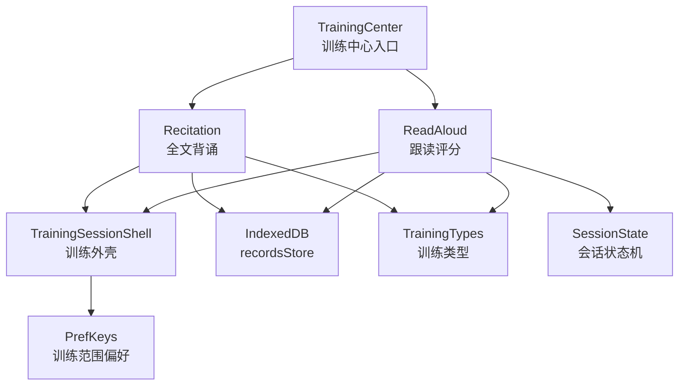
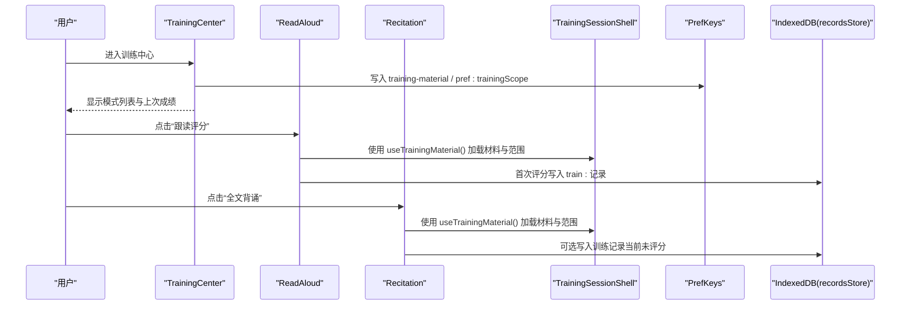
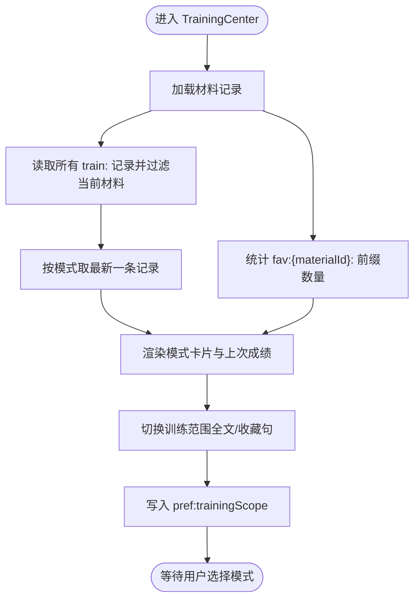
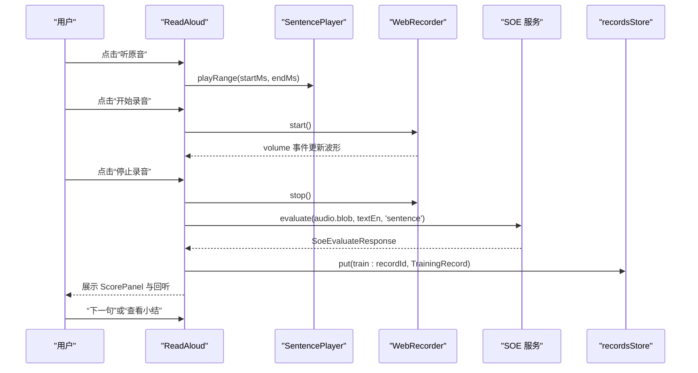
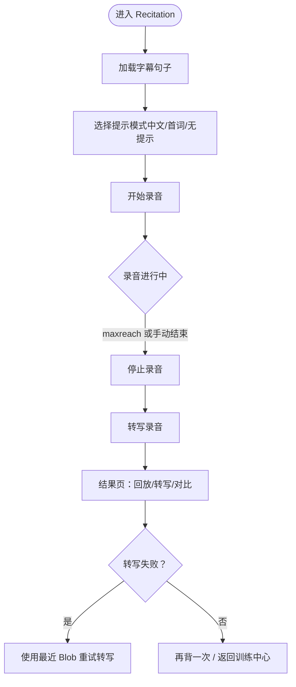
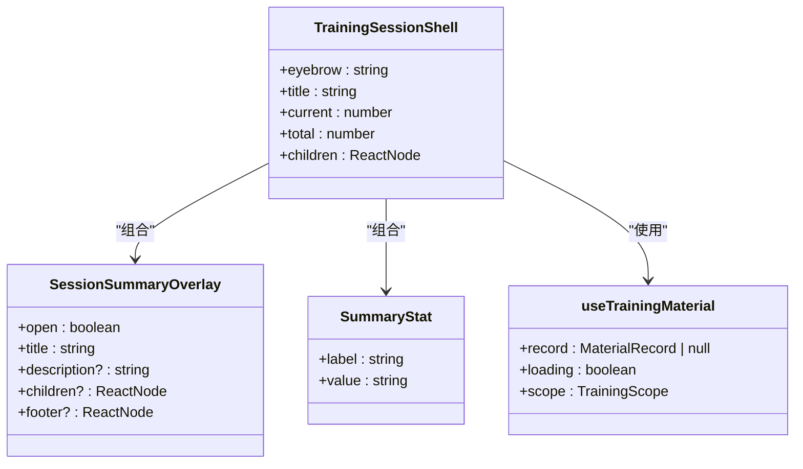
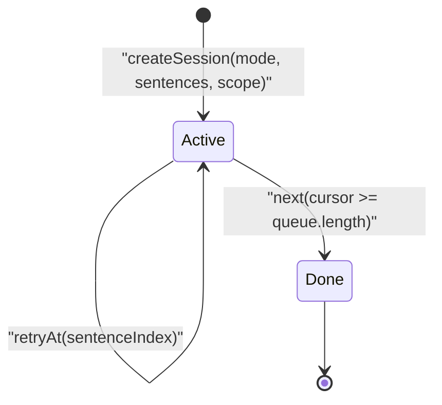
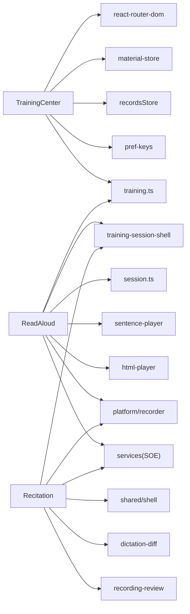
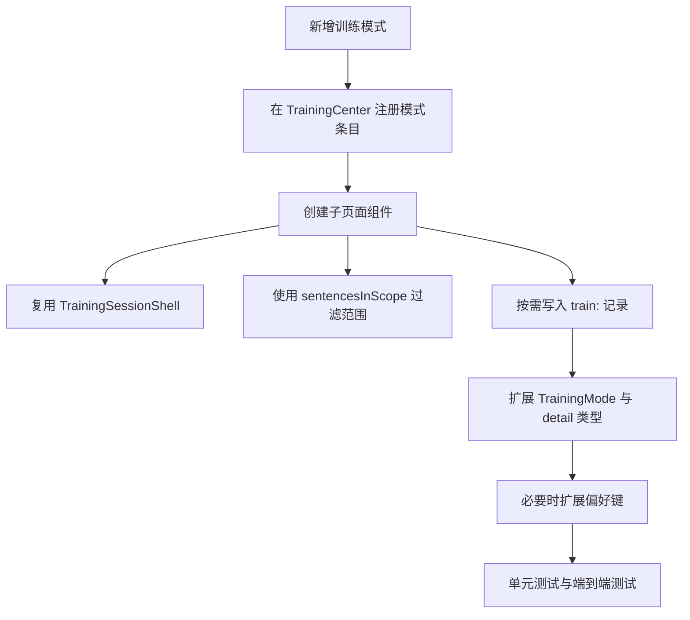

# 训练中心页面

<cite>
**本文引用的文件**   
- [training-center.tsx](file://client/components/pages/training-center.tsx)
- [read-aloud.tsx](file://client/components/pages/training/read-aloud.tsx)
- [recitation.tsx](file://client/components/pages/training/recitation.tsx)
- [training-session-shell.tsx](file://client/components/shared/training-session-shell.tsx)
- [session.ts](file://client/core/training/session.ts)
- [index.ts](file://client/core/training/index.ts)
- [pref-keys.ts](file://client/lib/pref-keys.ts)
- [idb.ts](file://client/platform/storage/idb.ts)
- [schema.ts](file://client/platform/storage/schema.ts)
- [training.ts](file://client/types/training.ts)
</cite>

## 目录
1. [引言](#引言)
2. [项目结构定位](#项目结构定位)
3. [核心组件总览](#核心组件总览)
4. [架构总览](#架构总览)
5. [详细组件分析](#详细组件分析)
6. [依赖关系分析](#依赖关系分析)
7. [性能与健壮性](#性能与健壮性)
8. [故障排查指南](#故障排查指南)
9. [扩展新训练模式指南](#扩展新训练模式指南)
10. [结论](#结论)

## 引言
本文件面向“训练中心”相关的前端实现，目标是帮助开发者快速理解 TrainingCenter 页面的导航与路由管理、训练模式选择、子页面切换、状态共享机制，以及影子跟读、全文背诵等训练子页面的集成方式。文档同时说明训练会话的统一管理、进度同步、成绩汇总等跨页面数据流，并给出训练范围配置、个性化设置和数据持久化机制的说明，最后提供接入新训练模式的扩展指南与最佳实践。

## 项目结构定位
训练中心位于客户端 React/Next.js 应用中的 `client/components/pages` 目录：
- 训练中心入口：`client/components/pages/training-center.tsx`
- 训练子页面：`client/components/pages/training/read-aloud.tsx`、`client/components/pages/training/recitation.tsx`
- 训练页共享外壳与材料加载 Hook：`client/components/shared/training-session-shell.tsx`
- 训练会话纯函数状态机：`client/core/training/session.ts`
- 训练类型定义：`client/types/training.ts`
- 偏好键与训练范围：`client/lib/pref-keys.ts`
- IndexedDB 存储封装与记录 Key 约定：`client/platform/storage/idb.ts`、`client/platform/storage/schema.ts`

**图表来源**
- [training-center.tsx:15-21](file://client/components/pages/training-center.tsx#L15-L21)
- [read-aloud.tsx:12-30](file://client/components/pages/training/read-aloud.tsx#L12-L30)
- [recitation.tsx:14-27](file://client/components/pages/training/recitation.tsx#L14-L27)
- [training-session-shell.tsx:1-20](file://client/components/shared/training-session-shell.tsx#L1-L20)
- [session.ts:1-12](file://client/core/training/session.ts#L1-L12)
- [training.ts:50-67](file://client/types/training.ts#L50-L67)
- [idb.ts:1-10](file://client/platform/storage/idb.ts#L1-L10)

**章节来源**
- [training-center.tsx:1-135](file://client/components/pages/training-center.tsx#L1-L135)
- [read-aloud.tsx:1-280](file://client/components/pages/training/read-aloud.tsx#L1-L280)
- [recitation.tsx:1-285](file://client/components/pages/training/recitation.tsx#L1-L285)
- [training-session-shell.tsx:1-67](file://client/components/shared/training-session-shell.tsx#L1-L67)
- [session.ts:1-119](file://client/core/training/session.ts#L1-L119)
- [training.ts:1-68](file://client/types/training.ts#L1-L68)
- [pref-keys.ts:28-34](file://client/lib/pref-keys.ts#L28-L34)
- [idb.ts:1-117](file://client/platform/storage/idb.ts#L1-L117)
- [schema.ts:16-26](file://client/platform/storage/schema.ts#L16-L26)

## 核心组件总览
- TrainingCenter：训练中心主页面，负责展示训练模式列表、训练范围选择（全文/收藏句）、上次成绩提示、收藏句数量提示，并将当前材料与范围写入偏好存储供子页面读取。
- ReadAloud：跟读评分子页面，逐句流程包括听原音、录音、SOE 评分、结果展示、下一句推进与完成小结；每句首次评分写入一条训练记录。
- Recitation：全文背诵子页面，支持中文提示/首词提示/无提示三种模式，全文录音后转写并与原文对比，不直接评分但可回放录音与查看差异。
- TrainingSessionShell：训练页统一外壳，提供页头标题、进度条、完成小结浮层，以及按最近材料与范围加载材料的 Hook。
- Session 状态机：纯函数实现的训练会话状态机，提供题目队列、游标推进、提交/跳过/重试等事件处理，以及记录 id 生成。
- 偏好与存储：通过 pref-keys.ts 读写训练范围偏好；通过 idb.ts 与 schema.ts 持久化训练记录、收藏句等数据。

**章节来源**
- [training-center.tsx:14-21](file://client/components/pages/training-center.tsx#L14-L21)
- [read-aloud.tsx:1-30](file://client/components/pages/training/read-aloud.tsx#L1-L30)
- [recitation.tsx:1-12](file://client/components/pages/training/recitation.tsx#L1-L12)
- [training-session-shell.tsx:1-20](file://client/components/shared/training-session-shell.tsx#L1-L20)
- [session.ts:1-12](file://client/core/training/session.ts#L1-L12)
- [pref-keys.ts:28-34](file://client/lib/pref-keys.ts#L28-L34)
- [idb.ts:1-10](file://client/platform/storage/idb.ts#L1-L10)
- [schema.ts:16-26](file://client/platform/storage/schema.ts#L16-L26)

## 架构总览
训练中心采用“入口 + 子页面 + 共享外壳 + 纯函数状态机 + 偏好与存储”的分层架构：
- 入口层：TrainingCenter 负责模式选择与范围配置，将 materialId 与 scope 写入偏好。
- 页面层：ReadAloud 与 Recitation 各自实现具体训练流程，复用 TrainingSessionShell 提供一致的进度与小结体验。
- 状态层：Session 状态机提供与 UI 无关的训练状态迁移逻辑，便于测试与复用。
- 数据层：IndexedDB 持久化训练记录、收藏句等；localStorage 偏好存储训练范围等设置。

**图表来源**
- [training-center.tsx:31-66](file://client/components/pages/training-center.tsx#L31-L66)
- [read-aloud.tsx:57-86](file://client/components/pages/training/read-aloud.tsx#L57-L86)
- [recitation.tsx:65-89](file://client/components/pages/training/recitation.tsx#L65-L89)
- [training-session-shell.tsx:43-64](file://client/components/shared/training-session-shell.tsx#L43-L64)
- [idb.ts:89-102](file://client/platform/storage/idb.ts#L89-L102)

## 详细组件分析

### TrainingCenter：导航与路由管理
- 模式清单：以数组形式声明各训练模式的跳转路径、模式标识、标题、描述与是否仅全文限制。
- 范围选择：支持“全文”和“收藏句”，当选择收藏句且存在收藏时，全文类模式（影子跟读、全文背诵）置灰不可选。
- 上次成绩：从 recordsStore 中筛选该材料的所有 train: 记录，取每个模式最新一条，计算文案展示。
- 收藏句数量：统计 fav:{materialId}: 前缀的记录数，用于提示与禁用逻辑。
- 偏好写入：进入页面时将 materialId 写入 `training-material` 偏好，scope 写入 `pref:trainingScope`，供子页面读取。

**图表来源**
- [training-center.tsx:31-66](file://client/components/pages/training-center.tsx#L31-L66)
- [training-center.tsx:71-107](file://client/components/pages/training-center.tsx#L71-L107)
- [training-center.tsx:109-127](file://client/components/pages/training-center.tsx#L109-L127)

**章节来源**
- [training-center.tsx:14-21](file://client/components/pages/training-center.tsx#L14-L21)
- [training-center.tsx:31-66](file://client/components/pages/training-center.tsx#L31-L66)
- [training-center.tsx:71-107](file://client/components/pages/training-center.tsx#L71-L107)
- [training-center.tsx:109-127](file://client/components/pages/training-center.tsx#L109-L127)

### ReadAloud：跟读评分子页面
- 流程阶段：空闲 → 录音中 → 评分中 → 已出分，逐句推进，完成后显示小结。
- 播放与录音：使用 SentencePlayer 进行句段播放；WebRecorder 录音并提供 volume 事件驱动声波条与时长计时。
- 评分与记录：调用 SOE 服务评分，首次对某句评分写入一条 train: 记录，包含综合分与三维指标。
- 回听与错误处理：评分后保留录音 ObjectURL 供回听；权限拒绝与 API 错误有明确提示与恢复路径。
- 进度与小结：复用 TrainingSessionShell 的进度与完成浮层，展示平均综合分与薄弱句数量。

**图表来源**
- [read-aloud.tsx:57-86](file://client/components/pages/training/read-aloud.tsx#L57-L86)
- [read-aloud.tsx:138-197](file://client/components/pages/training/read-aloud.tsx#L138-L197)
- [read-aloud.tsx:218-275](file://client/components/pages/training/read-aloud.tsx#L218-L275)

**章节来源**
- [read-aloud.tsx:1-30](file://client/components/pages/training/read-aloud.tsx#L1-L30)
- [read-aloud.tsx:57-86](file://client/components/pages/training/read-aloud.tsx#L57-L86)
- [read-aloud.tsx:138-197](file://client/components/pages/training/read-aloud.tsx#L138-L197)
- [read-aloud.tsx:218-275](file://client/components/pages/training/read-aloud.tsx#L218-L275)

### Recitation：全文背诵子页面
- 提示模式：支持“显示中文”“仅首词”“无提示”，若无中文字幕则自动禁用中文提示。
- 录音与转写：全文录音（默认 60s 上限），结束后转写录音并与原文逐词对比；失败仍可进入结果页并支持重试。
- 结果展示：复用 RecordingReview 组件展示录音回放、转写文本与差异标记。
- 交互与容错：权限拒绝引导、放弃录音、重新背诵、返回训练中心等交互完整；错误信息清晰提示。

**图表来源**
- [recitation.tsx:65-89](file://client/components/pages/training/recitation.tsx#L65-L89)
- [recitation.tsx:118-174](file://client/components/pages/training/recitation.tsx#L118-L174)
- [recitation.tsx:198-276](file://client/components/pages/training/recitation.tsx#L198-L276)

**章节来源**
- [recitation.tsx:1-12](file://client/components/pages/training/recitation.tsx#L1-L12)
- [recitation.tsx:65-89](file://client/components/pages/training/recitation.tsx#L65-L89)
- [recitation.tsx:118-174](file://client/components/pages/training/recitation.tsx#L118-L174)
- [recitation.tsx:198-276](file://client/components/pages/training/recitation.tsx#L198-L276)

### TrainingSessionShell：训练页共享外壳
- 进度展示：根据 current 与 total 计算百分比并渲染进度条。
- 完成小结：SessionSummaryOverlay 提供全屏遮罩的小结浮层，支持自定义 footer。
- 材料加载：useTrainingMaterial 从偏好中读取最近材料与范围，若范围为收藏句且确有收藏则按收藏句过滤，否则回落全文。

**图表来源**
- [training-session-shell.tsx:21-36](file://client/components/shared/training-session-shell.tsx#L21-L36)
- [training-session-shell.tsx:43-64](file://client/components/shared/training-session-shell.tsx#L43-L64)

**章节来源**
- [training-session-shell.tsx:1-67](file://client/components/shared/training-session-shell.tsx#L1-L67)

### Session 状态机：纯函数训练会话
- 范围过滤：sentencesInScope 依据 TrainingScope 过滤句子，保持时间轴顺序。
- 状态迁移：createSession 初始化会话；submit/attempt/hint/next/skip/retryAt 提供事件驱动的状态迁移。
- 结果收集：results 按提交顺序收集 SentenceResult，同一句重试会覆盖上一条同句结果。
- 记录 id：makeRecordId 生成零依赖记录 id，便于持久化。

**图表来源**
- [session.ts:13-32](file://client/core/training/session.ts#L13-L32)
- [session.ts:38-62](file://client/core/training/session.ts#L38-L62)
- [session.ts:70-118](file://client/core/training/session.ts#L70-L118)

**章节来源**
- [session.ts:1-119](file://client/core/training/session.ts#L1-L119)
- [index.ts:1-6](file://client/core/training/index.ts#L1-L6)

## 依赖关系分析
- TrainingCenter 依赖：
  - react-router-dom：Link/Navigate 与 useParams 用于路由与参数获取。
  - stores/material-store：getMaterialRecord 获取材料记录。
  - platform/storage/idb：recordsStore 读取训练记录与收藏句计数。
  - lib/pref-keys：getTrainingScope/setTrainingScope 读写训练范围偏好。
  - types/training：TrainingMode、TrainingRecord 类型定义。
- ReadAloud 依赖：
  - shared/training-session-shell：TrainingSessionShell、useTrainingMaterial、SessionSummaryOverlay。
  - core/training/session：sentencesInScope、makeRecordId。
  - core/player/sentence-player：句段播放。
  - platform/html-player：媒体控制器。
  - platform/recorder：WebRecorder 录音与权限错误。
  - services：SOE 评分服务。
  - types/api、types/training：API 响应与训练记录类型。
- Recitation 依赖：
  - shared/shell：Shell 基础外壳。
  - core/training/dictation-diff：diffWords 用于转写与原文对比。
  - platform/recorder：录音与权限错误。
  - components/shared/training-session-shell：useTrainingMaterial。
  - services：toApiError 错误转换。
  - recording-review：RecordingReview 与 transcribeRecording 转写能力。

**图表来源**
- [training-center.tsx:1-12](file://client/components/pages/training-center.tsx#L1-L12)
- [read-aloud.tsx:12-30](file://client/components/pages/training/read-aloud.tsx#L12-L30)
- [recitation.tsx:14-27](file://client/components/pages/training/recitation.tsx#L14-L27)

**章节来源**
- [training-center.tsx:1-12](file://client/components/pages/training-center.tsx#L1-L12)
- [read-aloud.tsx:12-30](file://client/components/pages/training/read-aloud.tsx#L12-L30)
- [recitation.tsx:14-27](file://client/components/pages/training/recitation.tsx#L14-L27)

## 性能与健壮性
- 媒体资源生命周期：ReadAloud 在 effect 内创建 ObjectURL 并在卸载时 revoke，避免内存泄漏。
- 录音器生命周期：ReadAloud 与 Recitation 均在挂载时创建 recorder，监听 volume 与 maxreach，卸载时 destroy 并中止请求。
- IndexedDB 降级：idb.ts 在 SSR、隐私模式或打开失败时优雅降级为内存 Map，保证调用方永不崩溃。
- 错误处理：权限拒绝、API 中止、转写失败均有明确提示与恢复路径；训练记录写入失败不影响训练流程。
- 进度与状态：TrainingSessionShell 基于 current/total 计算进度百分比，避免重复渲染与无效计算。

**章节来源**
- [read-aloud.tsx:89-100](file://client/components/pages/training/read-aloud.tsx#L89-L100)
- [read-aloud.tsx:116-131](file://client/components/pages/training/read-aloud.tsx#L116-L131)
- [recitation.tsx:96-111](file://client/components/pages/training/recitation.tsx#L96-L111)
- [idb.ts:17-50](file://client/platform/storage/idb.ts#L17-L50)
- [idb.ts:70-78](file://client/platform/storage/idb.ts#L70-L78)

## 故障排查指南
- 无法录音：检查麦克风权限，出现 RecorderPermissionError 时显示权限引导浮层；确认浏览器允许录音权限。
- 评分失败：SOE 服务返回 ApiError 且 code 为 ABORTED 时静默处理；其他错误提示“评分失败，请重试”。
- 转写失败：转写失败仍进入结果页，支持使用最近 Blob 重试；若 rec.stop 失败则回到引导页重录。
- 材料加载为空：TrainingCenter 在 record 为 null 时 Navigate 到首页；子页面在无字幕时提示无法训练并引导返回材料库。
- 收藏句数量为 0：TrainingCenter 禁用“收藏句”范围并提示先去精听页收藏句子。

**章节来源**
- [read-aloud.tsx:144-155](file://client/components/pages/training/read-aloud.tsx#L144-L155)
- [read-aloud.tsx:192-196](file://client/components/pages/training/read-aloud.tsx#L192-L196)
- [recitation.tsx:137-151](file://client/components/pages/training/recitation.tsx#L137-L151)
- [recitation.tsx:153-174](file://client/components/pages/training/recitation.tsx#L153-L174)
- [training-center.tsx:68-69](file://client/components/pages/training-center.tsx#L68-L69)
- [training-center.tsx:105-106](file://client/components/pages/training-center.tsx#L105-L106)

## 扩展新训练模式指南
接入新训练模式建议遵循以下最佳实践：
- 注册模式：在 TrainingCenter 的模式清单中添加新模式条目，包括 to、mode、title、desc 与 fullTextOnly 标志（如需全文）。
- 创建子页面：新建子页面组件，复用 TrainingSessionShell 提供一致的外壳与进度展示；使用 useTrainingMaterial 加载材料与范围。
- 范围过滤：使用 sentencesInScope 获取按范围过滤的句子队列，确保与九宫格/听写/跟读一致的口径。
- 记录写入：如需持久化成绩，使用 makeRecordId 生成记录 id，并通过 recordsStore.put(RECORD_KEYS.training(id), TrainingRecord) 写入；首次评分或关键节点写入，避免重复。
- 类型定义：在 types/training.ts 中扩展 TrainingMode 联合类型与对应 detail 类型，确保类型安全。
- 偏好与范围：如新模式需要特殊范围策略，可在 pref-keys.ts 中新增偏好键与读写方法，并在 useTrainingMaterial 中解析。
- 错误与降级：录音/评分/转写等外部操作需捕获权限错误与 API 错误，提供用户友好的提示与恢复路径；IndexedDB 失败应不影响主流程。

**图表来源**
- [training-center.tsx:15-21](file://client/components/pages/training-center.tsx#L15-L21)
- [session.ts:38-62](file://client/core/training/session.ts#L38-L62)
- [session.ts:115-118](file://client/core/training/session.ts#L115-L118)
- [training.ts:50-67](file://client/types/training.ts#L50-L67)
- [pref-keys.ts:28-34](file://client/lib/pref-keys.ts#L28-L34)

**章节来源**
- [training-center.tsx:15-21](file://client/components/pages/training-center.tsx#L15-L21)
- [session.ts:38-62](file://client/core/training/session.ts#L38-L62)
- [session.ts:115-118](file://client/core/training/session.ts#L115-L118)
- [training.ts:50-67](file://client/types/training.ts#L50-L67)
- [pref-keys.ts:28-34](file://client/lib/pref-keys.ts#L28-L34)

## 结论
训练中心以 TrainingCenter 为入口，统一管理训练模式选择、范围配置与上次成绩展示；ReadAloud 与 Recitation 作为典型子页面，分别实现逐句跟读评分与全文背诵转写对比，均复用 TrainingSessionShell 提供一致的进度与小结体验。Session 状态机提供与 UI 无关的训练状态迁移逻辑，IndexedDB 与偏好存储保障数据持久化与个性化设置。扩展新训练模式时，建议遵循注册、外壳复用、范围过滤、记录写入、类型扩展与偏好扩展的最佳实践，确保一致性、可测试性与健壮性。