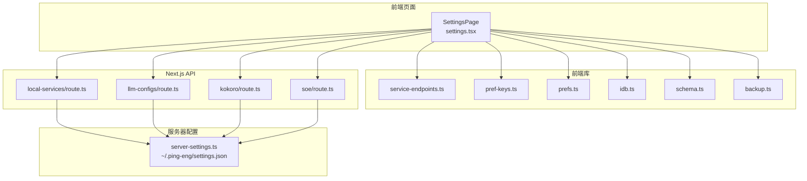
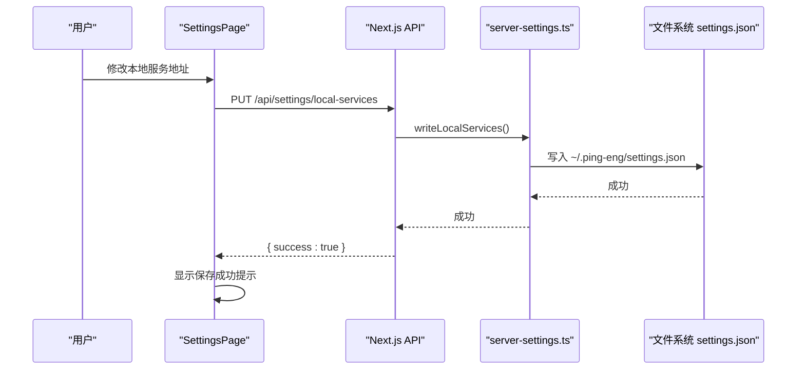
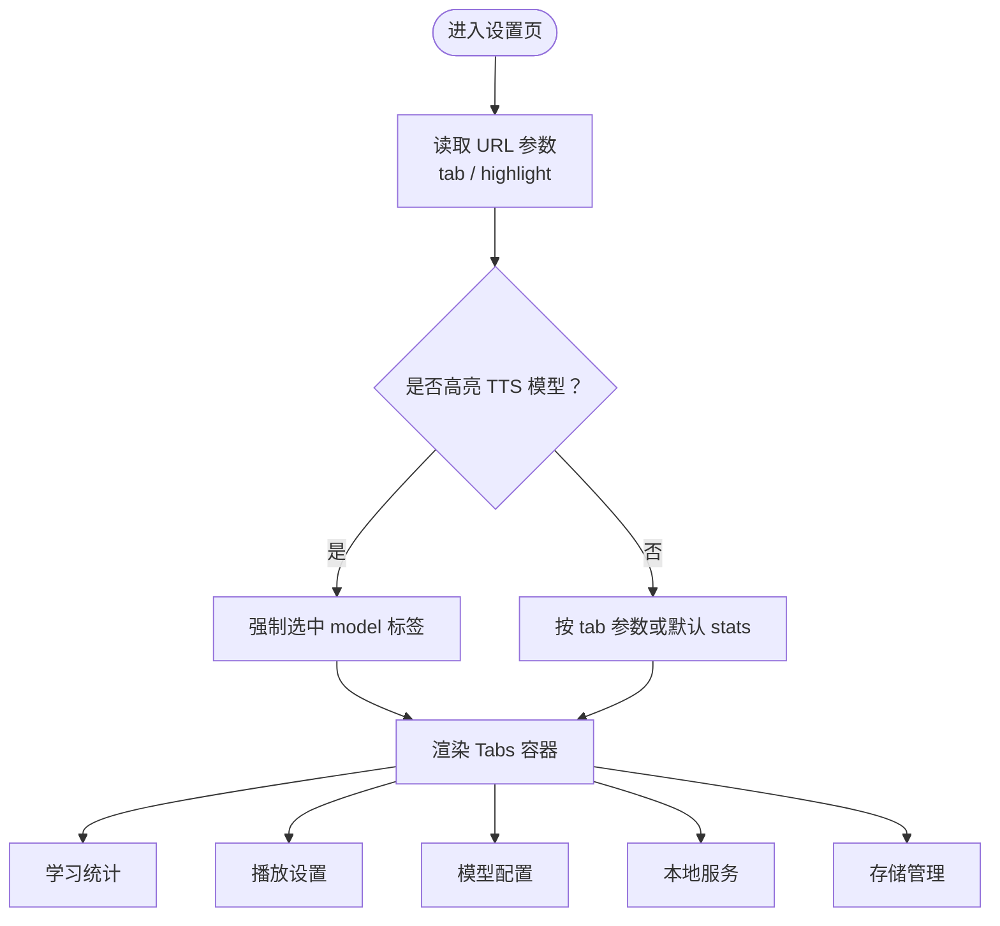
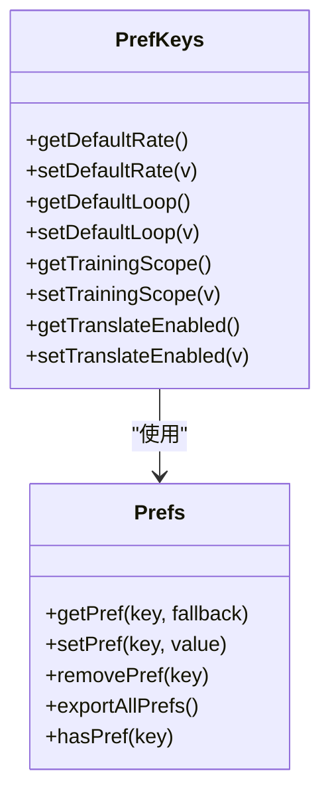
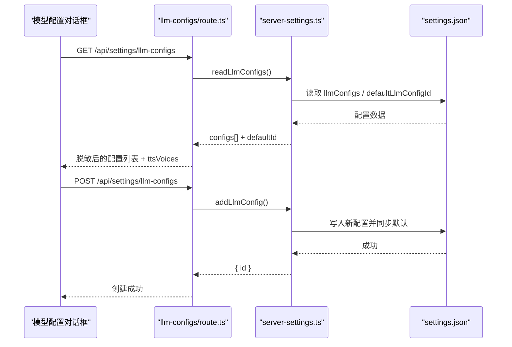
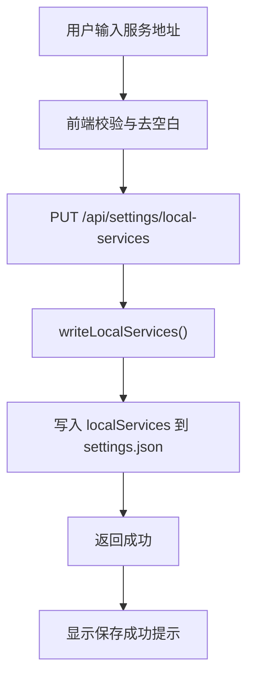
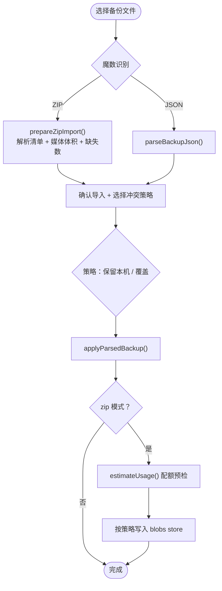
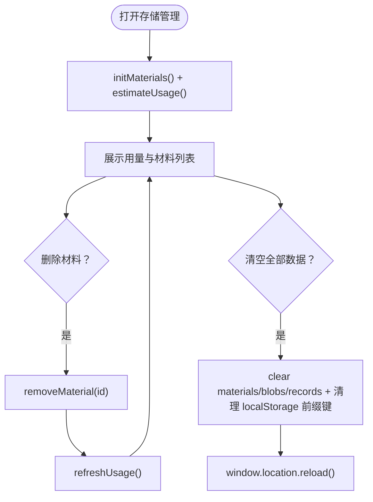
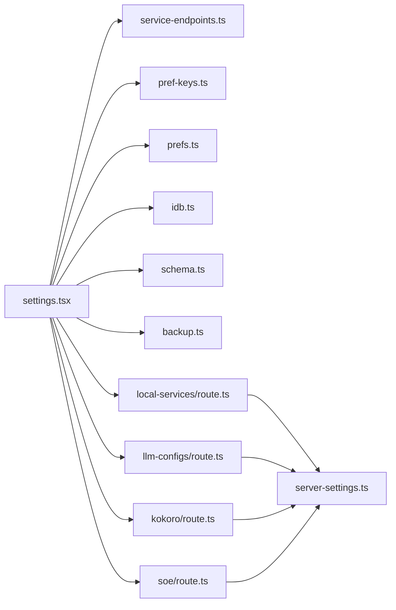

# 设置页面

<cite>
**本文引用的文件**   
- [settings.tsx](file://client/components/pages/settings.tsx)
- [server-settings.ts](file://client/lib/server-settings.ts)
- [service-endpoints.ts](file://client/lib/service-endpoints.ts)
- [pref-keys.ts](file://client/lib/pref-keys.ts)
- [prefs.ts](file://client/platform/storage/prefs.ts)
- [idb.ts](file://client/platform/storage/idb.ts)
- [schema.ts](file://client/platform/storage/schema.ts)
- [backup.ts](file://client/platform/storage/backup.ts)
- [route.ts（本地服务）](file://client/app/api/settings/local-services/route.ts)
- [route.ts（LLM 配置）](file://client/app/api/settings/llm-configs/route.ts)
- [route.ts（Kokoro）](file://client/app/api/settings/kokoro/route.ts)
- [route.ts（SOE）](file://client/app/api/settings/soe/route.ts)
</cite>

## 目录
1. [引言](#引言)
2. [项目结构与职责划分](#项目结构与职责划分)
3. [核心组件总览](#核心组件总览)
4. [架构总览](#架构总览)
5. [详细组件分析](#详细组件分析)
6. [依赖关系与数据流](#依赖关系与数据流)
7. [性能与可靠性特征](#性能与可靠性特征)
8. [故障排查指南](#故障排查指南)
9. [扩展与迁移策略](#扩展与迁移策略)
10. [结论](#结论)

## 引言
本文件面向“设置页面”的完整实现，目标是帮助开发者理解 Settings 组件如何组织服务配置、界面偏好、模型配置、本地服务地址、备份与存储管理，以及服务器端点与环境变量的统一管理机制。文档从用户可见的设置项出发，逐步深入到前端状态、持久化层、Next.js API Route 和磁盘配置文件，最终给出可扩展、可迁移、可排障的实践建议。

## 项目结构与职责划分
设置相关代码分布在客户端 UI、通用库、平台存储层与 Next.js API 路由中：
- 页面与交互：`client/components/pages/settings.tsx`
- 服务端点与默认值：`client/lib/service-endpoints.ts`
- 服务器端配置读写：`client/lib/server-settings.ts`
- 浏览器偏好封装：`client/platform/storage/prefs.ts`
- IndexedDB 封装与用量估算：`client/platform/storage/idb.ts`
- 存储键约定与记录结构：`client/platform/storage/schema.ts`
- 备份导出导入编排：`client/platform/storage/backup.ts`
- 各设置类 API 路由：`client/app/api/settings/*`

**图表来源**
- [settings.tsx:535-592](file://client/components/pages/settings.tsx#L535-L592)
- [service-endpoints.ts:1-161](file://client/lib/service-endpoints.ts#L1-L161)
- [pref-keys.ts:1-41](file://client/lib/pref-keys.ts#L1-L41)
- [prefs.ts:1-52](file://client/platform/storage/prefs.ts#L1-L52)
- [idb.ts:1-117](file://client/platform/storage/idb.ts#L1-L117)
- [schema.ts:1-27](file://client/platform/storage/schema.ts#L1-L27)
- [backup.ts:1-243](file://client/platform/storage/backup.ts#L1-L243)
- [route.ts（本地服务）:1-28](file://client/app/api/settings/local-services/route.ts#L1-L28)
- [route.ts（LLM 配置）:1-134](file://client/app/api/settings/llm-configs/route.ts#L1-L134)
- [route.ts（Kokoro）:1-34](file://client/app/api/settings/kokoro/route.ts#L1-L34)
- [route.ts（SOE）:1-57](file://client/app/api/settings/soe/route.ts#L1-L57)
- [server-settings.ts:1-327](file://client/lib/server-settings.ts#L1-L327)

**章节来源**
- [settings.tsx:1-11](file://client/components/pages/settings.tsx#L1-L11)
- [service-endpoints.ts:1-161](file://client/lib/service-endpoints.ts#L1-L161)

## 核心组件总览
- 学习统计：聚合训练次数、平均成绩、收藏数，用于展示用户学习概况。
- 播放/训练设置：默认倍速、单句循环次数，写入 `localStorage`。
- 模型配置：多 LLM 配置列表，支持新增、编辑、删除、设为默认；密钥在列表视图脱敏，详情视图明文回填。
- 本地服务：WhisperX 对齐与 faster-whisper 转写服务地址，通过 API 路由持久化到 `~/.ping-eng/settings.json`。
- 备份与迁移：轻量 JSON 与完整 zip 两种格式，支持冲突策略、媒体缺失提示、配额预检。
- 存储管理：IndexedDB 使用量、材料列表删除、清空全部数据并恢复示例内容。

**章节来源**
- [settings.tsx:50-140](file://client/components/pages/settings.tsx#L50-L140)
- [settings.tsx:144-228](file://client/components/pages/settings.tsx#L144-L228)
- [settings.tsx:230-446](file://client/components/pages/settings.tsx#L230-L446)
- [settings.tsx:448-533](file://client/components/pages/settings.tsx#L448-L533)

## 架构总览
设置页采用“前端 UI + 前端库 + API 路由 + 磁盘配置”的分层设计：
- UI 层负责表单、校验、预览与用户反馈。
- 前端库提供默认值、URL 拼接、偏好键位与备份编排。
- API 路由负责参数校验、权限控制（本地请求）、调用 server-settings。
- server-settings 将配置落盘到 `~/.ping-eng/settings.json`，并提供向后兼容与迁移逻辑。

**图表来源**
- [settings.tsx:146-180](file://client/components/pages/settings.tsx#L146-L180)
- [route.ts（本地服务）:13-27](file://client/app/api/settings/local-services/route.ts#L13-L27)
- [server-settings.ts:248-263](file://client/lib/server-settings.ts#L248-L263)

## 详细组件分析

### 设置页面主布局与标签页
- 使用 Tabs 组织五个子模块：学习统计、播放设置、模型配置、本地服务、存储管理。
- 支持 URL 参数定位到指定标签页，并通过 `highlight=tts-model` 强制定位到模型配置以高亮 TTS 模型。
- 所有浏览器 API 仅在 effect/回调内访问，保证 SSR 安全。

**图表来源**
- [settings.tsx:535-592](file://client/components/pages/settings.tsx#L535-L592)

**章节来源**
- [settings.tsx:535-592](file://client/components/pages/settings.tsx#L535-L592)

### 学习统计
- 从 `recordsStore` 遍历 `train:` 与 `fav:` 前缀的记录，计算训练次数、平均成绩、收藏数量。
- 失败不影响设置页展示，体现容错设计。

**章节来源**
- [settings.tsx:50-93](file://client/components/pages/settings.tsx#L50-L93)
- [idb.ts:100-102](file://client/platform/storage/idb.ts#L100-L102)

### 播放/训练设置
- 默认倍速与循环次数由 `pref-keys.ts` 定义，底层走 `prefs.ts` 的 `localStorage`。
- 切换按钮循环预设档位，立即持久化，播放器侧可直接读取默认值。

**图表来源**
- [pref-keys.ts:1-41](file://client/lib/pref-keys.ts#L1-L41)
- [prefs.ts:1-52](file://client/platform/storage/prefs.ts#L1-L52)

**章节来源**
- [settings.tsx:95-140](file://client/components/pages/settings.tsx#L95-L140)
- [pref-keys.ts:1-41](file://client/lib/pref-keys.ts#L1-L41)
- [prefs.ts:1-52](file://client/platform/storage/prefs.ts#L1-L52)

### 模型配置（多 LLM 配置）
- 通过 `/api/settings/llm-configs` 暴露 CRUD 接口，支持新增、更新、删除、设为默认。
- 列表视图对 `apiKey` 脱敏，详情视图返回明文以便编辑回填。
- 根据配置的 provider/endpoint 推导可用 TTS 音色列表。
- server-settings 内部维护 `llmConfigs` 数组与 `defaultLlmConfigId`，并在首次使用时自动从旧版 `llm` 字段迁移。

**图表来源**
- [route.ts（LLM 配置）:37-92](file://client/app/api/settings/llm-configs/route.ts#L37-L92)
- [server-settings.ts:121-178](file://client/lib/server-settings.ts#L121-L178)

**章节来源**
- [route.ts（LLM 配置）:1-134](file://client/app/api/settings/llm-configs/route.ts#L1-L134)
- [server-settings.ts:5-50](file://client/lib/server-settings.ts#L5-L50)
- [server-settings.ts:121-246](file://client/lib/server-settings.ts#L121-L246)

### 本地服务配置
- WhisperX 对齐与 faster-whisper 转写服务地址通过 `/api/settings/local-services` 读写。
- 前端默认值来自 `service-endpoints.ts` 中的常量，后端默认值由 server-settings 提供。
- 空字符串会被规范化为 `undefined`，避免写入无意义空值。

**图表来源**
- [settings.tsx:146-180](file://client/components/pages/settings.tsx#L146-L180)
- [route.ts（本地服务）:13-27](file://client/app/api/settings/local-services/route.ts#L13-L27)
- [server-settings.ts:248-263](file://client/lib/server-settings.ts#L248-L263)
- [service-endpoints.ts:57-68](file://client/lib/service-endpoints.ts#L57-L68)

**章节来源**
- [settings.tsx:144-228](file://client/components/pages/settings.tsx#L144-L228)
- [route.ts（本地服务）:1-28](file://client/app/api/settings/local-services/route.ts#L1-L28)
- [server-settings.ts:248-263](file://client/lib/server-settings.ts#L248-L263)
- [service-endpoints.ts:57-68](file://client/lib/service-endpoints.ts#L57-L68)

### 备份与迁移
- 轻量备份：materials + records + prefs，不含音视频。
- 完整备份：zip 包含 backup.json 与 media/{materialId}，媒体零压缩存储。
- 导入流程：魔数识别 .zip，解析清单，选择冲突策略（保留本机 / 覆盖），配额预检，批量写入。
- 结果弹窗展示写入/跳过计数，必要时提示补传媒体。

**图表来源**
- [settings.tsx:295-345](file://client/components/pages/settings.tsx#L295-L345)
- [backup.ts:138-180](file://client/platform/storage/backup.ts#L138-L180)
- [backup.ts:187-243](file://client/platform/storage/backup.ts#L187-L243)

**章节来源**
- [settings.tsx:230-446](file://client/components/pages/settings.tsx#L230-L446)
- [backup.ts:1-243](file://client/platform/storage/backup.ts#L1-L243)

### 存储管理
- 使用 `estimateUsage()` 获取已用空间与配额，展示进度条。
- 材料列表支持删除，清理后刷新用量。
- 清空全部数据会同时清理 IndexedDB 与 localStorage 中以 `ping-english:` 开头的键，然后刷新页面。

**图表来源**
- [settings.tsx:450-533](file://client/components/pages/settings.tsx#L450-L533)
- [idb.ts:104-117](file://client/platform/storage/idb.ts#L104-L117)

**章节来源**
- [settings.tsx:448-533](file://client/components/pages/settings.tsx#L448-L533)
- [idb.ts:104-117](file://client/platform/storage/idb.ts#L104-L117)

### Kokoro 与 SOE 设置
- Kokoro：HuggingFace 模型 ID 与本地模型路径，首次读取时写入默认值并创建目录。
- SOE：语音评测提供商、代理地址与各厂商密钥对象，GET 返回默认配置，PUT 进行严格校验与归一化。

**章节来源**
- [route.ts（Kokoro）:1-34](file://client/app/api/settings/kokoro/route.ts#L1-L34)
- [server-settings.ts:265-298](file://client/lib/server-settings.ts#L265-L298)
- [route.ts（SOE）:1-57](file://client/app/api/settings/soe/route.ts#L1-L57)
- [server-settings.ts:300-327](file://client/lib/server-settings.ts#L300-L327)

## 依赖关系与数据流
- 设置页依赖 service-endpoints 提供默认服务地址与 URL 构建工具。
- 偏好设置通过 pref-keys 与 prefs 封装，确保键名一致与 SSR 安全。
- 模型配置与本地服务通过 Next.js API 路由访问 server-settings，最终落盘到 `~/.ping-eng/settings.json`。
- 备份与存储管理依赖 idb 与 schema 约定的键前缀与记录结构。

**图表来源**
- [settings.tsx:1-593](file://client/components/pages/settings.tsx#L1-L593)
- [service-endpoints.ts:1-161](file://client/lib/service-endpoints.ts#L1-L161)
- [pref-keys.ts:1-41](file://client/lib/pref-keys.ts#L1-L41)
- [prefs.ts:1-52](file://client/platform/storage/prefs.ts#L1-L52)
- [idb.ts:1-117](file://client/platform/storage/idb.ts#L1-L117)
- [schema.ts:1-27](file://client/platform/storage/schema.ts#L1-L27)
- [backup.ts:1-243](file://client/platform/storage/backup.ts#L1-L243)
- [route.ts（本地服务）:1-28](file://client/app/api/settings/local-services/route.ts#L1-L28)
- [route.ts（LLM 配置）:1-134](file://client/app/api/settings/llm-configs/route.ts#L1-L134)
- [route.ts（Kokoro）:1-34](file://client/app/api/settings/kokoro/route.ts#L1-L34)
- [route.ts（SOE）:1-57](file://client/app/api/settings/soe/route.ts#L1-L57)
- [server-settings.ts:1-327](file://client/lib/server-settings.ts#L1-L327)

**章节来源**
- [settings.tsx:1-593](file://client/components/pages/settings.tsx#L1-L593)
- [server-settings.ts:1-327](file://client/lib/server-settings.ts#L1-L327)

## 性能与可靠性特征
- 备份 zip 导出采用流式写入与定期合并 Blob，内存峰值受控于单个最大媒体文件与固定缓冲。
- IndexedDB 封装在打开失败或隐私模式下自动降级为内存 Map，保证应用不崩溃。
- 偏好读写与 IDB 操作均包裹 try/catch，错误静默处理，提升用户体验稳定性。
- 导入 zip 前进行配额预检，避免写入中途因空间不足导致数据不一致。

**章节来源**
- [backup.ts:73-121](file://client/platform/storage/backup.ts#L73-L121)
- [idb.ts:17-51](file://client/platform/storage/idb.ts#L17-L51)
- [idb.ts:70-78](file://client/platform/storage/idb.ts#L70-L78)
- [backup.ts:211-223](file://client/platform/storage/backup.ts#L211-L223)

## 故障排查指南
- 无法读取本地服务配置：检查 `~/.ping-eng/settings.json` 是否存在与可读，确认 API 路由未抛出 500。
- 模型配置列表为空：确认 `llmConfigs` 是否为空；若存在旧版 `llm`，readLlmConfigs 会自动迁移。
- 导入 zip 报错存储空间不足：查看 `estimateUsage()` 返回的 usage/quota，清理空间或改用轻量备份。
- 偏好设置未生效：确认 key 前缀为 `ping-english:`，且在浏览器非隐私模式下可写。
- 清空数据后未恢复示例内容：确认 `initMaterials()` 被调用且页面刷新成功。

**章节来源**
- [route.ts（本地服务）:4-10](file://client/app/api/settings/local-services/route.ts#L4-L10)
- [server-settings.ts:127-159](file://client/lib/server-settings.ts#L127-L159)
- [backup.ts:211-223](file://client/platform/storage/backup.ts#L211-L223)
- [prefs.ts:8-22](file://client/platform/storage/prefs.ts#L8-L22)
- [settings.tsx:455-458](file://client/components/pages/settings.tsx#L455-L458)

## 扩展与迁移策略
- 添加自定义设置项：
  - 在 `pref-keys.ts` 中定义键名与默认值，并在 `prefs.ts` 基础上读写。
  - 如需服务器端持久化，在 `server-settings.ts` 中添加对应 section 与读写函数，并在 API 路由中暴露。
- 配置迁移：
  - server-settings 已内置从旧版 `llm` 到 `llmConfigs` 的自动迁移逻辑。
  - 新增字段时建议在读取函数中提供默认值，并在首次读取时回写默认值，确保后续版本兼容。
- 环境变量与动态配置：
  - 当前默认服务地址集中在 `service-endpoints.ts`，便于集中维护。
  - 运行时动态更新通过 API 路由写入 `settings.json`，前端重新加载或局部刷新即可生效。

**章节来源**
- [pref-keys.ts:1-41](file://client/lib/pref-keys.ts#L1-L41)
- [server-settings.ts:72-97](file://client/lib/server-settings.ts#L72-L97)
- [server-settings.ts:127-159](file://client/lib/server-settings.ts#L127-L159)
- [service-endpoints.ts:1-161](file://client/lib/service-endpoints.ts#L1-L161)

## 结论
设置页面以清晰的模块化组织实现了服务配置、界面偏好、模型配置、本地服务地址、备份与存储管理等核心能力。通过统一的默认值管理、严格的参数校验、健壮的持久化与迁移机制，系统在易用性与可靠性之间取得良好平衡。未来扩展可在现有分层架构上增加新的设置 section，并保持向后兼容与错误恢复策略。