# 页面组件

<cite>
**本文引用的文件**   
- [study-app.tsx](file://client/components/study-app.tsx)
- [library.tsx](file://client/components/pages/library.tsx)
- [player.tsx](file://client/components/pages/player.tsx)
- [training-center.tsx](file://client/components/pages/training-center.tsx)
- [puzzle.tsx](file://client/components/pages/puzzle.tsx)
- [dictation.tsx](file://client/components/pages/dictation.tsx)
- [read-aloud.tsx](file://client/components/pages/training/read-aloud.tsx)
- [recitation.tsx](file://client/components/pages/training/recitation.tsx)
- [session.ts](file://client/core/training/session.ts)
- [puzzle.ts](file://client/core/training/puzzle.ts)
- [dictation-diff.ts](file://client/core/training/dictation-diff.ts)
</cite>

## 目录
1. [引言](#引言)
2. [项目结构](#项目结构)
3. [核心页面职责总览](#核心页面职责总览)
4. [架构总览](#架构总览)
5. [详细页面分析](#详细页面分析)
6. [页面导航与参数传递](#页面导航与参数传递)
7. [状态管理与数据流](#状态管理与数据流)
8. [训练会话与算法模型](#训练会话与算法模型)
9. [性能优化策略](#性能优化策略)
10. [错误处理模式](#错误处理模式)
11. [使用示例与最佳实践](#使用示例与最佳实践)
12. [结论](#结论)

## 引言
本文面向“精听英语助手”前端页面组件，重点梳理 P0-P11 中已实现的核心业务页面：材料库、精听播放器、九宫格练习、单句听写、训练中心，以及跟读评分与全文背诵等训练子页面。文档从系统架构、组件职责、用户交互流程、状态管理、数据流、页面间导航关系、生命周期管理、性能优化和错误处理等维度展开，并给出可落地的使用示例与最佳实践。

## 项目结构
页面入口由应用级路由组件统一注册，各业务页面位于 `client/components/pages` 下；训练类页面进一步按功能拆分到 `client/components/pages/training`；训练通用逻辑集中在 `client/core/training`；播放能力由 `SentencePlayer` 与 `HtmlPlayerController` 抽象。

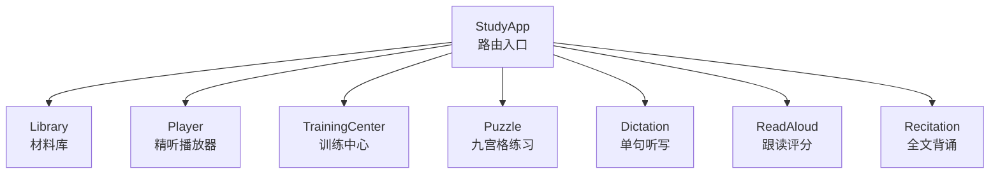

**图表来源**
- [study-app.tsx:41-61](file://client/components/study-app.tsx#L41-L61)

**章节来源**
- [study-app.tsx:1-65](file://client/components/study-app.tsx#L1-L65)

## 核心页面职责总览
- Library（材料库）：材料集分组、材料卡片展示、搜索、新建材料集、导入/导出辅助入口。
- Player（精听播放器）：音视频播放、字幕浏览、收藏、笔记、翻译、纠错、进度持久化、快捷键控制。
- TrainingCenter（训练中心）：选择训练模式、设置训练范围（全文/收藏句）、展示上次成绩。
- Puzzle（九宫格练习）：按语序点击词块拼出句子，支持提示、提交次数限制、结算得分。
- Dictation（单句听写）：听音写句，逐词 diff 对比，正确率统计，薄弱句重练。
- ReadAloud（跟读评分）：听原音 → 录音 → SOE 评分 → 小结，支持回听录音。
- Recitation（全文背诵）：凭记忆背诵全文录音，转写后与原文对比，提供提示模式。

**章节来源**
- [library.tsx:14-143](file://client/components/pages/library.tsx#L14-L143)
- [player.tsx:79-535](file://client/components/pages/player.tsx#L79-L535)
- [training-center.tsx:31-135](file://client/components/pages/training-center.tsx#L31-L135)
- [puzzle.tsx:31-293](file://client/components/pages/puzzle.tsx#L31-L293)
- [dictation.tsx:28-147](file://client/components/pages/dictation.tsx#L28-L147)
- [read-aloud.tsx:57-280](file://client/components/pages/training/read-aloud.tsx#L57-L280)
- [recitation.tsx:65-285](file://client/components/pages/training/recitation.tsx#L65-L285)

## 架构总览
页面层通过 React Router 组织，业务页面依赖存储层（材料、收藏、笔记、生词频率）、平台层（HTML 播放器、录音器、IDB 存储）与核心算法（训练会话、九宫格、听写 diff）。

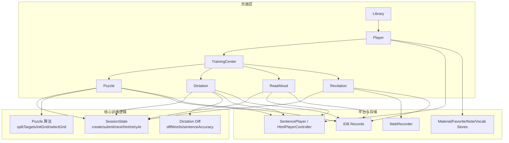

**图表来源**
- [study-app.tsx:41-61](file://client/components/study-app.tsx#L41-L61)
- [session.ts:44-119](file://client/core/training/session.ts#L44-L119)
- [puzzle.ts:168-284](file://client/core/training/puzzle.ts#L168-L284)
- [dictation-diff.ts:51-109](file://client/core/training/dictation-diff.ts#L51-L109)

## 详细页面分析

### Library（材料库）
- 功能特性
  - 材料集分组与未分组材料展示。
  - 搜索材料名称与集合名。
  - 新建材料集（去重校验）。
  - 删除材料与移动材料到集合。
  - 快速跳转 TTS、语音转写、导入材料。
- 用户交互流程
  - 初始化加载材料数据与进度百分比。
  - 输入关键词触发搜索态，平铺匹配结果。
  - 打开新建对话框，校验非空与唯一性后创建。
  - 删除前二次确认，成功后刷新列表。
- 状态管理
  - 使用 store hook 订阅 ready、records、collections。
  - 本地 percents 缓存进度百分比。
  - 新建/移动/删除操作调用 material-store 方法。
- 数据流
  - initMaterials 异步初始化。
  - loadProgressPercents 计算进度百分比。
  - removeMaterial/createCollection 更新存储并驱动 UI。
- 生命周期与错误处理
  - useEffect 内清理定时器与取消标志。
  - 删除失败静默忽略，避免阻断主流程。

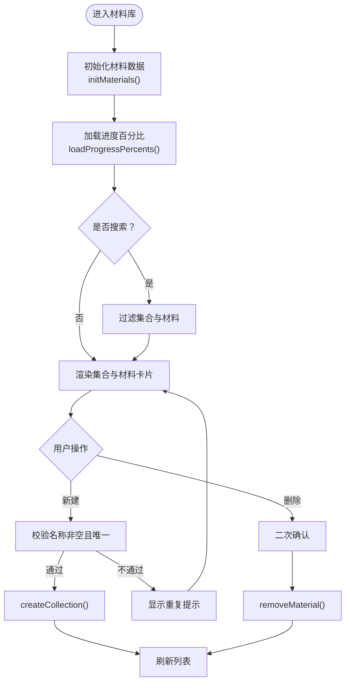

**图表来源**
- [library.tsx:21-56](file://client/components/pages/library.tsx#L21-L56)
- [library.tsx:119-136](file://client/components/pages/library.tsx#L119-L136)

**章节来源**
- [library.tsx:14-143](file://client/components/pages/library.tsx#L14-L143)

### Player（精听播放器）
- 功能特性
  - 音视频播放、倍速、循环、音量控制。
  - 字幕浏览、双语切换、复制原文/译文。
  - 收藏句子、记笔记、AI 转字幕、整篇翻译。
  - 进度持久化、键盘快捷键、背景轮播。
- 用户交互流程
  - 根据 materialId 加载材料与媒体 Blob。
  - 装配 SentencePlayer，监听 timeupdate/sentencechange/statechange。
  - 收藏/笔记/翻译/纠错等操作同步到 store 与 record。
  - 鼠标悬停显示控制栏，自动隐藏。
- 状态管理
  - 本地 state：playing、active、currentMs、durationMs、volume、favSet、noteMap、mode、loop、rate。
  - ref：playerRef、playedRef、pendingNotesRef、controlsTimerRef。
  - 节流：时间戳节流 setCurrentMs，5s 节流 flushProgress。
- 数据流
  - getMaterialRecord/getMediaBlob 获取材料与媒体。
  - favoriteSentenceIndexes/listNotes/getProgress 读取收藏、笔记、进度。
  - putMaterialRecord/updateFrequencies 持久化字幕与生词频率。
  - recordsStore.put 写入学习进度。
- 生命周期与错误处理
  - useEffect 内清理 ObjectURL、destroy 播放器与控制器。
  - 收藏夹跳转 ?s=N 先高亮再 seek。
  - 解析失败静默处理，不影响主流程。

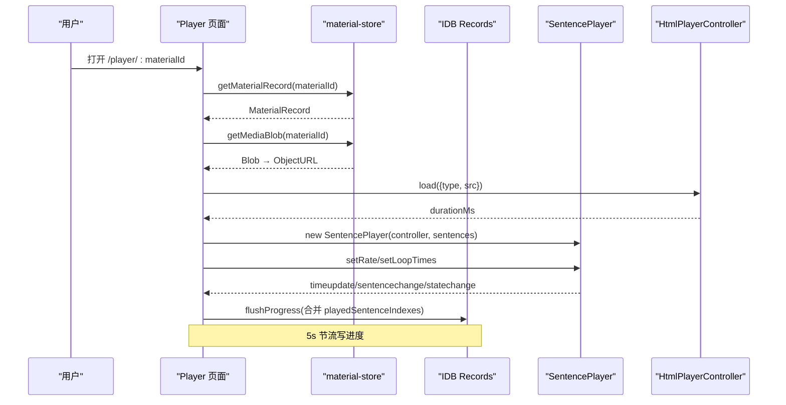

**图表来源**
- [player.tsx:129-245](file://client/components/pages/player.tsx#L129-L245)
- [player.tsx:254-271](file://client/components/pages/player.tsx#L254-L271)

**章节来源**
- [player.tsx:79-535](file://client/components/pages/player.tsx#L79-L535)

### TrainingCenter（训练中心）
- 功能特性
  - 选择训练模式：九宫格、单句听写、跟读评分、影子跟读、全文背诵。
  - 设置训练范围：全文或收藏句。
  - 展示上次成绩与收藏句数量。
- 用户交互流程
  - 根据 materialId 加载材料记录与 train: 记录。
  - 切换范围时写入 prefs:pref:trainingScope。
  - 收藏句范围生效时，全文类模式置灰。
- 状态管理
  - record、lastByMode、favCount、scope。
- 数据流
  - getMaterialRecord 获取材料。
  - recordsStore.allKeys + get 遍历 train: 记录，取最新一条。
  - fav:{materialId}:* 前缀计数收藏句。
- 生命周期与错误处理
  - 异步加载失败时返回 null，导航回首页。

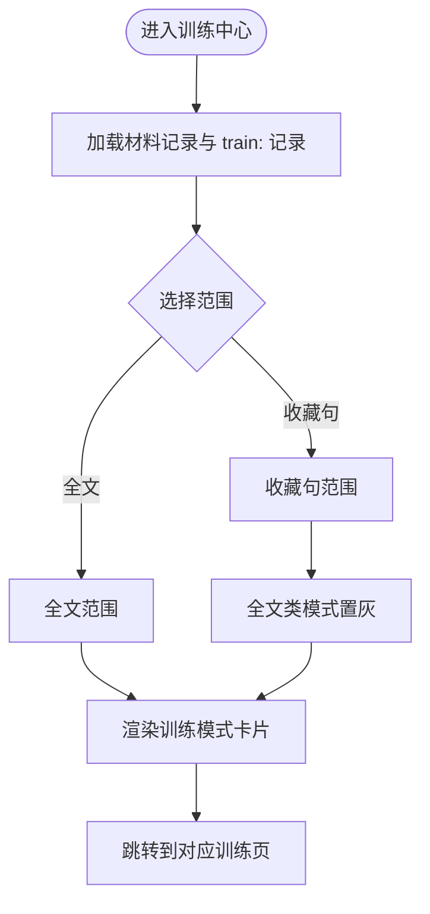

**图表来源**
- [training-center.tsx:45-66](file://client/components/pages/training-center.tsx#L45-L66)
- [training-center.tsx:71-127](file://client/components/pages/training-center.tsx#L71-L127)

**章节来源**
- [training-center.tsx:31-135](file://client/components/pages/training-center.tsx#L31-L135)

### Puzzle（九宫格练习）
- 功能特性
  - 按语序点击词块拼出句子。
  - 每句最多 3 次提示，每次扣 2 分。
  - 每句最多 2 次提交机会。
  - 完成后结算得分并写 train: 记录。
- 用户交互流程
  - 材料就绪后 createSession('puzzle', sentences, scope)。
  - 收集干扰词，初始化九宫格状态。
  - 点击格子：正确推进 cursor 并补词；错误抖动反馈。
  - 全对自动提交；尝试次数用尽则按准确率提交。
  - 下一句或查看小结。
- 状态管理
  - session、gridState、selected、resolved、shakeIndex、hintText、plays、mediaUrl。
- 数据流
  - getMediaBlob 获取媒体。
  - gridScore 计算得分。
  - recordsStore.put 写入训练记录。
- 生命周期与错误处理
  - 无媒体时播放按钮置灰。
  - 存储失败不影响训练流程。

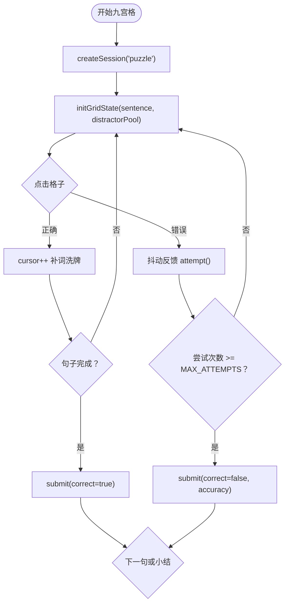

**图表来源**
- [puzzle.tsx:47-99](file://client/components/pages/puzzle.tsx#L47-L99)
- [puzzle.tsx:134-171](file://client/components/pages/puzzle.tsx#L134-L171)
- [puzzle.ts:168-284](file://client/core/training/puzzle.ts#L168-L284)

**章节来源**
- [puzzle.tsx:31-293](file://client/components/pages/puzzle.tsx#L31-L293)
- [puzzle.ts:1-284](file://client/core/training/puzzle.ts#L1-L284)

### Dictation（单句听写）
- 功能特性
  - 听音写句，核对答案后逐词 diff 着色。
  - 正确率统计，薄弱句重练。
  - 首次核对该句写 train: 记录。
- 用户交互流程
  - 材料就绪后 createSession('dictation', sentences, scope)。
  - 播放当前句段，输入文本，点击核对。
  - diffWords 生成 tokens，sentenceAccuracy 计算正确率。
  - 下一句或查看小结。
- 状态管理
  - session、value、tokens、plays、mediaUrl。
- 数据流
  - getMediaBlob 获取媒体。
  - diffWords/sentenceAccuracy 计算差异与正确率。
  - recordsStore.put 写入训练记录。
- 生命周期与错误处理
  - 无媒体时播放按钮置灰。
  - 存储失败不影响训练。

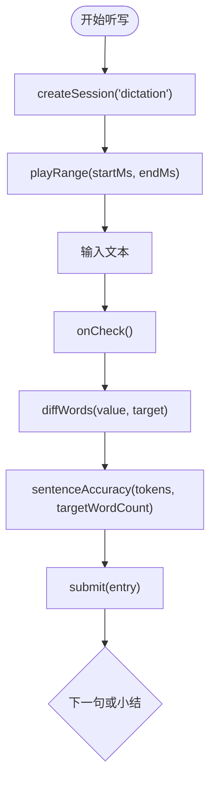

**图表来源**
- [dictation.tsx:41-81](file://client/components/pages/dictation.tsx#L41-L81)
- [dictation.tsx:91-117](file://client/components/pages/dictation.tsx#L91-L117)
- [dictation-diff.ts:51-109](file://client/core/training/dictation-diff.ts#L51-L109)

**章节来源**
- [dictation.tsx:28-147](file://client/components/pages/dictation.tsx#L28-L147)
- [dictation-diff.ts:1-109](file://client/core/training/dictation-diff.ts#L1-L109)

### ReadAloud（跟读评分）
- 功能特性
  - 听原音 → 录音 → SOE 评分 → 小结。
  - 波形振幅条、录音时长、权限引导浮层。
  - 评分后回听录音，薄弱句统计。
- 用户交互流程
  - 材料就绪后按 scope 过滤句子。
  - 播放原音，点击录音，到达 60s 上限自动停止。
  - 调用 SOE evaluate，展示 ScorePanel。
  - 首评写 train: 记录，下一句或查看小结。
- 状态管理
  - cursor、phase、result、elapsed、level、permDenied、permMessage、error、done、mediaUrl、totals。
- 数据流
  - getMediaBlob 获取媒体。
  - createRecorder 录音，getSoeService 评分。
  - recordsStore.put 写入训练记录。
- 生命周期与错误处理
  - 录音权限异常捕获，展示 MicPermissionOverlay。
  - 评分中止（ABORTED）静默处理。

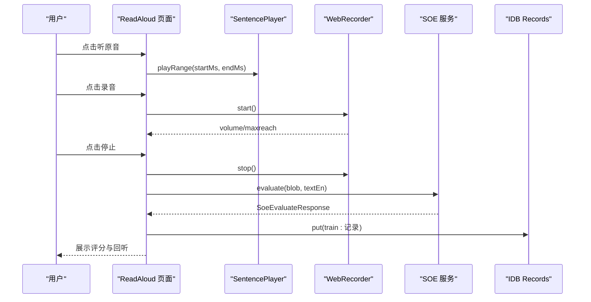

**图表来源**
- [read-aloud.tsx:138-197](file://client/components/pages/training/read-aloud.tsx#L138-L197)
- [read-aloud.tsx:210-275](file://client/components/pages/training/read-aloud.tsx#L210-L275)

**章节来源**
- [read-aloud.tsx:57-280](file://client/components/pages/training/read-aloud.tsx#L57-L280)

### Recitation（全文背诵）
- 功能特性
  - 凭记忆背诵全文录音，转写后与原文对比。
  - 提示模式三态：显示中文、仅首词、无提示。
  - 录音上限 60s 自动收尾，转写失败可重试。
- 用户交互流程
  - 选择提示模式，开始录音。
  - 到达上限或手动完成，进入转写。
  - 结果页展示录音回放、转写文本、diff 对比。
  - 可重新背诵或返回训练中心。
- 状态管理
  - phase、hintMode、elapsed、level、transcript、permDenied、permMessage、error。
- 数据流
  - createRecorder 录音，transcribeRecording 转写。
  - diffWords 对比 transcript 与 fullEn。
- 生命周期与错误处理
  - 录音权限异常捕获，展示 MicPermissionOverlay。
  - 转写失败进入结果页（可重试），不向上抛。

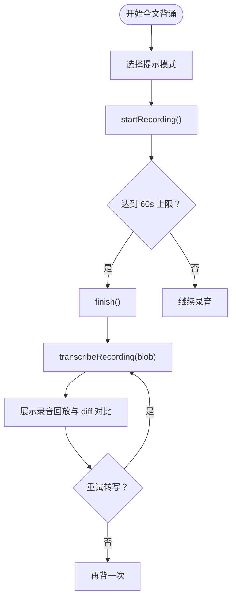

**图表来源**
- [recitation.tsx:118-174](file://client/components/pages/training/recitation.tsx#L118-L174)
- [recitation.tsx:193-285](file://client/components/pages/training/recitation.tsx#L193-L285)

**章节来源**
- [recitation.tsx:65-285](file://client/components/pages/training/recitation.tsx#L65-L285)

## 页面导航与参数传递
- 路由定义
  - `/` → Library
  - `/player/:materialId` → Player
  - `/training/:materialId` → TrainingCenter
  - `/training/puzzle` → Puzzle
  - `/training/dictation` → Dictation
  - `/training/read-aloud` → ReadAloud
  - `/training/shadowing` → Shadowing
  - `/training/recitation` → Recitation
- 参数传递
  - Player 通过 useParams 获取 materialId。
  - TrainingCenter 通过 useParams 获取 materialId，并写入 prefs:training-material。
  - Puzzle/Dictation/ReadAloud/Recitation 通过 useTrainingMaterial 共享当前材料与范围。
- 状态共享
  - 训练范围通过 pref-keys 的 getTrainingScope/setTrainingScope 共享。
  - 收藏句数量与 lastByMode 在 TrainingCenter 中读取 train: 记录与 fav:* 前缀。

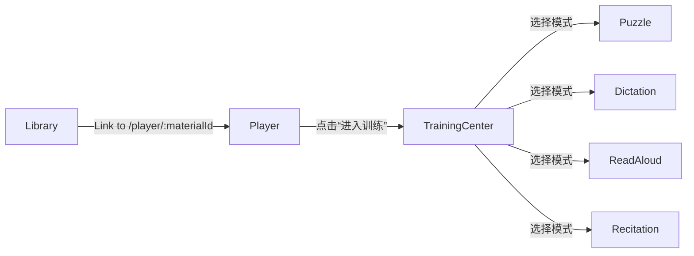

**图表来源**
- [study-app.tsx:41-61](file://client/components/study-app.tsx#L41-L61)
- [player.tsx:521-531](file://client/components/pages/player.tsx#L521-L531)
- [training-center.tsx:31-43](file://client/components/pages/training-center.tsx#L31-L43)

**章节来源**
- [study-app.tsx:41-61](file://client/components/study-app.tsx#L41-L61)
- [player.tsx:79-83](file://client/components/pages/player.tsx#L79-L83)
- [training-center.tsx:31-43](file://client/components/pages/training-center.tsx#L31-L43)

## 状态管理与数据流
- 材料库
  - 使用 useStore(materialStore) 订阅 ready、records、collections。
  - 新建/删除/移动操作调用 material-store 方法。
- 精听播放器
  - 本地 state 管理播放态、字幕态、收藏态、笔记态。
  - ref 管理播放器实例、进度增量、待落盘笔记。
  - 节流机制：时间戳节流 setCurrentMs，5s 节流 flushProgress。
- 训练中心
  - 读取 train: 记录与 fav:* 前缀，计算 lastByMode 与 favCount。
  - 写入 prefs:training-material 与 trainingScope。
- 训练页面
  - 使用 useTrainingMaterial 获取 record、loading、scope。
  - 通过 session.ts 的纯函数状态机管理题目队列与游标。
  - 通过 recordsStore.put 写入 train: 记录。

**章节来源**
- [library.tsx:14-56](file://client/components/pages/library.tsx#L14-L56)
- [player.tsx:79-126](file://client/components/pages/player.tsx#L79-L126)
- [training-center.tsx:31-66](file://client/components/pages/training-center.tsx#L31-L66)
- [session.ts:44-119](file://client/core/training/session.ts#L44-L119)

## 训练会话与算法模型
- SessionState
  - 包含 mode、queue、cursor、status、results、hintCount、attemptCount、startedAt。
  - 提供 createSession、submit、attempt、hint、next、skip、retryAt、makeRecordId。
- Puzzle 算法
  - splitTargets：按标点并块或每 3 词一块。
  - buildTiles：拆词+洗牌。
  - checkAnswer：逐位对比目标序列。
  - initGridState/selectGridWord：九宫格滑窗状态管理。
  - gridScore：每句基础 10 分，每次提示 -2。
- Dictation Diff
  - normalize/toWords：归一化与分词。
  - diffWords：LCS diff，输出 correct/wrong/missing/extra。
  - sentenceAccuracy：正确率计算。

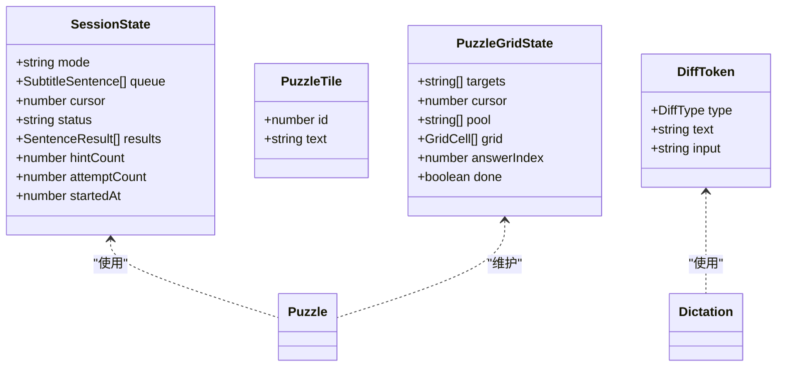

**图表来源**
- [session.ts:18-32](file://client/core/training/session.ts#L18-L32)
- [puzzle.ts:13-22](file://client/core/training/puzzle.ts#L13-L22)
- [puzzle.ts:106-123](file://client/core/training/puzzle.ts#L106-L123)
- [dictation-diff.ts:9-18](file://client/core/training/dictation-diff.ts#L9-L18)

**章节来源**
- [session.ts:1-119](file://client/core/training/session.ts#L1-L119)
- [puzzle.ts:1-284](file://client/core/training/puzzle.ts#L1-L284)
- [dictation-diff.ts:1-109](file://client/core/training/dictation-diff.ts#L1-L109)

## 性能优化策略
- 精听播放器
  - 时间戳节流：每 100ms 最多更新一次 currentMs，减少 React 重新渲染频率。
  - 进度节流：5s 合并 playedSentenceIndexes 后一次性落盘。
  - ObjectURL 生命周期管理：进入页面创建，卸载时 revoke。
- 训练页面
  - 媒体 Blob → ObjectURL 仅在 effect 内创建与销毁。
  - 录音器生命周期：挂载创建，卸载 destroy，避免内存泄漏。
- 通用
  - 使用 useMemo/useCallback 优化计算与回调。
  - 避免不必要的 re-render：如 noteMap 局部更新、pendingNotesRef 防抖落盘。

**章节来源**
- [player.tsx:209-225](file://client/components/pages/player.tsx#L209-L225)
- [player.tsx:254-271](file://client/components/pages/player.tsx#L254-L271)
- [puzzle.tsx:53-64](file://client/components/pages/puzzle.tsx#L53-L64)
- [read-aloud.tsx:116-131](file://client/components/pages/training/read-aloud.tsx#L116-L131)
- [recitation.tsx:96-111](file://client/components/pages/training/recitation.tsx#L96-L111)

## 错误处理模式
- 材料库
  - 删除失败静默忽略，避免阻断主流程。
- 精听播放器
  - 解析失败静默处理，不影响主流程。
  - 收藏夹跳转 ?s=N 定位失败时保持静态展示。
- 训练页面
  - 录音权限异常捕获，展示 MicPermissionOverlay。
  - 评分中止（ABORTED）静默处理。
  - 转写失败进入结果页（可重试），不向上抛。
- 通用
  - 存储失败不影响训练流程，静默 catch。

**章节来源**
- [library.tsx:28-31](file://client/components/pages/library.tsx#L28-L31)
- [player.tsx:391-398](file://client/components/pages/player.tsx#L391-L398)
- [read-aloud.tsx:144-155](file://client/components/pages/training/read-aloud.tsx#L144-L155)
- [read-aloud.tsx:192-196](file://client/components/pages/training/read-aloud.tsx#L192-L196)
- [recitation.tsx:137-151](file://client/components/pages/training/recitation.tsx#L137-L151)

## 使用示例与最佳实践
- 材料库
  - 新建材料集前进行名称去重校验。
  - 删除材料前二次确认，避免误删。
- 精听播放器
  - 使用 KeyboardEvent 监听空格/方向键，提升键盘体验。
  - 使用 useRef 管理播放器实例，避免重复创建。
  - 使用 useCallback 包裹回调，避免不必要的 re-render。
- 训练页面
  - 使用 useTrainingMaterial 共享材料与范围，避免重复加载。
  - 使用 session.ts 的纯函数状态机，确保状态迁移可预测。
  - 使用 recordsStore.put 写入训练记录，失败静默处理。
- 通用
  - 使用 ObjectURL 管理媒体资源，注意生命周期。
  - 使用 AbortController 中止网络请求，避免内存泄漏。

**章节来源**
- [library.tsx:40-49](file://client/components/pages/library.tsx#L40-L49)
- [player.tsx:273-305](file://client/components/pages/player.tsx#L273-L305)
- [puzzle.tsx:47-51](file://client/components/pages/puzzle.tsx#L47-L51)
- [dictation.tsx:41-46](file://client/components/pages/dictation.tsx#L41-L46)

## 结论
本文系统梳理了精听英语助手的前端页面组件，从架构设计、组件职责、用户交互、状态管理、数据流、导航关系、生命周期、性能优化与错误处理等维度提供了全面的技术文档。通过纯函数状态机与零依赖算法模块，训练页面具备高可测性与可扩展性；播放器与录音器通过平台层抽象，实现了跨媒体的统一交互。建议在实际使用中遵循本文的最佳实践，确保代码的可维护性与用户体验的一致性。