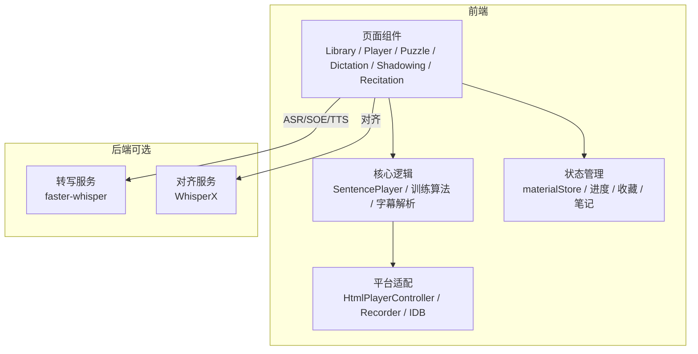
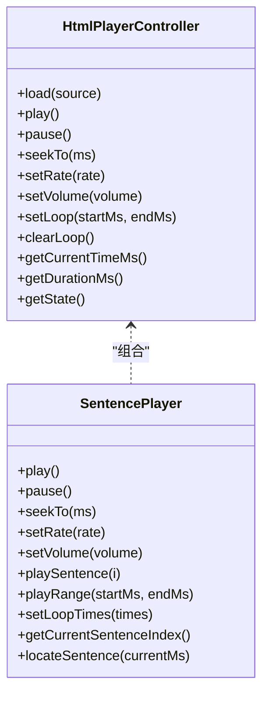
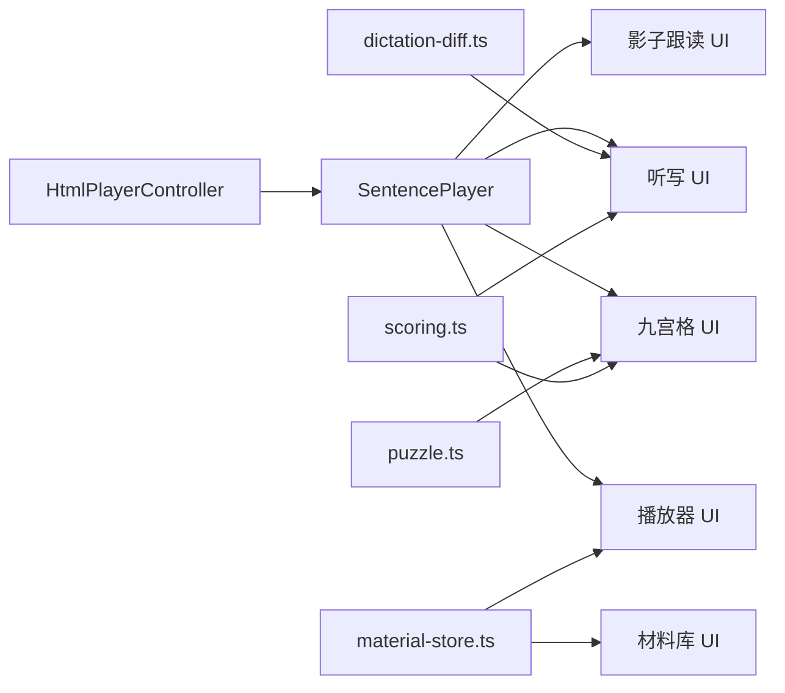

# 功能指南

<cite>
**本文引用的文件**   
- [README.md](file://client/README.md)
- [library.tsx](file://client/components/pages/library.tsx)
- [player.tsx](file://client/components/pages/player.tsx)
- [puzzle.tsx](file://client/components/pages/puzzle.tsx)
- [dictation.tsx](file://client/components/pages/dictation.tsx)
- [shadowing.tsx](file://client/components/pages/training/shadowing.tsx)
- [recitation.tsx](file://client/components/pages/training/recitation.tsx)
- [puzzle.ts](file://client/core/training/puzzle.ts)
- [dictation-diff.ts](file://client/core/training/dictation-diff.ts)
- [scoring.ts](file://client/core/training/scoring.ts)
- [sentence-player.ts](file://client/core/player/sentence-player.ts)
- [html-player.ts](file://client/platform/html-player.ts)
- [material-store.ts](file://client/stores/material-store.ts)
</cite>

## 目录
1. [引言](#引言)
2. [项目结构](#项目结构)
3. [核心组件](#核心组件)
4. [架构总览](#架构总览)
5. [详细功能指南](#详细功能指南)
6. [依赖关系分析](#依赖关系分析)
7. [性能与体验优化](#性能与体验优化)
8. [常见问题排查](#常见问题排查)
9. [结论](#结论)

## 引言
本指南面向所有用户，覆盖材料库浏览、搜索与分组管理；精听播放器逐句播放、A-B 循环、倍速控制与字幕同步；九宫格选词拼句逻辑与难度调节；单句听写模式与评分算法；影子跟读实时录音与转写对比；全文背诵提示模式与转写对比。每个功能均提供界面说明、操作步骤、配置选项与常见问题解答，并给出实际使用场景与最佳实践建议，帮助你高效提升英语听力、口语与记忆能力。

## 项目结构
应用采用“本地优先”的 SPA 架构：Next.js 仅作为壳，业务页面全部在客户端渲染；数据存储在浏览器 IndexedDB；AI 服务通过接口抽象，默认使用 Mock 实现，便于离线可用。

图表来源
- [README.md:126-152](file://client/README.md#L126-L152)
- [README.md:167-184](file://client/README.md#L167-L184)

章节来源
- [README.md:1-96](file://client/README.md#L1-L96)
- [README.md:126-184](file://client/README.md#L126-L184)

## 核心组件
- 材料库与分组：支持搜索、新建材料集、移动材料到集合、删除材料与级联清理。
- 精听播放器：逐句播放、A-B 循环、倍速切换、音量控制、字幕双语/原文/译文模式、收藏与句子笔记、导入/导出字幕、整篇翻译。
- 九宫格练习：按语序点击正确词，干扰词来自其他句子，支持提示与提交次数限制，自动计分。
- 单句听写：输入文本后与原文进行 LCS diff，显示错词/漏词/多词，计算句级正确率。
- 影子跟读：边播边录，暂停/继续同步，结束后转写并与原文逐词对比。
- 全文背诵：三态提示（中文/首词/无提示），录音上限 60s，结束后转写并与原文对比。

章节来源
- [library.tsx:14-56](file://client/components/pages/library.tsx#L14-L56)
- [player.tsx:79-126](file://client/components/pages/player.tsx#L79-L126)
- [puzzle.tsx:31-49](file://client/components/pages/puzzle.tsx#L31-L49)
- [dictation.tsx:28-46](file://client/components/pages/dictation.tsx#L28-L46)
- [shadowing.tsx:77-108](file://client/components/pages/training/shadowing.tsx#L77-L108)
- [recitation.tsx:65-94](file://client/components/pages/training/recitation.tsx#L65-L94)

## 架构总览
播放器链路：HtmlPlayerController 封装原生媒体元素，SentencePlayer 在其之上提供句级控制、A-B 循环、区间播放等能力；训练页复用 SentencePlayer 播放当前句段。

图表来源
- [html-player.ts:24-137](file://client/platform/html-player.ts#L24-L137)
- [sentence-player.ts:35-159](file://client/core/player/sentence-player.ts#L35-L159)

章节来源
- [html-player.ts:1-272](file://client/platform/html-player.ts#L1-L272)
- [sentence-player.ts:1-219](file://client/core/player/sentence-player.ts#L1-L219)

## 详细功能指南

### 材料库：浏览、搜索与分组管理
- 界面说明
  - 顶部快捷入口：Text-to-Speech、Speech-to-Text、导入材料。
  - 搜索框：支持按材料名称与材料集名称模糊匹配。
  - 材料集卡片：展示集合名、成员数量、最近使用标签。
  - 未分组区：归属无效或旧集合的材料归入未分组。
  - 新建材料集弹窗：校验非空与重名。
- 操作步骤
  1. 打开材料库，查看“材料集”和“未分组”。
  2. 在搜索框输入关键词，快速定位材料或集合。
  3. 点击“新建材料集”，输入名称并确认创建。
  4. 对单个材料点击“移动”，选择目标集合或移出到未分组。
  5. 长按或点击删除按钮可删除材料（会同时清理媒体与相关记录）。
- 配置选项
  - 排序：默认按“最近学习”排序（lastOpenedAt 降序）。
  - 分组：collectionId 为空或无效时视为未分组。
- 常见问题
  - 搜索不到材料：检查是否包含空格或大小写差异；确认材料已导入成功。
  - 删除后仍显示：刷新页面或重新进入材料库以触发列表刷新。
  - 无法新建集合：名称为空或与现有集合重名。

章节来源
- [library.tsx:14-56](file://client/components/pages/library.tsx#L14-L56)
- [library.tsx:67-118](file://client/components/pages/library.tsx#L67-L118)
- [library.tsx:119-137](file://client/components/pages/library.tsx#L119-L137)
- [material-store.ts:32-52](file://client/stores/material-store.ts#L32-L52)
- [material-store.ts:107-163](file://client/stores/material-store.ts#L107-L163)

### 精听播放器：逐句播放、A-B 循环、倍速与字幕同步
- 界面说明
  - 视频/音频区域：非视频内容自动轮播背景图；鼠标移入显示控制栏。
  - 控制栏：播放/暂停、上一句/下一句、A-B 循环开关与次数、倍速切换、音量、进度条。
  - 当前句卡片：复制原文/译文、记笔记、收藏。
  - 字幕列表：支持双语/英文/中文模式、导入字幕、AI 转字幕、编辑纠错、整篇翻译、导出 SRT。
- 操作步骤
  1. 从材料库进入播放器，点击播放或选择某一句开始。
  2. 使用键盘快捷键：空格播放/暂停，←/→ 上/下一句。
  3. 点击倍速按钮在 0.75×/1×/1.25× 之间切换。
  4. 设置 A-B 循环：关闭/1次/3次/无限循环。
  5. 在字幕列表中点击任意句跳转；开启收藏或为当前句记笔记。
  6. 导入/生成字幕后，自动更新引擎并启用双语模式。
- 配置选项
  - 默认倍速与循环次数：从设置读取，首次装配时应用。
  - 字幕模式：bilingual/english/chinese。
  - 进度持久化：每 5 秒合并写入 playedSentenceIndexes 与 lastPositionMs。
- 常见问题
  - 视频卡顿或返回按钮无响应：进度状态更新节流至 100ms，避免频繁渲染阻塞主线程。
  - 字幕不跟随：确保字幕数据已解析并同步到 SentencePlayer。
  - 收藏夹跳转无效：URL 参数 ?s=N 仅在加载完成后 seek 到目标句。

章节来源
- [player.tsx:79-126](file://client/components/pages/player.tsx#L79-L126)
- [player.tsx:177-245](file://client/components/pages/player.tsx#L177-L245)
- [player.tsx:273-305](file://client/components/pages/player.tsx#L273-L305)
- [player.tsx:348-360](file://client/components/pages/player.tsx#L348-L360)
- [player.tsx:370-492](file://client/components/pages/player.tsx#L370-L492)
- [sentence-player.ts:114-159](file://client/core/player/sentence-player.ts#L114-L159)
- [html-player.ts:103-137](file://client/platform/html-player.ts#L103-L137)

### 九宫格练习：选词拼句逻辑与难度调节
- 界面说明
  - 播放句子按钮：播放当前句段，计数播放次数。
  - 已选词区：按语序展示已选词。
  - 九宫格 3×3：点击正确词推进 cursor，错误抖动反馈。
  - 提示按钮：高亮答案词（同词多格时一并高亮），每次扣 2 分，每句最多 3 次。
  - 完成小结：正确率、用时、得分、最弱句 TOP。
- 操作步骤
  1. 进入九宫格训练，点击“播放句子”听音。
  2. 按语序点击九宫格中的正确词，选对则该词消失并补新词。
  3. 选错将抖动并消耗一次机会；达到最大尝试次数自动提交。
  4. 需要帮助时点击“提示”，高亮下一个应选词。
  5. 完成一轮后查看小结，可选择“下一句”或“再来一轮”。
- 难度调节
  - 长句自动并块：词数 >15 时按标点切分为短语块，保证单屏可操作。
  - 干扰词池：从其他句子抽取词填充九宫格，增加辨识难度。
  - 提示与提交次数限制：控制策略性使用提示与重试。
- 评分算法
  - 每句基础 10 分，每次提示 -2 分，下限 0。
  - 会话得分 = gridScore(正确句数, 提示次数)。
- 常见问题
  - 重复词判定：区分大小写，“You”与“you”不同；同一句内重复词任意格均可。
  - 无法播放句段：演示材料无音频，需导入真实材料。

章节来源
- [puzzle.tsx:31-49](file://client/components/pages/puzzle.tsx#L31-L49)
- [puzzle.tsx:84-99](file://client/components/pages/puzzle.tsx#L84-L99)
- [puzzle.tsx:134-190](file://client/components/pages/puzzle.tsx#L134-L190)
- [puzzle.tsx:205-289](file://client/components/pages/puzzle.tsx#L205-L289)
- [puzzle.ts:32-52](file://client/core/training/puzzle.ts#L32-L52)
- [puzzle.ts:128-140](file://client/core/training/puzzle.ts#L128-L140)
- [puzzle.ts:168-213](file://client/core/training/puzzle.ts#L168-L213)
- [puzzle.ts:222-269](file://client/core/training/puzzle.ts#L222-L269)
- [puzzle.ts:281-283](file://client/core/training/puzzle.ts#L281-L283)

### 单句听写：输入、核对与评分算法
- 界面说明
  - 播放句子按钮：播放当前句段，计数播放次数。
  - 输入框：输入听到的句子。
  - 核对结果：diff 着色（正确不变色、错词红删附正确词、漏词绿插、多词灰）。
  - 小结：平均正确率、总播放次数、最弱句 TOP（可点击重练）。
- 操作步骤
  1. 点击“播放句子”多次聆听。
  2. 在输入框写下完整句子。
  3. 点击“核对答案”，查看 diff 与句级正确率。
  4. 如需重听或跳过，使用相应按钮；完成一轮后查看小结。
- 评分算法
  - 归一化：小写、去标点、压缩空格。
  - LCS diff：输出 correct/wrong/missing/extra 四类标记。
  - 句级正确率 = 正确词数 / max(目标词数, 输入词数)，防止只按目标词数导致夹带多词也拿满分。
- 常见问题
  - 正确率偏低：注意标点与大小写差异；尽量准确写出完整句子。
  - 无法重听：演示材料无音频，需导入真实材料。

章节来源
- [dictation.tsx:28-46](file://client/components/pages/dictation.tsx#L28-L46)
- [dictation.tsx:83-117](file://client/components/pages/dictation.tsx#L83-L117)
- [dictation.tsx:124-142](file://client/components/pages/dictation.tsx#L124-L142)
- [dictation-diff.ts:20-34](file://client/core/training/dictation-diff.ts#L20-L34)
- [dictation-diff.ts:51-94](file://client/core/training/dictation-diff.ts#L51-L94)
- [dictation-diff.ts:101-108](file://client/core/training/dictation-diff.ts#L101-L108)

### 影子跟读：实时录音、暂停同步与转写对比
- 界面说明
  - 引导页：材料信息、建议佩戴耳机、原音连播说明。
  - 录音中：播放进度条、录音计时器、原文高亮滚动居中、暂停/继续/结束按钮。
  - 转写中：加载动画。
  - 结果页：录音回放、转写文本、与原文逐词对比、重试转写。
- 操作步骤
  1. 点击“开始跟读”，允许麦克风权限。
  2. 原音全文连播，对照下方原文同步跟读。
  3. 可随时暂停/继续（播放与录音同步暂停，暂停段静音保留）。
  4. 自然结束后延迟 2s 自动收尾；或手动点击“结束跟读”。
  5. 查看转写结果与对比，必要时“重新转写”。
- 配置选项
  - 录音上限：原型阶段 60s。
  - 回声消除：默认开启。
- 常见问题
  - 麦克风权限拒绝：出现权限引导浮层，点击重试。
  - 转写失败：进入结果页仍可回放录音并重试转写。
  - 无原音：演示材料无音频，仅录音，无原音跟播。

章节来源
- [shadowing.tsx:77-108](file://client/components/pages/training/shadowing.tsx#L77-L108)
- [shadowing.tsx:137-174](file://client/components/pages/training/shadowing.tsx#L137-L174)
- [shadowing.tsx:181-266](file://client/components/pages/training/shadowing.tsx#L181-L266)
- [shadowing.tsx:294-387](file://client/components/pages/training/shadowing.tsx#L294-L387)

### 全文背诵：提示模式与转写对比
- 界面说明
  - 提示模式：显示中文/仅首词/无提示（无中文字幕时禁用中文提示）。
  - 录音控件：声波振幅条、录音计时器、完成/放弃按钮。
  - 结果页：录音回放、转写文本、与原文逐词对比。
- 操作步骤
  1. 选择提示模式（中文/首词/无提示）。
  2. 点击“开始录音”，凭记忆背诵全文。
  3. 到达 60s 上限自动收尾；或点击“完成背诵”。
  4. 查看转写结果与对比，必要时“再背一次”。
- 配置选项
  - 提示模式：根据是否有中文字幕动态禁用不可用项。
  - 录音上限：原型阶段 60s。
- 常见问题
  - 中文提示不可选：材料无中文字幕时自动回落到首词提示。
  - 转写失败：进入结果页仍可回放录音并重试转写。

章节来源
- [recitation.tsx:65-94](file://client/components/pages/training/recitation.tsx#L65-L94)
- [recitation.tsx:118-174](file://client/components/pages/training/recitation.tsx#L118-L174)
- [recitation.tsx:198-280](file://client/components/pages/training/recitation.tsx#L198-L280)

## 依赖关系分析
- 播放器依赖链
  - HtmlPlayerController 负责原生媒体控制、seek 校准、rAF 高频采样、A-B 区间循环。
  - SentencePlayer 组合控制器，提供句级 API、A-B 次数循环、区间播放、事件派发。
- 训练模块依赖
  - puzzle.ts：九宫格滑窗算法、干扰词收集、提示与得分。
  - dictation-diff.ts：LCS diff 与句级正确率。
  - scoring.ts：会话汇总（正确率、用时、最弱句 TOP）。
- 存储与状态
  - material-store.ts：材料 CRUD、集合管理、最近学习排序、种子注入。
  - 进度/收藏/笔记：records store 前缀键（progress:/fav:/note:）。

图表来源
- [html-player.ts:24-137](file://client/platform/html-player.ts#L24-L137)
- [sentence-player.ts:35-159](file://client/core/player/sentence-player.ts#L35-L159)
- [puzzle.ts:168-213](file://client/core/training/puzzle.ts#L168-L213)
- [dictation-diff.ts:51-94](file://client/core/training/dictation-diff.ts#L51-L94)
- [scoring.ts:40-50](file://client/core/training/scoring.ts#L40-L50)
- [material-store.ts:32-52](file://client/stores/material-store.ts#L32-L52)

章节来源
- [html-player.ts:1-272](file://client/platform/html-player.ts#L1-L272)
- [sentence-player.ts:1-219](file://client/core/player/sentence-player.ts#L1-L219)
- [puzzle.ts:1-284](file://client/core/training/puzzle.ts#L1-L284)
- [dictation-diff.ts:1-109](file://client/core/training/dictation-diff.ts#L1-L109)
- [scoring.ts:1-58](file://client/core/training/scoring.ts#L1-L58)
- [material-store.ts:1-163](file://client/stores/material-store.ts#L1-L163)

## 性能与体验优化
- 进度更新节流
  - 播放器 timeupdate 回调节流至 100ms，减少 React 重渲染频率，避免视频播放时主线程被 rAF 与状态更新阻塞。
- Seek 落点校准
  - HtmlPlayerController 在 seek 后静默旧进度，等待首个原生 timeupdate 到达实际落点；偏差超过阈值记录漂移量供上层容差修正。
- 高频采样
  - 播放中使用 requestAnimationFrame 高频读取 currentTime，保证进度条与句级定位平滑。
- 字幕同步
  - SentencePlayer 仅在句 index 变化时派发 sentencechange，避免高频 setData/渲染。
- 录音处理
  - 录音器默认开启回声消除；60s 上限自动收尾；转写失败不影响回放可用性。

章节来源
- [player.tsx:209-225](file://client/components/pages/player.tsx#L209-L225)
- [html-player.ts:178-216](file://client/platform/html-player.ts#L178-L216)
- [html-player.ts:223-251](file://client/platform/html-player.ts#L223-L251)
- [sentence-player.ts:199-201](file://client/core/player/sentence-player.ts#L199-L201)
- [shadowing.tsx:181-206](file://client/components/pages/training/shadowing.tsx#L181-L206)

## 常见问题排查
- 材料库
  - 搜索不到材料：检查关键词是否包含空格或大小写差异；确认材料已导入成功。
  - 删除后仍显示：刷新页面或重新进入材料库以触发列表刷新。
  - 无法新建集合：名称为空或与现有集合重名。
- 播放器
  - 视频卡顿或返回按钮无响应：进度状态更新节流至 100ms，避免频繁渲染阻塞主线程。
  - 字幕不跟随：确保字幕数据已解析并同步到 SentencePlayer。
  - 收藏夹跳转无效：URL 参数 ?s=N 仅在加载完成后 seek 到目标句。
- 九宫格
  - 重复词判定：区分大小写，“You”与“you”不同；同一句内重复词任意格均可。
  - 无法播放句段：演示材料无音频，需导入真实材料。
- 听写
  - 正确率偏低：注意标点与大小写差异；尽量准确写出完整句子。
  - 无法重听：演示材料无音频，需导入真实材料。
- 影子跟读
  - 麦克风权限拒绝：出现权限引导浮层，点击重试。
  - 转写失败：进入结果页仍可回放录音并重试转写。
  - 无原音：演示材料无音频，仅录音，无原音跟播。
- 全文背诵
  - 中文提示不可选：材料无中文字幕时自动回落到首词提示。
  - 转写失败：进入结果页仍可回放录音并重试转写。

章节来源
- [library.tsx:67-118](file://client/components/pages/library.tsx#L67-L118)
- [player.tsx:209-225](file://client/components/pages/player.tsx#L209-L225)
- [puzzle.tsx:134-190](file://client/components/pages/puzzle.tsx#L134-L190)
- [dictation.tsx:83-117](file://client/components/pages/dictation.tsx#L83-L117)
- [shadowing.tsx:181-266](file://client/components/pages/training/shadowing.tsx#L181-L266)
- [recitation.tsx:118-174](file://client/components/pages/training/recitation.tsx#L118-L174)

## 结论
本应用围绕“眼耳手嘴脑共用记住 80%”的学习理念，提供材料库管理、精听播放器、九宫格、听写、影子跟读与全文背诵等训练模式。通过本地优先的数据存储、稳定的播放器控制与清晰的训练算法，帮助用户在多感官协同下高效提升英语能力。建议结合各模式的配置选项与最佳实践，循序渐进地安排训练计划，持续积累与复盘。