# 材料管理

<cite>
**本文引用的文件**   
- [client/README.md](file://client/README.md)
- [client/components/pages/library.tsx](file://client/components/pages/library.tsx)
- [client/components/pages/import.tsx](file://client/components/pages/import.tsx)
- [client/components/pages/collection.tsx](file://client/components/pages/collection.tsx)
- [client/components/pages/favorites.tsx](file://client/components/pages/favorites.tsx)
- [client/components/shared/player-parts.tsx](file://client/components/shared/player-parts.tsx)
- [client/stores/material-store.ts](file://client/stores/material-store.ts)
- [client/stores/favorite-store.ts](file://client/stores/favorite-store.ts)
- [client/types/material.ts](file://client/types/material.ts)
- [client/types/progress.ts](file://client/types/progress.ts)
- [client/platform/storage/schema.ts](file://client/platform/storage/schema.ts)
- [client/platform/storage/idb.ts](file://client/platform/storage/idb.ts)
- [client/core/subtitle/index.ts](file://client/core/subtitle/index.ts)
</cite>

## 目录
1. [简介](#简介)
2. [项目结构与入口](#项目结构与入口)
3. [核心概念与数据模型](#核心概念与数据模型)
4. [界面操作指南](#界面操作指南)
5. [导入流程详解](#导入流程详解)
6. [材料集分组管理](#材料集分组管理)
7. [学习进度与收藏系统](#学习进度与收藏系统)
8. [文件格式与兼容性](#文件格式与兼容性)
9. [批量管理与最佳实践](#批量管理与最佳实践)
10. [架构与依赖关系](#架构与依赖关系)
11. [常见问题排查](#常见问题排查)
12. [总结](#总结)

## 简介
本指南面向英语学习者，说明如何使用“材料管理”功能高效组织、导入和学习英语音视频材料。你将学会：
- 在材料库中浏览、搜索、按材料集分组管理材料
- 导入音视频并搭配字幕（SRT/LRC）
- 创建、编辑、删除材料集
- 追踪学习进度，使用句子收藏系统
- 使用批量移动、命名规范、时长对齐等技巧提升效率

该应用采用本地优先设计：所有材料、进度、收藏和训练记录都保存在浏览器 IndexedDB 中，无需后端即可运行。

**章节来源**
- [client/README.md:126-131](file://client/README.md#L126-L131)

## 项目结构与入口
材料管理相关的主要页面位于 `components/pages`，包括材料库、导入页、材料集详情页、收藏页；状态由 `stores` 中的 store 管理；类型定义集中在 `types`；持久化通过 `platform/storage/idb.ts` 实现。

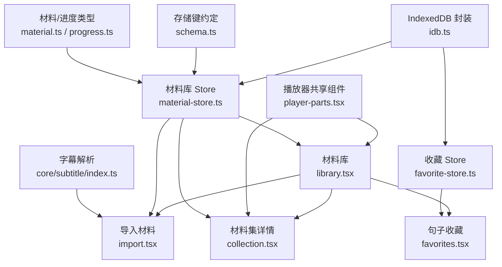

**图表来源**
- [client/components/pages/library.tsx:1-143](file://client/components/pages/library.tsx#L1-L143)
- [client/components/pages/import.tsx:1-374](file://client/components/pages/import.tsx#L1-L374)
- [client/components/pages/collection.tsx:1-117](file://client/components/pages/collection.tsx#L1-L117)
- [client/components/pages/favorites.tsx:1-170](file://client/components/pages/favorites.tsx#L1-L170)
- [client/components/shared/player-parts.tsx:1-234](file://client/components/shared/player-parts.tsx#L1-L234)
- [client/stores/material-store.ts:1-163](file://client/stores/material-store.ts#L1-L163)
- [client/stores/favorite-store.ts:1-42](file://client/stores/favorite-store.ts#L1-L42)
- [client/platform/storage/idb.ts:1-117](file://client/platform/storage/idb.ts#L1-L117)
- [client/platform/storage/schema.ts:1-27](file://client/platform/storage/schema.ts#L1-L27)
- [client/types/material.ts:1-36](file://client/types/material.ts#L1-L36)
- [client/types/progress.ts:1-20](file://client/types/progress.ts#L1-L20)
- [client/core/subtitle/index.ts:1-80](file://client/core/subtitle/index.ts#L1-L80)

**章节来源**
- [client/README.md:21-96](file://client/README.md#L21-L96)
- [client/README.md:167-184](file://client/README.md#L167-L184)

## 核心概念与数据模型
- 学习材料（Material）：包含名称、媒体类型、媒体引用、文件名、大小、字幕信息、时长、创建时间、最近打开时间、所属材料集 ID。
- 材料集（MaterialCollection）：扁平结构，仅保存集合 ID、名称、创建时间；成员关系通过材料的 collectionId 字段关联。
- 材料记录（MaterialRecord）：材料元数据 + 已解析的字幕 JSON，避免每次启动重复解析。
- 学习进度（LearningProgress）：记录最后播放位置、已播放句索引数组、更新时间。
- 收藏（Favorite）：记录某材料某一句的收藏时间与序号。

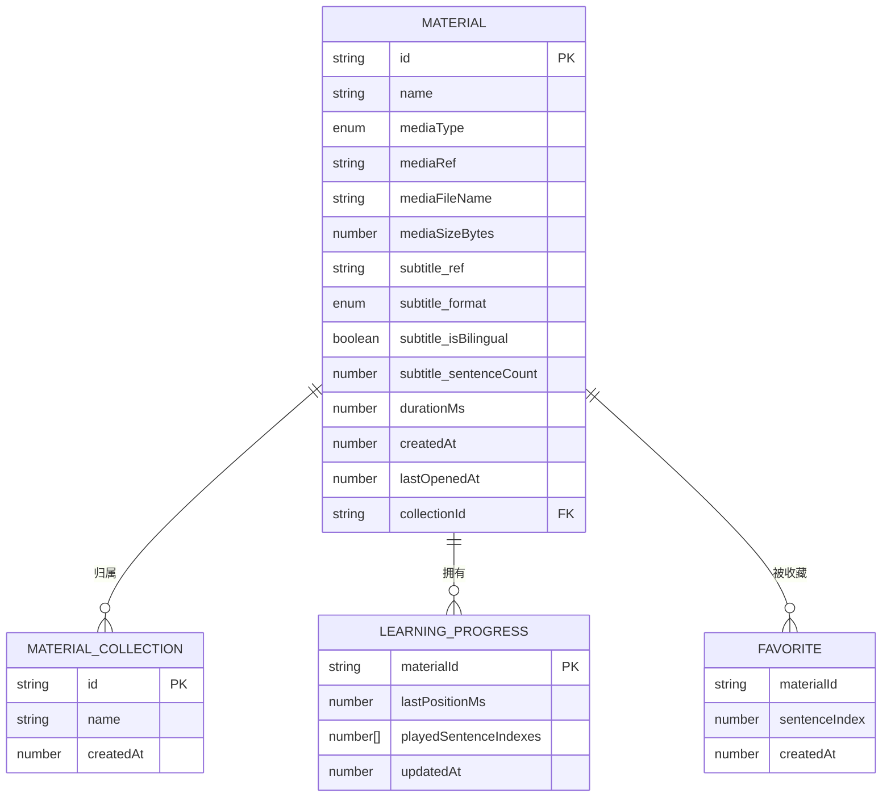

**图表来源**
- [client/types/material.ts:7-28](file://client/types/material.ts#L7-L28)
- [client/types/material.ts:30-35](file://client/types/material.ts#L30-L35)
- [client/platform/storage/schema.ts:9-14](file://client/platform/storage/schema.ts#L9-L14)
- [client/types/progress.ts:6-12](file://client/types/progress.ts#L6-L12)
- [client/types/progress.ts:14-19](file://client/types/progress.ts#L14-L19)

**章节来源**
- [client/types/material.ts:1-36](file://client/types/material.ts#L1-L36)
- [client/platform/storage/schema.ts:1-27](file://client/platform/storage/schema.ts#L1-L27)
- [client/types/progress.ts:1-20](file://client/types/progress.ts#L1-L20)

## 界面操作指南
### 材料库（Library）
- 主要能力：
  - 搜索材料名称与材料集名称
  - 查看“未分组”材料
  - 新建材料集
  - 删除材料（会级联清理媒体、进度、收藏、笔记、训练记录）
  - 移动材料到材料集或移出到未分组
  - 点击卡片进入精听播放器
- 交互要点：
  - 顶部搜索框支持模糊匹配
  - “最近学习”排序：最近打开的材料排在前面
  - 每个材料卡片显示完成百分比、最近学习时间
  - 悬停卡片可显示“移动到材料集”和“删除”按钮

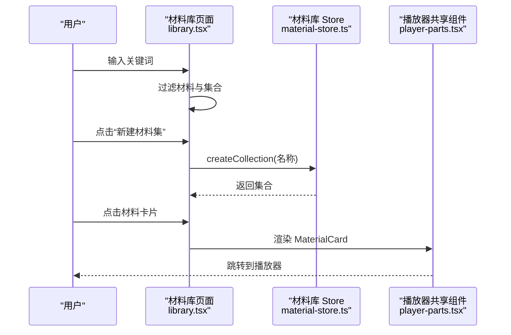

**图表来源**
- [client/components/pages/library.tsx:14-56](file://client/components/pages/library.tsx#L14-L56)
- [client/components/pages/library.tsx:57-143](file://client/components/pages/library.tsx#L57-L143)
- [client/stores/material-store.ts:125-131](file://client/stores/material-store.ts#L125-L131)
- [client/components/shared/player-parts.tsx:49-58](file://client/components/shared/player-parts.tsx#L49-L58)

**章节来源**
- [client/components/pages/library.tsx:1-143](file://client/components/pages/library.tsx#L1-L143)
- [client/components/shared/player-parts.tsx:19-58](file://client/components/shared/player-parts.tsx#L19-L58)

### 导入材料（Import）
- 主要能力：
  - 选择音视频文件
  - 可选导入字幕（SRT/LRC）
  - 自动探测媒体时长
  - 即时校验字幕格式与内容
  - 设置材料名称
  - 选择或新建材料集
  - 一键从 TTS 或转写结果导入
- 关键提示：
  - 若字幕与媒体时长偏差超过 5 秒，会给出警告但不阻断导入
  - 存储空间不足时中止导入并提示释放空间
  - 导入成功后自动跳转到播放器

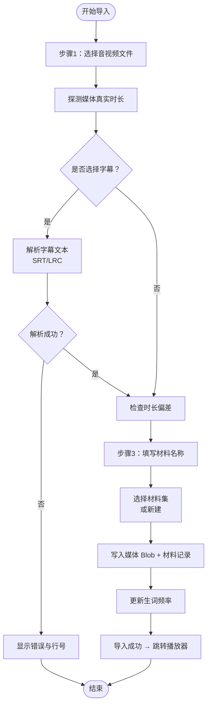

**图表来源**
- [client/components/pages/import.tsx:20-32](file://client/components/pages/import.tsx#L20-L32)
- [client/components/pages/import.tsx:140-160](file://client/components/pages/import.tsx#L140-L160)
- [client/components/pages/import.tsx:218-271](file://client/components/pages/import.tsx#L218-L271)

**章节来源**
- [client/components/pages/import.tsx:1-374](file://client/components/pages/import.tsx#L1-L374)

### 材料集详情（Collection）
- 主要能力：
  - 查看集合内材料列表
  - 添加材料（直接跳转到导入页并预选集合）
  - 重命名集合
  - 删除集合（仅解除归属，材料回到未分组）
  - 移动材料到其他集合或移出到未分组
  - 删除材料（级联清理）

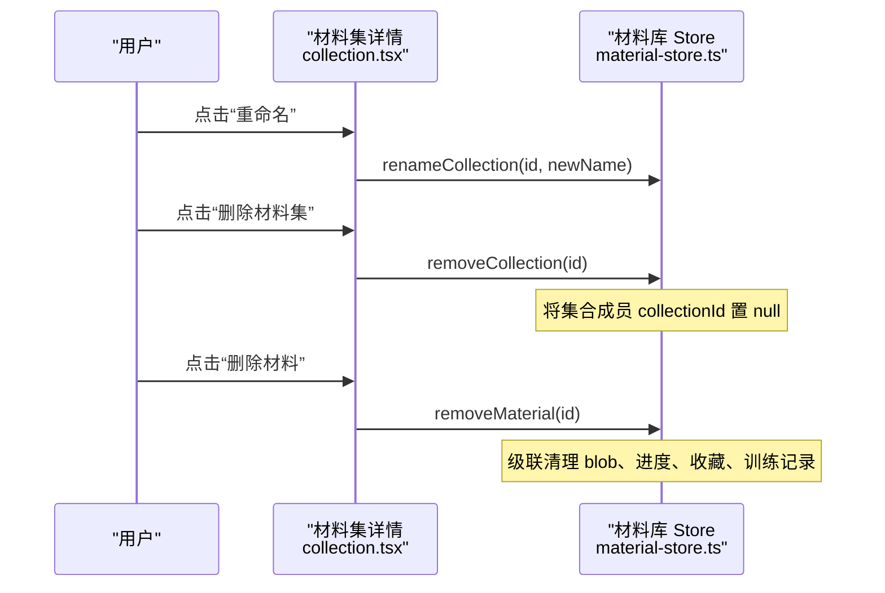

**图表来源**
- [client/components/pages/collection.tsx:42-56](file://client/components/pages/collection.tsx#L42-L56)
- [client/stores/material-store.ts:134-151](file://client/stores/material-store.ts#L134-L151)
- [client/stores/material-store.ts:107-121](file://client/stores/material-store.ts#L107-L121)

**章节来源**
- [client/components/pages/collection.tsx:1-117](file://client/components/pages/collection.tsx#L1-L117)
- [client/stores/material-store.ts:125-162](file://client/stores/material-store.ts#L125-L162)

### 句子收藏（Favorites）
- 主要能力：
  - 汇总跨材料的所有收藏句
  - 按材料分组，组间按最近收藏时间降序
  - 组内按句序号升序
  - 点击句子跳转到播放器对应句
  - 取消收藏后实时更新列表

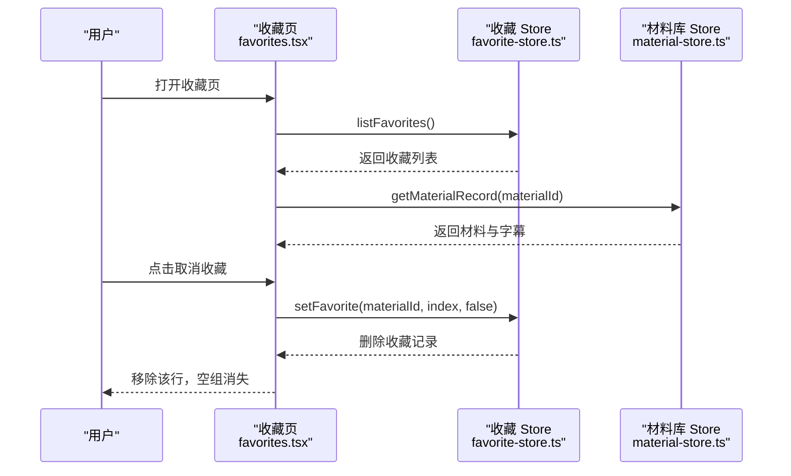

**图表来源**
- [client/components/pages/favorites.tsx:49-70](file://client/components/pages/favorites.tsx#L49-L70)
- [client/stores/favorite-store.ts:19-36](file://client/stores/favorite-store.ts#L19-L36)
- [client/stores/material-store.ts:75-79](file://client/stores/material-store.ts#L75-L79)

**章节来源**
- [client/components/pages/favorites.tsx:1-170](file://client/components/pages/favorites.tsx#L1-L170)
- [client/stores/favorite-store.ts:1-42](file://client/stores/favorite-store.ts#L1-L42)

## 导入流程详解
导入流程分为三个步骤：
1. 选择音视频文件
   - 支持拖拽或点击选择
   - 自动探测媒体真实时长
   - 显示文件大小、类型、时长
2. 选择字幕文件（可选）
   - 支持 SRT 与 LRC
   - 即时解析并显示摘要
   - 解析失败时显示错误消息与行号
   - LRC 末句结束时间根据媒体时长回填
3. 填写材料名称与归属
   - 默认取文件名作为材料名
   - 可选择已有材料集或新建材料集
   - 提交前检查存储空间余量

导入成功后：
- 媒体文件存入 IndexedDB blobs
- 材料记录与解析后的字幕 JSON 存入 materials
- 更新生词频率
- 自动跳转到播放器

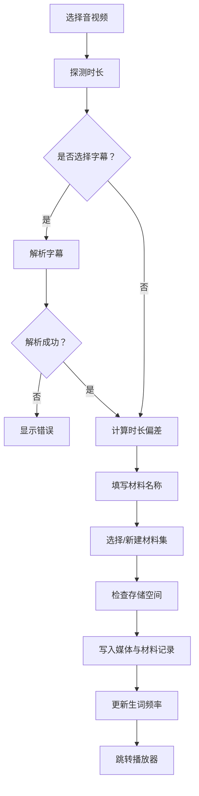

**图表来源**
- [client/components/pages/import.tsx:218-271](file://client/components/pages/import.tsx#L218-L271)
- [client/components/pages/import.tsx:291-364](file://client/components/pages/import.tsx#L291-L364)

**章节来源**
- [client/components/pages/import.tsx:1-374](file://client/components/pages/import.tsx#L1-L374)

## 材料集分组管理
材料集用于对材料进行归类，便于查找与整理。

- 创建材料集：
  - 在材料库点击“新建材料集”，输入名称（去空白、非空、不重名）
  - 可在导入页直接选择或新建材料集
- 编辑材料集：
  - 在材料集详情页点击“重命名”，修改名称（去空白、不重名）
- 删除材料集：
  - 删除集合本身，不会删除材料
  - 集合成员材料回到“未分组”
- 移动材料：
  - 在材料库或材料集详情页点击“移动到材料集”
  - 目标可以是其他集合、未分组，或现场新建集合

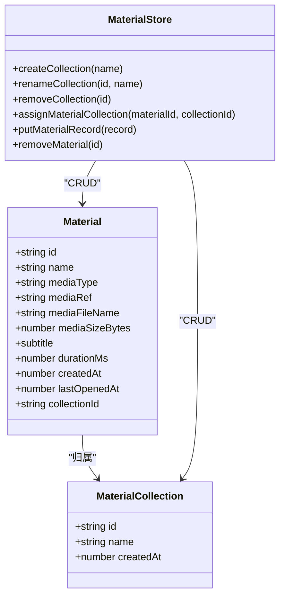

**图表来源**
- [client/types/material.ts:7-28](file://client/types/material.ts#L7-L28)
- [client/types/material.ts:30-35](file://client/types/material.ts#L30-L35)
- [client/stores/material-store.ts:125-162](file://client/stores/material-store.ts#L125-L162)

**章节来源**
- [client/components/pages/library.tsx:32-56](file://client/components/pages/library.tsx#L32-L56)
- [client/components/pages/collection.tsx:35-56](file://client/components/pages/collection.tsx#L35-L56)
- [client/stores/material-store.ts:125-162](file://client/stores/material-store.ts#L125-L162)

## 学习进度与收藏系统
学习进度与收藏系统帮助追踪学习情况并快速定位重点句子。

- 学习进度：
  - 每份材料一条进度记录
  - 记录最后播放位置、已播放句索引数组、更新时间
  - 材料库进度条 = 已播放句数 / 总句数
- 收藏系统：
  - 收藏记录以 `fav:{materialId}:{sentenceIndex}` 形式存储
  - 收藏页按材料分组，组间按收藏时间降序，组内按句序号升序
  - 取消收藏后实时更新列表

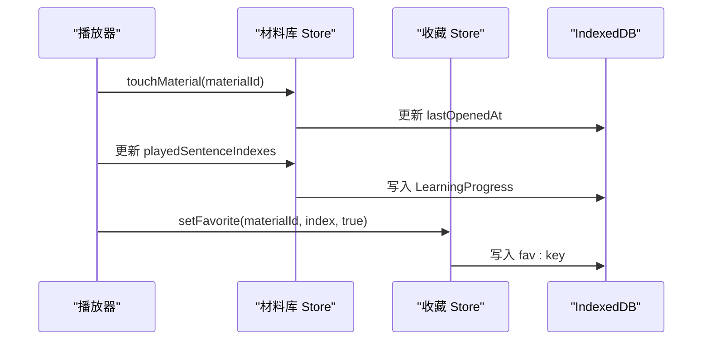

**图表来源**
- [client/stores/material-store.ts:87-94](file://client/stores/material-store.ts#L87-L94)
- [client/stores/material-store.ts:102-105](file://client/stores/material-store.ts#L102-L105)
- [client/stores/favorite-store.ts:26-36](file://client/stores/favorite-store.ts#L26-L36)
- [client/types/progress.ts:6-12](file://client/types/progress.ts#L6-L12)

**章节来源**
- [client/types/progress.ts:1-20](file://client/types/progress.ts#L1-L20)
- [client/stores/favorite-store.ts:1-42](file://client/stores/favorite-store.ts#L1-L42)
- [client/components/shared/player-parts.tsx:38-47](file://client/components/shared/player-parts.tsx#L38-L47)

## 文件格式与兼容性
- 音视频格式：
  - 支持音频与视频文件，常见格式包括 mp3、wav、m4a、mp4、mov 等
  - 导入时会探测媒体真实时长，用于字幕对齐与播放控制
- 字幕格式：
  - 支持 SRT 与 LRC
  - 自动嗅探格式，失败时抛出带行号的错误
  - 双语字幕自动识别，英文单词拆分用于生词频率统计
- 存储兼容：
  - 使用 IndexedDB 持久化，SSR 或隐私模式下自动降级为内存 Map
  - 存储空间不足时导入会被中止并提示

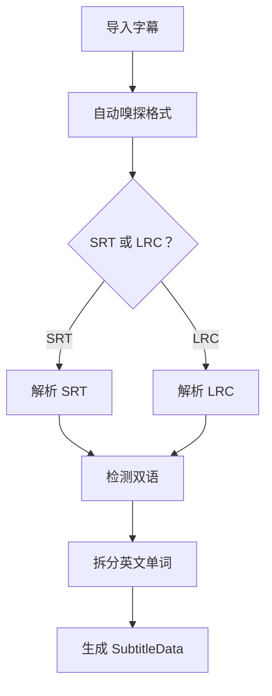

**图表来源**
- [client/core/subtitle/index.ts:22-69](file://client/core/subtitle/index.ts#L22-L69)
- [client/platform/storage/idb.ts:17-49](file://client/platform/storage/idb.ts#L17-L49)

**章节来源**
- [client/components/pages/import.tsx:291-331](file://client/components/pages/import.tsx#L291-L331)
- [client/core/subtitle/index.ts:1-80](file://client/core/subtitle/index.ts#L1-L80)
- [client/platform/storage/idb.ts:1-117](file://client/platform/storage/idb.ts#L1-L117)

## 批量管理与最佳实践
- 批量移动材料：
  - 在材料库“未分组”区域或搜索结果中，点击“移动到材料集”
  - 可将多个材料移动到同一集合，或移出到未分组
- 命名规范：
  - 材料名称建议简洁明确，避免过长（最大 50 字符）
  - 材料集名称建议按主题或来源分类（如“TED 演讲”、“BBC 新闻”）
- 字幕对齐：
  - 若字幕与媒体时长偏差较大，建议重新校对字幕或使用工具修正
  - LRC 字幕末句结束时间依赖媒体时长，确保媒体文件完整
- 收藏与复习：
  - 在播放器中收藏难句，收藏页集中复习
  - 结合训练模式（听写、跟读、背诵）强化记忆
- 存储管理：
  - 定期清理不再使用的材料，释放存储空间
  - 大文件媒体建议压缩后再导入

**章节来源**
- [client/components/shared/player-parts.tsx:63-111](file://client/components/shared/player-parts.tsx#L63-L111)
- [client/components/pages/import.tsx:333-338](file://client/components/pages/import.tsx#L333-L338)
- [client/components/pages/favorites.tsx:120-162](file://client/components/pages/favorites.tsx#L120-L162)

## 架构与依赖关系
材料管理功能涉及页面组件、Store、类型定义、存储层与字幕解析模块。

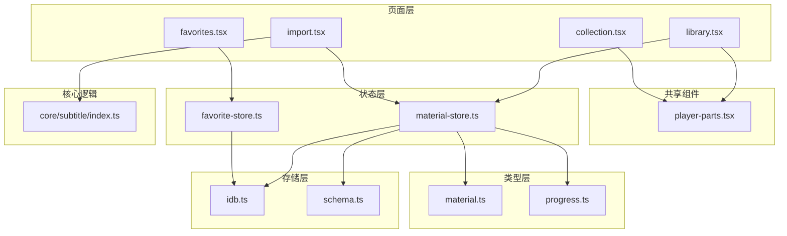

**图表来源**
- [client/components/pages/library.tsx:1-143](file://client/components/pages/library.tsx#L1-L143)
- [client/components/pages/import.tsx:1-374](file://client/components/pages/import.tsx#L1-L374)
- [client/components/pages/collection.tsx:1-117](file://client/components/pages/collection.tsx#L1-L117)
- [client/components/pages/favorites.tsx:1-170](file://client/components/pages/favorites.tsx#L1-L170)
- [client/components/shared/player-parts.tsx:1-234](file://client/components/shared/player-parts.tsx#L1-L234)
- [client/stores/material-store.ts:1-163](file://client/stores/material-store.ts#L1-L163)
- [client/stores/favorite-store.ts:1-42](file://client/stores/favorite-store.ts#L1-L42)
- [client/types/material.ts:1-36](file://client/types/material.ts#L1-L36)
- [client/types/progress.ts:1-20](file://client/types/progress.ts#L1-L20)
- [client/platform/storage/idb.ts:1-117](file://client/platform/storage/idb.ts#L1-L117)
- [client/platform/storage/schema.ts:1-27](file://client/platform/storage/schema.ts#L1-L27)
- [client/core/subtitle/index.ts:1-80](file://client/core/subtitle/index.ts#L1-L80)

**章节来源**
- [client/README.md:126-184](file://client/README.md#L126-L184)

## 常见问题排查
- 导入失败：
  - 检查存储空间是否充足
  - 确认媒体文件可读且格式受支持
  - 查看错误提示，必要时重试
- 字幕解析失败：
  - 确认字幕格式为 SRT 或 LRC
  - 检查字幕内容是否为空或格式不规范
  - 根据错误行号修正字幕
- 收藏不显示：
  - 确认收藏操作成功
  - 检查收藏页是否正确加载
  - 若材料被删除，收藏句可能无法显示原文
- 材料删除后数据丢失：
  - 删除材料会级联清理媒体、进度、收藏、笔记、训练记录
  - 如需保留数据，请先备份或导出

**章节来源**
- [client/components/pages/import.tsx:218-271](file://client/components/pages/import.tsx#L218-L271)
- [client/components/pages/library.tsx:28-31](file://client/components/pages/library.tsx#L28-L31)
- [client/components/pages/favorites.tsx:140-147](file://client/components/pages/favorites.tsx#L140-L147)
- [client/stores/material-store.ts:107-121](file://client/stores/material-store.ts#L107-L121)

## 总结
材料管理功能提供了完整的英语学习材料组织与学习闭环：
- 通过材料库浏览、搜索、分组管理材料
- 通过导入流程支持音视频与字幕（SRT/LRC）
- 通过材料集创建、编辑、删除实现灵活分类
- 通过学习进度与收藏系统追踪学习情况并聚焦重点
- 通过批量移动、命名规范、字幕对齐等技巧提升效率

建议用户按主题或来源建立材料集，定期整理与复习收藏句，并结合训练模式强化学习效果。