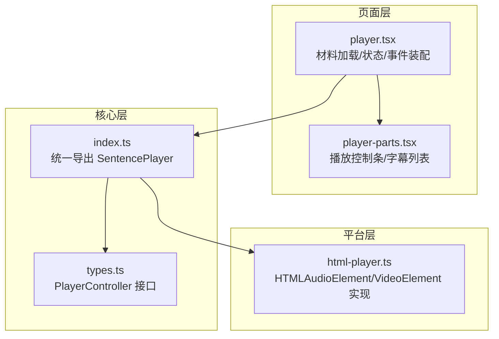
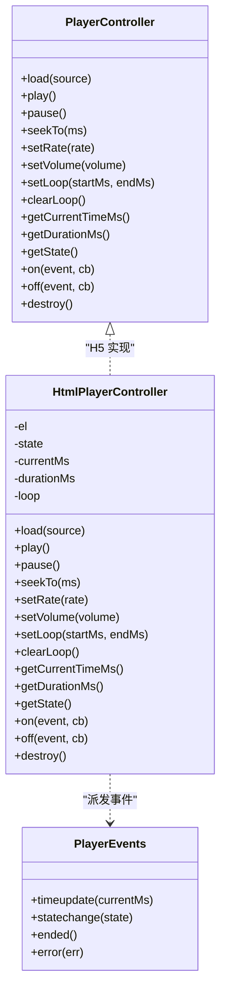
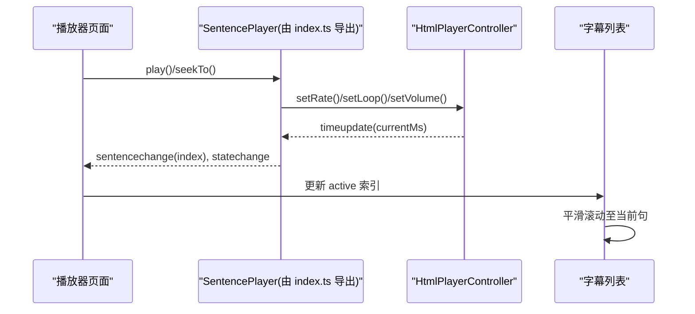

# 精听播放器

<cite>
**本文引用的文件**   
- [player.tsx](file://client/components/pages/player.tsx)
- [player-parts.tsx](file://client/components/shared/player-parts.tsx)
- [html-player.ts](file://client/platform/html-player.ts)
- [types.ts](file://client/core/player/types.ts)
- [index.ts](file://client/core/player/index.ts)
- [pref-keys.ts](file://client/lib/pref-keys.ts)
</cite>

## 目录
1. [简介](#简介)
2. [项目结构](#项目结构)
3. [核心功能总览](#核心功能总览)
4. [架构概览](#架构概览)
5. [详细使用指南](#详细使用指南)
6. [快捷键与交互](#快捷键与交互)
7. [字幕与同步机制](#字幕与同步机制)
8. [音频质量与性能特性](#音频质量与性能特性)
9. [常见问题排查](#常见问题排查)
10. [最佳实践与建议](#最佳实践与建议)
11. [结语](#结语)

## 简介
本指南面向希望系统掌握“精听播放器”的英语学习者。你将了解如何高效使用逐句播放、A-B 循环、倍速控制、字幕同步、收藏与笔记、翻译与纠错等能力，并结合不同训练场景给出操作步骤与技巧建议。文档同时简要说明底层实现要点，帮助你在遇到问题时快速定位原因。

## 项目结构
精听播放器由三层组成：
- 页面层：负责材料加载、UI 渲染、用户交互与状态管理。
- 组件层：提供播放控制条、字幕列表等可复用 UI。
- 核心层与平台层：抽象播放器接口，并在浏览器中用原生媒体元素实现。

图表来源
- [player.tsx:177-245](file://client/components/pages/player.tsx#L177-L245)
- [player-parts.tsx:113-119](file://client/components/shared/player-parts.tsx#L113-L119)
- [types.ts:32-55](file://client/core/player/types.ts#L32-L55)
- [html-player.ts:24-63](file://client/platform/html-player.ts#L24-L63)

章节来源
- [player.tsx:1-126](file://client/components/pages/player.tsx#L1-L126)
- [player-parts.tsx:113-234](file://client/components/shared/player-parts.tsx#L113-L234)
- [types.ts:1-56](file://client/core/player/types.ts#L1-L56)
- [html-player.ts:1-272](file://client/platform/html-player.ts#L1-L272)

## 核心功能总览
- 逐句播放：按句子边界跳转，自动高亮当前句，支持上一句/下一句。
- A-B 循环：对当前句或自定义区间进行重复播放，支持关闭、1 次、3 次、无限循环。
- 倍速控制：在 0.75x / 1x / 1.25x 三档间切换，默认值来自本地设置。
- 字幕同步：双语/仅英文/仅中文模式；字幕随播放滚动并高亮；支持导入、编辑、删除、导出、AI 转写、整篇翻译。
- 收藏与笔记：为单句添加收藏标记；为当前句打开笔记抽屉，自动保存。
- 进度持久化：记录已播放句序号与最后位置，下次进入可恢复。
- 键盘快捷键：空格播放/暂停，左右箭头切句，N 打开笔记。

章节来源
- [player.tsx:29-34](file://client/components/pages/player.tsx#L29-L34)
- [player.tsx:91-125](file://client/components/pages/player.tsx#L91-L125)
- [player.tsx:273-305](file://client/components/pages/player.tsx#L273-L305)
- [player-parts.tsx:113-119](file://client/components/shared/player-parts.tsx#L113-L119)

## 架构概览
播放器采用“控制器 + 引擎”的分层设计：
- PlayerController 接口定义跨平台能力（加载、播放、暂停、seek、倍速、音量、A-B 循环、事件）。
- HtmlPlayerController 在浏览器中以 HTMLAudioElement/HTMLVideoElement 实现，负责 seek 落点校准、rAF 高频进度采样、A-B 循环边界处理。
- 页面层通过统一的 SentencePlayer（由 index.ts 导出）组合控制器与字幕数据，驱动 UI 与业务逻辑。

图表来源
- [types.ts:32-55](file://client/core/player/types.ts#L32-L55)
- [html-player.ts:24-155](file://client/platform/html-player.ts#L24-L155)

章节来源
- [types.ts:1-56](file://client/core/player/types.ts#L1-L56)
- [html-player.ts:1-272](file://client/platform/html-player.ts#L1-L272)
- [index.ts:1-5](file://client/core/player/index.ts#L1-L5)

## 详细使用指南

### 一、逐句播放
- 操作步骤
  - 点击“上一句/下一句”按钮，或按下左右方向键切换句子。
  - 点击字幕列表中任意行，直接跳转到该句首。
  - 播放时，当前句会在字幕区高亮并自动滚动到可视区域。
- 使用场景
  - 初听阶段：逐句理解内容，配合翻译与笔记。
  - 跟读阶段：反复听某一句，模仿语音语调。
- 技巧建议
  - 遇到长难句，先切换到 0.75x 倍速，再逐步回到 1x。
  - 结合“收藏”功能，将难点句集中复习。

章节来源
- [player.tsx:273-294](file://client/components/pages/player.tsx#L273-L294)
- [player-parts.tsx:121-150](file://client/components/shared/player-parts.tsx#L121-L150)

### 二、A-B 循环
- 操作步骤
  - 点击“循环”按钮，依次切换：关闭 → 1 次 → 3 次 → 无限循环。
  - 当处于“无限循环”时，会针对当前句进行循环；切换新句后会自动对新句重新设置循环区间。
- 使用场景
  - 精听薄弱句：反复听直到能完整复述。
  - 连读弱读辨析：锁定关键片段对比发音差异。
- 技巧建议
  - 先用 0.75x 慢速听清细节，再用 1x 正常语速巩固。
  - 若需自定义区间（例如一段对话），可在后续版本关注 A-B 区间选择能力。

章节来源
- [player.tsx:227-232](file://client/components/pages/player.tsx#L227-L232)
- [player-parts.tsx:113-119](file://client/components/shared/player-parts.tsx#L113-L119)
- [html-player.ts:123-129](file://client/platform/html-player.ts#L123-L129)

### 三、倍速控制
- 操作步骤
  - 点击“倍速”按钮，在 0.75x / 1x / 1.25x 之间循环切换。
  - 首次进入播放器时，会从本地设置读取默认倍速。
- 使用场景
  - 听力入门：从慢速开始建立语感。
  - 实战模拟：以 1.25x 提升反应速度。
- 技巧建议
  - 建议固定一个主倍速，避免频繁切换影响节奏。
  - 遇到复杂段落临时降速，理解后再恢复原速。

章节来源
- [player.tsx:29-30](file://client/components/pages/player.tsx#L29-L30)
- [player.tsx:92-94](file://client/components/pages/player.tsx#L92-L94)
- [player.tsx:348-352](file://client/components/pages/player.tsx#L348-L352)
- [pref-keys.ts:8-19](file://client/lib/pref-keys.ts#L8-L19)
- [html-player.ts:115-117](file://client/platform/html-player.ts#L115-L117)

### 四、字幕同步与显示模式
- 操作步骤
  - 点击“字幕”按钮切换模式：双语 / 仅英文 / 仅中文。
  - 播放过程中字幕自动滚动并高亮当前句。
  - 手动滚动字幕列表后，5 秒内不会自动跟随，便于自由浏览。
- 使用场景
  - 双语对照：理解语义与表达。
  - 纯英模式：训练抓取关键词的能力。
  - 纯中模式：复盘翻译准确性。
- 技巧建议
  - 初次学习建议开启双语，熟悉后切换到仅英文。
  - 利用“复制原文/译文”快速收集素材到笔记或 AI 工具。

章节来源
- [player-parts.tsx:113-119](file://client/components/shared/player-parts.tsx#L113-L119)
- [player-parts.tsx:121-150](file://client/components/shared/player-parts.tsx#L121-L150)
- [player.tsx:494-502](file://client/components/pages/player.tsx#L494-L502)

### 五、收藏与笔记
- 操作步骤
  - 点击“收藏”按钮为当前句添加星标。
  - 按下 N 键或点击“记笔记”，打开当前句笔记抽屉；编辑后自动保存。
  - 笔记有图标提示，点击可查看或定位到对应句。
- 使用场景
  - 收藏：构建个人“难点句库”。
  - 笔记：记录语法点、词汇用法、发音要点。
- 技巧建议
  - 笔记尽量简洁，标注关键词和替换表达。
  - 定期回顾收藏句，尝试脱稿复述。

章节来源
- [player.tsx:361-368](file://client/components/pages/player.tsx#L361-L368)
- [player.tsx:296-335](file://client/components/pages/player.tsx#L296-L335)
- [player-parts.tsx:184-228](file://client/components/shared/player-parts.tsx#L184-L228)

### 六、字幕导入、编辑、导出与翻译
- 操作步骤
  - 导入：点击“导入字幕文件”，支持 .srt/.lrc。
  - AI 转写：点击“AI”，上传音频生成 SRT 字幕。
  - 编辑：点击“纠错”修改单句；完成后自动更新双语标记。
  - 删除：点击“删除”移除句子，索引自动重排。
  - 导出：点击“导出字幕”下载 SRT。
  - 翻译：点击“翻译全部字幕”，批量翻译后自动切换双语模式。
- 使用场景
  - 已有字幕：快速校对并导入。
  - 无字幕：AI 转写 + 人工纠错。
  - 教学备课：批量翻译并导出共享。
- 技巧建议
  - 导入后务必检查时间轴与断句是否合理。
  - 翻译前先做基础纠错，提高准确率。

章节来源
- [player.tsx:370-492](file://client/components/pages/player.tsx#L370-L492)
- [player-parts.tsx:154-183](file://client/components/shared/player-parts.tsx#L154-L183)

### 七、播放进度与恢复
- 工作机制
  - 播放过的句子会被增量记录，每隔一段时间合并写入进度。
  - 离开页面或切换材料时，会立即保存当前位置与已播句集合。
  - 再次进入同一材料时，可从上次位置继续学习。
- 使用建议
  - 分段学习：每次专注若干句，结束后自然退出即可保存。
  - 复习优先：根据材料库中的完成百分比安排复习计划。

章节来源
- [player.tsx:218-271](file://client/components/pages/player.tsx#L218-L271)
- [player-parts.tsx:38-47](file://client/components/shared/player-parts.tsx#L38-L47)

## 快捷键与交互
- 空格：播放/暂停
- 左/右方向键：上一句/下一句
- N：打开当前句笔记抽屉
- 注意：当输入框、文本域、下拉框或可编辑区域聚焦时，快捷键不触发，避免干扰输入。

章节来源
- [player.tsx:273-305](file://client/components/pages/player.tsx#L273-L305)

## 字幕与同步机制
- 字幕模式
  - 双语：同时显示英文与中文。
  - 仅英文：隐藏中文，训练抓词能力。
  - 仅中文：隐藏英文，用于复盘翻译。
- 同步行为
  - 播放时根据当前句索引滚动字幕列表，保持当前句居中可见。
  - 用户手动滚动后，5 秒内暂停自动跟随，防止误触打断阅读。
- 数据流
  - 页面层监听播放器事件，更新当前句索引与时间戳。
  - 字幕列表根据 active 索引计算滚动位置。

图表来源
- [player.tsx:196-233](file://client/components/pages/player.tsx#L196-L233)
- [player-parts.tsx:121-150](file://client/components/shared/player-parts.tsx#L121-L150)
- [html-player.ts:163-176](file://client/platform/html-player.ts#L163-L176)

章节来源
- [player.tsx:196-233](file://client/components/pages/player.tsx#L196-L233)
- [player-parts.tsx:121-150](file://client/components/shared/player-parts.tsx#L121-L150)

## 音频质量与性能特性
- 倍速范围
  - 控制器限制在 0.5x ~ 2.0x，界面档位为 0.75x / 1x / 1.25x。
- 进度刷新
  - 原生 timeupdate 频率较低，内部使用 requestAnimationFrame 高频采样，保证进度条与句级定位更平滑。
- seek 落点校准
  - seek 后会等待首个原生 timeupdate 作为实际落点，偏差超过阈值时记录漂移量供上层容差修正。
- 性能优化
  - 页面层对 currentMs 更新做了节流，降低 React 重渲染压力，避免返回按钮无响应等问题。
  - 播放过的句子集合与进度写入做了节流与合并，减少存储压力。

章节来源
- [html-player.ts:115-117](file://client/platform/html-player.ts#L115-L117)
- [html-player.ts:178-251](file://client/platform/html-player.ts#L178-L251)
- [player.tsx:209-225](file://client/components/pages/player.tsx#L209-L225)
- [player.tsx:254-271](file://client/components/pages/player.tsx#L254-L271)

## 常见问题排查
- 无法播放
  - 演示材料无真实音频，需导入真实材料后才能播放。
  - 媒体加载失败会进入错误态，控件可用但播放会报错提示。
- 进度条卡顿或不准确
  - 可能是 seek 落点尚未校准，等待首个 timeupdate 后恢复正常。
  - 视频播放时页面层对 currentMs 更新做了节流，属预期行为。
- 快捷键无效
  - 检查是否聚焦在输入框、文本域、下拉框或可编辑区域。
- 字幕不同步
  - 确认字幕格式正确且时间轴有效；必要时重新导入或 AI 转写。
- 循环不生效
  - 确认已选择循环次数；切换新句后会自动对新句设置循环区间。

章节来源
- [player.tsx:177-179](file://client/components/pages/player.tsx#L177-L179)
- [player.tsx:196-207](file://client/components/pages/player.tsx#L196-L207)
- [player.tsx:273-305](file://client/components/pages/player.tsx#L273-L305)
- [html-player.ts:178-251](file://client/platform/html-player.ts#L178-L251)

## 最佳实践与建议
- 分阶段训练
  - 初听：0.75x + 双语模式，理解大意与细节。
  - 精听：1x + 仅英文，逐句跟读与复述。
  - 提速：1.25x 挑战反应速度与语感。
- 善用工具
  - 收藏难点句，形成个人复习清单。
  - 为每句写简短笔记，标注语法、词汇与发音要点。
  - 使用 AI 转写与整篇翻译，提高效率。
- 习惯养成
  - 固定学习时长与目标句数，循序渐进。
  - 定期回顾收藏与笔记，尝试脱稿复述。

[本节为通用建议，不直接分析具体文件]

## 结语
精听播放器围绕“逐句—循环—倍速—字幕—笔记—翻译”的全链路能力，帮助你系统化地进行英语精听训练。建议从慢速双语起步，逐步过渡到正常语速与纯英模式，配合收藏与笔记沉淀个人语料库。遇到问题时，可参考常见问题排查部分快速定位原因。

[本节为总结性内容，不直接分析具体文件]