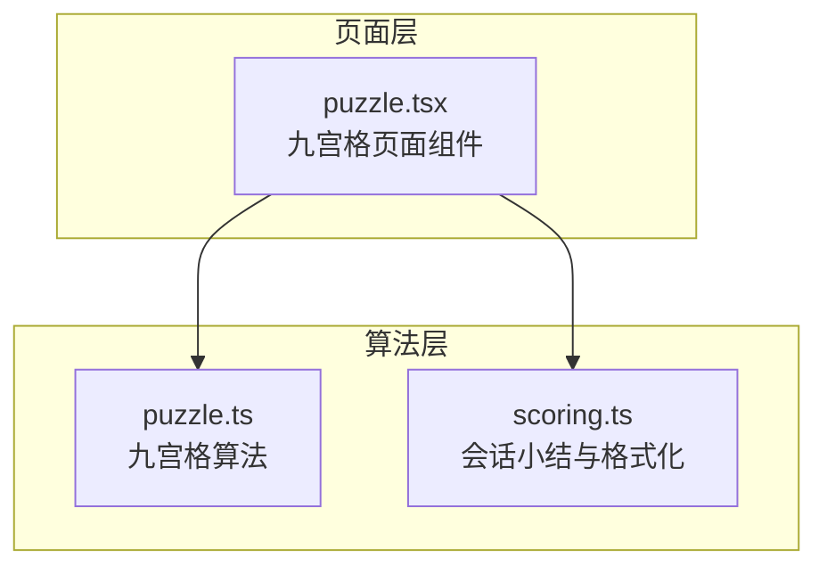
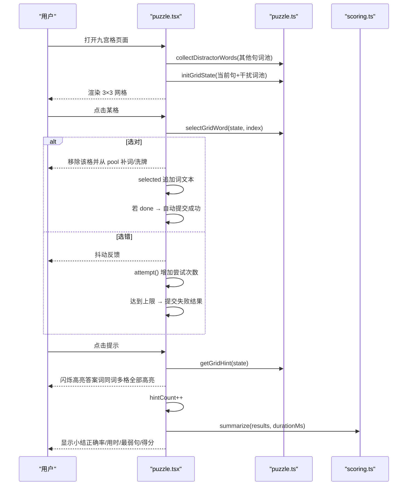
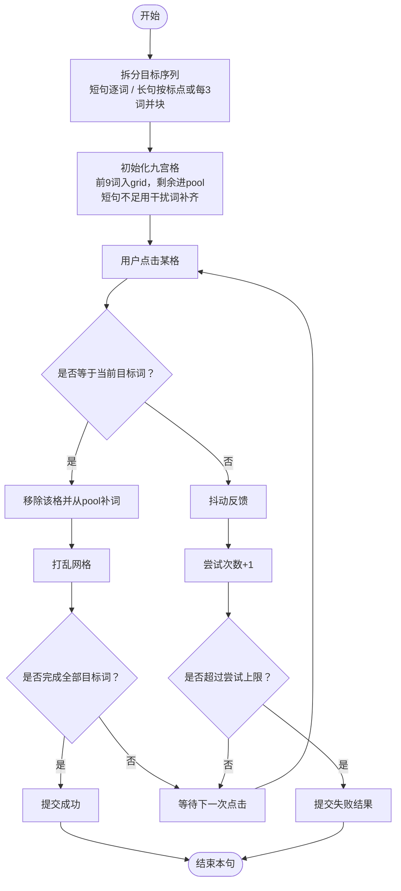
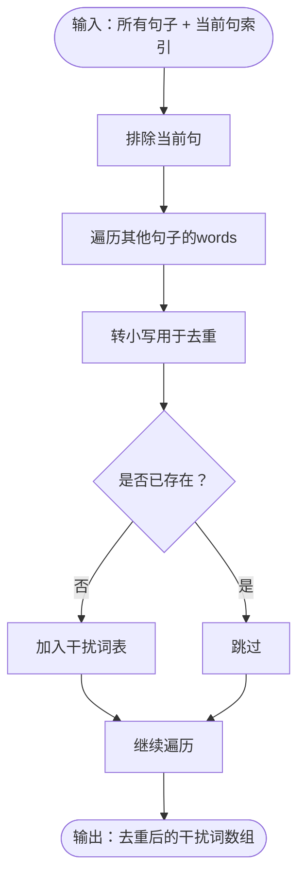
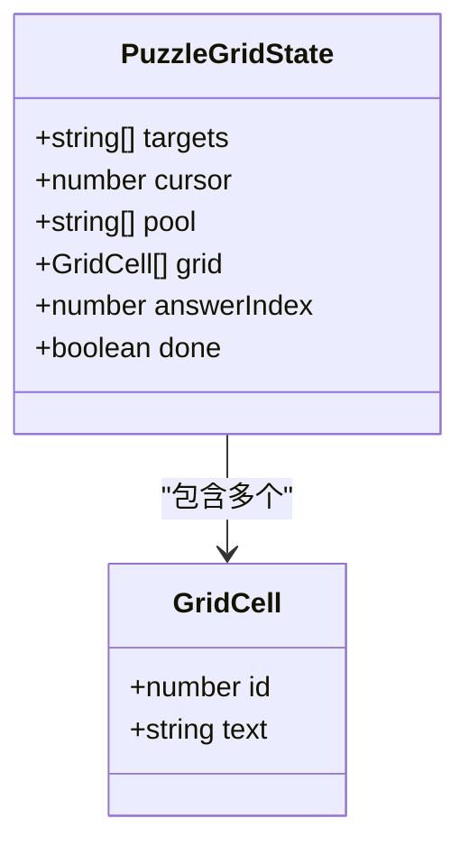
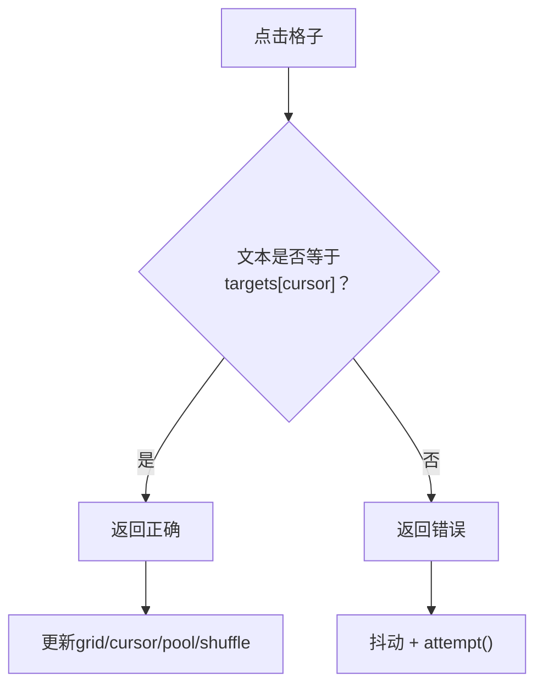
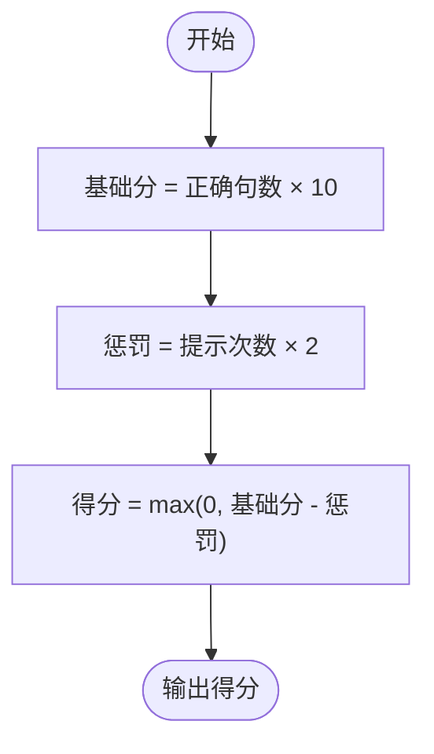
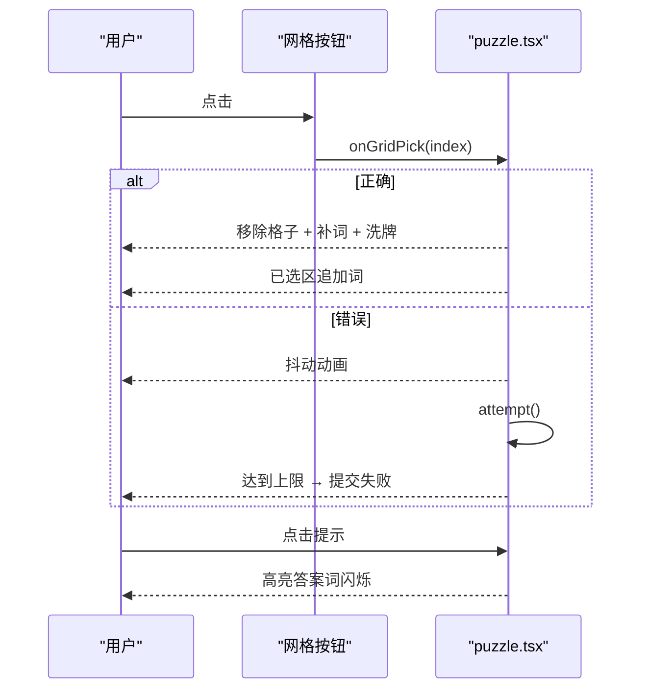
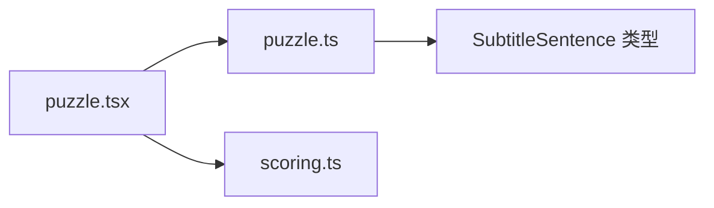

# 九宫格练习

<cite>
**本文引用的文件**   
- [puzzle.tsx](file://client/components/pages/puzzle.tsx)
- [puzzle.ts](file://client/core/training/puzzle.ts)
- [scoring.ts](file://client/core/training/scoring.ts)
</cite>

## 目录
1. [简介](#简介)
2. [项目结构定位](#项目结构定位)
3. [核心组件与职责](#核心组件与职责)
4. [系统架构总览](#系统架构总览)
5. [详细机制解析](#详细机制解析)
6. [依赖关系分析](#依赖关系分析)
7. [性能与复杂度](#性能与复杂度)
8. [配置项说明](#配置项说明)
9. [使用步骤](#使用步骤)
10. [评分标准与提升建议](#评分标准与提升建议)
11. [不同英语水平训练策略](#不同英语水平训练策略)
12. [故障排查](#故障排查)
13. [结论](#结论)

## 简介
九宫格练习是一种“按语序点击正确词”的互动拼句训练。系统从当前句子中抽取目标词，放入 3×3 网格；用户按顺序点击正确词完成句子。选错会抖动并消耗尝试次数，提示可高亮下一个答案词但会扣分。会话结束后汇总正确率、用时、最弱句和得分，帮助学习者通过高频互动强化词汇识别与句子理解能力。

## 项目结构定位
九宫格功能由页面组件与纯算法模块组成：
- 页面层负责界面交互、播放控制、会话状态与记录落盘。
- 算法层提供九宫格状态管理、干扰词收集、选择验证、提示与评分。
- 评分汇总模块负责会话小结统计。

**图表来源**
- [puzzle.tsx:1-293](file://client/components/pages/puzzle.tsx#L1-L293)
- [puzzle.ts:1-284](file://client/core/training/puzzle.ts#L1-L284)
- [scoring.ts:1-58](file://client/core/training/scoring.ts#L1-L58)

**章节来源**
- [puzzle.tsx:1-293](file://client/components/pages/puzzle.tsx#L1-L293)
- [puzzle.ts:1-284](file://client/core/training/puzzle.ts#L1-L284)
- [scoring.ts:1-58](file://client/core/training/scoring.ts#L1-L58)

## 核心组件与职责
- puzzle.tsx（页面组件）
  - 初始化训练会话、加载媒体、驱动 SentencePlayer 播放。
  - 维护九宫格状态、已选词列表、抖动与提示高亮。
  - 处理点击、提示、下一句、重听、结算与记录存储。
- puzzle.ts（算法模块）
  - 目标序列拆分、词块构建、答案校验、提示定位。
  - 九宫格滑窗状态管理、干扰词收集、选择验证、提示与评分。
- scoring.ts（评分汇总）
  - 汇总正确率、用时、最弱句 TOP3、总播放次数等。

**章节来源**
- [puzzle.tsx:1-293](file://client/components/pages/puzzle.tsx#L1-L293)
- [puzzle.ts:1-284](file://client/core/training/puzzle.ts#L1-L284)
- [scoring.ts:1-58](file://client/core/training/scoring.ts#L1-L58)

## 系统架构总览
九宫格练习的整体流程如下：

**图表来源**
- [puzzle.tsx:84-199](file://client/components/pages/puzzle.tsx#L84-L199)
- [puzzle.ts:146-276](file://client/core/training/puzzle.ts#L146-L276)
- [scoring.ts:40-50](file://client/core/training/scoring.ts#L40-L50)

## 详细机制解析

### 选词与拼句逻辑
- 目标序列拆分
  - 短句子：按空格拆成逐词序列。
  - 长句子（词数 >15）：优先按标点切分为短语块；若无标点则每 3 词一块，保证单屏可操作。
- 九宫格滑窗
  - 初始将前 9 个目标词放入网格，其余进入 pool。
  - 短句不足 9 格时，从干扰词池补齐，避免空位过多。
  - 每次选对后，移除该格并从 pool 补充新词，再打乱网格，保持随机性。
- 选择验证
  - 判定基于精确文本匹配（区分大小写），同一句内重复词有多个格，任选其一即可。
  - 全对即完成当前句，自动提交成功。

**图表来源**
- [puzzle.ts:32-52](file://client/core/training/puzzle.ts#L32-L52)
- [puzzle.ts:168-213](file://client/core/training/puzzle.ts#L168-L213)
- [puzzle.ts:222-269](file://client/core/training/puzzle.ts#L222-L269)
- [puzzle.tsx:134-171](file://client/components/pages/puzzle.tsx#L134-L171)

**章节来源**
- [puzzle.ts:32-52](file://client/core/training/puzzle.ts#L32-L52)
- [puzzle.ts:168-213](file://client/core/training/puzzle.ts#L168-L213)
- [puzzle.ts:222-269](file://client/core/training/puzzle.ts#L222-L269)
- [puzzle.tsx:134-171](file://client/components/pages/puzzle.tsx#L134-L171)

### 干扰词收集算法
- 范围：来自材料中除当前句之外的所有句子。
- 去重：按小写形式去重，避免重复干扰项。
- 目的：为短句填充网格，提高难度与区分度。

**图表来源**
- [puzzle.ts:146-160](file://client/core/training/puzzle.ts#L146-L160)

**章节来源**
- [puzzle.ts:146-160](file://client/core/training/puzzle.ts#L146-L160)

### 网格状态管理
- 关键状态字段
  - targets：目标词序列（正确顺序）。
  - cursor：当前应选第几个词（0-based）。
  - pool：尚未展示的目标词队列。
  - grid：当前 9 格内容。
  - answerIndex：当前答案在 grid 中的索引（用于提示）。
  - done：是否已完成。
- 状态更新
  - 选对：cursor+1，移除选中格，从 pool 补词，重新洗牌，更新 answerIndex。
  - 完成：清空 grid，标记 done。
  - 选错：state 不变，仅触发抖动与尝试计数。

**图表来源**
- [puzzle.ts:100-123](file://client/core/training/puzzle.ts#L100-L123)
- [puzzle.ts:168-213](file://client/core/training/puzzle.ts#L168-L213)
- [puzzle.ts:222-269](file://client/core/training/puzzle.ts#L222-L269)

**章节来源**
- [puzzle.ts:100-123](file://client/core/training/puzzle.ts#L100-L123)
- [puzzle.ts:168-213](file://client/core/training/puzzle.ts#L168-L213)
- [puzzle.ts:222-269](file://client/core/training/puzzle.ts#L222-L269)

### 选择验证机制
- 精确文本匹配（区分大小写）。
- 同词多格：任意一格均可命中。
- 错误路径：抖动动画 + 尝试次数累加；达到上限后以已选比例计算准确率并提交失败结果。

**图表来源**
- [puzzle.ts:138-140](file://client/core/training/puzzle.ts#L138-L140)
- [puzzle.ts:222-269](file://client/core/training/puzzle.ts#L222-L269)
- [puzzle.tsx:134-171](file://client/components/pages/puzzle.tsx#L134-L171)

**章节来源**
- [puzzle.ts:138-140](file://client/core/training/puzzle.ts#L138-L140)
- [puzzle.ts:222-269](file://client/core/training/puzzle.ts#L222-L269)
- [puzzle.tsx:134-171](file://client/components/pages/puzzle.tsx#L134-L171)

### 难度调节参数
- 提示次数限制（MAX_HINTS = 3）
  - 每句最多使用 3 次提示，每次提示扣 2 分。
- 尝试次数限制（MAX_ATTEMPTS = 2）
  - 每句最多允许 2 次错误尝试；超限后提交失败结果，并按已选词比例计算准确率。

**章节来源**
- [puzzle.tsx:26-29](file://client/components/pages/puzzle.tsx#L26-L29)
- [puzzle.tsx:157-169](file://client/components/pages/puzzle.tsx#L157-L169)
- [puzzle.tsx:173-182](file://client/components/pages/puzzle.tsx#L173-L182)

### 评分系统（gridScore 算法）
- 单句基础分：10 分。
- 提示惩罚：每次提示 -2 分。
- 总分下限：不低于 0。
- 会话最终得分：根据正确句数与总提示次数计算，并在总结面板展示。

**图表来源**
- [puzzle.ts:281-283](file://client/core/training/puzzle.ts#L281-L283)
- [puzzle.tsx:109-124](file://client/components/pages/puzzle.tsx#L109-L124)
- [puzzle.tsx:283-288](file://client/components/pages/puzzle.tsx#L283-L288)

**章节来源**
- [puzzle.ts:281-283](file://client/core/training/puzzle.ts#L281-L283)
- [puzzle.tsx:109-124](file://client/components/pages/puzzle.tsx#L109-L124)
- [puzzle.tsx:283-288](file://client/components/pages/puzzle.tsx#L283-L288)

### 界面交互流程
- 点击词语
  - 正确：该词消失，被加入上方“已选词”区域；网格从 pool 补词并洗牌。
  - 错误：抖动动画，尝试次数 +1；达到上限后提交失败结果。
- 抖动效果
  - 通过 CSS 动画类 animate-shake 实现，持续约 500ms。
- 高亮提示
  - 点击“提示”按钮后，下一个答案词闪烁高亮（同词多格全部高亮），持续约 1000ms。
- 进度与操作
  - 显示已选词数量、提示使用次数。
  - 支持播放句子、提示、下一句、重听、查看小结。

**图表来源**
- [puzzle.tsx:134-182](file://client/components/pages/puzzle.tsx#L134-L182)
- [puzzle.tsx:230-255](file://client/components/pages/puzzle.tsx#L230-L255)

**章节来源**
- [puzzle.tsx:134-182](file://client/components/pages/puzzle.tsx#L134-L182)
- [puzzle.tsx:230-255](file://client/components/pages/puzzle.tsx#L230-L255)

## 依赖关系分析
- puzzle.tsx 依赖
  - puzzle.ts：干扰词收集、网格初始化、选择验证、提示、评分。
  - scoring.ts：会话小结汇总与时间格式化。
  - 播放器与存储：SentencePlayer、HtmlPlayerController、recordsStore。
- puzzle.ts 内部依赖
  - SubtitleSentence 类型定义（外部类型）。
  - Fisher-Yates 洗牌算法（rng 注入，便于测试）。

**图表来源**
- [puzzle.tsx:1-24](file://client/components/pages/puzzle.tsx#L1-L24)
- [puzzle.ts:1-10](file://client/core/training/puzzle.ts#L1-L10)
- [scoring.ts:1-21](file://client/core/training/scoring.ts#L1-L21)

**章节来源**
- [puzzle.tsx:1-24](file://client/components/pages/puzzle.tsx#L1-L24)
- [puzzle.ts:1-10](file://client/core/training/puzzle.ts#L1-L10)
- [scoring.ts:1-21](file://client/core/training/scoring.ts#L1-L21)

## 性能与复杂度
- 目标序列拆分
  - 短句子：O(n)，n 为词数。
  - 长句子：按标点切分 O(n)；无标点时每 3 词一组 O(n)。
- 干扰词收集
  - 遍历其他句子的 words，去重集合查找 O(k)，k 为干扰词总数。
- 九宫格状态更新
  - 选对后移除、补词、洗牌 O(m)，m=9（常数级）。
- 选择验证
  - 精确文本比较 O(1)。
- 总体评估
  - 单次交互开销极小，适合高频点击场景；主要成本在素材加载与音频播放。

**章节来源**
- [puzzle.ts:32-52](file://client/core/training/puzzle.ts#L32-L52)
- [puzzle.ts:146-160](file://client/core/training/puzzle.ts#L146-L160)
- [puzzle.ts:222-269](file://client/core/training/puzzle.ts#L222-L269)

## 配置项说明
- MAX_HINTS = 3
  - 每句最大提示次数；每次提示扣 2 分。
- MAX_ATTEMPTS = 2
  - 每句最大错误尝试次数；超限后提交失败结果。
- GRID_SIZE = 9
  - 固定 3×3 网格；不可调整。
- CHUNK_THRESHOLD = 15
  - 长句子按标点或每 3 词并块的阈值。
- isSameWord
  - 区分大小写的精确文本匹配；不放宽语义等价。

**章节来源**
- [puzzle.tsx:26-29](file://client/components/pages/puzzle.tsx#L26-L29)
- [puzzle.ts:24-26](file://client/core/training/puzzle.ts#L24-L26)
- [puzzle.ts:98-104](file://client/core/training/puzzle.ts#L98-L104)
- [puzzle.ts:138-140](file://client/core/training/puzzle.ts#L138-L140)

## 使用步骤
1. 打开九宫格训练页面，系统自动创建会话并加载素材。
2. 点击“播放句子”聆听当前句，辅助理解。
3. 按语序点击 3×3 网格中的正确词。
   - 选对：词进入“已选词”区域，网格补词并洗牌。
   - 选错：抖动反馈，尝试次数 +1；达到上限后提交失败。
4. 需要提示时点击“提示”，下一个答案词闪烁高亮（扣 2 分/次，每句最多 3 次）。
5. 完成一句后自动提交；点击“下一句”继续。
6. 全部完成后查看小结：正确率、用时、最弱句、得分。

**章节来源**
- [puzzle.tsx:46-99](file://client/components/pages/puzzle.tsx#L46-L99)
- [puzzle.tsx:134-199](file://client/components/pages/puzzle.tsx#L134-L199)
- [puzzle.tsx:205-288](file://client/components/pages/puzzle.tsx#L205-L288)

## 评分标准与提升建议
- 评分标准
  - 单句基础分 10 分，每次提示 -2 分，最低 0 分。
  - 会话得分 = gridScore(正确句数, 总提示次数)。
  - 小结面板显示正确率、用时、最弱句 TOP3。
- 提升建议
  - 减少提示使用，尽量凭记忆与听力完成。
  - 先听一遍再点击，降低误选概率。
  - 关注大小写与专有名词，避免忽略细节。
  - 复盘最弱句，针对性复习相关词汇与句型。

**章节来源**
- [puzzle.ts:281-283](file://client/core/training/puzzle.ts#L281-L283)
- [puzzle.tsx:109-124](file://client/components/pages/puzzle.tsx#L109-L124)
- [puzzle.tsx:283-288](file://client/components/pages/puzzle.tsx#L283-L288)
- [scoring.ts:40-50](file://client/core/training/scoring.ts#L40-L50)

## 不同英语水平训练策略
- 初学者
  - 多听少猜：每句播放 2-3 遍后再点击。
  - 合理使用提示：先用 1-2 次提示建立信心，逐步减少。
  - 重点记忆高频词与常见句型。
- 中级水平
  - 控制提示次数 ≤1 次/句，挑战更高正确率。
  - 注意大小写与标点带来的语义差异。
  - 针对最弱句进行专项复习。
- 高级水平
  - 不使用提示，追求零提示高分。
  - 快速反应训练：缩短点击间隔，提升识别速度。
  - 扩展阅读与听力材料，丰富干扰词池应对能力。

[本节为通用指导，不直接分析具体文件]

## 故障排查
- 无字幕材料
  - 现象：提示“该材料暂无字幕，无法进行拼句训练”。
  - 解决：导入含字幕的材料。
- 无音频媒体
  - 现象：播放按钮置灰，提示“演示材料无音频”。
  - 解决：导入真实音频材料。
- 点击无效
  - 检查是否已完成（resolved/done），完成后需下一句或重启。
- 提示不可用
  - 检查是否已达 MAX_HINTS 上限。
- 尝试次数耗尽
  - 现象：提交失败结果，准确率按已选词比例计算。
  - 建议：减少误选，必要时使用提示。

**章节来源**
- [puzzle.tsx:127-130](file://client/components/pages/puzzle.tsx#L127-L130)
- [puzzle.tsx:157-169](file://client/components/pages/puzzle.tsx#L157-L169)
- [puzzle.tsx:173-182](file://client/components/pages/puzzle.tsx#L173-L182)

## 结论
九宫格练习通过“按语序点击正确词”的高频互动，有效强化词汇识别与句子理解能力。其核心在于稳定的九宫格滑窗算法、严格的精确匹配验证、可控的难度参数与清晰的评分反馈。配合播放与小结功能，学习者可在不同水平阶段制定个性化训练策略，持续提升英语语言能力。