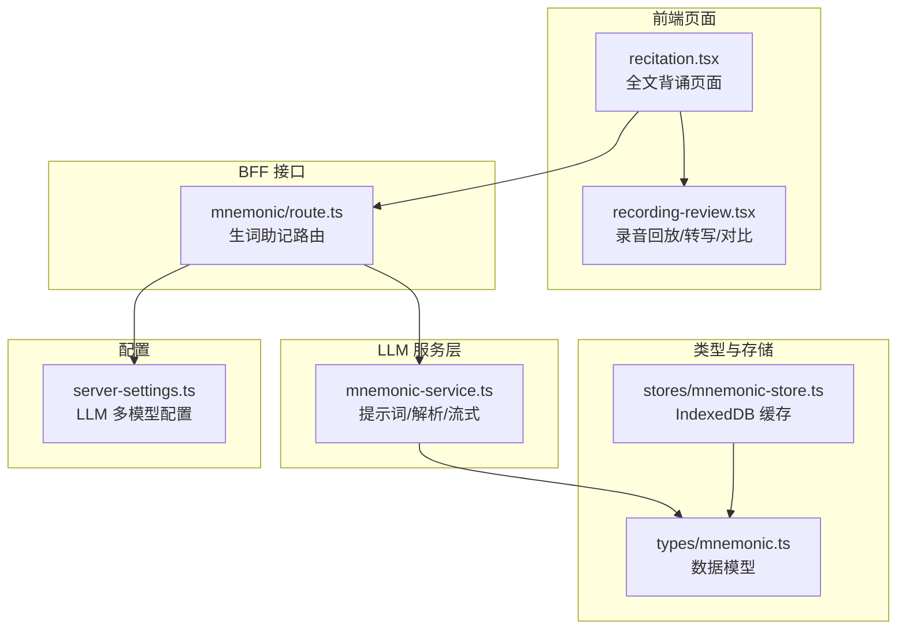
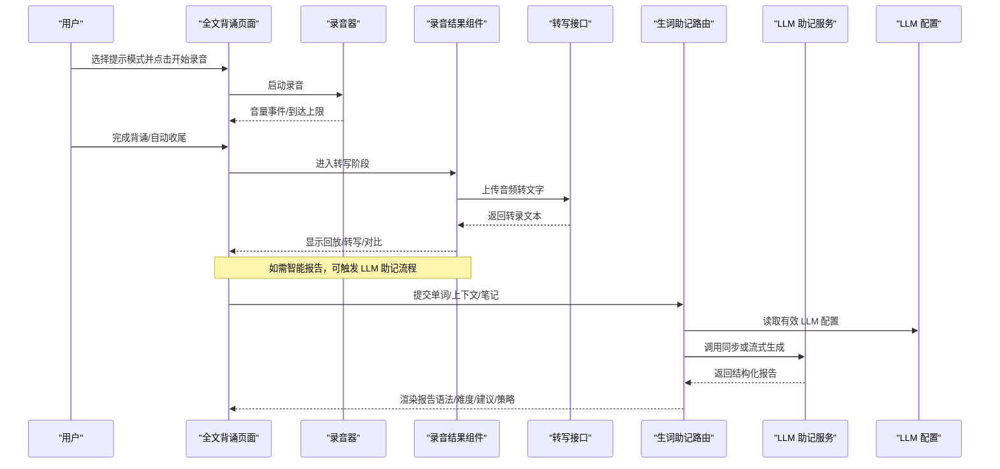
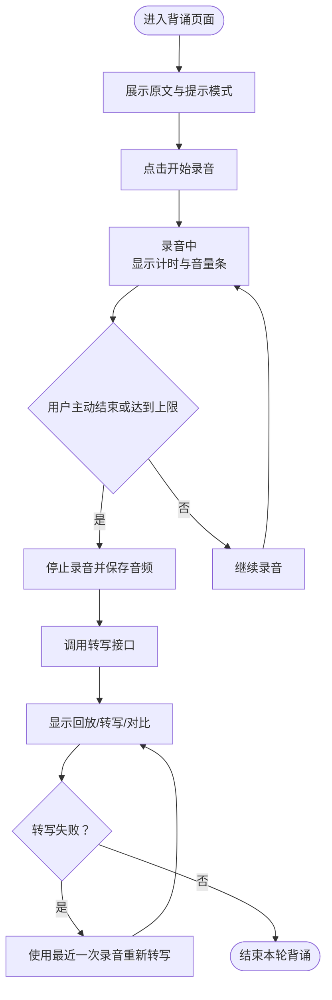
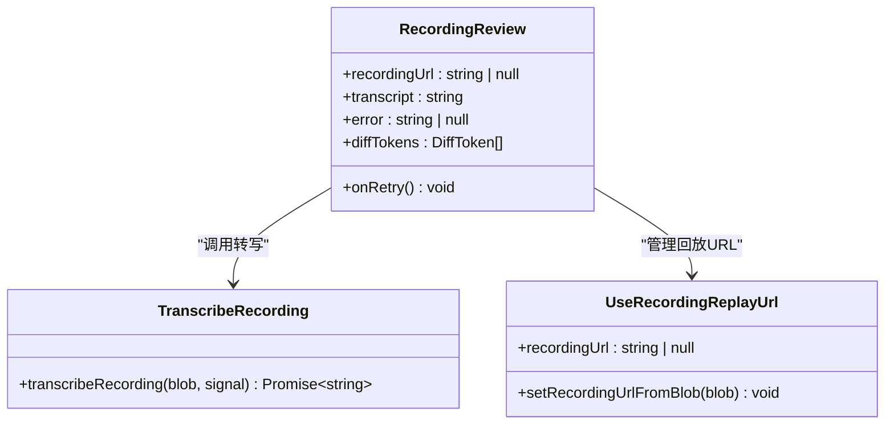
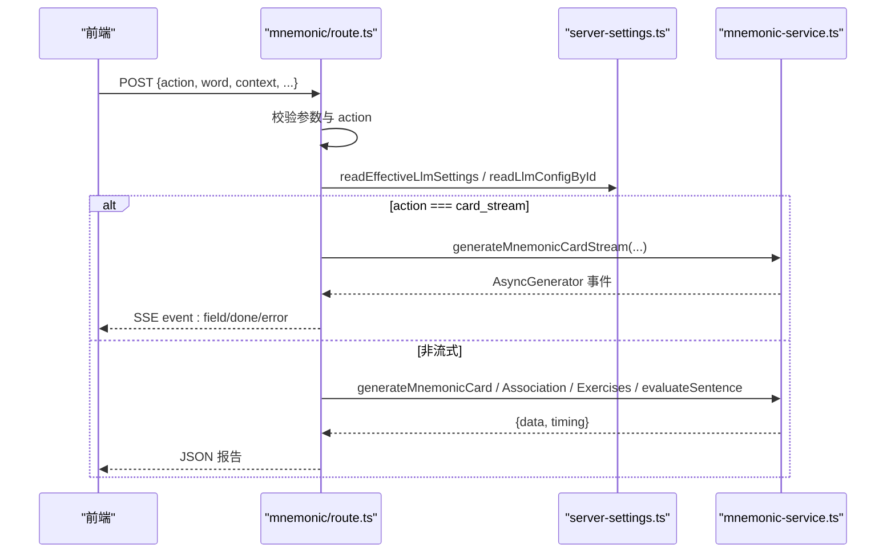
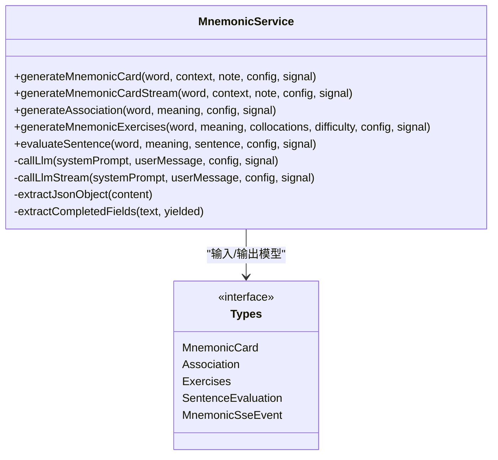
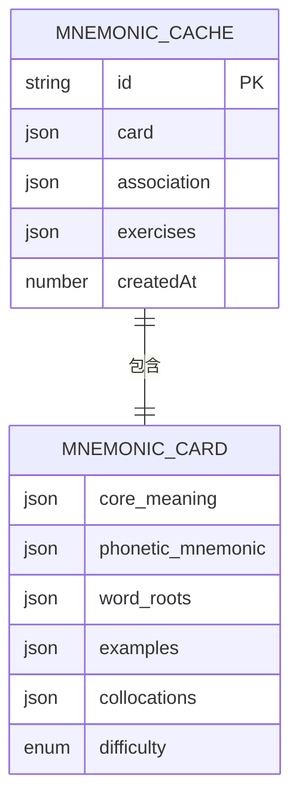
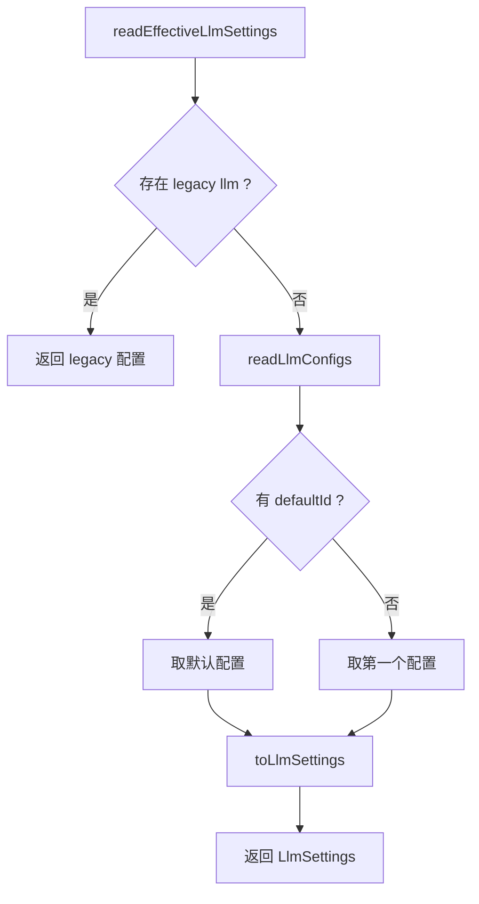
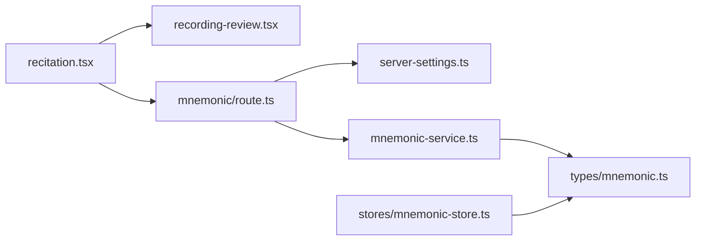

# 全文背诵

<cite>
**本文引用的文件**   
- [client/app/api/mnemonic/route.ts](file://client/app/api/mnemonic/route.ts)
- [client/lib/llm/mnemonic-service.ts](file://client/lib/llm/mnemonic-service.ts)
- [client/components/pages/training/recitation.tsx](file://client/components/pages/training/recitation.tsx)
- [client/components/pages/training/recording-review.tsx](file://client/components/pages/training/recording-review.tsx)
- [client/stores/mnemonic-store.ts](file://client/stores/mnemonic-store.ts)
- [client/types/mnemonic.ts](file://client/types/mnemonic.ts)
- [client/lib/server-settings.ts](file://client/lib/server-settings.ts)
</cite>

## 目录
1. [引言](#引言)
2. [项目结构定位](#项目结构定位)
3. [核心组件](#核心组件)
4. [架构总览](#架构总览)
5. [详细组件分析](#详细组件分析)
6. [依赖关系分析](#依赖关系分析)
7. [性能与可靠性](#性能与可靠性)
8. [故障排查指南](#故障排查指南)
9. [背诵方法与记忆技巧](#背诵方法与记忆技巧)
10. [结论](#结论)

## 引言
本文件面向“全文背诵”功能，覆盖以下目标：
- LLM 报告生成流程：文本提交、AI 分析、报告渲染。
- 背诵练习界面设计：原文展示、记忆测试、进度追踪。
- 智能报告内容结构：语法分析、词汇难度评估、改进建议、学习策略推荐。
- LLM 集成配置：API 调用、流式响应处理、错误重试机制。
- 不同英语水平的背诵方法和记忆技巧，帮助通过系统化背诵提升语言综合运用能力与长期记忆效果。

需要特别说明的是：当前仓库中的“全文背诵”页面（P8）主要实现录音、转写和逐词对比；LLM 助记卡片、联想、练习与造句批改由独立的“生词助记”模块提供。两者共享同一套 LLM 服务与配置体系，因此本文在讲解背诵流程的同时，也会把 LLM 报告生成作为可复用的智能反馈能力进行说明。

## 项目结构定位
“全文背诵”相关代码集中在客户端 Next.js 应用中，关键路径如下：
- 训练页面：`client/components/pages/training/recitation.tsx`
- 录音结果与转写复用组件：`client/components/pages/training/recording-review.tsx`
- 生词助记 BFF 路由：`client/app/api/mnemonic/route.ts`
- LLM 助记服务与提示词：`client/lib/llm/mnemonic-service.ts`
- 助记数据模型与缓存：`client/types/mnemonic.ts`、`client/stores/mnemonic-store.ts`
- LLM 多模型设置读取：`client/lib/server-settings.ts`

**图表来源**
- [client/components/pages/training/recitation.tsx:1-285](file://client/components/pages/training/recitation.tsx#L1-L285)
- [client/components/pages/training/recording-review.tsx:1-153](file://client/components/pages/training/recording-review.tsx#L1-L153)
- [client/app/api/mnemonic/route.ts:1-272](file://client/app/api/mnemonic/route.ts#L1-L272)
- [client/lib/llm/mnemonic-service.ts:1-484](file://client/lib/llm/mnemonic-service.ts#L1-L484)
- [client/types/mnemonic.ts:1-141](file://client/types/mnemonic.ts#L1-L141)
- [client/stores/mnemonic-store.ts:1-70](file://client/stores/mnemonic-store.ts#L1-L70)
- [client/lib/server-settings.ts:1-327](file://client/lib/server-settings.ts#L1-L327)

**章节来源**
- [client/components/pages/training/recitation.tsx:1-285](file://client/components/pages/training/recitation.tsx#L1-L285)
- [client/components/pages/training/recording-review.tsx:1-153](file://client/components/pages/training/recording-review.tsx#L1-L153)
- [client/app/api/mnemonic/route.ts:1-272](file://client/app/api/mnemonic/route.ts#L1-L272)
- [client/lib/llm/mnemonic-service.ts:1-484](file://client/lib/llm/mnemonic-service.ts#L1-L484)
- [client/types/mnemonic.ts:1-141](file://client/types/mnemonic.ts#L1-L141)
- [client/stores/mnemonic-store.ts:1-70](file://client/stores/mnemonic-store.ts#L1-L70)
- [client/lib/server-settings.ts:1-327](file://client/lib/server-settings.ts#L1-L327)

## 核心组件
- 全文背诵页面：负责原文展示、提示模式切换、录音控制、转写状态管理、结果页渲染。
- 录音结果组件：封装录音回放、转写调用、转写失败重试、与原文的逐词对比。
- 生词助记路由：校验请求、加载 LLM 配置、调用 LLM 服务、返回结构化报告或 SSE 流。
- LLM 助记服务：定义系统提示词、JSON 解析容错、同步与流式调用、错误映射。
- 数据类型与缓存：定义助记卡片、联想、练习、句子评估等数据结构，并提供 IndexedDB 缓存读写。
- 服务器设置：统一读取 legacy 单模型与多模型配置，支持默认配置迁移与回退。

**章节来源**
- [client/components/pages/training/recitation.tsx:1-285](file://client/components/pages/training/recitation.tsx#L1-L285)
- [client/components/pages/training/recording-review.tsx:1-153](file://client/components/pages/training/recording-review.tsx#L1-L153)
- [client/app/api/mnemonic/route.ts:1-272](file://client/app/api/mnemonic/route.ts#L1-L272)
- [client/lib/llm/mnemonic-service.ts:1-484](file://client/lib/llm/mnemonic-service.ts#L1-L484)
- [client/types/mnemonic.ts:1-141](file://client/types/mnemonic.ts#L1-L141)
- [client/stores/mnemonic-store.ts:1-70](file://client/stores/mnemonic-store.ts#L1-L70)
- [client/lib/server-settings.ts:1-327](file://client/lib/server-settings.ts#L1-L327)

## 架构总览
下图展示了从用户操作到 LLM 报告生成的端到端流程，包括背诵录音、转写、以及可选的智能报告生成。

**图表来源**
- [client/components/pages/training/recitation.tsx:1-285](file://client/components/pages/training/recitation.tsx#L1-L285)
- [client/components/pages/training/recording-review.tsx:1-153](file://client/components/pages/trinding/recording-review.tsx#L1-L153)
- [client/app/api/mnemonic/route.ts:1-272](file://client/app/api/mnemonic/route.ts#L1-L272)
- [client/lib/llm/mnemonic-service.ts:1-484](file://client/lib/llm/mnemonic-service.ts#L1-L484)
- [client/lib/server-settings.ts:1-327](file://client/lib/server-settings.ts#L1-L327)

## 详细组件分析

### 全文背诵页面
该页面承担背诵练习的核心交互：
- 原文展示：按句序展示英文原文，根据提示模式显示中文、仅首词或无提示。
- 录音控制：启动录音、监听音量、到达上限自动收尾、取消与放弃。
- 转写流程：停止录音后调用转写接口，失败也进入结果页以便重试。
- 结果呈现：播放录音、查看转写文本、与原文逐词对比。

**图表来源**
- [client/components/pages/training/recitation.tsx:1-285](file://client/components/pages/training/recitation.tsx#L1-L285)
- [client/components/pages/training/recording-review.tsx:1-153](file://client/components/pages/training/recording-review.tsx#L1-L153)

**章节来源**
- [client/components/pages/training/recitation.tsx:1-285](file://client/components/pages/training/recitation.tsx#L1-L285)
- [client/components/pages/training/recording-review.tsx:1-153](file://client/components/pages/training/recording-review.tsx#L1-L153)

### 录音结果与转写组件
该组件为影子跟读与全文背诵共用，职责清晰：
- 转写调用：优先本机 faster-whisper，云端大模型兜底；失败时给出明确指引。
- 回放 URL 管理：创建与回收 ObjectURL，避免内存泄漏。
- 结果三卡：回放录音、转写文本（含错误与重试）、与原文逐词对比。

**图表来源**
- [client/components/pages/training/recording-review.tsx:1-153](file://client/components/pages/training/recording-review.tsx#L1-L153)

**章节来源**
- [client/components/pages/training/recording-review.tsx:1-153](file://client/components/pages/training/recording-review.tsx#L1-L153)

### 生词助记路由（BFF）
该路由负责将前端请求转发到 LLM 服务，并处理配置、超时、SSE 流与错误映射：
- 参数校验：action、word、context、meaning、collocations、difficulty、sentence 等。
- 配置读取：优先 mnemonicModel，其次 translateModel；未配置则返回 400。
- 流式响应：card_stream 动作返回 SSE，逐字段推送。
- 非流式响应：card、association、exercises、evaluate 四种动作。
- 错误处理：区分 API_KEY_MISSING、BASE_URL_MISSING、MODEL_NOT_CONFIGURED、RESPONSE_EMPTY、RESPONSE_FORMAT_ERROR、UPSTREAM_ERROR、REQUEST_TIMEOUT 等。

**图表来源**
- [client/app/api/mnemonic/route.ts:1-272](file://client/app/api/mnemonic/route.ts#L1-L272)
- [client/lib/server-settings.ts:1-327](file://client/lib/server-settings.ts#L1-L327)
- [client/lib/llm/mnemonic-service.ts:1-484](file://client/lib/llm/mnemonic-service.ts#L1-L484)

**章节来源**
- [client/app/api/mnemonic/route.ts:1-272](file://client/app/api/mnemonic/route.ts#L1-L272)
- [client/lib/server-settings.ts:1-327](file://client/lib/server-settings.ts#L1-L327)

### LLM 助记服务与提示词
服务层定义了四类任务：
- 助记卡片：核心含义、发音助记、词根词缀、例句、搭配、难度标签。
- 联想记忆：图像、故事、声音游戏、荒诞场景。
- 练习题：IELTS 填空、听力辨别、写作提示。
- 句子评估：语法评分、用词评分、反馈、改进版、更多例句。

同时实现了：
- JSON 解析容错：剥离 markdown fences、截取首个至末个 `{}`、二次 sanitize 重试。
- 同步与流式调用：callLlm 与 callLlmStream，后者按顶层字段顺序 yield。
- 错误映射：统一转换为 LlmError，便于上层路由处理。

**图表来源**
- [client/lib/llm/mnemonic-service.ts:1-484](file://client/lib/llm/mnemonic-service.ts#L1-L484)
- [client/types/mnemonic.ts:1-141](file://client/types/mnemonic.ts#L1-L141)

**章节来源**
- [client/lib/llm/mnemonic-service.ts:1-484](file://client/lib/llm/mnemonic-service.ts#L1-L484)
- [client/types/mnemonic.ts:1-141](file://client/types/mnemonic.ts#L1-L141)

### 数据类型与缓存
- 数据类型：定义助记卡片、联想、练习、句子评估、SSE 事件等结构，确保前后端一致。
- 缓存策略：基于 IndexedDB 的 recordsStore，按 entryId 缓存卡片、联想、练习，避免重复调用 LLM。
- 内存访问：提供 getMnemonicFromMemory 同步读取，减少 IO 开销。

**图表来源**
- [client/types/mnemonic.ts:1-141](file://client/types/mnemonic.ts#L1-L141)
- [client/stores/mnemonic-store.ts:1-70](file://client/stores/mnemonic-store.ts#L1-L70)

**章节来源**
- [client/types/mnemonic.ts:1-141](file://client/types/mnemonic.ts#L1-L141)
- [client/stores/mnemonic-store.ts:1-70](file://client/stores/mnemonic-store.ts#L1-L70)

### LLM 集成配置
- 多模型配置：支持 legacy `llm` 与 `llmConfigs` 数组，自动迁移默认配置。
- 优先级：mnemonicModel > translateModel；若均未设置，返回 400 提示配置缺失。
- 本地服务：whisperAlignUrl、whisperTranscribeUrl 用于语音对齐与转写。
- SOE 评测：provider、proxyUrl 及第三方密钥，供发音评测使用。

**图表来源**
- [client/lib/server-settings.ts:1-327](file://client/lib/server-settings.ts#L1-L327)

**章节来源**
- [client/lib/server-settings.ts:1-327](file://client/lib/server-settings.ts#L1-L327)

## 依赖关系分析
- 页面层依赖：recitation.tsx 依赖 recording-review.tsx 的转写与回放能力。
- BFF 层依赖：mnemonic/route.ts 依赖 server-settings.ts 的配置读取与 mnemonic-service.ts 的 LLM 调用。
- 服务层依赖：mnemonic-service.ts 依赖 types/mnemonic.ts 的数据结构与 LangChain ChatModel。
- 存储层依赖：stores/mnemonic-store.ts 依赖 platform/storage/idb 与 schema。

**图表来源**
- [client/components/pages/training/recitation.tsx:1-285](file://client/components/pages/training/recitation.tsx#L1-L285)
- [client/components/pages/training/recording-review.tsx:1-153](file://client/components/pages/training/recording-review.tsx#L1-L153)
- [client/app/api/mnemonic/route.ts:1-272](file://client/app/api/mnemonic/route.ts#L1-L272)
- [client/lib/server-settings.ts:1-327](file://client/lib/server-settings.ts#L1-L327)
- [client/lib/llm/mnemonic-service.ts:1-484](file://client/lib/llm/mnemonic-service.ts#L1-L484)
- [client/types/mnemonic.ts:1-141](file://client/types/mnemonic.ts#L1-L141)
- [client/stores/mnemonic-store.ts:1-70](file://client/stores/mnemonic-store.ts#L1-L70)

**章节来源**
- [client/components/pages/training/recitation.tsx:1-285](file://client/components/pages/training/recitation.tsx#L1-L285)
- [client/components/pages/training/recording-review.tsx:1-153](file://client/components/pages/training/recording-review.tsx#L1-L153)
- [client/app/api/mnemonic/route.ts:1-272](file://client/app/api/mnemonic/route.ts#L1-L272)
- [client/lib/server-settings.ts:1-327](file://client/lib/server-settings.ts#L1-L327)
- [client/lib/llm/mnemonic-service.ts:1-484](file://client/lib/llm/mnemonic-service.ts#L1-L484)
- [client/types/mnemonic.ts:1-141](file://client/types/mnemonic.ts#L1-L141)
- [client/stores/mnemonic-store.ts:1-70](file://client/stores/mnemonic-store.ts#L1-L70)

## 性能与可靠性
- 超时控制：BFF 对单次上游调用设置 120 秒超时，结合 AbortSignal 与请求中止信号。
- 流式响应：SSE 逐字段推送，降低首屏等待时间，提升用户体验。
- JSON 解析容错：多层容错策略提高鲁棒性，减少因 LLM 输出格式波动导致的失败。
- 转写兜底：本机 faster-whisper 优先，云端大模型兜底，失败时给出明确启动指引。
- 缓存优化：助记卡片、联想、练习存入 IndexedDB，避免重复 LLM 调用。

[本节为通用性能与可靠性讨论，不直接分析具体文件]

## 故障排查指南
常见问题与定位方法：
- 未配置 LLM：检查 Base URL 与 API Key，确认 mnemonicModel 或 translateModel 已设置。
- 模型未配置：mnemonicModel 与 translateModel 均空时，会返回 400 SETTINGS_NOT_CONFIGURED。
- 流式生成失败：关注 SSE error 事件，检查网络与上游服务状态。
- 转写失败：确认本机转写服务是否启动，或是否在设置中配置了云端转写模型。
- 权限问题：麦克风权限被拒绝时，页面会弹出权限引导浮层，允许重试。

**章节来源**
- [client/app/api/mnemonic/route.ts:1-272](file://client/app/api/mnemonic/route.ts#L1-L272)
- [client/components/pages/training/recording-review.tsx:1-153](file://client/components/pages/training/recording-review.tsx#L1-L153)

## 背诵方法与记忆技巧
针对不同英语水平，推荐以下系统化背诵策略：

- 初学者（A2-B1）
  - 以“显示中文”提示为主，先理解语义再尝试背诵。
  - 分段背诵：每次聚焦 2-3 句，逐步拼接成完整段落。
  - 利用联想记忆：通过图像或小故事建立音义联结。
  - 重复朗读：配合录音回放，纠正发音与连读。

- 中级（B1-B2）
  - 切换到“仅首词”提示，强化回忆能力。
  - 使用助记卡片：关注词根词缀、搭配与例句，构建词汇网络。
  - 听力辨别：通过易混淆语音特征训练听辨力。
  - 写作提示：围绕目标词进行造句与短文写作，巩固用法。

- 高级（C1-C2）
  - 采用“无提示”模式，完全凭记忆背诵。
  - 精细打磨：关注语域、感情色彩与典型使用场景。
  - 自我评估：使用句子评估功能获取语法与用词评分，针对性改进。
  - 长期记忆：间隔复习与主题串联，形成知识图谱。

这些方法可与系统的“原文展示—记忆测试—进度追踪”闭环结合，通过反复输出与即时反馈，提升语言综合运用能力与长期记忆效果。

[本节为概念性指导，不直接分析具体文件]

## 结论
“全文背诵”功能以录音与转写为核心，结合 LLM 助记报告，形成从输入到输出的完整学习闭环。页面层提供直观的原文展示与提示模式，服务层保证稳定的 LLM 调用与流式响应，类型与缓存层确保数据结构一致性与性能优化。通过分层次的背诵方法与记忆技巧，学习者可以在不同水平上持续提升语言能力，最终实现长期记忆与综合应用能力的双重提升。

[本节为总结性内容，不直接分析具体文件]