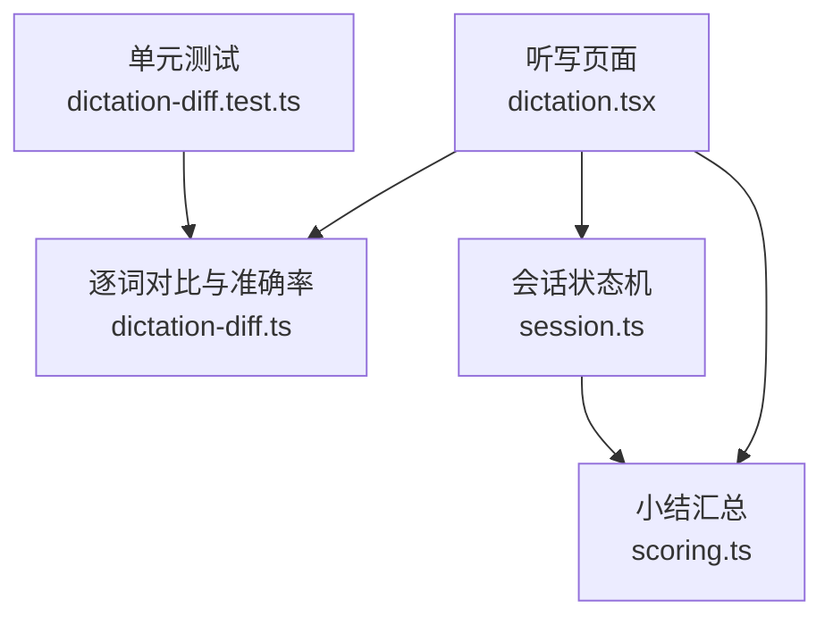
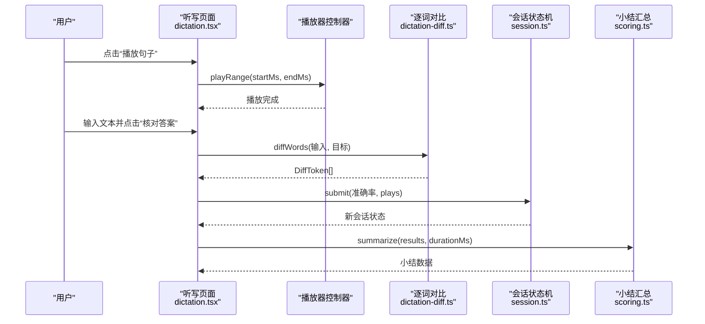
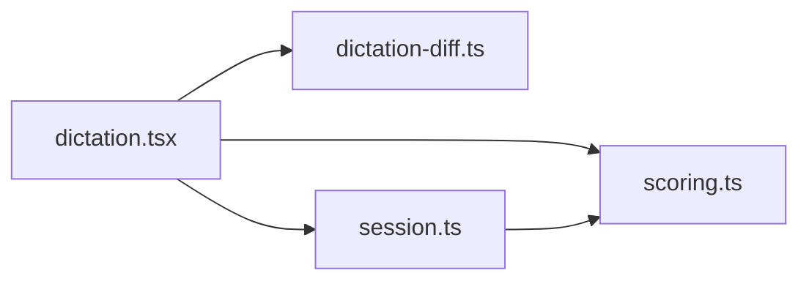

# 听写练习

<cite>
**本文引用的文件**   
- [dictation.tsx](file://client/components/pages/dictation.tsx)
- [dictation-diff.ts](file://client/core/training/dictation-diff.ts)
- [scoring.ts](file://client/core/training/scoring.ts)
- [session.ts](file://client/core/training/session.ts)
- [dictation-diff.test.ts](file://client/core/training/__tests__/dictation-diff.test.ts)
</cite>

## 目录
1. [简介](#简介)
2. [项目结构](#项目结构)
3. [核心组件](#核心组件)
4. [架构总览](#架构总览)
5. [详细组件分析](#详细组件分析)
6. [依赖关系分析](#依赖关系分析)
7. [性能与复杂度](#性能与复杂度)
8. [配置项与难度调节](#配置项与难度调节)
9. [学习阶段与训练方法](#学习阶段与训练方法)
10. [故障排查](#故障排查)
11. [结论](#结论)

## 简介
本文件为“单句听写模式”的完整技术文档，覆盖以下方面：
- 界面操作流程：音频播放控制、文本输入框、实时反馈机制。
- 评分算法实现：文本差异比较（diff）、准确率计算、错误类型分析。
- 会话状态机：题目队列、提交、下一句、重练指定句等流程。
- 配置选项：范围选择、提示计数、提交次数统计、播放次数统计。
- 适用场景与训练方法：不同学习阶段的建议用法。

该功能以纯函数式状态机为核心，UI 层仅负责交互与渲染，便于测试与扩展。

## 项目结构
听写练习相关代码主要分布在以下位置：
- UI 页面：`client/components/pages/dictation.tsx`
- 核心算法：`client/core/training/dictation-diff.ts`
- 会话状态机：`client/core/training/session.ts`
- 小结汇总：`client/core/training/scoring.ts`
- 单元测试：`client/core/training/__tests__/dictation-diff.test.ts`

**图表来源**
- [dictation.tsx:1-147](file://client/components/pages/dictation.tsx#L1-L147)
- [dictation-diff.ts:1-109](file://client/core/training/dictation-diff.ts#L1-L109)
- [session.ts:1-119](file://client/core/training/session.ts#L1-L119)
- [scoring.ts:1-58](file://client/core/training/scoring.ts#L1-L58)
- [dictation-diff.test.ts:1-107](file://client/core/training/__tests__/dictation-diff.test.ts#L1-L107)

**章节来源**
- [dictation.tsx:1-147](file://client/components/pages/dictation.tsx#L1-L147)
- [dictation-diff.ts:1-109](file://client/core/training/dictation-diff.ts#L1-L109)
- [session.ts:1-119](file://client/core/training/session.ts#L1-L119)
- [scoring.ts:1-58](file://client/core/training/scoring.ts#L1-L58)

## 核心组件
- 听写页面（UI）：负责材料加载、音频播放、用户输入、核对答案、结果展示与小结。
- 逐词对比（Diff）：对输入与目标句子进行归一化、分词、LCS 对齐，输出四类标记并计算准确率。
- 会话状态机：管理题目队列、当前句游标、提交/下一句/跳过/重练等事件迁移。
- 小结汇总：按句收集结果，计算平均正确率、最弱句 TOP3、总播放次数等。

**章节来源**
- [dictation.tsx:28-143](file://client/components/pages/dictation.tsx#L28-L143)
- [dictation-diff.ts:20-108](file://client/core/training/dictation-diff.ts#L20-L108)
- [session.ts:18-113](file://client/core/training/session.ts#L18-L113)
- [scoring.ts:7-51](file://client/core/training/scoring.ts#L7-L51)

## 架构总览
听写练习采用“UI + 纯函数核心”的分层架构：
- UI 层：React 组件，处理用户交互与媒体播放。
- 核心层：无框架依赖的纯函数模块，提供 diff、评分、会话状态机。
- 数据流：UI 调用核心函数生成新状态或结果，再驱动视图更新。

**图表来源**
- [dictation.tsx:84-117](file://client/components/pages/dictation.tsx#L84-L117)
- [dictation-diff.ts:51-108](file://client/core/training/dictation-diff.ts#L51-L108)
- [session.ts:70-98](file://client/core/training/session.ts#L70-L98)
- [scoring.ts:40-51](file://client/core/training/scoring.ts#L40-L51)

## 详细组件分析

### 听写页面（UI）
职责与流程：
- 初始化会话：根据材料与范围创建会话，准备字幕句列表。
- 媒体加载：将材料转为 ObjectURL，使用 HTML 播放器控制器加载音频或视频。
- 播放控制：按当前句的时间段播放，记录播放次数。
- 文本输入：提供多行文本框，支持清空与核对。
- 核对逻辑：调用 diffWords 得到 DiffToken[]，计算准确率，提交到会话状态机。
- 结果展示：用 DiffView 着色显示 correct/wrong/missing/extra，并显示原文与本句正确率。
- 小结面板：完成后展示平均正确率、总播放次数、最弱句 TOP3，支持重练。

关键实现要点：
- 播放按钮在已核对后禁用，避免重复提交。
- 每句首次核对该句时写入训练记录，包含准确率、句索引等信息。
- 小结中聚合 results 计算平均正确率与最弱句。

**章节来源**
- [dictation.tsx:41-74](file://client/components/pages/dictation.tsx#L41-L74)
- [dictation.tsx:84-117](file://client/components/pages/dictation.tsx#L84-L117)
- [dictation.tsx:124-143](file://client/components/pages/dictation.tsx#L124-L143)

### 逐词对比与准确率（Diff）
核心能力：
- normalize：小写、去标点、压缩空格，统一引号。
- toWords：基于 normalize 后按空格分词。
- diffWords：基于 LCS 的动态规划表，回溯生成操作序列，合并 missing/extra 为 wrong。
- sentenceAccuracy：按 correct / max(目标词数, 输入词数) 计算百分比。

数据结构：
- DiffToken：type 为 correct/wrong/missing/extra；wrong 时附带 input（用户实际输入的词）。

算法说明：
- LCS DP 表构建时间复杂度 O(n*m)，空间复杂度 O(n*m)。
- 回溯生成操作序列 O(n+m)。
- 合并未对齐块 O(k)，k 为未对齐长度。

准确率公式：
- 若目标为空：空输入得 100，非空输入得 0。
- 否则：correct 数量除以 max(目标词数, 输入词数)，四舍五入取整。

错误类型分析：
- correct：匹配成功。
- wrong：错词，配对一个 missing 与 extra。
- missing：漏词，目标侧缺失。
- extra：多词，用户多写。

**章节来源**
- [dictation-diff.ts:20-108](file://client/core/training/dictation-diff.ts#L20-L108)
- [dictation-diff.test.ts:22-106](file://client/core/training/__tests__/dictation-diff.test.ts#L22-L106)

### 会话状态机（Session）
职责：
- 创建会话：依据范围过滤句子，设置初始游标与状态。
- 提交结果：收集当前句结果，同句重试覆盖上一条。
- 尝试计数：每次提交前计数 attempts。
- 提示计数：记录 hintCount（九宫格等模式使用）。
- 推进与结束：next 推进游标，超出队尾设为 done。
- 跳过：记 0 分并推进。
- 重练指定句：游标跳回指定句位置，重置 hint/attempt。

状态字段：
- mode、queue、cursor、status、results、hintCount、attemptCount、startedAt。

**章节来源**
- [session.ts:18-113](file://client/core/training/session.ts#L18-L113)

### 小结汇总（Scoring）
职责：
- 汇总 SentenceResult 数组，计算 total、correctCount、accuracy、durationMs、weakest、totalPlays。
- formatElapsed：格式化用时为 mm:ss。

字段说明：
- SentenceResult：sentenceIndex、correct、accuracy、hints、attempts、plays、skipped。
- SessionSummary：total、correctCount、accuracy、durationMs、weakest、totalPlays。

**章节来源**
- [scoring.ts:7-51](file://client/core/training/scoring.ts#L7-L51)

## 依赖关系分析
- dictation.tsx 依赖：
  - dictation-diff.ts：diffWords、toWords、sentenceAccuracy。
  - session.ts：createSession、currentSentence、submit、next、retryAt。
  - scoring.ts：summarize（在小结中使用）。
- dictation-diff.ts 独立：零依赖，纯 TS。
- session.ts 依赖：scoring.ts 的类型定义（SentenceResult）。

**图表来源**
- [dictation.tsx:9-15](file://client/components/pages/dictation.tsx#L9-L15)
- [session.ts:11-11](file://client/core/training/session.ts#L11-L11)

**章节来源**
- [dictation.tsx:9-15](file://client/components/pages/dictation.tsx#L9-L15)
- [session.ts:11-11](file://client/core/training/session.ts#L11-L11)

## 性能与复杂度
- 文本差异比较：
  - LCS DP 表构建 O(n*m)，n、m 分别为输入和目标句的词数。
  - 回溯与合并 O(n+m+k)，k 为未对齐块长度。
  - 对于单句听写，n、m 通常较小，性能可接受。
- 准确率计算：O(t)，t 为 DiffToken 数量。
- 小结汇总：O(r)，r 为结果句数。

优化建议：
- 若未来扩展到长段落或多句批量处理，可考虑增量 LCS 或更高效的编辑距离库。
- 对超大语料，可对 normalize 与 toWords 做缓存。

[本节为通用性能讨论，不直接分析具体文件]

## 配置项与难度调节
当前实现中的可配置点：
- 训练范围（scope）：
  - all：全文所有句子。
  - favorites：仅收藏句（由 sentenceIndexes 指定）。
- 提示功能（hints）：
  - 会话状态机维护 hintCount，UI 层可限制每句提示次数。
- 提交次数（attempts）：
  - 会话状态机维护 attemptCount，用于“每句最多 N 次提交”的上限控制。
- 播放次数（plays）：
  - 听写页面记录每句播放次数，计入结果与小结。
- 时间限制：
  - 当前未实现硬性时间限制；可通过外部计时器与 UI 提示实现。
- 难度调节：
  - 通过 scope 选择收藏句或全文，间接调节难度。
  - 未来可扩展：词汇密度、语速、是否允许重听等。

**章节来源**
- [session.ts:13-14](file://client/core/training/session.ts#L13-L14)
- [session.ts:86-90](file://client/core/training/session.ts#L86-L90)
- [session.ts:80-84](file://client/core/training/session.ts#L80-L84)
- [dictation.tsx:84-89](file://client/components/pages/dictation.tsx#L84-L89)

## 学习阶段与训练方法
- 入门阶段：
  - 使用 all 范围，允许多次重听，逐步建立听力与拼写的对应关系。
  - 关注 missing 与 extra，强化词汇量与语序意识。
- 进阶阶段：
  - 切换到 favorites 范围，聚焦易错句，减少干扰。
  - 限制提示次数，提升独立拼写能力。
- 冲刺阶段：
  - 结合小结面板的“最弱句 TOP3”，针对性重练。
  - 统计准确率趋势，评估进步曲线。

训练建议：
- 先听后写：确保理解语义后再动笔，降低误拼概率。
- 分段练习：短句子优先，逐步过渡到长句。
- 复盘错误：重点分析 wrong 与 missing，纠正发音与拼写规则。

[本节为概念性指导，不直接分析具体文件]

## 故障排查
常见问题与定位：
- 无法播放音频：
  - 检查 mediaUrl 是否为空，确认 getMediaBlob 返回有效 Blob。
  - 查看 HtmlPlayerController 加载是否报错。
- 核对后按钮不可用：
  - tokens 存在时会禁用输入与核对按钮，需先清空或进入下一句。
- 准确率异常：
  - 检查 normalize 与 toWords 是否正确处理标点与空格。
  - 确认 sentenceAccuracy 的分母为 max(目标词数, 输入词数)。
- 小结数据不完整：
  - 确认 results 已收集，且 summarize 被调用。

**章节来源**
- [dictation.tsx:48-59](file://client/components/pages/dictation.tsx#L48-L59)
- [dictation.tsx:91-117](file://client/components/pages/dictation.tsx#L91-L117)
- [dictation-diff.ts:20-34](file://client/core/training/dictation-diff.ts#L20-L34)
- [dictation-diff.ts:101-108](file://client/core/training/dictation-diff.ts#L101-L108)
- [scoring.ts:40-51](file://client/core/training/scoring.ts#L40-L51)

## 结论
听写练习以纯函数核心保证算法稳定与可测试性，UI 层专注交互体验。通过 diff 与准确率算法，系统能精确识别错词、漏词与多词，并提供可视化反馈。会话状态机统一管理训练流程，小结面板帮助学习者定位薄弱环节。配合范围选择、提示与提交计数等配置，可灵活适配不同学习阶段与训练目标。

[本节为总结性内容，不直接分析具体文件]